## 第 6 章 构建用户界面与使用控件

到目前为止，我们已经介绍了 Android 的基础知识，但尚未涉及用户界面（UI）。在本章中，我们将讨论用户界面和控件。我们首先讨论 Android 中 UI 开发的总体理念，然后描述 Android SDK 随附的许多 UI 控件。这些是构建你将创建的界面的基本元素。我们还将讨论视图适配器和布局管理器。视图适配器用于向显示数据集（无论这些数据来自数组、数据库还是其他数据源）的控件提供数据。顾名思义，布局管理器负责管理控件在屏幕上的位置。在此过程中，我们还将介绍样式和主题，它们有助于封装控件外观属性，以便于设置和维护。

到本章结束时，你将扎实掌握如何将 UI 控件布局到屏幕中，并为其填充数据。

### Android 中的 UI 开发

Android 中的 UI 开发很有趣。之所以有趣，是因为它相对容易。借助 Android，我们拥有一个易于理解的框架，配备了一套数量有限的即用控件。可用的屏幕区域通常有限。Android 还处理了通常与设计和构建高质量 UI 相关的许多繁重工作。这一点，再加上用户通常只想执行一个特定操作，使我们能够轻松构建良好的 UI，以提供良好的用户体验。

Android SDK 附带了许多控件，你可以使用它们为应用程序构建 UI。与其他 SDK 类似，Android SDK 提供文本字段、按钮、列表、网格等。此外，Android 还提供了一系列适用于移动设备的控件。

常见控件的核心是两个类：`android.view.View` 和 `android.view.ViewGroup`。正如第一个类的名称所示，`View` 类代表一个通用的 `View` 对象。Android 中的常见控件最终都继承自 `View` 类。`ViewGroup` 也是一个视图，但它还包含其他视图。`ViewGroup` 是一系列布局类的基类。与 Swing 类似，Android 使用`布局`的概念来管理控件在容器视图中的布局方式。使用布局，正如我们将看到的，可以让我们轻松控制 UI 中控件的位置和方向。

你可以从几种方法中选择在 Android 中构建 UI。你可以完全在代码中构建 UI。你也可以在 XML 中定义 UI。你甚至可以结合使用两者——在 XML 中定义 UI，然后在代码中引用并修改它。为了演示这一点，在本章中，我们将使用这三种方法中的每一种来构建一个简单的 UI。

在我们开始之前，让我们定义一些术语。在本书和其他 Android 文献中，你会在关于 UI 开发的讨论中看到术语`视图`、`控件`、`微件`、`容器`和`布局`。如果你是 Android 编程或 UI 开发的新手，可能不熟悉这些术语。在开始之前，我们简要描述一下它们（请参见表 6–1）。

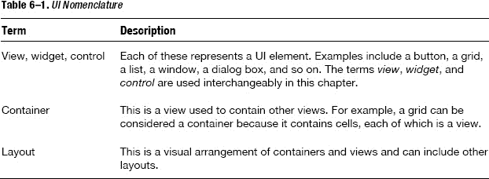

图 6–1 显示了我们即将构建的应用程序的截图。截图旁边是该应用程序中控件和容器的布局层次结构。

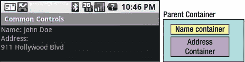

**图 6–1.** `Activity` 的 UI 和布局

在讨论示例程序时，我们将参考这个布局层次结构。现在，请知道该应用程序只有一个 `Activity`。该 `Activity` 的 UI 由三个容器组成：一个包含人名，一个包含地址，以及一个作为子容器外部父容器的容器。

#### 完全通过代码构建 UI

第一个示例代码清单 6–1 演示了如何完全通过代码构建 UI。要尝试此示例，请创建一个带名为 `MainActivity` 的 Activity 的新 Android 项目，然后将代码清单 6–1 中的代码复制到你的 `MainActivity` 类中。

**注意：** 我们将在本章末尾提供一个 URL，你可以通过它下载本章的项目文件。这样，你可以直接将这些项目导入 Eclipse，而无需复制粘贴代码。

`代码清单 6–1.` 完全通过代码创建简单的用户界面

```
package com.androidbook.controls;
import android.app.Activity;
import android.os.Bundle;
import android.view.ViewGroup.LayoutParams;
import android.widget.LinearLayout;
import android.widget.TextView;
public class MainActivity extends Activity
{
    private LinearLayout nameContainer;

    private LinearLayout addressContainer;

    private LinearLayout parentContainer;

    /** 当 Activity 首次创建时调用。 */
    @Override
    public void onCreate(Bundle savedInstanceState)
    {
        super.onCreate(savedInstanceState);

        createNameContainer();

        createAddressContainer();

        createParentContainer();

        setContentView(parentContainer);
    }

    private void createNameContainer()
    {
        nameContainer = new LinearLayout(this);

        nameContainer.setLayoutParams(new LayoutParams(LayoutParams.FILL_PARENT,
                LayoutParams.WRAP_CONTENT));
        nameContainer.setOrientation(LinearLayout.HORIZONTAL);

        TextView nameLbl = new TextView(this);
        nameLbl.setText("姓名：");

        TextView nameValue = new TextView(this);
        nameValue.setText("张三");

        nameContainer.addView(nameLbl);
        nameContainer.addView(nameValue);
    }

    private void createAddressContainer()
    {
        addressContainer = new LinearLayout(this);

        addressContainer.setLayoutParams(new LayoutParams(LayoutParams.FILL_PARENT,
                LayoutParams.WRAP_CONTENT));
        addressContainer.setOrientation(LinearLayout.VERTICAL);

        TextView addrLbl = new TextView(this);
        addrLbl.setText("地址：");

        TextView addrValue = new TextView(this);
        addrValue.setText("好莱坞大道 911 号");

        addressContainer.addView(addrLbl);
        addressContainer.addView(addrValue);
    }

    private void createParentContainer()
    {
        parentContainer = new LinearLayout(this);

        parentContainer.setLayoutParams(new LayoutParams(LayoutParams.FILL_PARENT,
                LayoutParams.FILL_PARENT));
        parentContainer.setOrientation(LinearLayout.VERTICAL);

        parentContainer.addView(nameContainer);
        parentContainer.addView(addressContainer);
    }
}
```

如代码清单 6–1 所示，该 Activity 包含三个 `LinearLayout` 对象。正如我们之前提到的，布局对象包含在屏幕部分区域定位子元素的逻辑。例如，`LinearLayout` 知道如何垂直或水平排列控件。布局对象可以包含任何类型的视图（`View`），甚至可以包含其他布局。

`nameContainer` 对象包含两个 `TextView` 控件：一个用于标签`姓名：`，另一个用于保存实际姓名（例如张三）。`addressContainer` 也包含两个 `TextView` 控件。这两个容器的区别在于：`nameContainer` 是水平布局，而 `addressContainer` 是垂直布局。这两个容器都位于 Activity 的根视图 `parentContainer` 内部。构建容器后，Activity 通过调用 `setContentView(parentContainer)` 将视图内容设置为根视图。当需要渲染 Activity 的 UI 时，根视图会被调用以渲染自身。然后根视图调用其子视图进行渲染，子控件再调用它们的子视图，依此类推，直到整个 UI 渲染完成。

如代码清单 6–1 所示，我们有多个 `LinearLayout` 控件。其中两个是垂直布局，一个是水平布局。`nameContainer` 是水平布局，这意味着两个 `TextView` 控件会水平并排显示。`addressContainer` 是垂直布局，这意味着两个 `TextView` 控件会上下堆叠。`parentContainer` 也是垂直布局，因此 `nameContainer` 出现在 `addressContainer` 上方。请注意 `addressContainer` 和 `parentContainer` 这两个垂直布局容器之间的细微差别。`parentContainer` 设置为占据屏幕的全部宽度和高度：

```
parentContainer.setLayoutParams(new LayoutParams(LayoutParams.FILL_PARENT,
        LayoutParams.FILL_PARENT));
```

而 `addressContainer` 则垂直方向自适应内容：

```
addressContainer.setLayoutParams(new LayoutParams(LayoutParams.FILL_PARENT,
        LayoutParams.WRAP_CONTENT));
```

换句话说，`WRAP_CONTENT` 表示视图在该维度上仅占用所需的空间，不超过父视图允许的范围。对于 `addressContainer` 而言，这意味着该容器会垂直占据两行高度，因为它只需要这么多。

#### 完全在 XML 中构建用户界面

现在让我们用 XML 构建相同的用户界面（参见代码清单 6–2）。回顾第 3 章的内容，XML 布局文件存储在资源（`/res/`）目录下的 `layout` 文件夹中。要尝试这个示例，请在 Eclipse 中创建一个新的 Android 项目。默认情况下，你会得到一个名为 `main.xml` 的 XML 布局文件，位于 `res/layout` 文件夹下。双击 `main.xml` 查看其内容。Eclipse 会为你的布局文件显示一个可视化编辑器。在视图顶部可能会显示类似 “Hello World, MainActivity!” 的字符串。点击视图底部的 `main.xml` 标签，即可查看 `main.xml` 文件的 XML 代码。其中会显示一个 `LinearLayout` 和一个 `TextView` 控件。使用布局标签或 `main.xml` 标签（或两者同时使用），在 `main.xml` 文件中重新创建代码清单 6–2 的内容。然后保存文件。

**代码清单 6–2.** *完全在 XML 中创建用户界面*

```
<?xml version="1.0" encoding="utf-8"?>
<LinearLayout
    android:orientation="vertical" android:layout_width="fill_parent"
    android:layout_height="fill_parent">
    <!-- 姓名容器 -->
    <LinearLayout
        android:orientation="horizontal" android:layout_width="fill_parent"
        android:layout_height="wrap_content">

            <TextView  android:layout_width="wrap_content"
        android:layout_height="wrap_content" android:text="姓名:" />

            <TextView android:layout_width="wrap_content"
        android:layout_height="wrap_content" android:text="张三" />

    </LinearLayout>

    <!-- 地址容器 -->
    <LinearLayout
        android:orientation="vertical" android:layout_width="fill_parent"
        android:layout_height="wrap_content">

            <TextView android:layout_width="fill_parent"
        android:layout_height="wrap_content" android:text="地址:" />

            <TextView android:layout_width="fill_parent"
        android:layout_height="wrap_content" android:text="好莱坞大道 911 号" />
    </LinearLayout>

</LinearLayout>
```

在你的新项目的 `src` 目录下，有一个默认的 `.java` 文件，其中包含一个 `Activity` 类定义。双击该文件查看其内容。请注意 `setContentView(R.layout.main)` 这条语句。代码清单 6–2 中展示的 XML 代码片段，结合对 `setContentView(R.layout.main)` 的调用，会渲染出与之前完全用代码生成的相同的用户界面。该 XML 文件一目了然，但请注意我们定义了三个容器视图。第一个 `LinearLayout` 相当于我们的父容器。该容器通过设置相应属性 `android:orientation="vertical"` 将方向设为垂直。父容器包含两个 `LinearLayout` 容器，分别代表 `nameContainer` 和 `addressContainer`。

运行此应用程序将产生与之前示例应用程序相同的用户界面。标签和值将如图 6–1 所示显示。

## 在 XML 中结合代码构建用户界面

代码清单 6–2 是一个刻意构造的示例。在 XML 布局中对 `TextView` 控件的值进行硬编码没有任何意义。理想情况下，我们应该在 XML 中设计用户界面，然后从代码中引用这些控件。这种方法使我们能够将动态数据绑定到设计时定义的控件上。事实上，这也是推荐的做法。在 XML 中构建布局，然后使用代码填充动态数据，是相当容易的。

代码清单 6–3 展示了相同的用户界面，但使用了略有不同的 XML 代码。该 XML 为 `TextView` 控件分配了 ID，以便我们可以在代码中引用它们。

**代码清单 6–3.** *在 XML 中使用 ID 创建用户界面*

```
<?xml version="1.0" encoding="utf-8"?>
<LinearLayout
    android:orientation="vertical" android:layout_width="fill_parent"
    android:layout_height="fill_parent">
    <!-- 姓名容器 -->
    <LinearLayout
        android:orientation="horizontal" android:layout_width="fill_parent"
        android:layout_height="wrap_content">

            <TextView android:layout_width="wrap_content"
        android:layout_height="wrap_content" android:text="@string/name_text" />

            <TextView android:id="@+id/nameValue"
        android:layout_width="wrap_content" android:layout_height="wrap_content" />

</LinearLayout>

    <!-- 地址容器 -->
    <LinearLayout
        android:orientation="vertical" android:layout_width="fill_parent"
        android:layout_height="wrap_content">

            <TextView android:layout_width="fill_parent"
        android:layout_height="wrap_content" android:text="@string/addr_text" />

            <TextView android:id="@+id/addrValue"
        android:layout_width="fill_parent" android:layout_height="wrap_content" />
    </LinearLayout>

</LinearLayout>
```

除了为想要通过代码填充内容的 `TextView` 控件添加 ID 之外，我们还有一些标签 `TextView` 控件，它们的内容来自字符串资源文件。这些是没有 ID 但带有 `android:text` 属性的 `TextView`。正如第 3 章中提到的，这些 `TextView` 的实际字符串将来自 `/res/values` 文件夹中的 `strings.xml` 文件。代码清单 6–4 展示了我们的 `strings.xml` 文件可能的样子。

**代码清单 6–4.** *用于代码清单 6–3 的`strings.xml` 文件*

```
<?xml version="1.0" encoding="utf-8"?>
<resources>
    <string name="app_name">公共控件</string>
    <string name="name_text">姓名:</string>
    <string name="addr_text">地址:</string>
</resources>
```

代码清单 6–5 中的代码演示了如何获取对 XML 中定义的控件的引用以设置其属性。你可以将此代码放入 Activity 的 `onCreate()` 方法中。

**代码清单 6–5.** *在运行时引用资源中的控件*

```
setContentView(R.layout.main);

TextView nameValue = (TextView)findViewById(R.id.nameValue);
nameValue.setText("张三");
TextView addrValue = (TextView)findViewById(R.id.addrValue);
addrValue.setText("好莱坞大道 911 号");
```

代码清单 6–5 中的代码非常直接，但请注意，我们在调用 `findViewById()` 之前先通过 `setContentView(R.layout.main)` 加载了资源——如果视图尚未加载，我们就无法获取对它们的引用。

Android 的开发者们做得非常出色，几乎控件的每一个方面都可以通过 XML 或代码进行设置。通常，最好在 XML 布局文件中设置控件的属性，而不是使用代码。然而，很多时候你仍需要使用代码，例如设置要显示给用户的值。

## FILL_PARENT 与 MATCH_PARENT

常量 `FILL_PARENT` 已在 Android 2.2 中被弃用，并替换为 `MATCH_PARENT`。但这纯粹是名称上的更改。该常量的值仍然是 -1。同样，在 XML 布局中，`fill_parent` 也被替换为 `match_parent`。那么你应该使用哪个值呢？实际上，你可以直接使用值 -1，而不用 `FILL_PARENT` 或 `MATCH_PARENT`，这也完全可行。不过，这样可读性不高，而且你无法在 XML 布局中使用无名称的等效值。有一个更好的方法。

根据你的应用需要使用哪些 Android API，你可以选择针对 Android 2.2 之前的版本构建应用，依赖前向兼容性；或者针对 Android 2.2 及更高版本构建应用，并将 `minSdkVersion` 设置为你应用支持的最低 Android 版本。例如，如果你只需要 Android 1.6 中已有的 API，那么就针对 Android 1.6 构建，并使用 `FILL_PARENT` 和 `fill_parent`。你的应用应该能在包括 2.2 及更高版本在内的所有后续 Android 版本中正常运行。如果你需要使用 Android 2.2 或更高版本的 API，那就针对该版本构建，使用 `MATCH_PARENT` 和 `match_parent`，并将 `minSdkVersion` 设置为一个更低的版本：例如 `4`（对应 Android 1.6）。你仍然可以将基于 Android 2.2 构建的应用部署到更早的 Android 版本上，但你必须谨慎处理那些在早期 Android SDK 中不存在的类和/或方法。有一些方法可以解决这个问题，比如使用反射或创建包装类来处理不同 Android 版本之间的差异。我们将在第 12 章中深入探讨这些高级主题。

## 理解 Android 的常用控件

现在我们将开始讨论 Android SDK 中的常用控件。我们首先介绍文本控件，然后介绍按钮、复选框、单选按钮、列表、网格、日期和时间控件，以及地图视图控件。我们还会谈到布局控件。

### 文本控件

文本控件很可能是你在 Android 中会接触到的第一类控件。Android 提供了一套完整但不复杂的文本控件。在本节中，我们将讨论 `TextView`、`EditText`、`AutoCompleteTextView` 和 `MultiCompleteTextView` 控件。图 6–2 展示了这些控件的实际效果。

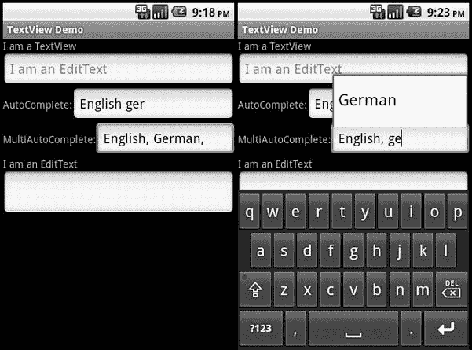

**图 6–2.** *Android 中的文本控件*

#### TextView

你已经在代码清单 6–3 中看到了一个简单的 `TextView` 控件的 XML 定义，以及在代码清单 6–4 中看到了如何在代码中处理 `TextView`。注意我们如何在 XML 中指定 ID、宽度、高度和文本值，以及如何使用 `setText()` 方法设置值。`TextView` 控件能够显示文本，但不允许编辑。这可能会让你认为该控件本质上只是一个静态标签。事实并非如此。`TextView` 控件有一些有趣的属性，使其非常实用。例如，如果你知道 `TextView` 的内容将包含网址或电子邮件地址，你可以将 `autoLink` 属性设置为 `email|web`，控件就会自动查找并高亮显示所有电子邮件地址和网址。而且，当用户点击这些高亮项之一时，系统会自动启动电子邮件应用并填入该地址，或者用该网址启动浏览器。在 XML 中，这个属性应放在 `TextView` 标签内，看起来像这样：

```
<TextView   ...     android:autoLink="email|web"    ...    />
```

你可以指定一组以竖线分隔的值，包括 `web`、`email`、`phone` 或 `map`，或者使用 `none`（默认值）或 `all`。如果你想在代码中设置 `autoLink` 行为而不是使用 XML，相应的方法调用是 `setAutoLinkMask()`。你需要传入一个 `int` 值，表示类似之前的值的组合，例如 `Linkify.EMAIL_ADDRESSES|Linkify.WEB_ADDRESSES`。为了实现此功能，`TextView` 使用了 `android.text.util.Linkify` 类。代码清单 6–6 展示了在代码中实现自动链接的示例。

**代码清单 6–6.** *在 TextView 中对文本使用 Linkify*

```
TextView tv =(TextView)this.findViewById(R.id.tv);
tv.setAutoLinkMask(Linkify.ALL);
tv.setText("请访问我的网站 http://www.androidbook.com
或发邮件至 davemac327@gmail.com。");
```

请注意，我们在设置文本之前先设置了 `TextView` 的自动链接选项。这一点很重要，因为如果在设置文本之后再设置自动链接选项，它不会影响已有的文本。由于我们使用代码为文本添加超链接，代码清单 6–6 中 `TextView` 的 XML 不需要任何特殊属性，可以像下面这样简单：

```
<TextView android:id="@+id/tv" android:layout_width="wrap_content"
  android:layout_height="wrap_content"/>
```

如果你愿意，你也可以调用 `Linkify` 类的静态方法 `addLinks()`，按需查找并添加链接到任何 `TextView` 或任何 `Spannable` 的内容中。除了使用 `setAutoLinkMask()`，我们还可以在*设置文本之后*执行以下操作：

```
Linkify.addLinks(tv, Linkify.ALL);
```

点击链接会触发该操作对应的默认 Intent。例如，点击网址会启动浏览器并打开该网址。点击电话号码会启动拨号程序，以此类推。`Linkify` 类可以直接执行这些工作。

`Linkify` 还能检测您想要查找的自定义模式，判断它们是否匹配你需要设为可点击的内容，并设置如何触发 Intent，从而使点击转化为某种操作。我们在此不深入讨论这些细节，但你需要知道这些功能是可以实现的。

`TextView` 还有许多其他特性值得探索，从字体属性到 `minLines` 和 `maxLines` 等等。这些特性都比较直观，建议你自行尝试，看看如何利用它们。不过需要记住的是，`TextView` 类中的某些功能并不适用于只读字段，这些功能是为 `TextView` 的子类准备的，我们接下来将介绍其中一个子类。

#### EditText

`EditText` 控件是 `TextView` 的子类。顾名思义，`EditText` 控件允许文本编辑。`EditText` 虽然不如互联网上常见的文本编辑控件强大，但 Android 设备的用户通常不会编写文档——他们最多只会输入几段文字。因此，该类具有有限但合适的功能，甚至可能会让你感到惊讶。例如，`EditText` 最重要的属性之一是 `inputType`。你可以将 `inputType` 属性设置为 `textAutoCorrect`，让控件纠正常见的拼写错误。你可以将其设置为 `textCapWords`，让控件将单词首字母大写。其他选项则只接受电话号码或密码。

有一些较旧且现已弃用的方式来指定首字母大写、多行文本和其他功能。如果这些是在没有 `inputType` 属性的情况下指定的，它们仍然可以被读取；但如果指定了 `inputType`，这些较旧的属性将被忽略。

`EditText`控件以前的默认行为是在一行上显示文本，并根据需要扩展。换句话说，如果用户输入超过第一行，则会显示另一行，依此类推。但是，你可以通过将`singleLine`属性设置为`true`来强制用户单行输入。在这种情况下，用户必须继续在同一行上输入。对于`inputType`，如果你不指定`textMultiLine`，`EditText`将默认为仅单行。因此，如果你想要旧的多行输入默认行为，则需要将`inputType`指定为`textMultiLine`。

`EditText`的一个优秀功能是你可以指定提示文本。该文本会以略微淡化的方式显示，并在用户开始输入文本时立即消失。提示的目的是让用户知道该字段中期望输入的内容，而无需用户选择并擦除默认文本。在 XML 中，此属性是`android:hint="your hint text here"`或`android:hint="@string/your_hint_name"`，其中`your_hint_name`是要在`/res/values/strings.xml`中找到的字符串资源名称。在代码中，你可以调用`setHint()`方法，并传入`CharSequence`或资源 ID。

## `AutoCompleteTextView`

`AutoCompleteTextView`控件是一个具有自动完成功能的`TextView`。换句话说，当用户在`TextView`中输入时，控件可以显示建议供选择。清单 6–7 演示了使用 XML 和相应代码的`AutoCompleteTextView`控件。

**清单 6–7.** *使用 AutoCompleteTextView 控件*

```xml
<AutoCompleteTextView android:id="@+id/actv"
    android:layout_width="fill_parent"  android:layout_height="wrap_content" />
```

```java
AutoCompleteTextView actv = (AutoCompleteTextView) this.findViewById(R.id.actv);

ArrayAdapter<String> aa = new ArrayAdapter<String>(this,
                android.R.layout.simple_dropdown_item_1line,
                new String[] {"English", "Hebrew", "Hindi", "Spanish",
                "German", "Greek" });

actv.setAdapter(aa);
```

清单 6–7 中显示的`AutoCompleteTextView`控件会向用户推荐一种语言。例如，如果用户输入`en`，控件会建议 English。如果用户输入`gr`，控件会推荐 Greek，以此类推。

如果你使用过建议控件或类似的自动完成控件，你就会知道这类控件由两部分组成：一个文本视图控件和一个用于显示建议的控件。这就是基本概念。要使用此类控件，你需要创建控件、创建建议列表、将建议列表告知控件，并且可能还需要告知控件如何显示建议。或者，你也可以为建议创建第二个控件，然后将两个控件关联起来。

Android 简化了这一过程，从清单 6–7 中可以明显看出。要使用`AutoCompleteTextView`，你可以在布局文件中定义该控件，并在 Activity 中引用它。然后，你创建一个包含建议的适配器类，并定义将显示建议的控件 ID（在本例中，是一个简单的列表项）。在清单 6–7 中，`ArrayAdapter`的第二个参数告诉适配器使用一个简单的列表项来显示建议。最后一步是使用`setAdapter()`方法将适配器与`AutoCompleteTextView`关联起来。暂时不用担心适配器；我们将在本章后面部分介绍它们。

## `MultiAutoCompleteTextView`

如果你使用过`AutoCompleteTextView`控件，就会知道该控件仅对文本视图中的**全部**文本提供建议。换句话说，如果你输入一个句子，你不会得到每个单词的建议。这就是`MultiAutoCompleteTextView`的用武之地。你可以使用`MultiAutoCompleteTextView`在用户输入时提供建议。例如，图 6–2 显示用户键入了单词`English`，后跟一个逗号，然后键入了`Ge`，这时控件建议了 German。如果用户继续输入，控件将提供更多建议。

使用`MultiAutoCompleteTextView`与使用`AutoCompleteTextView`类似。不同之处在于，你必须告诉控件从哪里开始重新提供建议。例如，在图 6–2 中，你可以看到控件可以在句子开头以及识别到逗号之后提供建议。`MultiAutoCompleteTextView`控件要求你提供一个标记器（tokenizer），它可以解析句子并告知控件是否需要重新开始建议。清单 6–8 演示了使用 XML 和 Java 代码的`MultiAutoCompleteTextView`控件。

**清单 6–8.** *使用 MultiAutoCompleteTextView 控件*

```xml
<MultiAutoCompleteTextView android:id="@+id/mactv"
    android:layout_width="fill_parent"  android:layout_height="wrap_content" />
```

```java
MultiAutoCompleteTextView mactv = (MultiAutoCompleteTextView) this
                .findViewById(R.id.mactv);
ArrayAdapter<String> aa2 = new ArrayAdapter<String>(this,
                android.R.layout.simple_dropdown_item_1line,
new String[] {"English", "Hebrew", "Hindi", "Spanish", "German", "Greek" });

mactv.setAdapter(aa2);

mactv.setTokenizer(new MultiAutoCompleteTextView.CommaTokenizer());
```

清单 6–7 和 6–8 之间唯一显著的区别在于使用了`MultiAutoCompleteTextView`以及调用了`setTokenizer()`方法。由于本例中使用了`CommaTokenizer`，当在`EditText`字段中输入逗号后，该字段将再次使用字符串数组提供建议。输入的其他任何字符都不会触发该字段提供建议。所以，即使你输入了`French Spani`，部分单词`Spani`也不会触发建议，因为它没有跟在逗号后面。Android 还提供了另一个用于电子邮件地址的标记器，叫做`Rfc822Tokenizer`。如果你愿意，也可以随时创建自己的标记器。

### Button 控件

按钮在任何小部件工具包中都很常见，Android 也不例外。Android 提供了典型的按钮集以及一些额外的功能。在本节中，我们将讨论三种类型的按钮控件：基本按钮、图像按钮和开关按钮。图 6–3 展示了包含这些控件的用户界面。最上面的按钮是基本按钮，中间的按钮是图像按钮，最后一个是开关按钮。

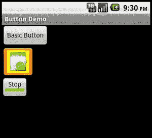

**图 6–3.** *Android 按钮控件*

让我们从基本按钮开始。

#### 按钮控件

Android 中的基本按钮类是 `android.widget.Button`。这种按钮除了用于处理点击事件之外，并没有太多特别之处。代码清单 6–9 展示了 `Button` 控件的 XML 布局片段，以及我们可能要在 Activity 的 `onCreate()` 方法中设置的一些 Java 代码。我们的基本按钮将类似于图 6–3 中顶部的按钮。

**代码清单 6–9.** *处理按钮上的点击事件*

```
<Button android:id="@+id/button1"
    android:text="@string/basicBtnLabel"
    android:layout_width="fill_parent"
    android:layout_height="wrap_content" />
```

### 按钮点击事件

```java
Button button1 = (Button)this.findViewById(R.id.button1);
button1.setOnClickListener(new OnClickListener()
{
     public void onClick(View v)
     {
        Intent intent = new Intent(Intent.ACTION_VIEW,
                                Uri.parse("http://www.androidbook.com"));
        startActivity(intent);
     }
});
```

代码清单 6–9 展示了如何注册按钮点击事件。通过使用 `OnClickListener` 调用 `setOnClickListener()` 方法来注册点击事件。在代码清单 6–9 中，动态创建了一个匿名监听器来处理 `button1` 的点击事件。当按钮被点击时，会调用监听器的 `onClick()` 方法，在本例中，它会启动浏览器访问我们的网站。

自 Android SDK 1.6 起，有一种更简单的方法来为按钮设置点击处理器。代码清单 6–10 显示了一个 `Button` 的 XML，其中为处理器指定了一个属性，以及作为点击处理器的 Java 代码。

**代码清单 6–10.** *设置按钮的点击处理器*

```xml
<Button   ...    android:onClick="myClickHandler"    ...  />
```

```java
    public void myClickHandler(View target) {
        switch(target.getId()) {
        case R.id.button1:
        ...
```

处理器方法被调用时，`target` 参数会被设置为代表被点击按钮的 `View` 对象。注意点击处理器方法中的 `switch` 语句是如何使用按钮的资源 ID 来选择要执行的逻辑的。使用这种方法意味着你无需在代码中显式创建每个 `Button` 对象，并且可以在多个按钮之间复用同一个方法。这使代码更易于理解和维护。这种方法也适用于其他按钮类型。

### ImageButton 控件

Android 通过 `android.widget.ImageButton` 提供了图片按钮。使用图片按钮与使用基本按钮类似（参见代码清单 6–11）。我们的图片按钮将类似于图 6–3 中中间的按钮。

**代码清单 6–11.** *使用 `ImageButton`*

```xml
<ImageButton android:id="@+id/imageButton2"
    android:layout_width="wrap_content" android:layout_height="wrap_content"
    android:onClick="myClickHandler"
    android:src="@drawable/icon"  />
```

```java
ImageButton imageButton2 = (ImageButton)this.findViewById(R.id.imageButton2);
imageButton2.setImageResource(R.drawable.icon);
```

这里我们在 XML 中创建了图片按钮，并从可绘制资源中设置了按钮的图片。按钮的图片文件必须存在于 `/res/drawable` 目录下。在我们的例子中，只是简单地复用了 Android 图标作为按钮图片。我们还在代码清单 6–11 中展示了如何通过调用按钮的 `setImageResource()` 方法并传入资源 ID，来动态设置按钮的图片。请注意，你只需执行其中一种方式，无需同时在 XML 文件和代码中指定按钮图片。

图片按钮的一个不错特性是，你可以为按钮指定透明背景。这样就会得到一个可点击的图片，它像按钮一样工作，但外观可以随心所欲。只需为图片按钮设置 `android:background="@null"` 即可。

由于你的图片可能与标准按钮截然不同，你可以自定义按钮在 UI 中使用的另外两种状态下的外观。除了正常显示外，按钮可以拥有焦点（focus），也可以被按下（pressed）。拥有**焦点**仅仅意味着按钮当前是事件的目标。例如，你可以使用键盘或方向键上的箭头键将焦点引导到按钮上。**按下**则意味着按钮在被按下后、用户松开之前，其外观会发生变化。为了告诉 Android 按钮的三个状态分别对应哪张图片，我们设置了一个选择器。这是一个简单的 XML 文件，位于项目的 `/res/drawable` 文件夹中。这有点违反直觉，因为它是一个 XML 文件而不是图片文件，但选择器文件必须放在那里。选择器文件的内容将类似于代码清单 6–12。

**代码清单 6–12.** *在 `ImageButton` 中使用选择器*

```xml
<?xml version="1.0" encoding="utf-8"?>
    <selector >
     <item android:state_pressed="true"
           android:drawable="@drawable/button_pressed" /> <!-- 按下 -->
     <item android:state_focused="true"
           android:drawable="@drawable/button_focused" /> <!-- 聚焦 -->
     <item android:drawable="@drawable/icon" /> <!-- 默认 -->
    </selector>
```

关于选择器文件，有几点需要注意。首先，不要像在 values XML 文件中那样指定 `<resources>` 标签。其次，按钮图片的顺序很重要。Android 会按顺序测试选择器中的每个项目，看是否匹配。因此，你希望正常图片放在最后，这样只有按钮既未被按下也未获得焦点时才会使用它。如果正常图片被列在第一位，那么即使按钮被按下或获得焦点，它也会始终匹配并被选中。当然，你引用的可绘制资源必须存在于 `/res/drawables` 文件夹中。在布局 XML 文件中定义按钮时，你需要将 `android:src` 属性设置为选择器 XML 文件，就像它是一个普通可绘制资源一样，如下所示：

```xml
<Button   ...    android:src="@drawable/imagebuttonselector"    ...   />
```

### ToggleButton 控件

`ToggleButton` 控件，类似于复选框或单选按钮，是一个双状态按钮。此按钮可以处于“开”或“关”状态。如图 6–3 所示，`ToggleButton` 的默认行为是在“开”状态下显示绿色条，在“关”状态下显示灰色条。此外，默认行为还会将按钮的文本设置为“开”（On）或“关”（Off）。如果“开/关”不适用于你的应用程序，你可以修改 `ToggleButton` 的文本。例如，如果你有一个希望通过 `ToggleButton` 启动和停止的后台进程，你可以使用 `android:textOn` 和 `android:textOff` 属性将按钮文本设置为“停止”和“运行”。

代码清单 6–13 展示了一个示例。我们的切换按钮是图 6–3 中底部的按钮，它处于“开”位置，因此按钮上的标签显示为“停止”。

**代码清单 6–13.** *Android 的 `ToggleButton`*

```xml
<ToggleButton android:id="@+id/cctglBtn"
        android:layout_width="wrap_content"
        android:layout_height="wrap_content"  
        android:text="Toggle Button"
        android:textOn="Stop"  
        android:textOff="Run"/>
```

由于 `ToggleButton` 将开和关文本作为单独的属性，因此 `ToggleButton` 的 `android:text` 属性实际上并未被使用。该属性存在是因为它是继承自 `TextView` 的，但在这种情况下，你无需使用它。

### CheckBox 控件

`CheckBox` 控件是另一种双状态按钮，允许用户切换其状态。不同之处在于，在许多情况下，用户并不将其视为可立即触发操作的按钮。然而，从 Android 的角度来看，它仍然是一个按钮，你可以对复选框执行任何可以对按钮执行的操作。

在 Android 中，你可以通过创建 `android.widget.CheckBox` 的实例来创建复选框。请参见清单 6–14 和图 6–4。

**清单 6–14.** *创建复选框*

# Android UI 控件：复选框与单选按钮

## 复选框 (CheckBox)

```xml
<LinearLayout
        android:orientation="vertical" android:layout_width="fill_parent"
        android:layout_height="fill_parent">

<CheckBox android:id="@+id/chickenCB"  android:text="Chicken" android:checked="true"
    android:layout_width="wrap_content" android:layout_height="wrap_content" />

<CheckBox android:id="@+id/fishCB"  android:text="Fish"
    android:layout_width="wrap_content" android:layout_height="wrap_content" />

<CheckBox android:id="@+id/steakCB"  android:text="Steak" android:checked="true"
    android:layout_width="wrap_content" android:layout_height="wrap_content" />

</LinearLayout>
```

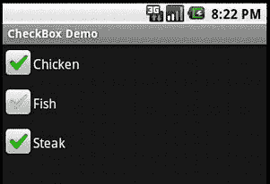

**图 6–4.** 使用 `CheckBox` 控件

你可以通过调用 `setChecked()` 或 `toggle()` 来管理复选框的状态。你可以通过调用 `isChecked()` 来获取其状态。

如果你需要在复选框被选中或取消选中时实现特定逻辑，你可以通过调用 `setOnCheckedChangeListener()` 并传入 `OnCheckedChangeListener` 接口的实现来注册 `on-checked` 事件。然后，你需要实现 `onCheckedChanged()` 方法，该方法将在复选框被选中或取消选中时被调用。清单 6–15 展示了一些处理 `CheckBox` 的代码。

**清单 6–15.** 在代码中使用复选框

```java
public class CheckBoxActivity extends Activity {
        /** Called when the activity is first created. */
        @Override
        public void onCreate(Bundle savedInstanceState) {
            super.onCreate(savedInstanceState);
            setContentView(R.layout.checkbox);

            CheckBox fishCB = (CheckBox)findViewById(R.id.fishCB);

            if(fishCB.isChecked())
                fishCB.toggle();     // flips the checkbox to unchecked if it was checked

            fishCB.setOnCheckedChangeListener(
                        new CompoundButton.OnCheckedChangeListener() {

                @Override
                public void onCheckedChanged(CompoundButton arg0, boolean isChecked) {
                    Log.v("CheckBoxActivity", "The fish checkbox is now "
                            + (isChecked?"checked":"not checked"));
                }});
        }
}
```

设置 `OnCheckedChangeListener` 的好处在于，你会直接接收到 `CheckBox` 按钮的新状态。你也可以像使用基本按钮那样使用 `OnClickListener` 技术。当调用 `onClick()` 方法时，你需要通过适当的类型转换来获取按钮的新状态，然后在其上调用 `isChecked()`。清单 6–16 展示了如果我们为 `CheckBox` 按钮的 XML 定义添加了 `android:onClick="myClickHandler"`，代码可能的样子。

**清单 6–16.** 在代码中使用复选框（结合 `android:onClick`）

```java
public void myClickHandler(View view) {
    switch(view.getId()) {
    case R.id.steakCB:
        Log.v("CheckBoxActivity", "The steak checkbox is now " +
                (((CheckBox)view).isChecked()?"checked":"not checked"));
    }
}
```

## `RadioButton` 控件

`RadioButton` 控件是任何 UI 工具包中不可或缺的一部分。单选按钮为用户提供多个选项，并强制他们选择单个项目。为了强制实现这种单选模型，单选按钮通常属于一个组，并且每个组在任意时刻只能有一个项目被选中。

要在 Android 中创建一组单选按钮，首先创建一个 `RadioGroup`，然后向该组中添加单选按钮。清单 6–17 和图 6–5 展示了一个示例。

**清单 6–17.** 使用 Android `RadioButton` 组件

```xml
<LinearLayout
        android:orientation="vertical" android:layout_width="fill_parent"
        android:layout_height="fill_parent">

<RadioGroup     android:id="@+id/rBtnGrp" android:layout_width="wrap_content"
            android:layout_height="wrap_content"  android:orientation="vertical" >

    <RadioButton     android:id="@+id/chRBtn" android:text="Chicken"
            android:layout_width="wrap_content"  android:layout_height="wrap_content"/>

    <RadioButton  android:id="@+id/fishRBtn" android:text="Fish" android:checked="true"
            android:layout_width="wrap_content"  android:layout_height="wrap_content"/>

    <RadioButton android:id="@+id/stkRBtn" android:text="Steak"
            android:layout_width="wrap_content"  android:layout_height="wrap_content"/>

</RadioGroup>

</LinearLayout>
```

在 Android 中，你可以使用 `android.widget.RadioGroup` 实现单选按钮组，使用 `android.widget.RadioButton` 实现单选按钮。

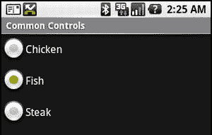

**图 6–5.** 使用单选按钮

请注意，单选按钮组中的单选按钮默认情况下初始状态是未选中的，尽管你可以在 XML 定义中将其中一个设置为选中状态，就像我们在清单 6–17 中对“Fish”所做的那样。要以编程方式将其中一个单选按钮设置为选中状态，你可以获取对该单选按钮的引用并调用 `setChecked()`：

```java
RadioButton steakBtn = (RadioButton)this.findViewById(R.id.stkRBtn);
steakBtn.setChecked(true);
```

你也可以使用 `toggle()` 方法来切换单选按钮的状态。与 `CheckBox` 控件类似，如果你调用 `setOnCheckedChangeListener()` 并传入 `OnCheckedChangeListener` 接口的实现，你会收到 `on-checked` 或 `on-unchecked` 事件的通知。不过，这里有一个细微的区别。这是一个与之前不同的类。这次，从技术上讲，它是 `RadioGroup.OnCheckedChangeListener` 类，而之前是 `CompoundButton.OnCheckedChangeListener` 类。

`RadioGroup` 也可以包含除单选按钮之外的其他视图。例如，清单 6–18 在最后一个单选按钮之后添加了一个 `TextView`。另外请注意，第一个单选按钮 (`anotherRadBtn`) 位于此单选按钮组之外。

**清单 6–18.** *包含不止`RadioButton`的`RadioGroup`*

```
<LinearLayout
        android:orientation="vertical"  android:layout_width="fill_parent"
        android:layout_height="fill_parent">

<RadioButton android:id="@+id/anotherRadBtn"  android:text="Outside"
            android:layout_width="wrap_content"  android:layout_height="wrap_content"/>

<RadioGroup android:id="@+id/radGrp"
android:layout_width="wrap_content"  android:layout_height="wrap_content">

     <RadioButton android:id="@+id/chRBtn"  android:text="Chicken"
            android:layout_width="wrap_content"  android:layout_height="wrap_content"/>

     <RadioButton android:id="@+id/fishRBtn"  android:text="Fish"    
            android:layout_width="wrap_content"  android:layout_height="wrap_content"/>

     <RadioButton android:id="@+id/stkRBtn"  android:text="Steak"
            android:layout_width="wrap_content"  android:layout_height="wrap_content"/>

     <TextView android:text="My Favorite"
            android:layout_width="wrap_content"  android:layout_height="wrap_content"/>
```

### RadioGroup 操作

`</RadioGroup>`

`</LinearLayout>`

Listing 6–18 展示了在单选按钮组中可以包含非`RadioButton`控件。同时需要注意的是，单选按钮组只能对其容器内的单选按钮强制单选。也就是说，ID 为`anotherRadBtn`的单选按钮将不会受到 Listing 6–18 中所示单选按钮组的影响，因为它不是该组的子元素。

你可以通过编程方式操作`RadioGroup`。例如，可以获取对单选按钮组的引用并添加一个单选按钮（或其他类型的控件）。Listing 6–19 演示了这一概念。

**Listing 6–19.** *在代码中向`RadioGroup`添加`RadioButton`*

```
RadioGroup radGrp = (RadioGroup)findViewById(R.id.radGrp);
RadioButton newRadioBtn = new RadioButton(this);
newRadioBtn.setText("Pork");
radGrp.addView(newRadioBtn);
```

一旦用户选中了单选按钮组中的某个单选按钮，就无法通过再次单击来取消选中。清除单选按钮组中所有单选按钮的唯一方法是调用`RadioGroup`上的`clearCheck()`方法。

当然，你可能希望利用`RadioGroup`实现一些有趣的功能。你可能不想轮询每个`RadioButton`来判断它是否被选中。幸运的是，`RadioGroup`提供了多种方法来帮助你。我们通过 Listing 6–20 来演示这些方法。此代码对应的 XML 见 Listing 6–18。

**Listing 6–20.** *以编程方式使用 RadioGroup*

```
public class RadioGroupActivity extends Activity {
        protected static final String TAG = "RadioGroupActivity";

        /** Called when the activity is first created. */
        @Override
        public void onCreate(Bundle savedInstanceState) {
            super.onCreate(savedInstanceState);
            setContentView(R.layout.radiogroup);

            RadioGroup radGrp = (RadioGroup)findViewById(R.id.radGrp);

            int checkedRadioButtonId = radGrp.getCheckedRadioButtonId();

            radGrp.setOnCheckedChangeListener(new RadioGroup.OnCheckedChangeListener() {
                @Override
                public void onCheckedChanged(RadioGroup arg0, int id) {
                    switch(id) {
                    case -1:
                        Log.v(TAG, "Choices cleared!");
                        break;
                    case R.id.chRBtn:
                        Log.v(TAG, "Chose Chicken");
                        break;
                    case R.id.fishRBtn:
                        Log.v(TAG, "Chose Fish");
                        break;
                    case R.id.stkRBtn:
                        Log.v(TAG, "Chose Steak");
                        break;
                    default:
                        Log.v(TAG, "Huh?");
                        break;
                    }
                }});
        }
}
```

我们可以随时使用`getCheckedRadioButtonId()`获取当前选中的`RadioButton`，该方法返回选中项的资源 ID，如果没有任何项被选中（可能没有默认选项且用户尚未做出选择），则返回–1。我们在前面的`onCreate()`方法中展示了这一点，但实际上，你应当在合适的时机使用它来读取用户当前的选择。我们还可以设置一个监听器，在用户选择某个`RadioButton`时立即得到通知。注意，`onCheckedChanged()`方法接收一个`RadioGroup`参数，这允许你为多个`RadioGroup`使用同一个`OnCheckedChangeListener`。你可能已经注意到了 switch 选项中的–1 情况。这种情况也会在通过代码调用`clearCheck()`清除`RadioGroup`时发生。

### ImageView 控件

我们尚未介绍的基本控件之一是`ImageView`控件。它用于显示图像，图像可以来自文件、内容提供者或资源（如 drawable）。你甚至可以只指定一种颜色，`ImageView`将显示该颜色。`Listing 6–21`展示了一些`ImageView`在 XML 中的示例，以及如何创建`ImageView`的相关代码。

`Listing 6–21.` `XML 和代码中的ImageView`

```
<ImageView android:id="@+id/image1"
  android:layout_width="wrap_content"  android:layout_height="wrap_content"
  android:src="@drawable/icon" />

<ImageView android:id="@+id/image2"
  android:layout_width="125dip"  android:layout_height="25dip"
  android:src="#555555" />

<ImageView android:id="@+id/image3"
  android:layout_width="wrap_content"  android:layout_height="wrap_content" />

<ImageView android:id="@+id/image4"
  android:layout_width="wrap_content"  android:layout_height="wrap_content"
  android:src="@drawable/manatee02"
  android:scaleType="centerInside"
  android:maxWidth="35dip"  android:maxHeight="50dip"
  />

  ImageView imgView = (ImageView)findViewById(R.id.image3);

  imgView.setImageResource( R.drawable.icon );

  imgView.setImageBitmap(BitmapFactory.decodeResource(
              this.getResources(), R.drawable.manatee14) );

  imgView.setImageDrawable(
              Drawable.createFromPath("/mnt/sdcard/dave2.jpg") );

  imgView.setImageURI(Uri.parse("file://mnt/sdcard/dave2.jpg"));
```

在这个示例中，我们在 XML 中定义了四个图像。第一个只是我们应用程序的图标。第二个是一个灰色条，宽度大于高度。第三个定义没有在 XML 中指定图像源，但我们为其关联了一个 ID（`image3`），以便在代码中使用该 ID 来设置图像。第四个图像是我们的另一个 drawable 图像文件，我们不仅指定了图像文件的来源，还设置了图像在屏幕上的最大尺寸，并定义了当图像超过最大尺寸时的处理方式。在这种情况下，我们告诉`ImageView`对图像进行居中缩放，使其适应我们指定的大小。

在`Listing 6–21`的 Java 代码中，我们展示了设置`image3`图像的几种方法。首先，我们当然需要通过资源 ID 找到`ImageView`的引用。第一个设置方法`setImageResource()`直接使用图像的资源 ID 来定位图像文件，为我们的`ImageView`提供图像。第二个设置方法使用`BitmapFactory`将图像资源读入`Bitmap`对象，然后将`ImageView`设置为该`Bitmap`。请注意，在将`Bitmap`应用到`ImageView`之前，我们可以对其做一些修改，但在本例中，我们直接使用了原图。此外，`BitmapFactory`有几种创建`Bitmap`的方法，包括从字节数组和`InputStream`创建。你可以使用`InputStream`方法从 Web 服务器读取图像，创建`Bitmap`图像，然后设置`ImageView`。

第三种设置方法使用`Drawable`作为图像源。在此例中，我们展示了图像来源是 SD 卡。你需要将某种图像文件以正确的名称放在 SD 卡上，才能使此方法生效。与`BitmapFactory`类似，`Drawable`类有几种不同的构造`Drawable`的方法，包括从 XML 流构造。

最后一个设置方法接受图像文件的 URI，并将其用作图像源。对于这最后一个调用，不要认为你可以使用任何图像 URI 作为源。此方法实际上仅用于设备上的本地图像，而不是可能通过 HTTP 找到的图像。要将基于互联网的图像用作`ImageView`的源，你很可能需要使用`BitmapFactory`和`InputStream`。

### 日期与时间控件

日期和时间控件在许多窗口工具集中都很常见。Android 提供了多种基于日期和时间的控件，本部分将讨论其中几种。具体来说，我们将介绍 `DatePicker`、`TimePicker`、`DigitalClock` 和 `AnalogClock` 控件。

#### `DatePicker` 和 `TimePicker` 控件

顾名思义，你可以使用 `DatePicker` 控件选择日期，使用 `TimePicker` 控件选取时间。`代码清单 6-22`和`图 6-6`展示了这些控件的示例。

`代码清单 6-22.` `XML 中的 DatePicker 和 TimePicker 控件`

```
<LinearLayout
        android:orientation="vertical"
        android:layout_width="fill_parent"
        android:layout_height="fill_parent">

  <TextView android:id="@+id/dateDefault"
    android:layout_width="fill_parent" android:layout_height="wrap_content" />

  <DatePicker android:id="@+id/datePicker"
    android:layout_width="wrap_content" android:layout_height="wrap_content" />

  <TextView android:id="@+id/timeDefault"
    android:layout_width="fill_parent" android:layout_height="wrap_content" />

  <TimePicker android:id="@+id/timePicker"
    android:layout_width="wrap_content" android:layout_height="wrap_content" />

</LinearLayout>
```

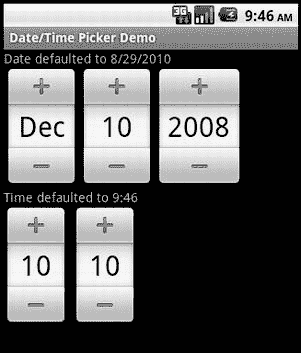

`图 6-6.` `DatePicker 和 TimePicker 的用户界面`

如果你查看 XML 布局，会发现定义这些控件很简单。与 Android 工具集中的任何其他控件一样，你可以通过编程方式访问这些控件以进行初始化或从中检索数据。例如，你可以像`代码清单 6-23`所示那样初始化这些控件。

`代码清单 6-23.` `分别使用日期和时间初始化 DatePicker 和 TimePicker`

### 代码清单 6-23

```java
    public void onCreate(Bundle savedInstanceState) {
        super.onCreate(savedInstanceState);
        setContentView(R.layout.datetimepicker);

        TextView dateDefault = (TextView)findViewById(R.id.dateDefault);
        TextView timeDefault = (TextView)findViewById(R.id.timePicker);

        DatePicker dp = (DatePicker)this.findViewById(R.id.datePicker);
        // 月份（而且只有月份）是从零开始的。显示时需要加 1。
        dateDefault.setText("日期默认为 " + (dp.getMonth() + 1) + "/" +
                dp.getDayOfMonth() + "/" + dp.getYear());
        // 这里，从 12 月 (12) 中减去 1 以将其设置为 12 月
        dp.init(2008, 11, 10, null);

        TimePicker tp = (TimePicker)this.findViewById(R.id.timePicker);

        java.util.Formatter timeF = new java.util.Formatter();
        timeF.format("时间默认为 %d:%02d", tp.getCurrentHour(),
                        tp.getCurrentMinute());
        timeDefault.setText(timeF.toString());

        tp.setIs24HourView(true);
        tp.setCurrentHour(new Integer(10));
        tp.setCurrentMinute(new Integer(10));
    }
}
```

代码清单 6-23 将 `DatePicker` 的日期设置为 2008 年 12 月 10 日。请注意，对于月份，内部值是从零开始的，这意味着一月是 0，十二月是 11。对于 `TimePicker`，小时和分钟数被设置为 10。另请注意，此控件支持 24 小时制视图。如果你未设置这些控件的值，默认值将是设备当前的日期和时间。

最后，请注意 Android 提供了这些控件的模态窗口版本，例如 `DatePickerDialog` 和 `TimePickerDialog`。如果你想向用户显示控件并强制用户做出选择，这些控件非常有用。我们将在第 8 章中更详细地介绍对话框。

### `DigitalClock` 和 `AnalogClock` 控件

Android 还提供了 `DigitalClock` 和 `AnalogClock` 控件（参见图 6-7）。

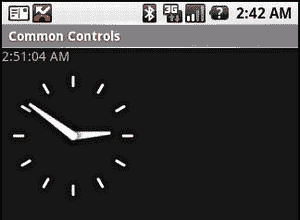

**图 6-7.** *使用 `AnalogClock` 和 `DigitalClock`*

如图所示，数字时钟除了小时和分钟外，还支持秒显示。Android 中的模拟时钟是一个双指针时钟，一个指针指示小时，另一个指针指示分钟。要将它们添加到布局中，请使用如代码清单 6-24 所示的 XML。

**代码清单 6-24.** *在 XML 中添加 `DigitalClock` 或 `AnalogClock`*

```xml
<DigitalClock
  android:layout_width="wrap_content" android:layout_height="wrap_content" />

<AnalogClock
  android:layout_width="wrap_content" android:layout_height="wrap_content" />
```

这两个控件实际上仅用于显示当前时间，它们不允许你修改日期或时间。换句话说，它们是功能仅限于显示当前时间的控件。因此，如果你想更改日期或时间，则需要使用 `DatePicker`/`TimePicker` 或 `DatePickerDialog`/`TimePickerDialog`。不过，这两个时钟的优点是它们会自动更新，无需你做任何操作。也就是说，`DigitalClock` 中的秒数会自然流逝，`AnalogClock` 的指针会自行转动，而我们无需额外处理。

### `MapView` 控件

`com.google.android.maps.MapView` 控件可以显示地图。你可以通过 XML 布局或代码来实例化此控件，但使用它的 Activity 必须扩展 `MapActivity`。`MapActivity` 负责处理加载地图的多线程请求、执行缓存等操作。

代码清单 6-25 展示了 `MapView` 的实例化示例。

**代码清单 6-25.** *通过 XML 布局创建 `MapView` 控件*

```xml
<LinearLayout
        android:orientation="vertical" android:layout_width="fill_parent"
        android:layout_height="fill_parent">

    <com.google.android.maps.MapView
        android:layout_width="fill_parent"
        android:layout_height="fill_parent"
        android:enabled="true"
        android:clickable="true"
        android:apiKey="myAPIKey"
        />

</LinearLayout>
```

我们将在第 17 章讨论基于位置的服务时，详细讨论 `MapView` 控件。届时你也会学习如何获取自己的地图 API 密钥。

### 理解适配器

在详细讨论 Android 的列表控件之前，我们需要谈谈适配器。列表控件用于显示数据集合。但 Android 并未使用单一类型的控件来同时管理显示和数据，而是将这两项职责分离到列表控件和适配器中。列表控件是扩展了 `android.widget.AdapterView` 的类，包括 `ListView`、`GridView`、`Spinner` 和 `Gallery`（参见图 6-8）。

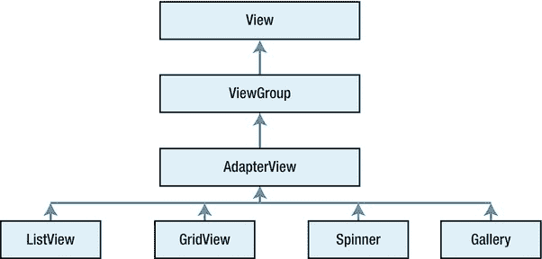

**图 6-8.** *`AdapterView` 类层次结构*

`AdapterView` 本身扩展了 `android.widget.ViewGroup`，这意味着 `ListView`、`GridView` 等是容器控件。换句话说，列表控件包含子视图的集合。适配器的目的是管理 `AdapterView` 的数据，并为其提供子视图。让我们通过研究 `SimpleCursorAdapter` 来了解其工作原理。

#### 认识 `SimpleCursorAdapter`

`SimpleCursorAdapter` 如图 6–9 所示。

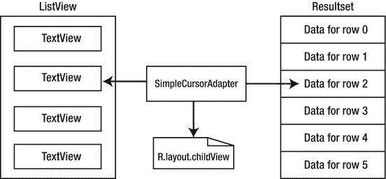

**图 6–9.** *`SimpleCursorAdapter`*

这是一张非常重要的理解图。左侧是 `AdapterView`；在此示例中，它是一个由多个 `TextView` 子视图构成的 `ListView`。右侧是数据；在本例中，它表示为来自内容提供程序查询结果的若干数据行。

为了将数据行映射到 `ListView`，`SimpleCursorAdapter` 需要一个子布局资源 ID。该子布局必须描述右侧应显示在左侧的每个数据元素的布局。这里的布局与我们为活动编写的布局类似，但它只需指定 `ListView` 中单行的布局。例如，如果从联系人内容提供程序获得了一组结果信息，并且只想在 `ListView` 中显示每个联系人姓名，则需要提供一个布局来描述姓名字段的外观。如果希望在 `ListView` 的每一行中同时显示姓名和来自结果集的图像，则布局必须说明如何显示姓名和图像。

这并不意味着你必须为结果集中的每个字段都提供布局规范，也不意味着你必须在结果集中为 `ListView` 每一行要包含的每个元素都准备一个数据。例如，稍后我们将展示如何在 `ListView` 中添加复选框用于选择行，而这些复选框无需通过结果集中的数据来设置。我们还将展示如何访问结果集中不属于 `ListView` 部分的数据。尽管我们刚刚只讨论了 `ListView`s、`TextView`s、游标和结果集，但请记住，适配器的概念远比这更通用。左侧可以是一个画廊，右侧可以是一个简单的图像数组。但为了简化问题，我们暂先更详细地了解 `SimpleCursorAdapter`。

`SimpleCursorAdapter` 的构造函数如下所示：

`SimpleCursorAdapter(Context context, int childLayout, Cursor c, String[] from, int[] to)`

此适配器将游标中的一行转换为容器控件的子视图。子视图的定义由 XML 资源（`childLayout` 参数）指定。请注意，由于游标中的一行可能包含多列，你需要通过指定列名数组（使用 `from` 参数）来告知 `SimpleCursorAdapter` 要选择该行中的哪些列。

同样，因为你选择的每一列都必须映射到布局中的一个 `View`，所以必须在 `to` 参数中指定这些视图的 ID。所选择的列与显示该列数据的 `View` 之间存在一一对应的映射关系，因此 `from` 和 `to` 参数数组必须具有相同数量的元素。如前所述，子视图可以包含其他类型的视图，不一定是 `TextView`。例如，你可以使用 `ImageView`。

`ListView` 与我们的适配器之间存在着紧密的协作关系。当 `ListView` 想要显示一行数据时，它会调用适配器的 `getView()` 方法，并传入位置参数以指定要显示的数据行。适配器通过使用其构造函数中设置的布局构建相应的子视图，并从结果集中提取相应记录的数据来响应。因此，`ListView` 无需处理数据在适配器端如何存在；它只需要根据需求调用子视图即可。这是一个关键点，因为这意味着 `ListView` 不一定需要为每一行数据都创建子视图。它实际上只需要拥有足够显示在显示窗口中的子视图数量。如果只显示十行，从技术上讲，即使结果集中有数百条记录，`ListView` 也只需要实例化十个子布局。实际上，实例化的子布局数量会超过十个，因为 Android 通常会预留一些额外的子布局，以便更快地将新行显示出来。你应该得出的结论是：`ListView` 管理的子视图是可以被回收利用的。稍后我们将对此进行更多讨论。

图 6–9 揭示了使用适配器的一些灵活性。由于列表控件使用了适配器，你可以根据数据和子视图替换使用各种类型的适配器。例如，如果你不打算从内容提供程序或数据库中填充 `AdapterView`，则不必使用 `SimpleCursorAdapter`。你可以选择一种更“简单”的适配器——`ArrayAdapter`。

### 认识 `ArrayAdapter`

`ArrayAdapter` 是 Android 中最简单的适配器。它专门针对列表控件，并假设列表项（子视图）由 `TextView` 控件表示。创建一个新的 `ArrayAdapter` 可以像下面这样简单：

```java
ArrayAdapter<String> adapter = new ArrayAdapter<String>(this,
                android.R.layout.simple_list_item_1,
                new string[]{"Dave","Satya","Dylan"});
```

我们仍然需要传入上下文（`this`）和 `childLayout` 资源 ID。但这次我们不再传入数据字段规范组成的 `from` 数组，而是直接传入一个字符串数组作为实际数据。我们不需要传入游标或 `View` 资源 ID 组成的 `to` 数组。这样做的假设是：我们的子布局只包含一个 `TextView`，而 `ArrayAdapter` 会将其作为数据数组中字符串的目标显示位置。

现在我们介绍一个关于 `childLayout` 资源 ID 的便捷技巧。我们无需为列表项创建自己的布局文件，而是可以直接利用 Android 中预定义的布局。请注意，子布局资源 ID 的前缀是 `android.`。Android 不会在本地的 `/res` 目录中查找，而是会去自己的资源目录中查找。你可以通过导航到 Android SDK 文件夹，然后在 `platforms/<android-version>/data/res/layout` 路径下找到该文件夹。在那里，你会找到 `simple_list_item_1.xml`，可以看到它定义了一个简单的 `TextView`。这个 `TextView` 正是我们的 `ArrayAdapter` 用来创建视图（在其 `getView()` 方法中）并传递给 `ListView` 的。你可以随意浏览这些文件夹，找到适用于各种场景的预定义布局。我们稍后会用到更多这样的布局。

`ArrayAdapter` 还有其他构造方法。如果 `childLayout` 不是一个简单的 `TextView`，你可以传入行布局的资源 ID，再加上用于接收数据的 `TextView` 的资源 ID。当你没有现成的字符串数组可以传入时，可以使用 `createFromResource()` 方法。代码清单 6-26 展示了一个为 Spinner 创建 `ArrayAdapter` 的例子。

**代码清单 6-26.** 从字符串资源文件创建 `ArrayAdapter`

```xml
<Spinner android:id="@+id/spinner"
    android:layout_width="wrap_content"  android:layout_height="wrap_content" />
```

```java
Spinner spinner = (Spinner) findViewById(R.id.spinner);

ArrayAdapter<CharSequence> adapter = ArrayAdapter.createFromResource(this,
        R.array.planets, android.R.layout.simple_spinner_item);

adapter.setDropDownViewResource(android.R.layout.simple_spinner_dropdown_item);

spinner.setAdapter(adapter);
```

```xml
<?xml version="1.0" encoding="utf-8"?>
<!-- 此文件位于 /res/values/planets.xml -->
<resources>
  <string-array name="planets">
    <item>水星</item>
    <item>金星</item>
    <item>地球</item>
    <item>火星</item>
    <item>木星</item>
    <item>土星</item>
    <item>天王星</item>
    <item>海王星</item>
  </string-array>
</resources>
```

代码清单 6-26 包含三个部分。第一部分是 Spinner 的 XML 布局。第二部分是 Java 代码，展示了如何创建一个数据源定义在字符串资源文件中的 `ArrayAdapter`。使用这种方法，你不仅可以将列表内容外部化到 XML 文件中，还可以使用本地化的版本。我们稍后会详细介绍 Spinner，但现在你只需要知道，Spinner 有一个用于显示当前选中值的视图，以及一个用于显示可供选择值的列表视图。它基本上就是一个下拉菜单。代码清单 6-26 的第三部分是名为 `/res/values/planets.xml` 的 XML 资源文件，它被读取用来初始化 `ArrayAdapter`。

值得一提的是，`ArrayAdapter` 允许对底层数据进行动态修改。例如，`add()` 方法会在数组末尾追加一个新值。`insert()` 方法会在数组中的指定位置添加一个新值。而 `remove()` 方法会从数组中移除一个对象。你也可以调用 `sort()` 方法来对数组重新排序。当然，完成这些操作后，数据数组会与 `ListView` 不同步，这时你需要调用适配器的 `notifyDataSetChanged()` 方法。该方法将使 `ListView` 与适配器重新同步。

以下列表总结了 Android 提供的适配器：

- `ArrayAdapter<T>`：这是一个基于任意对象泛型数组的适配器。它旨在与 `ListView` 配合使用。
- `CursorAdapter`：此适配器也用于 `ListView`，它通过游标为列表提供数据。
- `SimpleAdapter`：顾名思义，这是一个简单的适配器。它通常用于使用静态数据（可能来自资源）填充列表。

# 适配器与列表控件

- `ResourceCursorAdapter`：此适配器继承自 `CursorAdapter`，并知道如何从资源创建视图。
- `SimpleCursorAdapter`：此适配器继承自 `ResourceCursorAdapter`，并根据游标中的列创建 `TextView`/`ImageView` 视图。这些视图在资源中定义。

我们已经介绍了足够多的适配器知识，接下来可以开始展示一些使用适配器和列表控件（也称为 `AdapterView`）的实际例子了。让我们开始吧。

### 在 AdapterView 中使用适配器

既然你已经了解了适配器，现在是时候让它们为我们工作了，为列表控件提供数据。在本节中，我们将首先介绍基本的列表控件——`ListView`。然后，我们将描述如何创建你自己的自定义适配器，最后，我们将介绍其他类型的列表控件：`GridView`、Spinner 和 Gallery。

#### 基本列表控件：`ListView`

`ListView` 控件垂直显示项目列表。也就是说，如果我们有一个待查看的项目列表，且项目数量超出了当前屏幕显示范围，我们可以滚动来查看其余项目。通常，使用 `ListView` 的方法是编写一个继承自 `android.app.ListActivity` 的新 Activity。`ListActivity` 包含一个 `ListView`，你可以通过调用 `setListAdapter()` 方法来为 `ListView` 设置数据。

正如我们之前所述，适配器将列表控件与数据连接起来，并帮助为列表控件准备子视图。`ListView` 中的项目可以被点击以执行即时操作，也可以被选中以便后续对选中的项目集合进行操作。我们将从一个非常简单的例子开始，然后逐步添加功能。

##### 在 ListView 中显示值

图 6–10 展示了最简形式的 `ListView` 控件。

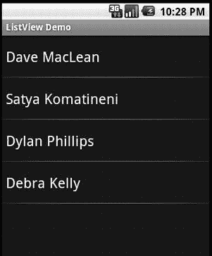

**图 6–10.** *使用 `ListView` 控件*

在本练习中，我们将用 `ListView` 填满整个屏幕，因此甚至无需在主布局 XML 文件中指定 `ListView`。代码清单 6–27 展示了 `ListActivity` 的 Java 代码。

**代码清单 6–27.** *向 `ListView` 添加条目*

```java
public class ListViewActivity extends ListActivity
{
    @Override
    protected void onCreate(Bundle savedInstanceState)
    {
        super.onCreate(savedInstanceState);

        Cursor c = managedQuery(Contacts.CONTENT_URI,
                        null, null, null, Contacts.DISPLAY_NAME + " ASC");

        String[] cols = new String[] {Contacts.DISPLAY_NAME};
        int[]    views = new int[]   {android.R.id.text1};

        SimpleCursorAdapter adapter = new SimpleCursorAdapter(this,
                        android.R.layout.simple_list_item_1,
                        c, cols, views);
        this.setListAdapter(adapter);
    }
}
```

代码清单 6–27 创建了一个 `ListView` 控件，并用设备上的联系人列表填充它。在我们的示例中，我们查询设备以获取联系人列表。为演示目的，我们选择了 Contacts 中的所有字段（使用 `managedQuery()` 方法中的第一个 null 参数），并按 `Contacts.DISPLAY_NAME` 字段进行排序（使用 `managedQuery()` 方法中的最后一个参数）。然后，我们创建一个投影（`cols`）来选择 `ListView` 中仅显示的联系人姓名——投影定义了我们感兴趣的列。接着，我们提供相应的资源 ID 数组（`views`），将姓名列（`Contacts.DISPLAY_NAME`）映射到 `TextView` 控件（`android.R.id.text1`）。之后，我们创建了一个光标适配器并设置列表的适配器。适配器类能够智能地从数据源中提取行，并取出每个联系人的名称以填充 UI。

要使它正常工作，我们还需要做一件事。由于此演示正在访问手机的通讯录数据库，我们需要请求相应的权限。此安全主题将在第 14 章中更详细地介绍，因此现在我们将仅引导您完成 `ListView` 的显示。双击本项目的 `AndroidManifest.xml` 文件，然后点击“权限”标签页。点击“添加”按钮，选择“使用权限”，然后点击“确定”。向下滚动名称列表，直到找到 `android.permission.READ_CONTACTS`。您的 Eclipse 窗口应类似于图 6–11 所示。然后保存 `AndroidManifest.xml` 文件。现在您可以在模拟器中运行此应用程序。在此示例应用程序中显示任何姓名之前，您可能需要使用联系人应用程序添加一些联系人。

您会注意到 `onCreate()` 方法没有设置 Activity 的内容视图。相反，由于基类 `ListActivity` 已经包含了一个 `ListView`，因此它只需为 `ListView` 提供数据即可。我们在这个示例中使用了一些快捷方式，首先是利用 `ListActivity` 提供了主布局。我们还使用了 Android 提供的布局作为子视图（资源 ID `android.R.layout.simple_list_item_1`），其中包含 Android 提供的 `TextView`（资源 ID `android.R.id.text1`）。总而言之，设置起来相当简单。

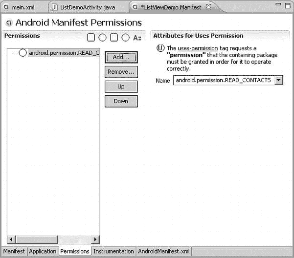

**图 6–11.** *修改 `AndroidManifest.xml` 以使我们的应用程序运行*

##### ListView 中的可点击项

当然，当您运行此示例时，您会看到可以上下滚动列表来查看所有联系人姓名，但仅此而已。如果我们想对这个示例做一些更有趣的事情，比如当用户点击 `ListView` 中的某个条目时启动联系人应用程序，该怎么办？代码清单 6–28 展示了对我们示例的修改，以接受用户输入。

**代码清单 6–28.** *在 `ListView` 上接受用户输入*

```
public class ListViewActivity2 extends ListActivity implements OnItemClickListener
{
    @Override
    protected void onCreate(Bundle savedInstanceState)
    {
        super.onCreate(savedInstanceState);

        ListView lv = getListView();

        Cursor c = managedQuery(Contacts.CONTENT_URI,
                null, null, null, Contacts.DISPLAY_NAME + " ASC");

        String[] cols = new String[] {Contacts.DISPLAY_NAME};
        int[]   views = new int[]   {android.R.id.text1};

        SimpleCursorAdapter adapter = new SimpleCursorAdapter(this,
                android.R.layout.simple_list_item_1,
                c, cols, views);
        this.setListAdapter(adapter);
        lv.setOnItemClickListener(this);
    }

    @Override
    public void onItemClick(AdapterView<?> adView, View target, int position, long id) {
        Log.v("ListViewActivity", "in onItemClick with " + ((TextView) target).getText() +
                ". Position = " + position + ". Id = " + id);
        Uri selectedPerson = ContentUris.withAppendedId(
                Contacts.CONTENT_URI, id);
        Intent intent = new Intent(Intent.ACTION_VIEW, selectedPerson);
        startActivity(intent);
    }
}
```

我们的 Activity 现在实现了 `OnItemClickListener` 接口，这意味着当用户在 `ListView` 中点击某个内容时，我们将收到回调。正如在 `onItemClick()` 方法中所见，我们获得了关于所点击内容的许多信息，包括接收点击的视图、所点击条目在 `ListView` 中的位置，以及根据适配器得到的条目 ID。由于我们知道 `ListView` 由 `TextView` 组成，因此我们假设接收到的是 `TextView` 并相应地进行类型转换，然后调用 `getText()` 方法来获取联系人姓名。位置值表示此条目在 `ListView` 中所有条目列表中的相对位置，且从零开始。因此，列表中的第一个条目位于位置 0。

ID 值完全取决于适配器和数据源。在我们的示例中，我们恰好查询的是 `Contacts` 内容提供者，因此根据该适配器，ID 就是来自内容提供者的记录的 `_ID`。但在其他情况下，您的数据源可能并非来自内容提供者，因此您不应认为总可以像本例中那样创建 URI。如果我们使用的是从资源 XML 文件中读取值的 `ArrayAdapter`，那么赋予我们的 ID 很可能就是数据数组中的位置值，实际上可能与位置值完全相同。

之前讨论 `ArrayAdapter` 时，我们提到了 `notifyDataSetChanged()` 方法，该方法可以在数据发生变化时让适配器更新 `ListView`。在当前示例中尝试这个实验。点击一个联系人，这应该会启动联系人应用程序。现在，编辑该联系人，更改其姓名；点击“完成”，然后点击“返回”按钮，回到我们的示例应用程序。您应该会看到 `ListView` 中该联系人的姓名已自动更新。是不是很酷？通过 `SimpleCursorAdapter` 和 `Contacts` 内容提供者，我们的 `ListView` 已被自动更新。然而，对于 `ArrayAdapter`，您需要自行调用 `notifyDataSetChanged()` 方法。

### 使用 `ListView` 添加其他控件

刚才的操作相当简单。我们生成了一个包含联系人姓名的自定义 `ListView`，点击姓名即可为所选人员启动“联系人”应用。但如果我们想先选择一批姓名，然后对这组人执行某些操作，该怎么办？在下一个示例应用中，我们将修改列表项的布局以包含复选框，并会在用户界面中添加一个按钮，用于对选中的子集项目执行操作。

如果你希望在主布局中添加其他控件，可以自行提供布局 XML 文件，放入一个 `ListView`，并添加其他所需控件。例如，你可以在用户界面的 `ListView` 下方添加一个按钮，用于对选中的项目提交操作，如图 6–12 所示。

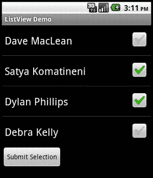

**图 6–12.** 一个附加按钮，允许用户提交选中的项目

本例的主布局如代码清单 6–29 所示，其中包含了该活动的 UI 定义——`ListView` 和 `Button`。

**代码清单 6–29.** 重写 `ListActivity` 引用的 `ListView`

```xml
<?xml version="1.0" encoding="utf-8"?>
<!-- 该文件位于 /res/layout/list.xml -->
<LinearLayout
    android:orientation="vertical"
    android:layout_width="fill_parent"  android:layout_height="fill_parent">

    <ListView android:id="@android:id/list"
            android:layout_width="fill_parent"  android:layout_height="0dip"
            android:layout_weight="1" />

    <Button android:id="@+id/btn" android:onClick="doClick"
           android:layout_width="wrap_content"  android:layout_height="wrap_content"
           android:text="提交选择" />

</LinearLayout>
```

请注意为 `ListView` 指定的 ID。我们必须使用 `@android:id/list`，因为 `ListActivity` 期望在我们的布局中找到一个具有此名称的 `ListView`。如果我们依赖 `ListActivity` 为自动创建的默认 `ListView`，它也会具有这个 ID。

另一点需要注意是我们在 `LinearLayout` 中指定 `ListView` 高度的方式。我们希望无论 `ListView` 中有多少项，按钮始终显示在屏幕上，并且不希望用户滚动到页面底部才能找到按钮。为此，我们将 `layout_height` 设为 0，然后使用 `layout_weight` 表示该控件应占据父容器的所有可用空间。这一技巧既为按钮留出了空间，又保留了滚动 `ListView` 的能力。我们将在本章稍后部分详细讨论布局和权重。

活动的实现代码如代码清单 6–30 所示。

**代码清单 6–30.** 从 `ListActivity` 读取用户输入

# ListView 与 SimpleCursorAdapter 示例解析

```java
public class ListViewActivity3 extends ListActivity
{
    private static final String TAG = "ListViewActivity3";
    private ListView lv = null;
    private Cursor cursor = null;
    private int idCol = -1;
    private int nameCol = -1;
    private int timesContactedCol = -1;

    @Override
    protected void onCreate(Bundle savedInstanceState)
    {
        super.onCreate(savedInstanceState);
        setContentView(R.layout.list);

        lv = getListView();

        cursor = managedQuery(Contacts.CONTENT_URI,
                        null, null, null, Contacts.DISPLAY_NAME + " ASC");

        String[] cols = new String[]{Contacts.DISPLAY_NAME};
        idCol = cursor.getColumnIndex(Contacts._ID);
        nameCol = cursor.getColumnIndex(Contacts.DISPLAY_NAME);
        timesContactedCol = cursor.getColumnIndex(Contacts.TIMES_CONTACTED);

        int[] views = new int[]{android.R.id.text1};

        SimpleCursorAdapter adapter = new SimpleCursorAdapter(this,
                android.R.layout.simple_list_item_multiple_choice,
                cursor, cols, views);

        this.setListAdapter(adapter);

        lv.setChoiceMode(ListView.CHOICE_MODE_MULTIPLE);
    }

    public void doClick(View view) {
        int count=lv.getCount();
        SparseBooleanArray viewItems = lv.getCheckedItemPositions();
        for(int i=0; i<count; i++) {
            if(viewItems.get(i)) {
                // CursorWrapper cw = (CursorWrapper) lv.getItemAtPosition(i);
                cursor.moveToPosition(i);
                long id = cursor.getLong(idCol);
                String name = cursor.getString(nameCol);
                int timesContacted = cursor.getInt(timesContactedCol);
                Log.v(TAG, name + " 已选中。联系次数 = " + timesContacted +
                        "。位置 = " + i + "。ID = " + id);
            }
        }
    }
}
```

现在，我们又回到了调用 `setContentView()` 来设置活动 UI 的情况。在设置适配器时，我们传入了另一个 Android 提供的用于 `ListView` 行项目的视图（`android.R.layout.simple_list_item_multiple_choice`），这会使每一行包含一个 `TextView` 和一个 `CheckBox`。如果你查看这个布局文件内部，会看到另一个 `TextView` 的子类，名为 `CheckedTextView`。这种特殊类型的 `TextView` 专为与 `ListView` 配合使用而设计。看吧，我们早就说过 Android 布局文件夹里有一些有趣的东西！你会注意到 `CheckedTextView` 的 ID 是 `text1`，这正是我们需要传递给 `SimpleCursorAdapter` 构造函数中 views 数组的值。

因为我们希望用户能够选择行，所以将选择模式设置为 `CHOICE_MODE_MULTIPLE`。默认情况下，选择模式是 `CHOICE_MODE_NONE`。另一个可能的取值是 `CHOICE_MODE_SINGLE`。如果你想在本例中使用单选模式，则需要改用不同的布局，很可能是 `android.R.layout.simple_list_item_single_choice`。

在本例中，我们实现了一个基本按钮，它会调用活动的 `doClick()` 方法。为简单起见，我们只想将用户勾选的项目名称输出到 LogCat。好消息是解决方案相当简单；坏消息是 Android 已经演变，最佳方案取决于你针对的是哪个 Android 版本。我们这里展示的 `ListView` 解决方案自 Android 1 以来一直有效（尽管我们在按钮回调中采用了 Android 1.6 的快捷方式）。也就是说，`getCheckedItemPositions()` 方法虽然旧但依然可用。其返回值是一个数组，可以告诉你某个项目是否被选中。因此，我们遍历该数组。如果 `ListView` 中对应的行被选中，`viewItems.get(i)` 将返回 true。我们的数据可通过游标访问。所以，我们不在 `ListView` 中查找数据，而是在游标中查找数据。`ListView` 会告诉我们在适配器中的哪个位置进行查找。

当我们从 `ListView` 获取到一个已被选中的位置编号时，可以使用游标的 `moveToPosition()` 方法来准备读取数据。还有一个方法功能几乎相同，即 `ListView` 的 `getItemAtPosition()` 方法。在我们的例子中，`getItemAtPosition()` 返回的对象实际上是一个 `CursorWrapper` 对象。正如我们之前所说，在其他情况下，我们可能会得到其他类型的对象。这里之所以会得到 `CursorWrapper`，仅仅是因为我们正在与内容提供程序打交道。你必须了解你的数据源和适配器，才能知道会得到什么结果。

然后我们可以使用 `Cursor`（或者如果之前选择了 `CursorWrapper`）来检索与 `ListView` 行相关联的数据。请注意，在我们的示例中，即使我们从未将备注映射到 `ListView`，我们也能检索到联系人的姓名和备注。当我们为适配器设置游标时，我们选择了所有可用字段。在实践中，你并不需要所有字段，因此应将查询限制为仅查询将要使用的字段。但在这个案例中，我们查询的字段数量超过了在 `ListView` 中显示所需的数量，这样我们就可以在按钮回调中轻松访问其他字段。

### 从 `ListView` 读取选中项的另一种方法

Android 1.6 引入了另一种从 `ListView` 检索选中行列表的方法：`getCheckItemIds()`。随后，在 Android 2.2 中，该方法被弃用，并替换为 `getCheckedItemIds()`。虽然名称变化细微，但使用该方法的方式基本相同。此外，在 Android 2.2 中，处理联系人的方式也发生了变化。在我们的下一个示例中，我们将使用 Android 2.2 的功能来展示示例的可能实现。列表 6–31 展示了 Java 代码。对于 `list.xml` 的 XML 布局，我们可以继续使用列表 6–29 中的文件。

列表 6–31. 从 `ListActivity` 读取用户输入的另一种方法

# ListView 与 GridView 控件

```java
public class ListViewActivity4 extends ListActivity
{
    private static final String TAG = "ListViewActivity4";
    private SimpleCursorAdapter adapter = null;
    private ListView lv = null;

    @Override
    protected void onCreate(Bundle savedInstanceState)
    {
        super.onCreate(savedInstanceState);
        setContentView(R.layout.list);

        lv = getListView();

        String[] projection = new String[] {Contacts._ID,
                Contacts.DISPLAY_NAME};
        Cursor c = managedQuery(Contacts.CONTENT_URI,
                        projection, null, null, Contacts.DISPLAY_NAME);

        String[] cols = new String[] {Contacts.DISPLAY_NAME};
        int[]    views = new int[]       {android.R.id.text1};

        adapter = new SimpleCursorAdapter(this,
                android.R.layout.simple_list_item_multiple_choice,
                c, cols, views);

        this.setListAdapter(adapter);

        lv.setChoiceMode(ListView.CHOICE_MODE_MULTIPLE);
    }

    public void doClick(View view) {
        if(!adapter.hasStableIds()) {
            Log.v(TAG, "Data is not stable");
            return;
        }
        long[] viewItems = lv.getCheckedItemIds();
        for(int i=0; i<viewItems.length; i++) {
            Uri selectedPerson = ContentUris.withAppendedId(
                    Contacts.CONTENT_URI, viewItems[i]);

            Log.v(TAG, selectedPerson.toString() + " is checked.");
        }
    }
}
```

在这个示例应用中，当我们点击按钮时，回调函数会调用 `getCheckedItemIds()` 方法。而在上一个示例中，我们得到的是 `ListView` 中被选中项的位置数组。这一次，我们得到的是适配器中那些在 `ListView` 里被选中的记录的 ID 数组。我们现在可以绕过 `ListView` 和游标，因为这些 ID 可以与内容提供者一起使用，从而执行我们想要的任何操作。在我们的示例中，我们只是构建了一个 URI，该 URI 代表来自联系人内容提供者的特定记录，并将该 URI 写入 LogCat。我们本可以直接使用内容提供者对数据进行操作。这种技术同样适用于旧版联系人内容提供者和 Android 1.6 的 `getCheckItemIds()` 方法。

在这个示例中，我们另一个不同的做法是，在创建游标时只选择了少数几个列。这是常规做法，因为你不想读取不必要的数据。从该示例中需要指出的最后一点是，`getCheckedItemIds()` 方法要求适配器中的底层数据是稳定的。因此，强烈建议在调用 `ListView` 的 `getCheckedItemIds()` 之前，先调用适配器的 `hasStableIds()`。在我们的示例中，我们走了一条捷径，仅记录事实并返回。实际上，你需要执行更智能的操作，例如，可能启动一个后台线程进行重试，并显示一个对话框指示正在处理。

我们已经向你展示了如何在多种场景下使用 `ListView`。我们展示了适配器为支持 `ListView` 承担了大量工作。接下来，我们将从 `GridView` 开始，介绍其他类型的列表控件。

## `GridView` 控件

大多数小部件工具包都提供了一种或多种基于网格的控件。Android 有一个 `GridView` 控件，它可以以网格的形式显示数据。请注意，虽然我们在此处使用了*数据*这一术语，但网格的内容可以是文本、图像等。

`GridView` 控件以网格形式显示信息。`GridView` 的使用模式是在 XML 布局中定义网格（参见清单 6–32），然后使用 `android.widget.ListAdapter` 将数据绑定到网格。别忘了在 `AndroidManifest.xml` 文件中添加 `uses-permission` 标签，以使此示例生效。

**清单 6–32.** *XML 布局中 `GridView` 的定义及关联的 Java 代码*

```xml
<?xml version="1.0" encoding="utf-8"?>
<!-- 此文件位于 /res/layout/gridview.xml -->
<GridView
    android:id="@+id/gridview"
    android:layout_width="fill_parent"
    android:layout_height="fill_parent"
    android:padding="10px"
    android:verticalSpacing="10px"
    android:horizontalSpacing="10px"
    android:numColumns="auto_fit"
    android:columnWidth="100px"
    android:stretchMode="columnWidth"
    android:gravity="center"
    />
```

```java
public class GridViewActivity extends Activity
{
    @Override
    protected void onCreate(Bundle savedInstanceState)
    {
        super.onCreate(savedInstanceState);
        setContentView(R.layout.gridview);

        GridView gv = (GridView)findViewById(R.id.gridview);

        Cursor c = managedQuery(Contacts.CONTENT_URI,
                        null, null, null, Contacts.DISPLAY_NAME);

        String[] cols = new String[] {Contacts.DISPLAY_NAME};
        int[]    views = new int[]      {android.R.id.text1};

        SimpleCursorAdapter adapter = new SimpleCursorAdapter(this,
                android.R.layout.simple_list_item_1,
                c, cols, views);

        gv.setAdapter(adapter);
    }
}
```

清单 6–32 在 XML 布局中定义了一个简单的 `GridView`。然后将该网格加载到 Activity 的内容视图中。生成的用户界面如图 6–13 所示。

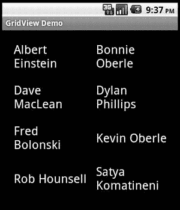

**图 6–13.** *填充了联系人信息的 `GridView`*

图 6–13 中显示的网格展示了设备上联系人的姓名。我们决定显示一个包含联系人姓名的 `TextView`，但你也可以轻松生成一个填充了图像或其他控件的网格。我们再次利用了 Android 中预定义的布局。事实上，这个示例与清单 6–27 非常相似，但有几个重要的区别。首先，我们的 `GridViewActivity` 继承自 `Activity`，而不是 `ListActivity`。其次，我们必须调用 `setContentView()` 来为我们的 `GridView` 设置布局；没有可用的默认视图。最后，要设置适配器，我们在 `GridView` 对象上调用 `setAdapter()`，而不是在 `Activity` 上调用 `setListAdapter()`。

你肯定已经注意到，网格使用的适配器是一个 `ListAdapter`。列表通常是一维的，而网格是二维的。因此我们可以得出结论，网格实际上显示的是面向列表的数据。事实证明，列表是按行显示的。也就是说，列表先填充第一行，然后第二行，以此类推。

和之前一样，我们有一个列表控件，它与适配器协同工作来处理数据管理和子视图的生成。我们之前使用的相同技术同样适用于 `GridView`。不过有一个例外与选择相关：无法像我们在清单 6–30 中那样在 `GridView` 中指定多项选择。

## `Spinner` 控件

`Spinner` 控件类似于下拉菜单。它通常用于从相对较短的选择列表中进行选择。如果选项列表太长而无法完全显示，系统会自动为你添加一个滚动条。你可以通过 XML 布局实例化一个 `Spinner`，如下所示：

```xml
<Spinner
    android:id="@+id/spinner"  android:prompt="@string/spinnerprompt"
    android:layout_width="wrap_content"  android:layout_height="wrap_content" />
```

虽然从技术上讲，spinner 是一个列表控件，但它对你来说更像是一个简单的 `TextView` 控件。换句话说，当 spinner 处于静止状态时，只会显示一个值。spinner 的目的是允许用户从一组预设值中进行选择：当用户点击小箭头时，会显示一个列表，用户可以选择一个新值。填充此列表的方式与其他列表控件相同：使用适配器。

由于 spinner 通常像下拉菜单一样使用，因此常见做法是让适配器从资源文件中获取列表选项。展示如何使用资源文件设置 spinner 的示例见清单 6–33。请注意名为 `android:prompt` 的新属性，它用于在列表顶部设置提示文字，供用户选择。我们的 spinner 提示的实际文本位于 `/res/values/strings.xml` 文件中。正如你所料，`Spinner` 类也提供了在代码中设置提示的方法。

**清单 6–33.** *从资源文件创建 Spinner 的代码*

```java
public class SpinnerActivity extends Activity {
    /** 当 Activity 首次被创建时调用。 */
    @Override
    public void onCreate(Bundle savedInstanceState) {
        super.onCreate(savedInstanceState);
        setContentView(R.layout.spinner);

        Spinner spinner = (Spinner)findViewById(R.id.spinner);

        ArrayAdapter<CharSequence> adapter = ArrayAdapter.createFromResource(this,
                R.array.planets, android.R.layout.simple_spinner_item);

        adapter.setDropDownViewResource(android.R.layout.simple_spinner_dropdown_item);

        spinner.setAdapter(adapter);
    }
}
```

你可能还记得在清单 6–26 中看到过 `planets.xml` 文件。在这个示例中，我们展示了如何创建一个 `Spinner` 控件；适配器被设置好然后关联到 spinner。实际效果请参见图 6–14。

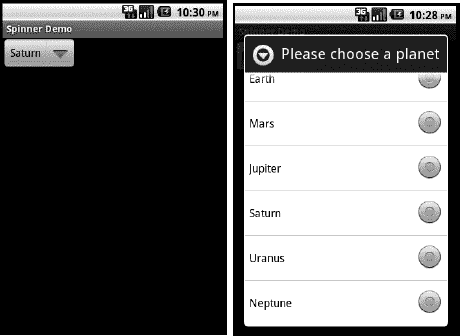

**图 6–14.** *用于选择行星的 Spinner*

与我们之前的列表控件的一个不同之处在于，使用 spinner 时需要处理一个额外的布局。图 6–14 的左侧显示了 spinner 的正常模式，即显示当前选中项。在这种情况下，当前选中项是土星。在该词旁边有一个向下箭头，表示此控件是一个 spinner，可以用来弹出一个列表以选择不同的值。第一个布局作为参数传递给 `ArrayAdapter.createFromResource()` 方法，定义了 spinner 在正常模式下的外观。图 6–14 的右侧展示了 spinner 处于弹出列表模式，等待用户选择新值。此列表的布局通过 `setDropDownViewResource()` 方法设置。同样在这个例子中，我们使用了 Android 提供的布局来满足这两种需求，因此如果你想查看这两种布局的定义，可以访问 Android 的 `res/layout` 文件夹。当然，你也可以为它们指定自己的布局定义，以达到你想要的效果。

## Gallery 控件

`Gallery` 控件是一个可水平滚动的列表控件，其焦点始终位于列表中央。在触摸模式下，该控件通常用作照片画廊。你可以通过 XML 布局或代码来实例化一个 `Gallery`：

```xml
<Gallery
    android:id="@+id/gallery"
    android:layout_width="fill_parent"
    android:layout_height="wrap_content"
/>
```

`Gallery` 控件通常用于显示图片，因此你的适配器很可能需要专门针对图片进行定制。我们将在下一节关于自定义适配器的内容中展示一个自定义图片适配器的示例。从视觉上看，`Gallery` 控件的外观如图 6-15 所示。

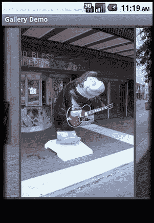

**图 6-15.** *显示海牛图片的画廊*

## 创建自定义适配器

Android 中的标准适配器易于使用，但存在一些局限性。为解决此问题，Android 提供了一个名为 `BaseAdapter` 的抽象类，当需要自定义适配器时，你可以对其进行扩展。如果你有特殊的数据管理需求，或者希望更精细地控制子视图的显示方式，就可以使用自定义适配器。此外，你也可以通过使用缓存技术来提升性能，从而使用自定义适配器。接下来，我们将展示如何构建一个自定义适配器。

代码清单 6-34 展示了自定义适配器的 XML 布局和 Java 代码可能呈现的样子。在本示例中，我们的适配器将处理海牛图片，因此我们将其命名为 `ManateeAdapter`。我们还将在一个 Activity 中创建该适配器。

**代码清单 6-34.** *我们的自定义适配器：`ManateeAdapter`*

```xml
<?xml version="1.0" encoding="utf-8"?>
<!-- 该文件位于 /res/layout/gridviewcustom.xml -->
<GridView
    android:id="@+id/gridview"
    android:layout_width="fill_parent"
    android:layout_height="fill_parent"
    android:padding="10dip"
    android:verticalSpacing="10dip"
    android:horizontalSpacing="10dip"
    android:numColumns="auto_fit"
    android:gravity="center"
    />
```

```java
public class GridViewCustomAdapter extends Activity {
    @Override
    protected void onCreate(Bundle savedInstanceState) {
        super.onCreate(savedInstanceState);
        setContentView(R.layout.gridviewcustom);

        GridView gv = (GridView) findViewById(R.id.gridview);

        ManateeAdapter adapter = new ManateeAdapter(this);

        gv.setAdapter(adapter);
    }

    public static class ManateeAdapter extends BaseAdapter {
        private static final String TAG = "ManateeAdapter";
        private static int convertViewCounter = 0;
        private Context mContext;
        private LayoutInflater mInflater;

        static class ViewHolder {
            ImageView image;
        }

        private int[] manatees = {
                R.drawable.manatee00, R.drawable.manatee01, R.drawable.manatee02,
                R.drawable.manatee03, R.drawable.manatee04, R.drawable.manatee05,
                R.drawable.manatee06, R.drawable.manatee07, R.drawable.manatee08,
                R.drawable.manatee09, R.drawable.manatee10, R.drawable.manatee11,
                R.drawable.manatee12, R.drawable.manatee13, R.drawable.manatee14,
                R.drawable.manatee15, R.drawable.manatee16, R.drawable.manatee17,
                R.drawable.manatee18, R.drawable.manatee19, R.drawable.manatee20,
                R.drawable.manatee21, R.drawable.manatee22, R.drawable.manatee23,
                R.drawable.manatee24, R.drawable.manatee25, R.drawable.manatee26,
                R.drawable.manatee27, R.drawable.manatee28, R.drawable.manatee29,
                R.drawable.manatee30, R.drawable.manatee31, R.drawable.manatee32,
                R.drawable.manatee33
        };

        private Bitmap[] manateeImages = new Bitmap[manatees.length];
        private Bitmap[] manateeThumbs = new Bitmap[manatees.length];

        public ManateeAdapter(Context context) {
            Log.v(TAG, "Constructing ManateeAdapter");
            this.mContext = context;
            mInflater = LayoutInflater.from(context);

            for (int i = 0; i < manatees.length; i++) {
                manateeImages[i] = BitmapFactory.decodeResource(
                        context.getResources(), manatees[i]);
                manateeThumbs[i] = Bitmap.createScaledBitmap(manateeImages[i],
                        100, 100, false);
            }
        }

        @Override
        public int getCount() {
            Log.v(TAG, "in getCount()");
            return manatees.length;
        }

        public int getViewTypeCount() {
            Log.v(TAG, "in getViewTypeCount()");
            return 1;
        }

        public int getItemViewType(int position) {
            Log.v(TAG, "in getItemViewType() for position " + position);
            return 0;
        }

        @Override
        public View getView(int position, View convertView, ViewGroup parent) {
            ViewHolder holder;

            Log.v(TAG, "in getView for position " + position +
                    ", convertView is " +
                    ((convertView == null) ? "null" : "being recycled"));

            if (convertView == null) {
                convertView = mInflater.inflate(R.layout.gridimage, null);
                convertViewCounter++;
                Log.v(TAG, convertViewCounter + " convertViews have been created");

                holder = new ViewHolder();
                holder.image = (ImageView) convertView.findViewById(R.id.gridImageView);

                convertView.setTag(holder);
            } else {
                holder = (ViewHolder) convertView.getTag();
            }

            holder.image.setImageBitmap(manateeThumbs[position]);

            return convertView;
        }

        @Override
        public Object getItem(int position) {
            Log.v(TAG, "in getItem() for position " + position);
            return manateeImages[position];
        }

        @Override
        public long getItemId(int position) {
            Log.v(TAG, "in getItemId() for position " + position);
            return position;
        }
    }
}
```

当你运行这个应用程序时，你应该会看到一个显示效果，如图 6–16 所示。

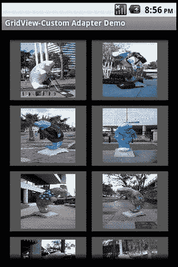

**图 6–16.** *一个展示海牛图像的 `GridView`*

这个例子虽然看起来相对简单，但有很多值得解释的地方。我们先从 `Activity` 类开始，它与本章这一小节中我们一直在使用的类非常相似。主布局来自 `gridviewcustom.xml`，其中只包含一个 `GridView` 定义。我们需要从布局内部获取对 `GridView` 的引用，因此我们定义并设置了 `gv`。我们实例化了 `ManateeAdapter`，将上下文传递给它，并将适配器设置到 `GridView` 上。到目前为止，这都是非常标准的操作，不过你已经注意到，我们的自定义适配器在创建时使用的参数远少于预定义的适配器。这主要是因为我们对这个特定适配器拥有完全的控制权，并且它仅用于这个应用程序。如果我们要让这个适配器更加通用，很可能会设置更多参数。但让我们继续往下看。

适配器内部的工作是管理向 Android `View` 对象传递数据。列表控件（此处为 `GridView`）会使用这些 `View` 对象。数据来自某个数据源。在之前的例子中，数据通过传递给适配器的游标对象传入。而在我们这个自定义示例中，适配器完全了解数据及其来源。列表控件会询问信息，以便知道如何构建用户界面。当列表控件有不再需要的视图时，它也会友好地将这些视图传入以进行回收。一开始你可能觉得适配器必须知道如何构建视图有些奇怪，但最终，这一切都是合理的。

当我们实例化自定义适配器 `ManateeAdapter` 时，通常的做法是将上下文传入，并由适配器保存它。在需要时能够使用上下文通常非常有用。我们希望适配器做的第二件事是持有 `inflater`（布局填充器）。这有助于在需要创建新视图返回给列表控件时提高性能。适配器中典型的第三件事是创建一个 `ViewHolder` 对象，用于容纳我们正在管理的数据所对应的 `View` 对象。在这个例子中，我们只存储了一个 `ImageView`，但如果需要处理额外的字段，我们会把它们添加到 `ViewHolder` 的定义中。例如，如果有一个 `ListView`，每一行包含一个 `ImageView` 和两个 `TextView`，那么我们的 `ViewHolder` 就会包含一个 `ImageView` 和两个 `TextView`。

由于我们在这个适配器中处理的是海牛图像，我们在构造时设置了一个资源 ID 数组来创建位图。我们还定义了一个位图数组作为我们的数据列表。

从 `ManateeAdapter` 的构造函数可以看出，我们保存了上下文，创建并持有 `inflater`，然后遍历图像资源 ID 并构建一个位图数组。这个位图数组就是我们的数据。

正如你之前所学，设置适配器会导致我们的 `GridView` 调用适配器上的方法来设置自身，以便显示数据。例如，`gv` 会调用适配器的 `getCount()` 方法来确定有多少个对象需要显示。它还会调用 `getViewTypeCount()` 方法来确定 `GridView` 中可以显示多少种不同类型的视图。在这个示例中，我们将此值设为 1。然而，如果我们有一个 `ListView` 并且希望在常规数据行之间放置分隔符，那么我们将有两种类型的视图，并且需要从 `getViewTypeCount()` 方法返回 2。你可以根据需要设置任意多种不同的视图类型，只要正确地从这个方法返回对应的计数即可。与此方法相关的还有 `getItemViewType()`。我们刚刚提到可以从适配器返回多种类型的视图，但为了简单起见，`getItemViewType()` 只需要返回一个整数值，来指明数据中某个特定位置对应的是哪种视图类型。因此，如果我们有两种类型的视图需要返回，`getItemViewType()` 就需要返回 0 或 1 来指示具体类型。如果我们有三种类型的视图，这个方法需要返回 0、1 或 2。

如果我们的适配器在 `ListView` 中处理分隔符，它必须将这些分隔符视为数据。这意味着数据中有一个位置被分隔符占据。当列表控件调用 `getView()` 来获取该位置对应的视图时，`getView()` 需要返回一个分隔符视图，而不是常规的数据视图。并且当在 `getItemViewType()` 中被问及该位置的视图类型时，我们需要返回我们预先决定对应于该视图类型的整数值。如果你使用了分隔符，另一件你应该做的事是实现 `isEnabled()` 方法。对于列表项，该方法应返回 `true`；对于分隔符，应返回 `false`，因为分隔符不应被选中或点击。

`ManateeAdapter` 中最有趣的方法是 `getView()` 方法调用。一旦 `gv` 确定了有多少项可用，它就开始请求数据。现在，我们来谈谈视图回收。列表控件只能在屏幕上显示尽可能多的子视图。这意味着没有必要为适配器中的每一份数据都调用 `getView()`；只为能够显示的项数调用 `getView()` 才是合理的。当 `gv` 从适配器获取子视图时，它正在确定屏幕上能容纳多少个视图。当屏幕被子视图填满时，`gv` 就会停止调用 `getView()`。

如果你在启动这个示例应用后查看 `LogCat`，你会看到各种调用，但你也会发现 `getView()` 在所有图片请求完成之前就停止了调用。如果你开始在 `GridView` 中上下滚动，你会在 `LogCat` 中看到更多对 `getView()` 的调用，并且你会注意到，一旦我们创建了一定数量的子视图，`getView()` 被调用时 `convertView` 会被设置为某个非空值。这意味着我们现在正在回收子视图——这对性能非常有利。

如果我们在 `getView()` 中从 `gv` 获取到一个非空的 `convertView` 值，这意味着 `gv` 正在回收该视图。通过重用传入的视图，我们避免了填充 XML 布局，也避免了查找 `ImageView`。通过将一个 `ViewHolder` 对象与我们返回的 `View` 关联，我们可以更快地在下一次视图被回传时完成回收。在 `getView()` 中，我们只需重新获取 `ViewHolder` 并将正确的数据分配到视图中。

对于这个示例，我们想展示的是，放入视图中的数据并不一定与数据源中的完全一致。`createScaledBitmap()` 方法会为显示目的创建一个更小版本的数据。关键在于，我们的列表控件不会调用 `getItem()` 方法。如果用户对列表控件执行操作，我们的其他代码会调用该方法来对数据进行处理。再次强调，对于任何适配器，理解其行为非常重要。你不一定非要依赖适配器中由 `getView()` 创建的列表控件视图中的数据。有时，你需要调用适配器的 `getItem()` 方法来获取实际要操作的数据。而有时，就像我们在之前的 `ListView` 示例中所做的那样，你可能希望从游标中获取数据。这完全取决于适配器以及数据的最终来源。尽管我们在示例中使用了 `createScaledBitmap()` 方法，但 Android 2.2 引入了另一个在这里可能很有用的类：`ThumbnailUtils`。这个类提供了一些从位图和视频生成缩略图的静态方法。

这个示例中还有最后一点需要指出，即 `getItemId()` 方法的调用。在我们之前使用 `ListView` 和联系人的示例中，项目 ID 是来自内容提供者的 `_ID` 值。对于这个示例，我们并不需要除位置之外的其他值作为项目 ID。项目 ID 的作用是提供一种机制，使数据可以独立于其位置被引用。当数据存在于该适配器之外时（就像我们的联系人那样），这一点尤其重要。当我们能像处理海牛图片那样直接控制数据，并且知道如何在应用中获取实际数据时，一个常见的简化做法就是直接将位置作为项目 ID。在我们的案例中尤其如此，因为我们甚至不允许添加或删除数据。

### Android 中的其他控件

Android 中有许多控件可供使用。我们到目前为止已经介绍了相当多，更多的内容将在后续章节中介绍（例如第 22 章中的 `MapView`，以及第 24 章中的 `VideoView` 和 `MediaController`）。你会发现，其他控件由于都继承自 `View`，与我们这里介绍的有许多共同之处。现在，我们仅提几个你可能想自行深入探索的控件。

`ScrollView` 是一个用于设置带有垂直滚动条的 `View` 容器的控件。当你内容太多无法在一屏内显示时，这非常有用。关于如何使用它，请参阅本章的“参考资料”部分中 Romain Guy 博客文章的链接。

`ProgressBar` 和 `RatingBar` 控件类似于滑块。前者用于直观显示某些操作的进度（例如文件下载或音乐播放），后者则用于显示星级评分。

`Chronometer` 控件是一个正向计时的计时器。如果你想显示倒计时，可以使用 `CountDownTimer` 类，但它不是一个 `View` 类。

Android 4.0 中新增了 `Switch` 控件，它的功能类似于 `ToggleButton`，但在视觉上呈现左右滑动样式。同样在 4.0 中新增的还有 `Space` 视图，这是一个轻量级视图，可用于在布局中更轻松地在其他视图之间创建间距。

`WebView` 是一个非常特殊的用于显示 HTML 的视图。它的功能远不止于此，包括处理 Cookie 和 JavaScript，以及与应用程序中的 Java 代码进行交互。但是，在你在应用程序中实现一个 Web 浏览器之前，你应该仔细考虑调用设备上的 Web 浏览器，让它来完成所有繁重的工作。

至此，本章对控件的介绍就结束了。接下来，我们将讨论用于修改控件外观和感觉的样式与主题，然后介绍用于在屏幕上排列控件的布局。

### 样式和主题

Android 提供了多种方式来改变应用程序中视图的样式。我们首先介绍在字符串中使用标记标签，然后介绍如何使用 `Spannable` 来更改文本的特定视觉属性。但是，如果你想使用一个通用规范来控制多个视图或整个 `Activity` 或应用程序的外观，该怎么办呢？我们将讨论 Android 样式和主题，向你展示如何操作。

#### 使用样式

有时候，你可能想要高亮或设置 `View` 内容的样式。你可以通过静态或动态方式来实现。静态方式下，你可以直接在字符串资源中对字符串应用标记，如下所示：

`<string name="styledText"><i>静态</i>样式在<b>TextView</b>中。</string>`

然后你可以在 XML 或代码中引用它。请注意，字符串资源中可以使用以下 HTML 标签：`<i>`（斜体）、`<b>`（粗体）和 `<u>`（下划线），以及 `<sup>`（上标）、`<sub>`（下标）、`<strike>`（删除线）、`<big>`（放大）、`<small>`（缩小）和 `<monospace>`（等宽字体）。你甚至可以嵌套使用它们，例如，实现小号上标。这不仅适用于 `TextView`，也适用于其他视图，比如按钮。图 6-17 展示了使用本节中的多个示例后，样式化和主题化文本的效果。

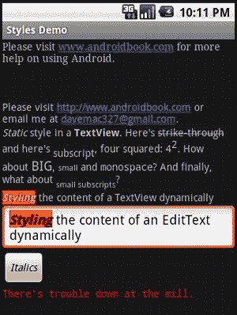

`图 6-17. 样式和主题示例`

以编程方式设置 `TextView` 控件内容的样式需要额外一些工作，但提供了更大的灵活性（参见代码清单 6-35），因为你可以在运行时设置样式。不过，这种灵活性只能应用于 `Spannable` 对象，而 `EditText` 通常以这种方式管理内部文本，但 `TextView` 默认不使用 `Spannable`。`Spannable` 本质上是一个可以应用样式的 `String`。要让 `TextView` 将文本存储为 `Spannable`，你可以这样调用 `setText()`：

`tv.setText("这段文本存储在 Spannable 中", TextView.BufferType.SPANNABLE);`

然后，当你调用 `tv.getText()` 时，会得到一个 `Spannable` 对象。

如代码清单 6-35 所示，你可以获取 `EditText` 的内容（作为 `Spannable` 对象），然后为部分文本设置样式。该清单中的代码将文本样式设置为粗体和斜体，并将背景设置为红色。你可以像之前描述 HTML 标签那样使用所有的样式选项，甚至更多。

`代码清单 6-35. 动态为 EditText 内容应用样式`

```
EditText et =(EditText)this.findViewById(R.id.et);
et.setText("动态设置 EditText 内容的样式");
Spannable spn = (Spannable) et.getText();
spn.setSpan(new BackgroundColorSpan(Color.RED), 0, 7,
             Spannable.SPAN_EXCLUSIVE_EXCLUSIVE);
spn.setSpan(new StyleSpan(android.graphics.Typeface.BOLD_ITALIC),
             0, 7, Spannable.SPAN_EXCLUSIVE_EXCLUSIVE);
```

这两种样式化技术只作用于它们所应用的单个视图。Android 提供了一种样式机制来定义可在多个视图间复用的通用样式，同时还提供了一种主题机制，该机制基本上可以将一个样式应用于整个 `Activity` 或整个应用程序。首先，我们需要讨论样式。

`样式` 是 `View` 属性的集合，它被赋予一个名称，这样你可以通过名称引用该集合，并将该样式按名称分配给视图。例如，代码清单 6-36 展示了一个保存在 `/res/values` 目录下的资源 XML 文件，我们可以将其用于所有错误消息。

`代码清单 6-36. 定义一个可在多个视图中使用的样式`

```
<?xml version="1.0" encoding="utf-8"?>
<resources>
    <style name="ErrorText">
        <item name="android:layout_width">fill_parent</item>
        <item name="android:layout_height">wrap_content</item>
        <item name="android:textColor">#FF0000</item>
        <item name="android:typeface">monospace</item>
    </style>
</resources>
```

这里定义了视图的大小以及字体颜色（红色）和字体样式。请注意，`item` 标签的 `name` 属性就是我们布局 XML 文件中使用的 XML 属性名称，而 `item` 标签的值不再需要双引号。现在，我们可以为错误 `TextView` 使用此样式，如代码清单 6-37 所示。

`代码清单 6-37. 在视图中使用样式`

```
<TextView  android:id="@+id/errorText"
    style="@style/ErrorText"
    android:text="目前没有错误"
    />
```

需要注意的是，在此 `View` 定义中，样式的属性名称不以 `android:` 开头。请留意这一点，因为似乎除了样式之外，其他所有属性都使用 `android:` 前缀。当应用程序中有许多视图共享同一样式时，在一个地方更改该样式会简单得多；你只需修改这一个资源文件中的样式属性即可。当然，你可以为各种控件创建许多不同的样式。例如，按钮可以共享一种通用样式，而菜单中的文本则可以共享另一种不同的通用样式。

样式的一个非常好的方面是你可以建立它们的层次结构。我们可以基于 `ErrorText` 样式定义一个新的样式，用于表示非常严重的错误消息。代码清单 6-38 展示了这可能的样子。

`代码清单 6-38. 从父样式中定义新样式`

```
<?xml version="1.0" encoding="utf-8"?>
<resources>
    <style name="ErrorText.Danger" >
        <item name="android:textStyle">bold</item>
    </style>
</resources>
```

这个示例表明，我们可以简单地通过使用父样式名称作为新样式名称的前缀来命名我们的子样式。因此，`ErrorText.Danger` 是 `ErrorText` 的子样式，并继承了父样式的所有属性。然后它添加了一个新的 `textStyle` 属性。这个过程可以重复多次，从而创建一整套样式树。

与适配器布局的情况类似，Android 也提供了大量的样式供我们使用。要指定一个 Android 提供的样式，请使用如下语法：

`style="@android:style/TextAppearance"`

此样式设置了 Android 中文本的默认样式。要找到主控的 Android `styles.xml` 文件，请访问 `Android SDK/platforms/<android-version>/data/res/values/` 文件夹。在此文件中，你会发现许多现成的样式可供使用或扩展。关于扩展 Android 提供的样式，这里有一个注意事项：之前使用前缀的方法不适用于 Android 提供的样式。相反，你必须使用 `style` 标签的 `parent` 属性，如下所示：

```
<style name="CustomTextAppearance" parent="@android:style/TextAppearance">
    <item  ... 在此处添加你的扩展内容 ...    />
</style>
```

你不必总是将整个样式应用到你的视图上。你也可以选择只借用样式的一部分。例如，如果你想将 `TextView` 中的文本颜色设置为系统样式颜色，可以执行以下操作：

# Android 主题与布局管理器

## 使用主题

样式的一个问题是，你需要为每个希望应用样式的视图定义添加 `style="@style/..."` 属性规范。如果你有一些希望在整个 Activity 或整个应用中应用的样式元素，则应使用主题。*主题*本质上就是广泛应用的样式；但在定义主题方面，它与样式完全相同。事实上，主题和样式相当可互换：你可以将主题扩展为样式，或将样式作为主题引用。通常，只有名称能提示某个样式是打算用作样式还是主题。

要为 Activity 或应用指定主题，你可以在项目的 `AndroidManifest.xml` 文件中的 `<activity>` 或 `<application>` 标签内添加一个属性。代码可能如下所示：

```
<activity android:theme="@style/MyActivityTheme">
<application android:theme="@style/MyApplicationTheme">
<application android:theme="@android:style/Theme.NoTitleBar">
```

你可以在与 Android 提供的样式相同的文件夹中找到 Android 提供的主题，主题位于名为 `themes.xml` 的文件中。查看主题文件内部时，你会看到大量定义的样式，其名称以 `Theme` 开头。你还会注意到，在 Android 提供的主题和样式内部，存在大量的扩展操作，这就是为什么你会看到诸如 `Theme.Dialog.AppError` 这样的样式名称。

至此，我们对 Android 控件集的讨论就结束了。正如我们在本章开头提到的，在 Android 中构建 UI 需要掌握两件事：控件集和布局管理器。在下一节中，我们将讨论 Android 布局管理器。

# 理解布局管理器

Android 提供了一组充当视图容器的视图类。这些容器类被称为*布局*（或*布局管理器*），每种布局都实现了特定的策略来管理其子视图的大小和位置。例如，`LinearLayout` 类将其子视图水平或垂直地逐一排列。所有布局管理器都派生自 `View` 类，因此你可以将布局管理器相互嵌套。

Android SDK 附带的布局管理器定义在表 6-2 中。

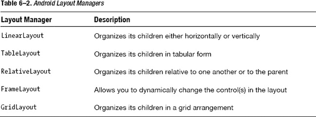

我们将在后续章节中讨论这些布局管理器。名为 `AbsoluteLayout` 的布局管理器已被弃用，本书将不再介绍。

## LinearLayout 布局管理器

`LinearLayout` 布局管理器是最基础的。该布局管理器根据 `orientation` 属性的值，将其子视图水平或垂直地组织起来。到目前为止，我们已经在多个示例中使用了 `LinearLayout`。列表 6-39 展示了一个水平配置的 `LinearLayout`。

**列表 6-39.** *水平配置的 LinearLayout*

```
<LinearLayout
    android:orientation="horizontal"
    android:layout_width="fill_parent"  android:layout_height="wrap_content">

    <!-- 在此处添加子视图 -->

</LinearLayout>
```

你可以通过将 `orientation` 的值设置为 `vertical` 来创建一个垂直方向的 `LinearLayout`。由于布局管理器可以嵌套，例如，你可以构建一个包含多个水平布局管理器的垂直布局管理器，以创建一个填充表单，其中每一行都有一个标签和一个 `EditText` 控件相邻。每一行都是其自己的水平布局，但所有行作为一个集合则按垂直方向组织。

### 理解 Weight 和 Gravity

`orientation` 属性是 `LinearLayout` 布局管理器识别的第一个重要属性。其他可能影响子控件大小和位置的重要属性是 weight 和 gravity。

你可以使用 *weight* 来为控件分配相对于容器中其他控件的大小重要性。假设一个容器有三个控件：一个的 weight 为 1，而其他两个的 weight 为 0。在这种情况下，weight 等于 1 的控件将消耗容器中的空白空间。*Gravity* 本质上是对齐。例如，如果你希望将标签的文本向右对齐，你可以将其 gravity 设置为 `right`。`gravity` 的可能值有很多，包括 `left`、`center`、`right`、`top`、`bottom`、`center_vertical`、`clip_horizontal` 等。有关这些值以及其他 gravity 值的详细信息，请参阅“参考资料”部分的网页。

 **注意：** 布局管理器扩展了 `android.widget.ViewGroup`，许多基于控件的容器类（例如 `ListView`）也是如此。尽管布局管理器和基于控件的容器扩展了相同的类，但布局管理器类严格处理控件的大小和位置，而不处理与子控件的用户交互。例如，比较 `LinearLayout` 和 `ListView` 控件。在屏幕上，它们看起来很相似，因为两者都可以垂直组织子视图。但 `ListView` 控件提供了供用户进行选择的 API，而 `LinearLayout` 则没有。换句话说，基于控件的容器（`ListView`）支持用户与容器中的项目进行交互，而布局管理器（`LinearLayout`）仅处理大小和定位。

现在让我们看一个涉及 weight 和 gravity 属性的示例（参见图 6-18）。

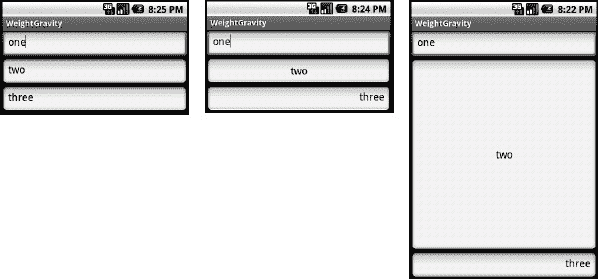

**图 6-18.** *使用 `LinearLayout` 布局管理器*

图 6-18 显示了三个利用 `LinearLayout` 的 UI，它们具有不同的 weight 和 gravity 设置。左侧的 UI 使用了 weight 和 gravity 的默认设置。第一个 UI 的 XML 布局如列表 6-40 所示。

**列表 6-40.** *在 LinearLayout 中垂直排列的三个文本字段，使用默认的 Weight 和 Gravity 值*

```
<LinearLayout
    android:orientation="vertical" android:layout_width="fill_parent"
    android:layout_height="fill_parent">

    <EditText android:layout_width="fill_parent"
        android:layout_height="wrap_content"
        android:text="one"/>
    <EditText android:layout_width="fill_parent"
        android:layout_height="wrap_content"
        android:text="two"/>
    <EditText android:layout_width="fill_parent"
        android:layout_height="wrap_content"
        android:text="three"/>
</LinearLayout>
```

图 6-18 中间的 UI 使用了 weight 的默认值，但将容器中控件的 `android:gravity` 分别设置为 `left`、`center` 和 `right`。最后一个示例将中间组件的 `android:layout_weight` 属性设置为 1.0，并将其他两个组件保留为默认值 0.0（参见列表 6-41）。通过将中间组件的 weight 属性设置为 1.0，而将其他两个组件的 weight 属性保留为 0.0，我们指定了中间组件应占据容器中所有剩余的空白空间，而其他两个组件应保持其理想大小。

类似地，如果你希望容器中三个控件中的两个共享剩余的空白空间，你可以将这两个控件的 weight 设置为 1.0，并将第三个控件的 weight 设置为 0.0。最后，如果你希望三个组件均匀地共享空间，你可以将所有组件的 weight 值都设置为 1.0。这样做将使每个文本字段均匀扩展。

##### 清单 6–41. 配置了权重的 `LinearLayout`

```
<LinearLayout
    android:orientation="vertical" android:layout_width="fill_parent"
    android:layout_height="fill_parent">

    <EditText android:layout_width="fill_parent" android:layout_weight="0.0"
    android:layout_height="wrap_content" android:text="one"
    android:gravity="left"/>

    <EditText android:layout_width="fill_parent" android:layout_weight="1.0"
    android:layout_height="wrap_content" android:text="two"
    android:gravity="center"/>

    <EditText android:layout_width="fill_parent" android:layout_weight="0.0"
    android:layout_height="wrap_content" android:text="three"
    android:gravity="right"
    />
</LinearLayout>
```

##### `android:gravity` 与 `android:layout_gravity` 的区别

请注意，Android 定义了两个相似的 gravity 属性：`android:gravity` 和 `android:layout_gravity`。它们的区别如下：`android:gravity` 是视图自身使用的设置，而 `android:layout_gravity` 由容器（`android.view.ViewGroup`）使用。例如，你可以将 `android:gravity` 设置为 `center`，使 `EditText` 中的文本在控件内居中显示。同样地，你可以通过设置 `android:layout_gravity="right"` 将 `EditText` 对齐到 `LinearLayout`（容器）的最右侧。请参见 图 6–19 和 清单 6–42。

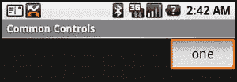

图 6–19. 应用 gravity 设置

清单 6–42. 理解 `android:gravity` 与 `android:layout_gravity` 的区别

```
<LinearLayout
    android:orientation="vertical" android:layout_width="fill_parent"
    android:layout_height="fill_parent">

    <EditText android:layout_width="wrap_content" android:gravity="center"
    android:layout_height="wrap_content" android:text="one"
 android:layout_gravity="right"/>
</LinearLayout>
```

如 图 6–19 所示，文本在 `EditText` 中居中显示，而该 `EditText` 则对齐到 `LinearLayout` 的右侧。

#### `TableLayout` 布局管理器

`TableLayout` 布局管理器是 `LinearLayout` 的扩展。该布局管理器将其子控件组织成行和列。清单 6–43 展示了一个示例。

清单 6–43. 一个简单的 `TableLayout`

```
<?xml version="1.0" encoding="utf-8"?>
<TableLayout
    android:layout_width="fill_parent"  android:layout_height="fill_parent">

  <TableRow>
    <TextView android:text="名字："
        android:layout_width="wrap_content"  android:layout_height="wrap_content" />

    <EditText android:text="埃德加"
        android:layout_width="wrap_content"  android:layout_height="wrap_content" />
  </TableRow>

  <TableRow>
    <TextView android:text="姓氏："
        android:layout_width="wrap_content"  android:layout_height="wrap_content" />

    <EditText android:text="爱伦·坡"
        android:layout_width="wrap_content"  android:layout_height="wrap_content" />
  </TableRow>

</TableLayout>
```

要使用此布局管理器，你需要创建一个 `TableLayout` 实例，并在其中放置 `TableRow` 元素。这些 `TableRow` 元素包含表格的控件。清单 6–43 对应的 UI 如 图 6–20 所示。

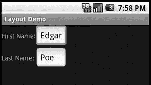

图 6–20. `TableLayout` 布局管理器

由于 `TableLayout` 的内容是按行而非按列定义的，因此 Android 通过查找拥有最多单元格的行来确定表格的列数。例如，清单 6–44 创建了一个两行的表格，其中一行有两个单元格，另一行有三个单元格（参见 图 6–21）。在这种情况下，Android 会创建一个两行三列的表格。第一行的最后一列是一个空单元格。

清单 6–44. 一个不规则表格定义

```
<TableLayout
    android:layout_width="fill_parent"  android:layout_height="fill_parent">

  <TableRow>
    <TextView android:text="名字："
        android:layout_width="wrap_content"  android:layout_height="wrap_content" />

    <EditText android:text="埃德加"
        android:layout_width="wrap_content"  android:layout_height="wrap_content" />
  </TableRow>

  <TableRow>
    <TextView android:text="姓氏："
        android:layout_width="wrap_content"  android:layout_height="wrap_content" />

    <EditText android:text="艾伦"
        android:layout_width="wrap_content"  android:layout_height="wrap_content" />

    <EditText android:text="坡"
        android:layout_width="wrap_content"  android:layout_height="wrap_content" />
  </TableRow>

</TableLayout>
```

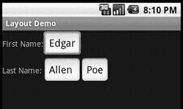

图 6–21. 一个不规则的 `TableLayout`

在 清单 6–43 和 清单 6–44 中，我们使用 `TableRow` 元素填充了 `TableLayout`。虽然这是常规用法，但你也可以将任何 `android.widget.View` 作为表格的子视图放置。例如，清单 6–45 创建了一个表格，其第一行是一个 `EditText`（参见 图 6–22）。

清单 6–45. 使用 `EditText` 代替 `TableRow`

```
进入`/path.to/xxx`目录，找到`xxx.json`。

在表达式`cvar = avar + bvar`中，加法运算符（`+`）将`avar`与`bvar`相加，得到它们的和`cvar`

在`List.of(arg0, arg1, arg2)`中，`List`接口的工厂方法`of()`接受一系列的元素，返回包含它们的只读列表。

之后我们这样调用`cmd`命令：`cmd arg0 arg1 arg2`。

```
if (condVar > someVal) {console.log("xxx")}
```
```

# Android 布局管理器

## `RelativeLayout` 布局管理器

```xml
<RelativeLayout
        android:layout_width="fill_parent"
        android:layout_height="wrap_content">

    <TextView android:id="@+id/userNameLbl"
        android:layout_width="fill_parent"  android:layout_height="wrap_content"
        android:text="Username: "
        android:layout_alignParentTop="true" />

    <EditText android:id="@+id/userNameText"
        android:layout_width="fill_parent"  android:layout_height="wrap_content"
        android:layout_toRightOf="@id/userNameLbl" />

    <TextView android:id="@+id/pwdLbl"
        android:layout_width="wrap_content"  android:layout_height="wrap_content"
        android:layout_below="@id/userNameText"
        android:text="Password: " />

    <EditText android:id="@+id/pwdText"
        android:layout_width="fill_parent"  android:layout_height="wrap_content"
        android:layout_toRightOf="@id/pwdLbl"
        android:layout_below="@id/userNameText" />

    <TextView android:id="@+id/pwdCriteria"
        android:layout_width="fill_parent"  android:layout_height="wrap_content"
        android:layout_below="@id/pwdText"
        android:text="Password Criteria... " />

    <TextView android:id="@+id/disclaimerLbl"
        android:layout_width="fill_parent"  android:layout_height="wrap_content"
        android:layout_alignParentBottom="true"
        android:text="Use at your own risk... " />

</RelativeLayout>
```

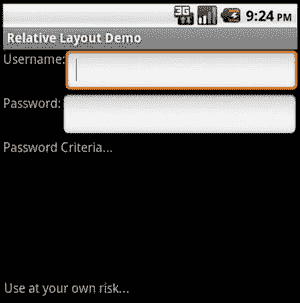

**图 6–24.** 使用 `RelativeLayout` 布局管理器布局的用户界面

如图所示，该用户界面看起来像一个简单的登录表单。用户名标签固定在容器顶部，因为我们设置了 `android:layout_alignParentTop` 为 `true`。类似地，用户名输入框位于用户名标签下方，因为我们设置了 `android:layout_below`。密码标签出现在用户名标签下方，密码输入框出现在密码标签下方。免责声明标签固定在容器底部，因为我们设置了 `android:layout_alignParentBottom` 为 `true`。

除了这三个布局属性之外，你还可以指定 `layout_above`、`layout_toRightOf`、`layout_toLeftOf`、`layout_centerInParent` 等更多属性。由于 `RelativeLayout` 的简洁性，使用它非常有趣。事实上，一旦你开始使用它，它就会成为你最喜欢的布局管理器——你会发现自己反复使用它。

### ADT 对设计 `RelativeLayouts` 的支持

随着用于 Eclipse 的 Android 开发工具（ADT）的发展，越来越多的功能变得可用。早期，布局的视觉编辑器并不太好。但最近它好多了。特别是，该工具使用 `RelativeLayout` 以可视方式布局用户界面的能力有了很大改善。如果你使用 `RelativeLayout`，绝对应该检查一下 Eclipse 中的这个工具。

## `FrameLayout` 布局管理器

我们迄今为止讨论过的布局管理器实现了多种布局策略。换句话说，每种布局管理器都有其特定的方式来在屏幕上定位和定向其子视图。使用这些布局管理器，你可以在同一屏幕上放置多个控件，每个控件占据屏幕的一部分。Android 还提供了一种主要用于显示单个项目的布局管理器：`FrameLayout`。你主要使用这个实用布局类来动态显示单个视图，但你可以用它填充多个项目，设置其中一个可见，而其他项目不可见。代码清单 6–48 演示了如何使用 `FrameLayout`。

**代码清单 6–48.** 填充 `FrameLayout`

```xml
<?xml version="1.0" encoding="utf-8"?>
<FrameLayout
    android:id="@+id/frmLayout"
    android:layout_width="fill_parent"  android:layout_height="fill_parent">

     <ImageView
        android:id="@+id/oneImgView" android:src="@drawable/one"
        android:scaleType="fitCenter"
        android:layout_width="fill_parent"  android:layout_height="fill_parent"/>
    <ImageView
        android:id="@+id/twoImgView" android:src="@drawable/two"
        android:scaleType="fitCenter"
        android:layout_width="fill_parent"  android:layout_height="fill_parent"
        android:visibility="gone" />

</FrameLayout>
```

```java
public class FrameLayoutActivity extends Activity{
    private ImageView one = null;
    private ImageView two = null;
    @Override
    protected void onCreate(Bundle savedInstanceState) {
        super.onCreate(savedInstanceState);
        setContentView(R.layout.listing6_48);

        one = (ImageView)findViewById(R.id.oneImgView);
        two = (ImageView)findViewById(R.id.twoImgView);

        one.setOnClickListener(new OnClickListener(){

            public void onClick(View view) {
                two.setVisibility(View.VISIBLE);

                view.setVisibility(View.GONE);
            }});

        two.setOnClickListener(new OnClickListener(){

            public void onClick(View view) {
                one.setVisibility(View.VISIBLE);

                view.setVisibility(View.GONE);
            }});
    }
}
```

# 代码清单 6–48

代码清单 6–48 展示了布局文件以及 Activity 的 `onCreate()` 方法。该演示的思路是在 `FrameLayout` 中加载两个 `ImageView` 对象，但同一时间只让其中一个 `ImageView` 对象可见。在用户界面中，当用户点击可见的图像时，我们隐藏一个图像并显示另一个图像。

现在更仔细地看一下代码清单 6–48，从布局开始。可以看到我们定义了一个包含两个 `ImageView` 对象（`ImageView` 是一个知道如何显示图像的控件）的 `FrameLayout`。请注意，第二个 `ImageView` 的可见性被设置为 `gone`，从而使该控件不可见。现在，看一下 `onCreate()` 方法。在 `onCreate()` 方法中，我们为 `ImageView` 对象注册了点击事件的监听器。在点击处理程序中，我们隐藏一个 `ImageView` 并显示另一个。

## `FrameLayout` 布局管理器

正如我们之前所说，当你需要动态地将视图的内容设置为单个控件时，通常会使用 `FrameLayout`。尽管这是常规做法，但该控件可以接受多个子视图，正如我们所演示的那样。代码清单 6–48 向布局中添加了两个控件，但一次只让其中一个控件可见。然而，`FrameLayout` 并不强制你一次只能有一个控件可见。如果你向布局中添加了多个控件，`FrameLayout` 会简单地将这些控件堆叠起来，一个叠在另一个上面，最后一个控件位于最上层。这可以创建出有趣的用户界面。例如，图 6–25 展示了一个包含两个可见 `ImageView` 对象的 `FrameLayout` 控件。你可以看到控件是堆叠的，并且顶部的控件部分覆盖了它后面的图像。


**图 6–25.** *包含两个 `ImageView` 对象的 `FrameLayout`*

`FrameLayout` 的另一个有趣方面是，如果你向布局中添加了多个控件，布局的大小将根据容器中最大的项目来计算。在图 6–25 中，顶部的图像实际上比它后面的图像小得多，但由于布局的大小是根据最大的控件计算的，因此顶部的图像被拉伸了。

另外请注意，如果将一个或多个控件初始时设置为不可见并放入 `FrameLayout` 中，你可能需要考虑在你的 `FrameLayout` 上使用 `setMeasureAllChildren(true)`。因为最大的子视图决定了布局的大小，如果最大的子视图一开始是不可见的，你就会遇到问题：当它变得可见时，它只能部分可见。为了确保所有项目都能正确渲染，请调用 `setMeasureAllChildren()` 并向其传递 `true` 值。`FrameLayout` 对应的 XML 属性是 `android:measureAllChildren="true"`。

### `GridLayout` 布局管理器

Android 4.0 引入了一种名为 `GridLayout` 的新布局管理器。正如你可能期望的那样，它以行和列的网格模式来布局视图，有点像 `TableLayout`。然而，它比 `TableLayout` 更容易使用。使用 `GridLayout`，你可以为视图指定行和列的值，它就会出现在网格中的该位置。这意味着你不需要为每个单元格都指定一个视图，只需要为那些你想要放置视图的单元格指定即可。视图可以跨越多个网格单元格。你甚至可以将多个视图放入同一个网格单元格中。

在布局视图时，你不能使用 weight 属性，因为它不适用于 `GridLayout` 的子视图。你可以改用 `layout_gravity` 属性。可以用于 `GridLayout` 子视图的其他有趣属性包括 `layout_column` 和 `layout_columnSpan`，分别用于指定最左侧的列以及视图占用的列数。类似地，还有 `layout_row` 和 `layout_rowSpan` 属性。有趣的是，你不需要为 `GridLayout` 的子视图指定 `layout_height` 和 `layout_width`；它们默认为 `WRAP_CONTENT`。

## 针对不同设备配置自定义布局

到目前为止，你已经非常清楚 Android 提供了大量布局管理器来帮助你构建用户界面。如果你尝试过我们讨论过的布局管理器，就会知道可以通过多种方式组合这些布局管理器，以获得你想要的外观和体验。但即使有这么多布局管理器，构建用户界面并将其调整到位仍是一项挑战。对于移动设备尤其如此。移动设备的用户和制造商变得越来越复杂，这使开发者的工作更具挑战性。

其中一项挑战是为在不同屏幕配置下显示的应用构建 UI。例如，如果你的应用在竖屏模式与横屏模式下显示，你的 UI 会是什么样子？如果你还未遇到过这种情况，现在你的大脑可能已经在飞速运转，思考如何处理这种常见场景。有趣且幸运的是，Android 为这种用例提供了一些支持。

其工作原理如下：在构建布局时，Android 会根据设备的配置从特定文件夹中查找并加载布局。设备可以处于三种配置之一：竖屏、横屏或方形（方形很少见）。为了为不同配置提供不同的布局，你需要为每种配置创建特定的文件夹，Android 将从中加载合适的布局。如你所知，默认布局文件夹位于 `res/layout`。为了支持竖屏显示，创建一个名为 `res/layout-port` 的文件夹。对于横屏，创建一个名为 `res/layout-land` 的文件夹。对于方形，创建一个名为 `res/layout-square` 的文件夹。

这时有个好问题：“有了这三个文件夹，我还需要默认布局文件夹（`res/layout`）吗？” 一般来说，是的。Android 的资源解析逻辑会首先查找配置特定的目录。如果 Android 在那里没有找到资源，它会转到默认布局目录。因此，你应该将默认布局定义放在 `res/layout` 中，而将自定义版本放在特定配置的文件夹中。

另一个技巧是在布局文件中使用 `<include />` 标签。这允许你创建公共的布局代码块（例如，在默认布局目录中），并将它们包含在 `layout-port` 和 `layout-land` 中定义的布局里。一个 `include` 标签可能看起来像这样：

`<include layout="@layout/common_chunk1" />`

如果 `include` 的概念让你感兴趣，你还应该查看 Android API 中的 `<merge />` 标签和 `ViewStub` 类。这些类让你在组织布局时拥有更大的灵活性，并且无需重复视图。

请注意，Android SDK 没有提供任何 API 让你以编程方式指定加载哪种配置——系统只是根据设备配置自动选择文件夹。不过，你可以在代码中设置设备的方向，例如，使用以下代码：

```
import android.content.pm.ActivityInfo;
...
setRequestedOrientation(ActivityInfo.SCREEN_ORIENTATION_LANDSCAPE);
```

这将强制你的应用在设备上以横屏模式显示。继续在你之前的某个项目中尝试一下。将这段代码添加到某个 Activity 的 `onCreate()` 方法中，在模拟器中运行它，然后侧着脑袋查看你的应用。

布局并非唯一受配置驱动的资源，在查找要使用的资源时，还会考虑设备配置的其他限定符。`res` 文件夹的全部内容都可以为每种配置提供变体。例如，要为每种配置加载不同的可绘制对象，除了默认的 `drawable` 文件夹外，还要创建 `drawable-port`、`drawable-land` 和 `drawable-square` 文件夹。请记住，在你的代码中，你仍然只使用 `R.resource_type.name` 来引用资源，而不带任何限定符。例如，如果你在几个不同的限定资源目录中有许多 `main.xml` 布局文件的不同变体，你的代码仍将引用 `R.layout.main`。Android 会负责为你找到合适的 `main.xml`。

关于更多资源基础，你可以参考第 3 章。我们将在第 12 章中更详细地介绍配置变更这一概念。至此，我们关于构建 UI 的讨论就结束了。

## 总结

让我们快速列举一下你在本章学到的关于构建用户界面的内容，以此作为本章的结尾：

* XML 资源如何定义 UI 外观，以及代码如何填充数据

* 三种主要的布局类型及其使用时机

* Android 支持的视图以及如何通过 XML 和代码定义它们

* 主要的列表控件以及如何使用适配器填充数据

* 可用于从一组公共资源管理应用外观和体验的样式和主题

## 面试问题

你可以使用以下问题作为指南，测试你对本章内容的理解。

**1.**  `TextView` 能否接收用户的键入输入？

**2.**  何时应该在 `EditText` 字段中使用 `Spannable`？

**3.**  如何在按下和释放操作期间自定义 `ImageButton` 的外观？

**4.**  适配器是否总是需要从内容提供者获取数据？

**5.**  `ListView` 能否包含多个视图？

**6.**  `ListView` 是否必须始终包含至少一个 `TextView`？

## Android布局相关问题

**7.** 什么定义了`ListView`项的布局，你可以在哪里找到它？

**8.** `Spinner`与其他列表控件有何不同？

**9.** 为了以行列格式显示数据库表中的姓名列表，使用`TableLayout`还是`GridView`更好？

**10.** 何时在用户界面中使用`AbsoluteLayout`？

**11.** `android:layout_weight`有什么作用？

**12.** `android:gravity`和`android:layout_gravity`有什么区别？

**13.** 是否可能强制Activity以特定方向显示？

**14.** 在哪个布局管理器中使用`android:layout_toRightOf`？

**15.** 在什么情况下，列表适配器中的ID与位置的数值相同？

在下一章中，我们将进一步深入用户界面开发——我们将讨论菜单。
