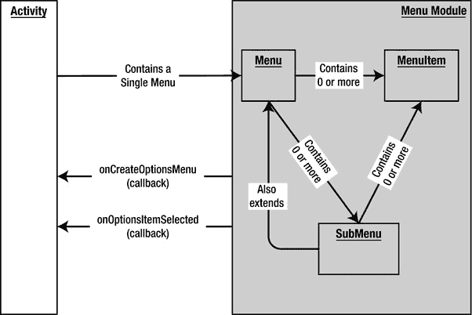
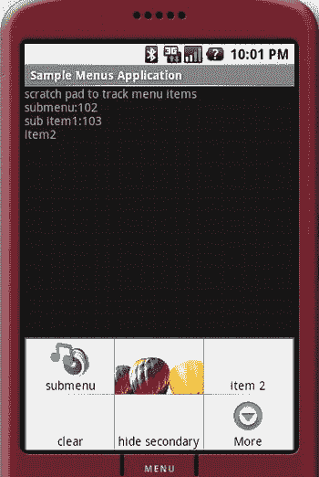
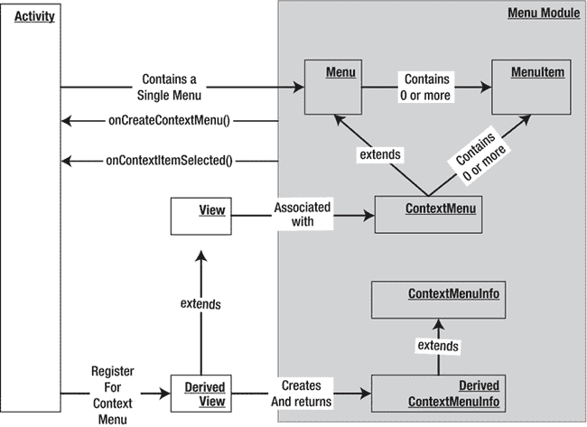
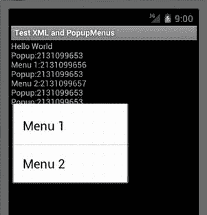

# 第 7 章 使用菜单

Android SDK 对菜单提供了广泛的支持。它支持常规菜单、子菜单、上下文菜单、图标菜单、次级菜单和替代菜单。此外，Android 3.0 引入了操作栏，它与菜单项很好地集成在一起。操作栏和菜单的交互将在第 10 章中介绍。现在，Android 4.0 引入了弹出菜单：可以根据按钮点击或任何其他 UI 事件随时调用的菜单。

在 Android 中，菜单与其他资源非常相似，既可以表示为 Java 对象，也可以表示为 XML 文件中的条目。Android 为每个加载的菜单项生成资源 ID。本章也将详细讨论 XML 菜单资源。

作为资源，所有菜单项都利用了自动生成的资源 ID。

### 理解 Android 菜单

Android 菜单支持中的关键类是 `android.view.Menu`。Android 中的每个 Activity 都与一个此类型的菜单对象相关联。该菜单对象随后包含若干菜单项和子菜单。

菜单项由 `android.view.MenuItem` 表示。子菜单由 `android.view.SubMenu` 表示。这些关系在图 7-1 中以图形方式展示。严格来说，这并非类图，而是一个结构图，旨在帮助你可视化地理解各种菜单相关类与函数之间的关系。



**图 7-1.** *Android 菜单相关类的结构*

图 7-1 说明一个 `Menu` 对象包含一组菜单项。一个菜单项具有以下属性：

*   **名称：** 一个字符串标题
*   **菜单项 ID：** 一个整数
*   **组 ID：** 一个整数，表示此菜单项应属于哪个组
*   **排序顺序：** 一个整数，用于标识此菜单项在菜单中显示时的顺序

名称和菜单项 ID 属性不言自明。

你可以通过为每个菜单项分配一个组 ID 来将它们分组。具有相同组 ID 的多个菜单项被视为同一组的一部分。

排序顺序属性需要稍作解释。如果一个菜单项的排序号为 4，而另一个菜单项的排序号为 6，那么第一个菜单项在菜单中将显示在第二个菜单项之上。某些菜单项排序号的取值范围是为特定类型的菜单保留的。这些被称为菜单*类别*。可用的菜单类别如下：

*   **次要：** 次要菜单项，被认为比其他菜单项重要性较低（且使用频率较低），从 0x30000 开始，由常量 `Menu.CATEGORY_SECONDARY` 定义。其他类型的菜单类别（如系统菜单、替代菜单和容器菜单）具有不同的排序号范围。
*   **系统：** 系统菜单项的排序号从 0x20000 开始，由常量 `Menu.CATEGORY_SYSTEM` 定义。此排序号范围是为 Android 系统添加的菜单项保留的。截至 4.0 版本，我们尚未看到向应用程序添加系统菜单项。例如，在 Microsoft Windows 平台上，关闭、刷新等可被视为适用于所有 Activity 的系统菜单项。我们在 Android 平台上尚未见到它们，但我们预计随着该平台超越手机范畴，未来可能会考虑引入。
*   **替代：** 替代菜单项的排序号范围从 0x40000 开始。这些菜单项由常量 `Menu.CATEGORY_ALTERNATIVE` 定义。它们通常由外部应用程序贡献，提供处理当前待处理数据的替代方法。
*   **容器：** 容器菜单项的排序号范围从 0x10000 开始，由常量 `Menu.CATEGORY_CONTAINER` 定义。在 Android 中，视图的父级（如布局）被视为容器。文档未明确说明此类别是否与布局相关，但这至少算是一个合理的猜测。很可能，与容器相关的菜单项可被放置在此范围内。对网格中的一组视图重新排序可被视为一个容器菜单项。

这些菜单类别主要设计用于使某一组菜单项比另一组更重要。然而，并没有规定禁止使用这些类别整数作为菜单项 ID 的起始编号来保持其唯一性。因此，你可以使用这些类别整数作为某类菜单项 ID 的起始编号。也可以将这些菜单类别起始编号作为菜单项组 ID 传递。

通常，菜单项 ID 的唯一性不是问题，因为在 Android 4.0 中，系统菜单目前不会添加到你的应用程序菜单中。调用替代菜单的机制不同（替代菜单将在本章后面介绍），其 ID 不会传递给你的菜单处理程序。大多数时候，菜单是在 XML 文件中声明的，Android 会为你生成唯一的 ID。因此，这些类别范围仅在你决定菜单显示顺序时，或者有时在你表明整个菜单项组属于特定类别时（此时组 ID 与类别 ID 匹配）才起作用。

图 7-1 还显示了你可用于创建和响应菜单项的两个回调方法：`onCreateOptionsMenu()` 和 `onOptionsItemSelected()`。你接下来将介绍这些方法。

### 创建菜单

在 Android SDK 中，你不需要从头创建菜单对象。由于一个 Activity 与单个菜单关联，Android 会为此 Activity 创建这个单个菜单，并将其传递给 Activity 类的 `onCreateOptionsMenu()` 回调方法（正如方法名称所示，Android 中的菜单也称为*选项菜单*）。

在 SDK 3.0 之前，`onCreateOptionsMenu()` 在首次访问 Activity 的选项菜单时被调用。从 3.0 开始，此方法在 Activity 创建过程中被调用。此变化是由于操作栏始终存在于 Activity 中。你在此方法中为选项菜单创建的菜单项可能会位于操作栏中。因为操作栏始终可见（与选项菜单不同），所以操作栏必须从一开始就知道其菜单项。因此，Android 不能等到用户打开选项菜单时才调用 `onCreateOptionsMenu()` 方法。

这个回调菜单设置方法允许你使用一组菜单项填充传入的单个菜单（见清单 7-1）。

**清单 7-1.** * `onCreateOptionsMenu` 方法的签名*

```
@Override
public boolean onCreateOptionsMenu(Menu menu)
{
    // 填充菜单项
    .....
   ...return true;
}
```

填充菜单项后，代码应返回 `true` 以使菜单可见。如果此方法返回 `false`，则菜单不可见。清单 7-2 中的代码展示了如何使用单个组 ID 以及递增的菜单项 ID 和顺序 ID 来添加三个菜单项。

**清单 7-2.** *添加菜单项*

```
@Override
public boolean onCreateOptionsMenu(Menu menu)
{
   //调用基类以包含系统菜单
   super.onCreateOptionsMenu(menu);

   menu.add(0           // 组
         ,1             // 菜单项 ID
         ,0             //顺序
         ,"append");    // 标题

   menu.add(0,2,1,"item2");
   menu.add(0,3,2,"clear");

   //返回 true 以显示菜单很重要
   return true;
}
```

你还应该调用此方法的基类实现，让系统有机会用系统菜单项填充菜单（目前尚未定义系统菜单项）。为了将这些系统菜单项与其他类型的菜单项分开，Android 会以 0x20000 开始的排序顺序添加系统菜单项。（正如我们之前提到的，常量 `Menu.CATEGORY_SYSTEM` 定义了这些系统菜单项的起始排序顺序 ID。在迄今为止的所有版本中，Android 尚未添加任何系统菜单。）

创建菜单项的参数在清单 7-2 中进行了解释。最后一个参数是菜单项的名称或标题。你可以使用 `R.java` 常量文件中的字符串资源，而不是自由文本。组、菜单项和顺序 ID 都是可选的；如果你不想指定其中任何一个，可以使用 `Menu.NONE`。

#### 使用菜单组

现在，我们来看看如何使用菜单组。清单 7-3 演示了如何添加两组菜单：组 1 和组 2。

**清单 7-3.** *使用组 ID 创建菜单组*

```java
@Override
public boolean onCreateOptionsMenu(Menu menu)
{
   //Group 1
   int group1 = 1;
   menu.add(group1,1,1,"g1.item1");
   menu.add(group1,2,2,"g1.item2");

   //Group 2
   int group2 = 2;
   menu.add(group2,3,3,"g2.item1");
   menu.add(group2,4,4,"g2.item2");

   return true; // it is important to return true
}
```

请注意，菜单项 ID 和排序 ID 与组是相互独立的。那组有什么用呢？实际上，Android 在 `android.view.Menu` 类上提供了一组基于组 ID 的方法。你可以使用这些方法来操作某个组内的菜单项：

`removeGroup(id)`

`setGroupCheckable(id, checkable, exclusive)`

`setGroupEnabled(id,boolean enabled)`

`setGroupVisible(id,visible)`

`removeGroup()` 会根据给定的组 ID 移除该组中的所有菜单项。你可以使用 `setGroupEnabled()` 方法来启用或禁用某个组内的菜单项。类似地，你也可以使用 `setGroupVisible()` 来控制某个菜单组的可见性。

`setGroupCheckable()` 是一个有趣的方法。你可以使用此方法在某个菜单项被选中时显示一个复选标记。当应用于一个组时，它会为该组内的所有菜单项启用此功能。如果此方法的 `exclusive` 标志被设置，则只允许该组内的一个菜单项进入选中状态，其他菜单项则保持未选中状态。

现在你知道了如何用一组菜单项填充活动的主菜单，并根据它们的性质进行分组。接下来，你将学习如何响应这些菜单项。

## 响应菜单项

在 Android 中有多种方式响应菜单项点击事件。你可以使用活动类的 `onOptionsItemSelected()` 方法；也可以使用独立的监听器；或者使用 Intent。本节将逐一介绍这些技术。

### 通过 `onOptionsItemSelected()` 响应菜单项

当菜单项被点击时，Android 会调用 `Activity` 类上的 `onOptionsItemSelected()` 回调方法（参见 清单 7-4）。

`清单 7-4. onOptionsItemSelected() 方法的签名和主体`

```java
@Override
public boolean onOptionsItemSelected(MenuItem item)
{
   switch(item.getItemId()) {
      .....
   //for items handled
   return true;

   //for the rest
   ...return super.onOptionsItemSelected(item);
   }
}
```

这里的关键模式是通过 `MenuItem` 类的 `getItemId()` 方法检查菜单项 ID，并执行必要的操作。如果 `onOptionsItemSelected()` 处理了某个菜单项，它会返回 `true`。菜单事件将不再继续传播。对于 `onOptionsItemSelected()` 未处理的菜单项回调，`onOptionsItemSelected()` 应通过 `super.onOptionsItemSelected()` 调用父类方法。`onOptionsItemSelected()` 方法的默认实现返回 `false`，以便进行正常处理。正常处理包括调用响应菜单点击的替代方式，例如直接调用可以绑定到菜单项的监听器。

### 通过监听器响应菜单项

通常你会通过重写 `onOptionsItemSelected()` 来响应菜单；这是为了更好性能而推荐的技术。但是，菜单项允许你注册一个可用作回调的监听器。使用监听器意味着需要创建对象并注册监听器。因此，这就是本节第一句中提到的*性能*开销。不过，你可能更看重代码的复用性和清晰度，在这种情况下，监听器提供了灵活性。

这种方法分两步。第一步，实现 `OnMenuClickListener` 接口。然后，创建此实现的一个实例并将其传递给菜单项。当菜单项被点击时，菜单项会调用 `OnMenuClickListener` 接口的 `onMenuItemClick()` 方法（参见 清单 7-5）。

`清单 7-5. 使用监听器作为菜单项点击的回调`

```java
//Step 1
public class MyResponse implements OnMenuClickListener
{
   //some local variable to work on
   //...
   //Some constructors
   @override
   boolean onMenuItemClick(MenuItem item)
   {
      //do your thing
      return true;
   }
}

//Step 2
MyResponse myResponse = new MyResponse(...);
menuItem.setOnMenuItemClickListener(myResponse);
...
```

当菜单项被调用时，会执行 `onMenuItemClick()` 方法。这段代码会在菜单项被点击后立即执行，甚至早于 `onOptionsItemSelected()` 方法的调用。如果 `onMenuItemClick()` 返回 `true`，则不会执行其他任何回调——包括 `onOptionsItemSelected()` 回调方法。这意味着监听器代码的优先级高于 `onOptionsItemSelected()` 方法。

### 使用 Intent 响应菜单项

你也可以通过使用 `MenuItem` 的 `setIntent(intent)` 方法将菜单项与一个 Intent 关联起来。默认情况下，菜单项没有关联 Intent。但是，当一个 Intent *确实* 与菜单项关联，并且没有其他处理函数处理该菜单项时，默认行为是使用 `startActivity(intent)` 来调用这个 Intent。要使它正常工作，所有处理程序——尤其是 `onOptionsItemSelected()` 方法——对于那些未处理的项目，应该调用父类的 `onOptionsItemSelected()` 方法。或者你可以这样理解：系统优先让 `onOptionsItemSelected()` 有机会处理菜单项（当然，紧接着是监听器）。这是假设没有监听器直接与该菜单项关联；如果有，那么监听器会覆盖其他处理。

如果你没有重写 `onOptionsItemSelected()` 方法，Android 框架中的基类会执行必要的操作来调用菜单项上的 Intent。但如果你确实重写了这个方法，并且对这个菜单项不感兴趣，你必须调用父类方法，父类方法会继而促成 Intent 的调用。所以，底线是：要么不重写 `onOptionsItemSelected()` 方法，要么重写它，并为你未处理的菜单项调用父类方法。

 `注意：` `Menu` 类定义了一些便捷常量，其中之一是 `Menu.FIRST`。你可以将其用作菜单 ID 和其他与菜单相关的序列号的基准数字。

如前所述，次级菜单项起始于 `0x30000`，并由常量 `Menu.CATEGORY_SECONDARY` 定义。它们的排序 ID 高于常规菜单项，因此它们在菜单中显示在常规菜单项之后。请注意，排序顺序是区分次级菜单项和常规菜单项的唯一标准。在其他所有方面，次级菜单项的工作方式和行为与任何其他菜单项相同。

现在你已经了解了 Android 中菜单支持的基础知识，图 7-2 显示了一个显示菜单的活动屏幕截图。本节在解释这些概念时会引用此图。



`图 7-2. 示例菜单应用程序`

## 使用其他菜单类型

到目前为止，你已经了解了一些比较简单但功能强大的菜单类型。当你深入研究 SDK 时，你会发现 Android 也支持图标菜单、子菜单、上下文菜单和替代菜单。其中，替代菜单是 Android 特有的。本节将涵盖所有这些菜单类型。

### 展开菜单

如果应用的菜单项超出主屏幕可显示范围，Android 会显示"更多"菜单项，让用户查看其余内容。这种菜单称为*展开菜单*，当菜单项过多无法在有限空间内全部显示时，它会自动出现。您可以在图 7–2 中看到这个"更多"菜单项。

### 使用图标菜单

Android 不仅支持文本，还支持图片或图标作为菜单的一部分。您同样可以在图 7–2 中看到这一点。您可以使用图标代替文本（或与文本结合）来表示菜单项。

使用图标菜单时请注意以下几点限制。首先，展开菜单不能使用图标菜单。此限制未来可能会根据设备尺寸和 SDK 支持情况而解除。较大尺寸的设备可能允许此功能，而较小设备可能仍保留此限制。

其次，图标菜单项不支持菜单项复选标记。

第三，如果图标菜单项的文本过长，会根据显示屏尺寸截断一定数量的字符。（最后这条限制也适用于纯文本菜单项。）

创建图标菜单项非常简单。您先像之前一样创建常规的纯文本菜单项，然后使用 `MenuItem` 类的 `setIcon()` 方法来设置图像。您需要使用图像的资源 ID，因此必须先将图片或图标放在 `/res/drawable` 目录下生成资源 ID。例如，如果图标文件名为 `balloons`，那么资源 ID 就是 `R.drawable.balloons`。

代码清单 7–6 演示了如何向菜单项添加图标

`代码清单 7–6. 为菜单项附加图标`

```
//添加菜单项并记住它，以便后续为其设置图标。
MenuItem item = menu.add(...);
item.setIcon(R.drawable.balloons);
```

在向菜单添加菜单项时，通常无需保留 `menu.add` 方法返回的局部变量。但在此例中，您需要记住返回的对象，以便为菜单项添加图标。此示例代码还说明了 `menu.add()` 方法返回的类型是 `MenuItem`。

只要菜单项显示在主应用屏幕上，图标就会显示。如果菜单项作为展开菜单的一部分显示，则不会显示图标，仅显示文本。图 7–2 中显示气球图像的菜单项就是图标菜单项的一个示例。

## 使用子菜单

现在我们来看看 Android 的子菜单。图 7–1 指出了 `SubMenu` 与 `Menu` 和 `MenuItem` 之间的结构关系。一个 `Menu` 对象可以拥有多个 `SubMenu` 对象。每个 `SubMenu` 对象通过调用 `Menu.addSubMenu()` 方法添加到 `Menu` 对象中（参见代码清单 7–7）。往子菜单中添加菜单项的方式与往菜单中添加菜单项完全相同，这是因为 `SubMenu` 同样继承自 `Menu` 对象。不过，您无法向子菜单中添加更多子菜单。

**代码清单 7–7.** *添加子菜单*

```
private void addSubMenu(Menu menu)
{
   //次要项与其他项一样正常显示
   int base=Menu.FIRST + 100;
   SubMenu sm = menu.addSubMenu(base,base+1,Menu.NONE,"子菜单");
   sm.add(base,base+2,base+2,"子项 1");
   sm.add(base,base+3,base+3,"子项 2");
   sm.add(base,base+4,base+4,"子项 3");

    //子菜单项不支持图标
   item1.setIcon(R.drawable.icon48x48_2);

   //以下操作是允许的
   sm.setIcon(R.drawable.icon48x48_1);

   //以下操作将导致运行时异常
    //sm.addSubMenu("尝试这个");
}
```

 **注意：** `SubMenu` 作为 `Menu` 对象的子类，仍然继承 `addSubMenu()` 方法。如果你向一个子菜单添加另一个子菜单，编译器不会报错，但实际执行时会产生运行时异常。

Android SDK 文档还指出，子菜单不支持图标菜单项。当你为菜单项添加图标，然后将其添加到子菜单时，该菜单项会忽略这个图标，即使不会出现编译时或运行时错误。不过，子菜单本身可以带有图标。

## 处理上下文菜单

桌面程序的用户对上下文菜单都很熟悉。例如在 Windows 应用程序中，你可以通过右键点击某个 UI 元素来访问上下文菜单。Android 通过一种称为*长按*的操作支持相同的上下文菜单概念。长按是指在任意 Android 视图上按住鼠标点击的时间比平时稍长一些。

在手机等手持设备上，鼠标点击的实现方式有多种，具体取决于导航机制。如果你的手机有滚轮来移动光标，按下滚轮就相当于鼠标点击。或者，如果设备有触摸板，轻触或按压就相当于鼠标点击。又或者你有一组方向按钮用于移动以及一个位于中间的确认按钮；点击该按钮就相当于点击鼠标。无论你的设备如何实现鼠标点击，如果你按住鼠标点击的时间稍长一点，就能触发长按。

上下文菜单在结构上与你一直了解的标准选项菜单不同（参见图 7–3）。上下文菜单具有选项菜单所没有的细微差别。

图 7–3 展示了在 Android 菜单架构中，上下文菜单被表示为 `ContextMenu` 类。就像 `Menu` 一样，`ContextMenu` 可以包含多个菜单项。你可以使用同一组 `Menu` 方法来为上下文菜单添加菜单项。

`Menu` 和 `ContextMenu` 之间的区别归结为菜单的所有权问题。Activity 拥有常规的选项菜单，而视图拥有上下文菜单。这是符合预期的，因为激活上下文菜单的长按操作是针对被点击的*视图*的。因此，一个 Activity 只能有一个选项菜单，但可以有多个上下文菜单。由于一个 Activity 可以包含多个视图，并且每个视图都可以有自己的上下文菜单，所以一个 Activity 可以有与视图数量一样多的上下文菜单。



**图 7–3.** *Activity、视图和上下文菜单*

尽管上下文菜单由视图拥有，但填充上下文菜单的方法位于 `Activity` 类中。这个方法名为 `activity.onCreateContextMenu()`，其作用类似于 `activity.onCreateOptionsMenu()` 方法。此回调方法还会携带（作为该方法的参数）需要为其填充上下文菜单项的视图。

上下文菜单还有另一个值得注意的特殊之处。虽然 `onCreateOptionsMenu()` 方法会自动为每个 Activity 调用，但 `onCreateContextMenu()` 并非如此。一个 Activity 中的视图并非*必须*拥有一个上下文菜单。例如，你的 Activity 中可以有三个视图，但你可能只想为一个视图启用上下文菜单，而其他视图则不启用。如果你希望某个特定的视图拥有上下文菜单，你必须专门为此目的向该 Activity 注册该视图。你可以通过 `activity.registerForContextMenu(view)` 方法来实现这一点，该方法将在“为上下文菜单注册视图”一节中讨论。

现在请注意图 7–3 中所示的 `ContextMenuInfo` 类。此类型的对象会被传递给 `onCreateContextMenu()` 方法。这是视图向该方法传递额外信息的一种方式。为了实现这一点，视图需要重写 `getContextViewInfo()` 方法，并返回一个 `ContextMenuInfo` 的派生类，该类包含用于表示额外信息的额外方法。你可能需要查看 `android.view.View` 的源代码以完全理解这种交互。

 **注意：** 根据 Android SDK 文档，上下文菜单不支持快捷键、图标或子菜单。

现在你已经了解了上下文菜单的总体结构，让我们看一些示例代码，这些代码演示了实现上下文菜单的每个步骤：

1.  在 Activity 的 `onCreate()` 方法中为上下文菜单注册一个视图。

2.  使用 `onCreateContextMenu()` 填充上下文菜单。你必须在 Android 调用此回调方法之前完成步骤 1。

3.  响应上下文菜单点击。

### 为上下文菜单注册视图

实现上下文菜单的第一步是在 Activity 的 `onCreate()` 方法中为上下文菜单注册一个视图。你可以使用代码清单 7–8 中的代码为 `TextView` 注册上下文菜单。首先找到 `TextView`，然后在 Activity 上以该 `TextView` 作为参数调用 `registerForContextMenu()`。这样就为该 `TextView` 设置好了上下文菜单。

**代码清单 7–8.** *为上下文菜单注册 `TextView`*

```
@Override
public void onCreate(Bundle savedInstanceState) {
    super.onCreate(savedInstanceState);
    setContentView(R.layout.main);

    TextView tv = (TextView)this.findViewById(R.id.textViewId);
    registerForContextMenu(tv);
}
```

### 填充上下文菜单

一旦为本示例中的 `TextView` 这样的视图注册了上下文菜单，Android 就会以该视图作为参数调用 `onCreateContextMenu()` 方法。这就是你可以为该上下文菜单填充菜单项的地方。`onCreateContextMenu()` 回调方法提供了三个参数供使用。

第一个参数是一个预先构建好的 `ContextMenu` 对象，第二个是触发回调的视图（例如 `TextView`），第三个是你在讨论图 7–3 时简要看到的 `ContextMenuInfo` 类。对于许多简单的情况，你可以直接忽略 `ContextMenuInfo` 对象。但是，某些视图可能会通过此对象传递额外信息。在这些情况下，你需要将 `ContextMenuInfo` 类转换为子类，然后使用额外的方法来检索这些额外信息。
```

一些派生自 `ContextMenuInfo` 类的示例包括 `AdapterContextMenuInfo` 和 `ExpandableContextMenuInfo`。Android 中与数据库游标关联的视图使用 `AdapterContextMenuInfo` 类来传递该视图中正在显示上下文菜单的行 ID。从某种意义上说，你可以使用此类来进一步明确鼠标点击下的对象，即使在给定的视图内部也是如此。

## 代码清单 7–9. `onCreateContextMenu()` 方法

```java
@Override
public void onCreateContextMenu(ContextMenu menu, View v, ContextMenuInfo menuInfo)
{
    menu.setHeaderTitle("示例上下文菜单");
    menu.add(200, 200, 200, "项目 1");
}
```

## 响应上下文菜单项

实现上下文菜单的第三步是响应上下文菜单点击。响应上下文菜单的机制与响应选项菜单的机制类似。Android 提供了一个类似 `onOptionsItemSelected()` 的回调方法，名为 `onContextItemSelected()`。这个方法与其对应方法一样，也可以在 `Activity` 类中找到。代码清单 7–10 演示了 `onContextItemSelected()`。

### 代码清单 7–10. 响应上下文菜单

```java
@Override
public boolean onContextItemSelected(MenuItem item)
{
    if (item.getItemId() == some-menu-item-id)
    {
        //处理此菜单项
        return true;
    }
    // ... 其他异常处理
}
```

## 使用替代菜单

到目前为止，您已经学会了如何创建和使用菜单、子菜单以及上下文菜单。Android 引入了一个名为*替代菜单*的新概念，它允许将替代菜单项作为菜单、子菜单和上下文菜单的一部分。替代菜单使 Android 上的多个应用能够相互协助。

具体而言，替代菜单允许某一应用包含来自另一应用的菜单项。当选择替代菜单时，目标应用或 Activity 会通过一个指向所需数据的 URL 启动。被调用的 Activity 随后使用从传递的 Intent 中获取的数据 URL。要深入理解替代菜单，您必须先了解内容提供程序、内容 URI、内容 MIME 类型以及 Intent（请参考第 4 章和第 5 章）。

这里的基本思路是：假设您正在编写一个用于显示某些数据的界面。这个界面很可能是一个 Activity。在这个 Activity 上，您有一个选项菜单，允许您以多种方式操作或处理数据。同时，假设您正在处理一份由 URI 和对应 MIME 类型标识的文档或笔记。作为程序员，您需要预见到设备上最终会出现更多能够处理或显示这类数据的程序。您希望让这些新程序有机会将其菜单项作为您为此 Activity 构建的菜单的一部分显示出来。

要将替代菜单项附加到菜单，请在 `onCreateOptionsMenu()` 方法中设置菜单时遵循以下步骤：

1.  创建一个 Intent，将其数据 URI 设置为当前展示的数据 URI。
2.  将 Intent 的类别设置为 `CATEGORY_ALTERNATIVE`。
3.  搜索能够对 URI 所支持的数据进行操作的活动。
4.  将能够调用这些 Activity 的 Intent 作为菜单项添加到菜单中。

这些步骤充分揭示了 Android 应用的本质，因此我们来逐一分析。如您所知，将替代菜单项附加到菜单的操作发生在 `onCreateOptionsMenu()` 方法中：

```java
@Override
public boolean onCreateOptionsMenu(Menu menu)
{
}
```

现在，我们来确定此函数中应包含的代码。首先，您需要知道当前 Activity 可能处理的数据的 URI。您可以通过以下方式获取 URI：

```java
this.getIntent().getData()
```

这之所以可行，是因为 `Activity` 类有一个名为 `getIntent()` 的方法，它会返回用于调用此 Activity 的数据 URI。这个被调用的 Activity 可能是由主菜单调用的主 Activity；在这种情况下，它可能没有 Intent，`getIntent()` 方法会返回 `null`。在代码中，您需要防范这种情况。

如果您碰巧知道数据的 URI（无论 Activity 是如何被调用的），您也可以直接使用该 URI。

现在，您的目标是找出其他能够处理这类数据的程序。您需要使用一个 Intent 作为参数来进行搜索。以下是构建该 Intent 的代码：

```java
Intent criteriaIntent = new Intent(null, getIntent().getData());
intent.addCategory(Intent.CATEGORY_ALTERNATIVE);
```

一旦构建好 Intent，您还需要添加您感兴趣的 Action 类别。具体来说，您只对可作为替代菜单一部分被调用的 Activity 感兴趣。现在，您可以告诉 `Menu` 对象搜索匹配的 Activity，并将它们添加为菜单选项（请参考列表 7–11）。

### 列表 7–11. 使用替代菜单项填充菜单

```java
// 搜索匹配的 Activity 并将其填充到菜单中。

// 您可以使用以下定义的常量
// 作为一系列唯一 ID 的起始点。
int menuItemGroupId = Menu.CATEGORY_ALTERNATIVE;
int startingMenuItemId = Menu.CATEGORY_ALTERNATIVE;
int startingMenuItemOrderId = Menu.CATEGORY_ALTERNATIVE;
```

`menu.addIntentOptions(`
`     menuItemGroupId,             // 分组`
`     startingMenuItemId,          // 所有菜单项的起始菜单项 ID`
`     startingMenuItemOrderId,     // 每个菜单的起始排序 ID`
`     this.getComponentName(),     // 显示菜单的活动类名称——此处为当前类。`
`                                  // 变量 "this" 指向当前活动`
`     null,                        // 无特定意图`
`     criteriaIntent,              // 先前创建的意图，用于描述我们的需求`
`     0,                           // 无标志`
`     null);                       // 返回的菜单项`

`Menu` 类中的 `addIntentOptions()` 方法负责查找与某项意图的 URI 和类别属性相匹配的活动。然后，该方法将这些活动添加到正确的分组下，并赋予相应的菜单项和排序 ID。前三个参数处理的就是方法在这方面的职责。在清单 7–11 中，您从 `Menu.CATEGORY_ALTERNATIVE` 开始，将其作为新菜单项将要添加到的分组。您还使用同一个常量作为菜单项和排序 ID 的起始值。

下一个参数指向此菜单所属活动的完全限定组件名称。代码使用了 `Activity` 类中的 `getComponentName()` 方法。*组件名称*仅是包名和类名的组合，之所以需要此组件名称，是因为当添加一个新的菜单项时，该菜单项需要调用目标活动。为此，系统需要知道启动目标活动的源活动。下一个参数是一个意图数组，您应将其用作返回意图的过滤器。在示例中您使用了 `null`。

接下来的参数指向您刚构建的 `criteriaIntent`。这是您要使用的搜索条件。之后的参数是一个标志，例如 `Menu.FLAG_APPEND_TO_GROUP`，用于指示是追加到该分组现有菜单项集合中，还是替换它们。默认值为 `0`，表示应替换菜单组中的菜单项。

清单 7–11 中的最后一个参数是一个已添加菜单项的数组。如果您希望在添加后以某种方式操作这些已添加的菜单项，可以使用这些引用。

以上这一切都很好。但仍有一些问题未得到解答。例如，添加的菜单项的名称会是什么？Android 文档对此没有说明，因此我们深入查看了源代码，想了解这个函数在幕后究竟做了什么（请参考第 1 章了解如何获取 Android 源代码）。

事实证明，`Menu` 类只是一个接口，因此您无法看到它的任何实现源代码。实现 `Menu` 接口的类名为 `MenuBuilder`。清单 7–12 展示了来自 `MenuBuilder` 类的一个相关方法 `addIntentOptions()` 的源代码（提供此代码供您参考，我们不会逐行解释）。

`清单 7–12. MenuBuilder.addIntentOptions() 方法`

```
public int addIntentOptions(int group, int id, int categoryOrder,
                           ComponentName caller,
                           Intent[] specifics,
                           Intent intent, int flags,
                           MenuItem[] outSpecificItems)
{
    PackageManager pm = mContext.getPackageManager();
    final List<ResolveInfo> lri =
            pm.queryIntentActivityOptions(caller, specifics, intent, 0);
    final int N = lri != null ? lri.size() : 0;

    if ((flags & FLAG_APPEND_TO_GROUP) == 0) {
        removeGroup(group);
    }

    for (int i=0; i<N; i++) {
        final ResolveInfo ri = lri.get(i);
        Intent rintent = new Intent(
            ri.specificIndex < 0 ? intent : specifics[ri.specificIndex]);
        rintent.setComponent(new ComponentName(
                ri.activityInfo.applicationInfo.packageName,
                ri.activityInfo.name));
final MenuItem item = add(group, id, categoryOrder,
                       ri.loadLabel(pm));
        item.setIntent(rintent);
        if (outSpecificItems != null && ri.specificIndex >= 0) {
            outSpecificItems[ri.specificIndex] = item;
        }
    }
    return N;
}
```

请注意清单 7–12 中加粗高亮的那一行代码；这部分代码用于构建菜单项。代码将确定菜单标题的工作委托给了 `ResolveInfo` 类。`ResolveInfo` 类的源代码显示，声明此意图的意图过滤器应具有一个关联的标题。清单 7–13 展示了一个意图过滤器定义的示例。

`清单 7–13. 意图过滤器的标签`

```
<intent-filter android:label="菜单标题 ">
     .......
      <category android:name="android.intent.category.ALTERNATE" />
     <data android:mimeType="some type data" />
</intent-filter>
```

意图过滤器的 `label` 值最终用作菜单名称。您可以查看 Android 的 NotePad 示例来了解此行为。

### 动态菜单

到目前为止，我们讨论的都是静态菜单——您一次性设置好它们，它们不会根据屏幕上的内容动态变化。如果您想创建动态菜单，请使用 Android 在活动类上提供的 `onPrepareOptionsMenu()` 方法。此方法与 `onCreateOptionsMenu()` 类似，区别在于它每次调用菜单时都会被调用。如果您想根据显示的内容禁用某些菜单项或菜单组，则应使用 `onPrepareOptionsMenu()`。对于 Android 3.0 及以上版本，您必须显式调用一个新提供的方法 `invalidateOptionsMenu()`，该方法会转而调用 `onPrepareOptionsMenu()`。每当您的应用程序状态发生需要更改菜单的变化时，您都可以随时调用此方法。

### 通过 XML 文件加载菜单

到目前为止，我们都是通过编程方式创建所有菜单。这并不是创建菜单最方便的方式，因为对于每个菜单，您都必须提供多个 ID 并为每个 ID 定义常量。这无疑很繁琐。

相反，您可以通过 XML 文件定义菜单，这在 Android 中是可行的，因为菜单也是资源。创建菜单的 XML 方法提供了几个优点，例如能够命名菜单、自动对它们排序以及为它们分配 ID。您还可以获得对菜单文本的本地化支持。

按照以下步骤使用基于 XML 的菜单：

1.  使用菜单标签定义一个 XML 文件。

2.  将该文件放置在 `/res/menu` 子目录中。文件名是任意的，您可以根据需要创建任意数量的文件。Android 会自动为此菜单文件生成一个资源 ID。

3.  使用菜单文件的资源 ID 将 XML 文件加载到菜单中。

4.  使用为每个菜单项生成的资源 ID 来响应菜单项。

以下各节将分别讨论这些步骤，并提供相应的代码片段。

#### XML 菜单资源文件的结构

首先，让我们来看一个包含菜单定义的 XML 文件（参见列表 7–14）。所有菜单文件都以相同的高层级 `menu` 标签开头，后跟一系列 `group` 标签。每个 `group` 标签对应你在本章开头提到的菜单项组。你可以使用 `@+id` 方式为组指定一个 ID。每个菜单组都包含一系列菜单项，这些菜单项的 ID 与符号名称相关联。你可以参考 Android SDK 文档了解这些 XML 标签所有可能的参数。

`列表 7–14. 包含菜单定义的 XML 文件`

```
<menu>
    <!-- 此组使用默认类别。 -->
    <group android:id="@+id/menuGroup_Main">
        <item android:id="@+id/menu_testPick"
            android:orderInCategory="5"
            android:title="Test Pick" />
        <item android:id="@+id/menu_testGetContent"
            android:orderInCategory="5"
            android:title="Test Get Content" />
        <item android:id="@+id/menu_clear"
            android:orderInCategory="10"
            android:title="clear" />
        <item android:id="@+id/menu_dial"
            android:orderInCategory="7"
            android:title="dial" />
        <item android:id="@+id/menu_test"
            android:orderInCategory="4"
            android:title="@+string/test" />
        <item android:id="@+id/menu_show_browser"
            android:orderInCategory="5"
            android:title="show browser" />
    </group>
</menu>
```

列表 7–14 中的菜单 XML 文件包含一个组。根据资源 ID 定义 `@+id/menuGroup_main`，此组将在 `R.java` 资源 ID 文件中自动获得一个名为 `menuGroup_main` 的资源 ID。类似地，所有子菜单项会根据该 XML 文件中的符号资源 ID 定义被分配相应的菜单项 ID。

### 填充 XML 菜单资源文件

假设这个 XML 文件的名称为 `my_menu.xml`。你需要将此文件放置在 `/res/menu` 子目录中。将文件放在 `/res/menu` 中会自动生成一个名为 `R.menu.my_menu` 的资源 ID。

现在，让我们看看如何使用这个菜单资源 ID 来填充选项菜单。Android 提供了一个名为 `android.view.MenuInflater` 的类，用于从 XML 文件填充 `Menu` 对象。你可以使用该 `MenuInflater` 的一个实例，借助 `R.menu.my_menu` 资源 ID 来填充菜单对象。如列表 7–15 所示。

**列表 7–15.** `使用菜单填充器`

```java
@Override
public boolean onCreateOptionsMenu(Menu menu)
{
   MenuInflater inflater = getMenuInflater(); //来自 Activity
   inflater.inflate(R.menu.my_menu, menu);

   //务必返回 true 以显示菜单
   return true;
}
```

在这段代码中，你首先从 `Activity` 类获取 `MenuInflater`，然后指示它将菜单 XML 文件直接填充到菜单中。

### 响应基于 XML 的菜单项

你响应 XML 菜单项的方式与响应通过编程方式创建的菜单类似，但有一点细微差别。和之前一样，你在 `onOptionsItemSelected()` 回调方法中处理菜单项。这一次，你可以借助 Android 资源获得一些帮助（有关资源的详细信息，请参见第 3 章）。如“XML 菜单资源文件的结构”一节所述，Android 不仅为 XML 文件生成资源 ID，还会生成必要的菜单项 ID，以帮助你区分不同的菜单项。这在响应菜单项方面是一个优势，因为你无需显式创建和管理它们的菜单项 ID。

 **注意：** 用于标识菜单项 ID 的资源类型（`R.id.some_menu_item_id`）与用于标识菜单本身的资源类型（`R.menu.some_menu_file_id`）是不同的。

为了进一步说明这一点，对于 XML 菜单，你无需为这些 ID 定义常量，也无需担心它们的唯一性，因为资源 ID 的生成机制会处理这一切。列表 7–16 中的代码对此进行了说明。

**列表 7–16.** `响应来自 XML 菜单资源文件的菜单项`

```java
private void onOptionsItemSelected (MenuItem item)
{
   if (item.getItemId() == R.id.menu_clear)
   {
        //执行某些操作
   }
   else if (item.getItemId() == R.id.menu_dial)
   {
        //执行某些操作
   }
    ......等等
}
```

请注意，XML 菜单资源文件中的菜单项名称是如何在 `R.id` 空间中自动生成菜单项 ID 的。

从 SDK 3.0 开始，你可以使用菜单项的 `android:onClick` 属性直接指定 Activity 中与此菜单关联的方法名称。然后，该方法将被调用，并将菜单项对象作为唯一的输入参数。此功能仅在 3.0 及以上版本中可用。列表 7–17 展示了一个示例。

**列表 7–17.** `在 XML 菜单资源文件中指定菜单回调方法`

```xml
<item android:id="... "
        android:onClick="a-method-name-in-your-activity"
       ...
</item>
```

### 4.0 中的弹出菜单

Android 3.0 引入了另一种菜单类型，称为弹出菜单。SDK 4.0 通过为 `PopupMenu` 类添加几个实用方法（例如 `PopupMenu.inflate`）对此进行了轻微增强。（请参阅 `PopupMenu` API 文档了解这些方法。清单 7–19 也指出了这一差异。）

弹出菜单可以针对任何视图调用，以响应 UI 事件。UI 事件的一个示例是按钮点击或图像视图上的点击。图 7–4 显示了一个针对视图调用的弹出菜单。



**图 7–4.** `附加到文本视图的弹出菜单`

要创建像图 7–4 中那样的弹出菜单，请从常规的 XML 菜单文件开始，如清单 7–18 所示。

**清单 7–18.** `弹出菜单的示例 XML 文件`

```xml
<menu >
    <!-- 此组使用默认类别。 -->
    <group android:id="@+id/menuGroup_Popup">
        <item android:id="@+id/popup_menu_1"
            android:title="Menu 1" />

        <item android:id="@+id/popup_menu_2"
            android:title="Menu 2" />
    </group>
</menu>
```

假设清单 7–18 中的代码位于名为 `popup_menu.xml` 的文件中，则可以使用清单 7–19 中的 Java 代码将此菜单 XML 作为弹出菜单加载。

**清单 7–19.** `处理弹出菜单`

```java
//其他活动代码在此处...
//调用以下方法以显示弹出菜单
private void showPopupMenu()
{
    //获取一个视图来锚定弹出菜单
    //getTextView() 可以是任何返回视图的方法
    TextView tv = getTextView();

    //实例化一个弹出菜单
    //变量 "this" 代表活动
    PopupMenu popup = new PopupMenu(this, tv);

    //以下代码适用于 3.0 SDK
    //popup.getMenuInflater().inflate(
    //        R.menu.popup_menu, popup.getMenu());

    //或者使用 SDK 4.0
    popup.inflate(R.menu.popup_menu);
    popup.setOnMenuItemClickListener(new PopupMenu.OnMenuItemClickListener()
            {
                public boolean onMenuItemClick(MenuItem item)
                {
                    //一些用于记录该项的本地方法
                    //查看示例项目以了解此方法如何工作
                    appendMenuItemText(item);
                    return true;
                }
            }
    );
    popup.show();
}
```

如你所见，弹出菜单的行为与选项菜单非常相似。主要区别如下：

* 弹出菜单是按需使用的，而选项菜单始终可用。

* 弹出菜单锚定到一个视图，而选项菜单属于整个活动。

* 弹出菜单使用自己的菜单项回调，而选项菜单使用活动上的 `onOptionsItemSelected()` 回调。

### 附加 XML 菜单标签简介

在构建菜单 XML 文件时，你需要了解各种可能的 XML 菜单标签。你可以在线查找，或者通过检查 Android SDK 附带的 API 演示来快速获取此信息。这些 Android API 演示包括一系列菜单，可帮助你探索 Android 编程的各个方面。如果你查看 API 演示项目的 `/res/menu` 子目录，会发现许多 XML 菜单示例。以下各节简要介绍了一些从中借鉴的关键标签。

#### 组类别标签

在 XML 文件中，可以使用 `menuCategory` 标签指定组的类别：

```xml
<group android:id="@+id/some_group_id "
        android:menuCategory="secondary">
```

#### 可勾选行为标签

你可以使用 `checkableBehavior` 标签在组级别控制可勾选行为：

```xml
<group android:id="@+id/noncheckable_group"
       android:checkableBehavior="none">
```

你可以使用 `checked` 标签在项级别控制可勾选行为：

# Android 菜单

```xml
<item android:id=".."
      android:title="..."
      android:checked="true" />
```

### 模拟子菜单的标签

子菜单表示为菜单项下的一个 `menu` 元素：

```xml
<item android:title="所有不带组的项">
       <menu>
                  <item...>
       </menu>
</item>
```

### 菜单图标标签

你可以使用 `icon` 标签将图像与菜单项关联：

```xml
<item android:id=".. "
       android:icon="@drawable/some-file" />
```

### 菜单启用/禁用标签

你可以使用 `enabled` 标签启用或禁用菜单项：

```xml
<item android:id=".. "
        android:enabled="true"
        android:icon="@drawable/some-file" />
```

### 菜单项快捷键

你可以使用 `alphabeticShortcut` 标签为菜单项设置快捷键：

```xml
<item android:id="... "
       android:alphabeticShortcut="a"
      ...>
</item>
```

### 菜单可见性

你可以使用 `visible` 标志控制菜单项的可见性：

```xml
<item android:id="... "
        android:visible="true"
       ...>
</item>
```

## 资源

在学习和使用 Android 菜单时，你可能希望手头保留以下 URL：

* [`developer.android.com/guide/topics/ui/menus.html`](http://developer.android.com/guide/topics/ui/menus.html)：来自 Google 的主要文档，描述了如何处理菜单。随着 SDK 的进步，如果需要检查自本章撰写以来是否有变化，这是一个好去处。

* [`developer.android.com/guide/topics/resources/menu-resource.html`](http://developer.android.com/guide/topics/resources/menu-resource.html)：有关可在菜单资源中使用的各种 XML 标签的信息。

* [`androidbook.com/proandroid4/projects`](http://androidbook.com/proandroid4/projects)：本书的项目下载 URL。本章可下载的项目 ZIP 文件是 `ProAndroid4_ch07_TestMenus.zip`。此项目使用了本章涵盖的所有菜单。图 7–2 中的屏幕截图取自该项目的运行示例。

## 总结

本章涵盖了以下内容：

* 如何创建和响应常规菜单

* 如何创建和响应上下文菜单

* 如何更改现有菜单以响应应用程序中变化的上下文

* 如何处理替代菜单

* 如何创建、加载和响应基于 XML 的菜单资源

* 如何处理弹出菜单

## 面试题

以下问题将巩固你在本章学到的知识：

1.  Android SDK 中提供了哪些类型的菜单？

2.  菜单项有哪些重要属性？

3.  创建菜单项时会调用哪个回调方法？

4.  响应菜单项时会调用哪个回调方法？

5.  菜单项的顺序是否受其组 ID 的影响？

6.  如何为菜单项点击事件附加监听器？

7.  如何使用意图（intent）响应菜单项？

8.  能否通过菜单项中的意图启动服务？

9.  什么是展开菜单？

10. 如何为菜单项添加图片？

11. 菜单展开时图片会显示吗？

12. Android 中的长按是什么？

13. 从所有权角度看，菜单和上下文菜单有什么区别？

14. 创建上下文菜单时使用哪个回调方法？

15. 响应上下文菜单时使用哪个回调方法？

16. `OnCreateContextMenu` 是否为每个视图调用？

17. 如何触发上下文菜单的创建？

18. 传递给 `onCreateContextMenu()` 回调方法的三个参数是什么？

19. 如何为应用添加替代菜单？

20. 如何在每次调用菜单或应用中某些数据变化时动态更改菜单？

21. 菜单 XML 文件应放在哪里？

22. 每个菜单是否都需要单独的 XML 文件？

23. 如何使用 `R.java` 标识菜单项 ID？

24. 如何将 XML 文件中的菜单附加到 Activity？

25. 菜单 ID 和菜单项 ID 是否共享同一种资源类型？

26. 菜单填充器类（menu inflater class）的作用是什么？

27. 如何获取菜单填充器类的实例？
