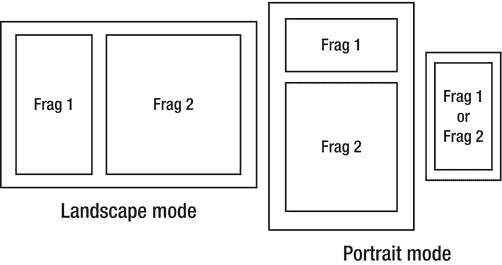
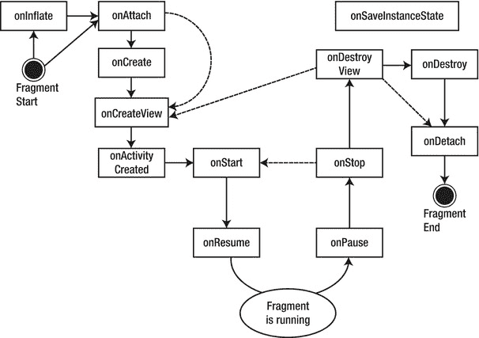
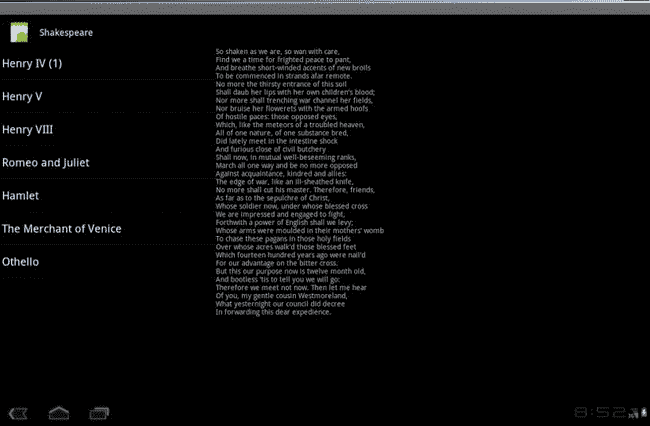

# 第 8 章：面向平板电脑及更大屏幕的 Fragment

到目前为止，我们已经探索了 Android 应用的各个组成部分，并运行了一些针对智能手机屏幕尺寸设计的简单应用。你只需要考虑如何为 Activity 在屏幕上布局 UI 控件，以及一个 Activity 如何流向下一个 Activity 等等。在 Android 最初的两个主要版本中，小屏幕是主流。随后 Android 平板电脑问世：这些设备拥有 10 英寸的屏幕。这使事情变得复杂了。为什么呢？因为现在屏幕空间非常充裕，一个简单的 Activity 很难在填满屏幕的同时，又保持单一功能。例如，一个电子邮件应用如果在一个 Activity 中只显示邮件标题（填满屏幕），再在另一个单独的 Activity 中显示单个邮件内容（同样填满屏幕），这就不再合理了。有了这么大的操作空间，应用完全可以在屏幕左侧显示邮件标题列表，在右侧显示选中的邮件内容。能否在一个 Activity 中使用单个布局实现这一点呢？嗯，可以，但你无法为较小屏幕的设备复用这个 Activity 或布局。

Android 3.0 引入的核心类之一是 `Fragment` 类，它专门设计用来帮助开发者管理应用功能，以便提供出色的可用性和高度的可复用性。本章将向你介绍片段（Fragment），解释它是什么、如何融入应用的架构以及如何使用它。片段使得许多以前难以实现的有趣功能成为可能。大约在同一时间，谷歌发布了一个适用于旧版 Android 系统的 Fragment SDK。因此，即使你对编写平板电脑应用不感兴趣，你也会发现片段能让非平板设备上的开发工作更轻松。现在，有了 Android 4.0，为智能手机、平板电脑，乃至电视和其他设备编写出色的应用比以往任何时候都更简单。

让我们开始学习 Android 片段吧。

## 什么是 Fragment？

本节将解释片段是什么以及它的作用。但首先，让我们设定一下场景，看看为什么需要片段。正如你之前所学，在小屏幕设备上，Android 应用使用 Activity 向用户展示数据和功能，每个 Activity 都有一个相当简单、定义明确的目的。例如，一个 Activity 可能向用户显示其通讯录中的联系人列表。另一个 Activity 可能允许用户撰写电子邮件。Android 应用就是这些 Activity 的集合，它们组合在一起实现一个更大的目标，例如通过阅读和发送消息来管理电子邮件账户。这对于小屏幕设备来说没问题，但当用户的屏幕非常大（10 英寸或更大）时，屏幕上就有空间可以做不止一件简单的事情。应用可能希望让用户同时查看收件箱中的邮件列表，并在另一个窗口中显示当前选中的邮件正文。或者，应用可能希望同时显示联系人列表和当前选中联系人的详细信息视图。

作为一名 Android 开发者，你知道这种功能可以通过为超大屏幕定义另一个包含 `ListView`、各种布局和其他视图的布局来实现。而“另一个布局”指的是在你可能已经为小屏幕定义的布局之外再添加的布局。当然，你还需要为竖屏和横屏情况分别设置单独的布局。鉴于超大屏幕的尺寸，这意味着要布局和编写代码的标签、字段、图片等视图数量会相当多。如果能有一种方法将这些视图对象分组并整合其逻辑，使得应用的各个部分能够在不同屏幕尺寸和设备间复用，从而最大程度地减少开发者维护应用所需的工作量，那就好了。这正是我们拥有片段的原因。

片段的一种理解方式是将其视为子 Activity。事实上，片段的语义与 Activity 非常相似。片段可以拥有与之关联的视图层次结构，并且它的生命周期与 Activity 的生命周期非常相似。片段甚至能像 Activity 一样响应返回按钮。如果你曾想过“要是我能同时在平板电脑屏幕上放置多个 Activity 就好了”，那么你的思路是对的。但由于在平板电脑屏幕上同时激活同一个应用的多个 Activity 会过于混乱，因此创建了片段来实现这一想法。这意味着片段是包含在 Activity 之内的。片段只能在 Activity 的上下文中存在；没有 Activity，你就无法使用片段。片段可以与 Activity 的其他元素共存，这意味着你并非必须将整个 Activity 的用户界面都转换为使用片段。你可以像以前一样创建 Activity 的布局，并且只为用户界面的某一部分使用片段。

然而，在保存和恢复状态方面，片段与 Activity 不同。片段框架提供了若干特性，使得保存和恢复片段比在 Activity 中需要做的工作简单得多。如何决定何时使用片段取决于一些考量因素，这些将在下面讨论。

## 何时使用片段

使用片段的主要原因之一是，你可以在不同设备和屏幕尺寸间复用用户界面和功能模块。这一点在平板电脑上尤为明显。试想，当屏幕大到像平板电脑那样时，能承载多少内容？它更像一台台式机而非手机，而许多桌面应用程序都采用了多面板用户界面。如之前所述，你可以在屏幕上同时显示一个列表和所选项目的详情视图。在横屏模式下，列表在左侧、详情在右侧的情况很容易想象。但如果用户将设备旋转到竖屏模式，屏幕变成竖长形呢？你可能希望列表位于屏幕顶部，详情位于底部。然而，如果这个应用程序运行在小屏幕上，根本没有空间同时容纳这两个部分，该怎么办？你难道不希望为列表和详情分别创建独立的 Activity，并让它们能够共享你为大屏幕构建的这些面板逻辑吗？我们希望你给出的答案是肯定的。片段正好可以解决这个问题。图 8–1 会更清楚地展示这一点。



**图 8–1.** *用于平板电脑 UI 和智能手机 UI 的片段*

在横屏模式下，两个片段可以并排整齐摆放。在竖屏模式下，我们或许可以将一个片段放在另一个上方。但如果我们要在屏幕更小的设备上运行同一个应用程序，则可能只需显示片段 1 或片段 2，而不是同时显示两者。如果我们试图用布局来管理所有这些场景，就需要创建大量布局，这意味着要艰难地尝试在众多独立布局中保持一切正确。而使用片段时，布局变得简单了；它们处理的是片段本身，而不是每个片段的内部结构。每个片段都有自己的布局，可以在多种配置间复用。

让我们回到旋转方向的例子。如果你曾为 Activity 的方向变化编写过代码，就会知道保存 Activity 的当前状态并在 Activity 重建后恢复其状态是一件非常痛苦的事情。如果你的 Activity 中有一些模块能够轻松地在方向变化后保留下来，从而避免每次方向变化时都进行销毁和重建，那该多好？当然是的。片段正好可以解决这个问题。

现在想象一下，用户正在你的 Activity 中操作，并且已经做了一些工作。再假设同一 Activity 内的用户界面发生了变化，用户想要回退一步、两步或三步。在旧式的 Activity 中，按下返回键会让用户完全退出该 Activity。而使用片段时，返回键可以在当前 Activity 内，沿着片段栈逐步回退。

接下来，考虑一下当大量内容发生变化时 Activity 的用户界面；你希望过渡看起来流畅自然，就像一款精致的应用程序。片段也能做到这一点。

既然你对片段是什么以及为什么要使用它有了初步了解，那么让我们更深入地探讨片段的结构。

## 片段的结构

如前所述，片段类似于一个子 Activity：它有一个相当特定的目的，并且几乎总是显示用户界面。但 Activity 是 `Context` 的子类，而片段则是从 `android.app` 包中的 `Object` 类扩展而来。片段并非 `Activity` 的扩展。不过，与 Activity 一样，你总是需要扩展 `Fragment`（或其子类），以便重写它的行为。

片段可以拥有一个与用户交互的视图层次结构。这个视图层次结构与其他任何视图层次结构一样，可以通过 XML 布局规范创建（填充），也可以在代码中创建。如果希望用户能看到这个视图层次结构，它需要附加到周围 Activity 的视图层次结构上，这一点稍后会介绍到。构成片段视图层次结构的视图对象与 Android 其他部分使用的视图类型相同。因此，你所了解的关于视图的一切也适用于片段。

除了视图层次结构，片段还有一个作为其初始化参数的 `Bundle` 对象。与 Activity 类似，片段可以被系统保存并在之后自动恢复。当系统恢复一个片段时，它会调用默认构造函数（无参），然后将这个参数 `Bundle` 恢复到新创建的片段中。后续对片段回调的调用可以访问这些参数，并利用它们让片段恢复到之前的状态。因此，你必须务必做到以下几点：

* 确保你的片段类有一个默认构造函数。

* 在创建新片段后立即添加一个参数 `Bundle`，以便这些后续方法能够正确设置你的片段，并且当需要时系统可以正确恢复它。

一个 Activity 可以同时拥有多个片段；如果一个片段被切换成另一个片段，片段切换的事务可以保存在回退栈中。回退栈由与 Activity 绑定的 `FragmentManager` 管理。回退栈就是管理返回键行为的方式。`FragmentManager` 将在本章后面讨论。这里你需要知道的是，片段知道它绑定到了哪个 Activity，并且可以通过该 Activity 获取其 `FragmentManager`。片段还可以通过其 Activity 访问 Activity 的资源。

由于片段可以被管理，它拥有一些关于自身的标识信息，包括一个标签和一个 ID。这些标识符可以用于以后查找该片段，这有助于复用。

与 Activity 类似，当片段被重建时，它可以将状态保存到一个 `Bundle` 对象中，并且这个 `Bundle` 对象会被传回到片段的 `onCreate()` 回调中。这个保存的 `Bundle` 也会传递给 `onInflate()`、`onCreateView()` 和 `onActivityCreated()`。请注意，这与作为初始化参数附加的 `Bundle` 不是同一个。这个 `Bundle` 通常用于存储片段的当前状态，而不是应该用于初始化它的值。

## 片段的生命周期

在示例应用中使用片段之前，你需要了解片段的生命周期。为什么？因为片段的生命周期比活动的生命周期更复杂，理解*何时*可以对片段执行操作非常重要。图 8–2 展示了片段的生命周期。



**图 8–2.** *片段的生命周期*

如果你将其与图 2-15（活动的生命周期）进行比较，就会注意到几个差异，这主要是由于活动与片段之间所需的交互造成的。片段高度依赖于其所驻留的活动，并且在其活动经历一个步骤时，片段可能经历多个步骤。

在最开始时，片段被实例化。此时它作为内存中的一个对象存在。很可能发生的第一件事是初始化参数会被添加到你的片段对象中。在系统从保存的状态重新创建片段的情况下，这一点绝对成立。当系统从保存的状态恢复片段时，会调用默认构造函数，然后附加初始化参数包。如果你在代码中创建片段，一个很好的模式是使用清单 8–1 中所示的方法，该清单在 `MyFragment` 类定义中展示了一种工厂类型的实例化器。

**清单 8–1.** *使用静态工厂方法实例化片段*

```
public static MyFragment newInstance(int index) {
    MyFragment f = new MyFragment();
    Bundle args = new Bundle();
    args.putInt("index", index);
    f.setArguments(args);
    return f;
}
```

从客户端的角度来看，他们通过调用带有单个参数的静态 `newInstance()` 方法获得一个新实例。他们取回实例化的对象，并且初始化参数已通过参数包设置到该片段上。如果此片段稍后被保存并重建，系统将经历一个非常相似的过程：调用默认构造函数，然后重新附加初始化参数。在你的特定情况下，你可以定义你的 `newInstance()` 方法（或多个方法）的签名，以接受适当数量和类型的参数，然后适当地构建参数包。这就是你希望你的 `newInstance()` 方法所做的全部工作。后续的回调将负责完成片段的其余设置。

### `onInflate()` 回调

接下来可能发生的是布局视图的填充。如果你的片段由正在被填充的布局中的 `<fragment>` 标签定义（通常当活动为其主布局调用了 `setContentView()` 时），则会调用你片段的 `onInflate()` 回调。该回调传入了刚才提到的活动、一个包含来自 `<fragment>` 标签属性的 `AttributeSet`，以及一个保存的 bundle。保存的 bundle 中包含由 `onSaveInstanceState()` 存放的保存状态值。`onInflate()` 的预期行为是，你将读取属性值并保存它们以供以后使用。在片段生命周期的这个阶段，真正对用户界面做任何事都为时过早。片段甚至还没有与其活动关联。但这是片段的下一个事件。

## `onAttach()` 回调

`onAttach()` 回调在你的片段与其活动关联后被调用。如果需要，活动引用会传递给你。你至少可以使用该活动来确定关于其所在活动的信息。你也可以将该活动用作上下文来执行其他操作。需要注意的一点是，`Fragment` 类有一个 `getActivity()` 方法，如果你需要，它总是会返回片段所附加的活动。请记住，在整个生命周期中，初始化参数包都可以通过片段的 `getArguments()` 方法获取。然而，一旦片段附加到其活动，你就不能再调用 `setArguments()`。因此，除了在最开始时，你不能向初始化参数添加内容。

## `onCreate()` 回调

接下来是 `onCreate()` 回调。尽管这与活动的 `onCreate()` 类似，但区别在于，你不应将依赖于活动视图层次结构存在的代码放在这里。此时你的片段可能已经与其活动关联，但你尚未收到活动 `onCreate()` 已完成的通知。那即将到来。此回调会传入保存的状态 bundle（如果有的话）。这个回调是尽可能早地创建后台线程以获取此片段所需数据的好时机。你的片段代码运行在 UI 线程上，你不希望在该线程上执行磁盘 I/O 或网络访问。实际上，启动一个后台线程来准备数据是非常合理的。你的后台线程应该是执行阻塞调用的地方。你需要在稍后与数据建立连接，可能通过使用 handler 或其他技术。

**注意：** 在后台线程中加载数据的方法之一是使用 `Loader` 类。由于篇幅所限，本书未能涵盖这一点。

## `onCreateView()` 回调

下一个回调是 `onCreateView()`。此处的预期是，你将为此片段返回一个视图层次结构。传入此回调的参数包括一个 `LayoutInflater`（你可以使用它为这个片段填充一个布局）、一个 `ViewGroup` 父容器（在清单 8–2 中称为 *container*）以及保存的 bundle（如果存在）。非常重要的一点是，你不应将视图层次结构附加到传入的 `ViewGroup` 父容器上。这种关联稍后会自动发生。如果你在此回调中将片段的视图层次结构附加到父容器，很可能会遇到异常——或者至少会出现奇怪且意外的应用行为。

提供父容器是为了让你能将其与 `LayoutInflater` 的 `inflate()` 方法一起使用。如果父容器值为 null，则意味着这个特定的片段将无法被查看，因为没有视图层次结构可供其附加。在这种情况下，你可以简单地从这里返回 null。请记住，你的应用中可能存在一些未被显示的片段。清单 8–2 展示了一个示例，说明你可能希望在此方法中执行的操作。

**清单 8–2.** *在 `onCreateView()` 中创建片段视图层次结构*

```
@Override
public View onCreateView(LayoutInflater inflater,
                  ViewGroup container, Bundle savedInstanceState) {
        if(container == null)
            return null;

        View v = inflater.inflate(R.layout.details, container, false);
        TextView text1 = (TextView) v.findViewById(R.id.text1);
        text1.setText(myDataSet[ getPosition() ] );
        return v;
}
```

这里你可以看到如何访问一个专属于此片段的布局 XML 文件，并将其填充为一个视图返回给调用者。这种方法有几个优点。你总是可以在代码中构造视图层次结构，但通过填充布局 XML 文件，你可以利用系统的资源查找逻辑。根据设备所处的配置，或者具体是哪个设备，系统会选择适当的布局 XML 文件。然后你可以访问布局内的特定视图——在本例中，是 `text1` 这个 `TextView` 字段——来执行你想要的操作。再次强调非常重要的一点：不要在此回调中将片段的视图附加到容器父对象上。你可以在清单 8–2 中看到，你在调用 `inflate()` 时使用了容器，但同时也将 `attachToRoot` 参数传递为 `false`。

## `onActivityCreated()` 回调

现在你即将进入用户能够与片段交互的阶段。下一个回调是 `onActivityCreated()`。它在 Activity 完成其 `onCreate()` 回调后被调用。此时，你可以确信 Activity 的视图层次结构已经就绪且可用，包括你之前返回的视图层次结构（如果有的话）。你可以在这里对用户界面进行最后的微调，然后再展示给用户。如果 Activity 及其片段正在从保存的状态中重建，这一点可能尤为重要。在这里你还可以确定该 Activity 的任何其他片段都已被附加到你的 Activity 上。

## `onStart()` 回调

片段生命周期中的下一个回调是 `onStart()`。此时你的片段对用户可见，但你尚未开始与用户交互。此回调与 Activity 的 `onStart()` 相关联。因此，以前你可能会将逻辑放在 Activity 的 `onStart()` 中，而现在更可能将逻辑放在片段的 `onStart()` 中，因为用户界面组件也在此处就绪。

## `onResume()` 回调

用户与你的片段交互之前的最后一个回调是 `onResume()`。此回调与 Activity 的 `onResume()` 相关联。当此回调返回时，用户可以自由地与片段交互。例如，如果你的片段中有相机预览，你可能会在片段的 `onResume()` 中启用它。

至此，应用正忙于让用户满意。然后，用户决定退出你的应用，可能是通过返回键、主页键或启动其他应用。接下来的序列与 Activity 的情况类似，方向与设置片段交互的流程相反。

## `onPause()` 回调

片段上第一个撤销回调是 `onPause()`。此回调与 Activity 的 `onPause()` 相关联；与 Activity 类似，如果你的片段中有媒体播放器或其他共享对象，你可以通过 `onPause()` 方法暂停、停止或释放它。同样的良好公民规则适用：如果用户正在接听电话，你不想播放音频。

## `onSaveInstanceState()` 回调

与 Activity 类似，片段有机会保存状态以供后续重建。此回调传递一个 `Bundle` 对象，作为你想要保留的任何状态信息的容器。这就是之前讨论的回调中传递的保存状态 bundle。为防止内存问题，请注意保存到该 bundle 中的内容。只保存你需要的内容。如果需要保留对另一个片段的引用，请保存其标签，而不是尝试保存另一个片段本身。

尽管你可能会看到此方法通常在 `onPause()` 之后立即被调用，但该片段所属的 Activity 会在它认为应该保存片段状态时调用它。这可能在 `onDestroy()` 之前的任何时候发生。

## `onStop()` 回调

下一个撤销回调是 `onStop()`。此回调与 Activity 的 `onStop()` 相关联，其用途与 Activity 的 `onStop()` 类似。已停止的片段可以直接回到 `onStart()` 回调，然后进入 `onResume()`。

## `onDestroyView()` 回调

如果你的片段即将被销毁或保存，撤销方向的下一个回调是 `onDestroyView()`。这会在你之前在 `onCreateView()` 回调中创建的视图层次结构从你的片段中分离后被调用。

## `onDestroy()` 回调

接下来是 `onDestroy()`。当片段不再被使用时调用此方法。请注意，它仍然附加到 Activity 并且仍然可被找到，但它无法执行太多操作。

## `onDetach()` 回调

片段生命周期中的最后一个回调是 `onDetach()`。一旦调用此方法，片段将与它的 Activity 解除关联，不再拥有视图层次结构，并且其所有资源都应该已被释放。

### 使用 `setRetainInstance()`

你可能已经注意到图 8–2 中的虚线。片段的一个很酷的特性是，你可以指定不希望片段在 Activity 被重建时完全销毁，因此你的片段也会随之返回。因此，片段提供了一个名为`setRetainInstance()`的方法，它接受一个布尔参数来告知：“是的；我希望我的 Activity 重启时片段保留”或“不；请销毁，我将从头创建一个新片段。”调用`setRetainInstance()`的最佳位置是在片段的`onCreate()`回调中。

如果参数为`true`，意味着你想将片段对象保留在内存中，而不是从头开始。然而，如果你的 Activity 即将消失并被重建，你将不得不将你的片段从当前 Activity 上分离，并附加到新的 Activity 上。底线是，如果保留实例的值为`true`，实际上你不会销毁你的片段实例，因此你也无需在另一边创建一个新的实例。不过，所有其他回调仍会被调用。图中的虚线表示，在销毁过程中你会跳过`onDestroy()`回调，而在片段重新附加到新 Activity 的过程中你会跳过`onCreate()`回调。由于 Activity 的重建很可能是由于配置变化引起的，你的片段回调可能应该假设配置已经发生了变化，因此应采取相应的措施。例如，这包括在`onCreateView()`中充气布局以创建新的视图层次结构。代码清单 8–2 中提供的代码按原样处理了这一问题。如果你选择使用保留实例特性，你可能决定不将某些初始化逻辑放在`onCreate()`中，因为它不像其他回调那样总是会被调用。

## 展示生命周期的示例片段应用

没有什么比看到一个真实示例更能深刻理解一个概念了。您将创建一个经过检测的示例应用，以便观察所有这些回调的运行情况。您将使用一个示例应用，该应用在一个片段（fragment）中显示一个莎士比亚作品标题列表；当用户点击其中一个标题时，该剧作的部分文本会出现在另一个独立的片段中。这个示例应用在平板电脑的横屏和竖屏模式下都能工作。然后，您将对其进行配置，使其模拟在小屏幕设备上运行，从而了解如何将文本片段分离到一个 Activity 中。您将从横屏模式下 Activity 的 XML 布局开始，如清单 8–3 所示，运行时它将呈现为图 8–3 的样子。

**注：** 本章末尾提供了可下载本章项目的网址。这样您就可以直接将这些项目导入 Eclipse。

**清单 8–3.** *Activity 在横屏模式下的布局 XML*

```
<?xml version="1.0" encoding="utf-8"?>
<!-- 此文件为 res/layout-land/main.xml -->
<LinearLayout
        android:orientation="horizontal"
        android:layout_width="match_parent"
        android:layout_height="match_parent">

    <fragment class="com.androidbook.fragments.bard.TitlesFragment"
            android:id="@+id/titles" android:layout_weight="1"
            android:layout_width="0px"
            android:layout_height="match_parent" />

    <FrameLayout
            android:id="@+id/details" android:layout_weight="2"
            android:layout_width="0px"
            android:layout_height="match_parent" />

</LinearLayout> 
```



**图 8–3.** *示例片段应用的用户界面*

这个布局看起来与本书中看到的许多其他布局类似，由两个主要对象水平从左到右排列。不过，这里有一个特殊的新标签 `<fragment>`，它还有一个新的属性 `class`。请记住，片段（fragment）不是一个视图（view），因此片段在布局 XML 中的处理方式与其他元素略有不同。另一点需要注意的是，`<fragment>` 标签在此布局中仅仅是一个占位符。您不应在布局 XML 文件的 `<fragment>` 标签下放置任何子标签。

片段的其余属性看起来很熟悉，其作用与视图类似。`fragment` 标签的 `class` 属性指定了您为应用标题所扩展的类。也就是说，您必须扩展 Android 的某个 `Fragment` 类来实现您的逻辑，并且 `<fragment>` 标签必须知道您扩展的类名。片段拥有自己的视图层次结构，该结构稍后由片段自身创建。下一个标签是一个 `FrameLayout`，而不是另一个 `<fragment>` 标签。这是为什么呢？稍后我们会详细解释，但目前您需要知道的是，您将要对文本进行一些切换操作，即用一个片段替换另一个片段。您使用 `FrameLayout` 作为视图容器来容纳当前的文本片段。对于您的标题片段，您只需关注这一个片段：无需切换或过渡。而对于显示莎士比亚文本的区域，您将使用多个片段。

`MainActivity` 的 Java 代码见清单 8–4。实际上，该清单只展示了关键代码。代码中插入了日志消息，以便您通过 LogCat 观察运行情况。请查看网站上的源代码文件以了解完整内容。

**清单 8–4.** *`MainActivity` 的关键源代码*

```
public boolean isMultiPane() {
    return getResources().getConfiguration().orientation
            == Configuration.ORIENTATION_LANDSCAPE;
}

/**
 * 辅助函数，用于显示选中项的详细信息，
 * 可以在当前 UI 中就地显示片段，或者启动一个全新的 Activity 来显示。
 */
public void showDetails(int index) {
    Log.v(TAG, "进入 MainActivity.showDetails(" + index + ")");

    if (isMultiPane()) {
        // 检查当前显示的片段，如果需要则进行替换。
        DetailsFragment details = (DetailsFragment)
                getFragmentManager().findFragmentById(R.id.details);
        if ( (details == null) ||
             (details.getShownIndex() != index) ) {
            // 创建新的片段来显示此选项。
            details = DetailsFragment.newInstance(index);

            // 执行事务，将框架内的任何现有片段替换为此片段。
            Log.v(TAG, "即将执行 FragmentTransaction...");
            FragmentTransaction ft
                    = getFragmentManager().beginTransaction();
            ft.setTransition(
                    FragmentTransaction.TRANSIT_FRAGMENT_FADE);
            //ft.addToBackStack("details");
            ft.replace(R.id.details, details);
            ft.commit();
        }

    } else {
        // 否则，需要启动一个新的 Activity 来显示
        // 包含选定文本的对话框片段。
        Intent intent = new Intent();
        intent.setClass(this, DetailsActivity.class);
        intent.putExtra("index", index);
        startActivity(intent);
    }
}
```

这是一个非常简单的 Activity。要确定多面板模式（即是否需要并排使用片段），您只需使用设备的方向即可。如果处于横屏模式，则为多面板模式；如果处于竖屏模式，则不是。辅助方法 `showDetails()` 的作用是在标题被选中时确定如何显示文本。参数 `index` 是标题在标题列表中的位置。如果是多面板模式，您将使用一个片段来显示文本。我们将此片段称为 `DetailsFragment`，并使用工厂模式的方法根据 `index` 创建它。`DetailsFragment` 类的关键代码如清单 8–5 所示。与之前在 `TitlesFragment` 中一样，`DetailsFragment` 的各个回调都添加了日志，以便我们通过 LogCat 观察其行为。稍后我们还会回到 `showDetails()` 方法。

## 清单 8–5. `DetailsFragment` 的源代码

```java
public class DetailsFragment extends Fragment {

    private int mIndex = 0;

    public static DetailsFragment newInstance(int index) {
        Log.v(MainActivity.TAG, "进入 DetailsFragment.newInstance(" +
                                 index + ")");

        DetailsFragment df = new DetailsFragment();

        // 将索引输入作为参数提供。
        Bundle args = new Bundle();
        args.putInt("index", index);
        df.setArguments(args);
        return df;
    }

    public static DetailsFragment newInstance(Bundle bundle) {
        int index = bundle.getInt("index", 0);
        return newInstance(index);
    }

    @Override
    public void onCreate(Bundle myBundle) {
        Log.v(MainActivity.TAG,
                "进入 DetailsFragment.onCreate。Bundle 包含：");
        if(myBundle != null) {
            for(String key : myBundle.keySet()) {
                Log.v(MainActivity.TAG, "    " + key);
            }
        }
        else {
            Log.v(MainActivity.TAG, "    myBundle 为空");
        }
        super.onCreate(myBundle);

        mIndex = getArguments().getInt("index", 0);
    }

    public int getShownIndex() {
        return mIndex;
    }

    @Override
    public View onCreateView(LayoutInflater inflater,
            ViewGroup container, Bundle savedInstanceState) {
        Log.v(MainActivity.TAG,
                "in DetailsFragment onCreateView. container = " +
                container);
        // Don't tie this fragment to anything through the inflater.
        // Android takes care of attaching fragments for us. The
        // container is only passed in so you can know about the
        // container where this View hierarchy is going to go.
        View v = inflater.inflate(R.layout.details, container, false);
        TextView text1 = (TextView) v.findViewById(R.id.text1);
        text1.setText(Shakespeare.DIALOGUE[ mIndex ] );
        return v;
    }
}
```

`DetailsFragment` 类实际上也很简单。现在你可以看到如何实例化这个片段。重要的是要指出，你是在代码中实例化这个片段的，因为你的布局定义了 `ViewGroup` 容器（一个 `FrameLayout`），你的详情片段将放入其中。由于该片段本身没有像你的标题片段那样在活动的布局 XML 中定义，你需要在代码中实例化你的详情片段。

要创建一个新的详情片段，你使用 `newInstance()` 方法。如前所述，这个工厂方法会调用默认构造函数，然后通过 `index` 的值设置参数包。一旦 `newInstance()` 运行完成，你的详情片段就可以通过引用 `getArguments()` 来在其任何回调中检索 `index` 的值。为了方便，你可以在 `onCreate()` 中将参数包中的索引值保存到 `DetailsFragment` 类的一个成员字段中。

你可能会疑惑为什么不在 `newInstance()` 中直接设置 `mIndex` 值。原因是 Android 会在幕后使用默认构造函数重新创建片段，然后将参数包设置回之前的内容。Android 不会使用你的 `newInstance()` 方法，因此确保 `mIndex` 被设置的唯一可靠方法是从参数包中读取值并在 `onCreate()` 中设置它。便捷方法 `getShownIndex()` 会检索该索引的值。现在，详情片段中剩下的唯一方法就是 `onCreateView()` 了。这也很简单。

`onCreateView()` 的目的是返回片段的视图层次结构。记住，根据你的配置，你可能希望为该片段使用各种不同的布局。因此，最常用的做法是使用布局 XML 文件。在你的示例应用中，你使用资源 `R.layout.details` 将片段的布局指定为 `details.xml`。`details.xml` 的 XML 内容在列表 8-6 中。

## 列表 8-6. 详情片段的 `details.xml` 布局文件

```xml
<?xml version="1.0" encoding="utf-8"?>
<!-- This file is res/layout/details.xml -->
<LinearLayout
    android:layout_width="match_parent"
    android:layout_height="match_parent">
    <ScrollView android:id="@+id/scroller"
        android:layout_width="match_parent"
        android:layout_height="match_parent">
        <TextView android:id="@+id/text1"
            android:layout_width="match_parent"
            android:layout_height="match_parent" />
    </ScrollView>
</LinearLayout>
```

对于你的示例应用，无论处于横屏模式还是竖屏模式，你都可以为详情片段使用完全相同的布局文件。这个布局不是给活动的，而只是让你的片段用来显示文本。因为它可以被视为默认布局，你可以将它存储在 `/res/layout` 目录中，即使处于横屏模式，它也会被找到并使用。当 Android 查找详情 XML 文件时，它会尝试最匹配设备配置的特定目录，但如果在其他地方找不到 `details.xml` 文件，最终会回到 `/res/layout` 目录。当然，如果你希望详情片段在横屏模式下有不同的布局，你可以定义一个单独的 `details.xml` 布局文件，并将其存储在 `/res/layout-land` 下。请随意尝试不同的 `details.xml` 文件。

当你的详情片段的`onCreateView()`被调用时，你只需获取相应的`details.xml`布局文件，对其进行填充，并将文本设置为`Shakespeare`类中的文本。我们不会在这里包含`Shakespeare`的完整 Java 代码，但列表 8-7 中展示了部分内容，以便你了解它的实现方式。要获取完整源代码，请访问项目下载文件，如本章末尾的“参考资料”部分所述。

**列表 8-7.** *`Shakespeare`的源代码*

```java
public class Shakespeare {
    public static String TITLES[] = {
            "亨利四世 (第一部)",
            "亨利五世",
            "亨利八世",
            "罗密欧与朱丽叶",
            "哈姆雷特",
            "威尼斯商人",
            "奥赛罗"
    };
    public static String DIALOGUE[] = {
        "我们如此动摇，如此苍白憔悴，\n..."
        // ... 等等 ...
    };
}
```

现在，你的详情片段视图层次结构包含了所选标题的文本。你的详情片段已准备就绪。你可以回到`showDetails()`方法来讨论`FragmentTransactions`。

## Fragment 事务与 Fragment 回退栈

`showDetails()` 中用于引入新详情 Fragment 的代码（再次展示在代码清单 8-8 中）看起来相当简单，但其中蕴含了大量信息。花些时间来解释正在发生的事情及其原因是非常值得的。如果你的 Activity 处于多面板模式，你希望将详情显示在标题列表旁边的 Fragment 中。你可能已经在显示详情内容，这意味着用户可能已经看到了一个详情 Fragment。无论哪种情况，资源 ID `R.id.details` 都是为你 Activity 中的 `FrameLayout` 准备的，如代码清单 8-3 所示。如果你在布局中放置了一个详情 Fragment 且没有为其分配其他 ID，那么它就会拥有这个 ID。因此，要判断布局中是否存在详情 Fragment，你可以使用 `findFragmentById()` 向 Fragment 管理器查询。如果帧布局为空，该方法会返回 `null`；否则会返回当前的详情 Fragment。随后你就可以决定是否需要在布局中放置新的详情 Fragment——这可能是由于布局为空，或是当前显示的是其他标题的详情 Fragment。一旦确定要创建并使用新的详情 Fragment，就调用工厂方法创建新的实例。现在，你就可以将这个新 Fragment 放置到位，供用户查看了。

**代码清单 8-8.** *Fragment 事务示例*

```java
public void showDetails(int index) {
    Log.v(TAG, "in MainActivity showDetails(" + index + ")");

    if (isMultiPane()) {
        // 检查当前显示的 Fragment，必要时进行替换。
        DetailsFragment details = (DetailsFragment)
                getFragmentManager().findFragmentById(R.id.details);
        if (details == null || details.getShownIndex() != index) {
            // 创建新的 Fragment 来显示当前选中项。
            details = DetailsFragment.newInstance(index);

            // 执行事务，将帧布局中的现有 Fragment 替换为此新 Fragment。
            Log.v(TAG, "about to run FragmentTransaction...");
            FragmentTransaction ft
                    = getFragmentManager().beginTransaction();
            ft.setTransition(
                    FragmentTransaction.TRANSIT_FRAGMENT_FADE);
            //ft.addToBackStack("details");
            ft.replace(R.id.details, details);
            ft.commit();
        }
            // 其余代码已省略以节省空间。
}
```

需要理解的一个关键概念是，Fragment 必须存在于一个称为*视图组*的视图容器内。`ViewGroup` 类包含了诸如布局及其派生类等元素。`FrameLayout` 是 Activity 的 `main.xml` 布局文件中作为详情 Fragment 容器的良好选择。`FrameLayout` 非常简单，你只需要一个简单的容器来容纳 Fragment，无需其他类型布局带来的额外负担。`FrameLayout` 就是你的详情 Fragment 要放置的地方。如果你在 Activity 的布局文件中指定了另一个 `<fragment>` 标签而不是 `FrameLayout`，那么你将无法进行所需的替换操作。

`FragmentTransaction` 就是你用来执行替换操作的工具。你告诉 Fragment 事务，你想用新的详情 Fragment 替换帧布局中的任何内容。你本可以通过定位详情 `TextView` 的资源 ID 并直接将其文本设置为新的莎士比亚标题文本，从而避免这一切。但 Fragment 的另一面则解释了为什么你要使用 `FragmentTransaction`。

如你所知，Activity 是按照栈的方式排列的，随着你在应用程序中层层深入，同时存在多个 Activity 的栈并不罕见。当你按下返回键时，最顶层的 Activity 消失，你会返回到下面的 Activity，该 Activity 会为你恢复运行。这个过程可以一直持续下去，直到你回到主屏幕。

当 Activity 仅用于单一目的时，这种机制运行良好。但现在一个 Activity 可以同时拥有多个 Fragment，并且你可以在不离开最顶层 Activity 的情况下深入应用程序，因此 Android 确实需要将返回键栈的概念扩展到包含 Fragment。事实上，Fragment 对此的需求更为迫切。当一个 Activity 中有多个 Fragment 同时相互交互，并且一次性有多个 Fragment 过渡到新内容时，按下返回键应使每个 Fragment *协同*回退一步。为了确保每个 Fragment 都能正确参与回退，系统会创建并管理一个 `FragmentTransaction` 来执行这种协调。

请注意，Activity 内部并非必须有 Fragment 的回退栈。你可以编写应用程序代码，让返回键在 Activity 层级工作，而完全不涉及 Fragment 层级。如果你的 Fragment 没有回退栈，按下返回键会将当前 Activity 从栈中弹出，并将用户返回到其下方的任何内容。如果你选择利用 Fragment 的回退栈，则需要取消代码清单 8-8 中 `ft.addToBackStack("details")` 这一行的注释。在这种特定情况下，你已将标签参数硬编码为字符串 `"details"`。此标签应为表示事务发生时 Fragment 状态的合适字符串名称。你可以在代码中使用标签值来查询回退栈，以删除条目或弹出条目。你希望在这些事务上使用有意义的标签，以便日后能找到合适的条目。

### 片段事务转换与动画

使用片段事务的一大优点在于，你能够通过转换和动画，实现从旧片段到新片段的过渡。这些动画不同于第 21 章中即将介绍的动画。它们更为简单，且不需要深入的图形学知识。让我们利用片段事务转换，在将旧详情片段替换为新详情片段时添加特效。这可以为你的应用增色不少，让新旧片段之间的切换看起来更加流畅。

实现这一目的的一种方法是使用`setTransition()`，如列表 8–8 所示。不过，有多种不同的转换可供选择。你在示例中使用了淡入淡出，但也可以使用`setCustomAnimations()`方法来描述其他特效，例如将一个片段向右滑出，同时另一个片段从左侧滑入。自定义动画使用的是新的对象动画定义，而非旧的。旧的动画 XML 文件使用`<translate>`等标签，而新的 XML 文件则使用`<objectAnimator>`。旧的 XML 文件位于相应 Android SDK `platforms`目录下的`/data/res/anim`目录中（例如针对 Honeycomb 的`platforms/android-11`）。这里同样有一些新的 XML 文件位于`/data/res/animator`目录下。你的代码可以像这样：

```
ft.setCustomAnimations(android.R.animator.fade_in, android.R.animator.fade_out);
```

这将导致新片段淡入，同时旧片段淡出。第一个参数适用于进入的片段，第二个参数适用于退出的片段。你可以自由探索 Android animator 目录，以获取更多内置动画。如果你想创建自己的动画，本章稍后关于对象动画器的部分会为你提供帮助。你还需要了解的另一个非常重要的知识点是：转换调用必须在`replace()`调用之前进行；否则，它们将不起作用。

使用对象动画器为片段添加特效是一种有趣的转换方式。关于`FragmentTransaction`，你还需要了解另外两个方法：`hide()`和`show()`。这两个方法都接受一个片段作为参数，并且它们的作用正如你所料。对于与视图容器关联的片段管理器中的片段，这些方法只是在用户界面中隐藏或显示该片段。在此过程中，片段并不会从片段管理器中移除，但它必须与视图容器绑定才能影响其可见性。如果片段没有视图层级结构，或者其视图层级结构未与显示的视图层级结构绑定，那么这些方法将不会产生任何效果。

一旦你为片段事务指定了特效，就必须告知它你想要完成的主要工作。在你的例子中，你是用新的详情片段替换帧布局中的任何现有内容。这就是`replace()`方法的用武之地。这等同于对帧布局中已有的任何片段调用`remove()`，然后为新的详情片段调用`add()`，这意味着你也可以根据需要直接调用`remove()`或`add()`。

在使用片段事务时，你必须执行的最后一步是提交它。`commit()`方法不会立即执行操作，而是会将任务安排到 UI 线程准备就绪时再进行。

现在你应该明白，为什么仅仅更改一个简单片段的内容也需要如此周折。这不仅仅是因为你想修改文本；在转换过程中，你可能还需要特殊的图形效果。你或许还希望将转换细节保存在一个片段事务中，以便日后可以撤销。最后一点可能令人困惑，因此我们将加以说明。

这并非严格意义上的事务。当你将片段事务从返回栈中弹出时，并不会撤销可能已发生的所有数据更改。例如，如果你在活动中创建了返回栈上的片段事务，并更改了数据，那么按下返回按钮并不会使活动数据更改回退到先前的值。你只是在用户界面视图间回溯，就像在活动中一样，但这次是针对片段的。由于片段的保存和恢复方式，从已保存状态恢复的片段的内部状态将取决于你随片段保存了哪些值，以及你如何管理这些值的恢复。因此，你的片段可能与之前看起来相同，但你的活动不会——除非你在恢复片段时采取措施来恢复活动状态。

在你的示例中，你只使用了一个视图容器，并引入了一个详情片段。如果你的用户界面更加复杂，你可以在片段事务中操作其他片段。实际上，你是在开始事务，用新的详情片段替换详情帧布局中的任何现有片段，指定一个淡入动画，然后提交事务。你已注释掉将此事务添加到返回栈的部分，但你当然可以取消注释，以便参与返回栈。

### FragmentManager 详解

`FragmentManager`是一个负责管理属于某个 Activity 的 Fragment 的组件。这包括位于返回栈上的 Fragment，以及那些可能只是处于待定状态的 Fragment。我们接下来会详细解释。

Fragment 只能在 Activity 的上下文中创建。这可以通过填充 Activity 的布局 XML 实现，或者通过像代码清单 8-1 中那样的代码直接实例化。当通过代码实例化时，Fragment 通常会使用 Fragment 事务附加到 Activity 上。无论哪种情况，都会使用`FragmentManager`类来访问和管理该 Activity 的 Fragment。

你可以在 Activity 或已附加的 Fragment 上调用`getFragmentManager()`方法来获取一个 Fragment 管理器。你在代码清单 8-8 中已经看到，Fragment 事务是从 Fragment 管理器获取的。除了获取 Fragment 事务，你还可以使用 Fragment 的 ID、标签或 Bundle 与键的组合来获取一个 Fragment。

为此，获取方法包括`findFragmentById()`、`findFragmentByTag()`和`getFragment()`。`getFragment()`方法会与`putFragment()`配合使用，后者也接受一个 Bundle、一个键和要放入的 Fragment。这里的 Bundle 很可能是`savedState` Bundle，而`putFragment()`将在`onSaveInstanceState()`回调中使用，以保存当前 Activity（或其他 Fragment）的状态。`getFragment()`方法大概会在`onCreate()`中调用，以与`putFragment()`对应，不过对于 Fragment 而言，如前所述，该 Bundle 也可供其他回调方法使用。

显然，你不能在一个尚未附加到 Activity 的 Fragment 上调用`getFragment()`方法。但是，你也可以将 Fragment 附加到 Activity 上，同时暂时不向用户显示它。如果这样做，你应该为 Fragment 关联一个`String`标签，以便将来能够找到它。你很可能使用`FragmentTransaction`的以下方法来做到这一点：

`public FragmentTransaction add (Fragment fragment, String tag)`

事实上，你可以拥有一个不展示视图层次结构的 Fragment。这样做可能是为了将某些逻辑封装在一起，使其能够附加到 Activity 上，同时又与 Activity 的生命周期以及其他 Fragment 保持一定的自主性。当 Activity 因设备配置更改而经历重建周期时，这个非 UI Fragment 可以在 Activity 销毁和重新创建的过程中基本保持完整。这对于`setRetainInstance()`选项来说是一个很好的用例。

Fragment 返回栈也属于 Fragment 管理器的管辖范围。虽然 Fragment 事务用于将 Fragment 放入返回栈，但 Fragment 管理器可以将 Fragment 从返回栈中移除。这通常是通过使用 Fragment 的 ID 或标签来完成的，但也可以基于在返回栈中的位置，或者仅仅弹出栈顶的 Fragment。

最后，Fragment 管理器还提供了一些用于调试功能的方法，例如使用`enableDebugLogging()`开启 LogCat 的调试消息，或使用`dump()`将 Fragment 管理器的当前状态转储到流中。请注意，在代码清单 8-4 中，你已经在 Activity 的`onCreate()`方法里开启了 Fragment 管理器的调试。

#### 引用 Fragment 时的注意事项

现在该重新审视一下之前关于 Fragment 生命周期以及参数和保存状态 Bundle 的讨论了。Android 可能在多个不同时间点保存你的某个 Fragment。这意味着，当你的应用想要检索那个 Fragment 时，它有可能不在内存中。因此，我们提醒你，不要认为对 Fragment 的变量引用会长期有效。如果使用 Fragment 事务在容器视图中替换 Fragment，那么对旧 Fragment 的任何引用现在都指向一个可能位于返回栈上的 Fragment。或者，在应用配置更改（例如屏幕旋转）期间，Fragment 可能会从 Activity 的视图层次结构中分离。请务必小心。

# Android Fragment 状态管理与示例

如果你打算持有对 Fragment 的引用，请留意它可能被保存的时机；当你需要再次找到它时，请使用 Fragment 管理器的某个获取方法。如果你希望保留一个 Fragment 引用，例如当 Activity 正在经历配置更改时，你可以使用`putFragment()`方法配合适当的 Bundle。对于 Activity 和 Fragment 来说，适当的 Bundle 是在`onSaveInstanceState()`中使用并在`onCreate()`中重新出现的`savedState` Bundle（对于 Fragment 而言，则是 Fragment 生命周期的其他早期回调）。你可能永远不会将直接的 Fragment 引用存储到 Fragment 的参数 Bundle 中；如果你有此想法，请务必先三思而后行。

获取特定 Fragment 的另一种方法是使用已知的标签或已知的 ID 进行查询。前面描述的获取方法允许通过这种方式从 Fragment 管理器中检索 Fragment，这意味着你可以选择只记住 Fragment 的标签或 ID，然后使用这两个值之一从 Fragment 管理器中检索它，而不必使用`putFragment()`和`getFragment()`。

## 保存 Fragment 状态

Android 3.2 中引入了另一个有趣的类：`Fragment.SavedState`。使用`FragmentManager`的`saveFragmentInstanceState()`方法，你可以将一个 Fragment 传递给该方法，它会返回一个代表该 Fragment 状态的对象。然后，你可以在初始化 Fragment 时，使用`Fragment`的`setInitialSavedState()`方法使用该对象。第 12 章会对此进行更详细的讨论。

## `ListFragments` 和 `<fragment>`

为了让你的示例应用更加完整，还有几项内容需要介绍。首先是 `TitlesFragment` 类。这个类是通过主 Activity 的 `layout.xml` 文件创建的。`<fragment>` 标签作为该片段将要放置位置的占位符，但并不定义该片段的视图层次结构的样子。`TitlesFragment` 的代码见代码清单 8–9。`TitlesFragment` 用于显示应用中的标题列表。

**代码清单 8–9.** `TitlesFragment` Java 代码

```java
public class TitlesFragment extends ListFragment {
    private MainActivity myActivity = null;
    int mCurCheckPosition = 0;

    @Override
    public void onAttach(Activity myActivity) {
        Log.v(MainActivity.TAG,
            "in TitlesFragment onAttach; activity is: " + myActivity);
        super.onAttach(myActivity);
        this.myActivity = (MainActivity)myActivity;
    }

    @Override
    public void onActivityCreated(Bundle savedState) {
        Log.v(MainActivity.TAG,
            "in TitlesFragment onActivityCreated. savedState contains:");
        if(savedState != null) {
            for(String key : savedState.keySet()) {
                Log.v(MainActivity.TAG, "    " + key);
            }
        }
        else {
            Log.v(MainActivity.TAG, "    savedState is null");
        }
        super.onActivityCreated(savedState);

        // Populate list with your static array of titles.
        setListAdapter(new ArrayAdapter<String>(getActivity(),
                android.R.layout.simple_list_item_1,
                Shakespeare.TITLES));

        if (savedState != null) {
            // Restore last state for checked position.
            mCurCheckPosition = savedState.getInt("curChoice", 0);
        }

        // Get your ListFragment's ListView and update it
        ListView lv = getListView();
        lv.setChoiceMode(ListView.CHOICE_MODE_SINGLE);
        lv.setSelection(mCurCheckPosition);

        // Activity is created, fragments are available
        // Go ahead and populate the details fragment
        myActivity.showDetails(mCurCheckPosition);
    }
    @Override
    public void onSaveInstanceState(Bundle outState) {
        Log.v(MainActivity.TAG, "in TitlesFragment onSaveInstanceState");
        super.onSaveInstanceState(outState);
        outState.putInt("curChoice", mCurCheckPosition);
    }

    @Override
    public void onListItemClick(ListView l, View v, int pos, long id) {
        Log.v(MainActivity.TAG,
            "in TitlesFragment onListItemClick. pos = "
            + pos);
        myActivity.showDetails(pos);
        mCurCheckPosition = pos;
    }

    @Override
    public void onDetach() {
        Log.v(MainActivity.TAG, "in TitlesFragment onDetach");
        super.onDetach();
        myActivity = null;
    }
}
```

与 `DetailsFragment` 不同，对于这个片段，你不需要在 `onCreateView()` 回调中执行任何操作。这是因为你继承了 `ListFragment` 类，而该类已经包含了一个 `ListView`。`ListFragment` 的默认 `onCreateView()` 会为你创建这个 `ListView` 并返回它。直到 `onActivityCreated()` 方法中，你才执行真正的应用逻辑。此时在应用中，你可以确保 Activity 的视图层次结构以及该片段的视图层次结构已经创建完成。那个 `ListView` 的资源 ID 是 `android.R.id.list1`，但如果你需要获取它的引用，总是可以调用 `getListView()` 方法，而你在 `onActivityCreated()` 中也正是这样做的。然而，由于 `ListFragment` 不同于 `ListView`，请不要直接将适配器附加到 `ListView` 上。你必须使用 `ListFragment` 的 `setListAdapter()` 方法。由于 Activity 的视图层次结构已经设置完毕，因此可以安全地回到 Activity 中调用 `showDetails()`。

在示例 Activity 生命周期的这个阶段，你已经为列表视图添加了一个列表适配器，恢复了当前的位置（如果因配置变更等原因从恢复状态返回），并请求 Activity（在 `showDetails()` 中）设置文本，使其对应所选中的莎士比亚标题。

你的 `TitlesFragment` 类还为列表设置了一个监听器，这样当用户点击另一个标题时，会调用 `onListItemClick()` 回调，你再次通过 `showDetails()` 方法将文本切换为对应标题的内容。

该片段与之前的详情片段的另一个区别在于：当该片段被销毁并重新创建时，你会将状态（列表中的当前位置值）保存到一个 `Bundle` 中，并在 `onCreate()` 中将其读回。与那些在 Activity 布局的 `FrameLayout` 中来回替换的详情片段不同，这里只需要考虑一个标题片段。因此，当发生配置变更并且你的标题片段正在执行保存和恢复操作时，你会希望记住之前的位置。而对于详情片段，你可以在不记住之前状态的情况下重新创建它们。

### 在需要时调用独立 Activity

有一段代码我们尚未提及，即 `showDetails()` 中——当设备处于竖屏模式，且详情 fragment 无法与标题 fragment 正常显示在同一页面上时。此处我们假定该情况成立，尽管在平板屏幕上实际并非如此。由于通过兼容性库，fragment 被引入到较旧的 Android 版本中，因此你可以在手机和平板上使用 fragment，这意味着此处描述的场景可能很常见。如果屏幕空间不足以让原本应与其他 fragment 一起显示的 fragment 正常显示，你将需要启动一个独立的 Activity 来展示该 fragment 的用户界面。对于示例应用，你实现了详情 Activity；代码见清单 8–10。

**清单 8–10.** *当 Fragment 无法适配时显示新 Activity*

```java
public class DetailsActivity extends Activity {

    @Override
    public void onCreate(Bundle savedInstanceState) {
        Log.v(MainActivity.TAG, "in DetailsActivity onCreate");
        super.onCreate(savedInstanceState);
        if (getResources().getConfiguration().orientation
                == Configuration.ORIENTATION_LANDSCAPE) {
            // 如果屏幕现在是横屏模式，意味着
            // 你的 MainActivity 正同时显示标题和文本，
            // 因此不再需要此 Activity。
            // 直接退出，让 MainActivity 处理所有工作。
            finish();
            return;
        }

        if(getIntent() != null) {
            // 这是实例化详情 fragment 的另一种方式。
            DetailsFragment details =
                DetailsFragment.newInstance(getIntent().getExtras());

            getFragmentManager().beginTransaction()
                .add(android.R.id.content, details)
                .commit();
        }
    }
}
```

这段代码有几个值得关注的方面。首先，实现起来非常简单。你只需简单判断设备的方向，只要处于竖屏模式，就在该详情 Activity 中设置一个新的详情 fragment。如果处于横屏模式，你的 `MainActivity` 能够同时显示标题 fragment 和详情 fragment，因此完全没有必要再显示这个 Activity。你可能会好奇，既然在横屏模式下为何要启动这个 Activity，答案是：你不会启动。然而，一旦该 Activity 在竖屏模式下启动，如果用户将设备旋转为横屏模式，此详情 Activity 便会因配置变更而重启。此时 Activity 启动时处于横屏模式，因此在那一刻，结束该 Activity 并让 `MainActivity` 接管所有工作才是合理的。

该详情 Activity 的另一个有趣之处在于，你从未使用 `setContentView()` 设置根内容视图。那么用户界面是如何创建的呢？仔细查看 fragment 事务中的 `add()` 方法调用，你会看到添加 fragment 的视图容器被指定为资源 `android.R.id.content`。这是 Activity 的顶级视图容器，因此当你将 fragment 的视图层级附加到此容器时，该 fragment 的视图层级便会成为 Activity 唯一的视图层级。你使用了与之前相同的 `DetailsFragment` 类及另一个 `newInstance()` 方法（接受 `Bundle` 作为参数）来创建 fragment，然后简单地将其附加到 Activity 视图层级的顶部。这会导致 fragment 在此新 Activity 中显示。

从用户的角度来看，他们现在看到的只是详情 fragment 的视图，即莎士比亚戏剧的文本。如果用户想要选择不同的标题，他们可以按下返回键，这将弹出该 Activity，显示主 Activity（仅包含标题 fragment）。用户的另一种选择是将设备旋转回横屏模式。此时你的详情 Activity 会调用 `finish()` 并消失，露出下方同样已旋转的主 Activity。

当设备处于竖屏模式时，如果你不在主 Activity 中显示详情 fragment，则应为竖屏模式准备一个独立的 `main.xml` 布局文件，如清单 8–11 所示。

**清单 8–11.** *竖屏主 Activity 的布局*

```xml
<?xml version="1.0" encoding="utf-8"?>
<!-- 此文件为 res/layout/main.xml -->
<LinearLayout
        android:orientation="vertical"
        android:layout_width="match_parent"
        android:layout_height="match_parent">

    <fragment class="com.androidbook.fragments.bard.TitlesFragment"
            android:id="@+id/titles"
            android:layout_width="match_parent"
            android:layout_height="match_parent" />

</LinearLayout>
```

当然，你可以根据需要自由设计此布局。此处你的目的很简单，就是仅显示标题 fragment。非常棒的是，你的标题 fragment 类无需包含太多代码来处理设备重新配置。

花点时间查看此应用的清单文件。其中你会找到主 Activity，其类别为 `LAUNCHER`，以便它出现在设备的应用列表中。然后你有单独的 `DetailsActivity`，其类别为 `DEFAULT`。这允许你从代码中启动详情 Activity，但不会在应用列表中将其显示为一个独立应用。

### 碎片的持久化

当你试用这个示例应用时，请确保旋转设备（按 `Ctrl+F11` 可旋转模拟器中的设备）。你会看到设备旋转时，各个碎片也会随之旋转。如果观察 LogCat 消息，你会发现该应用产生了大量日志。特别在设备旋转过程中，请密切关注与碎片相关的消息：不仅 Activity 会被销毁并重建，碎片也会经历同样的过程。

到目前为止，你只在标题碎片中编写了一小段代码，用于在重启后记住标题列表的当前位置。你并未在详情碎片的代码中进行任何处理来处理配置变更，这是因为你不需要这样做。Android 会负责保留碎片管理器中的碎片，将它们保存起来，然后在 Activity 重建时恢复它们。你需要意识到，配置变更完成后重新获得的碎片，很可能与之前内存中的碎片不是同一个对象。这些碎片已经为你重建过。Android 保存了参数 `Bundle`、碎片类型信息，以及每个碎片的已保存状态 `Bundle`（其中包含用于恢复该碎片的状态信息）。

LogCat 消息会显示碎片与 Activity 同步经历其生命周期。你会看到详情碎片被重建，但你的 `newInstance()` 方法并不会被再次调用。相反，Android 会使用默认构造函数，将参数 Bundle 附加到碎片上，然后开始调用碎片的回调方法。这就是为什么不要在 `newInstance()` 方法中做任何复杂操作如此重要：当碎片被重建时，它不会通过 `newInstance()` 进行。

现在你也应该体会到，你已经在多个不同地方复用了你的碎片。标题碎片被用于两种不同的布局中，但如果你查看标题碎片的代码，会发现它并不关心每个布局的属性。你可以让布局彼此差异很大，而标题碎片的代码看起来仍然相同。详情碎片也是如此。它被用于你的主横屏布局中，也单独出现在详情 Activity 中。同样，详情碎片的布局在这两种场景下可能截然不同，但详情碎片的代码仍然保持一致。此外，详情 Activity 的代码也非常简单。

到目前为止，你已经探索了两种碎片类型：基础的 `Fragment` 类和 `ListFragment` 子类。`Fragment` 还有其他子类：`DialogFragment`、`PreferenceFragment` 和 `WebViewFragment`。我们将在第 9 章和第 13 章分别介绍 `DialogFragment` 和 `PreferenceFragment`。

## 与碎片的通信

由于碎片管理器知道所有附加到当前 Activity 的碎片，因此 Activity 或该 Activity 中的任何碎片都可以使用之前描述的 getter 方法来获取任何其他碎片。获得碎片引用后，Activity 或碎片可以适当地转换引用类型，然后直接调用该 Activity 或碎片上的方法。这会导致你的碎片对其他碎片的了解超出通常所需的程度，但请不要忘记，你是在移动设备上运行此应用，因此走些捷径有时也是合理的。代码清单 8–12 提供了一个代码片段，展示了某个碎片如何直接与另一个碎片通信。

**代码清单 8–12.** *碎片到碎片的直接通信*

```
FragmentOther fragOther =
        (FragmentOther)getFragmentManager().findFragmentByTag("other");
fragOther.callCustomMethod( arg1, arg2 );
```

在代码清单 8–12 中，当前碎片直接了解另一个碎片的类以及该类中存在哪些方法。这可能没问题，因为这些碎片属于同一个应用，并且直接接受某些碎片了解其他碎片这一事实会更简单。我们将在第 9 章的 `DialogFragment` 示例应用中展示一种更清晰的碎片间通信方式。

### 使用 `startActivity()` 和 `setTargetFragment()`

碎片的一个与 Activity 非常相似的特性是，碎片能够启动一个 Activity。`Fragment` 具有 `startActivity()` 方法和 `startActivityForResult()` 方法。它们的工作方式与 Activity 中的对应方法相同；当结果被传回时，会触发启动该 Activity 的碎片上的 `onActivityResult()` 回调。

还有另一种你应该了解的通信机制。当一个碎片想要启动另一个碎片时，有一个特性可以让调用碎片向被调用碎片设置自己的身份。代码清单 8–13 展示了一个示例。

**代码清单 8–13.** *碎片到目标碎片的设置*

```
mCalledFragment = new CalledFragment();
mCalledFragment.setTargetFragment(this, 0);
fm.beginTransaction().add(mCalledFragment, "work").commit();
```

通过这几行代码，你创建了一个新的 `CalledFragment` 对象，将目标碎片设置为当前碎片，然后使用碎片事务将被调用碎片添加到碎片管理器和 Activity 中。当被调用碎片开始运行时，它可以调用 `getTargetFragment()` 方法，该方法会返回对调用碎片的引用。有了这个引用，被调用碎片就可以调用调用碎片上的方法，甚至直接访问视图组件。例如，在代码清单 8–14 中，被调用碎片可以直接设置调用碎片 UI 中的文本。

**代码清单 8–14.** *目标碎片到碎片的通信*

```
TextView tv = (TextView)
    getTargetFragment().getView().findViewById(R.id.text1);
tv.setText("Set from the called fragment");
```

## 使用 `ObjectAnimator` 实现自定义动画

此前，我们曾带你简单接触过片段的自定义动画。你曾使用自定义动画让当前详情片段淡出，同时让新详情片段淡入。我们也告诉过你，Android SDK 中自带的动画数量很少，而且有些甚至无法正常工作。本节将帮助你理解如何创建自己的自定义动画，以便你能够在旧片段和新片段之间实现有趣的过渡效果。

在片段上实现自定义动画的机制是 `ObjectAnimator` 类。这实际上是 Android 中的一个通用特性，可以应用于 `View` 对象，而不仅仅是片段。本节我们只关注片段，但这里的原则同样适用于其他对象。对象动画器是一种工具，它接收一个对象，并在一定时间段内将其从“起始”状态动画过渡到“终止”状态。这个时间段在动画器中以毫秒为单位定义。此外，还存在定义动画在该时间段内如何运作的例程，这些例程被称为**插值器**。

如果你将“起始”状态到“终止”状态的过渡想象成一条直线，那么插值器就定义了在时间段内的任意时刻，过渡过程位于这条直线上的哪个点。最简单的插值器之一是线性插值器；它将这条直线等分，并在整个时间段内均匀地逐步通过这些等分点。其效果是对象以恒定速度从“起始”点移动到“终止”点，没有开始的加速和结束的减速。

默认的插值器是 `accelerate_decelerate`，它增加了平滑的加速开始和平滑的减速结束。真正有趣的是，插值器可以越过该直线上的“终止”点，然后再返回。这就是过冲插值器所做的事情。还有一种叫做弹跳的插值器，它会从“起始”点移动到“终止”点，但当它第一次到达“终止”点时，会向“起始”点方向弹回几次，最后才稳定在“终止”点上。

插值器作用于对象的某一维度。对于你之前使用的 `fade_in` 和 `fade_out` 动画器，这个维度就是片段的 alpha（即对象的透明度）。`fade_in` 动画器将 alpha 维度从零（0）变到一（1）。`fade_out` 动画器将另一个片段的 alpha 维度从一（1）变到零（0）。于是一个片段从不可见变为完全可见，而另一个则从完全可见变为不可见。

在幕后，对象动画器会找到片段的根视图，并反复调用 `setAlpha()` 方法，在每次调用中，参数值随时间变化一点点。重复调用的频率取决于插值器。线性插值器会在时间上以固定的时间间隔进行常规调用。`accelerate_decelerate` 插值器开始时会先让单位时间内的参数值设定得较小，然后使参数值变大，从而产生加速的效果。然后在另一端进行相反的操作，使对象在其维度上看起来像是在减速。

维度可以是 `View` 上许多可设置和可获取的值。实际上，对象动画器利用反射来操作被操纵的视图。如果你指定想要为旋转添加动画，对象动画器会调用对象（或对象的视图）上的 `setRotation()` 方法。动画器接收一个“起始”值和一个“终止”值，并使用它们将对象从“起始”状态动画过渡到“终止”状态。如果未指定“起始”值，则会确定一个 getter 方法，并用它从对象上获取当前值。下面来看看这对你的片段有何应用。

在 `FragmentTransaction` 类中，唯一指定自定义动画的方法是 `setCustomAnimations()` 方法，它接受两个资源 ID 参数：

- 第一个参数指定**进入**视图容器的片段的动画器资源。

- 第二个参数指定**退出**视图容器的片段的动画器资源。

这两个动画器不必相关，但在视觉上最好将它们配对。换句话说，如果你让一个片段淡出，就让另一个片段淡入。或者，如果你将一个片段向右滑出，就让另一个片段从左侧滑入。

动画器资源位于 Android SDK 文件夹中对应平台目录下的 `/data/res/animator` 子目录中。你之前使用的 `fade_in.xml` 和 `fade_out.xml` 文件就可以在这里找到。你也可以创建自己的动画器。如果决定自己创建，最好使用你项目的 `/res/animator` 目录，如果需要，可以手动创建该目录。有关本地动画器 XML 文件（`slide_in_left.xml`）的简单示例，请参考代码清单 8–15。

**代码清单 8–15.** *一个从左侧滑入的自定义动画器*
