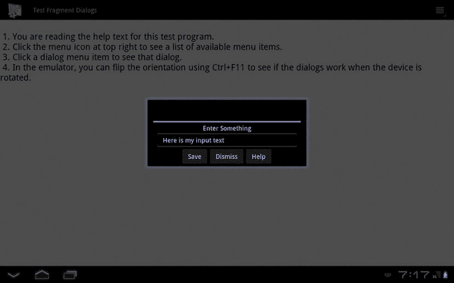

# 第 9 章 使用对话框

Android SDK 为对话框提供了广泛的支持。对话框是一个较小的窗口，它会弹出在当前窗口的前面，用于显示紧急消息、提示用户输入信息，或显示某种状态（如下载进度）。通常期望用户与对话框交互，然后返回到下方的窗口以继续使用应用程序。从技术上讲，Android 允许将对话框 Fragment 嵌入到 Activity 的布局中，我们也将对此进行介绍。

Android 明确支持的对话框包括：警告框、提示框、选择列表、单选、多选、进度条、时间选择器和日期选择器对话框。（此列表可能因 Android 版本而异。）Android 也支持用于其他需求的自定义对话框。本章的主要目的不是逐一介绍所有这些对话框，而是通过一个示例应用程序来介绍 Android 对话框的底层架构。在此基础上，你应该能够使用任意的 Android 对话框。

需要注意的是，Android 3.0 增加了基于 Fragment 的对话框。Google 期望开发者即使在使用 Android 3.0 之前版本的设备时，也只使用 Fragment 对话框。这可以通过 Fragment 兼容库来实现。因此，本章的重点是`DialogFragment`。

### 在 Android 中使用对话框

此资源文件使用了（Android 3.0 中新增的）`objectAnimator` 标签。这个文件的基本结构你应该很熟悉。它包含一系列 `android:` 属性来指示你想要执行的操作。对于对象动画器，你需要指定几个参数。第一个是插值器。可用的类型列在 `android.R.interpolator` 中。根据你对资源名称的了解，`interpolator` 属性最终会指向 Android SDK 中对应平台 `/data/res/interpolator` 目录下的一个文件，文件名为 `accelerate_decelerate.xml`。

`android:propertyName` 属性指定了你想要动画化的维度。在本例中，你希望在 x 维度上设置动画。如果你查阅 `View` 的 `setX()` 方法，会发现它接受一个浮点值作为参数，这就是为什么 `android:valueType` 属性被设置为 `floatType`。`android:duration` 值被设置为 2000，表示 2 秒。对于真正的生产应用来说，这个速度可能太慢了，但它有助于你观察动画发生的整个过程。最后，`android:valueFrom` 和 `android:valueTo` 属性分别被设置为 -1280 和 0。选择这些值是因为你希望动画结束时片段位于 0 处。也就是说，你希望动画停止时，片段的左边缘与视图容器的左边缘对齐，从而让用户可见。由于你想实现片段从左侧滑入的效果，它需要从左侧外部开始，而 -1280 看起来是一个足够大的数值来实现这一点。正如你可能预料的那样，一个实现向右滑出的动画器资源文件与代码清单 8–15 中的文件非常相似，只不过 `valueFrom` 会是 0，而 `valueTo` 会是某个大的正数，例如 1280。

大多数情况下，你会发现你感兴趣的动画属性是`floatType`，尽管有时你可能会选择`intType`。只需查看设置器所要求的参数类型即可。这正是对象动画器（Object Animator）真正强大的地方。事实上，它并不关心设置器方法来自何处。这意味着你可以为对象添加自定义属性，而对象动画器可以为你对其执行动画。你所需要做的就是提供设置器方法，然后在资源文件中设置属性；剩下的工作将由对象动画器完成。这里有一个注意事项：如果你在 XML 中没有指定`valueFrom`属性，对象动画器将使用获取器（getter）方法来确定对象的初始值。该获取器方法必须返回与所讨论属性相匹配的类型。

你可能也有兴趣同时为多个属性执行动画。为此，你可以使用`<set>`标签来包含多个`<objectAnimator>`标签。清单 8–16 展示了一个动画资源文件 (`slide_out_down.xml`)，该文件在沿 Y 轴执行动画的同时，也对透明度（alpha）执行动画。

**清单 8–16.** *一个同时对 Y 轴和透明度执行动画的自定义动画器*

```xml
<?xml version="1.0" encoding="utf-8" ?>
<set >
<objectAnimator
    android:interpolator="@android:interpolator/accelerate_cubic"
    android:valueFrom="0"
    android:valueTo="1280"
    android:valueType="floatType"
    android:propertyName="y"
    android:duration="2000" />
<objectAnimator
    android:interpolator="@android:interpolator/accelerate_cubic"
    android:valueFrom="1"
    android:valueTo="0"
    android:valueType="floatType"
    android:propertyName="alpha"
    android:duration="2000" />
</set>
```

`<set>`标签对应于 Android 中的`AnimatorSet`类；然而，在 XML 中，`<set>`只有一个属性，即`android:ordering`。允许的属性值有`together`（默认值），它会使包含的对象动画器并行运行；以及`sequential`，它会使对象动画器按照它们在 XML 文件中声明的顺序一个接一个地运行。

### 总结

本章介绍了`Fragment`类及其相关的管理器、事务和子类。以下是本章涵盖内容的总结：

- `Fragment`类，它的作用以及如何使用它。

- 为什么 Fragment 必须依附于且仅依附于一个 Activity 才能使用。

- 尽管可以通过静态工厂方法（如`newInstance()`）实例化 Fragment，但必须始终提供一个默认构造函数以及一种将初始化值保存到初始化参数 Bundle 中的方式。

- Fragment 的生命周期及其如何与拥有该 Fragment 的 Activity 的生命周期交织在一起。

- `FragmentManager`及其特性。

- 使用 Fragment 管理设备配置。

- 将多个 Fragment 组合到一个 Activity 中，或将它们拆分到多个 Activity 中。

- 使用 Fragment 事务来更改向用户显示的内容，并使用酷炫的效果为这些转换添加动画。

- 使用 Fragment 时，返回按钮可能实现的新行为。

- 在布局中使用`<fragment>`标签。

- 当你想使用转换时，使用`FrameLayout`作为 Fragment 的占位符。

- `ListFragment`以及如何使用适配器填充数据（非常类似于`ListView`）。

- 当 Fragment 无法适应当前屏幕时，启动一个新的 Activity，以及当配置更改使得再次可能看到多个 Fragment 时如何进行调整。

- Fragment 之间，以及 Fragment 与其 Activity 之间的通信。

### 面试问题

以下是一些可以自问的问题，以确保你对 Android 中的 Fragment 有很好的理解：

1. `Fragment`的父类是什么？

2. Fragment 与 Activity 有何相似之处？

3. Fragment 与 Activity 有何不同？

4. 返回栈（Back Stack）有什么用途？

5. 你能创建一个不使用返回栈的应用吗？

6. 判断正误：回滚一个`FragmentTransaction`会将应用恢复到其先前的状态。

7. `<fragment>`标签如何指定要使用的 Fragment？

8. 数据适配器是附加到`ListFragment`上，还是附加到`ListFragment`内的`ListView`上？

9. 在你的应用中，查找已存在的 Fragment 有哪几种不同的方法？

10. 什么是插值器（Interpolator），它有什么用途？

11. 列出一些你可以对其使用动画器的视图属性。

12. 你能对类的自定义属性使用动画器吗？如果可以，动画器为此需要什么条件？

Android 中的对话框是异步的，这提供了灵活性。但是，如果你习惯了对话框主要是同步的编程框架（例如 Microsoft Windows 或网页中的 JavaScript 对话框），你可能会觉得异步对话框有点不直观。对于同步对话框，显示对话框之后的代码行在对话框被关闭之前不会运行。这意味着下一行代码可以查询按下了哪个按钮，或者在对话框中输入了什么文本。然而，在 Android 中，对话框是异步的。一旦对话框被显示，即使尚未操作对话框，下一行代码也会立即运行。你的应用程序必须通过实现来自对话框的回调来处理这种情况，以便应用程序能够接收到用户与对话框交互的通知。

这也意味着你的应用程序有能力从代码中关闭对话框，这非常强大。如果对话框因为你的应用程序正在执行某项任务而显示忙碌消息，那么一旦任务完成，你的应用程序就可以从代码中关闭该对话框。

### 理解 DialogFragment

在本节中，你将学习如何使用对话框 Fragment 来呈现一个简单的警告对话框以及一个用于收集提示文本的自定义对话框。

### DialogFragment 基础

在展示提示对话框和警告对话框的工作示例之前，我们先介绍对话框片段的高级概念。对话框相关功能使用名为 `DialogFragment` 的类。`DialogFragment` 派生自 `Fragment` 类，其行为与片段非常相似。随后，您将使用 `DialogFragment` 作为对话框的基类。一旦从此类派生出对话框，例如：

`public class MyDialogFragment extends DialogFragment { ... }`

您便可以使用片段事务将 `MyDialogFragment` 这个对话框片段作为对话框显示出来。代码清单 9–1 展示了实现此功能的代码片段。

 **注意：** 我们在本章末尾的“参考资料”部分提供了一个可下载项目的链接。您可以使用此下载文件来试验本章介绍的代码和概念。

**代码清单 9–1.** *显示一个对话框片段*

```
SomeActivity
{
    //....其他活动函数
    public void showDialog()
    {
        //构造 MyDialogFragment
        MyDialogFragment mdf = MyDialogFragment.newInstance(arg1,arg2);
        FragmentManager fm = getFragmentManager();
        FragmentTransaction ft = fm.beginTransaction();
        mdf.show(ft,"my-dialog-tag");
    }
    //....其他活动函数
}
```

根据代码清单 9–1，显示对话框片段的步骤如下：

1. 创建一个对话框片段。

2. 获取一个片段事务。

3. 使用来自步骤 2 的片段事务来显示对话框。

我们来逐一讨论这些步骤。

### 构造 DialogFragment

对话框片段本身也是一个片段，因此在构造对话框片段时适用相同的规则和规定。推荐的模式是使用工厂方法，例如之前使用的 `newInstance()`。在该 `newInstance()` 方法内部，使用对话框片段的默认构造函数，然后添加一个包含传入参数的 arguments 包。您不应在此方法内执行其他操作，因为您必须确保您在此处所做的操作与 Android 从其保存状态恢复对话框片段时所做的操作一致。而 Android 所做的全部工作就是调用默认构造函数并重新创建其 arguments 包。

### 重写 onCreateView

当您继承自对话框片段时，需要重写两个方法之一来为对话框提供视图层次结构。第一种选择是重写 `onCreateView()` 并返回一个视图。第二种选择是重写 `onCreateDialog()` 并返回一个对话框（例如由 `AlertDialog.Builder` 构造的对话框，我们稍后会介绍）。

代码清单 9–2 展示了重写 `onCreateView()` 的示例。

**代码清单 9–2.** *重写 DialogFragment 的 `onCreateView()`*

```
MyDialogFragment
{
    .....其他函数
    public View onCreateView(LayoutInflater inflater,
            ViewGroup container, Bundle savedInstanceState)
    {
        //通过填充期望的布局来创建视图
        View v =
            inflater.inflate(R.layout.prompt_dialog, container, false);

        //可以定位视图并设置值
        TextView tv = (TextView)v.findViewById(R.id.promptmessage);
        tv.setText(this.getPrompt());

        //可以在按钮上设置回调
        Button dismissBtn = (Button)v.findViewById(R.id.btn_dismiss);
        dismissBtn.setOnClickListener(this);

        Button saveBtn = (Button)v.findViewById(R.id.btn_save);
        saveBtn.setOnClickListener(this);
        return v;
    }
    .....其他函数
}
```

在代码清单 9–2 中，您正在加载一个由布局标识的视图。然后查找两个按钮并为其设置回调。这与上一章中创建详情片段的方式非常相似。然而，与早期的片段不同，对话框片段有另一种创建视图层次结构的方式。

### 重写 onCreateDialog

作为在 `onCreateView()` 中提供视图的替代方案，您可以重写 `onCreateDialog()` 并提供一个对话框实例。代码清单 9–3 为此方法提供了示例代码。

**代码清单 9–3.** *重写 `DialogFragment` 的 `onCreateDialog()`*

```
MyDialogFragment
{
    .....其他函数
    @Override
    public Dialog onCreateDialog(Bundle icicle)
    {
        AlertDialog.Builder b = new AlertDialog.Builder(getActivity())
          .setTitle("我的对话框标题")
          .setPositiveButton("确定", this)
          .setNegativeButton("取消", this)
          .setMessage(this.getMessage());
        return b.create();
    }
    .....其他函数
}
```

在这个示例中，您使用警告对话框构建器来创建要返回的对话框对象。这对于简单的对话框效果很好。第一种选择，即重写 `onCreateView()`，也同样简单，并且提供了更大的灵活性。

`AlertDialog.Builder` 实际上是 Android 3.0 之前的遗留产物。这是创建对话框的旧方式之一，您仍然可以在 `DialogFragment` 中使用它来创建对话框。正如您所见，通过调用各种可用的方法（就像我们这里所做的那样）来构建对话框是相当容易的。

### 显示 DialogFragment

一旦您构造了一个对话框片段，就需要一个片段事务来显示它。与所有其他片段一样，对对话框片段的操作是通过片段事务来执行的。

对话框片段的 `show()` 方法接收一个片段事务作为输入。您可以在代码清单 9–1 中看到这一点。`show()` 方法使用该片段事务将此对话框添加到活动中，然后提交该片段事务。然而，`show()` 方法并不会将事务添加到返回栈。如果您想要这样做，您需要先将此事务添加到返回栈，然后再将其传递给 `show()` 方法。对话框片段的 `show()` 方法具有以下签名：

`public int show(FragmentTransaction transaction, String tag)`

`public int show(FragmentManager manager, String tag)`

第一个 `show()` 方法通过将此片段以指定的标签添加到传递进来的事务中来显示对话框。然后该方法返回已提交事务的标识符。

第二个 `show()` 方法自动从事务管理器中获取一个事务。这是一个快捷方法。然而，当您使用这第二种方法时，您无法选择将事务添加到返回栈。如果您想要这种控制，您需要使用第一个方法。如果您只想简单地显示对话框，并且当时没有其他理由处理片段事务，那么可以使用第二种方法。

对话框作为一个片段，其好处在于底层片段管理器会处理基本的状态管理。例如，即使在显示对话框时设备旋转，对话框也会自动重建，而无需您执行任何状态管理。

对话框片段还提供了方法来控制显示对话框视图的框架，例如标题和框架的外观。请参考 `DialogFragment` 类文档以查看更多此类选项；本章末尾提供了此 URL。

### 关闭对话框片段

有两种方法可以关闭对话框片段。第一种方法是在对话框视图中，根据按钮点击或某些操作显式调用对话框片段的 `dismiss()` 方法，如代码清单 9–4 所示。

**代码清单 9–4.** 调用 `dismiss()`

```
if (someview.getId() == R.id.btn_dismiss)
{
    //使用某些回调来通知客户端
    //此对话框正在被关闭
    //然后调用 dismiss
    dismiss();
    return;
}
```

对话框片段的 `dismiss()` 方法会将该片段从片段管理器中移除，并提交该事务。如果此对话框片段有返回栈，那么 `dismiss()` 会将当前对话框弹出事务栈，并显示之前的片段事务状态。无论是否有返回栈，调用 `dismiss()` 都会触发标准的对话框片段销毁回调，包括 `onDismiss()`。

需要注意的一点是，你不能依赖 `onDismiss()` 来判断 `dismiss()` 是否已被你的代码调用。这是因为当设备配置发生变化时，`onDismiss()` 也会被调用，因此它并不能很好地指示用户对对话框本身做了什么。例如，当用户旋转设备时，如果对话框正在显示，对话框片段会看到 `onDismiss()` 被调用，即使用户并未按下对话框中的按钮。相反，你应该始终依赖对话框视图上明确的按钮点击事件。

当对话框片段显示时，如果用户按下返回键，这会触发对话框片段上的 `onCancel()` 回调。默认情况下，Android 会直接关闭对话框片段，因此你无需自行调用片段的 `dismiss()` 方法。但如果你希望通知调用的 Activity 对话框已被取消，则需要从 `onCancel()` 内部调用相关逻辑来实现。这就是 `onCancel()` 与 `onDismiss()` 在对话框片段中的区别。使用 `onDismiss()` 时，你无法确切知道是什么触发了 `onDismiss()` 回调。你可能也注意到了，对话框片段没有 `cancel()` 方法，只有 `dismiss()`；但正如我们所说，当通过按下返回键取消对话框片段时，Android 会帮你处理取消/关闭操作。

另一种关闭对话框片段的方法是展示另一个对话框片段。关闭当前对话框并展示新对话框的方式与仅关闭当前对话框略有不同。代码清单 9–5 展示了一个示例。

**代码清单 9–5.** 为返回栈设置对话框

```
if (someview.getId() == R.id.btn_invoke_another_dialog)
{
    Activity act = getActivity();
    FragmentManager fm = act.getFragmentManager();
    FragmentTransaction ft = fm.beginTransaction();
    ft.remove(this);

    ft.addToBackStack(null);
    //null 表示返回栈事务没有名称

    HelpDialogFragment hdf =
        HelpDialogFragment.newInstance(R.string.helptext);
    hdf.show(ft, "HELP");
    return;
}
```

在单个事务中，你移除了当前对话框片段并添加了新的对话框片段。这会使当前对话框在视觉上消失，并让新对话框出现。如果用户按下返回键，由于你已将这个事务保存到返回栈中，新对话框会被关闭，而之前的对话框则重新显示。例如，这是显示帮助对话框的一种便捷方式。

### 对话框关闭的影响

当你将任何片段添加到片段管理器时，片段管理器会负责该片段的状态管理。这意味着当设备配置发生变化（例如设备旋转）时，Activity 会重启，片段也会随之重启。你在运行莎士比亚示例应用并旋转设备时已经看到了这一点。

设备配置变化不会影响对话框，因为它们也由片段管理器管理。但 `show()` 和 `dismiss()` 的隐含行为意味着，如果不小心，你很容易失去对对话框片段的跟踪。`show()` 方法会自动将片段添加到片段管理器；`dismiss()` 方法会自动将片段从片段管理器中移除。在开始显示片段之前，你可能有一个指向对话框片段的直接引用。但你不能先将此片段添加到片段管理器，之后再调用 `show()`，因为片段只能被添加到片段管理器一次。你可能打算通过 Activity 的恢复来重新获取这个引用。然而，如果你显示并关闭了这个对话框，该片段会被隐式地从片段管理器中移除，从而使其无法被恢复和重新引用（因为片段管理器在移除后就不再知道该片段的存在）。

如果你想在对话框关闭后保留其状态，你需要将状态维护在对话框之外，要么在父 Activity 中，要么在一个生命周期更长的非对话框片段中。

### DialogFragment 示例应用

在本节中，你将创建一个示例应用来演示对话框片段的这些概念。你还将研究片段与其所在 Activity 之间的通信。要实现这一切，你需要五个 Java 文件：

- `MainActivity.java`：应用的主 Activity。它显示一个包含帮助文本的简单视图和一个可以启动对话框的菜单。

- `PromptDialogFragment.java`：一个对话框片段示例，它使用 XML 定义自己的布局并允许用户输入。它有三个按钮：保存（Save）、关闭（Dismiss/取消）和帮助（Help）。

- `AlertDialogFragment.java`：一个对话框片段示例，它使用 `AlertBuilder` 类在此片段内部创建对话框。这是创建对话框的传统方式。

- `HelpDialogFragment.java`：一个非常简单的片段，用于显示来自应用资源的帮助消息。创建帮助对话框对象时，会指定具体的帮助消息。这个帮助片段可以从主 Activity 和提示对话框片段中显示。

- `OnDialogDoneListener.java`：一个要求你的 Activity 实现的接口，以便从片段接收回传消息。使用接口意味着你的片段无需过多了解调用它的 Activity，只需知道它实现了这个接口即可。这有助于将功能封装在它所属的位置。从 Activity 的角度来看，它有一种通用的方式从片段接收信息，而无需了解其过多细节。

此应用有三个布局文件：一个用于主 Activity，一个用于提示对话框片段，一个用于帮助对话框片段。注意，你不需要为警告对话框片段准备布局，因为 `AlertBuilder` 会为你内部处理布局。完成后的应用外观如图 9–1 所示。



**图 9–1.** 对话框片段示例应用的用户界面

### 对话框示例：主活动

现在来看源代码。列表 9–6 展示了与对话框相关的主活动代码片段。要查看完整源代码，你可以从本书网站下载（参见“参考”章节）。

**列表 9–6.** 对话框片段的主活动

## 对话框示例

```java
public class MainActivity extends Activity
implements OnDialogDoneListener
{
    public static final String LOGTAG = "DialogFragmentDemo";
    public static final String ALERT_DIALOG_TAG = "ALERT_DIALOG_TAG";
    public static final String HELP_DIALOG_TAG = "HELP_DIALOG_TAG";
    public static final String PROMPT_DIALOG_TAG = "PROMPT_DIALOG_TAG";
    public static final String EMBED_DIALOG_TAG = "EMBED_DIALOG_TAG";

    private void testPromptDialog()
    {
        FragmentTransaction ft = getFragmentManager().beginTransaction();

        PromptDialogFragment pdf =
            PromptDialogFragment.newInstance("Enter Something");

        pdf.show(ft, PROMPT_DIALOG_TAG);
    }

    private void testAlertDialog()
    {
        FragmentTransaction ft = getFragmentManager().beginTransaction();

        AlertDialogFragment adf =
            AlertDialogFragment.newInstance("Alert Message");

        adf.show(ft, ALERT_DIALOG_TAG);
    }

    private void testHelpDialog()
    {
        FragmentTransaction ft = getFragmentManager().beginTransaction();

        HelpDialogFragment hdf =
            HelpDialogFragment.newInstance(R.string.help_text);

        hdf.show(ft, HELP_DIALOG_TAG);
    }

    private void testEmbedDialog()
    {
        FragmentTransaction ft = getFragmentManager().beginTransaction();

        PromptDialogFragment pdf =
            PromptDialogFragment.newInstance(
                 "Enter Something (Embedded)");

        ft.add(R.id.embeddedDialog, pdf, EMBED_DIALOG_TAG);
        ft.commit();
    }

    public void onDialogDone(String tag, boolean cancelled,
                             CharSequence message) {
        String s = tag + " responds with: " + message;
        if(cancelled)
            s = tag + " was cancelled by the user";
        Toast.makeText(this, s, Toast.LENGTH_LONG).show();
        Log.v(LOGTAG, s);
    }
}
```

主活动的代码非常简单。你显示一个简单的文本页面并设置一个菜单。每个菜单项调用一个活动方法，而每个方法基本都做相同的事情：获取一个片段事务，创建一个新片段，然后显示该片段。请注意，每个片段都有一个与片段事务关联的唯一标签。这个标签会在片段管理器中与该片段关联，因此你可以稍后通过标签名找到这些片段。片段也可以通过 `Fragment` 上的 `getTag()` 方法来确定自己的标签值。

主活动中最后一个方法定义是 `onDialogDone()`，这是一个回调函数，属于你的活动所实现的 `OnDialogDoneListener` 接口的一部分。如你所见，该回调提供了调用你的片段的标签、一个指示对话框片段是否被取消的布尔值，以及一条消息。就你的需求而言，你只想将信息记录到 LogCat 中；同时你也通过 `Toast` 将其显示给用户。Toast 将在本章后续内容中介绍。

### 对话框示例：OnDialogDoneListener

为了能够了解对话框何时消失，你需要创建一个监听器接口，由你的对话框调用者来实现。该接口的代码在列表 9–7 中。

**列表 9–7.** *监听器接口*

```java
// This file is OnDialogDoneListener.java
/*
 * An interface implemented typically by an activity
 * so that a dialog can report back
 * on what happened.
 */
public interface OnDialogDoneListener {
  public void onDialogDone(String tag, boolean cancelled,
                           CharSequence message);
}
```

如你所见，这是一个非常简单的接口。你只为这个接口选择了一个回调函数，活动必须实现它。你的片段不需要知道调用活动的具体细节，只需要知道调用活动必须实现 `OnDialogDoneListener` 接口即可；因此，片段可以调用这个回调来与调用活动进行通信。根据片段的具体功能，接口中可能有多个回调函数。对于这个示例应用程序，你将接口与片段类定义分开展示。为了方便代码管理，你可以将片段监听器接口嵌入到片段类定义本身中，这样更容易保持监听器与片段之间的同步。

### 对话框示例：`PromptDialogFragment`

现在让我们来看看你的第一个片段，`PromptDialogFragment`，其布局和 Java 代码如清单 9–8 所示。

**清单 9–8.** *`PromptDialogFragment` 布局和 Java 代码*

```
<?xml version="1.0" encoding="utf-8"?>
<!-- 此文件为 /res/layout/prompt_dialog.xml -->
<LinearLayout
    android:orientation="vertical" android:padding="4dip"
    android:gravity="center_horizontal"
    android:layout_width="match_parent"
    android:layout_height="match_parent">

    <TextView
        android:id="@+id/promptmessage"
        android:layout_height="wrap_content"
        android:layout_width="wrap_content"
        android:layout_marginLeft="20dip"
        android:layout_marginRight="20dip"
        android:text="输入文本"
        android:layout_weight="1"
        android:layout_gravity="center_vertical|center_horizontal"
        android:textAppearance="?android:attr/textAppearanceMedium"
        android:gravity="top|center_horizontal" />

    <EditText
        android:id="@+id/inputtext"
        android:layout_height="wrap_content"
        android:layout_width="400dip"
        android:layout_marginLeft="20dip"
        android:layout_marginRight="20dip"
        android:scrollHorizontally="true"
        android:autoText="false"
        android:capitalize="none"
        android:gravity="fill_horizontal"
        android:textAppearance="?android:attr/textAppearanceMedium" />

    <LinearLayout
        android:orientation="horizontal"
        android:layout_width="wrap_content"
        android:layout_height="wrap_content">

      <Button android:id="@+id/btn_save"
        android:layout_width="wrap_content"
        android:layout_height="wrap_content"
        android:layout_weight="0"
        android:text="保存">
      </Button>

      <Button android:id="@+id/btn_dismiss"
        android:layout_width="wrap_content"
        android:layout_height="wrap_content"
        android:layout_weight="0"
        android:text="取消">
      </Button>

      <Button android:id="@+id/btn_help"
        android:layout_width="wrap_content"
        android:layout_height="wrap_content"
        android:layout_weight="0"
        android:text="帮助">
      </Button>

    </LinearLayout>
</LinearLayout>
```

# PromptDialogFragment 详解

这个提示对话框的布局看起来类似于你之前见过的许多布局。它包含一个用作提示的 `TextView`；一个用于接收用户输入的 `EditText`；以及三个按钮，分别用于保存输入、取消（关闭）对话框片段以及弹出帮助对话框。

`PromptDialogFragment` 的 Java 代码开始时看起来与你之前的片段类似。你有一个用于创建新对象的 `newInstance()` 静态方法，在此方法中，你调用默认构造函数，构建一个参数 `Bundle`，并将其附加到新对象上。接下来，在 `onAttach()` 回调中有一些新内容。你需要确保刚刚附加的 `Activity` 已经实现了 `OnDialogDoneListener` 接口。为了测试这一点，你将传入的 `Activity` 强制转换为 `OnDialogDoneListener` 接口。以下是那段代码：

```java
try {
    OnDialogDoneListener test = (OnDialogDoneListener)act;
}
catch(ClassCastException cce) {
    // 在这里我们优雅地处理失败情况。
    Log.e(MainActivity.LOGTAG, "Activity 未监听");
}
```

如果 `Activity` 没有实现此接口，则会抛出 `ClassCastException` 异常。你可以处理这个异常并更优雅地应对，但这个示例尽可能保持代码简洁。

接下来是 `onCreate()` 回调。与片段的常见做法一致，你并不在此处构建用户界面，但可以设置对话框样式。这是对话框片段独有的特点。你可以自行设置样式和主题，也可以仅设置样式并将主题值设为零（`0`），让系统为你选择合适的主题。以下是该段代码：

```java
// 此文件为 PromptDialogFragment.java
public class PromptDialogFragment
extends DialogFragment
implements View.OnClickListener
{
    private EditText et;

    public static PromptDialogFragment
    newInstance(String prompt)
    {
        PromptDialogFragment pdf = new PromptDialogFragment();
        Bundle bundle = new Bundle();
        bundle.putString("prompt",prompt);
        pdf.setArguments(bundle);

        return pdf;
    }

    @Override
    public void onAttach(Activity act) {
        // 如果你要附加到的 Activity 没有
        // 实现 OnDialogDoneListener 接口，
        // 以下代码行将抛出 ClassCastException 异常。
        // 这是你可以测试 Activity 行为是否规范的最早时机。
        try {
            OnDialogDoneListener test = (OnDialogDoneListener)act;
        }
        catch(ClassCastException cce) {
            // 在这里我们优雅地处理失败情况。
            Log.e(MainActivity.LOGTAG, "Activity 未监听");
        }
        super.onAttach(act);
    }

    @Override
    public void onCreate(Bundle icicle)
    {
        super.onCreate(icicle);
        this.setCancelable(true);
        int style = DialogFragment.STYLE_NORMAL, theme = 0;
        setStyle(style,theme);
    }

    public View onCreateView(LayoutInflater inflater,
            ViewGroup container, Bundle icicle)
    {
        View v = inflater.inflate(R.layout.prompt_dialog, container,
                                  false);

        TextView tv = (TextView)v.findViewById(R.id.promptmessage);
        tv.setText(getArguments().getString("prompt"));

        Button dismissBtn = (Button)v.findViewById(R.id.btn_dismiss);
        dismissBtn.setOnClickListener(this);

        Button saveBtn = (Button)v.findViewById(R.id.btn_save);
        saveBtn.setOnClickListener(this);

        Button helpBtn = (Button)v.findViewById(R.id.btn_help);
        helpBtn.setOnClickListener(this);

        et = (EditText)v.findViewById(R.id.inputtext);
        if(icicle != null)
            et.setText(icicle.getCharSequence("input"));
        return v;
    }

    @Override
    public void onSaveInstanceState(Bundle icicle) {
        super.onSaveInstanceState(icicle);
        icicle.putCharSequence("input", et.getText());
    }

    public void onClick(View v)
    {
        OnDialogDoneListener act = (OnDialogDoneListener)getActivity();
        if (v.getId() == R.id.btn_save)
        {
            TextView tv =
                (TextView)getView().findViewById(R.id.inputtext);
            act.onDialogDone(this.getTag(), false, tv.getText());
            dismiss();
            return;
        }
        if (v.getId() == R.id.btn_dismiss)
        {
            act.onDialogDone(this.getTag(), true, null);
            dismiss();
            return;
        }
        if (v.getId() == R.id.btn_help)
        {
            FragmentTransaction ft =
                getFragmentManager().beginTransaction();
            ft.remove(this);

            // 在这种情况下，你想要显示帮助文本，但
            // 完成后返回之前的对话框
            ft.addToBackStack(null);
            // null 表示后台堆栈事务没有名称

            HelpDialogFragment hdf =
                    HelpDialogFragment.newInstance(R.string.help1);
            hdf.show(ft, MainActivity.HELP_DIALOG_TAG);
            return;
        }
    }
}
```

# DialogFragment 使用指南

```java
int style = DialogFragment.STYLE_NORMAL, theme = 0;
setStyle(style,theme);
```

在`onCreateView()`中，你需要为对话框片段创建视图层次结构。与其他片段一样，不要将视图层次结构附加到传入的视图容器中（即，将`attachToRoot`参数设置为`false`）。然后，设置按钮回调，并将对话框提示文本设置为最初传递给`newInstance()`的提示。最后，检查是否有任何值通过保存的状态包（`icicle`）传入。这将表明你的片段正在被重新创建，很可能是由于配置变更导致的，并且用户可能已经输入了一些文本。如果是这样，你需要用用户已输入的内容填充`EditText`。请记住，由于配置已更改，内存中的实际视图对象与之前不同，因此你必须找到它并相应地设置文本。接下来的回调是`onSaveInstanceState()`；在这里，你将用户输入的任何当前文本保存到保存的状态包中。

`onCancel()`和`onDismiss()`回调未显示，因为它们只进行日志记录；你将能够在片段生命周期中看到这些回调何时触发。

提示对话框片段中的最后一个回调是针对按钮的。再次，你获取对封闭活动的引用，并将其转换为你期望活动已实现的接口。如果用户按下了“保存”按钮，你获取输入的文本并调用接口的回调`onDialogDone()`。此回调接受该片段的标签名、一个表示此对话框片段是否被取消的布尔值以及一个消息（在本例中为用户输入的文本）。以下是来自`MainActivity`末尾列表 9-6 的代码：

```java
public void onDialogDone(String tag, boolean cancelled,
                         CharSequence message) {
    String s = tag + " responds with: " + message;
    if(cancelled)
        s = tag + " was cancelled by the user";
    Toast.makeText(this, s, Toast.LENGTH_LONG).show();
    Log.v(LOGTAG, s);
}
```

然后你调用`dismiss()`来移除对话框片段。请记住，`dismiss()`不仅会使片段在视觉上消失，还会将片段从片段管理器中弹出，使其不再可用。如果按下的按钮是“关闭”，你再次调用接口回调，这次不带消息，然后调用`dismiss()`。最后，如果用户按下了“帮助”按钮，你不想丢失提示对话框片段，因此你采取了一些不同的操作。我们之前已经描述过。为了记住提示对话框片段以便稍后返回，你需要创建一个片段事务，使用`show()`方法移除提示对话框片段并添加帮助对话框片段；这需要放入返回栈中。还要注意，帮助对话框片段是如何通过资源 ID 的引用创建的。这意味着你的帮助对话框片段可以与应用程序可用的任何帮助文本一起使用。

## 对话框示例：`HelpDialogFragment`

我们将很快展示帮助对话框片段的代码，但现在先描述其操作。你创建了一个片段事务，从提示对话框片段导航到帮助对话框片段，并将该片段事务放入返回栈。这使得提示对话框片段从视图中消失，但仍可通过片段管理器和返回栈访问。新的帮助对话框片段出现在其位置，允许用户阅读帮助文本。当用户关闭帮助对话框片段时，片段返回栈条目被弹出，效果是帮助对话框片段被关闭（同时在视觉上和从片段管理器中），并且提示对话框片段恢复到视图中。这是实现所有这些效果的一种相当简单的方法。它非常简单但非常强大；即使在这些对话框显示时用户旋转设备，它也能正常工作。

下载并查看`HelpDialogFragment.java`文件及其布局（`help_dialog.xml`）的源代码。此对话框片段的目的是显示帮助文本。布局包含一个`TextView`和一个关闭按钮。Java 代码应该开始让你感到熟悉。有一个`newInstance()`方法来创建一个新的帮助对话框片段，一个`onCreate()`方法来设置样式和主题，以及一个`onCreateView()`方法来构建视图层次结构。在这个特定情况下，你需要找到一个字符串资源来填充`TextView`，因此你通过活动访问资源，并选择传递给`newInstance()`的资源 ID。最后，`onCreateView()`设置了一个按钮点击处理程序来捕获关闭按钮的点击。在这种情况下，在关闭时你不需要做任何有趣的事情。

此片段有两种调用方式：从活动调用和从提示对话框片段调用。当此帮助对话框片段从主活动显示时，关闭它只是将片段从顶部弹出，并显示下面的主活动。当此帮助对话框片段从提示对话框片段显示时，因为帮助对话框片段是返回栈上片段事务的一部分，关闭它会导致片段事务被回滚，这会弹出帮助对话框片段但恢复提示对话框片段。用户会看到提示对话框片段重新出现。

## 对话框示例：`AlertDialogFragment`

本示例应用中还有最后一个对话框片段要展示：提示对话框片段。虽然你可以用与帮助对话框片段类似的方式创建提示对话框片段，但也可以使用在多个 Android 版本中都有效的旧版 `AlertBuilder` 框架来创建。 清单 9–9 展示了提示对话框片段的源代码。

清单 9–9. `AlertDialogFragment` Java 代码

```java
public class AlertDialogFragment
extends DialogFragment
implements DialogInterface.OnClickListener
{
    public static AlertDialogFragment
    newInstance(String message)
    {
        AlertDialogFragment adf = new AlertDialogFragment();
        Bundle bundle = new Bundle();
        bundle.putString("alert-message",message);
        adf.setArguments(bundle);

        return adf;
    }

    @Override
    public void onCreate(Bundle savedInstanceState)
    {
        super.onCreate(savedInstanceState);
        this.setCancelable(true);
        int style = DialogFragment.STYLE_NORMAL, theme = 0;
        setStyle(style,theme);
    }

    @Override
    public Dialog onCreateDialog(Bundle savedInstanceState)
    {
        AlertDialog.Builder b =
            new AlertDialog.Builder(getActivity())
           .setTitle("Alert!!")
           .setPositiveButton("Ok", this)
           .setNegativeButton("Cancel", this)
           .setMessage(this.getArguments().getString("alert-message"));
        return b.create();
    }

    public void onClick(DialogInterface dialog, int which)
    {
        OnDialogDoneListener act = (OnDialogDoneListener) getActivity();
        boolean cancelled = false;
        if (which == AlertDialog.BUTTON_NEGATIVE)
        {
            cancelled = true;
        }
        act.onDialogDone(getTag(), cancelled, "Alert dismissed");
    }
}
```

此对话框无需布局，因为 `AlertBuilder` 会为你处理。注意，该对话框片段开始时与其他片段类似，但这里没有 `onCreateView()` 回调，而是使用了 `onCreateDialog()` 回调。你需要实现 `onCreateView()` 或 `onCreateDialog()`，但不能同时实现两者。`onCreateDialog()` 的返回值不是视图，而是一个对话框。这里值得注意的是，要获取对话框的参数，你应该访问参数 Bundle。在此示例应用中，你只对提示消息进行了此操作，但你也可以通过参数 Bundle 访问其他参数。

另外请注意，对于这种类型的对话框片段，你的片段类需要实现 `DialogInterface.OnClickListener`，这意味着你的对话框片段必须实现 `onClick()` 回调。当用户对嵌入的对话框进行操作时，会触发此回调。同样，你会获得触发回调的对话框引用以及被按下的按钮标识。和之前一样，你应谨慎，不要依赖 `onDismiss()`，因为设备配置发生变化时也可能会触发此回调。

### 对话框示例：嵌入对话框

你可能已经注意到 `DialogFragment` 的另一个特性。在该应用的主布局中，文本下方有一个 `FrameLayout`，可用于容纳对话框。在应用的菜单中，最后一项会触发片段事务，将 `PromptDialogFragment` 的新实例添加到主屏幕。无需任何修改，该对话框片段即可嵌入主布局显示，并如预期般工作。

这种技术的一个不同之处在于，显示嵌入对话框的代码与显示弹出对话框的代码不同。嵌入对话框的代码如下所示：

```java
ft.add(R.id.embeddedDialog, pdf, EMBED_DIALOG_TAG);
ft.commit();
```

这与第 8 章中在 `FrameLayout` 中显示片段时的代码完全相同。不过，这次需要确保传入一个标签名，当对话框片段通知活动用户的输入时，会使用该标签名。

### 对话框示例：观察

运行此示例应用时，请务必在不同设备方向上尝试所有菜单选项。在对话框片段显示时旋转设备。你会欣喜地发现对话框会随旋转而适应；无需担心大量代码来管理因配置变化而导致的片段保存与恢复。

我们希望您能体会到的另一点是，在片段和活动之间进行通信是多么容易。当然，活动拥有或可以获取对所有可用片段的引用，因此它可以访问片段自身暴露的方法。这并不是片段与活动之间通信的唯一方式。你始终可以使用片段管理器上的 getter 方法来获取受管理片段的实例，然后适当地转换该引用并直接调用该片段上的方法。你甚至可以在另一个片段内部执行此操作。通过接口和活动将片段相互隔离的程度，或者通过片段间通信构建依赖关系的程度，取决于你的应用程序有多复杂以及你希望实现多大程度的复用。

### 使用 Toast

本章开头介绍了如何在错误页面上使用提示消息进行 JavaScript 调试。如果需要使用类似的方法处理不频繁的调试消息，可以使用 Android 中的 `Toast` 对象。

`Toast` 类似于一个提示对话框，它包含一条消息，显示一段时间后消失。它没有任何按钮。因此，可以说它是一种瞬时提示消息。之所以称为 `Toast`，是因为它像烤面包机里弹出来的吐司一样弹出。

清单 9–10 展示了一个如何使用 `Toast` 显示消息的示例。

**清单 9–10.** *使用 `Toast` 进行调试*

```java
//Create a function to wrap a message as a toast
//show the toast
public void reportToast(String message)
{
    String s = MainActivity.LOGTAG + ":" + message;
    Toast.makeText(activity, s, Toast.LENGTH_SHORT).show();
}
```

清单 9–10 中的 `makeText()` 方法不仅可以使用活动，还可以使用任何上下文对象，例如传递给广播接收器或服务的上下文。这扩展了 `Toast` 在活动之外的使用范围。

### 用于旧版 Android 的对话框片段

虽然希望所有旧手机都能升级到 Ice Cream Sandwich，从而能够利用对话框片段的所有优点，但现实是，一些旧型号仍会停留在 Android 1.6、2.1 和 2.2 上。为了给这些手机提供对话框片段支持，Google 提供了 Fragment 兼容性库。对于对话框片段，你仍然使用前面讨论过的 `DialogFragment` 类；只需确保在应用程序中包含兼容性 jar 文件即可。

### 摘要

本章讨论了异步对话框以及如何使用对话框片段，涵盖以下主题：

- 什么是对话框以及为何使用它

- Android 中对话框的异步特性

- 让对话框在屏幕上显示的三个步骤

- 创建片段

- 对话框片段创建视图层次结构的两种方法

- 片段事务如何参与显示对话框片段，以及如何获取一个片段事务

- 用户在查看对话框片段时按下返回键会发生什么

- 返回栈及管理对话框片段

- 点击对话框片段上的按钮时会发生什么，以及如何处理

- 从对话框片段与调用活动进行通信的简洁方法

- 一个对话框片段如何调用另一个对话框片段并仍能返回上一个对话框片段

- `Toast` 类以及如何将其用作简单的提示弹窗

### 面试问题

以下问题应能帮助您巩固对本章关于对话框讨论的理解：

1.  您的代码能否在对话框片段显示后立即读取用户从提示对话框片段中的输入？请说明原因。

2.  您使用 `DialogFragment` 的哪个方法来构建视图层次结构？

3.  您使用哪个方法来返回一个已准备好的对话框？

4.  您使用对话框片段的哪个方法来显示对话框？

5.  调用此方法的两种方式是什么？哪一种最简单？

6.  您能使用 `onDismiss()` 来判断用户是否已点击对话框片段中的按钮吗？请说明原因。

7.  一个对话框片段能否显示另一个对话框片段？如果可以，新的对话框片段能否再显示另一个对话框片段而不产生问题？

8.  您在哪里设置对话框的样式和主题？

9.  `Toast` 消息的时间长度选项有哪些？

10. 如何在配置变更（例如设备旋转）时，让对话框片段记住用户输入的内容？
