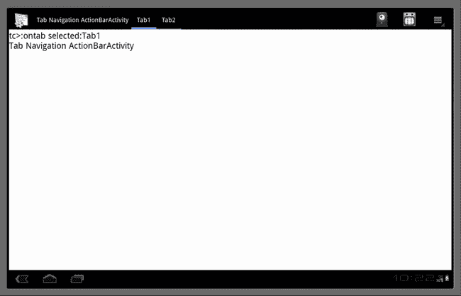
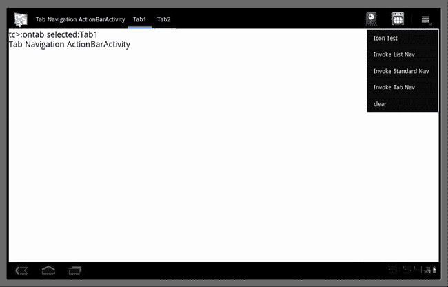
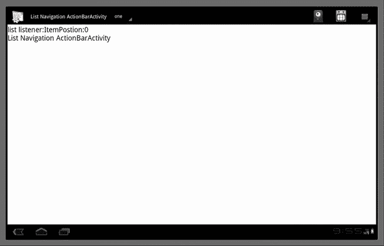
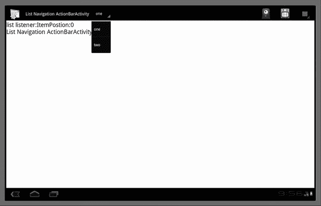
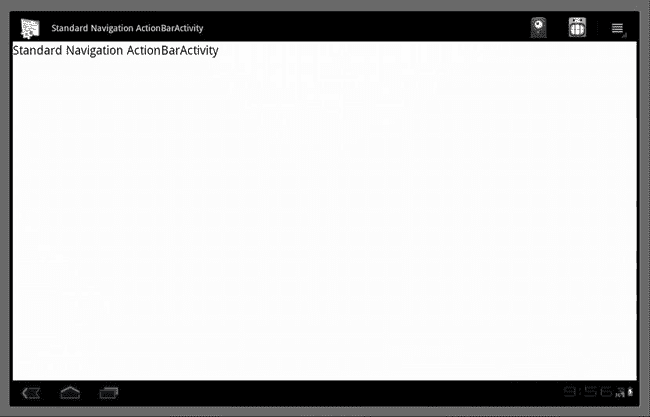
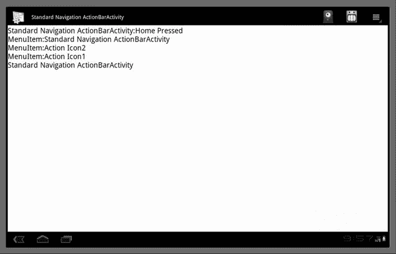
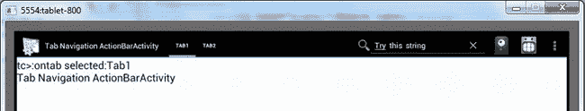

## 第 10 章

## 探索操作栏

`ActionBar` 是在适用于平板电脑的 Android 3.0 SDK 中引入的，现在（4.0 版本）也适用于手机。它允许您自定义活动的标题栏。在 3.0 SDK 发布之前，活动的标题栏仅包含活动的标题。Android 的 `ActionBar` 设计类似于网页浏览器的菜单/标题栏。

 **注意：** 本章同时指代 `ActionBar` 和 action bar。`ActionBar` 指实际的类，而 *action bar* 指的是概念。

3.0 SDK 经过了优化，但仅适用于平板电脑。这意味着，对于运行 Android 4.0 之前版本的手机，操作栏 API 并不可用。到了 4.0 SDK，手机和平板电脑的 SDK 方面已合并，以提供统一的 API。

操作栏设计的一个关键目标是让用户无需在选项菜单或上下文菜单中搜寻，就能轻松访问常用操作。

 **注意：** 在当前计算机技术文献中，便捷的操作访问被时髦地称为 *可发现性*，指的是方便地发现/调用操作的能力。我们在本章末尾提供了一些关于可发现性的参考网址。

在本章的学习过程中，您将了解关于操作栏的以下内容：

- 操作栏归活动所有，并遵循其生命周期。

- 操作栏可以采用三种形式之一：选项卡式操作栏、列表操作栏或标准操作栏。您将看到这些不同的操作栏在每种模式下的外观和行为。

- 您将学习选项卡监听器如何让您与选项卡式操作栏进行交互。

- 您将看到如何使用微调适配器和列表监听器与列表操作栏进行交互。

- 您将了解操作栏的“主页”图标如何与菜单基础设施进行交互。

- 您将看到图标菜单项如何显示在操作栏区域中并对其进行响应。

- 您将了解如何在操作栏中放置自定义搜索小部件。

您将通过规划三个不同的活动来探索这些概念。每个活动都拥有不同模式的操作栏。这将让您有机会检查每种模式下操作栏的行为。但首先，让我们快速浏览一下操作栏的视觉方面。

### 操作栏的解剖结构

图 10–1 显示了一个处于选项卡导航模式的典型操作栏。



**图 10–1.** *带有选项卡式操作栏的活动*

此截图取自本章后面介绍的实际工作示例。图 10–1 中的操作栏有五个部分。这些部分如下（从左到右）：

- *主页图标区域：* 操作栏左上角的图标有时称为“主页”图标。这类似于网站导航上下文，点击主页图标会带您回到起始点。当您将用户导航到主活动时，不要启动一个新的主活动；相反，应使用一个意图标志来转移过去，该标志会清除主活动之上的所有活动栈。稍后您将看到，点击此“主页”图标会向选项菜单发送一个回调，其菜单 ID 为 `android.R.id.home`。

- 标题区域：标题区域显示操作栏的标题。

- 选项卡区域：选项卡区域是操作栏绘制指定选项卡列表的地方。此区域的内容是可变的。如果操作栏导航模式是选项卡，则此处显示选项卡。如果模式是列表导航模式，则显示一个可导航的下拉列表项。在标准模式下，此区域被忽略并保持为空。

- 操作图标区域：在选项卡区域之后，操作图标区域显示一些作为图标的选项菜单项。您将在稍后的示例中看到如何选择哪些选项菜单显示为操作图标。

- 菜单图标区域：最后是菜单图标区域。它是一个单一的标准菜单图标。当您点击此菜单图标时，您会看到展开的菜单。根据 Android 设备的大小，此展开菜单的外观或在屏幕上的位置会有所不同。您还可以将搜索视图附加到菜单上，就像它是一个菜单的操作图标一样。我们将在本章后面介绍这一点。

除了操作栏之外，图 10–1 中的活动还显示了一个用于记录大量操作的调试文本视图。这些操作可能是点击选项卡、主页图标、操作菜单或实际选项菜单的结果。

让我们看看如何实现前面提到的三种类型的操作栏活动：选项卡式操作栏、列表操作栏和标准操作栏。您已经看过作为操作栏视觉示例的选项卡式操作栏，那么我们将从实现选项卡式操作栏开始。

### 选项卡式导航操作栏活动

尽管你计划创建三种不同的活动，每种都有其自己的操作栏类型，但这些示例活动具有许多共同的功能：

*   所有这些活动都具有相同的调试文本视图，以便你可以在调用操作时进行监控。

*   所有这些活动都具有相同的主页图标。

*   所有这些活动都有一个标题。

*   所有这些活动都具有相同的操作图标。

*   所有这些活动都具有相同的选项菜单。

这些活动之间的主要区别在于，每个活动对操作栏的配置方式不同。在本示例中，你将公共行为封装在一个基类中，并允许每个派生活动（包括此选项卡式操作栏活动）来配置操作栏。

如果没有至少一个操作栏活动的上下文，很难解释这些公共文件。因此，你首先查看这些公共文件，以及选项卡式操作栏活动如何使用它们。然后，另外两个状态栏活动可以用更少的文件添加到该项目中。

以下是此选项卡式操作栏练习所需的文件列表。这些文件既包括公共文件，也包括选项卡式操作栏特有的文件。列表看起来很多，是因为你将公共行为封装到了基类中。这减少了后续示例所需的文件数量。每个文件都标注了清单编号：

*   `DebugActivity.java`：基类活动，允许使用如图 10–1 所示的调试文本视图（清单 10–2）。

*   `BaseActionBarActivity.java`：派生自 `DebugActivity`，允许公共导航（例如，响应包括在三个活动之间切换在内的公共操作）（清单 10–3）。

*   `IReportBack.java`：一个接口，作为调试活动与操作栏的各种监听器之间的通信工具（清单 10–1）。

*   `BaseListener.java`：基类监听器，与 `DebugActivity` 以及从操作栏调用的各种操作协同工作。作为选项卡监听器和列表导航监听器的基类（清单 10–4）。

*   `TabNavigationActionBarActivity.java`：继承自 `BaseActionBarActivity.java`，并将操作栏配置为选项卡式操作栏。大部分与选项卡式操作栏相关的代码都在此类中（清单 10–6）。

*   `TabListener.java`：用于向选项卡式操作栏添加选项卡。在这里响应选项卡点击。在本例中，它只是通过 `BaseListener` 将一条消息记录到调试视图（清单 10–5）。

*   `AndroidManifest.xml`：定义要调用的活动（清单 10–13）。

*   `Layout/main.xml`：`DebugActivity` 的布局文件。由于所有三个状态栏活动都继承自此基类 `DebugActivity`，因此它们共享此布局文件（清单 10–7）。

*   `menu/menu.xml`：一组菜单项，用于测试菜单与操作栏的交互。此菜单文件也在所有派生状态栏活动之间共享（清单 10–9）。

#### 实现基类活动

许多基类都使用了 `IReportBack` 接口。该接口在清单 10–1 中介绍。

**清单 10–1.** `IReportBack.java`

```java
//IReportBack.java
package com.androidbook.actionbar;

public interface IReportBack
{
   public void reportBack(String tag, String message);
   public void reportTransient(String tag, String message);
}
```

实现了此接口的类会接收一条消息并将其报告到屏幕上，类似于调试消息。这是通过 `reportBack()` 方法完成的。`reportTransient()` 方法执行相同的操作，只是它使用 `Toast` 将该消息报告给用户。

在本示例中，实现 `IReportBack` 的类是 `DebugActivity`。这使得 `DebugActivity` 能够传递自身，而无需暴露其所有内部实现。`DebugActivity` 的源代码在清单 10–2 中给出。

**清单 10–2.** 带有调试文本视图的 `DebugActivity`

```
//DebugActivity.java
package com.androidbook.actionbar;
//
//使用 CTRL-SHIFT-O 导入依赖项
//
public abstract class DebugActivity
extends Activity
implements IReportBack
{
   //派生类需要首先定义
   protected abstract boolean
   onMenuItemSelected(MenuItem item);

   //由构造函数设置的私有变量
   private static String tag=null;
   private int menuId = 0;
   private int layoutid = 0;
   private int debugTextViewId = 0;

   public DebugActivity(int inMenuId,
         int inLayoutId,
         int inDebugTextViewId,
         String inTag)
   {
      tag = inTag;
      menuId = inMenuId;
      layoutid = inLayoutId;
      debugTextViewId = inDebugTextViewId;

   }
    @Override
protected void onCreate(Bundle savedInstanceState) {
        super.onCreate(savedInstanceState);
        setContentView(this.layoutid);

        //你需要以下代码来使文本视图可滚动。
        TextView tv = this.getTextView();
        tv.setMovementMethod(
          ScrollingMovementMethod.getInstance());
    }
    @Override
public boolean onCreateOptionsMenu(Menu menu){
       super.onCreateOptionsMenu(menu);
       MenuInflater inflater = getMenuInflater();
       inflater.inflate(menuId, menu);
       return true;
    }
    @Override
public boolean onOptionsItemSelected(MenuItem item){
       appendMenuItemText(item);
       if (item.getItemId() == R.id.menu_da_clear){
          this.emptyText();
          return true;
       }
       boolean b = onMenuItemSelected(item);
       if (b == true)
       {
          return true;
       }
       return super.onOptionsItemSelected(item);
    }
protected TextView getTextView(){
        return
        (TextView)this.findViewById(this.debugTextViewId);
    }
protected void appendMenuItemText(MenuItem menuItem){
       String title = menuItem.getTitle().toString();
       appendText("MenuItem:" + title);
    }
    protected void emptyText(){
       TextView tv = getTextView();
       tv.setText("");
    }
protected void appendText(String s){
       TextView tv = getTextView();
       tv.setText(s + "\n" + tv.getText());
       Log.d(tag,s);
    }
public void reportBack(String tag, String message)
   {
      this.appendText(tag + ":" + message);
      Log.d(tag,message);
   }
public void reportTransient(String tag, String message)
   {
      String s = tag + ":" + message;
      Toast mToast =
        Toast.makeText(this, s, Toast.LENGTH_SHORT);
      mToast.show();
      reportBack(tag,message);
      Log.d(tag,message);
   }
}//eof-class
```

此基类活动的主要目标是提供一个包含调试文本视图的活动。此文本视图用于记录来自 `reportBack()` 方法的消息。你将所有操作栏活动的基类都使用此活动。

## 为操作栏分配统一行为

您有更多机会将派生自活动的代码重构到另一个基类 `BaseActionBarActivity` 中。

这个重构类的主要目的是提供对菜单项的通用行为响应。这些菜单项用于在代表三种不同操作栏模式的三个活动之间切换。切换后，您可以测试相应的操作栏活动。

本活动在清单 10-3 中呈现。

`清单 10-3. 操作栏启用活动的公共基类`

## 实现标签监听器

在您能够使用标签操作栏之前，需要一个标签监听器。标签监听器允许您响应标签上的点击事件。您从基础监听器派生您的标签监听器，该基础监听器允许您记录标签操作。清单 10-4 展示了使用 `IReportBack` 进行记录的基础监听器。

### 清单 10-4. 操作栏启用活动的通用监听器

```java
//BaseListener.java
package com.androidbook.actionbar;
//
//使用 CTRL-SHIFT-O 导入依赖
//
public class BaseListener
{
   protected IReportBack mReportTo;
   protected Context mContext;
   public BaseListener(Context ctx, IReportBack target)
   {
      mReportTo = target;
      mContext = ctx;
   }
}
```

这个基类持有一个对 `IReportBack` 实现的引用，以及一个可作为上下文使用的活动。在这种情况下，清单 10-2 中的 `DebugActivity` 既是 `IReportBack` 的实现者，也承担了上下文的角色。

现在您有了一个基础监听器，清单 10-5 展示了标签监听器。

### 清单 10-5. 用于响应标签操作的标签监听器

```java
// BaseActionBarActivity.java
package com.androidbook.actionbar;
//
//使用 CTRL-SHIFT-O 导入依赖
//
public abstract class BaseActionBarActivity
extends DebugActivity
{
    private String tag=null;
    public BaseActionBarActivity(String inTag)
    {
        super(R.menu.menu,    // 提供通用菜单
            R.layout.main,    // 提供通用布局
            R.id.textViewId,  // 基础调试活动的文本视图
            inTag);           // 用于日志记录的调试标签
            tag = inTag;
    }
    @Override
    public void onCreate(Bundle savedInstanceState)
    {
        super.onCreate(savedInstanceState);
        TextView tv = this.getTextView();
        tv.setText(tag);
    }
    protected boolean onMenuItemSelected(MenuItem item)
    {
// 响应主页图标
        if (item.getItemId() == android.R.id.home) {
            this.reportBack(tag,"Home Pressed");
            return true;
        }

// 调用同级活动的通用行为
        if (item.getItemId() == R.id.menu_invoke_tabnav){
            if (getNavMode() ==
              ActionBar.NAVIGATION_MODE_TABS)
            {
                this.reportBack(tag,
                  "You are already in tab nav");
            }
            else {
                this.invokeTabNav();
            }
            return true;
        }
        if (item.getItemId() == R.id.menu_invoke_listnav){
            if (getNavMode() ==
            ActionBar.NAVIGATION_MODE_LIST)
            {
                this.reportBack(tag,
                "You are already in list nav");
            }
            else{
                this.invokeListNav();
            }
            return true;
        }
        if (item.getItemId() == R.id.menu_invoke_standardnav){
            if (getNavMode() ==
            ActionBar.NAVIGATION_MODE_STANDARD)
            {
                this.reportBack(tag,
                "You are already in standard nav");
            }
            else{
                this.invokeStandardNav();
            }
            return true;
        }
        return false;
    }
private int getNavMode(){
ActionBar bar = this.getActionBar();
        return bar.getNavigationMode();
    }
    private void invokeTabNav(){
        Intent i = new Intent(this,
          TabNavigationActionBarActivity.class);
        startActivity(i);
    }

    // 在实现以下额外活动时，解开相应方法体的注释

    private void invokeListNav(){
        //Intent i = new Intent(this,
        //  ListNavigationActionBarActivity.class);
        //startActivity(i);
    }
    private void invokeStandardNav(){
        //Intent i = new Intent(this,
        //  StandardNavigationActionBarActivity.class);
        //startActivity(i);
    }
}//eof-class
```

如果您关注清单 10-3 中响应菜单项的代码，会发现您正在检查当前活动是否也是要切换到的目标活动。如果是，您会记录一条消息，并且不切换当前活动。

这个基础操作栏活动还简化了派生的操作栏导航活动，包括标签导航操作栏活动。

```
// TabListener.java
package com.androidbook.actionbar;
//
//使用 CTRL-SHIFT-O 导入依赖
//
public class `TabListener` extends `BaseListener`
implements `ActionBar.TabListener`
{
    private static String `tag` = "tc>";
    public `TabListener`(`Context` `ctx`,
                `IReportBack` `target`)
    {
        super(`ctx`, `target`);
    }
    public void `onTabReselected`(`Tab` `tab`,
                  `FragmentTransaction` `ft`)
    {
        this.mReportTo.reportBack(`tag`,
          "ontab re selected:" + `tab`.getText());
    }
    public void `onTabSelected`(`Tab` `tab`,
               `FragmentTransaction` `ft`)
    {
        this.mReportTo.reportBack(`tag`,
          "ontab selected:" + `tab`.getText());
    }
    public void `onTabUnselected`(`Tab` `tab`,
                 `FragmentTransaction` `ft`)
    {
        this.mReportTo.reportBack(`tag`,
          "ontab un selected:" + `tab`.getText());
    }
}
```

这个标签监听器将操作栏标签的回调记录到图 10-1 的调试文本视图中。

## 实现标签操作栏活动

有了标签监听器后，您最终可以构建标签导航活动。这在清单 10-6 中呈现。

**清单 10-6.** *标签导航启用的操作栏活动*

```
// TabNavigationActionBarActivity.java
package com.androidbook.actionbar;
//
//使用 CTRL-SHIFT-O 导入依赖
//
public class `TabNavigationActionBarActivity`
extends `BaseActionBarActivity`
{
    private static String `tag` =
      "Tab Navigation ActionBarActivity";
    public `TabNavigationActionBarActivity`()
    {
        super(`tag`);
    }
    @Override
    public void `onCreate`(`Bundle` `savedInstanceState`)
    {
        super.`onCreate`(`savedInstanceState`);
        `workwithTabbedActionBar`();
    }

public void `workwithTabbedActionBar`()
    {
        `ActionBar` `bar` = this.getActionBar();
        `bar`.setTitle(`tag`);
        `bar`.setNavigationMode(
          `ActionBar.NAVIGATION_MODE_TABS`);

        `TabListener` `tl` = new `TabListener`(this,this);

        `Tab` `tab1` = `bar`.newTab();
        `tab1`.setText("Tab1");
        `tab1`.setTabListener(`tl`);
        `bar`.addTab(`tab1`);

        `Tab` `tab2` = `bar`.newTab();
        `tab2`.setText("Tab2");
        `tab2`.setTabListener(`tl`);
        `bar`.addTab(`tab2`);
    }
}//eof-class
```

现在，您将在以下小节中查看此活动（清单 10-6）的代码，这些小节将关注使用标签操作栏的各个方面。首先，您需要获取属于活动的操作栏的访问权限。

### 获取操作栏实例

在列表 10-6 中，请注意控制操作栏的代码非常简单。你可以在活动中调用`getActionbar()`方法来获取该活动的操作栏访问权限。以下是该行代码的再次呈现：

```
ActionBar bar = this.getActionBar();
```

如这段代码所示，操作栏是活动的一个属性，并且不能跨越活动边界。换句话说，不能使用一个操作栏来控制或影响多个活动。

### 操作栏导航模式

在列表 10-6 中，一旦你为某个活动获取了操作栏，就可以将其导航模式设置为`ActionBar.NAVIGATION_MODE_TABS`：

```
bar.setNavigationMode(
  ActionBar.NAVIGATION_MODE_TABS);
```

另外两种可能的操作栏导航模式是：

* `ActionBar.NAVIGATION_MODE_LIST`

* `ActionBar.NAVIGATION_MODE_STANDARD`

一旦设置了标签导航模式，你就可以在`ActionBar`类的 API 中使用多种与标签相关的方法。列表 10-6 使用了这些与标签相关的 API 来向操作栏添加两个标签。同时，你还使用了来自列表 10-5 的标签监听器来初始化标签。

以下是列表 10-6 中展示如何向操作栏添加标签的快速代码片段：

```
Tab tab1 = bar.newTab();
tab1.setText("Tab1");
tab1.setTabListener(tl);
bar.addTab(tab1);
```

如果你忘记对添加到操作栏的标签调用`setTabListener()`方法，程序会在运行时报错，提示需要一个监听器。

### 可滚动的调试文本视图布局

当操作栏的标签被点击时，标签监听器被设置成将调试信息发送到调试文本视图。列表 10-7 展示了`DebugActivity`的布局文件，其中包含了调试文本视图。

**列表 10-7.** *调试活动文本视图布局文件*

```xml
<?xml version="1.0" encoding="utf-8"?>
<!-- /res/layout/main.xml -->
<LinearLayout

    xmlns:android="http://schemas.android.com/apk/res/android"

    android:orientation="vertical"

    android:layout_width="fill_parent"

    android:layout_height="fill_parent"

    android:gravity="fill"

    >

    <TextView android:id="@+id/textViewId"

        android:layout_width="fill_parent"

        android:layout_height="fill_parent"

        android:background="@android:color/white"

        android:text="Initial Text Message"

        android:textColor="@android:color/black"

        android:textSize="25sp"

        android:scrollbars="vertical"

        android:scrollbarStyle="insideOverlay"

        android:scrollbarSize="25dip"

        android:scrollbarFadeDuration="0"

        />

</LinearLayout>
```

关于此布局，有几点值得注意。你将文本视图的背景色设为白色，这样便于在光线较亮的环境下截屏。文本字号也设置得很大，以方便截屏。

你还设置了文本视图的滚动功能。虽然通常布局使用 `ScrollView`，但文本视图本身已具备滚动能力。除了在 XML 文件中为文本视图启用滚动属性外，你还需要在文本视图上调用 `setMovementMethod()` 方法，如代码清单 10–8 所示。

**代码清单 10–8.** *为文本视图启用滚动功能*
```java
TextView tv = this.getTextView();
tv.setMovementMethod(
    ScrollingMovementMethod.getInstance());
```
此代码提取自 `DebugActivity`（代码清单 10–2）。

滚动文本视图时，你会发现滚动条出现后会逐渐淡出。这并不能很好地指示文本是否超出可视范围。你可以通过将淡出持续时间设置为 0 来让滚动条保持显示。如何设置此参数请参见代码清单 10–7。

### 操作栏与菜单交互

此示例还展示了菜单如何与操作栏交互。因此，你需要设置一个菜单文件。该文件在代码清单 10–9 中给出。

**代码清单 10–9.** *本项目菜单 XML 文件*
```xml
<!-- /res/menu/menu.xml -->
<menu>
    <!-- 此组使用默认类别。 -->
    <group android:id="@+id/menuGroup_Main">
        <item android:id="@+id/menu_action_icon1"
            android:title="操作图标 1"
            android:icon="@drawable/creep001"
            android:showAsAction="ifRoom"/>
        <item android:id="@+id/menu_action_icon2"
            android:title="操作图标 2"
            android:icon="@drawable/creep002"
            android:showAsAction="ifRoom"/>
        <item android:id="@+id/menu_icon_test"
            android:title="图标测试"
            android:icon="@drawable/creep003"/>
        <item android:id="@+id/menu_invoke_listnav"
            android:title="调用列表导航"
            />
        <item android:id="@+id/menu_invoke_standardnav"
            android:title="调用标准导航"
            />
        <item android:id="@+id/menu_invoke_tabnav"
            android:title="调用标签导航"
            />
        <item android:id="@+id/menu_da_clear"
            android:title="清除" />
    </group>
</menu>
```

 **注意：** 代码清单 10–9 中的菜单 XML 文件使用了来自 [`www.androidicons.com`](http://www.androidicons.com) 的三个图标（`creep001`、`002` 和 `003`）。根据该网站声明，这些图标遵循知识共享许可协议 3.0。

以下部分将更详细地介绍此菜单。

#### 显示菜单

在 2.3 及更早版本中，设备通常有专门的菜单按钮。在 3.0 中，模拟器不显示实体主页、返回和菜单按钮。这些按钮在某些设备上可能仍然可用。

如图 10–2 所示，返回和主页按钮现在是屏幕底部的软按钮。而菜单按钮则在应用程序上下文中显示，具体位于右上角的操作栏中。

图 10–2 展示了菜单展开后的样子。



**图 10–2.** *带有标签操作栏和展开菜单的 Activity*

有一点值得注意：菜单栏可能不显示菜单项的图标。你不应依赖菜单项图标在所有情况下都显示。

#### 菜单项作为操作

正如本章开头所述，你可以将某些菜单项直接分配到操作栏上显示。这些菜单项使用 `showAsAction` 标记指示。你可以在代码清单 10–9 的菜单 XML 文件中看到此标记。该标记行被提取出来，并再次显示在代码清单 10–10 中。

**代码清单 10–10.** *`showAsAction` 的菜单项属性*
```xml
android:showAsAction="ifRoom"
```
此 XML 标记的其他可能值如下：

*   `always`
*   `never`
*   `withText`

你也可以通过 `MenuItem` 类的 Java API 实现相同的效果：
```java
menuItem.setShowAsAction(int actionEnum)
```
`actionEnum` 的值如下：

*   `SHOW_AS_ACTION_ALWAYS`
*   `SHOW_AS_ACTION_IF_ROOM`
*   `SHOW_AS_ACTION_NEVER`
*   `SHOW_AS_ACTION_WITH_TEXT`

由于这些操作本质上只是菜单项，它们的行为也是如此，并会调用 `Activity` 类的 `onOptionsItemSelected()` 回调方法。

最后，本示例使用了许多图标。你可以将这些图标替换为自己的图标，或者使用本章末尾的 URL 下载本章的项目。

### Android 清单文件

代码清单 10–11 展示了迄今本项目的清单文件。

**代码清单 10–11.** *`AndroidManifest.xml`*
```xml
<?xml version="1.0" encoding="utf-8"?>
<manifest
    package="com.androidbook.actionbar"
    android:versionCode="1"
    android:versionName="1.0.0">
    <application android:icon="@drawable/icon"
        android:label="操作栏演示应用">
        <activity android:name=".TabNavigationActionBarActivity"
            android:label="操作栏演示：标签导航">
            <intent-filter>
                <action android:name="android.intent.action.MAIN" />
                <category android:name="android.intent.category.LAUNCHER" />
            </intent-filter>
        </activity>
    </application>
    <uses-sdk android:minSdkVersion="11" />
</manifest>
```

`minSDKVersion` 需要指向 `11`，即 3.0 版本的 API 编号。

## 检查标签操作栏 Activity

当你编译这些文件并运行应用程序时，会看到标签操作栏，如图 10–1 所示。然后，如果你点击右侧的菜单图标，就会看到应用程序的菜单，如图 10–2 中展开的那样。

该应用程序的设计方式是，操作栏上的任何操作都会被记录到调试文本视图中。当运行此应用程序时，你可以测试以下内容：

*   如果你点击主页图标，你将看到一条消息记录到调试屏幕，表明主页按钮被点击。
*   如果你点击 tab1，你将看到一条消息，表明 tab1 被重新选中。
*   如果你点击 tab2，你将看到两条消息：一条表明 tab1 失去焦点，另一条表明 tab2 被点击。这些消息通过代码清单 10–5 中的标签监听器提供。
*   如果你点击右侧的操作按钮，你将看到相应的菜单项被调用，并且调试消息记录到调试视图。
*   如果你展开菜单，你将看到有菜单项用于调用其他 Activity，这些 Activity 演示了其余的操作栏模式。但是，你需要等到本章后面开发完其他 Activity 后才能使用。在此之前，只需注意这些项被调用并记录调试消息即可。

至此，你完成了标签操作栏 Activity 的实现，以及基础框架的设置，这使得编写其他两个 Activity 更加简单。接下来，让我们进入列表导航模式的操作栏。

### 列表导航操作栏 Activity

由于你的基类承担了大部分工作，因此实现和测试列表操作栏导航 Activity 相当容易。你需要以下额外文件来实现此 Activity：

*   `SimpleSpinnerArrayAdapter.java`：用于设置列表导航栏及其监听器。此类提供下拉导航列表所需的行（代码清单 10–12）。
*   `ListListener.java`：作为列表导航 Activity 的监听器。在将操作栏设置为列表操作栏时，需要将此监听器传递给操作栏（代码清单 10–13）。
*   `ListNavigationActionBarActivity.java`：实现列表导航操作栏 Activity（代码清单 10–14）。

拥有这三个新文件后，你需要更新以下两个文件：

*   `BaseActionBarActivity.java`：取消对列表操作栏 Activity 调用的注释（代码清单 10–3）。
*   `AndroidManifest.xml`：在清单文件中定义新的列表导航操作栏 Activity（代码清单 10–11）。

#### 创建微调器适配器

要能够使用列表导航模式初始化操作栏，你需要以下两样东西：

*   一个微调器适配器，可以告诉列表导航程序导航文本列表是什么。
*   一个列表导航监听器，以便当选择了列表中的某个项时，你可以得到回调。

代码清单 10–12 展示了实现 `SpinnerAdapter` 接口的 `SimpleSpinnerArrayAdapter`。如前所述，此类的目标是提供一个要显示的项列表。

**代码清单 10–12.** *为列表导航创建微调器适配器*
```java
//SimpleSpinnerArrayAdapter.java

package com.androidbook.actionbar;

//

//使用 CTRL-SHIFT-O 导入依赖项

//

public class SimpleSpinnerArrayAdapter

    extends ArrayAdapter<String>

    implements SpinnerAdapter

{

    public SimpleSpinnerArrayAdapter(Context ctx)

    {

        super(ctx,

          android.R.layout.simple_spinner_item,

          new String[]{"one","two"});

        this.setDropDownViewResource(

          android.R.layout.simple_spinner_dropdown_item);

    }

    public View getDropDownView(

      int position, View convertView, ViewGroup parent)

    {

        return super.getDropDownView(

          position, convertView, parent);

    }

}
```

没有直接实现列表导航所需的 `SpinnerAdapter` 接口的 SDK 类。因此，你从 `ArrayAdapter` 派生此类，并为 `SpinnerAdapter` 提供一个简单的实现。本章末尾有一个关于微调器适配器的参考 URL，供进一步阅读。现在，让我们进入列表导航监听器。

#### 创建列表监听器

这是一个实现 `ActionBar.OnNavigationListener` 的简单类。代码清单 10–13 展示了此类的代码。

**代码清单 10–13.** *为列表导航创建列表监听器*
```java
//ListListener.java

package com.androidbook.actionbar;

//

//使用 CTRL-SHIFT-O 导入依赖项

//

public class ListListener

    extends BaseListener

    implements ActionBar.OnNavigationListener

{

    public ListListener(

    Context ctx, IReportBack target)

    {

        super(ctx, target);

    }

    public boolean onNavigationItemSelected(

    int itemPosition, long itemId)

    {

        this.mReportTo.reportBack(

          "列表监听器","项位置:" + itemPosition);

        return true;

    }

}
```

与代码清单 10–5 中的标签监听器类似，你从 `BaseListener` 继承，以便能够通过 `IReportBack` 接口将事件记录到调试文本视图。

#### 设置列表操作栏

现在，你已拥有设置列表导航操作栏所需的一切。列表导航操作栏 Activity 的源代码如代码清单 10–14 所示。此类与你之前编写的标签 Activity 非常相似。

**代码清单 10–14.** *列表导航操作栏 Activity*
```java
// ListNavigationActionBarActivity.java

package com.androidbook.actionbar;

//

//使用 CTRL-SHIFT-O 导入依赖项

//

public class ListNavigationActionBarActivity

    extends BaseActionBarActivity

{

    private static String tag=

      "列表导航操作栏 Activity";

    public ListNavigationActionBarActivity()

    {

        super(tag);

    }

    @Override

    public void onCreate(Bundle savedInstanceState)

    {

        super.onCreate(savedInstanceState);

        workwithListActionBar();

    }

    public void workwithListActionBar()

    {

        ActionBar bar = this.getActionBar();

        bar.setTitle(tag);

        bar.setNavigationMode(ActionBar.NAVIGATION_MODE_LIST);

        bar.setListNavigationCallbacks(

           new SimpleSpinnerArrayAdapter(this),

           new ListListener(this,this));

    }

}//eof-class
```

重要的代码在代码清单 10–14 中突出显示。代码非常简单：你获取一个微调器适配器和一个列表监听器，并将它们设置为操作栏的列表导航回调。

#### 对 `BaseActionBarActivity` 进行更改

有了这个列表导航操作栏 Activity（代码清单 10–14），你可以返回并更改 `BaseActionBarActivity`，以便用于 `ListNavigationActionBarActivity` 的菜单项可以调用此 Activity。取消注释后，代码清单 10–3 中的相应函数看起来像代码清单 10–15 中提取并取消注释的代码。

**代码清单 10–15.** *取消注释以调用列表导航操作栏 Activity 的代码*
```java
private void invokeListNav(){
     Intent i = new Intent(this,
        ListNavigationActionBarActivity.class);
     startActivity(i);
}
```
取消注释后，菜单项和代码就被连接起来，以调用此列表导航操作栏 Activity。

#### 对 `AndroidManifest.xml` 进行更改

在调用此 Activity 之前，你需要在 Android 清单文件中注册它。将代码清单 10–16 中的代码添加到代码清单 10–11 的 Android 清单文件中，以完成 Activity 的注册。

**代码清单 10–16.** *注册列表导航操作栏 Activity*
```xml
<activity android:name=".ListNavigationActionBarActivity"
        android:label="操作栏演示：列表导航">
</activity>
```

#### 检查列表操作栏 Activity

当你编译到目前为止所涉及的文件（本小节关于列表导航操作栏开头提到的新文件和已更改文件）并运行应用程序时，你会看到如图 10–3 所示的列表操作栏。



**图 10–3.** *带有列表导航操作栏的 Activity*

在图 10–3 中，你可以在 Activity 标题旁边看到未展开的列表。这与 SDK 在操作栏模式为标签导航时放置标签的位置相同。如果你点击 One 项，列表会展开并允许你选择一个选项，如图 10–4 所示。



**图 10–4.** *带有打开导航列表的 Activity*

将此 Activity 与图 10–1 和图 10–2 中的 Activity 进行比较，它们看起来非常相似，只是前者有标签，后者有列表用于导航。这两个 Activity 的设计主题说明了与网页设计方式的重要相似之处。

 **注意：** 在网站中，可能有许多网页，但每个页面通过母版页显示统一的外观和感觉。在这个更简单的例子中，你使用基类来实现这种效果。

尽管你使用了多个 Activity 来展示操作栏，但操作栏似乎更适用于在单个 Activity 上协调片段。但是，如果你需要处理多个 Activity，你可以使用此基类模式来提供那种母版页设计模式。

此列表导航 Activity 的行为与上一节中标签 Activity 的行为非常相似。区别在于点击列表项时会发生什么。每次你选择一个列表项时，你都会看到对列表监听器的回调，并且列表监听器会向调试文本视图发送一条消息。

现在，你已经有了两个可用的 Activity，菜单项允许你在标签 Activity 和列表 Activity 之间切换。

接下来，让我们进入更简单的标准操作栏 Activity。

### 标准导航操作栏 Activity

在本节中，你将研究标准导航操作栏的性质。你设置一个 Activity，并将其操作栏导航模式设置为标准。然后，你将看到标准导航的外观并检查其行为。

与 `ListNavigationActionBarActivity` 的情况一样，由于你的基类承担了大部分工作，因此实现和测试标准操作栏导航 Activity 很容易。你需要以下额外文件：

*   `StandardNavigationActionBarActivity.java`：这是将操作栏配置为标准导航模式操作栏的实现文件（代码清单 10–17）。

你还需要更新以下两个文件：

*   `BaseActionBarActivity.java`：取消对响应菜单项而调用标准操作栏 Activity 的注释（有关更改，请参见代码清单 10–18，原始文件请参见代码清单 10–3）。
*   `AndroidManifest.xml`：在清单文件中定义此新 Activity（有关此 Activity 的定义，请参见代码清单 10–19，以便你可以将其添加到代码清单 10–11 的主 Android 清单文件中）。

#### 设置标准导航操作栏 Activity

你在设置标签操作栏时使用了标签监听器，在设置列表导航操作栏时使用了列表监听器。对于标准操作栏，除了菜单回调之外，没有其他监听器。菜单回调不需要特别设置，因为它们由 SDK 自动连接。因此，以标准导航模式设置操作栏非常容易。

代码清单 10–17 展示了标准导航操作栏 Activity 的源代码。

**代码清单 10–17.** *标准导航操作栏 Activity*
```java
//StandardNavigationActionBarActivity.java
package com.androidbook.actionbar;
//
//使用 CTRL-SHIFT-O 导入依赖项
//
public class StandardNavigationActionBarActivity
    extends BaseActionBarActivity
{
    private static String tag=
      "标准导航操作栏 Activity";
    public StandardNavigationActionBarActivity()
    {
        super(tag);
    }
    @Override
    public void onCreate(Bundle savedInstanceState)
    {
        super.onCreate(savedInstanceState);
        workwithStandardActionBar();
    }
    public void workwithStandardActionBar()
    {
        ActionBar bar = this.getActionBar();
        bar.setTitle(tag);
        bar.setNavigationMode(ActionBar.NAVIGATION_MODE_STANDARD);
        //测试如果在标准模式下添加标签会发生什么
        attachTabs(bar);
    }
    public void attachTabs(ActionBar bar)
    {
        TabListener tl = new TabListener(this,this);
        Tab tab1 = bar.newTab();
        tab1.setText("Tab1");
        tab1.setTabListener(tl);
        bar.addTab(tab1);
        Tab tab2 = bar.newTab();
        tab2.setText("Tab2");
        tab2.setTabListener(tl);
        bar.addTab(tab2);
    }
}//eof-class
```

将操作栏设置为标准导航操作栏唯一需要做的就是将其导航模式设置为标准。该部分代码在代码清单 10–17 中突出显示。

 **注意：** 代码清单 10–17 还包含一些代码，用于查看在标准导航模式下添加标签会发生什么。测试表明，这些标签不会导致任何运行时错误，但会被框架忽略。

在你看到标准操作栏的样子之前，你需要对现有文件进行一些更改。

### 对 `BaseActionBarActivity` 进行更改

一旦标准导航操作栏 Activity（代码清单 10–17）可用，你就可以返回并更改 `BaseActionBarActivity`（代码清单 10–3），以便用于 `StandardNavigationActionBarActivity` 的菜单项可以调用此 Activity。取消注释后，代码清单 10–3 中的相应函数看起来像代码清单 10–18 中的代码。

**代码清单 10–18.** *取消注释以调用标准导航操作栏 Activity 的部分*
```java
private void invokeStandardNav(){
    Intent i = new Intent(this,
      StandardNavigationActionBarActivity.class);
    startActivity(i);
}
```

取消注释后，菜单项和代码已连接好，可以调用 `StandardNavigationActionBarActivity`。

### 对 `AndroidManifest.xml` 进行更改

在调用此 Activity 之前，你需要在 Android 清单文件中注册此 Activity。将代码清单 10–19 中的行添加到代码清单 10–11 的 Android 清单文件中，以完成 Activity 的注册。

**代码清单 10–19.** *注册标准导航操作栏 Activity*
```xml
<activity android:name=".StandardNavigationActionBarActivity "
        android:label="操作栏演示：标准导航">
</activity>
```

### 检查标准操作栏 Activity

当你编译到目前为止所涉及的文件（并在“标准导航操作栏 Activity”一节中列出）并运行应用程序时，应用程序会以标签 Activity 作为第一个 Activity 打开（图 10–1）。如果你点击菜单项，你会看到图 10–2 中的 Activity。如果你选择菜单项“调用标准导航”，你现在会看到如图 10–5 所示的标准导航操作栏 Activity。



**图 10–5.** *带有标准导航操作栏的 Activity*

在图 10–5 中，你首先注意到的是这个操作栏缺少了之前专门用于标签或列表导航的区域。如果你点击右侧的操作按钮，它们会将其调用信息写入调试文本视图。点击主页按钮：这也会将其调用签名写入调试文本视图。在这三次点击结束时，调试文本视图看起来像图 10–6。



**图 10–6.** *响应操作栏的事件*

### 操作栏与搜索视图

在 Android 4.0 中，由于操作栏在手机上可用，将其用作搜索功能的兴趣日益增长。本节将展示如何在操作栏中使用搜索小部件。

我们将提供代码片段，你可以使用这些代码片段修改到目前为止看到的项目，以包含搜索小部件。虽然我们只提供片段，但你可以在本章的可下载项目中看到完整的代码。

搜索视图小部件是一个搜索框，它位于操作栏中的标签和菜单图标之间，如图 10–7 所示。



**图 10–7.** *操作栏搜索视图*

要在你的操作栏中使用搜索，你需要执行以下操作：

1.  定义一个指向 SDK 提供的搜索视图的菜单项。你还需要一个可以加载此菜单的 Activity。这通常被称为*搜索调用 Activity*。
2.  创建另一个 Activity，它可以接收步骤 1 中搜索视图的查询并提供结果。这通常被称为*搜索结果 Activity*。
3.  创建一个 XML 文件，允许你自定义搜索视图小部件。此文件通常命名为 `searchable.xml`，位于 `res/xml` 子目录中。
4.  在清单文件中声明搜索结果 Activity。此定义需要指向步骤 3 中定义的 XML 文件。
5.  在你的搜索调用 Activity 的菜单设置中，指示搜索视图需要定位到步骤 2 中的搜索结果 Activity。

我们将为这些步骤中的每一步提供代码片段。如前所述，完整代码在可下载的项目中可用。实际上，当你运行本章的项目时，搜索视图在本章前面部分介绍的所有操作栏上都是可见的：标签、列表和标准。

#### 将搜索视图小部件定义为菜单项

要定义一个搜索视图显示在你的 Activity 的操作栏中，你需要在你的一个菜单 XML 文件中定义一个菜单项，如代码清单 10–20 所示。

**代码清单 10–20.** *搜索视图菜单项定义*
```xml
<item android:id="@+id/menu_search"
    android:title="搜索"
    android:showAsAction="ifRoom"
    android:actionViewClass="android.widget.SearchView"
    />
```
代码清单 10–20 中的关键元素是指向 `android.widget.SearchView` 的 `actionViewClass` 属性。你之前在本章中声明普通菜单项作为操作图标出现在操作栏时，已经看到了其他属性。

#### 塑造搜索结果 Activity

为了在你的应用程序中启用搜索，你需要一个可以响应搜索查询的 Activity。它可以像任何其他 Activity 一样。一个示例在代码清单 10–21 中展示。

**代码清单 10–21.** *搜索结果 Activity*
```java
public class SearchResultsActivity
{
    private static String tag="搜索结果 Activity";
    @Override
    public void onCreate(Bundle savedInstanceState)
    {
        super.onCreate(savedInstanceState);
        final Intent queryIntent = getIntent();
        doSearchQuery(queryIntent);
    }
    @Override
    public void onNewIntent(final Intent newIntent)
    {
        super.onNewIntent(newIntent);
        final Intent queryIntent = getIntent();
        doSearchQuery(queryIntent);
    }
    private void doSearchQuery(final Intent queryIntent)
    {
        final String queryAction = queryIntent.getAction();
        if (!(Intent.ACTION_SEARCH.equals(queryAction)))
        {
            Log.d(tag,"意图不是用于搜索");
            return;
        }
        final String queryString =
            queryIntent.getStringExtra(SearchManager.QUERY);
        Log.d(tag, queryString);
    }
}//eof-class
```

关于代码清单 10–21 中的搜索结果 Activity，有几点需要注意：

*   此 Activity 检查调用它的 action 是否由搜索发起。
*   此 Activity 可能是新创建的，或者只是被带到前台。在后一种情况下，此 Activity 还需要在其 `onNewIntent()` 方法中执行与 `onCreate()` 方法相同的操作。
*   如果此 Activity 由搜索调用，它将使用一个名为 `SearchManager.QUERY` 的额外参数来检索查询字符串。然后，Activity 会记录该字符串是什么。在实际场景中，你将使用该字符串来返回匹配的结果。

## 通过可搜索的 XML 文件自定义搜索

如前面的步骤所示，让我们看看自定义搜索体验的 XML 文件；见代码清单 10–22。

**代码清单 10–22.** *可搜索的 XML 文件*

```xml
<!-- /res/xml/searchable.xml -->

<searchable
    android:label="@string/search_label"
    android:hint="@string/search_hint"
/>
```

`hint` 属性将显示在搜索视图小部件上，作为你开始键入时消失的提示。`label` 在操作栏中不起重要作用。但是，当你将相同的搜索结果 Activity 用于搜索对话框时，对话框将具有此处定义的标签。

你可以在以下 URL 了解更多关于可搜索 XML 属性的信息：

`http://developer.android.com/guide/topics/search/searchable-config.html`

## 在清单文件中定义搜索结果 Activity

现在，让我们看看如何将这个 XML 文件与搜索结果 Activity 关联起来。这是在清单文件中定义搜索结果 Activity 时完成的：参见代码清单 10–23。注意指向可搜索 XML 文件资源的元数据定义。

**代码清单 10–23.** *将 Activity 与其 `Searchable.xml` 关联*

```xml
<activity android:name=".SearchResultsActivity"
   android:label="搜索结果">
     <intent-filter>
        <action android:name="android.intent.action.SEARCH"/>
      </intent-filter>
     <meta-data android:name="android.app.searchable"
                        android:resource="@xml/searchable"/>
</activity>
```

## 为搜索视图小部件指定搜索目标

到目前为止，你已经在操作栏中有了搜索视图，并且有了可以响应搜索的 Activity。你需要使用 Java 代码将这两部分连接起来。你可以在搜索调用 Activity 的 `onCreateOptions()` 回调中，在设置菜单时执行此操作。代码清单 10–24 中的函数可以从 `onCreateOptions()` 调用，以链接搜索视图小部件和搜索结果 Activity。

**代码清单 10–24.** *将搜索视图小部件与搜索结果 Activity 关联*

```java
private void setupSearchView(Menu menu)
{
    //定位搜索视图小部件
    SearchView searchView =
        (SearchView) menu.findItem(R.id.menu_search).getActionView();
    if (searchView == null)
    {
        this.reportBack(tag, "无法获取搜索视图");
        return;
    }

    //设置搜索视图
    SearchManager searchManager =
        (SearchManager) getSystemService(Context.SEARCH_SERVICE);
    ComponentName cn =
        new ComponentName(this,SearchResultsActivity.class);
    SearchableInfo info =
        searchManager.getSearchableInfo(cn);
    if (info == null)
    {
        this.reportBack(tag, "无法获取搜索信息");
        return;
    }
    searchView.setSearchableInfo(info);

    //不要图标化小部件；默认展开它
    searchView.setIconifiedByDefault(false);
}
```

你可以通过修改你的项目来测试本节中的代码，或者你可以下载本章的项目。完成此操作后，你将看到搜索视图作为操作栏的一部分显示，如图 10–7 所示。

### 操作栏与片段

本章展示了如何将操作栏与 Activity 结合使用。在处理平板电脑时，通常建议将操作栏与片段一起使用。片段在第 8 章中介绍。这里阐述的相同原则也适用于片段。

因为片段位于 Activity 内部，而 Activity 拥有操作栏，所以不需要基类抽象来确保每个 Activity 具有相同的操作栏。所有片段共享同一个 Activity，因此它们也共享同一个操作栏。解决方案更简单。

### 参考资料

以下 URL 在我们为本章节研究资料时提供了帮助。该列表还包括进一步的阅读材料。此外，最后的 URL 允许你下载本章项目的 zip 文件：

*   *《日常事物的设计》* 作者：唐纳德·A·诺曼。这本书借鉴了先前视觉感知中的一个概念，称为 *可供性*，用于人机交互。这个术语在 Android 用户界面文献中越来越多地被使用。本章讨论的操作栏被认为是关键的用户界面可供性之一。
*   [`http://en.wikipedia.org/wiki/Affordance`](http://en.wikipedia.org/wiki/Affordance)：维基百科参考，讨论用户界面可供性。
*   [`www.androidbook.com/item/3624`](http://www.androidbook.com/item/3624)：我们关于 Android 操作栏的研究，包括更多参考资料、示例代码、示例链接以及代表各种操作栏模式的用户界面图片。
*   [`http://developer.android.com/reference/android/app/ActionBar.html`](http://developer.android.com/reference/android/app/ActionBar.html)：`ActionBar` 类的 API URL。
*   [`www.androidbook.com/item/3627`](http://www.androidbook.com/item/3627)：“使用微调器适配器。”要设置列表导航模式，你需要了解下拉列表和微调器的工作原理。这篇简短的文章展示了一些关于如何在 Android 中使用微调器的示例和参考链接。
*   [`www.androidbook.com/item/3885`](http://www.androidbook.com/item/3885)：解释搜索的工作原理，以帮助你充分利用操作栏。
*   [`www.androidicons.com`](http://www.androidicons.com)：本章中使用的一些图标借用的网站。这些图标遵循知识共享许可协议 3.0。
*   [`www.androidbook.com/item/3302`](http://www.androidbook.com/item/3302)：“令人愉悦的 Android 布局。”关于简单布局的一些注意事项和示例代码。
*   [`http://developer.android.com/reference/android/view/MenuItem.html`](http://developer.android.com/reference/android/view/MenuItem.html)：`MenuItem` 类的 API。你可以在这里找到将菜单项作为操作图标附加到操作栏的文档。
*   [`http://developer.android.com/guide/topics/resources/menu-resource.html`](http://developer.android.com/guide/topics/resources/menu-resource.html)：用于将菜单项定义为操作栏图标的可用 XML 元素。
*   [`www.androidbook.com/proandroid4/projects`](http://www.androidbook.com/proandroid4/projects)：本章测试项目的下载站点。zip 文件的名称为 `ProAndroid4_ch10_TestActionbar.zip`。

### 总结

总而言之，本章涵盖了以下内容：

*   操作栏的外观和感觉
*   三种类型的操作栏
*   用于在多个 Activity 之间协调操作栏的通用框架
*   在操作栏中容纳搜索视图

### 面试问题

以下是复习本章所学内容的问题列表：

1.  什么是操作栏，它的关键视觉组件是什么？
2.  三种类型的操作栏是什么？
3.  如何将菜单项作为图标显示在操作栏上？
4.  什么是 `R.id.home`？
5.