# 使用菜单

Android SDK 对菜单提供了广泛的支持。它支持常规菜单、子菜单、上下文菜单、图标菜单、次级菜单和替代菜单。此外，Android 3.0 引入了操作栏，它与菜单项很好地集成在一起。操作栏和菜单的交互将在第 10 章中介绍。现在，Android 4.0 引入了弹出菜单：可以根据按钮点击或任何其他 UI 事件随时调用的菜单。

在 Android 中，菜单与其他资源非常相似，既可以表示为 Java 对象，也可以表示为 XML 文件中的条目。Android 为每个加载的菜单项生成资源 ID。本章也将详细讨论 XML 菜单资源。

作为资源，所有菜单项都利用了自动生成的资源 ID。


### 理解 Android 菜单

Android 菜单支持中的关键类是 `android.view.Menu`。Android 中的每个 Activity 都与一个此类型的菜单对象相关联。该菜单对象随后包含若干菜单项和子菜单。

菜单项由 `android.view.MenuItem` 表示。子菜单由 `android.view.SubMenu` 表示。这些关系在图 7-1 中以图形方式展示。严格来说，这并非类图，而是一个结构图，旨在帮助你可视化地理解各种菜单相关类与函数之间的关系。

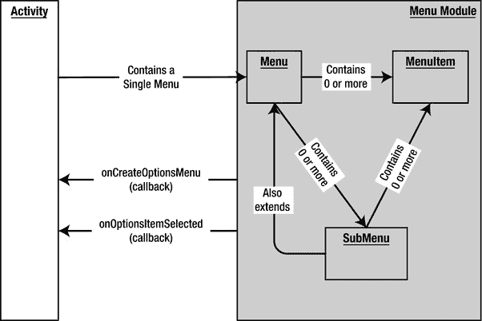

**图 7-1.** *Android 菜单相关类的结构*

图 7-1 说明一个 `Menu` 对象包含一组菜单项。一个菜单项具有以下属性：

*   **名称：** 一个字符串标题
*   **菜单项 ID：** 一个整数
*   **组 ID：** 一个整数，表示此菜单项应属于哪个组
*   **排序顺序：** 一个整数，用于标识此菜单项在菜单中显示时的顺序

名称和菜单项 ID 属性不言自明。

你可以通过为每个菜单项分配一个组 ID 来将它们分组。具有相同组 ID 的多个菜单项被视为同一组的一部分。

排序顺序属性需要稍作解释。如果一个菜单项的排序号为 4，而另一个菜单项的排序号为 6，那么第一个菜单项在菜单中将显示在第二个菜单项之上。某些菜单项排序号的取值范围是为特定类型的菜单保留的。这些被称为菜单*类别*。可用的菜单类别如下：

*   **次要：** 次要菜单项，被认为比其他菜单项重要性较低（且使用频率较低），从 0x30000 开始，由常量 `Menu.CATEGORY_SECONDARY` 定义。其他类型的菜单类别（如系统菜单、替代菜单和容器菜单）具有不同的排序号范围。
*   **系统：** 系统菜单项的排序号从 0x20000 开始，由常量 `Menu.CATEGORY_SYSTEM` 定义。此排序号范围是为 Android 系统添加的菜单项保留的。截至 4.0 版本，我们尚未看到向应用程序添加系统菜单项。例如，在 Microsoft Windows 平台上，关闭、刷新等可被视为适用于所有 Activity 的系统菜单项。我们在 Android 平台上尚未见到它们，但我们预计随着该平台超越手机范畴，未来可能会考虑引入。
*   **替代：** 替代菜单项的排序号范围从 0x40000 开始。这些菜单项由常量 `Menu.CATEGORY_ALTERNATIVE` 定义。它们通常由外部应用程序贡献，提供处理当前待处理数据的替代方法。
*   **容器：** 容器菜单项的排序号范围从 0x10000 开始，由常量 `Menu.CATEGORY_CONTAINER` 定义。在 Android 中，视图的父级（如布局）被视为容器。文档未明确说明此类别是否与布局相关，但这至少算是一个合理的猜测。很可能，与容器相关的菜单项可被放置在此范围内。对网格中的一组视图重新排序可被视为一个容器菜单项。

这些菜单类别主要设计用于使某一组菜单项比另一组更重要。然而，并没有规定禁止使用这些类别整数作为菜单项 ID 的起始编号来保持其唯一性。因此，你可以使用这些类别整数作为某类菜单项 ID 的起始编号。也可以将这些菜单类别起始编号作为菜单项组 ID 传递。

通常，菜单项 ID 的唯一性不是问题，因为在 Android 4.0 中，系统菜单目前不会添加到你的应用程序菜单中。调用替代菜单的机制不同（替代菜单将在本章后面介绍），其 ID 不会传递给你的菜单处理程序。大多数时候，菜单是在 XML 文件中声明的，Android 会为你生成唯一的 ID。因此，这些类别范围仅在你决定菜单显示顺序时，或者有时在你表明整个菜单项组属于特定类别时（此时组 ID 与类别 ID 匹配）才起作用。

图 7-1 还显示了你可用于创建和响应菜单项的两个回调方法：`onCreateOptionsMenu()` 和 `onOptionsItemSelected()`。你接下来将介绍这些方法。

### 创建菜单

在 Android SDK 中，你不需要从头创建菜单对象。由于一个 Activity 与单个菜单关联，Android 会为此 Activity 创建这个单个菜单，并将其传递给 Activity 类的 `onCreateOptionsMenu()` 回调方法（正如方法名称所示，Android 中的菜单也称为*选项菜单*）。

在 SDK 3.0 之前，`onCreateOptionsMenu()` 在首次访问 Activity 的选项菜单时被调用。从 3.0 开始，此方法在 Activity 创建过程中被调用。此变化是由于操作栏始终存在于 Activity 中。你在此方法中为选项菜单创建的菜单项可能会位于操作栏中。因为操作栏始终可见（与选项菜单不同），所以操作栏必须从一开始就知道其菜单项。因此，Android 不能等到用户打开选项菜单时才调用 `onCreateOptionsMenu()` 方法。

这个回调菜单设置方法允许你使用一组菜单项填充传入的单个菜单（见清单 7-1）。

**清单 7-1.** * `onCreateOptionsMenu` 方法的签名*

```
@Override
public boolean onCreateOptionsMenu(Menu menu)
{
    // 填充菜单项
    .....
   ...return true;
}
```

填充菜单项后，代码应返回 `true` 以使菜单可见。如果此方法返回 `false`，则菜单不可见。清单 7-2 中的代码展示了如何使用单个组 ID 以及递增的菜单项 ID 和顺序 ID 来添加三个菜单项。

**清单 7-2.** *添加菜单项*

```
@Override
public boolean onCreateOptionsMenu(Menu menu)
{
   //调用基类以包含系统菜单
   super.onCreateOptionsMenu(menu);

   menu.add(0           // 组
         ,1             // 菜单项 ID
         ,0             //顺序
         ,"append");    // 标题

   menu.add(0,2,1,"item2");
   menu.add(0,3,2,"clear");

   //返回 true 以显示菜单很重要
   return true;
}
```

你还应该调用此方法的基类实现，让系统有机会用系统菜单项填充菜单（目前尚未定义系统菜单项）。为了将这些系统菜单项与其他类型的菜单项分开，Android 会以 0x20000 开始的排序顺序添加系统菜单项。（正如我们之前提到的，常量 `Menu.CATEGORY_SYSTEM` 定义了这些系统菜单项的起始排序顺序 ID。在迄今为止的所有版本中，Android 尚未添加任何系统菜单。）

创建菜单项的参数在清单 7-2 中进行了解释。最后一个参数是菜单项的名称或标题。你可以使用 `R.java` 常量文件中的字符串资源，而不是自由文本。组、菜单项和顺序 ID 都是可选的；如果你不想指定其中任何一个，可以使用 `Menu.NONE`。


#### 使用菜单组

现在，我们来看看如何使用菜单组。清单 7-3 演示了如何添加两组菜单：组 1 和组 2。

**清单 7-3.** *使用组 ID 创建菜单组*

```java
@Override
public boolean onCreateOptionsMenu(Menu menu)
{
   //Group 1
   int group1 = 1;
   menu.add(group1,1,1,"g1.item1");
   menu.add(group1,2,2,"g1.item2");

   //Group 2
   int group2 = 2;
   menu.add(group2,3,3,"g2.item1");
   menu.add(group2,4,4,"g2.item2");

   return true; // it is important to return true
}
```

请注意，菜单项 ID 和排序 ID 与组是相互独立的。那组有什么用呢？实际上，Android 在 `android.view.Menu` 类上提供了一组基于组 ID 的方法。你可以使用这些方法来操作某个组内的菜单项：

`removeGroup(id)`
`setGroupCheckable(id, checkable, exclusive)`
`setGroupEnabled(id,boolean enabled)`
`setGroupVisible(id,visible)`

`removeGroup()` 会根据给定的组 ID 移除该组中的所有菜单项。你可以使用 `setGroupEnabled()` 方法来启用或禁用某个组内的菜单项。类似地，你也可以使用 `setGroupVisible()` 来控制某个菜单组的可见性。

`setGroupCheckable()` 是一个有趣的方法。你可以使用此方法在某个菜单项被选中时显示一个复选标记。当应用于一个组时，它会为该组内的所有菜单项启用此功能。如果此方法的 `exclusive` 标志被设置，则只允许该组内的一个菜单项进入选中状态，其他菜单项则保持未选中状态。

现在你知道了如何用一组菜单项填充活动的主菜单，并根据它们的性质进行分组。接下来，你将学习如何响应这些菜单项。

#### 响应菜单项

在 Android 中有多种方式响应菜单项点击事件。你可以使用活动类的 `onOptionsItemSelected()` 方法；也可以使用独立的监听器；或者使用 Intent。本节将逐一介绍这些技术。

##### 通过 `onOptionsItemSelected()` 响应菜单项

当菜单项被点击时，Android 会调用 `Activity` 类上的 `onOptionsItemSelected()` 回调方法（参见 清单 7-4）。

**清单 7-4.** *`onOptionsItemSelected()` 方法的签名和主体*

```java
@Override
public boolean onOptionsItemSelected(MenuItem item)
{
   switch(item.getItemId()) {
      .....
   //for items handled
   return true;

   //for the rest
   ...return super.onOptionsItemSelected(item);
   }
}
```

这里的关键模式是通过 `MenuItem` 类的 `getItemId()` 方法检查菜单项 ID，并执行必要的操作。如果 `onOptionsItemSelected()` 处理了某个菜单项，它会返回 `true`。菜单事件将不再继续传播。对于 `onOptionsItemSelected()` 未处理的菜单项回调，`onOptionsItemSelected()` 应通过 `super.onOptionsItemSelected()` 调用父类方法。`onOptionsItemSelected()` 方法的默认实现返回 `false`，以便进行正常处理。正常处理包括调用响应菜单点击的替代方式，例如直接调用可以绑定到菜单项的监听器。

##### 通过监听器响应菜单项

通常你会通过重写 `onOptionsItemSelected()` 来响应菜单；这是为了更好性能而推荐的技术。但是，菜单项允许你注册一个可用作回调的监听器。使用监听器意味着需要创建对象并注册监听器。因此，这就是本节第一句中提到的*性能*开销。不过，你可能更看重代码的复用性和清晰度，在这种情况下，监听器提供了灵活性。

这种方法分两步。第一步，实现 `OnMenuClickListener` 接口。然后，创建此实现的一个实例并将其传递给菜单项。当菜单项被点击时，菜单项会调用 `OnMenuClickListener` 接口的 `onMenuItemClick()` 方法（参见 清单 7-5）。

**清单 7-5.** *使用监听器作为菜单项点击的回调*

```java
//Step 1
public class MyResponse implements OnMenuClickListener
{
   //some local variable to work on
   //...
   //Some constructors
   @override
   boolean onMenuItemClick(MenuItem item)
   {
      //do your thing
      return true;
   }
}

//Step 2
MyResponse myResponse = new MyResponse(...);
menuItem.setOnMenuItemClickListener(myResponse);
...
```

当菜单项被调用时，会执行 `onMenuItemClick()` 方法。这段代码会在菜单项被点击后立即执行，甚至早于 `onOptionsItemSelected()` 方法的调用。如果 `onMenuItemClick()` 返回 `true`，则不会执行其他任何回调——包括 `onOptionsItemSelected()` 回调方法。这意味着监听器代码的优先级高于 `onOptionsItemSelected()` 方法。

##### 使用 Intent 响应菜单项

你也可以通过使用 `MenuItem` 的 `setIntent(intent)` 方法将菜单项与一个 Intent 关联起来。默认情况下，菜单项没有关联 Intent。但是，当一个 Intent *确实* 与菜单项关联，并且没有其他处理函数处理该菜单项时，默认行为是使用 `startActivity(intent)` 来调用这个 Intent。要使它正常工作，所有处理程序——尤其是 `onOptionsItemSelected()` 方法——对于那些未处理的项目，应该调用父类的 `onOptionsItemSelected()` 方法。或者你可以这样理解：系统优先让 `onOptionsItemSelected()` 有机会处理菜单项（当然，紧接着是监听器）。这是假设没有监听器直接与该菜单项关联；如果有，那么监听器会覆盖其他处理。

如果你没有重写 `onOptionsItemSelected()` 方法，Android 框架中的基类会执行必要的操作来调用菜单项上的 Intent。但如果你确实重写了这个方法，并且对这个菜单项不感兴趣，你必须调用父类方法，父类方法会继而促成 Intent 的调用。所以，底线是：要么不重写 `onOptionsItemSelected()` 方法，要么重写它，并为你未处理的菜单项调用父类方法。

 **注意：** `Menu` 类定义了一些便捷常量，其中之一是 `Menu.FIRST`。你可以将其用作菜单 ID 和其他与菜单相关的序列号的基准数字。

如前所述，次级菜单项起始于 `0x30000`，并由常量 `Menu.CATEGORY_SECONDARY` 定义。它们的排序 ID 高于常规菜单项，因此它们在菜单中显示在常规菜单项之后。请注意，排序顺序是区分次级菜单项和常规菜单项的唯一标准。在其他所有方面，次级菜单项的工作方式和行为与任何其他菜单项相同。

现在你已经了解了 Android 中菜单支持的基础知识，图 7-2 显示了一个显示菜单的活动屏幕截图。本节在解释这些概念时会引用此图。

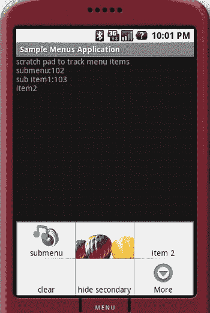

**图 7-2.** *示例菜单应用程序*

### 使用其他菜单类型

到目前为止，你已经了解了一些比较简单但功能强大的菜单类型。当你深入研究 SDK 时，你会发现 Android 也支持图标菜单、子菜单、上下文菜单和替代菜单。其中，替代菜单是 Android 特有的。本节将涵盖所有这些菜单类型。


### 展开菜单

如果应用的菜单项超出主屏幕可显示范围，Android 会显示"更多"菜单项，让用户查看其余内容。这种菜单称为*展开菜单*，当菜单项过多无法在有限空间内全部显示时，它会自动出现。您可以在图 7–2 中看到这个"更多"菜单项。

### 使用图标菜单

Android 不仅支持文本，还支持图片或图标作为菜单的一部分。您同样可以在图 7–2 中看到这一点。您可以使用图标代替文本（或与文本结合）来表示菜单项。

使用图标菜单时请注意以下几点限制。首先，展开菜单不能使用图标菜单。此限制未来可能会根据设备尺寸和 SDK 支持情况而解除。较大尺寸的设备可能允许此功能，而较小设备可能仍保留此限制。

其次，图标菜单项不支持菜单项复选标记。

第三，如果图标菜单项的文本过长，会根据显示屏尺寸截断一定数量的字符。（最后这条限制也适用于纯文本菜单项。）

创建图标菜单项非常简单。您先像之前一样创建常规的纯文本菜单项，然后使用 `MenuItem` 类的 `setIcon()` 方法来设置图像。您需要使用图像的资源 ID，因此必须先将图片或图标放在 `/res/drawable` 目录下生成资源 ID。例如，如果图标文件名为 `balloons`，那么资源 ID 就是 `R.drawable.balloons`。

代码清单 7–6 演示了如何向菜单项添加图标

**代码清单 7–6.** *为菜单项附加图标*

```
//添加菜单项并记住它，以便后续为其设置图标。
MenuItem item = menu.add(...);
item.setIcon(R.drawable.balloons);
```

在向菜单添加菜单项时，通常无需保留 `menu.add` 方法返回的局部变量。但在此例中，您需要记住返回的对象，以便为菜单项添加图标。此示例代码还说明了 `menu.add()` 方法返回的类型是 `MenuItem`。

只要菜单项显示在主应用屏幕上，图标就会显示。如果菜单项作为展开菜单的一部分显示，则不会显示图标，仅显示文本。图 7–2 中显示气球图像的菜单项就是图标菜单项的一个示例。

### 使用子菜单

现在我们来看看 Android 的子菜单。图 7–1 指出了 `SubMenu` 与 `Menu` 和 `MenuItem` 之间的结构关系。一个 `Menu` 对象可以拥有多个 `SubMenu` 对象。每个 `SubMenu` 对象通过调用 `Menu.addSubMenu()` 方法添加到 `Menu` 对象中（参见代码清单 7–7）。往子菜单中添加菜单项的方式与往菜单中添加菜单项完全相同，这是因为 `SubMenu` 同样继承自 `Menu` 对象。不过，您无法向子菜单中添加更多子菜单。

**代码清单 7–7.** *添加子菜单*

```
private void addSubMenu(Menu menu)
{
   //次要项与其他项一样正常显示
   int base=Menu.FIRST + 100;
   SubMenu sm = menu.addSubMenu(base,base+1,Menu.NONE,"子菜单");
   sm.add(base,base+2,base+2,"子项 1");
   sm.add(base,base+3,base+3,"子项 2");
   sm.add(base,base+4,base+4,"子项 3");

    //子菜单项不支持图标
   item1.setIcon(R.drawable.icon48x48_2);

   //以下操作是允许的
   sm.setIcon(R.drawable.icon48x48_1);

   //以下操作将导致运行时异常
    //sm.addSubMenu("尝试这个");
}
```

 **注意：** `SubMenu` 作为 `Menu` 对象的子类，仍然继承 `addSubMenu()` 方法。如果你向一个子菜单添加另一个子菜单，编译器不会报错，但实际执行时会产生运行时异常。

Android SDK 文档还指出，子菜单不支持图标菜单项。当你为菜单项添加图标，然后将其添加到子菜单时，该菜单项会忽略这个图标，即使不会出现编译时或运行时错误。不过，子菜单本身可以带有图标。


### 处理上下文菜单

桌面程序的用户对上下文菜单都很熟悉。例如在 Windows 应用程序中，你可以通过右键点击某个 UI 元素来访问上下文菜单。Android 通过一种称为*长按*的操作支持相同的上下文菜单概念。长按是指在任意 Android 视图上按住鼠标点击的时间比平时稍长一些。

在手机等手持设备上，鼠标点击的实现方式有多种，具体取决于导航机制。如果你的手机有滚轮来移动光标，按下滚轮就相当于鼠标点击。或者，如果设备有触摸板，轻触或按压就相当于鼠标点击。又或者你有一组方向按钮用于移动以及一个位于中间的确认按钮；点击该按钮就相当于点击鼠标。无论你的设备如何实现鼠标点击，如果你按住鼠标点击的时间稍长一点，就能触发长按。

上下文菜单在结构上与你一直了解的标准选项菜单不同（参见图 7–3）。上下文菜单具有选项菜单所没有的细微差别。

图 7–3 展示了在 Android 菜单架构中，上下文菜单被表示为 `ContextMenu` 类。就像 `Menu` 一样，`ContextMenu` 可以包含多个菜单项。你可以使用同一组 `Menu` 方法来为上下文菜单添加菜单项。

`Menu` 和 `ContextMenu` 之间的区别归结为菜单的所有权问题。Activity 拥有常规的选项菜单，而视图拥有上下文菜单。这是符合预期的，因为激活上下文菜单的长按操作是针对被点击的*视图*的。因此，一个 Activity 只能有一个选项菜单，但可以有多个上下文菜单。由于一个 Activity 可以包含多个视图，并且每个视图都可以有自己的上下文菜单，所以一个 Activity 可以有与视图数量一样多的上下文菜单。

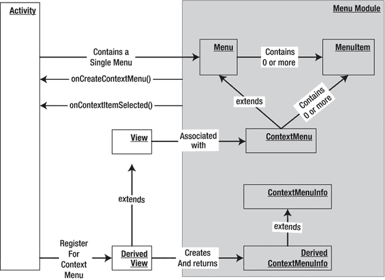

**图 7–3.** *Activity、视图和上下文菜单*

尽管上下文菜单由视图拥有，但填充上下文菜单的方法位于 `Activity` 类中。这个方法名为 `activity.onCreateContextMenu()`，其作用类似于 `activity.onCreateOptionsMenu()` 方法。此回调方法还会携带（作为该方法的参数）需要为其填充上下文菜单项的视图。

上下文菜单还有另一个值得注意的特殊之处。虽然 `onCreateOptionsMenu()` 方法会自动为每个 Activity 调用，但 `onCreateContextMenu()` 并非如此。一个 Activity 中的视图并非*必须*拥有一个上下文菜单。例如，你的 Activity 中可以有三个视图，但你可能只想为一个视图启用上下文菜单，而其他视图则不启用。如果你希望某个特定的视图拥有上下文菜单，你必须专门为此目的向该 Activity 注册该视图。你可以通过 `activity.registerForContextMenu(view)` 方法来实现这一点，该方法将在“为上下文菜单注册视图”一节中讨论。

现在请注意图 7–3 中所示的 `ContextMenuInfo` 类。此类型的对象会被传递给 `onCreateContextMenu()` 方法。这是视图向该方法传递额外信息的一种方式。为了实现这一点，视图需要重写 `getContextViewInfo()` 方法，并返回一个 `ContextMenuInfo` 的派生类，该类包含用于表示额外信息的额外方法。你可能需要查看 `android.view.View` 的源代码以完全理解这种交互。

 **注意：** 根据 Android SDK 文档，上下文菜单不支持快捷键、图标或子菜单。

现在你已经了解了上下文菜单的总体结构，让我们看一些示例代码，这些代码演示了实现上下文菜单的每个步骤：

1.  在 Activity 的 `onCreate()` 方法中为上下文菜单注册一个视图。
2.  使用 `onCreateContextMenu()` 填充上下文菜单。你必须在 Android 调用此回调方法之前完成步骤 1。
3.  响应上下文菜单点击。

#### 为上下文菜单注册视图

实现上下文菜单的第一步是在 Activity 的 `onCreate()` 方法中为上下文菜单注册一个视图。你可以使用代码清单 7–8 中的代码为 `TextView` 注册上下文菜单。首先找到 `TextView`，然后在 Activity 上以该 `TextView` 作为参数调用 `registerForContextMenu()`。这样就为该 `TextView` 设置好了上下文菜单。

**代码清单 7–8.** *为上下文菜单注册 `TextView`*

```
@Override
public void onCreate(Bundle savedInstanceState) {
    super.onCreate(savedInstanceState);
    setContentView(R.layout.main);

    TextView tv = (TextView)this.findViewById(R.id.textViewId);
    registerForContextMenu(tv);
}
```

#### 填充上下文菜单

一旦为本示例中的 `TextView` 这样的视图注册了上下文菜单，Android 就会以该视图作为参数调用 `onCreateContextMenu()` 方法。这就是你可以为该上下文菜单填充菜单项的地方。`onCreateContextMenu()` 回调方法提供了三个参数供使用。

第一个参数是一个预先构建好的 `ContextMenu` 对象，第二个是触发回调的视图（例如 `TextView`），第三个是你在讨论图 7–3 时简要看到的 `ContextMenuInfo` 类。对于许多简单的情况，你可以直接忽略 `ContextMenuInfo` 对象。但是，某些视图可能会通过此对象传递额外信息。在这些情况下，你需要将 `ContextMenuInfo` 类转换为子类，然后使用额外的方法来检索这些额外信息。

一些派生自 `ContextMenuInfo` 类的示例包括 `AdapterContextMenuInfo` 和 `ExpandableContextMenuInfo`。Android 中与数据库游标关联的视图使用 `AdapterContextMenuInfo` 类来传递该视图中正在显示上下文菜单的行 ID。从某种意义上说，你可以使用此类来进一步明确鼠标点击下的对象，即使在给定的视图内部也是如此。

代码清单 7–9 演示了 `onCreateContextMenu()` 方法。

**代码清单 7–9.** *`onCreateContextMenu()` 方法*

```
@Override
public void onCreateContextMenu(ContextMenu menu, View v, ContextMenuInfo menuInfo)
{
    menu.setHeaderTitle("示例上下文菜单");
    menu.add(200, 200, 200, "项目 1");
}
```

#### 响应上下文菜单项

实现上下文菜单的第三步是响应上下文菜单点击。响应上下文菜单的机制与响应选项菜单的机制类似。Android 提供了一个类似 `onOptionsItemSelected()` 的回调方法，名为 `onContextItemSelected()`。这个方法与其对应方法一样，也可以在 `Activity` 类中找到。代码清单 7–10 演示了 `onContextItemSelected()`。

**代码清单 7–10.** *响应上下文菜单*

```
@Override
public boolean onContextItemSelected(MenuItem item)
{
    if (item.getItemId() == some-menu-item-id)
    {
        //处理此菜单项
        return true;
    }
    // ... 其他异常处理
}
```


### 使用替代菜单

到目前为止，您已经学会了如何创建和使用菜单、子菜单以及上下文菜单。Android 引入了一个名为*替代菜单*的新概念，它允许将替代菜单项作为菜单、子菜单和上下文菜单的一部分。替代菜单使 Android 上的多个应用能够相互协助。

具体而言，替代菜单允许某一应用包含来自另一应用的菜单项。当选择替代菜单时，目标应用或 Activity 会通过一个指向所需数据的 URL 启动。被调用的 Activity 随后使用从传递的 Intent 中获取的数据 URL。要深入理解替代菜单，您必须先了解内容提供程序、内容 URI、内容 MIME 类型以及 Intent（请参考第 4 章和第 5 章）。

这里的基本思路是：假设您正在编写一个用于显示某些数据的界面。这个界面很可能是一个 Activity。在这个 Activity 上，您有一个选项菜单，允许您以多种方式操作或处理数据。同时，假设您正在处理一份由 URI 和对应 MIME 类型标识的文档或笔记。作为程序员，您需要预见到设备上最终会出现更多能够处理或显示这类数据的程序。您希望让这些新程序有机会将其菜单项作为您为此 Activity 构建的菜单的一部分显示出来。

要将替代菜单项附加到菜单，请在 `onCreateOptionsMenu()` 方法中设置菜单时遵循以下步骤：

1.  创建一个 Intent，将其数据 URI 设置为当前展示的数据 URI。
2.  将 Intent 的类别设置为 `CATEGORY_ALTERNATIVE`。
3.  搜索能够对 URI 所支持的数据进行操作的活动。
4.  将能够调用这些 Activity 的 Intent 作为菜单项添加到菜单中。

这些步骤充分揭示了 Android 应用的本质，因此我们来逐一分析。如您所知，将替代菜单项附加到菜单的操作发生在 `onCreateOptionsMenu()` 方法中：

```
@Override
public boolean onCreateOptionsMenu(Menu menu)
{
}
```

现在，我们来确定此函数中应包含的代码。首先，您需要知道当前 Activity 可能处理的数据的 URI。您可以通过以下方式获取 URI：

```
this.getIntent().getData()
```

这之所以可行，是因为 `Activity` 类有一个名为 `getIntent()` 的方法，它会返回用于调用此 Activity 的数据 URI。这个被调用的 Activity 可能是由主菜单调用的主 Activity；在这种情况下，它可能没有 Intent，`getIntent()` 方法会返回 `null`。在代码中，您需要防范这种情况。

如果您碰巧知道数据的 URI（无论 Activity 是如何被调用的），您也可以直接使用该 URI。

现在，您的目标是找出其他能够处理这类数据的程序。您需要使用一个 Intent 作为参数来进行搜索。以下是构建该 Intent 的代码：

```
Intent criteriaIntent = new Intent(null, getIntent().getData());
intent.addCategory(Intent.CATEGORY_ALTERNATIVE);
```

一旦构建好 Intent，您还需要添加您感兴趣的 Action 类别。具体来说，您只对可作为替代菜单一部分被调用的 Activity 感兴趣。现在，您可以告诉 `Menu` 对象搜索匹配的 Activity，并将它们添加为菜单选项（请参考列表 7–11）。

**列表 7–11.** *使用替代菜单项填充菜单*

```
// 搜索匹配的 Activity 并将其填充到菜单中。

// 您可以使用以下定义的常量
// 作为一系列唯一 ID 的起始点。
int menuItemGroupId = Menu.CATEGORY_ALTERNATIVE;
int startingMenuItemId = Menu.CATEGORY_ALTERNATIVE;
int startingMenuItemOrderId = Menu.CATEGORY_ALTERNATIVE;
```


`menu.addIntentOptions(`
`     menuItemGroupId,             // 分组`
`     startingMenuItemId,          // 所有菜单项的起始菜单项 ID`
`     startingMenuItemOrderId,     // 每个菜单的起始排序 ID`
`     this.getComponentName(),     // 显示菜单的活动类名称——此处为当前类。`
`                                  // 变量 "this" 指向当前活动`
`     null,                        // 无特定意图`
`     criteriaIntent,              // 先前创建的意图，用于描述我们的需求`
`     0,                           // 无标志`
`     null);                       // 返回的菜单项`

`Menu` 类中的 `addIntentOptions()` 方法负责查找与某项意图的 URI 和类别属性相匹配的活动。然后，该方法将这些活动添加到正确的分组下，并赋予相应的菜单项和排序 ID。前三个参数处理的就是方法在这方面的职责。在清单 7–11 中，您从 `Menu.CATEGORY_ALTERNATIVE` 开始，将其作为新菜单项将要添加到的分组。您还使用同一个常量作为菜单项和排序 ID 的起始值。

下一个参数指向此菜单所属活动的完全限定组件名称。代码使用了 `Activity` 类中的 `getComponentName()` 方法。*组件名称*仅是包名和类名的组合，之所以需要此组件名称，是因为当添加一个新的菜单项时，该菜单项需要调用目标活动。为此，系统需要知道启动目标活动的源活动。下一个参数是一个意图数组，您应将其用作返回意图的过滤器。在示例中您使用了 `null`。

接下来的参数指向您刚构建的 `criteriaIntent`。这是您要使用的搜索条件。之后的参数是一个标志，例如 `Menu.FLAG_APPEND_TO_GROUP`，用于指示是追加到该分组现有菜单项集合中，还是替换它们。默认值为 `0`，表示应替换菜单组中的菜单项。

清单 7–11 中的最后一个参数是一个已添加菜单项的数组。如果您希望在添加后以某种方式操作这些已添加的菜单项，可以使用这些引用。

以上这一切都很好。但仍有一些问题未得到解答。例如，添加的菜单项的名称会是什么？Android 文档对此没有说明，因此我们深入查看了源代码，想了解这个函数在幕后究竟做了什么（请参考第 1 章了解如何获取 Android 源代码）。

事实证明，`Menu` 类只是一个接口，因此您无法看到它的任何实现源代码。实现 `Menu` 接口的类名为 `MenuBuilder`。清单 7–12 展示了来自 `MenuBuilder` 类的一个相关方法 `addIntentOptions()` 的源代码（提供此代码供您参考，我们不会逐行解释）。

**清单 7–12.** *`MenuBuilder.addIntentOptions()` 方法*

```
public int addIntentOptions(int group, int id, int categoryOrder,
                           ComponentName caller,
                           Intent[] specifics,
                           Intent intent, int flags,
                           MenuItem[] outSpecificItems)
{
    PackageManager pm = mContext.getPackageManager();
    final List<ResolveInfo> lri =
            pm.queryIntentActivityOptions(caller, specifics, intent, 0);
    final int N = lri != null ? lri.size() : 0;

    if ((flags & FLAG_APPEND_TO_GROUP) == 0) {
        removeGroup(group);
    }

    for (int i=0; i<N; i++) {
        final ResolveInfo ri = lri.get(i);
        Intent rintent = new Intent(
            ri.specificIndex < 0 ? intent : specifics[ri.specificIndex]);
        rintent.setComponent(new ComponentName(
                ri.activityInfo.applicationInfo.packageName,
                ri.activityInfo.name));
final MenuItem item = add(group, id, categoryOrder,
                       ri.loadLabel(pm));
        item.setIntent(rintent);
        if (outSpecificItems != null && ri.specificIndex >= 0) {
            outSpecificItems[ri.specificIndex] = item;
        }
    }
    return N;
}
```

请注意清单 7–12 中加粗高亮的那一行代码；这部分代码用于构建菜单项。代码将确定菜单标题的工作委托给了 `ResolveInfo` 类。`ResolveInfo` 类的源代码显示，声明此意图的意图过滤器应具有一个关联的标题。清单 7–13 展示了一个意图过滤器定义的示例。

**清单 7–13.** *意图过滤器的标签*

```
<intent-filter android:label="菜单标题 ">
     .......
      <category android:name="android.intent.category.ALTERNATE" />
     <data android:mimeType="some type data" />
</intent-filter>
```

意图过滤器的 `label` 值最终用作菜单名称。您可以查看 Android 的 NotePad 示例来了解此行为。

### 动态菜单

到目前为止，我们讨论的都是静态菜单——您一次性设置好它们，它们不会根据屏幕上的内容动态变化。如果您想创建动态菜单，请使用 Android 在活动类上提供的 `onPrepareOptionsMenu()` 方法。此方法与 `onCreateOptionsMenu()` 类似，区别在于它每次调用菜单时都会被调用。如果您想根据显示的内容禁用某些菜单项或菜单组，则应使用 `onPrepareOptionsMenu()`。对于 Android 3.0 及以上版本，您必须显式调用一个新提供的方法 `invalidateOptionsMenu()`，该方法会转而调用 `onPrepareOptionsMenu()`。每当您的应用程序状态发生需要更改菜单的变化时，您都可以随时调用此方法。

### 通过 XML 文件加载菜单

到目前为止，我们都是通过编程方式创建所有菜单。这并不是创建菜单最方便的方式，因为对于每个菜单，您都必须提供多个 ID 并为每个 ID 定义常量。这无疑很繁琐。

相反，您可以通过 XML 文件定义菜单，这在 Android 中是可行的，因为菜单也是资源。创建菜单的 XML 方法提供了几个优点，例如能够命名菜单、自动对它们排序以及为它们分配 ID。您还可以获得对菜单文本的本地化支持。

按照以下步骤使用基于 XML 的菜单：

1.  使用菜单标签定义一个 XML 文件。
2.  将该文件放置在 `/res/menu` 子目录中。文件名是任意的，您可以根据需要创建任意数量的文件。Android 会自动为此菜单文件生成一个资源 ID。
3.  使用菜单文件的资源 ID 将 XML 文件加载到菜单中。
4.  使用为每个菜单项生成的资源 ID 来响应菜单项。

以下各节将分别讨论这些步骤，并提供相应的代码片段。


#### XML 菜单资源文件的结构

首先，让我们来看一个包含菜单定义的 XML 文件（参见列表 7–14）。所有菜单文件都以相同的高层级 `menu` 标签开头，后跟一系列 `group` 标签。每个 `group` 标签对应你在本章开头提到的菜单项组。你可以使用 `@+id` 方式为组指定一个 ID。每个菜单组都包含一系列菜单项，这些菜单项的 ID 与符号名称相关联。你可以参考 Android SDK 文档了解这些 XML 标签所有可能的参数。

**列表 7–14.** *包含菜单定义的 XML 文件*

```
<menu>
    <!-- 此组使用默认类别。 -->
    <group android:id="@+id/menuGroup_Main">
        <item android:id="@+id/menu_testPick"
            android:orderInCategory="5"
            android:title="Test Pick" />
        <item android:id="@+id/menu_testGetContent"
            android:orderInCategory="5"
            android:title="Test Get Content" />
        <item android:id="@+id/menu_clear"
            android:orderInCategory="10"
            android:title="clear" />
        <item android:id="@+id/menu_dial"
            android:orderInCategory="7"
            android:title="dial" />
        <item android:id="@+id/menu_test"
            android:orderInCategory="4"
            android:title="@+string/test" />
        <item android:id="@+id/menu_show_browser"
            android:orderInCategory="5"
            android:title="show browser" />
    </group>
</menu>
```

列表 7–14 中的菜单 XML 文件包含一个组。根据资源 ID 定义 `@+id/menuGroup_main`，此组将在 `R.java` 资源 ID 文件中自动获得一个名为 `menuGroup_main` 的资源 ID。类似地，所有子菜单项会根据该 XML 文件中的符号资源 ID 定义被分配相应的菜单项 ID。

### 填充 XML 菜单资源文件

假设这个 XML 文件的名称为 `my_menu.xml`。你需要将此文件放置在 `/res/menu` 子目录中。将文件放在 `/res/menu` 中会自动生成一个名为 `R.menu.my_menu` 的资源 ID。

现在，让我们看看如何使用这个菜单资源 ID 来填充选项菜单。Android 提供了一个名为 `android.view.MenuInflater` 的类，用于从 XML 文件填充 `Menu` 对象。你可以使用该 `MenuInflater` 的一个实例，借助 `R.menu.my_menu` 资源 ID 来填充菜单对象。如列表 7–15 所示。

**列表 7–15.** *使用菜单填充器*

```
@Override
public boolean onCreateOptionsMenu(Menu menu)
{
   MenuInflater inflater = getMenuInflater(); //来自 Activity
   inflater.inflate(R.menu.my_menu, menu);

   //务必返回 true 以显示菜单
   return true;
}
```

在这段代码中，你首先从 `Activity` 类获取 `MenuInflater`，然后指示它将菜单 XML 文件直接填充到菜单中。

### 响应基于 XML 的菜单项

你响应 XML 菜单项的方式与响应通过编程方式创建的菜单类似，但有一点细微差别。和之前一样，你在 `onOptionsItemSelected()` 回调方法中处理菜单项。这一次，你可以借助 Android 资源获得一些帮助（有关资源的详细信息，请参见第 3 章）。如“XML 菜单资源文件的结构”一节所述，Android 不仅为 XML 文件生成资源 ID，还会生成必要的菜单项 ID，以帮助你区分不同的菜单项。这在响应菜单项方面是一个优势，因为你无需显式创建和管理它们的菜单项 ID。

 **注意：** 用于标识菜单项 ID 的资源类型（`R.id.some_menu_item_id`）与用于标识菜单本身的资源类型（`R.menu.some_menu_file_id`）是不同的。

为了进一步说明这一点，对于 XML 菜单，你无需为这些 ID 定义常量，也无需担心它们的唯一性，因为资源 ID 的生成机制会处理这一切。列表 7–16 中的代码对此进行了说明。

**列表 7–16.** *响应来自 XML 菜单资源文件的菜单项*

```
private void onOptionsItemSelected (MenuItem item)
{
   if (item.getItemId() == R.id.menu_clear)
   {
        //执行某些操作
   }
   else if (item.getItemId() == R.id.menu_dial)
   {
        //执行某些操作
   }
    ......等等
}
```

请注意，XML 菜单资源文件中的菜单项名称是如何在 `R.id` 空间中自动生成菜单项 ID 的。

从 SDK 3.0 开始，你可以使用菜单项的 `android:onClick` 属性直接指定 Activity 中与此菜单关联的方法名称。然后，该方法将被调用，并将菜单项对象作为唯一的输入参数。此功能仅在 3.0 及以上版本中可用。列表 7–17 展示了一个示例。

**列表 7–17.** *在 XML 菜单资源文件中指定菜单回调方法*

```
<item android:id="... "
        android:onClick="a-method-name-in-your-activity"
       ...
</item>
```


### 4.0 中的弹出菜单

Android 3.0 引入了另一种菜单类型，称为弹出菜单。SDK 4.0 通过为 `PopupMenu` 类添加几个实用方法（例如 `PopupMenu.inflate`）对此进行了轻微增强。（请参阅 `PopupMenu` API 文档了解这些方法。清单 7–19 也指出了这一差异。）

弹出菜单可以针对任何视图调用，以响应 UI 事件。UI 事件的一个示例是按钮点击或图像视图上的点击。图 7–4 显示了一个针对视图调用的弹出菜单。

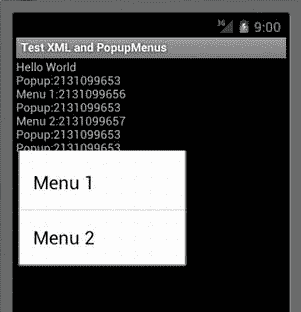

**图 7–4.** *附加到文本视图的弹出菜单*

要创建像图 7–4 中那样的弹出菜单，请从常规的 XML 菜单文件开始，如清单 7–18 所示。

**清单 7–18.** *弹出菜单的示例 XML 文件*

```
<menu >
    <!-- 此组使用默认类别。 -->
    <group android:id="@+id/menuGroup_Popup">
        <item android:id="@+id/popup_menu_1"
            android:title="Menu 1" />

        <item android:id="@+id/popup_menu_2"
            android:title="Menu 2" />
    </group>
</menu>
```

假设清单 7–18 中的代码位于名为 `popup_menu.xml` 的文件中，则可以使用清单 7–19 中的 Java 代码将此菜单 XML 作为弹出菜单加载。

**清单 7–19.** *处理弹出菜单*

```
//其他活动代码在此处...
//调用以下方法以显示弹出菜单
private void showPopupMenu()
{
    //获取一个视图来锚定弹出菜单
    //getTextView() 可以是任何返回视图的方法
    TextView tv = getTextView();

    //实例化一个弹出菜单
    //变量 "this" 代表活动
    PopupMenu popup = new PopupMenu(this, tv);

    //以下代码适用于 3.0 SDK
    //popup.getMenuInflater().inflate(
    //        R.menu.popup_menu, popup.getMenu());

    //或者使用 SDK 4.0
    popup.inflate(R.menu.popup_menu);
    popup.setOnMenuItemClickListener(new PopupMenu.OnMenuItemClickListener()
            {
                public boolean onMenuItemClick(MenuItem item)
                {
                    //一些用于记录该项的本地方法
                    //查看示例项目以了解此方法如何工作
                    appendMenuItemText(item);
                    return true;
                }
            }
    );
    popup.show();
}
```

如你所见，弹出菜单的行为与选项菜单非常相似。主要区别如下：

* 弹出菜单是按需使用的，而选项菜单始终可用。
* 弹出菜单锚定到一个视图，而选项菜单属于整个活动。
* 弹出菜单使用自己的菜单项回调，而选项菜单使用活动上的 `onOptionsItemSelected()` 回调。

### 附加 XML 菜单标签简介

在构建菜单 XML 文件时，你需要了解各种可能的 XML 菜单标签。你可以在线查找，或者通过检查 Android SDK 附带的 API 演示来快速获取此信息。这些 Android API 演示包括一系列菜单，可帮助你探索 Android 编程的各个方面。如果你查看 API 演示项目的 `/res/menu` 子目录，会发现许多 XML 菜单示例。以下各节简要介绍了一些从中借鉴的关键标签。

#### 组类别标签

在 XML 文件中，可以使用 `menuCategory` 标签指定组的类别：

```
<group android:id="@+id/some_group_id "
        android:menuCategory="secondary">
```

#### 可勾选行为标签

你可以使用 `checkableBehavior` 标签在组级别控制可勾选行为：

```
<group android:id="@+id/noncheckable_group"
       android:checkableBehavior="none">
```

你可以使用 `checked` 标签在项级别控制可勾选行为：

```
<item android:id=".."
      android:title="..."
      android:checked="true" />
```

#### 模拟子菜单的标签

子菜单表示为菜单项下的一个 `menu` 元素：

```
<item android:title="所有不带组的项">
       <menu>
                  <item...>
       </menu>
</item>
```

#### 菜单图标标签

你可以使用 `icon` 标签将图像与菜单项关联：

```
<item android:id=".. "
       android:icon="@drawable/some-file" />
```

#### 菜单启用/禁用标签

你可以使用 `enabled` 标签启用或禁用菜单项：

```
<item android:id=".. "
        android:enabled="true"
        android:icon="@drawable/some-file" />
```

#### 菜单项快捷键

你可以使用 `alphabeticShortcut` 标签为菜单项设置快捷键：

```
<item android:id="... "
       android:alphabeticShortcut="a"
      ...>
</item>
```

#### 菜单可见性

你可以使用 `visible` 标志控制菜单项的可见性：

```
<item android:id="... "
        android:visible="true"
       ...>
</item>
```

### 资源

在学习和使用 Android 菜单时，你可能希望手头保留以下 URL：

* [`developer.android.com/guide/topics/ui/menus.html`](http://developer.android.com/guide/topics/ui/menus.html)：来自 Google 的主要文档，描述了如何处理菜单。随着 SDK 的进步，如果需要检查自本章撰写以来是否有变化，这是一个好去处。
* [`developer.android.com/guide/topics/resources/menu-resource.html`](http://developer.android.com/guide/topics/resources/menu-resource.html)：有关可在菜单资源中使用的各种 XML 标签的信息。
* [`androidbook.com/proandroid4/projects`](http://androidbook.com/proandroid4/projects)：本书的项目下载 URL。本章可下载的项目 ZIP 文件是 `ProAndroid4_ch07_TestMenus.zip`。此项目使用了本章涵盖的所有菜单。图 7–2 中的屏幕截图取自该项目的运行示例。

### 总结

本章涵盖了以下内容：

* 如何创建和响应常规菜单
* 如何创建和响应上下文菜单
* 如何更改现有菜单以响应应用程序中变化的上下文
* 如何处理替代菜单
* 如何创建、加载和响应基于 XML 的菜单资源
* 如何处理弹出菜单


### 面试题

以下问题将巩固你在本章学到的知识：

1.  Android SDK 中提供了哪些类型的菜单？
2.  菜单项有哪些重要属性？
3.  创建菜单项时会调用哪个回调方法？
4.  响应菜单项时会调用哪个回调方法？
5.  菜单项的顺序是否受其组 ID 的影响？
6.  如何为菜单项点击事件附加监听器？
7.  如何使用意图（intent）响应菜单项？
8.  能否通过菜单项中的意图启动服务？
9.  什么是展开菜单？
10. 如何为菜单项添加图片？
11. 菜单展开时图片会显示吗？
12. Android 中的长按是什么？
13. 从所有权角度看，菜单和上下文菜单有什么区别？
14. 创建上下文菜单时使用哪个回调方法？
15. 响应上下文菜单时使用哪个回调方法？
16. `OnCreateContextMenu` 是否为每个视图调用？
17. 如何触发上下文菜单的创建？
18. 传递给 `onCreateContextMenu()` 回调方法的三个参数是什么？
19. 如何为应用添加替代菜单？
20. 如何在每次调用菜单或应用中某些数据变化时动态更改菜单？
21. 菜单 XML 文件应放在哪里？
22. 每个菜单是否都需要单独的 XML 文件？
23. 如何使用 `R.java` 标识菜单项 ID？
24. 如何将 XML 文件中的菜单附加到 Activity？
25. 菜单 ID 和菜单项 ID 是否共享同一种资源类型？
26. 菜单填充器类（menu inflater class）的作用是什么？
27. 如何获取菜单填充器类的实例？

## 第 8 章：面向平板电脑及更大屏幕的 Fragment

到目前为止，我们已经探索了 Android 应用的各个组成部分，并运行了一些针对智能手机屏幕尺寸设计的简单应用。你只需要考虑如何为 Activity 在屏幕上布局 UI 控件，以及一个 Activity 如何流向下一个 Activity 等等。在 Android 最初的两个主要版本中，小屏幕是主流。随后 Android 平板电脑问世：这些设备拥有 10 英寸的屏幕。这使事情变得复杂了。为什么呢？因为现在屏幕空间非常充裕，一个简单的 Activity 很难在填满屏幕的同时，又保持单一功能。例如，一个电子邮件应用如果在一个 Activity 中只显示邮件标题（填满屏幕），再在另一个单独的 Activity 中显示单个邮件内容（同样填满屏幕），这就不再合理了。有了这么大的操作空间，应用完全可以在屏幕左侧显示邮件标题列表，在右侧显示选中的邮件内容。能否在一个 Activity 中使用单个布局实现这一点呢？嗯，可以，但你无法为较小屏幕的设备复用这个 Activity 或布局。

Android 3.0 引入的核心类之一是 `Fragment` 类，它专门设计用来帮助开发者管理应用功能，以便提供出色的可用性和高度的可复用性。本章将向你介绍片段（Fragment），解释它是什么、如何融入应用的架构以及如何使用它。片段使得许多以前难以实现的有趣功能成为可能。大约在同一时间，谷歌发布了一个适用于旧版 Android 系统的 Fragment SDK。因此，即使你对编写平板电脑应用不感兴趣，你也会发现片段能让非平板设备上的开发工作更轻松。现在，有了 Android 4.0，为智能手机、平板电脑，乃至电视和其他设备编写出色的应用比以往任何时候都更简单。

让我们开始学习 Android 片段吧。

### 什么是 Fragment？

本节将解释片段是什么以及它的作用。但首先，让我们设定一下场景，看看为什么需要片段。正如你之前所学，在小屏幕设备上，Android 应用使用 Activity 向用户展示数据和功能，每个 Activity 都有一个相当简单、定义明确的目的。例如，一个 Activity 可能向用户显示其通讯录中的联系人列表。另一个 Activity 可能允许用户撰写电子邮件。Android 应用就是这些 Activity 的集合，它们组合在一起实现一个更大的目标，例如通过阅读和发送消息来管理电子邮件账户。这对于小屏幕设备来说没问题，但当用户的屏幕非常大（10 英寸或更大）时，屏幕上就有空间可以做不止一件简单的事情。应用可能希望让用户同时查看收件箱中的邮件列表，并在另一个窗口中显示当前选中的邮件正文。或者，应用可能希望同时显示联系人列表和当前选中联系人的详细信息视图。

作为一名 Android 开发者，你知道这种功能可以通过为超大屏幕定义另一个包含 `ListView`、各种布局和其他视图的布局来实现。而“另一个布局”指的是在你可能已经为小屏幕定义的布局之外再添加的布局。当然，你还需要为竖屏和横屏情况分别设置单独的布局。鉴于超大屏幕的尺寸，这意味着要布局和编写代码的标签、字段、图片等视图数量会相当多。如果能有一种方法将这些视图对象分组并整合其逻辑，使得应用的各个部分能够在不同屏幕尺寸和设备间复用，从而最大程度地减少开发者维护应用所需的工作量，那就好了。这正是我们拥有片段的原因。

片段的一种理解方式是将其视为子 Activity。事实上，片段的语义与 Activity 非常相似。片段可以拥有与之关联的视图层次结构，并且它的生命周期与 Activity 的生命周期非常相似。片段甚至能像 Activity 一样响应返回按钮。如果你曾想过“要是我能同时在平板电脑屏幕上放置多个 Activity 就好了”，那么你的思路是对的。但由于在平板电脑屏幕上同时激活同一个应用的多个 Activity 会过于混乱，因此创建了片段来实现这一想法。这意味着片段是包含在 Activity 之内的。片段只能在 Activity 的上下文中存在；没有 Activity，你就无法使用片段。片段可以与 Activity 的其他元素共存，这意味着你**并非必须**将整个 Activity 的用户界面都转换为使用片段。你可以像以前一样创建 Activity 的布局，并且只为用户界面的某一部分使用片段。

然而，在保存和恢复状态方面，片段与 Activity 不同。片段框架提供了若干特性，使得保存和恢复片段比在 Activity 中需要做的工作简单得多。如何决定何时使用片段取决于一些考量因素，这些将在下面讨论。


  
#### 何时使用片段  

使用片段的主要原因之一是，你可以在不同设备和屏幕尺寸间复用用户界面和功能模块。这一点在平板电脑上尤为明显。试想，当屏幕大到像平板电脑那样时，能承载多少内容？它更像一台台式机而非手机，而许多桌面应用程序都采用了多面板用户界面。如之前所述，你可以在屏幕上同时显示一个列表和所选项目的详情视图。在横屏模式下，列表在左侧、详情在右侧的情况很容易想象。但如果用户将设备旋转到竖屏模式，屏幕变成竖长形呢？你可能希望列表位于屏幕顶部，详情位于底部。然而，如果这个应用程序运行在小屏幕上，根本没有空间同时容纳这两个部分，该怎么办？你难道不希望为列表和详情分别创建独立的 Activity，并让它们能够共享你为大屏幕构建的这些面板逻辑吗？我们希望你给出的答案是肯定的。片段正好可以解决这个问题。图 8–1 会更清楚地展示这一点。  

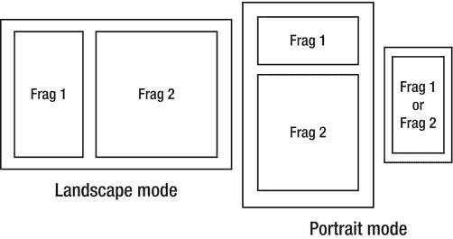  

**图 8–1.** *用于平板电脑 UI 和智能手机 UI 的片段*  

在横屏模式下，两个片段可以并排整齐摆放。在竖屏模式下，我们或许可以将一个片段放在另一个上方。但如果我们要在屏幕更小的设备上运行同一个应用程序，则可能只需显示片段 1 或片段 2，而不是同时显示两者。如果我们试图用布局来管理所有这些场景，就需要创建大量布局，这意味着要艰难地尝试在众多独立布局中保持一切正确。而使用片段时，布局变得简单了；它们处理的是片段本身，而不是每个片段的内部结构。每个片段都有自己的布局，可以在多种配置间复用。  

让我们回到旋转方向的例子。如果你曾为 Activity 的方向变化编写过代码，就会知道保存 Activity 的当前状态并在 Activity 重建后恢复其状态是一件非常痛苦的事情。如果你的 Activity 中有一些模块能够轻松地在方向变化后保留下来，从而避免每次方向变化时都进行销毁和重建，那该多好？当然是的。片段正好可以解决这个问题。  

现在想象一下，用户正在你的 Activity 中操作，并且已经做了一些工作。再假设同一 Activity 内的用户界面发生了变化，用户想要回退一步、两步或三步。在旧式的 Activity 中，按下返回键会让用户完全退出该 Activity。而使用片段时，返回键可以在当前 Activity 内，沿着片段栈逐步回退。  

接下来，考虑一下当大量内容发生变化时 Activity 的用户界面；你希望过渡看起来流畅自然，就像一款精致的应用程序。片段也能做到这一点。  

既然你对片段是什么以及为什么要使用它有了初步了解，那么让我们更深入地探讨片段的结构。  

#### 片段的结构  

如前所述，片段类似于一个子 Activity：它有一个相当特定的目的，并且几乎总是显示用户界面。但 Activity 是 `Context` 的子类，而片段则是从 `android.app` 包中的 `Object` 类扩展而来。片段**并非** `Activity` 的扩展。不过，与 Activity 一样，你总是需要扩展 `Fragment`（或其子类），以便重写它的行为。  

片段可以拥有一个与用户交互的视图层次结构。这个视图层次结构与其他任何视图层次结构一样，可以通过 XML 布局规范创建（填充），也可以在代码中创建。如果希望用户能看到这个视图层次结构，它需要附加到周围 Activity 的视图层次结构上，这一点稍后会介绍到。构成片段视图层次结构的视图对象与 Android 其他部分使用的视图类型相同。因此，你所了解的关于视图的一切也适用于片段。  

除了视图层次结构，片段还有一个作为其初始化参数的 Bundle 对象。与 Activity 类似，片段可以被系统保存并在之后自动恢复。当系统恢复一个片段时，它会调用默认构造函数（无参），然后将这个参数 Bundle 恢复到新创建的片段中。后续对片段回调的调用可以访问这些参数，并利用它们让片段恢复到之前的状态。因此，你必须务必做到以下几点：  

* 确保你的片段类有一个默认构造函数。  
* 在创建新片段后立即添加一个参数 Bundle，以便这些后续方法能够正确设置你的片段，并且当需要时系统可以正确恢复它。  

一个 Activity 可以同时拥有多个片段；如果一个片段被切换成另一个片段，片段切换的事务可以保存在回退栈中。回退栈由与 Activity 绑定的 FragmentManager 管理。回退栈就是管理返回键行为的方式。FragmentManager 将在本章后面讨论。这里你需要知道的是，片段知道它绑定到了哪个 Activity，并且可以通过该 Activity 获取其 FragmentManager。片段还可以通过其 Activity 访问 Activity 的资源。  

由于片段可以被管理，它拥有一些关于自身的标识信息，包括一个标签和一个 ID。这些标识符可以用于以后查找该片段，这有助于复用。  

与 Activity 类似，当片段被重建时，它可以将状态保存到一个 Bundle 对象中，并且这个 Bundle 对象会被传回到片段的 `onCreate()` 回调中。这个保存的 Bundle 也会传递给 `onInflate()`、`onCreateView()` 和 `onActivityCreated()`。请注意，这与作为初始化参数附加的 Bundle 不是同一个。这个 Bundle 通常用于存储片段的当前状态，而不是应该用于初始化它的值。  


#### 片段的生命周期

在示例应用中使用片段之前，你需要了解片段的生命周期。为什么？因为片段的生命周期比活动的生命周期更复杂，理解*何时*可以对片段执行操作非常重要。图 8–2 展示了片段的生命周期。

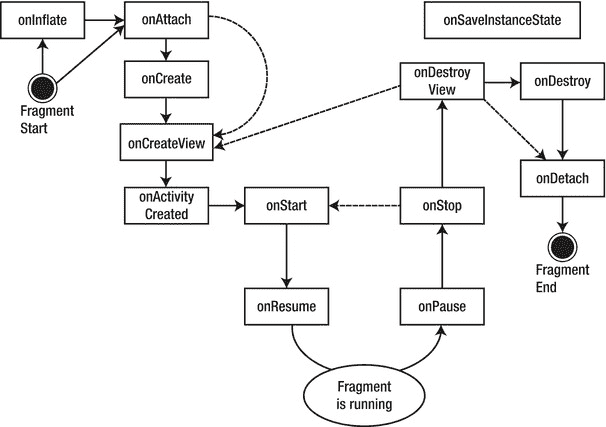

**图 8–2.** *片段的生命周期*

如果你将其与图 2-15（活动的生命周期）进行比较，就会注意到几个差异，这主要是由于活动与片段之间所需的交互造成的。片段高度依赖于其所驻留的活动，并且在其活动经历一个步骤时，片段可能经历多个步骤。

在最开始时，片段被实例化。此时它作为内存中的一个对象存在。很可能发生的第一件事是初始化参数会被添加到你的片段对象中。在系统从保存的状态重新创建片段的情况下，这一点绝对成立。当系统从保存的状态恢复片段时，会调用默认构造函数，然后附加初始化参数包。如果你在代码中创建片段，一个很好的模式是使用清单 8–1 中所示的方法，该清单在 `MyFragment` 类定义中展示了一种工厂类型的实例化器。

**清单 8–1.** *使用静态工厂方法实例化片段*

```
public static MyFragment newInstance(int index) {
    MyFragment f = new MyFragment();
    Bundle args = new Bundle();
    args.putInt("index", index);
    f.setArguments(args);
    return f;
}
```

从客户端的角度来看，他们通过调用带有单个参数的静态 `newInstance()` 方法获得一个新实例。他们取回实例化的对象，并且初始化参数已通过参数包设置到该片段上。如果此片段稍后被保存并重建，系统将经历一个非常相似的过程：调用默认构造函数，然后重新附加初始化参数。在你的特定情况下，你可以定义你的 `newInstance()` 方法（或多个方法）的签名，以接受适当数量和类型的参数，然后适当地构建参数包。这就是你希望你的 `newInstance()` 方法所做的全部工作。后续的回调将负责完成片段的其余设置。

##### `onInflate()` 回调

接下来*可能*发生的是布局视图的填充。如果你的片段由正在被填充的布局中的 `<fragment>` 标签定义（通常当活动为其主布局调用了 `setContentView()` 时），则会调用你片段的 `onInflate()` 回调。该回调传入了刚才提到的活动、一个包含来自 `<fragment>` 标签属性的 `AttributeSet`，以及一个保存的 bundle。保存的 bundle 中包含由 `onSaveInstanceState()` 存放的保存状态值。`onInflate()` 的预期行为是，你将读取属性值并保存它们以供以后使用。在片段生命周期的这个阶段，真正对用户界面做任何事都为时过早。片段甚至还没有与其活动关联。但这是片段的下一个事件。

##### `onAttach()` 回调

`onAttach()` 回调在你的片段与其活动关联后被调用。如果需要，活动引用会传递给你。你至少可以使用该活动来确定关于其所在活动的信息。你也可以将该活动用作上下文来执行其他操作。需要注意的一点是，`Fragment` 类有一个 `getActivity()` 方法，如果你需要，它总是会返回片段所附加的活动。请记住，在整个生命周期中，初始化参数包都可以通过片段的 `getArguments()` 方法获取。然而，一旦片段附加到其活动，你就不能再调用 `setArguments()`。因此，除了在最开始时，你不能向初始化参数添加内容。

##### `onCreate()` 回调

接下来是 `onCreate()` 回调。尽管这与活动的 `onCreate()` 类似，但区别在于，你不应将依赖于活动视图层次结构存在的代码放在这里。此时你的片段可能已经与其活动关联，但你尚未收到活动 `onCreate()` 已完成的通知。那即将到来。此回调会传入保存的状态 bundle（如果有的话）。这个回调是尽可能早地创建后台线程以获取此片段所需数据的好时机。你的片段代码运行在 UI 线程上，你不希望在该线程上执行磁盘 I/O 或网络访问。实际上，启动一个后台线程来准备数据是非常合理的。你的后台线程应该是执行阻塞调用的地方。你需要在稍后与数据建立连接，可能通过使用 handler 或其他技术。

**注意：** 在后台线程中加载数据的方法之一是使用 `Loader` 类。由于篇幅所限，本书未能涵盖这一点。

##### `onCreateView()` 回调

下一个回调是 `onCreateView()`。此处的预期是，你将为此片段返回一个视图层次结构。传入此回调的参数包括一个 `LayoutInflater`（你可以使用它为这个片段填充一个布局）、一个 `ViewGroup` 父容器（在清单 8–2 中称为 *container*）以及保存的 bundle（如果存在）。非常重要的一点是，你不应将视图层次结构附加到传入的 `ViewGroup` 父容器上。这种关联稍后会自动发生。如果你在此回调中将片段的视图层次结构附加到父容器，很可能会遇到异常——或者至少会出现奇怪且意外的应用行为。

提供父容器是为了让你能将其与 `LayoutInflater` 的 `inflate()` 方法一起使用。如果父容器值为 null，则意味着这个特定的片段将无法被查看，因为没有视图层次结构可供其附加。在这种情况下，你可以简单地从这里返回 null。请记住，你的应用中可能存在一些未被显示的片段。清单 8–2 展示了一个示例，说明你可能希望在此方法中执行的操作。

**清单 8–2.** *在 `onCreateView()` 中创建片段视图层次结构*

```
@Override
public View onCreateView(LayoutInflater inflater,
                  ViewGroup container, Bundle savedInstanceState) {
        if(container == null)
            return null;

        View v = inflater.inflate(R.layout.details, container, false);
        TextView text1 = (TextView) v.findViewById(R.id.text1);
        text1.setText(myDataSet[ getPosition() ] );
        return v;
}
```

这里你可以看到如何访问一个专属于此片段的布局 XML 文件，并将其填充为一个视图返回给调用者。这种方法有几个优点。你总是可以在代码中构造视图层次结构，但通过填充布局 XML 文件，你可以利用系统的资源查找逻辑。根据设备所处的配置，或者具体是哪个设备，系统会选择适当的布局 XML 文件。然后你可以访问布局内的特定视图——在本例中，是 `text1` 这个 `TextView` 字段——来执行你想要的操作。再次强调非常重要的一点：不要在此回调中将片段的视图附加到容器父对象上。你可以在清单 8–2 中看到，你在调用 `inflate()` 时使用了容器，但同时也将 `attachToRoot` 参数传递为 `false`。


##### `onActivityCreated()` 回调

现在你即将进入用户能够与片段交互的阶段。下一个回调是`onActivityCreated()`。它在 Activity 完成其`onCreate()`回调后被调用。此时，你可以确信 Activity 的视图层次结构已经就绪且可用，包括你之前返回的视图层次结构（如果有的话）。你可以在这里对用户界面进行最后的微调，然后再展示给用户。如果 Activity 及其片段正在从保存的状态中重建，这一点可能尤为重要。在这里你还可以确定该 Activity 的任何其他片段都已被附加到你的 Activity 上。

##### `onStart()` 回调

片段生命周期中的下一个回调是`onStart()`。此时你的片段对用户可见，但你尚未开始与用户交互。此回调与 Activity 的`onStart()`相关联。因此，以前你可能会将逻辑放在 Activity 的`onStart()`中，而现在更可能将逻辑放在片段的`onStart()`中，因为用户界面组件也在此处就绪。

##### `onResume()` 回调

用户与你的片段交互之前的最后一个回调是`onResume()`。此回调与 Activity 的`onResume()`相关联。当此回调返回时，用户可以自由地与片段交互。例如，如果你的片段中有相机预览，你可能会在片段的`onResume()`中启用它。

至此，应用正忙于让用户满意。然后，用户决定退出你的应用，可能是通过返回键、主页键或启动其他应用。接下来的序列与 Activity 的情况类似，方向与设置片段交互的流程相反。

##### `onPause()` 回调

片段上第一个撤销回调是`onPause()`。此回调与 Activity 的`onPause()`相关联；与 Activity 类似，如果你的片段中有媒体播放器或其他共享对象，你可以通过`onPause()`方法暂停、停止或释放它。同样的良好公民规则适用：如果用户正在接听电话，你不想播放音频。

##### `onSaveInstanceState()` 回调

与 Activity 类似，片段有机会保存状态以供后续重建。此回调传递一个`Bundle`对象，作为你想要保留的任何状态信息的容器。这就是之前讨论的回调中传递的保存状态 bundle。为防止内存问题，请注意保存到该 bundle 中的内容。只保存你需要的内容。如果需要保留对另一个片段的引用，请保存其标签，而不是尝试保存另一个片段本身。

尽管你可能会看到此方法通常在`onPause()`之后立即被调用，但该片段所属的 Activity 会在它认为应该保存片段状态时调用它。这可能在`onDestroy()`之前的任何时候发生。

##### `onStop()` 回调

下一个撤销回调是`onStop()`。此回调与 Activity 的`onStop()`相关联，其用途与 Activity 的`onStop()`类似。已停止的片段可以直接回到`onStart()`回调，然后进入`onResume()`。

##### `onDestroyView()` 回调

如果你的片段即将被销毁或保存，撤销方向的下一个回调是`onDestroyView()`。这会在你之前在`onCreateView()`回调中创建的视图层次结构从你的片段中分离后被调用。

##### `onDestroy()` 回调

接下来是`onDestroy()`。当片段不再被使用时调用此方法。请注意，它仍然附加到 Activity 并且仍然可被找到，但它无法执行太多操作。

##### `onDetach()` 回调

片段生命周期中的最后一个回调是`onDetach()`。一旦调用此方法，片段将与它的 Activity 解除关联，不再拥有视图层次结构，并且其所有资源都应该已被释放。

### 使用`setRetainInstance()`

你可能已经注意到图 8–2 中的虚线。片段的一个很酷的特性是，你可以指定不希望片段在 Activity 被重建时完全销毁，因此你的片段也会随之返回。因此，片段提供了一个名为`setRetainInstance()`的方法，它接受一个布尔参数来告知：“是的；我希望我的 Activity 重启时片段保留”或“不；请销毁，我将从头创建一个新片段。”调用`setRetainInstance()`的最佳位置是在片段的`onCreate()`回调中。

如果参数为`true`，意味着你想将片段对象保留在内存中，而不是从头开始。然而，如果你的 Activity 即将消失并被重建，你将不得不将你的片段从当前 Activity 上分离，并附加到新的 Activity 上。底线是，如果保留实例的值为`true`，实际上你不会销毁你的片段实例，因此你也无需在另一边创建一个新的实例。不过，所有其他回调仍会被调用。图中的虚线表示，在销毁过程中你会跳过`onDestroy()`回调，而在片段重新附加到新 Activity 的过程中你会跳过`onCreate()`回调。由于 Activity 的重建很可能是由于配置变化引起的，你的片段回调可能应该假设配置已经发生了变化，因此应采取相应的措施。例如，这包括在`onCreateView()`中充气布局以创建新的视图层次结构。代码清单 8–2 中提供的代码按原样处理了这一问题。如果你选择使用保留实例特性，你可能决定不将某些初始化逻辑放在`onCreate()`中，因为它不像其他回调那样总是会被调用。


#### 展示生命周期的示例片段应用

没有什么比看到一个真实示例更能深刻理解一个概念了。您将创建一个经过检测的示例应用，以便观察所有这些回调的运行情况。您将使用一个示例应用，该应用在一个片段（fragment）中显示一个莎士比亚作品标题列表；当用户点击其中一个标题时，该剧作的部分文本会出现在另一个独立的片段中。这个示例应用在平板电脑的横屏和竖屏模式下都能工作。然后，您将对其进行配置，使其模拟在小屏幕设备上运行，从而了解如何将文本片段分离到一个 Activity 中。您将从横屏模式下 Activity 的 XML 布局开始，如清单 8–3 所示，运行时它将呈现为图 8–3 的样子。

**注：** 本章末尾提供了可下载本章项目的网址。这样您就可以直接将这些项目导入 Eclipse。

**清单 8–3.** *Activity 在横屏模式下的布局 XML*

```
<?xml version="1.0" encoding="utf-8"?>
<!-- 此文件为 res/layout-land/main.xml -->
<LinearLayout
        android:orientation="horizontal"
        android:layout_width="match_parent"
        android:layout_height="match_parent">

    <fragment class="com.androidbook.fragments.bard.TitlesFragment"
            android:id="@+id/titles" android:layout_weight="1"
            android:layout_width="0px"
            android:layout_height="match_parent" />

    <FrameLayout
            android:id="@+id/details" android:layout_weight="2"
            android:layout_width="0px"
            android:layout_height="match_parent" />

</LinearLayout> 
```

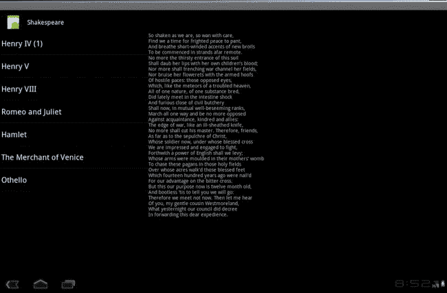

**图 8–3.** *示例片段应用的用户界面*

这个布局看起来与本书中看到的许多其他布局类似，由两个主要对象水平从左到右排列。不过，这里有一个特殊的新标签 `<fragment>`，它还有一个新的属性 `class`。请记住，片段（fragment）不是一个视图（view），因此片段在布局 XML 中的处理方式与其他元素略有不同。另一点需要注意的是，`<fragment>` 标签在此布局中仅仅是一个占位符。您不应在布局 XML 文件的 `<fragment>` 标签下放置任何子标签。

片段的其余属性看起来很熟悉，其作用与视图类似。`fragment` 标签的 `class` 属性指定了您为应用标题所扩展的类。也就是说，您必须扩展 Android 的某个 `Fragment` 类来实现您的逻辑，并且 `<fragment>` 标签必须知道您扩展的类名。片段拥有自己的视图层次结构，该结构稍后由片段自身创建。下一个标签是一个 `FrameLayout`，而不是另一个 `<fragment>` 标签。这是为什么呢？稍后我们会详细解释，但目前您需要知道的是，您将要对文本进行一些切换操作，即用一个片段替换另一个片段。您使用 `FrameLayout` 作为视图容器来容纳当前的文本片段。对于您的标题片段，您只需关注这一个片段：无需切换或过渡。而对于显示莎士比亚文本的区域，您将使用多个片段。

`MainActivity` 的 Java 代码见清单 8–4。实际上，该清单只展示了关键代码。代码中插入了日志消息，以便您通过 LogCat 观察运行情况。请查看网站上的源代码文件以了解完整内容。

**清单 8–4.** *`MainActivity` 的关键源代码*

```
public boolean isMultiPane() {
    return getResources().getConfiguration().orientation
            == Configuration.ORIENTATION_LANDSCAPE;
}

/**
 * 辅助函数，用于显示选中项的详细信息，
 * 可以在当前 UI 中就地显示片段，或者启动一个全新的 Activity 来显示。
 */
public void showDetails(int index) {
    Log.v(TAG, "进入 MainActivity.showDetails(" + index + ")");

    if (isMultiPane()) {
        // 检查当前显示的片段，如果需要则进行替换。
        DetailsFragment details = (DetailsFragment)
                getFragmentManager().findFragmentById(R.id.details);
        if ( (details == null) ||
             (details.getShownIndex() != index) ) {
            // 创建新的片段来显示此选项。
            details = DetailsFragment.newInstance(index);

            // 执行事务，将框架内的任何现有片段替换为此片段。
            Log.v(TAG, "即将执行 FragmentTransaction...");
            FragmentTransaction ft
                    = getFragmentManager().beginTransaction();
            ft.setTransition(
                    FragmentTransaction.TRANSIT_FRAGMENT_FADE);
            //ft.addToBackStack("details");
            ft.replace(R.id.details, details);
            ft.commit();
        }

    } else {
        // 否则，需要启动一个新的 Activity 来显示
        // 包含选定文本的对话框片段。
        Intent intent = new Intent();
        intent.setClass(this, DetailsActivity.class);
        intent.putExtra("index", index);
        startActivity(intent);
    }
}
```

这是一个非常简单的 Activity。要确定多面板模式（即是否需要并排使用片段），您只需使用设备的方向即可。如果处于横屏模式，则为多面板模式；如果处于竖屏模式，则不是。辅助方法 `showDetails()` 的作用是在标题被选中时确定如何显示文本。参数 index 是标题在标题列表中的位置。如果是多面板模式，您将使用一个片段来显示文本。我们将此片段称为 `DetailsFragment`，并使用工厂模式的方法根据 index 创建它。`DetailsFragment` 类的关键代码如清单 8–5 所示。与之前在 `TitlesFragment` 中一样，`DetailsFragment` 的各个回调都添加了日志，以便我们通过 LogCat 观察其行为。稍后我们还会回到 `showDetails()` 方法。

**清单 8–5.** *`DetailsFragment` 的源代码*

```
public class DetailsFragment extends Fragment {

    private int mIndex = 0;

    public static DetailsFragment newInstance(int index) {
        Log.v(MainActivity.TAG, "进入 DetailsFragment.newInstance(" +
                                 index + ")");

        DetailsFragment df = new DetailsFragment();

        // 将索引输入作为参数提供。
        Bundle args = new Bundle();
        args.putInt("index", index);
        df.setArguments(args);
        return df;
    }

    public static DetailsFragment newInstance(Bundle bundle) {
        int index = bundle.getInt("index", 0);
        return newInstance(index);
    }

    @Override
    public void onCreate(Bundle myBundle) {
        Log.v(MainActivity.TAG,
                "进入 DetailsFragment.onCreate。Bundle 包含：");
        if(myBundle != null) {
            for(String key : myBundle.keySet()) {
                Log.v(MainActivity.TAG, "    " + key);
            }
        }
        else {
            Log.v(MainActivity.TAG, "    myBundle 为空");
        }
        super.onCreate(myBundle);

        mIndex = getArguments().getInt("index", 0);
    }

    public int getShownIndex() {
        return mIndex;
    }
```


`@Override`
`public View onCreateView(LayoutInflater inflater,`
`        ViewGroup container, Bundle savedInstanceState) {`
`    Log.v(MainActivity.TAG,`
`            "in DetailsFragment onCreateView. container = " +`
`            container);`

`    // Don't tie this fragment to anything through the inflater.`
`    // Android takes care of attaching fragments for us. The`
`    // container is only passed in so you can know about the`
`    // container where this View hierarchy is going to go.`
`    View v = inflater.inflate(R.layout.details, container, false);`
`    TextView text1 = (TextView) v.findViewById(R.id.text1);`
`    text1.setText(Shakespeare.DIALOGUE[ mIndex ] );`
`    return v;`
`}`
`}`

`DetailsFragment`类实际上也很简单。现在你可以看到如何实例化这个片段。重要的是要指出，你是在代码中实例化这个片段的，因为你的布局定义了`ViewGroup`容器（一个`FrameLayout`），你的详情片段将放入其中。由于该片段本身没有像你的标题片段那样在活动的布局 XML 中定义，你需要在代码中实例化你的详情片段。

要创建一个新的详情片段，你使用`newInstance()`方法。如前所述，这个工厂方法会调用默认构造函数，然后通过`index`的值设置参数包。一旦`newInstance()`运行完成，你的详情片段就可以通过引用`getArguments()`来在其任何回调中检索`index`的值。为了方便，你可以在`onCreate()`中将参数包中的索引值保存到`DetailsFragment`类的一个成员字段中。

你可能会疑惑为什么不在`newInstance()`中直接设置`mIndex`值。原因是 Android 会在幕后使用默认构造函数重新创建片段，然后将参数包设置回之前的内容。Android 不会使用你的`newInstance()`方法，因此确保`mIndex`被设置的唯一可靠方法是从参数包中读取值并在`onCreate()`中设置它。便捷方法`getShownIndex()`会检索该索引的值。现在，详情片段中剩下的唯一方法就是`onCreateView()`了。这也很简单。

`onCreateView()`的目的是返回片段的视图层次结构。记住，根据你的配置，你可能希望为该片段使用各种不同的布局。因此，最常用的做法是使用布局 XML 文件。在你的示例应用中，你使用资源`R.layout.details`将片段的布局指定为`details.xml`。`details.xml`的 XML 内容在列表 8-6 中。

**列表 8-6.** *详情片段的`details.xml`布局文件*

```xml
<?xml version="1.0" encoding="utf-8"?>
<!-- This file is res/layout/details.xml -->
<LinearLayout
    android:layout_width="match_parent"
    android:layout_height="match_parent">
    <ScrollView android:id="@+id/scroller"
        android:layout_width="match_parent"
        android:layout_height="match_parent">
        <TextView android:id="@+id/text1"
            android:layout_width="match_parent"
            android:layout_height="match_parent" />
    </ScrollView>
</LinearLayout>
```

对于你的示例应用，无论处于横屏模式还是竖屏模式，你都可以为详情片段使用完全相同的布局文件。这个布局不是给活动的，而只是让你的片段用来显示文本。因为它可以被视为默认布局，你可以将它存储在`/res/layout`目录中，即使处于横屏模式，它也会被找到并使用。当 Android 查找详情 XML 文件时，它会尝试最匹配设备配置的特定目录，但如果在其他地方找不到`details.xml`文件，最终会回到`/res/layout`目录。当然，如果你希望详情片段在横屏模式下有不同的布局，你可以定义一个单独的`details.xml`布局文件，并将其存储在`/res/layout-land`下。请随意尝试不同的`details.xml`文件。

当你的详情片段的`onCreateView()`被调用时，你只需获取相应的`details.xml`布局文件，对其进行填充，并将文本设置为`Shakespeare`类中的文本。我们不会在这里包含`Shakespeare`的完整 Java 代码，但列表 8-7 中展示了部分内容，以便你了解它的实现方式。要获取完整源代码，请访问项目下载文件，如本章末尾的“参考资料”部分所述。

**列表 8-7.** *`Shakespeare`的源代码*

```java
public class Shakespeare {
    public static String TITLES[] = {
            "亨利四世 (第一部)",
            "亨利五世",
            "亨利八世",
            "罗密欧与朱丽叶",
            "哈姆雷特",
            "威尼斯商人",
            "奥赛罗"
    };
    public static String DIALOGUE[] = {
        "我们如此动摇，如此苍白憔悴，\n..."
        // ... 等等 ...
    };
}
```

现在，你的详情片段视图层次结构包含了所选标题的文本。你的详情片段已准备就绪。你可以回到`showDetails()`方法来讨论`FragmentTransactions`。


### Fragment 事务与 Fragment 回退栈

`showDetails()` 中用于引入新详情 Fragment 的代码（再次展示在代码清单 8-8 中）看起来相当简单，但其中蕴含了大量信息。花些时间来解释正在发生的事情及其原因是非常值得的。如果你的 Activity 处于多面板模式，你希望将详情显示在标题列表旁边的 Fragment 中。你可能已经在显示详情内容，这意味着用户可能已经看到了一个详情 Fragment。无论哪种情况，资源 ID `R.id.details` 都是为你 Activity 中的 `FrameLayout` 准备的，如代码清单 8-3 所示。如果你在布局中放置了一个详情 Fragment 且没有为其分配其他 ID，那么它就会拥有这个 ID。因此，要判断布局中是否存在详情 Fragment，你可以使用 `findFragmentById()` 向 Fragment 管理器查询。如果帧布局为空，该方法会返回 `null`；否则会返回当前的详情 Fragment。随后你就可以决定是否需要在布局中放置新的详情 Fragment——这可能是由于布局为空，或是当前显示的是其他标题的详情 Fragment。一旦确定要创建并使用新的详情 Fragment，就调用工厂方法创建新的实例。现在，你就可以将这个新 Fragment 放置到位，供用户查看了。

**代码清单 8-8.** *Fragment 事务示例*

```
public void showDetails(int index) {
    Log.v(TAG, "in MainActivity showDetails(" + index + ")");

    if (isMultiPane()) {
        // 检查当前显示的 Fragment，必要时进行替换。
        DetailsFragment details = (DetailsFragment)
                getFragmentManager().findFragmentById(R.id.details);
        if (details == null || details.getShownIndex() != index) {
            // 创建新的 Fragment 来显示当前选中项。
            details = DetailsFragment.newInstance(index);

            // 执行事务，将帧布局中的现有 Fragment 替换为此新 Fragment。
            Log.v(TAG, "about to run FragmentTransaction...");
            FragmentTransaction ft
                    = getFragmentManager().beginTransaction();
            ft.setTransition(
                    FragmentTransaction.TRANSIT_FRAGMENT_FADE);
            //ft.addToBackStack("details");
            ft.replace(R.id.details, details);
            ft.commit();
        }
            // 其余代码已省略以节省空间。
}
```

需要理解的一个关键概念是，Fragment 必须存在于一个称为*视图组*的视图容器内。`ViewGroup` 类包含了诸如布局及其派生类等元素。`FrameLayout` 是 Activity 的 `main.xml` 布局文件中作为详情 Fragment 容器的良好选择。`FrameLayout` 非常简单，你只需要一个简单的容器来容纳 Fragment，无需其他类型布局带来的额外负担。`FrameLayout` 就是你的详情 Fragment 要放置的地方。如果你在 Activity 的布局文件中指定了另一个 `<fragment>` 标签而不是 `FrameLayout`，那么你将无法进行所需的替换操作。

`FragmentTransaction` 就是你用来执行替换操作的工具。你告诉 Fragment 事务，你想用新的详情 Fragment 替换帧布局中的任何内容。你本可以通过定位详情 `TextView` 的资源 ID 并直接将其文本设置为新的莎士比亚标题文本，从而避免这一切。但 Fragment 的另一面则解释了为什么你要使用 `FragmentTransaction`。

如你所知，Activity 是按照栈的方式排列的，随着你在应用程序中层层深入，同时存在多个 Activity 的栈并不罕见。当你按下返回键时，最顶层的 Activity 消失，你会返回到下面的 Activity，该 Activity 会为你恢复运行。这个过程可以一直持续下去，直到你回到主屏幕。

当 Activity 仅用于单一目的时，这种机制运行良好。但现在一个 Activity 可以同时拥有多个 Fragment，并且你可以在不离开最顶层 Activity 的情况下深入应用程序，因此 Android 确实需要将返回键栈的概念扩展到包含 Fragment。事实上，Fragment 对此的需求更为迫切。当一个 Activity 中有多个 Fragment 同时相互交互，并且一次性有多个 Fragment 过渡到新内容时，按下返回键应使每个 Fragment *协同*回退一步。为了确保每个 Fragment 都能正确参与回退，系统会创建并管理一个 `FragmentTransaction` 来执行这种协调。

请注意，Activity 内部并非必须有 Fragment 的回退栈。你可以编写应用程序代码，让返回键在 Activity 层级工作，而完全不涉及 Fragment 层级。如果你的 Fragment 没有回退栈，按下返回键会将当前 Activity 从栈中弹出，并将用户返回到其下方的任何内容。如果你选择利用 Fragment 的回退栈，则需要取消代码清单 8-8 中 `ft.addToBackStack("details")` 这一行的注释。在这种特定情况下，你已将标签参数硬编码为字符串 `"details"`。此标签应为表示事务发生时 Fragment 状态的合适字符串名称。你可以在代码中使用标签值来查询回退栈，以删除条目或弹出条目。你希望在这些事务上使用有意义的标签，以便日后能找到合适的条目。


#### 片段事务转换与动画

使用片段事务的一大优点在于，你能够通过转换和动画，实现从旧片段到新片段的过渡。这些动画不同于第 21 章中即将介绍的动画。它们更为简单，且不需要深入的图形学知识。让我们利用片段事务转换，在将旧详情片段替换为新详情片段时添加特效。这可以为你的应用增色不少，让新旧片段之间的切换看起来更加流畅。

实现这一目的的一种方法是使用 `setTransition()`，如列表 8–8 所示。不过，有多种不同的转换可供选择。你在示例中使用了淡入淡出，但也可以使用 `setCustomAnimations()` 方法来描述其他特效，例如将一个片段向右滑出，同时另一个片段从左侧滑入。自定义动画使用的是新的对象动画定义，而非旧的。旧的动画 XML 文件使用 `<translate>` 等标签，而新的 XML 文件则使用 `<objectAnimator>`。旧的 XML 文件位于相应 Android SDK `platforms` 目录下的 `/data/res/anim` 目录中（例如针对 Honeycomb 的 `platforms/android-11`）。这里同样有一些新的 XML 文件位于 `/data/res/animator` 目录下。你的代码可以像这样：

```
ft.setCustomAnimations(android.R.animator.fade_in, android.R.animator.fade_out);
```

这将导致新片段淡入，同时旧片段淡出。第一个参数适用于进入的片段，第二个参数适用于退出的片段。你可以自由探索 Android animator 目录，以获取更多内置动画。如果你想创建自己的动画，本章稍后关于对象动画器的部分会为你提供帮助。你还需要了解的另一个非常重要的知识点是：转换调用必须在 `replace()` 调用之前进行；否则，它们将不起作用。

使用对象动画器为片段添加特效是一种有趣的转换方式。关于 `FragmentTransaction`，你还需要了解另外两个方法：`hide()` 和 `show()`。这两个方法都接受一个片段作为参数，并且它们的作用正如你所料。对于与视图容器关联的片段管理器中的片段，这些方法只是在用户界面中隐藏或显示该片段。在此过程中，片段并不会从片段管理器中移除，但它必须与视图容器绑定才能影响其可见性。如果片段没有视图层级结构，或者其视图层级结构未与显示的视图层级结构绑定，那么这些方法将不会产生任何效果。

一旦你为片段事务指定了特效，就必须告知它你想要完成的主要工作。在你的例子中，你是用新的详情片段替换帧布局中的任何现有内容。这就是 `replace()` 方法的用武之地。这等同于对帧布局中已有的任何片段调用 `remove()`，然后为新的详情片段调用 `add()`，这意味着你也可以根据需要直接调用 `remove()` 或 `add()`。

在使用片段事务时，你必须执行的最后一步是提交它。`commit()` 方法不会立即执行操作，而是会将任务安排到 UI 线程准备就绪时再进行。

现在你应该明白，为什么仅仅更改一个简单片段的内容也需要如此周折。这不仅仅是因为你想修改文本；在转换过程中，你可能还需要特殊的图形效果。你或许还希望将转换细节保存在一个片段事务中，以便日后可以撤销。最后一点可能令人困惑，因此我们将加以说明。

这并非严格意义上的事务。当你将片段事务从返回栈中弹出时，并不会撤销可能已发生的所有数据更改。例如，如果你在活动中创建了返回栈上的片段事务，并更改了数据，那么按下返回按钮并不会使活动数据更改回退到先前的值。你只是在用户界面视图间回溯，就像在活动中一样，但这次是针对片段的。由于片段的保存和恢复方式，从已保存状态恢复的片段的内部状态将取决于你随片段保存了哪些值，以及你如何管理这些值的恢复。因此，你的片段可能与之前看起来相同，但你的活动不会——除非你在恢复片段时采取措施来恢复活动状态。

在你的示例中，你只使用了一个视图容器，并引入了一个详情片段。如果你的用户界面更加复杂，你可以在片段事务中操作其他片段。实际上，你是在开始事务，用新的详情片段替换详情帧布局中的任何现有片段，指定一个淡入动画，然后提交事务。你已注释掉将此事务添加到返回栈的部分，但你当然可以取消注释，以便参与返回栈。


### FragmentManager 详解

`FragmentManager` 是一个负责管理属于某个 Activity 的 Fragment 的组件。这包括位于返回栈上的 Fragment，以及那些可能只是处于待定状态的 Fragment。我们接下来会详细解释。

Fragment 只能在 Activity 的上下文中创建。这可以通过填充 Activity 的布局 XML 实现，或者通过像代码清单 8-1 中那样的代码直接实例化。当通过代码实例化时，Fragment 通常会使用 Fragment 事务附加到 Activity 上。无论哪种情况，都会使用`FragmentManager`类来访问和管理该 Activity 的 Fragment。

你可以在 Activity 或已附加的 Fragment 上调用`getFragmentManager()`方法来获取一个 Fragment 管理器。你在代码清单 8-8 中已经看到，Fragment 事务是从 Fragment 管理器获取的。除了获取 Fragment 事务，你还可以使用 Fragment 的 ID、标签或 Bundle 与键的组合来获取一个 Fragment。

为此，获取方法包括`findFragmentById()`、`findFragmentByTag()`和`getFragment()`。`getFragment()`方法会与`putFragment()`配合使用，后者也接受一个 Bundle、一个键和要放入的 Fragment。这里的 Bundle 很可能是`savedState` Bundle，而`putFragment()`将在`onSaveInstanceState()`回调中使用，以保存当前 Activity（或其他 Fragment）的状态。`getFragment()`方法大概会在`onCreate()`中调用，以与`putFragment()`对应，不过对于 Fragment 而言，如前所述，该 Bundle 也可供其他回调方法使用。

显然，你不能在一个尚未附加到 Activity 的 Fragment 上调用`getFragment()`方法。但是，你也可以将 Fragment 附加到 Activity 上，同时暂时不向用户显示它。如果这样做，你应该为 Fragment 关联一个`String`标签，以便将来能够找到它。你很可能使用`FragmentTransaction`的以下方法来做到这一点：

`public FragmentTransaction add (Fragment fragment, String tag)`

事实上，你可以拥有一个不展示视图层次结构的 Fragment。这样做可能是为了将某些逻辑封装在一起，使其能够附加到 Activity 上，同时又与 Activity 的生命周期以及其他 Fragment 保持一定的自主性。当 Activity 因设备配置更改而经历重建周期时，这个非 UI Fragment 可以在 Activity 销毁和重新创建的过程中基本保持完整。这对于`setRetainInstance()`选项来说是一个很好的用例。

Fragment 返回栈也属于 Fragment 管理器的管辖范围。虽然 Fragment 事务用于将 Fragment 放入返回栈，但 Fragment 管理器可以将 Fragment 从返回栈中移除。这通常是通过使用 Fragment 的 ID 或标签来完成的，但也可以基于在返回栈中的位置，或者仅仅弹出栈顶的 Fragment。

最后，Fragment 管理器还提供了一些用于调试功能的方法，例如使用`enableDebugLogging()`开启 LogCat 的调试消息，或使用`dump()`将 Fragment 管理器的当前状态转储到流中。请注意，在代码清单 8-4 中，你已经在 Activity 的`onCreate()`方法里开启了 Fragment 管理器的调试。

#### 引用 Fragment 时的注意事项

现在该重新审视一下之前关于 Fragment 生命周期以及参数和保存状态 Bundle 的讨论了。Android 可能在多个不同时间点保存你的某个 Fragment。这意味着，当你的应用想要检索那个 Fragment 时，它有可能不在内存中。因此，我们提醒你，*不要*认为对 Fragment 的变量引用会长期有效。如果使用 Fragment 事务在容器视图中替换 Fragment，那么对旧 Fragment 的任何引用现在都指向一个可能位于返回栈上的 Fragment。或者，在应用配置更改（例如屏幕旋转）期间，Fragment 可能会从 Activity 的视图层次结构中分离。请务必小心。

如果你打算持有对 Fragment 的引用，请留意它可能被保存的时机；当你需要再次找到它时，请使用 Fragment 管理器的某个获取方法。如果你希望保留一个 Fragment 引用，例如当 Activity 正在经历配置更改时，你可以使用`putFragment()`方法配合适当的 Bundle。对于 Activity 和 Fragment 来说，适当的 Bundle 是在`onSaveInstanceState()`中使用并在`onCreate()`中重新出现的`savedState` Bundle（对于 Fragment 而言，则是 Fragment 生命周期的其他早期回调）。你可能永远不会将直接的 Fragment 引用存储到 Fragment 的参数 Bundle 中；如果你有此想法，请务必先三思而后行。

获取特定 Fragment 的另一种方法是使用已知的标签或已知的 ID 进行查询。前面描述的获取方法允许通过这种方式从 Fragment 管理器中检索 Fragment，这意味着你可以选择只记住 Fragment 的标签或 ID，然后使用这两个值之一从 Fragment 管理器中检索它，而不必使用`putFragment()`和`getFragment()`。

#### 保存 Fragment 状态

Android 3.2 中引入了另一个有趣的类：`Fragment.SavedState`。使用`FragmentManager`的`saveFragmentInstanceState()`方法，你可以将一个 Fragment 传递给该方法，它会返回一个代表该 Fragment 状态的对象。然后，你可以在初始化 Fragment 时，使用`Fragment`的`setInitialSavedState()`方法使用该对象。第 12 章会对此进行更详细的讨论。


#### `ListFragments` 和 `<fragment>`

为了让你的示例应用更加完整，还有几项内容需要介绍。首先是 `TitlesFragment` 类。这个类是通过主 Activity 的 `layout.xml` 文件创建的。`<fragment>` 标签作为该片段将要放置位置的占位符，但并不定义该片段的视图层次结构的样子。`TitlesFragment` 的代码见代码清单 8–9。`TitlesFragment` 用于显示应用中的标题列表。

**代码清单 8–9.** `TitlesFragment` Java 代码

```
public class TitlesFragment extends ListFragment {
    private MainActivity myActivity = null;
    int mCurCheckPosition = 0;

    @Override
    public void onAttach(Activity myActivity) {
        Log.v(MainActivity.TAG,
            "in TitlesFragment onAttach; activity is: " + myActivity);
        super.onAttach(myActivity);
        this.myActivity = (MainActivity)myActivity;
    }

    @Override
    public void onActivityCreated(Bundle savedState) {
        Log.v(MainActivity.TAG,
            "in TitlesFragment onActivityCreated. savedState contains:");
        if(savedState != null) {
            for(String key : savedState.keySet()) {
                Log.v(MainActivity.TAG, "    " + key);
            }
        }
        else {
            Log.v(MainActivity.TAG, "    savedState is null");
        }
        super.onActivityCreated(savedState);

        // Populate list with your static array of titles.
        setListAdapter(new ArrayAdapter<String>(getActivity(),
                android.R.layout.simple_list_item_1,
                Shakespeare.TITLES));

        if (savedState != null) {
            // Restore last state for checked position.
            mCurCheckPosition = savedState.getInt("curChoice", 0);
        }

        // Get your ListFragment's ListView and update it
        ListView lv = getListView();
        lv.setChoiceMode(ListView.CHOICE_MODE_SINGLE);
        lv.setSelection(mCurCheckPosition);

        // Activity is created, fragments are available
        // Go ahead and populate the details fragment
        myActivity.showDetails(mCurCheckPosition);
    }
    @Override
    public void onSaveInstanceState(Bundle outState) {
        Log.v(MainActivity.TAG, "in TitlesFragment onSaveInstanceState");
        super.onSaveInstanceState(outState);
        outState.putInt("curChoice", mCurCheckPosition);
    }

    @Override
    public void onListItemClick(ListView l, View v, int pos, long id) {
        Log.v(MainActivity.TAG,
            "in TitlesFragment onListItemClick. pos = "
            + pos);
        myActivity.showDetails(pos);
        mCurCheckPosition = pos;
    }

    @Override
    public void onDetach() {
        Log.v(MainActivity.TAG, "in TitlesFragment onDetach");
        super.onDetach();
        myActivity = null;
    }
}
```

与 `DetailsFragment` 不同，对于这个片段，你不需要在 `onCreateView()` 回调中执行任何操作。这是因为你继承了 `ListFragment` 类，而该类已经包含了一个 `ListView`。`ListFragment` 的默认 `onCreateView()` 会为你创建这个 `ListView` 并返回它。直到 `onActivityCreated()` 方法中，你才执行真正的应用逻辑。此时在应用中，你可以确保 Activity 的视图层次结构以及该片段的视图层次结构已经创建完成。那个 `ListView` 的资源 ID 是 `android.R.id.list1`，但如果你需要获取它的引用，总是可以调用 `getListView()` 方法，而你在 `onActivityCreated()` 中也正是这样做的。然而，由于 `ListFragment` 不同于 `ListView`，请不要直接将适配器附加到 `ListView` 上。你必须使用 `ListFragment` 的 `setListAdapter()` 方法。由于 Activity 的视图层次结构已经设置完毕，因此可以安全地回到 Activity 中调用 `showDetails()`。

在示例 Activity 生命周期的这个阶段，你已经为列表视图添加了一个列表适配器，恢复了当前的位置（如果因配置变更等原因从恢复状态返回），并请求 Activity（在 `showDetails()` 中）设置文本，使其对应所选中的莎士比亚标题。

你的 `TitlesFragment` 类还为列表设置了一个监听器，这样当用户点击另一个标题时，会调用 `onListItemClick()` 回调，你再次通过 `showDetails()` 方法将文本切换为对应标题的内容。

该片段与之前的详情片段的另一个区别在于：当该片段被销毁并重新创建时，你会将状态（列表中的当前位置值）保存到一个 Bundle 中，并在 `onCreate()` 中将其读回。与那些在 Activity 布局的 `FrameLayout` 中来回替换的详情片段不同，这里只需要考虑一个标题片段。因此，当发生配置变更并且你的标题片段正在执行保存和恢复操作时，你会希望记住之前的位置。而对于详情片段，你可以在不记住之前状态的情况下重新创建它们。


#### 在需要时调用独立 Activity

有一段代码我们尚未提及，即 `showDetails()` 中——当设备处于竖屏模式，且详情 fragment 无法与标题 fragment 正常显示在同一页面上时。此处我们假定该情况成立，尽管在平板屏幕上实际并非如此。由于通过兼容性库，fragment 被引入到较旧的 Android 版本中，因此你可以在手机和平板上使用 fragment，这意味着此处描述的场景可能很常见。如果屏幕空间不足以让原本应与其他 fragment 一起显示的 fragment 正常显示，你将需要启动一个独立的 Activity 来展示该 fragment 的用户界面。对于示例应用，你实现了详情 Activity；代码见清单 8–10。

**清单 8–10.** *当 Fragment 无法适配时显示新 Activity*

```
public class DetailsActivity extends Activity {

    @Override
    public void onCreate(Bundle savedInstanceState) {
        Log.v(MainActivity.TAG, "in DetailsActivity onCreate");
        super.onCreate(savedInstanceState);
        if (getResources().getConfiguration().orientation
                == Configuration.ORIENTATION_LANDSCAPE) {
            // 如果屏幕现在是横屏模式，意味着
            // 你的 MainActivity 正同时显示标题和文本，
            // 因此不再需要此 Activity。
            // 直接退出，让 MainActivity 处理所有工作。
            finish();
            return;
        }

        if(getIntent() != null) {
            // 这是实例化详情 fragment 的另一种方式。
            DetailsFragment details =
                DetailsFragment.newInstance(getIntent().getExtras());

            getFragmentManager().beginTransaction()
                .add(android.R.id.content, details)
                .commit();
        }
    }
}
```

这段代码有几个值得关注的方面。首先，实现起来非常简单。你只需简单判断设备的方向，只要处于竖屏模式，就在该详情 Activity 中设置一个新的详情 fragment。如果处于横屏模式，你的 `MainActivity` 能够同时显示标题 fragment 和详情 fragment，因此完全没有必要再显示这个 Activity。你可能会好奇，既然在横屏模式下为何要启动这个 Activity，答案是：你不会启动。然而，一旦该 Activity 在竖屏模式下启动，如果用户将设备旋转为横屏模式，此详情 Activity 便会因配置变更而重启。此时 Activity 启动时处于横屏模式，因此在那一刻，结束该 Activity 并让 `MainActivity` 接管所有工作才是合理的。

该详情 Activity 的另一个有趣之处在于，你从未使用 `setContentView()` 设置根内容视图。那么用户界面是如何创建的呢？仔细查看 fragment 事务中的 `add()` 方法调用，你会看到添加 fragment 的视图容器被指定为资源 `android.R.id.content`。这是 Activity 的顶级视图容器，因此当你将 fragment 的视图层级附加到此容器时，该 fragment 的视图层级便会成为 Activity 唯一的视图层级。你使用了与之前相同的 `DetailsFragment` 类及另一个 `newInstance()` 方法（接受 Bundle 作为参数）来创建 fragment，然后简单地将其附加到 Activity 视图层级的顶部。这会导致 fragment 在此新 Activity 中显示。

从用户的角度来看，他们现在看到的只是详情 fragment 的视图，即莎士比亚戏剧的文本。如果用户想要选择不同的标题，他们可以按下返回键，这将弹出该 Activity，显示主 Activity（仅包含标题 fragment）。用户的另一种选择是将设备旋转回横屏模式。此时你的详情 Activity 会调用 `finish()` 并消失，露出下方同样已旋转的主 Activity。

当设备处于竖屏模式时，如果你不在主 Activity 中显示详情 fragment，则应为竖屏模式准备一个独立的 `main.xml` 布局文件，如清单 8–11 所示。

**清单 8–11.** *竖屏主 Activity 的布局*

```
<?xml version="1.0" encoding="utf-8"?>
<!-- 此文件为 res/layout/main.xml -->
<LinearLayout
        android:orientation="vertical"
        android:layout_width="match_parent"
        android:layout_height="match_parent">

    <fragment class="com.androidbook.fragments.bard.TitlesFragment"
            android:id="@+id/titles"
            android:layout_width="match_parent"
            android:layout_height="match_parent" />

</LinearLayout>
```

当然，你可以根据需要自由设计此布局。此处你的目的很简单，就是仅显示标题 fragment。非常棒的是，你的标题 fragment 类无需包含太多代码来处理设备重新配置。

花点时间查看此应用的清单文件。其中你会找到主 Activity，其类别为 `LAUNCHER`，以便它出现在设备的应用列表中。然后你有单独的 `DetailsActivity`，其类别为 `DEFAULT`。这允许你从代码中启动详情 Activity，但不会在应用列表中将其显示为一个独立应用。


#### 碎片的持久化

当你试用这个示例应用时，请确保旋转设备（按 `Ctrl+F11` 可旋转模拟器中的设备）。你会看到设备旋转时，各个碎片也会随之旋转。如果观察 LogCat 消息，你会发现该应用产生了大量日志。特别在设备旋转过程中，请密切关注与碎片相关的消息：不仅 Activity 会被销毁并重建，碎片也会经历同样的过程。

到目前为止，你只在标题碎片中编写了一小段代码，用于在重启后记住标题列表的当前位置。你并未在详情碎片的代码中进行任何处理来处理配置变更，这是因为你不需要这样做。Android 会负责保留碎片管理器中的碎片，将它们保存起来，然后在 Activity 重建时恢复它们。你需要意识到，配置变更完成后重新获得的碎片，很可能与之前内存中的碎片不是同一个对象。这些碎片已经为你重建过。Android 保存了参数 Bundle、碎片类型信息，以及每个碎片的已保存状态 Bundle（其中包含用于恢复该碎片的状态信息）。

LogCat 消息会显示碎片与 Activity 同步经历其生命周期。你会看到详情碎片被重建，但你的 `newInstance()` 方法并不会被再次调用。相反，Android 会使用默认构造函数，将参数 Bundle 附加到碎片上，然后开始调用碎片的回调方法。这就是为什么不要在 `newInstance()` 方法中做任何复杂操作如此重要：当碎片被重建时，它不会通过 `newInstance()` 进行。

现在你也应该体会到，你已经在多个不同地方复用了你的碎片。标题碎片被用于两种不同的布局中，但如果你查看标题碎片的代码，会发现它并不关心每个布局的属性。你可以让布局彼此差异很大，而标题碎片的代码看起来仍然相同。详情碎片也是如此。它被用于你的主横屏布局中，也单独出现在详情 Activity 中。同样，详情碎片的布局在这两种场景下可能截然不同，但详情碎片的代码仍然保持一致。此外，详情 Activity 的代码也非常简单。

到目前为止，你已经探索了两种碎片类型：基础的 `Fragment` 类和 `ListFragment` 子类。`Fragment` 还有其他子类：`DialogFragment`、`PreferenceFragment` 和 `WebViewFragment`。我们将在第 9 章和第 13 章分别介绍 `DialogFragment` 和 `PreferenceFragment`。

### 与碎片的通信

由于碎片管理器知道所有附加到当前 Activity 的碎片，因此 Activity 或该 Activity 中的任何碎片都可以使用之前描述的 getter 方法来获取任何其他碎片。获得碎片引用后，Activity 或碎片可以适当地转换引用类型，然后直接调用该 Activity 或碎片上的方法。这会导致你的碎片对其他碎片的了解超出通常所需的程度，但请不要忘记，你是在移动设备上运行此应用，因此走些捷径有时也是合理的。代码清单 8–12 提供了一个代码片段，展示了某个碎片如何直接与另一个碎片通信。

**代码清单 8–12.** *碎片到碎片的直接通信*

```
FragmentOther fragOther =
        (FragmentOther)getFragmentManager().findFragmentByTag("other");
fragOther.callCustomMethod( arg1, arg2 );
```

在代码清单 8–12 中，当前碎片直接了解另一个碎片的类以及该类中存在哪些方法。这可能没问题，因为这些碎片属于同一个应用，并且直接接受某些碎片了解其他碎片这一事实会更简单。我们将在第 9 章的 `DialogFragment` 示例应用中展示一种更清晰的碎片间通信方式。

#### 使用 `startActivity()` 和 `setTargetFragment()`

碎片的一个与 Activity 非常相似的特性是，碎片能够启动一个 Activity。`Fragment` 具有 `startActivity()` 方法和 `startActivityForResult()` 方法。它们的工作方式与 Activity 中的对应方法相同；当结果被传回时，会触发启动该 Activity 的碎片上的 `onActivityResult()` 回调。

还有另一种你应该了解的通信机制。当一个碎片想要启动另一个碎片时，有一个特性可以让调用碎片向被调用碎片设置自己的身份。代码清单 8–13 展示了一个示例。

**代码清单 8–13.** *碎片到目标碎片的设置*

```
mCalledFragment = new CalledFragment();
mCalledFragment.setTargetFragment(this, 0);
fm.beginTransaction().add(mCalledFragment, "work").commit();
```

通过这几行代码，你创建了一个新的 `CalledFragment` 对象，将目标碎片设置为当前碎片，然后使用碎片事务将被调用碎片添加到碎片管理器和 Activity 中。当被调用碎片开始运行时，它可以调用 `getTargetFragment()` 方法，该方法会返回对调用碎片的引用。有了这个引用，被调用碎片就可以调用调用碎片上的方法，甚至直接访问视图组件。例如，在代码清单 8–14 中，被调用碎片可以直接设置调用碎片 UI 中的文本。

**代码清单 8–14.** *目标碎片到碎片的通信*

```
TextView tv = (TextView)
    getTargetFragment().getView().findViewById(R.id.text1);
tv.setText("Set from the called fragment");
```


### 使用 `ObjectAnimator` 实现自定义动画

此前，我们曾带你简单接触过片段的自定义动画。你曾使用自定义动画让当前详情片段淡出，同时让新详情片段淡入。我们也告诉过你，Android SDK 中自带的动画数量很少，而且有些甚至无法正常工作。本节将帮助你理解如何创建自己的自定义动画，以便你能够在旧片段和新片段之间实现有趣的过渡效果。

在片段上实现自定义动画的机制是 `ObjectAnimator` 类。这实际上是 Android 中的一个通用特性，可以应用于 `View` 对象，而不仅仅是片段。本节我们只关注片段，但这里的原则同样适用于其他对象。对象动画器是一种工具，它接收一个对象，并在一定时间段内将其从“起始”状态动画过渡到“终止”状态。这个时间段在动画器中以毫秒为单位定义。此外，还存在定义动画在该时间段内如何运作的例程，这些例程被称为**插值器**。

如果你将“起始”状态到“终止”状态的过渡想象成一条直线，那么插值器就定义了在时间段内的任意时刻，过渡过程位于这条直线上的哪个点。最简单的插值器之一是线性插值器；它将这条直线等分，并在整个时间段内均匀地逐步通过这些等分点。其效果是对象以恒定速度从“起始”点移动到“终止”点，没有开始的加速和结束的减速。

默认的插值器是 `accelerate_decelerate`，它增加了平滑的加速开始和平滑的减速结束。真正有趣的是，插值器可以越过该直线上的“终止”点，然后再返回。这就是过冲插值器所做的事情。还有一种叫做弹跳的插值器，它会从“起始”点移动到“终止”点，但当它第一次到达“终止”点时，会向“起始”点方向弹回几次，最后才稳定在“终止”点上。

插值器作用于对象的某一维度。对于你之前使用的 `fade_in` 和 `fade_out` 动画器，这个维度就是片段的 alpha（即对象的透明度）。`fade_in` 动画器将 alpha 维度从零（0）变到一（1）。`fade_out` 动画器将另一个片段的 alpha 维度从一（1）变到零（0）。于是一个片段从不可见变为完全可见，而另一个则从完全可见变为不可见。

在幕后，对象动画器会找到片段的根视图，并反复调用 `setAlpha()` 方法，在每次调用中，参数值随时间变化一点点。重复调用的频率取决于插值器。线性插值器会在时间上以固定的时间间隔进行常规调用。`accelerate_decelerate` 插值器开始时会先让单位时间内的参数值设定得较小，然后使参数值变大，从而产生加速的效果。然后在另一端进行相反的操作，使对象在其维度上看起来像是在减速。

维度可以是 `View` 上许多可设置和可获取的值。实际上，对象动画器利用反射来操作被操纵的视图。如果你指定想要为旋转添加动画，对象动画器会调用对象（或对象的视图）上的 `setRotation()` 方法。动画器接收一个“起始”值和一个“终止”值，并使用它们将对象从“起始”状态动画过渡到“终止”状态。如果未指定“起始”值，则会确定一个 getter 方法，并用它从对象上获取当前值。下面来看看这对你的片段有何应用。

在 `FragmentTransaction` 类中，唯一指定自定义动画的方法是 `setCustomAnimations()` 方法，它接受两个资源 ID 参数：

- 第一个参数指定**进入**视图容器的片段的动画器资源。
- 第二个参数指定**退出**视图容器的片段的动画器资源。

这两个动画器不必相关，但在视觉上最好将它们配对。换句话说，如果你让一个片段淡出，就让另一个片段淡入。或者，如果你将一个片段向右滑出，就让另一个片段从左侧滑入。

动画器资源位于 Android SDK 文件夹中对应平台目录下的 `/data/res/animator` 子目录中。你之前使用的 `fade_in.xml` 和 `fade_out.xml` 文件就可以在这里找到。你也可以创建自己的动画器。如果决定自己创建，最好使用你项目的 `/res/animator` 目录，如果需要，可以手动创建该目录。有关本地动画器 XML 文件（`slide_in_left.xml`）的简单示例，请参考代码清单 8–15。

**代码清单 8–15.** *一个从左侧滑入的自定义动画器*

```
<?xml version="1.0" encoding="utf-8" ?>
<objectAnimator
    android:interpolator="@android:interpolator/accelerate_decelerate"
    android:valueFrom="-1280"
    android:valueTo="0"
    android:valueType="floatType"
    android:propertyName="x"
    android:duration="2000" />
```

此资源文件使用了（Android 3.0 中新增的）`objectAnimator` 标签。这个文件的基本结构你应该很熟悉。它包含一系列 `android:` 属性来指示你想要执行的操作。对于对象动画器，你需要指定几个参数。第一个是插值器。可用的类型列在 `android.R.interpolator` 中。根据你对资源名称的了解，`interpolator` 属性最终会指向 Android SDK 中对应平台 `/data/res/interpolator` 目录下的一个文件，文件名为 `accelerate_decelerate.xml`。

`android:propertyName` 属性指定了你想要动画化的维度。在本例中，你希望在 x 维度上设置动画。如果你查阅 `View` 的 `setX()` 方法，会发现它接受一个浮点值作为参数，这就是为什么 `android:valueType` 属性被设置为 `floatType`。`android:duration` 值被设置为 2000，表示 2 秒。对于真正的生产应用来说，这个速度可能太慢了，但它有助于你观察动画发生的整个过程。最后，`android:valueFrom` 和 `android:valueTo` 属性分别被设置为 -1280 和 0。选择这些值是因为你希望动画结束时片段位于 0 处。也就是说，你希望动画停止时，片段的左边缘与视图容器的左边缘对齐，从而让用户可见。由于你想实现片段从左侧滑入的效果，它需要从左侧外部开始，而 -1280 看起来是一个足够大的数值来实现这一点。正如你可能预料的那样，一个实现向右滑出的动画器资源文件与代码清单 8–15 中的文件非常相似，只不过 `valueFrom` 会是 0，而 `valueTo` 会是某个大的正数，例如 1280。


大多数情况下，你会发现你感兴趣的动画属性是`floatType`，尽管有时你可能会选择`intType`。只需查看设置器所要求的参数类型即可。这正是对象动画器（Object Animator）真正强大的地方。事实上，它并不关心设置器方法来自何处。这意味着你可以为对象添加自定义属性，而对象动画器可以为你对其执行动画。你所需要做的就是提供设置器方法，然后在资源文件中设置属性；剩下的工作将由对象动画器完成。这里有一个注意事项：如果你在 XML 中没有指定`valueFrom`属性，对象动画器将使用获取器（getter）方法来确定对象的初始值。该获取器方法必须返回与所讨论属性相匹配的类型。

你可能也有兴趣同时为多个属性执行动画。为此，你可以使用`<set>`标签来包含多个`<objectAnimator>`标签。清单 8–16 展示了一个动画资源文件 (`slide_out_down.xml`)，该文件在沿 Y 轴执行动画的同时，也对透明度（alpha）执行动画。

**清单 8–16.** *一个同时对 Y 轴和透明度执行动画的自定义动画器*

```xml
<?xml version="1.0" encoding="utf-8" ?>
<set >
<objectAnimator
    android:interpolator="@android:interpolator/accelerate_cubic"
    android:valueFrom="0"
    android:valueTo="1280"
    android:valueType="floatType"
    android:propertyName="y"
    android:duration="2000" />
<objectAnimator
    android:interpolator="@android:interpolator/accelerate_cubic"
    android:valueFrom="1"
    android:valueTo="0"
    android:valueType="floatType"
    android:propertyName="alpha"
    android:duration="2000" />
</set>
```

`<set>`标签对应于 Android 中的`AnimatorSet`类；然而，在 XML 中，`<set>`只有一个属性，即`android:ordering`。允许的属性值有`together`（默认值），它会使包含的对象动画器并行运行；以及`sequential`，它会使对象动画器按照它们在 XML 文件中声明的顺序一个接一个地运行。

### 总结

本章介绍了`Fragment`类及其相关的管理器、事务和子类。以下是本章涵盖内容的总结：

- `Fragment`类，它的作用以及如何使用它。
- 为什么 Fragment 必须依附于且仅依附于一个 Activity 才能使用。
- 尽管可以通过静态工厂方法（如`newInstance()`）实例化 Fragment，但必须始终提供一个默认构造函数以及一种将初始化值保存到初始化参数 Bundle 中的方式。
- Fragment 的生命周期及其如何与拥有该 Fragment 的 Activity 的生命周期交织在一起。
- `FragmentManager`及其特性。
- 使用 Fragment 管理设备配置。
- 将多个 Fragment 组合到一个 Activity 中，或将它们拆分到多个 Activity 中。
- 使用 Fragment 事务来更改向用户显示的内容，并使用酷炫的效果为这些转换添加动画。
- 使用 Fragment 时，返回按钮可能实现的新行为。
- 在布局中使用`<fragment>`标签。
- 当你想使用转换时，使用`FrameLayout`作为 Fragment 的占位符。
- `ListFragment`以及如何使用适配器填充数据（非常类似于`ListView`）。
- 当 Fragment 无法适应当前屏幕时，启动一个新的 Activity，以及当配置更改使得再次可能看到多个 Fragment 时如何进行调整。
- Fragment 之间，以及 Fragment 与其 Activity 之间的通信。

### 面试问题

以下是一些可以自问的问题，以确保你对 Android 中的 Fragment 有很好的理解：

1. `Fragment`的父类是什么？
2. Fragment 与 Activity 有何相似之处？
3. Fragment 与 Activity 有何不同？
4. 返回栈（Back Stack）有什么用途？
5. 你能创建一个不使用返回栈的应用吗？
6. 判断正误：回滚一个`FragmentTransaction`会将应用恢复到其先前的状态。
7. `<fragment>`标签如何指定要使用的 Fragment？
8. 数据适配器是附加到`ListFragment`上，还是附加到`ListFragment`内的`ListView`上？
9. 在你的应用中，查找已存在的 Fragment 有哪几种不同的方法？
10. 什么是插值器（Interpolator），它有什么用途？
11. 列出一些你可以对其使用动画器的视图属性。
12. 你能对类的自定义属性使用动画器吗？如果可以，动画器为此需要什么条件？

## 第 9 章

## 使用对话框

Android SDK 为对话框提供了广泛的支持。对话框是一个较小的窗口，它会弹出在当前窗口的前面，用于显示紧急消息、提示用户输入信息，或显示某种状态（如下载进度）。通常期望用户与对话框交互，然后返回到下方的窗口以继续使用应用程序。从技术上讲，Android 允许将对话框 Fragment 嵌入到 Activity 的布局中，我们也将对此进行介绍。

Android 明确支持的对话框包括：警告框、提示框、选择列表、单选、多选、进度条、时间选择器和日期选择器对话框。（此列表可能因 Android 版本而异。）Android 也支持用于其他需求的自定义对话框。本章的主要目的不是逐一介绍所有这些对话框，而是通过一个示例应用程序来介绍 Android 对话框的底层架构。在此基础上，你应该能够使用任意的 Android 对话框。

需要注意的是，Android 3.0 增加了基于 Fragment 的对话框。Google 期望开发者即使在使用 Android 3.0 之前版本的设备时，也只使用 Fragment 对话框。这可以通过 Fragment 兼容库来实现。因此，本章的重点是`DialogFragment`。

### 在 Android 中使用对话框

Android 中的对话框是异步的，这提供了灵活性。但是，如果你习惯了对话框主要是同步的编程框架（例如 Microsoft Windows 或网页中的 JavaScript 对话框），你可能会觉得异步对话框有点不直观。对于同步对话框，显示对话框之后的代码行在对话框被关闭之前不会运行。这意味着下一行代码可以查询按下了哪个按钮，或者在对话框中输入了什么文本。然而，在 Android 中，对话框是异步的。一旦对话框被显示，即使尚未操作对话框，下一行代码也会立即运行。你的应用程序必须通过实现来自对话框的回调来处理这种情况，以便应用程序能够接收到用户与对话框交互的通知。

这也意味着你的应用程序有能力从代码中关闭对话框，这非常强大。如果对话框因为你的应用程序正在执行某项任务而显示忙碌消息，那么一旦任务完成，你的应用程序就可以从代码中关闭该对话框。

### 理解 DialogFragment

在本节中，你将学习如何使用对话框 Fragment 来呈现一个简单的警告对话框以及一个用于收集提示文本的自定义对话框。


### DialogFragment 基础

在展示提示对话框和警告对话框的工作示例之前，我们先介绍对话框片段的高级概念。对话框相关功能使用名为 `DialogFragment` 的类。`DialogFragment` 派生自 `Fragment` 类，其行为与片段非常相似。随后，您将使用 `DialogFragment` 作为对话框的基类。一旦从此类派生出对话框，例如：

`public class MyDialogFragment extends DialogFragment { ... }`

您便可以使用片段事务将 `MyDialogFragment` 这个对话框片段作为对话框显示出来。代码清单 9–1 展示了实现此功能的代码片段。

 **注意：** 我们在本章末尾的“参考资料”部分提供了一个可下载项目的链接。您可以使用此下载文件来试验本章介绍的代码和概念。

**代码清单 9–1.** *显示一个对话框片段*

```
SomeActivity
{
    //....其他活动函数
    public void showDialog()
    {
        //构造 MyDialogFragment
        MyDialogFragment mdf = MyDialogFragment.newInstance(arg1,arg2);
        FragmentManager fm = getFragmentManager();
        FragmentTransaction ft = fm.beginTransaction();
        mdf.show(ft,"my-dialog-tag");
    }
    //....其他活动函数
}
```

根据代码清单 9–1，显示对话框片段的步骤如下：

1. 创建一个对话框片段。
2. 获取一个片段事务。
3. 使用来自步骤 2 的片段事务来显示对话框。

我们来逐一讨论这些步骤。

### 构造 DialogFragment

对话框片段本身也是一个片段，因此在构造对话框片段时适用相同的规则和规定。推荐的模式是使用工厂方法，例如之前使用的 `newInstance()`。在该 `newInstance()` 方法内部，使用对话框片段的默认构造函数，然后添加一个包含传入参数的 arguments 包。您不应在此方法内执行其他操作，因为您必须确保您在此处所做的操作与 Android 从其保存状态恢复对话框片段时所做的操作一致。而 Android 所做的全部工作就是调用默认构造函数并重新创建其 arguments 包。

### 重写 onCreateView

当您继承自对话框片段时，需要重写两个方法之一来为对话框提供视图层次结构。第一种选择是重写 `onCreateView()` 并返回一个视图。第二种选择是重写 `onCreateDialog()` 并返回一个对话框（例如由 `AlertDialog.Builder` 构造的对话框，我们稍后会介绍）。

代码清单 9–2 展示了重写 `onCreateView()` 的示例。

**代码清单 9–2.** *重写 DialogFragment 的 `onCreateView()`*

```
MyDialogFragment
{
    .....其他函数
    public View onCreateView(LayoutInflater inflater,
            ViewGroup container, Bundle savedInstanceState)
    {
        //通过填充期望的布局来创建视图
        View v =
            inflater.inflate(R.layout.prompt_dialog, container, false);

        //可以定位视图并设置值
        TextView tv = (TextView)v.findViewById(R.id.promptmessage);
        tv.setText(this.getPrompt());

        //可以在按钮上设置回调
        Button dismissBtn = (Button)v.findViewById(R.id.btn_dismiss);
        dismissBtn.setOnClickListener(this);

        Button saveBtn = (Button)v.findViewById(R.id.btn_save);
        saveBtn.setOnClickListener(this);
        return v;
    }
    .....其他函数
}
```

在代码清单 9–2 中，您正在加载一个由布局标识的视图。然后查找两个按钮并为其设置回调。这与上一章中创建详情片段的方式非常相似。然而，与早期的片段不同，对话框片段有另一种创建视图层次结构的方式。

### 重写 onCreateDialog

作为在 `onCreateView()` 中提供视图的替代方案，您可以重写 `onCreateDialog()` 并提供一个对话框实例。代码清单 9–3 为此方法提供了示例代码。

**代码清单 9–3.** *重写 `DialogFragment` 的 `onCreateDialog()`*

```
MyDialogFragment
{
    .....其他函数
    @Override
    public Dialog onCreateDialog(Bundle icicle)
    {
        AlertDialog.Builder b = new AlertDialog.Builder(getActivity())
          .setTitle("我的对话框标题")
          .setPositiveButton("确定", this)
          .setNegativeButton("取消", this)
          .setMessage(this.getMessage());
        return b.create();
    }
    .....其他函数
}
```

在这个示例中，您使用警告对话框构建器来创建要返回的对话框对象。这对于简单的对话框效果很好。第一种选择，即重写 `onCreateView()`，也同样简单，并且提供了更大的灵活性。

`AlertDialog.Builder` 实际上是 Android 3.0 之前的遗留产物。这是创建对话框的旧方式之一，您仍然可以在 `DialogFragment` 中使用它来创建对话框。正如您所见，通过调用各种可用的方法（就像我们这里所做的那样）来构建对话框是相当容易的。

### 显示 DialogFragment

一旦您构造了一个对话框片段，就需要一个片段事务来显示它。与所有其他片段一样，对对话框片段的操作是通过片段事务来执行的。

对话框片段的 `show()` 方法接收一个片段事务作为输入。您可以在代码清单 9–1 中看到这一点。`show()` 方法使用该片段事务将此对话框添加到活动中，然后提交该片段事务。然而，`show()` 方法并不会将事务添加到返回栈。如果您想要这样做，您需要先将此事务添加到返回栈，然后再将其传递给 `show()` 方法。对话框片段的 `show()` 方法具有以下签名：

`public int show(FragmentTransaction transaction, String tag)`
`public int show(FragmentManager manager, String tag)`

第一个 `show()` 方法通过将此片段以指定的标签添加到传递进来的事务中来显示对话框。然后该方法返回已提交事务的标识符。

第二个 `show()` 方法自动从事务管理器中获取一个事务。这是一个快捷方法。然而，当您使用这第二种方法时，您无法选择将事务添加到返回栈。如果您想要这种控制，您需要使用第一个方法。如果您只想简单地显示对话框，并且当时没有其他理由处理片段事务，那么可以使用第二种方法。

对话框作为一个片段，其好处在于底层片段管理器会处理基本的状态管理。例如，即使在显示对话框时设备旋转，对话框也会自动重建，而无需您执行任何状态管理。

对话框片段还提供了方法来控制显示对话框视图的框架，例如标题和框架的外观。请参考 `DialogFragment` 类文档以查看更多此类选项；本章末尾提供了此 URL。


### 关闭对话框片段

有两种方法可以关闭对话框片段。第一种方法是在对话框视图中，根据按钮点击或某些操作显式调用对话框片段的 `dismiss()` 方法，如代码清单 9–4 所示。

**代码清单 9–4.** *调用 `dismiss()`*

```
if (someview.getId() == R.id.btn_dismiss)
{
    //使用某些回调来通知客户端
    //此对话框正在被关闭
    //然后调用 dismiss
    dismiss();
    return;
}
```

对话框片段的 `dismiss()` 方法会将该片段从片段管理器中移除，并提交该事务。如果此对话框片段有返回栈，那么 `dismiss()` 会将当前对话框弹出事务栈，并显示之前的片段事务状态。无论是否有返回栈，调用 `dismiss()` 都会触发标准的对话框片段销毁回调，包括 `onDismiss()`。

需要注意的一点是，你不能依赖 `onDismiss()` 来判断 `dismiss()` 是否已被你的代码调用。这是因为当设备配置发生变化时，`onDismiss()` 也会被调用，因此它并不能很好地指示用户对对话框本身做了什么。例如，当用户旋转设备时，如果对话框正在显示，对话框片段会看到 `onDismiss()` 被调用，即使用户并未按下对话框中的按钮。相反，你应该始终依赖对话框视图上明确的按钮点击事件。

当对话框片段显示时，如果用户按下返回键，这会触发对话框片段上的 `onCancel()` 回调。默认情况下，Android 会直接关闭对话框片段，因此你无需自行调用片段的 `dismiss()` 方法。但如果你希望通知调用的 Activity 对话框已被取消，则需要从 `onCancel()` 内部调用相关逻辑来实现。这就是 `onCancel()` 与 `onDismiss()` 在对话框片段中的区别。使用 `onDismiss()` 时，你无法确切知道是什么触发了 `onDismiss()` 回调。你可能也注意到了，对话框片段没有 `cancel()` 方法，只有 `dismiss()`；但正如我们所说，当通过按下返回键取消对话框片段时，Android 会帮你处理取消/关闭操作。

另一种关闭对话框片段的方法是展示另一个对话框片段。关闭当前对话框并展示新对话框的方式与仅关闭当前对话框略有不同。代码清单 9–5 展示了一个示例。

**代码清单 9–5.** *为返回栈设置对话框*

```
if (someview.getId() == R.id.btn_invoke_another_dialog)
{
    Activity act = getActivity();
    FragmentManager fm = act.getFragmentManager();
    FragmentTransaction ft = fm.beginTransaction();
    ft.remove(this);

    ft.addToBackStack(null);
    //null 表示返回栈事务没有名称

    HelpDialogFragment hdf =
        HelpDialogFragment.newInstance(R.string.helptext);
    hdf.show(ft, "HELP");
    return;
}
```

在单个事务中，你移除了当前对话框片段并添加了新的对话框片段。这会使当前对话框在视觉上消失，并让新对话框出现。如果用户按下返回键，由于你已将这个事务保存到返回栈中，新对话框会被关闭，而之前的对话框则重新显示。例如，这是显示帮助对话框的一种便捷方式。

### 对话框关闭的影响

当你将任何片段添加到片段管理器时，片段管理器会负责该片段的状态管理。这意味着当设备配置发生变化（例如设备旋转）时，Activity 会重启，片段也会随之重启。你在运行莎士比亚示例应用并旋转设备时已经看到了这一点。

设备配置变化不会影响对话框，因为它们也由片段管理器管理。但 `show()` 和 `dismiss()` 的隐含行为意味着，如果不小心，你很容易失去对对话框片段的跟踪。`show()` 方法会自动将片段添加到片段管理器；`dismiss()` 方法会自动将片段从片段管理器中移除。在开始显示片段之前，你可能有一个指向对话框片段的直接引用。但你不能先将此片段添加到片段管理器，之后再调用 `show()`，因为片段只能被添加到片段管理器一次。你可能打算通过 Activity 的恢复来重新获取这个引用。然而，如果你显示并关闭了这个对话框，该片段会被隐式地从片段管理器中移除，从而使其无法被恢复和重新引用（因为片段管理器在移除后就不再知道该片段的存在）。

如果你想在对话框关闭后保留其状态，你需要将状态维护在对话框之外，要么在父 Activity 中，要么在一个生命周期更长的非对话框片段中。

### DialogFragment 示例应用

在本节中，你将创建一个示例应用来演示对话框片段的这些概念。你还将研究片段与其所在 Activity 之间的通信。要实现这一切，你需要五个 Java 文件：

- `MainActivity.java`：应用的主 Activity。它显示一个包含帮助文本的简单视图和一个可以启动对话框的菜单。
- `PromptDialogFragment.java`：一个对话框片段示例，它使用 XML 定义自己的布局并允许用户输入。它有三个按钮：保存（Save）、关闭（Dismiss/取消）和帮助（Help）。
- `AlertDialogFragment.java`：一个对话框片段示例，它使用 `AlertBuilder` 类在此片段内部创建对话框。这是创建对话框的传统方式。
- `HelpDialogFragment.java`：一个非常简单的片段，用于显示来自应用资源的帮助消息。创建帮助对话框对象时，会指定具体的帮助消息。这个帮助片段可以从主 Activity 和提示对话框片段中显示。
- `OnDialogDoneListener.java`：一个要求你的 Activity 实现的接口，以便从片段接收回传消息。使用接口意味着你的片段无需过多了解调用它的 Activity，只需知道它实现了这个接口即可。这有助于将功能封装在它所属的位置。从 Activity 的角度来看，它有一种通用的方式从片段接收信息，而无需了解其过多细节。

此应用有三个布局文件：一个用于主 Activity，一个用于提示对话框片段，一个用于帮助对话框片段。注意，你不需要为警告对话框片段准备布局，因为 `AlertBuilder` 会为你内部处理布局。完成后的应用外观如图 9–1 所示。

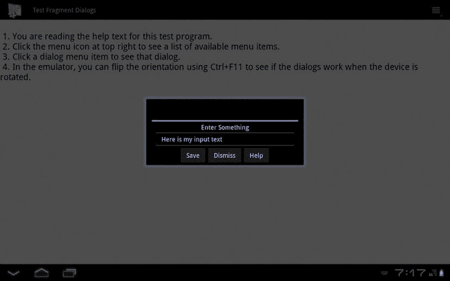

**图 9–1.** *对话框片段示例应用的用户界面*


### 对话框示例：主活动

现在来看源代码。列表 9–6 展示了与对话框相关的主活动代码片段。要查看完整源代码，你可以从本书网站下载（参见“参考”章节）。

**列表 9–6.** *对话框片段的主活动*

```
public class MainActivity extends Activity
implements OnDialogDoneListener
{
    public static final String LOGTAG = "DialogFragmentDemo";
    public static final String ALERT_DIALOG_TAG = "ALERT_DIALOG_TAG";
    public static final String HELP_DIALOG_TAG = "HELP_DIALOG_TAG";
    public static final String PROMPT_DIALOG_TAG = "PROMPT_DIALOG_TAG";
    public static final String EMBED_DIALOG_TAG = "EMBED_DIALOG_TAG";

    private void testPromptDialog()
    {
        FragmentTransaction ft = getFragmentManager().beginTransaction();

        PromptDialogFragment pdf =
            PromptDialogFragment.newInstance("Enter Something");

        pdf.show(ft, PROMPT_DIALOG_TAG);
    }

    private void testAlertDialog()
    {
        FragmentTransaction ft = getFragmentManager().beginTransaction();

        AlertDialogFragment adf =
            AlertDialogFragment.newInstance("Alert Message");

        adf.show(ft, ALERT_DIALOG_TAG);
    }

    private void testHelpDialog()
    {
        FragmentTransaction ft = getFragmentManager().beginTransaction();

        HelpDialogFragment hdf =
            HelpDialogFragment.newInstance(R.string.help_text);

        hdf.show(ft, HELP_DIALOG_TAG);
    }

    private void testEmbedDialog()
    {
        FragmentTransaction ft = getFragmentManager().beginTransaction();

        PromptDialogFragment pdf =
            PromptDialogFragment.newInstance(
                 "Enter Something (Embedded)");

        ft.add(R.id.embeddedDialog, pdf, EMBED_DIALOG_TAG);
        ft.commit();
    }

    public void onDialogDone(String tag, boolean cancelled,
                             CharSequence message) {
        String s = tag + " responds with: " + message;
        if(cancelled)
            s = tag + " was cancelled by the user";
        Toast.makeText(this, s, Toast.LENGTH_LONG).show();
        Log.v(LOGTAG, s);
    }
}
```

主活动的代码非常简单。你显示一个简单的文本页面并设置一个菜单。每个菜单项调用一个活动方法，而每个方法基本都做相同的事情：获取一个片段事务，创建一个新片段，然后显示该片段。请注意，每个片段都有一个与片段事务关联的唯一标签。这个标签会在片段管理器中与该片段关联，因此你可以稍后通过标签名找到这些片段。片段也可以通过 `Fragment` 上的 `getTag()` 方法来确定自己的标签值。

主活动中最后一个方法定义是 `onDialogDone()`，这是一个回调函数，属于你的活动所实现的 `OnDialogDoneListener` 接口的一部分。如你所见，该回调提供了调用你的片段的标签、一个指示对话框片段是否被取消的布尔值，以及一条消息。就你的需求而言，你只想将信息记录到 LogCat 中；同时你也通过 `Toast` 将其显示给用户。Toast 将在本章后续内容中介绍。

### 对话框示例：OnDialogDoneListener

为了能够了解对话框何时消失，你需要创建一个监听器接口，由你的对话框调用者来实现。该接口的代码在列表 9–7 中。

**列表 9–7.** *监听器接口*

```
// This file is OnDialogDoneListener.java
/*
 * An interface implemented typically by an activity
 * so that a dialog can report back
 * on what happened.
 */
public interface OnDialogDoneListener {
  public void onDialogDone(String tag, boolean cancelled,
                           CharSequence message);
}
```

如你所见，这是一个非常简单的接口。你只为这个接口选择了一个回调函数，活动必须实现它。你的片段不需要知道调用活动的具体细节，只需要知道调用活动必须实现 `OnDialogDoneListener` 接口即可；因此，片段可以调用这个回调来与调用活动进行通信。根据片段的具体功能，接口中可能有多个回调函数。对于这个示例应用程序，你将接口与片段类定义分开展示。为了方便代码管理，你可以将片段监听器接口嵌入到片段类定义本身中，这样更容易保持监听器与片段之间的同步。


### 对话框示例：`PromptDialogFragment`

现在让我们来看看你的第一个片段，`PromptDialogFragment`，其布局和 Java 代码如清单 9–8 所示。

**清单 9–8.** *`PromptDialogFragment` 布局和 Java 代码*

```
<?xml version="1.0" encoding="utf-8"?>
<!-- 此文件为 /res/layout/prompt_dialog.xml -->
<LinearLayout
    android:orientation="vertical" android:padding="4dip"
    android:gravity="center_horizontal"
    android:layout_width="match_parent"
    android:layout_height="match_parent">

    <TextView
        android:id="@+id/promptmessage"
        android:layout_height="wrap_content"
        android:layout_width="wrap_content"
        android:layout_marginLeft="20dip"
        android:layout_marginRight="20dip"
        android:text="输入文本"
        android:layout_weight="1"
        android:layout_gravity="center_vertical|center_horizontal"
        android:textAppearance="?android:attr/textAppearanceMedium"
        android:gravity="top|center_horizontal" />

    <EditText
        android:id="@+id/inputtext"
        android:layout_height="wrap_content"
        android:layout_width="400dip"
        android:layout_marginLeft="20dip"
        android:layout_marginRight="20dip"
        android:scrollHorizontally="true"
        android:autoText="false"
        android:capitalize="none"
        android:gravity="fill_horizontal"
        android:textAppearance="?android:attr/textAppearanceMedium" />

    <LinearLayout
        android:orientation="horizontal"
        android:layout_width="wrap_content"
        android:layout_height="wrap_content">

      <Button android:id="@+id/btn_save"
        android:layout_width="wrap_content"
        android:layout_height="wrap_content"
        android:layout_weight="0"
        android:text="保存">
      </Button>

      <Button android:id="@+id/btn_dismiss"
        android:layout_width="wrap_content"
        android:layout_height="wrap_content"
        android:layout_weight="0"
        android:text="取消">
      </Button>

      <Button android:id="@+id/btn_help"
        android:layout_width="wrap_content"
        android:layout_height="wrap_content"
        android:layout_weight="0"
        android:text="帮助">
      </Button>

    </LinearLayout>
</LinearLayout>
```

```
// 此文件为 PromptDialogFragment.java
public class PromptDialogFragment
extends DialogFragment
implements View.OnClickListener
{
    private EditText et;

    public static PromptDialogFragment
    newInstance(String prompt)
    {
        PromptDialogFragment pdf = new PromptDialogFragment();
        Bundle bundle = new Bundle();
        bundle.putString("prompt",prompt);
        pdf.setArguments(bundle);

        return pdf;
    }

    @Override
    public void onAttach(Activity act) {
        // 如果你要附加到的 Activity 没有
        // 实现 OnDialogDoneListener 接口，
        // 以下代码行将抛出 ClassCastException 异常。
        // 这是你可以测试 Activity 行为是否规范的最早时机。
        try {
            OnDialogDoneListener test = (OnDialogDoneListener)act;
        }
        catch(ClassCastException cce) {
            // 在这里我们优雅地处理失败情况。
            Log.e(MainActivity.LOGTAG, "Activity 未监听");
        }
        super.onAttach(act);
    }

    @Override
    public void onCreate(Bundle icicle)
    {
        super.onCreate(icicle);
        this.setCancelable(true);
        int style = DialogFragment.STYLE_NORMAL, theme = 0;
        setStyle(style,theme);
    }

    public View onCreateView(LayoutInflater inflater,
            ViewGroup container, Bundle icicle)
    {
        View v = inflater.inflate(R.layout.prompt_dialog, container,
                                  false);

        TextView tv = (TextView)v.findViewById(R.id.promptmessage);
        tv.setText(getArguments().getString("prompt"));

        Button dismissBtn = (Button)v.findViewById(R.id.btn_dismiss);
        dismissBtn.setOnClickListener(this);

        Button saveBtn = (Button)v.findViewById(R.id.btn_save);
        saveBtn.setOnClickListener(this);

        Button helpBtn = (Button)v.findViewById(R.id.btn_help);
        helpBtn.setOnClickListener(this);

        et = (EditText)v.findViewById(R.id.inputtext);
        if(icicle != null)
            et.setText(icicle.getCharSequence("input"));
        return v;
    }

    @Override
    public void onSaveInstanceState(Bundle icicle) {
        super.onSaveInstanceState(icicle);
        icicle.putCharSequence("input", et.getText());
    }

    public void onClick(View v)
    {
        OnDialogDoneListener act = (OnDialogDoneListener)getActivity();
        if (v.getId() == R.id.btn_save)
        {
            TextView tv =
                (TextView)getView().findViewById(R.id.inputtext);
            act.onDialogDone(this.getTag(), false, tv.getText());
            dismiss();
            return;
        }
        if (v.getId() == R.id.btn_dismiss)
        {
            act.onDialogDone(this.getTag(), true, null);
            dismiss();
            return;
        }
        if (v.getId() == R.id.btn_help)
        {
            FragmentTransaction ft =
                getFragmentManager().beginTransaction();
            ft.remove(this);

            // 在这种情况下，你想要显示帮助文本，但
            // 完成后返回之前的对话框
            ft.addToBackStack(null);
            // null 表示后台堆栈事务没有名称

            HelpDialogFragment hdf =
                    HelpDialogFragment.newInstance(R.string.help1);
            hdf.show(ft, MainActivity.HELP_DIALOG_TAG);
            return;
        }
    }
}
```

这个提示对话框的布局看起来类似于你之前见过的许多布局。它包含一个用作提示的 `TextView`；一个用于接收用户输入的 `EditText`；以及三个按钮，分别用于保存输入、取消（关闭）对话框片段以及弹出帮助对话框。

`PromptDialogFragment` 的 Java 代码开始时看起来与你之前的片段类似。你有一个用于创建新对象的 `newInstance()` 静态方法，在此方法中，你调用默认构造函数，构建一个参数 Bundle，并将其附加到新对象上。接下来，在 `onAttach()` 回调中有一些新内容。你需要确保刚刚附加的 Activity 已经实现了 `OnDialogDoneListener` 接口。为了测试这一点，你将传入的 Activity 强制转换为 `OnDialogDoneListener` 接口。以下是那段代码：

```
try {
    OnDialogDoneListener test = (OnDialogDoneListener)act;
}
catch(ClassCastException cce) {
    // 在这里我们优雅地处理失败情况。
    Log.e(MainActivity.LOGTAG, "Activity 未监听");
}
```

如果 Activity 没有实现此接口，则会抛出 `ClassCastException` 异常。你可以处理这个异常并更优雅地应对，但这个示例尽可能保持代码简洁。

接下来是 `onCreate()` 回调。与片段的常见做法一致，你并不在此处构建用户界面，但可以设置对话框样式。这是对话框片段独有的特点。你可以自行设置样式和主题，也可以仅设置样式并将主题值设为零（`0`），让系统为你选择合适的主题。以下是该段代码：

```
int style = DialogFragment.STYLE_NORMAL, theme = 0;
setStyle(style,theme);
```


在`onCreateView()`中，你需要为对话框片段创建视图层次结构。与其他片段一样，不要将视图层次结构附加到传入的视图容器中（即，将`attachToRoot`参数设置为`false`）。然后，设置按钮回调，并将对话框提示文本设置为最初传递给`newInstance()`的提示。最后，检查是否有任何值通过保存的状态包（`icicle`）传入。这将表明你的片段正在被重新创建，很可能是由于配置变更导致的，并且用户可能已经输入了一些文本。如果是这样，你需要用用户已输入的内容填充`EditText`。请记住，由于配置已更改，内存中的实际视图对象与之前不同，因此你必须找到它并相应地设置文本。接下来的回调是`onSaveInstanceState()`；在这里，你将用户输入的任何当前文本保存到保存的状态包中。

`onCancel()`和`onDismiss()`回调未显示，因为它们只进行日志记录；你将能够在片段生命周期中看到这些回调何时触发。

提示对话框片段中的最后一个回调是针对按钮的。再次，你获取对封闭活动的引用，并将其转换为你期望活动已实现的接口。如果用户按下了“保存”按钮，你获取输入的文本并调用接口的回调`onDialogDone()`。此回调接受该片段的标签名、一个表示此对话框片段是否被取消的布尔值以及一个消息（在本例中为用户输入的文本）。以下是来自`MainActivity`末尾列表 9-6 的代码：

```
public void onDialogDone(String tag, boolean cancelled,
                         CharSequence message) {
    String s = tag + " responds with: " + message;
    if(cancelled)
        s = tag + " was cancelled by the user";
    Toast.makeText(this, s, Toast.LENGTH_LONG).show();
    Log.v(LOGTAG, s);
}
```

然后你调用`dismiss()`来移除对话框片段。请记住，`dismiss()`不仅会使片段在视觉上消失，还会将片段从片段管理器中弹出，使其不再可用。如果按下的按钮是“关闭”，你再次调用接口回调，这次不带消息，然后调用`dismiss()`。最后，如果用户按下了“帮助”按钮，你不想丢失提示对话框片段，因此你采取了一些不同的操作。我们之前已经描述过。为了记住提示对话框片段以便稍后返回，你需要创建一个片段事务，使用`show()`方法移除提示对话框片段并添加帮助对话框片段；这需要放入返回栈中。还要注意，帮助对话框片段是如何通过资源 ID 的引用创建的。这意味着你的帮助对话框片段可以与应用程序可用的任何帮助文本一起使用。

### 对话框示例：`HelpDialogFragment`

我们将很快展示帮助对话框片段的代码，但现在先描述其操作。你创建了一个片段事务，从提示对话框片段导航到帮助对话框片段，并将该片段事务放入返回栈。这使得提示对话框片段从视图中消失，但仍可通过片段管理器和返回栈访问。新的帮助对话框片段出现在其位置，允许用户阅读帮助文本。当用户关闭帮助对话框片段时，片段返回栈条目被弹出，效果是帮助对话框片段被关闭（同时在视觉上和从片段管理器中），并且提示对话框片段恢复到视图中。这是实现所有这些效果的一种相当简单的方法。它非常简单但非常强大；即使在这些对话框显示时用户旋转设备，它也能正常工作。

下载并查看`HelpDialogFragment.java`文件及其布局（`help_dialog.xml`）的源代码。此对话框片段的目的是显示帮助文本。布局包含一个`TextView`和一个关闭按钮。Java 代码应该开始让你感到熟悉。有一个`newInstance()`方法来创建一个新的帮助对话框片段，一个`onCreate()`方法来设置样式和主题，以及一个`onCreateView()`方法来构建视图层次结构。在这个特定情况下，你需要找到一个字符串资源来填充`TextView`，因此你通过活动访问资源，并选择传递给`newInstance()`的资源 ID。最后，`onCreateView()`设置了一个按钮点击处理程序来捕获关闭按钮的点击。在这种情况下，在关闭时你不需要做任何有趣的事情。

此片段有两种调用方式：从活动调用和从提示对话框片段调用。当此帮助对话框片段从主活动显示时，关闭它只是将片段从顶部弹出，并显示下面的主活动。当此帮助对话框片段从提示对话框片段显示时，因为帮助对话框片段是返回栈上片段事务的一部分，关闭它会导致片段事务被回滚，这会弹出帮助对话框片段但恢复提示对话框片段。用户会看到提示对话框片段重新出现。


### 对话框示例：AlertDialogFragment

本示例应用中还有最后一个对话框片段要展示：提示对话框片段。虽然你可以用与帮助对话框片段类似的方式创建提示对话框片段，但也可以使用在多个 Android 版本中都有效的旧版 `AlertBuilder` 框架来创建。 清单 9–9 展示了提示对话框片段的源代码。

**清单 9–9.** *`AlertDialogFragment` Java 代码*

```java
public class AlertDialogFragment
extends DialogFragment
implements DialogInterface.OnClickListener
{
    public static AlertDialogFragment
    newInstance(String message)
    {
        AlertDialogFragment adf = new AlertDialogFragment();
        Bundle bundle = new Bundle();
        bundle.putString("alert-message",message);
        adf.setArguments(bundle);

        return adf;
    }

    @Override
    public void onCreate(Bundle savedInstanceState)
    {
        super.onCreate(savedInstanceState);
        this.setCancelable(true);
        int style = DialogFragment.STYLE_NORMAL, theme = 0;
        setStyle(style,theme);
    }

    @Override
    public Dialog onCreateDialog(Bundle savedInstanceState)
    {
        AlertDialog.Builder b =
            new AlertDialog.Builder(getActivity())
           .setTitle("Alert!!")
           .setPositiveButton("Ok", this)
           .setNegativeButton("Cancel", this)
           .setMessage(this.getArguments().getString("alert-message"));
        return b.create();
    }

    public void onClick(DialogInterface dialog, int which)
    {
        OnDialogDoneListener act = (OnDialogDoneListener) getActivity();
        boolean cancelled = false;
        if (which == AlertDialog.BUTTON_NEGATIVE)
        {
            cancelled = true;
        }
        act.onDialogDone(getTag(), cancelled, "Alert dismissed");
    }
}
```

此对话框无需布局，因为 `AlertBuilder` 会为你处理。注意，该对话框片段开始时与其他片段类似，但这里没有 `onCreateView()` 回调，而是使用了 `onCreateDialog()` 回调。你需要实现 `onCreateView()` 或 `onCreateDialog()`，但不能同时实现两者。`onCreateDialog()` 的返回值不是视图，而是一个对话框。这里值得注意的是，要获取对话框的参数，你应该访问参数 Bundle。在此示例应用中，你只对提示消息进行了此操作，但你也可以通过参数 Bundle 访问其他参数。

另外请注意，对于这种类型的对话框片段，你的片段类需要实现 `DialogInterface.OnClickListener`，这意味着你的对话框片段必须实现 `onClick()` 回调。当用户对嵌入的对话框进行操作时，会触发此回调。同样，你会获得触发回调的对话框引用以及被按下的按钮标识。和之前一样，你应谨慎，不要依赖 `onDismiss()`，因为设备配置发生变化时也可能会触发此回调。

### 对话框示例：嵌入对话框

你可能已经注意到 `DialogFragment` 的另一个特性。在该应用的主布局中，文本下方有一个 `FrameLayout`，可用于容纳对话框。在应用的菜单中，最后一项会触发片段事务，将 `PromptDialogFragment` 的新实例添加到主屏幕。无需任何修改，该对话框片段即可嵌入主布局显示，并如预期般工作。

这种技术的一个不同之处在于，显示嵌入对话框的代码与显示弹出对话框的代码不同。嵌入对话框的代码如下所示：

```java
ft.add(R.id.embeddedDialog, pdf, EMBED_DIALOG_TAG);
ft.commit();
```

这与第 8 章中在 `FrameLayout` 中显示片段时的代码完全相同。不过，这次需要确保传入一个标签名，当对话框片段通知活动用户的输入时，会使用该标签名。

### 对话框示例：观察

运行此示例应用时，请务必在不同设备方向上尝试所有菜单选项。在对话框片段显示时旋转设备。你会欣喜地发现对话框会随旋转而适应；无需担心大量代码来管理因配置变化而导致的片段保存与恢复。

我们希望您能体会到的另一点是，在片段和活动之间进行通信是多么容易。当然，活动拥有或可以获取对所有可用片段的引用，因此它可以访问片段自身暴露的方法。这并不是片段与活动之间通信的唯一方式。你始终可以使用片段管理器上的 getter 方法来获取受管理片段的实例，然后适当地转换该引用并直接调用该片段上的方法。你甚至可以在另一个片段内部执行此操作。通过接口和活动将片段相互隔离的程度，或者通过片段间通信构建依赖关系的程度，取决于你的应用程序有多复杂以及你希望实现多大程度的复用。

### 使用 Toast

本章开头介绍了如何在错误页面上使用提示消息进行 JavaScript 调试。如果需要使用类似的方法处理不频繁的调试消息，可以使用 Android 中的 `Toast` 对象。

`Toast` 类似于一个提示对话框，它包含一条消息，显示一段时间后消失。它没有任何按钮。因此，可以说它是一种瞬时提示消息。之所以称为 `Toast`，是因为它像烤面包机里弹出来的吐司一样弹出。

清单 9–10 展示了一个如何使用 `Toast` 显示消息的示例。

**清单 9–10.** *使用 `Toast` 进行调试*

```java
//Create a function to wrap a message as a toast
//show the toast
public void reportToast(String message)
{
    String s = MainActivity.LOGTAG + ":" + message;
    Toast.makeText(activity, s, Toast.LENGTH_SHORT).show();
}
```

清单 9–10 中的 `makeText()` 方法不仅可以使用活动，还可以使用任何上下文对象，例如传递给广播接收器或服务的上下文。这扩展了 `Toast` 在活动之外的使用范围。

### 用于旧版 Android 的对话框片段

虽然希望所有旧手机都能升级到 Ice Cream Sandwich，从而能够利用对话框片段的所有优点，但现实是，一些旧型号仍会停留在 Android 1.6、2.1 和 2.2 上。为了给这些手机提供对话框片段支持，Google 提供了 Fragment 兼容性库。对于对话框片段，你仍然使用前面讨论过的 `DialogFragment` 类；只需确保在应用程序中包含兼容性 jar 文件即可。


### 摘要

本章讨论了异步对话框以及如何使用对话框片段，涵盖以下主题：

- 什么是对话框以及为何使用它
- Android 中对话框的异步特性
- 让对话框在屏幕上显示的三个步骤
- 创建片段
- 对话框片段创建视图层次结构的两种方法
- 片段事务如何参与显示对话框片段，以及如何获取一个片段事务
- 用户在查看对话框片段时按下返回键会发生什么
- 返回栈及管理对话框片段
- 点击对话框片段上的按钮时会发生什么，以及如何处理
- 从对话框片段与调用活动进行通信的简洁方法
- 一个对话框片段如何调用另一个对话框片段并仍能返回上一个对话框片段
- `Toast` 类以及如何将其用作简单的提示弹窗

### 面试问题

以下问题应能帮助您巩固对本章关于对话框讨论的理解：

1.  您的代码能否在对话框片段显示后立即读取用户从提示对话框片段中的输入？请说明原因。
2.  您使用 `DialogFragment` 的哪个方法来构建视图层次结构？
3.  您使用哪个方法来返回一个已准备好的对话框？
4.  您使用对话框片段的哪个方法来显示对话框？
5.  调用此方法的两种方式是什么？哪一种最简单？
6.  您能使用 `onDismiss()` 来判断用户是否已点击对话框片段中的按钮吗？请说明原因。
7.  一个对话框片段能否显示另一个对话框片段？如果可以，新的对话框片段能否再显示另一个对话框片段而不产生问题？
8.  您在哪里设置对话框的样式和主题？
9.  `Toast` 消息的时间长度选项有哪些？
10. 如何在配置变更（例如设备旋转）时，让对话框片段记住用户输入的内容？

## 第 10 章

## 探索操作栏

`ActionBar` 是在适用于平板电脑的 Android 3.0 SDK 中引入的，现在（4.0 版本）也适用于手机。它允许您自定义活动的标题栏。在 3.0 SDK 发布之前，活动的标题栏仅包含活动的标题。Android 的 `ActionBar` 设计类似于网页浏览器的菜单/标题栏。

 **注意：** 本章同时指代 `ActionBar` 和 action bar。`ActionBar` 指实际的类，而 *action bar* 指的是概念。

3.0 SDK 经过了优化，但仅适用于平板电脑。这意味着，对于运行 Android 4.0 之前版本的手机，操作栏 API 并不可用。到了 4.0 SDK，手机和平板电脑的 SDK 方面已合并，以提供统一的 API。

操作栏设计的一个关键目标是让用户无需在选项菜单或上下文菜单中搜寻，就能轻松访问常用操作。

 **注意：** 在当前计算机技术文献中，便捷的操作访问被时髦地称为 *可发现性*，指的是方便地发现/调用操作的能力。我们在本章末尾提供了一些关于可发现性的参考网址。

在本章的学习过程中，您将了解关于操作栏的以下内容：

- 操作栏归活动所有，并遵循其生命周期。
- 操作栏可以采用三种形式之一：选项卡式操作栏、列表操作栏或标准操作栏。您将看到这些不同的操作栏在每种模式下的外观和行为。
- 您将学习选项卡监听器如何让您与选项卡式操作栏进行交互。
- 您将看到如何使用微调适配器和列表监听器与列表操作栏进行交互。
- 您将了解操作栏的“主页”图标如何与菜单基础设施进行交互。
- 您将看到图标菜单项如何显示在操作栏区域中并对其进行响应。
- 您将了解如何在操作栏中放置自定义搜索小部件。

您将通过规划三个不同的活动来探索这些概念。每个活动都拥有不同模式的操作栏。这将让您有机会检查每种模式下操作栏的行为。但首先，让我们快速浏览一下操作栏的视觉方面。

### 操作栏的解剖结构

图 10–1 显示了一个处于选项卡导航模式的典型操作栏。

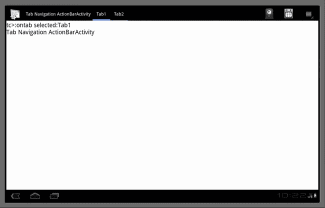

**图 10–1.** *带有选项卡式操作栏的活动*

此截图取自本章后面介绍的实际工作示例。图 10–1 中的操作栏有五个部分。这些部分如下（从左到右）：

- *主页图标区域：* 操作栏左上角的图标有时称为“主页”图标。这类似于网站导航上下文，点击主页图标会带您回到起始点。当您将用户导航到主活动时，不要启动一个新的主活动；相反，应使用一个意图标志来转移过去，该标志会清除主活动之上的所有活动栈。稍后您将看到，点击此“主页”图标会向选项菜单发送一个回调，其菜单 ID 为 `android.R.id.home`。
- *标题区域：* 标题区域显示操作栏的标题。
- *选项卡区域：* 选项卡区域是操作栏绘制指定选项卡列表的地方。此区域的内容是可变的。如果操作栏导航模式是选项卡，则此处显示选项卡。如果模式是列表导航模式，则显示一个可导航的下拉列表项。在标准模式下，此区域被忽略并保持为空。
- *操作图标区域：* 在选项卡区域之后，操作图标区域显示一些作为图标的选项菜单项。您将在稍后的示例中看到如何选择哪些选项菜单显示为操作图标。
- *菜单图标区域：* 最后是菜单图标区域。它是一个单一的标准菜单图标。当您点击此菜单图标时，您会看到展开的菜单。根据 Android 设备的大小，此展开菜单的外观或在屏幕上的位置会有所不同。您还可以将搜索视图附加到菜单上，就像它是一个菜单的操作图标一样。我们将在本章后面介绍这一点。

除了操作栏之外，图 10–1 中的活动还显示了一个用于记录大量操作的调试文本视图。这些操作可能是点击选项卡、主页图标、操作菜单或实际选项菜单的结果。

让我们看看如何实现前面提到的三种类型的操作栏活动：选项卡式操作栏、列表操作栏和标准操作栏。您已经看过作为操作栏视觉示例的选项卡式操作栏，那么我们将从实现选项卡式操作栏开始。


### 选项卡式导航操作栏活动

尽管你计划创建三种不同的活动，每种都有其自己的操作栏类型，但这些示例活动具有许多共同的功能：

*   所有这些活动都具有相同的调试文本视图，以便你可以在调用操作时进行监控。
*   所有这些活动都具有相同的主页图标。
*   所有这些活动都有一个标题。
*   所有这些活动都具有相同的操作图标。
*   所有这些活动都具有相同的选项菜单。

这些活动之间的主要区别在于，每个活动对操作栏的配置方式不同。在本示例中，你将公共行为封装在一个基类中，并允许每个派生活动（包括此选项卡式操作栏活动）来配置操作栏。

如果没有至少一个操作栏活动的上下文，很难解释这些公共文件。因此，你首先查看这些公共文件，以及选项卡式操作栏活动如何使用它们。然后，另外两个状态栏活动可以用更少的文件添加到该项目中。

以下是此选项卡式操作栏练习所需的文件列表。这些文件既包括公共文件，也包括选项卡式操作栏特有的文件。列表看起来很多，是因为你将公共行为封装到了基类中。这减少了后续示例所需的文件数量。每个文件都标注了清单编号：

*   `DebugActivity.java`：基类活动，允许使用如图 10–1 所示的调试文本视图（清单 10–2）。
*   `BaseActionBarActivity.java`：派生自 `DebugActivity`，允许公共导航（例如，响应包括在三个活动之间切换在内的公共操作）（清单 10–3）。
*   `IReportBack.java`：一个接口，作为调试活动与操作栏的各种监听器之间的通信工具（清单 10–1）。
*   `BaseListener.java`：基类监听器，与 `DebugActivity` 以及从操作栏调用的各种操作协同工作。作为选项卡监听器和列表导航监听器的基类（清单 10–4）。
*   `TabNavigationActionBarActivity.java`：继承自 `BaseActionBarActivity.java`，并将操作栏配置为选项卡式操作栏。大部分与选项卡式操作栏相关的代码都在此类中（清单 10–6）。
*   `TabListener.java`：用于向选项卡式操作栏添加选项卡。在这里响应选项卡点击。在本例中，它只是通过 `BaseListener` 将一条消息记录到调试视图（清单 10–5）。
*   `AndroidManifest.xml`：定义要调用的活动（清单 10–13）。
*   `Layout/main.xml`：`DebugActivity` 的布局文件。由于所有三个状态栏活动都继承自此基类 `DebugActivity`，因此它们共享此布局文件（清单 10–7）。
*   `menu/menu.xml`：一组菜单项，用于测试菜单与操作栏的交互。此菜单文件也在所有派生状态栏活动之间共享（清单 10–9）。

#### 实现基类活动

许多基类都使用了 `IReportBack` 接口。该接口在清单 10–1 中介绍。

**清单 10–1.** *`IReportBack.java`*

```
//IReportBack.java
package com.androidbook.actionbar;

public interface IReportBack
{
   public void reportBack(String tag, String message);
   public void reportTransient(String tag, String message);
}
```

实现了此接口的类会接收一条消息并将其报告到屏幕上，类似于调试消息。这是通过 `reportBack()` 方法完成的。`reportTransient()` 方法执行相同的操作，只是它使用 `Toast` 将该消息报告给用户。

在本示例中，实现 `IReportBack` 的类是 `DebugActivity`。这使得 `DebugActivity` 能够传递自身，而无需暴露其所有内部实现。`DebugActivity` 的源代码在清单 10–2 中给出。

**清单 10–2.** *带有调试文本视图的 `DebugActivity`*

```
//DebugActivity.java
package com.androidbook.actionbar;
//
//使用 CTRL-SHIFT-O 导入依赖项
//
public abstract class DebugActivity
extends Activity
implements IReportBack
{
   //派生类需要首先定义
   protected abstract boolean
   onMenuItemSelected(MenuItem item);

   //由构造函数设置的私有变量
   private static String tag=null;
   private int menuId = 0;
   private int layoutid = 0;
   private int debugTextViewId = 0;

   public DebugActivity(int inMenuId,
         int inLayoutId,
         int inDebugTextViewId,
         String inTag)
   {
      tag = inTag;
      menuId = inMenuId;
      layoutid = inLayoutId;
      debugTextViewId = inDebugTextViewId;

   }
    @Override
protected void onCreate(Bundle savedInstanceState) {
        super.onCreate(savedInstanceState);
        setContentView(this.layoutid);

        //你需要以下代码来使文本视图可滚动。
        TextView tv = this.getTextView();
        tv.setMovementMethod(
          ScrollingMovementMethod.getInstance());
    }
    @Override
public boolean onCreateOptionsMenu(Menu menu){
       super.onCreateOptionsMenu(menu);
       MenuInflater inflater = getMenuInflater();
       inflater.inflate(menuId, menu);
       return true;
    }
    @Override
public boolean onOptionsItemSelected(MenuItem item){
       appendMenuItemText(item);
       if (item.getItemId() == R.id.menu_da_clear){
          this.emptyText();
          return true;
       }
       boolean b = onMenuItemSelected(item);
       if (b == true)
       {
          return true;
       }
       return super.onOptionsItemSelected(item);
    }
protected TextView getTextView(){
        return
        (TextView)this.findViewById(this.debugTextViewId);
    }
protected void appendMenuItemText(MenuItem menuItem){
       String title = menuItem.getTitle().toString();
       appendText("MenuItem:" + title);
    }
    protected void emptyText(){
       TextView tv = getTextView();
       tv.setText("");
    }
protected void appendText(String s){
       TextView tv = getTextView();
       tv.setText(s + "\n" + tv.getText());
       Log.d(tag,s);
    }
public void reportBack(String tag, String message)
   {
      this.appendText(tag + ":" + message);
      Log.d(tag,message);
   }
public void reportTransient(String tag, String message)
   {
      String s = tag + ":" + message;
      Toast mToast =
        Toast.makeText(this, s, Toast.LENGTH_SHORT);
      mToast.show();
      reportBack(tag,message);
      Log.d(tag,message);
   }
}//eof-class
```

此基类活动的主要目标是提供一个包含调试文本视图的活动。此文本视图用于记录来自 `reportBack()` 方法的消息。你将所有操作栏活动的基类都使用此活动。


#### 为操作栏分配统一行为

您有更多机会将派生自活动的代码重构到另一个基类 `BaseActionBarActivity` 中。

这个重构类的主要目的是提供对菜单项的通用行为响应。这些菜单项用于在代表三种不同操作栏模式的三个活动之间切换。切换后，您可以测试相应的操作栏活动。

本活动在清单 10-3 中呈现。

**清单 10-3.** *操作栏启用活动的公共基类*

```
// BaseActionBarActivity.java
package com.androidbook.actionbar;
//
//使用 CTRL-SHIFT-O 导入依赖
//
public abstract class BaseActionBarActivity
extends DebugActivity
{
    private String tag=null;
    public BaseActionBarActivity(String inTag)
    {
        super(R.menu.menu,    // 提供通用菜单
            R.layout.main,    // 提供通用布局
            R.id.textViewId,  // 基础调试活动的文本视图
            inTag);           // 用于日志记录的调试标签
            tag = inTag;
    }
    @Override
    public void onCreate(Bundle savedInstanceState)
    {
        super.onCreate(savedInstanceState);
        TextView tv = this.getTextView();
        tv.setText(tag);
    }
    protected boolean onMenuItemSelected(MenuItem item)
    {
// 响应主页图标
        if (item.getItemId() == android.R.id.home) {
            this.reportBack(tag,"Home Pressed");
            return true;
        }

// 调用同级活动的通用行为
        if (item.getItemId() == R.id.menu_invoke_tabnav){
            if (getNavMode() ==
              ActionBar.NAVIGATION_MODE_TABS)
            {
                this.reportBack(tag,
                  "You are already in tab nav");
            }
            else {
                this.invokeTabNav();
            }
            return true;
        }
        if (item.getItemId() == R.id.menu_invoke_listnav){
            if (getNavMode() ==
            ActionBar.NAVIGATION_MODE_LIST)
            {
                this.reportBack(tag,
                "You are already in list nav");
            }
            else{
                this.invokeListNav();
            }
            return true;
        }
        if (item.getItemId() == R.id.menu_invoke_standardnav){
            if (getNavMode() ==
            ActionBar.NAVIGATION_MODE_STANDARD)
            {
                this.reportBack(tag,
                "You are already in standard nav");
            }
            else{
                this.invokeStandardNav();
            }
            return true;
        }
        return false;
    }
private int getNavMode(){
ActionBar bar = this.getActionBar();
        return bar.getNavigationMode();
    }
    private void invokeTabNav(){
        Intent i = new Intent(this,
          TabNavigationActionBarActivity.class);
        startActivity(i);
    }

    // 在实现以下额外活动时，解开相应方法体的注释

    private void invokeListNav(){
        //Intent i = new Intent(this,
        //  ListNavigationActionBarActivity.class);
        //startActivity(i);
    }
    private void invokeStandardNav(){
        //Intent i = new Intent(this,
        //  StandardNavigationActionBarActivity.class);
        //startActivity(i);
    }
}//eof-class
```

如果您关注清单 10-3 中响应菜单项的代码，会发现您正在检查当前活动是否也是要切换到的目标活动。如果是，您会记录一条消息，并且不切换当前活动。

这个基础操作栏活动还简化了派生的操作栏导航活动，包括标签导航操作栏活动。

#### 实现标签监听器

在您能够使用标签操作栏之前，需要一个标签监听器。标签监听器允许您响应标签上的点击事件。您从基础监听器派生您的标签监听器，该基础监听器允许您记录标签操作。清单 10-4 展示了使用 `IReportBack` 进行记录的基础监听器。

**清单 10-4.** *操作栏启用活动的通用监听器*

```
//BaseListener.java
package com.androidbook.actionbar;
//
//使用 CTRL-SHIFT-O 导入依赖
//
public class BaseListener
{
   protected IReportBack mReportTo;
   protected Context mContext;
   public BaseListener(Context ctx, IReportBack target)
   {
      mReportTo = target;
      mContext = ctx;
   }
}
```

这个基类持有一个对 `IReportBack` 实现的引用，以及一个可作为上下文使用的活动。在这种情况下，清单 10-2 中的 `DebugActivity` 既是 `IReportBack` 的实现者，也承担了上下文的角色。

现在您有了一个基础监听器，清单 10-5 展示了标签监听器。

**清单 10-5.** *用于响应标签操作的标签监听器*

```
// TabListener.java
package com.androidbook.actionbar;
//
//使用 CTRL-SHIFT-O 导入依赖
//
public class TabListener extends BaseListener
implements ActionBar.TabListener
{
    private static String tag = "tc>";
    public TabListener(Context ctx,
                IReportBack target)
    {
        super(ctx, target);
    }
    public void onTabReselected(Tab tab,
                  FragmentTransaction ft)
    {
        this.mReportTo.reportBack(tag,
          "ontab re selected:" + tab.getText());
    }
    public void onTabSelected(Tab tab,
               FragmentTransaction ft)
    {
        this.mReportTo.reportBack(tag,
          "ontab selected:" + tab.getText());
    }
    public void onTabUnselected(Tab tab,
                 FragmentTransaction ft)
    {
        this.mReportTo.reportBack(tag,
          "ontab un selected:" + tab.getText());
    }
}
```

这个标签监听器将操作栏标签的回调记录到图 10-1 的调试文本视图中。

#### 实现标签操作栏活动

有了标签监听器后，您最终可以构建标签导航活动。这在清单 10-6 中呈现。

**清单 10-6.** *标签导航启用的操作栏活动*

```
// TabNavigationActionBarActivity.java
package com.androidbook.actionbar;
//
//使用 CTRL-SHIFT-O 导入依赖
//
public class TabNavigationActionBarActivity
extends BaseActionBarActivity
{
    private static String tag =
      "Tab Navigation ActionBarActivity";
    public TabNavigationActionBarActivity()
    {
        super(tag);
    }
    @Override
    public void onCreate(Bundle savedInstanceState)
    {
        super.onCreate(savedInstanceState);
        workwithTabbedActionBar();
    }

public void workwithTabbedActionBar()
    {
        ActionBar bar = this.getActionBar();
        bar.setTitle(tag);
        bar.setNavigationMode(
          ActionBar.NAVIGATION_MODE_TABS);

        TabListener tl = new TabListener(this,this);

        Tab tab1 = bar.newTab();
        tab1.setText("Tab1");
        tab1.setTabListener(tl);
        bar.addTab(tab1);

        Tab tab2 = bar.newTab();
        tab2.setText("Tab2");
        tab2.setTabListener(tl);
        bar.addTab(tab2);
    }
}//eof-class
```

现在，您将在以下小节中查看此活动（清单 10-6）的代码，这些小节将关注使用标签操作栏的各个方面。首先，您需要获取属于活动的操作栏的访问权限。


##### 获取操作栏实例

在列表 10-6 中，请注意控制操作栏的代码非常简单。你可以在活动中调用`getActionbar()`方法来获取该活动的操作栏访问权限。以下是该行代码的再次呈现：

```
ActionBar bar = this.getActionBar();
```

如这段代码所示，操作栏是活动的一个属性，并且不能跨越活动边界。换句话说，不能使用一个操作栏来控制或影响多个活动。

##### 操作栏导航模式

在列表 10-6 中，一旦你为某个活动获取了操作栏，就可以将其导航模式设置为`ActionBar.NAVIGATION_MODE_TABS`：

```
bar.setNavigationMode(
  ActionBar.NAVIGATION_MODE_TABS);
```

另外两种可能的操作栏导航模式是：

* `ActionBar.NAVIGATION_MODE_LIST`
* `ActionBar.NAVIGATION_MODE_STANDARD`

一旦设置了标签导航模式，你就可以在`ActionBar`类的 API 中使用多种与标签相关的方法。列表 10-6 使用了这些与标签相关的 API 来向操作栏添加两个标签。同时，你还使用了来自列表 10-5 的标签监听器来初始化标签。

以下是列表 10-6 中展示如何向操作栏添加标签的快速代码片段：

```
Tab tab1 = bar.newTab();
tab1.setText("Tab1");
tab1.setTabListener(tl);
bar.addTab(tab1);
```

如果你忘记对添加到操作栏的标签调用`setTabListener()`方法，程序会在运行时报错，提示需要一个监听器。

#### 可滚动的调试文本视图布局

当操作栏的标签被点击时，标签监听器被设置成将调试信息发送到调试文本视图。列表 10-7 展示了`DebugActivity`的布局文件，其中包含了调试文本视图。

**列表 10-7.** *调试活动文本视图布局文件*


```xml
<?xml version="1.0" encoding="utf-8"?>
`<!-- /res/layout/main.xml -->`
```xml
<LinearLayout
    xmlns:android="http://schemas.android.com/apk/res/android"
    android:orientation="vertical"
    android:layout_width="fill_parent"
    android:layout_height="fill_parent"
    android:gravity="fill"
    >
    <TextView android:id="@+id/textViewId"
        android:layout_width="fill_parent"
        android:layout_height="fill_parent"
        android:background="@android:color/white"
        android:text="Initial Text Message"
        android:textColor="@android:color/black"
        android:textSize="25sp"
        android:scrollbars="vertical"
        android:scrollbarStyle="insideOverlay"
        android:scrollbarSize="25dip"
        android:scrollbarFadeDuration="0"
        />
</LinearLayout>
```

关于此布局，有几点值得注意。你将文本视图的背景色设为白色，这样便于在光线较亮的环境下截屏。文本字号也设置得很大，以方便截屏。

你还设置了文本视图的滚动功能。虽然通常布局使用 `ScrollView`，但文本视图本身已具备滚动能力。除了在 XML 文件中为文本视图启用滚动属性外，你还需要在文本视图上调用 `setMovementMethod()` 方法，如代码清单 10–8 所示。

**代码清单 10–8.** *为文本视图启用滚动功能*
```java
TextView tv = this.getTextView();
tv.setMovementMethod(
    ScrollingMovementMethod.getInstance());
```
此代码提取自 `DebugActivity`（代码清单 10–2）。

滚动文本视图时，你会发现滚动条出现后会逐渐淡出。这并不能很好地指示文本是否超出可视范围。你可以通过将淡出持续时间设置为 0 来让滚动条保持显示。如何设置此参数请参见代码清单 10–7。

#### 操作栏与菜单交互

此示例还展示了菜单如何与操作栏交互。因此，你需要设置一个菜单文件。该文件在代码清单 10–9 中给出。

**代码清单 10–9.** *本项目菜单 XML 文件*
```xml
<!-- /res/menu/menu.xml -->
<menu
>
    <!-- 此组使用默认类别。 -->
    <group android:id="@+id/menuGroup_Main">

        <item android:id="@+id/menu_action_icon1"
            android:title="操作图标 1"
            android:icon="@drawable/creep001"
            android:showAsAction="ifRoom"/>

        <item android:id="@+id/menu_action_icon2"
            android:title="操作图标 2"
            android:icon="@drawable/creep002"
            android:showAsAction="ifRoom"/>

        <item android:id="@+id/menu_icon_test"
            android:title="图标测试"
            android:icon="@drawable/creep003"/>

        <item android:id="@+id/menu_invoke_listnav"
            android:title="调用列表导航"
            />
        <item android:id="@+id/menu_invoke_standardnav"
            android:title="调用标准导航"
            />
        <item android:id="@+id/menu_invoke_tabnav"
            android:title="调用标签导航"
            />
        <item android:id="@+id/menu_da_clear"
            android:title="清除" />
    </group>
</menu>
```

 **注意：** 代码清单 10–9 中的菜单 XML 文件使用了来自 [`www.androidicons.com`](http://www.androidicons.com) 的三个图标（`creep001`、`002` 和 `003`）。根据该网站声明，这些图标遵循知识共享许可协议 3.0。

以下部分将更详细地介绍此菜单。

##### 显示菜单

在 2.3 及更早版本中，设备通常有专门的菜单按钮。在 3.0 中，模拟器不显示实体主页、返回和菜单按钮。这些按钮在某些设备上可能仍然可用。

如图 10–2 所示，返回和主页按钮现在是屏幕底部的软按钮。而菜单按钮则在应用程序上下文中显示，具体位于右上角的操作栏中。

图 10–2 展示了菜单展开后的样子。

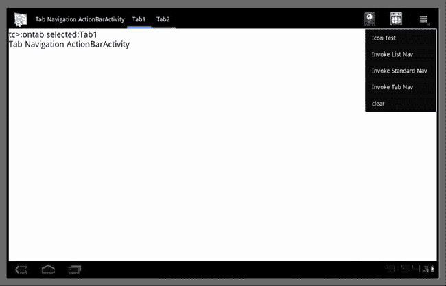

**图 10–2.** *带有标签操作栏和展开菜单的 Activity*

有一点值得注意：菜单栏可能不显示菜单项的图标。你不应依赖菜单项图标在所有情况下都显示。

##### 菜单项作为操作

正如本章开头所述，你可以将某些菜单项直接分配到操作栏上显示。这些菜单项使用 `showAsAction` 标记指示。你可以在代码清单 10–9 的菜单 XML 文件中看到此标记。该标记行被提取出来，并再次显示在代码清单 10–10 中。

**代码清单 10–10.** *`showAsAction` 的菜单项属性*
```xml
android:showAsAction="ifRoom"
```
此 XML 标记的其他可能值如下：

*   `always`
*   `never`
*   `withText`

你也可以通过 `MenuItem` 类的 Java API 实现相同的效果：
```java
menuItem.setShowAsAction(int actionEnum)
```
`actionEnum` 的值如下：

*   `SHOW_AS_ACTION_ALWAYS`
*   `SHOW_AS_ACTION_IF_ROOM`
*   `SHOW_AS_ACTION_NEVER`
*   `SHOW_AS_ACTION_WITH_TEXT`

由于这些操作本质上只是菜单项，它们的行为也是如此，并会调用 Activity 类的 `onOptionsItemSelected()` 回调方法。

最后，本示例使用了许多图标。你可以将这些图标替换为自己的图标，或者使用本章末尾的 URL 下载本章的项目。

#### Android 清单文件

代码清单 10–11 展示了迄今本项目的清单文件。

**代码清单 10–11.** *`AndroidManifest.xml`*
```xml
<?xml version="1.0" encoding="utf-8"?>
<manifest
    package="com.androidbook.actionbar"
    android:versionCode="1"
    android:versionName="1.0.0">
    <application android:icon="@drawable/icon"
        android:label="操作栏演示应用">
        <activity android:name=".TabNavigationActionBarActivity"
            android:label="操作栏演示：标签导航">
            <intent-filter>
                <action android:name="android.intent.action.MAIN" />
                <category android:name="android.intent.category.LAUNCHER" />
            </intent-filter>
        </activity>
    </application>
    <uses-sdk android:minSdkVersion="11" />
</manifest>
```

`minSDKVersion` 需要指向 `11`，即 3.0 版本的 API 编号。

#### 检查标签操作栏 Activity

当你编译这些文件并运行应用程序时，会看到标签操作栏，如图 10–1 所示。然后，如果你点击右侧的菜单图标，就会看到应用程序的菜单，如图 10–2 中展开的那样。

该应用程序的设计方式是，操作栏上的任何操作都会被记录到调试文本视图中。当运行此应用程序时，你可以测试以下内容：

*   如果你点击主页图标，你将看到一条消息记录到调试屏幕，表明主页按钮被点击。
*   如果你点击 tab1，你将看到一条消息，表明 tab1 被重新选中。
*   如果你点击 tab2，你将看到两条消息：一条表明 tab1 失去焦点，另一条表明 tab2 被点击。这些消息通过代码清单 10–5 中的标签监听器提供。
*   如果你点击右侧的操作按钮，你将看到相应的菜单项被调用，并且调试消息记录到调试视图。
*   如果你展开菜单，你将看到有菜单项用于调用其他 Activity，这些 Activity 演示了其余的操作栏模式。但是，你需要等到本章后面开发完其他 Activity 后才能使用。在此之前，只需注意这些项被调用并记录调试消息即可。

至此，你完成了标签操作栏 Activity 的实现，以及基础框架的设置，这使得编写其他两个 Activity 更加简单。接下来，让我们进入列表导航模式的操作栏。

### 列表导航操作栏 Activity

由于你的基类承担了大部分工作，因此实现和测试列表操作栏导航 Activity 相当容易。你需要以下额外文件来实现此 Activity：

*   `SimpleSpinnerArrayAdapter.java`：用于设置列表导航栏及其监听器。此类提供下拉导航列表所需的行（代码清单 10–12）。
*   `ListListener.java`：作为列表导航 Activity 的监听器。在将操作栏设置为列表操作栏时，需要将此监听器传递给操作栏（代码清单 10–13）。
*   `ListNavigationActionBarActivity.java`：实现列表导航操作栏 Activity（代码清单 10–14）。

拥有这三个新文件后，你需要更新以下两个文件：

*   `BaseActionBarActivity.java`：取消对列表操作栏 Activity 调用的注释（代码清单 10–3）。
*   `AndroidManifest.xml`：在清单文件中定义新的列表导航操作栏 Activity（代码清单 10–11）。

#### 创建微调器适配器

要能够使用列表导航模式初始化操作栏，你需要以下两样东西：

*   一个微调器适配器，可以告诉列表导航程序导航文本列表是什么。
*   一个列表导航监听器，以便当选择了列表中的某个项时，你可以得到回调。

代码清单 10–12 展示了实现 `SpinnerAdapter` 接口的 `SimpleSpinnerArrayAdapter`。如前所述，此类的目标是提供一个要显示的项列表。

**代码清单 10–12.** *为列表导航创建微调器适配器*
```java
//SimpleSpinnerArrayAdapter.java
package com.androidbook.actionbar;
//
//使用 CTRL-SHIFT-O 导入依赖项
//
public class SimpleSpinnerArrayAdapter
    extends ArrayAdapter<String>
    implements SpinnerAdapter
{
    public SimpleSpinnerArrayAdapter(Context ctx)
    {
        super(ctx,
          android.R.layout.simple_spinner_item,
          new String[]{"one","two"});

        this.setDropDownViewResource(
          android.R.layout.simple_spinner_dropdown_item);
    }
    public View getDropDownView(
      int position, View convertView, ViewGroup parent)
    {
        return super.getDropDownView(
          position, convertView, parent);
    }
}
```

没有直接实现列表导航所需的 `SpinnerAdapter` 接口的 SDK 类。因此，你从 `ArrayAdapter` 派生此类，并为 `SpinnerAdapter` 提供一个简单的实现。本章末尾有一个关于微调器适配器的参考 URL，供进一步阅读。现在，让我们进入列表导航监听器。

#### 创建列表监听器

这是一个实现 `ActionBar.OnNavigationListener` 的简单类。代码清单 10–13 展示了此类的代码。

**代码清单 10–13.** *为列表导航创建列表监听器*
```java
//ListListener.java
package com.androidbook.actionbar;
//
//使用 CTRL-SHIFT-O 导入依赖项
//
public class ListListener
    extends BaseListener
    implements ActionBar.OnNavigationListener
{
    public ListListener(
    Context ctx, IReportBack target)
    {
        super(ctx, target);
    }
    public boolean onNavigationItemSelected(
    int itemPosition, long itemId)
    {
        this.mReportTo.reportBack(
          "列表监听器","项位置:" + itemPosition);
        return true;
    }
}
```

与代码清单 10–5 中的标签监听器类似，你从 `BaseListener` 继承，以便能够通过 `IReportBack` 接口将事件记录到调试文本视图。

#### 设置列表操作栏

现在，你已拥有设置列表导航操作栏所需的一切。列表导航操作栏 Activity 的源代码如代码清单 10–14 所示。此类与你之前编写的标签 Activity 非常相似。

**代码清单 10–14.** *列表导航操作栏 Activity*
```java
// ListNavigationActionBarActivity.java
package com.androidbook.actionbar;
//
//使用 CTRL-SHIFT-O 导入依赖项
//
public class ListNavigationActionBarActivity
    extends BaseActionBarActivity
{
    private static String tag=
      "列表导航操作栏 Activity";

    public ListNavigationActionBarActivity()
    {
        super(tag);
    }

    @Override
    public void onCreate(Bundle savedInstanceState)
    {
        super.onCreate(savedInstanceState);
        workwithListActionBar();
    }
    public void workwithListActionBar()
    {
        ActionBar bar = this.getActionBar();
        bar.setTitle(tag);
        bar.setNavigationMode(ActionBar.NAVIGATION_MODE_LIST);
        bar.setListNavigationCallbacks(
           new SimpleSpinnerArrayAdapter(this),
           new ListListener(this,this));
    }
}//eof-class
```

重要的代码在代码清单 10–14 中突出显示。代码非常简单：你获取一个微调器适配器和一个列表监听器，并将它们设置为操作栏的列表导航回调。

#### 对 `BaseActionBarActivity` 进行更改

有了这个列表导航操作栏 Activity（代码清单 10–14），你可以返回并更改 `BaseActionBarActivity`，以便用于 `ListNavigationActionBarActivity` 的菜单项可以调用此 Activity。取消注释后，代码清单 10–3 中的相应函数看起来像代码清单 10–15 中提取并取消注释的代码。

**代码清单 10–15.** *取消注释以调用列表导航操作栏 Activity 的代码*
```java
private void invokeListNav(){
     Intent i = new Intent(this,
        ListNavigationActionBarActivity.class);
     startActivity(i);
}
```
取消注释后，菜单项和代码就被连接起来，以调用此列表导航操作栏 Activity。

#### 对 `AndroidManifest.xml` 进行更改

在调用此 Activity 之前，你需要在 Android 清单文件中注册它。将代码清单 10–16 中的代码添加到代码清单 10–11 的 Android 清单文件中，以完成 Activity 的注册。

**代码清单 10–16.** *注册列表导航操作栏 Activity*
```xml
<activity android:name=".ListNavigationActionBarActivity"
        android:label="操作栏演示：列表导航">
</activity>
```

#### 检查列表操作栏 Activity

当你编译到目前为止所涉及的文件（本小节关于列表导航操作栏开头提到的新文件和已更改文件）并运行应用程序时，你会看到如图 10–3 所示的列表操作栏。

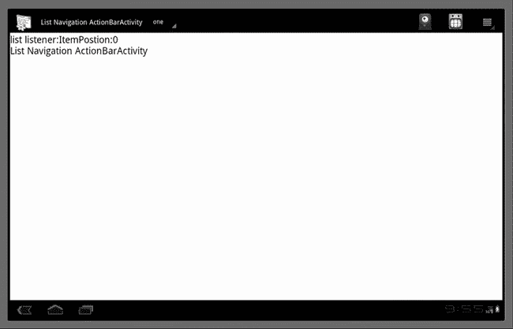

**图 10–3.** *带有列表导航操作栏的 Activity*

在图 10–3 中，你可以在 Activity 标题旁边看到未展开的列表。这与 SDK 在操作栏模式为标签导航时放置标签的位置相同。如果你点击 One 项，列表会展开并允许你选择一个选项，如图 10–4 所示。

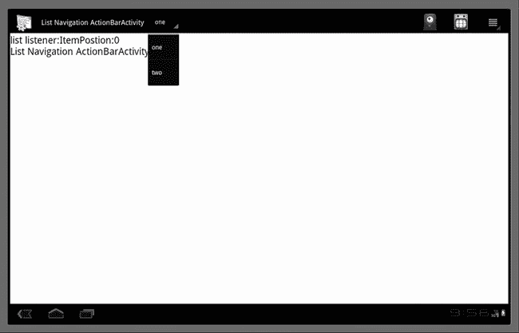

**图 10–4.** *带有打开导航列表的 Activity*

将此 Activity 与图 10–1 和图 10–2 中的 Activity 进行比较，它们看起来非常相似，只是前者有标签，后者有列表用于导航。这两个 Activity 的设计主题说明了与网页设计方式的重要相似之处。

 **注意：** 在网站中，可能有许多网页，但每个页面通过母版页显示统一的外观和感觉。在这个更简单的例子中，你使用基类来实现这种效果。

尽管你使用了多个 Activity 来展示操作栏，但操作栏似乎更适用于在单个 Activity 上协调片段。但是，如果你需要处理多个 Activity，你可以使用此基类模式来提供那种母版页设计模式。

此列表导航 Activity 的行为与上一节中标签 Activity 的行为非常相似。区别在于点击列表项时会发生什么。每次你选择一个列表项时，你都会看到对列表监听器的回调，并且列表监听器会向调试文本视图发送一条消息。

现在，你已经有了两个可用的 Activity，菜单项允许你在标签 Activity 和列表 Activity 之间切换。

接下来，让我们进入更简单的标准操作栏 Activity。

### 标准导航操作栏 Activity

在本节中，你将研究标准导航操作栏的性质。你设置一个 Activity，并将其操作栏导航模式设置为标准。然后，你将看到标准导航的外观并检查其行为。

与 `ListNavigationActionBarActivity` 的情况一样，由于你的基类承担了大部分工作，因此实现和测试标准操作栏导航 Activity 很容易。你需要以下额外文件：

*   `StandardNavigationActionBarActivity.java`：这是将操作栏配置为标准导航模式操作栏的实现文件（代码清单 10–17）。

你还需要更新以下两个文件：

*   `BaseActionBarActivity.java`：取消对响应菜单项而调用标准操作栏 Activity 的注释（有关更改，请参见代码清单 10–18，原始文件请参见代码清单 10–3）。
*   `AndroidManifest.xml`：在清单文件中定义此新 Activity（有关此 Activity 的定义，请参见代码清单 10–19，以便你可以将其添加到代码清单 10–11 的主 Android 清单文件中）。

#### 设置标准导航操作栏 Activity

你在设置标签操作栏时使用了标签监听器，在设置列表导航操作栏时使用了列表监听器。对于标准操作栏，除了菜单回调之外，没有其他监听器。菜单回调不需要特别设置，因为它们由 SDK 自动连接。因此，以标准导航模式设置操作栏非常容易。

代码清单 10–17 展示了标准导航操作栏 Activity 的源代码。

**代码清单 10–17.** *标准导航操作栏 Activity*
```java
//StandardNavigationActionBarActivity.java
package com.androidbook.actionbar;
//
//使用 CTRL-SHIFT-O 导入依赖项
//
public class StandardNavigationActionBarActivity
    extends BaseActionBarActivity
{
    private static String tag=
      "标准导航操作栏 Activity";
    public StandardNavigationActionBarActivity()
    {
        super(tag);
    }
    @Override
    public void onCreate(Bundle savedInstanceState)
    {
        super.onCreate(savedInstanceState);
        workwithStandardActionBar();
    }

    public void workwithStandardActionBar()
    {
        ActionBar bar = this.getActionBar();
        bar.setTitle(tag);
        bar.setNavigationMode(ActionBar.NAVIGATION_MODE_STANDARD);
        //测试如果在标准模式下添加标签会发生什么
        attachTabs(bar);
    }
    public void attachTabs(ActionBar bar)
    {
        TabListener tl = new TabListener(this,this);

        Tab tab1 = bar.newTab();
        tab1.setText("Tab1");
        tab1.setTabListener(tl);
        bar.addTab(tab1);

        Tab tab2 = bar.newTab();
        tab2.setText("Tab2");
        tab2.setTabListener(tl);
        bar.addTab(tab2);
    }
}//eof-class
```

将操作栏设置为标准导航操作栏唯一需要做的就是将其导航模式设置为标准。该部分代码在代码清单 10–17 中突出显示。

 **注意：** 代码清单 10–17 还包含一些代码，用于查看在标准导航模式下添加标签会发生什么。测试表明，这些标签不会导致任何运行时错误，但会被框架忽略。

在你看到标准操作栏的样子之前，你需要对现有文件进行一些更改。

#### 对 `BaseActionBarActivity` 进行更改

一旦标准导航操作栏 Activity（代码清单 10–17）可用，你就可以返回并更改 `BaseActionBarActivity`（代码清单 10–3），以便用于 `StandardNavigationActionBarActivity` 的菜单项可以调用此 Activity。取消注释后，代码清单 10–3 中的相应函数看起来像代码清单 10–18 中的代码。

**代码清单 10–18.** *取消注释以调用标准导航操作栏 Activity 的部分*
```java
private void invokeStandardNav(){
    Intent i = new Intent(this,
      StandardNavigationActionBarActivity.class);
    startActivity(i);
}
```

取消注释后，菜单项和代码已连接好，可以调用 `StandardNavigationActionBarActivity`。

#### 对 `AndroidManifest.xml` 进行更改

在调用此 Activity 之前，你需要在 Android 清单文件中注册此 Activity。将代码清单 10–19 中的行添加到代码清单 10–11 的 Android 清单文件中，以完成 Activity 的注册。

**代码清单 10–19.** *注册标准导航操作栏 Activity*
```xml
<activity android:name=".StandardNavigationActionBarActivity "
        android:label="操作栏演示：标准导航">
</activity>
```

#### 检查标准操作栏 Activity

当你编译到目前为止所涉及的文件（并在“标准导航操作栏 Activity”一节中列出）并运行应用程序时，应用程序会以标签 Activity 作为第一个 Activity 打开（图 10–1）。如果你点击菜单项，你会看到图 10–2 中的 Activity。如果你选择菜单项“调用标准导航”，你现在会看到如图 10–5 所示的标准导航操作栏 Activity。

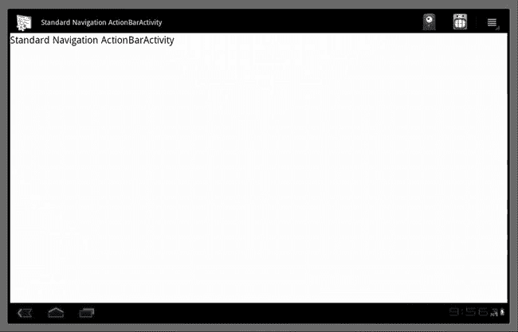

**图 10–5.** *带有标准导航操作栏的 Activity*

在图 10–5 中，你首先注意到的是这个操作栏缺少了之前专门用于标签或列表导航的区域。如果你点击右侧的操作按钮，它们会将其调用信息写入调试文本视图。点击主页按钮：这也会将其调用签名写入调试文本视图。在这三次点击结束时，调试文本视图看起来像图 10–6。

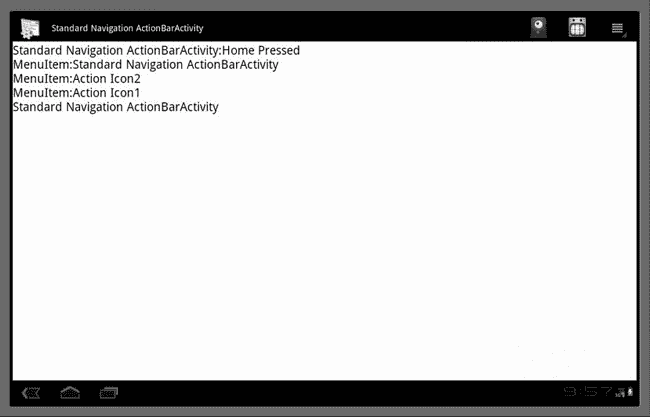

**图 10–6.** *响应操作栏的事件*

### 操作栏与搜索视图

在 Android 4.0 中，由于操作栏在手机上可用，将其用作搜索功能的兴趣日益增长。本节将展示如何在操作栏中使用搜索小部件。

我们将提供代码片段，你可以使用这些代码片段修改到目前为止看到的项目，以包含搜索小部件。虽然我们只提供片段，但你可以在本章的可下载项目中看到完整的代码。

搜索视图小部件是一个搜索框，它位于操作栏中的标签和菜单图标之间，如图 10–7 所示。

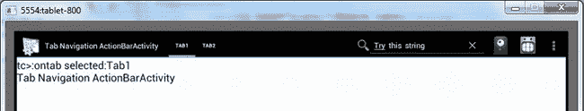

**图 10–7.** *操作栏搜索视图*

要在你的操作栏中使用搜索，你需要执行以下操作：

1.  定义一个指向 SDK 提供的搜索视图的菜单项。你还需要一个可以加载此菜单的 Activity。这通常被称为*搜索调用 Activity*。
2.  创建另一个 Activity，它可以接收步骤 1 中搜索视图的查询并提供结果。这通常被称为*搜索结果 Activity*。
3.  创建一个 XML 文件，允许你自定义搜索视图小部件。此文件通常命名为 `searchable.xml`，位于 `res/xml` 子目录中。
4.  在清单文件中声明搜索结果 Activity。此定义需要指向步骤 3 中定义的 XML 文件。
5.  在你的搜索调用 Activity 的菜单设置中，指示搜索视图需要定位到步骤 2 中的搜索结果 Activity。

我们将为这些步骤中的每一步提供代码片段。如前所述，完整代码在可下载的项目中可用。实际上，当你运行本章的项目时，搜索视图在本章前面部分介绍的所有操作栏上都是可见的：标签、列表和标准。

#### 将搜索视图小部件定义为菜单项

要定义一个搜索视图显示在你的 Activity 的操作栏中，你需要在你的一个菜单 XML 文件中定义一个菜单项，如代码清单 10–20 所示。

**代码清单 10–20.** *搜索视图菜单项定义*
```xml
<item android:id="@+id/menu_search"
    android:title="搜索"
    android:showAsAction="ifRoom"
    android:actionViewClass="android.widget.SearchView"
    />
```
代码清单 10–20 中的关键元素是指向 `android.widget.SearchView` 的 `actionViewClass` 属性。你之前在本章中声明普通菜单项作为操作图标出现在操作栏时，已经看到了其他属性。

#### 塑造搜索结果 Activity

为了在你的应用程序中启用搜索，你需要一个可以响应搜索查询的 Activity。它可以像任何其他 Activity 一样。一个示例在代码清单 10–21 中展示。

**代码清单 10–21.** *搜索结果 Activity*
```java
public class SearchResultsActivity
{
    private static String tag="搜索结果 Activity";

    @Override
    public void onCreate(Bundle savedInstanceState)
    {
        super.onCreate(savedInstanceState);
        final Intent queryIntent = getIntent();
        doSearchQuery(queryIntent);
    }
    @Override
    public void onNewIntent(final Intent newIntent)
    {
        super.onNewIntent(newIntent);
        final Intent queryIntent = getIntent();
        doSearchQuery(queryIntent);
    }
    private void doSearchQuery(final Intent queryIntent)
    {
        final String queryAction = queryIntent.getAction();
        if (!(Intent.ACTION_SEARCH.equals(queryAction)))
        {
            Log.d(tag,"意图不是用于搜索");
            return;
        }
        final String queryString =
            queryIntent.getStringExtra(SearchManager.QUERY);
        Log.d(tag, queryString);
    }
}//eof-class
```

关于代码清单 10–21 中的搜索结果 Activity，有几点需要注意：

*   此 Activity 检查调用它的 action 是否由搜索发起。
*   此 Activity 可能是新创建的，或者只是被带到前台。在后一种情况下，此 Activity 还需要在其 `onNewIntent()` 方法中执行与 `onCreate()` 方法相同的操作。
*   如果此 Activity 由搜索调用，它将使用一个名为 `SearchManager.QUERY` 的额外参数来检索查询字符串。然后，Activity 会记录该字符串是什么。在实际场景中，你将使用该字符串来返回匹配的结果。

#### 通过可搜索的 XML 文件自定义搜索

如前面的步骤所示，让我们看看自定义搜索体验的 XML 文件；见代码清单 10–22。

**代码清单 10–22.** *可搜索的 XML 文件*
```xml
<!-- /res/xml/searchable.xml -->
<searchable
    android:label="@string/search_label"
    android:hint="@string/search_hint"
/>
```

`hint` 属性将显示在搜索视图小部件上，作为你开始键入时消失的提示。`label` 在操作栏中不起重要作用。但是，当你将相同的搜索结果 Activity 用于搜索对话框时，对话框将具有此处定义的标签。

你可以在以下 URL 了解更多关于可搜索 XML 属性的信息：

`http://developer.android.com/guide/topics/search/searchable-config.html`

#### 在清单文件中定义搜索结果 Activity

现在，让我们看看如何将这个 XML 文件与搜索结果 Activity 关联起来。这是在清单文件中定义搜索结果 Activity 时完成的：参见代码清单 10–23。注意指向可搜索 XML 文件资源的元数据定义。

**代码清单 10–23.** *将 Activity 与其 `Searchable.xml` 关联*
```xml
<activity android:name=".SearchResultsActivity"
   android:label="搜索结果">
     <intent-filter>
        <action android:name="android.intent.action.SEARCH"/>
      </intent-filter>
     <meta-data android:name="android.app.searchable"
                        android:resource="@xml/searchable"/>
</activity>
```

#### 为搜索视图小部件指定搜索目标

到目前为止，你已经在操作栏中有了搜索视图，并且有了可以响应搜索的 Activity。你需要使用 Java 代码将这两部分连接起来。你可以在搜索调用 Activity 的 `onCreateOptions()` 回调中，在设置菜单时执行此操作。代码清单 10–24 中的函数可以从 `onCreateOptions()` 调用，以链接搜索视图小部件和搜索结果 Activity。

**代码清单 10–24.** *将搜索视图小部件与搜索结果 Activity 关联*
```java
private void setupSearchView(Menu menu)
{
    //定位搜索视图小部件
    SearchView searchView =
        (SearchView) menu.findItem(R.id.menu_search).getActionView();
    if (searchView == null)
    {
        this.reportBack(tag, "无法获取搜索视图");
        return;
    }

    //设置搜索视图
    SearchManager searchManager =
        (SearchManager) getSystemService(Context.SEARCH_SERVICE);
    ComponentName cn =
        new ComponentName(this,SearchResultsActivity.class);
    SearchableInfo info =
        searchManager.getSearchableInfo(cn);
    if (info == null)
    {
        this.reportBack(tag, "无法获取搜索信息");
        return;
    }

    searchView.setSearchableInfo(info);

    //不要图标化小部件；默认展开它
    searchView.setIconifiedByDefault(false);
}
```

你可以通过修改你的项目来测试本节中的代码，或者你可以下载本章的项目。完成此操作后，你将看到搜索视图作为操作栏的一部分显示，如图 10–7 所示。

### 操作栏与片段

本章展示了如何将操作栏与 Activity 结合使用。在处理平板电脑时，通常建议将操作栏与片段一起使用。片段在第 8 章中介绍。这里阐述的相同原则也适用于片段。

因为片段位于 Activity 内部，而 Activity 拥有操作栏，所以不需要基类抽象来确保每个 Activity 具有相同的操作栏。所有片段共享同一个 Activity，因此它们也共享同一个操作栏。解决方案更简单。

### 参考资料

以下 URL 在我们为本章节研究资料时提供了帮助。该列表还包括进一步的阅读材料。此外，最后的 URL 允许你下载本章项目的 zip 文件：

*   *《日常事物的设计》* 作者：唐纳德·A·诺曼。这本书借鉴了先前视觉感知中的一个概念，称为 *可供性*，用于人机交互。这个术语在 Android 用户界面文献中越来越多地被使用。本章讨论的操作栏被认为是关键的用户界面可供性之一。
*   [`http://en.wikipedia.org/wiki/Affordance`](http://en.wikipedia.org/wiki/Affordance)：维基百科参考，讨论用户界面可供性。
*   [`www.androidbook.com/item/3624`](http://www.androidbook.com/item/3624)：我们关于 Android 操作栏的研究，包括更多参考资料、示例代码、示例链接以及代表各种操作栏模式的用户界面图片。
*   [`http://developer.android.com/reference/android/app/ActionBar.html`](http://developer.android.com/reference/android/app/ActionBar)：`ActionBar` 类的 API URL。
*   [`www.androidbook.com/item/3627`](http://www.androidbook.com/item/3627)：“使用微调器适配器。”要设置列表导航模式，你需要了解下拉列表和微调器的工作原理。这篇简短的文章展示了一些关于如何在 Android 中使用微调器的示例和参考链接。
*   [`www.androidbook.com/item/3885`](http://www.androidbook.com/item/3885)：解释搜索的工作原理，以帮助你充分利用操作栏。
*   [`www.androidicons.com`](http://www.androidicons.com)：本章中使用的一些图标借用的网站。这些图标遵循知识共享许可协议 3.0。
*   [`www.androidbook.com/item/3302`](http://www.androidbook.com/item/3302)：“令人愉悦的 Android 布局。”关于简单布局的一些注意事项和示例代码。
*   [`http://developer.android.com/reference/android/view/MenuItem.html`](http://developer.android.com/reference/android/view/MenuItem.html)：`MenuItem` 类的 API。你可以在这里找到将菜单项作为操作图标附加到操作栏的文档。
*   [`http://developer.android.com/guide/topics/resources/menu-resource.html`](http://developer.android.com/guide/topics/resources/menu-resource.html)：用于将菜单项定义为操作栏图标的可用 XML 元素。
*   [`www.androidbook.com/proandroid4/projects`](http://www.androidbook.com/proandroid4/projects)：本章测试项目的下载站点。zip 文件的名称为 `ProAndroid4_ch10_TestActionbar.zip`。

### 总结

总而言之，本章涵盖了以下内容：

*   操作栏的外观和感觉
*   三种类型的操作栏
*   用于在多个 Activity 之间协调操作栏的通用框架
*   在操作栏中容纳搜索视图

### 面试问题

以下是复习本章所学内容的问题列表：

1.  什么是操作栏，它的关键视觉组件是什么？
2.  三种类型的操作栏是什么？
3.  如何将菜单项作为图标显示在操作栏上？
4.  什么是 `R.id.home`？
5.
