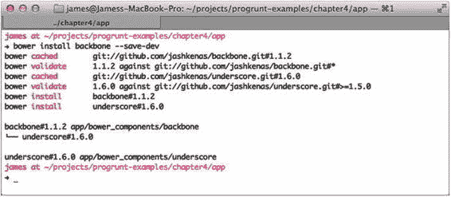
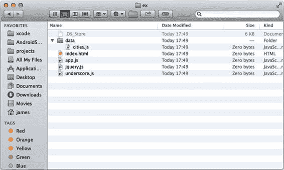
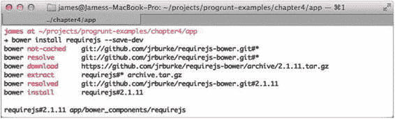
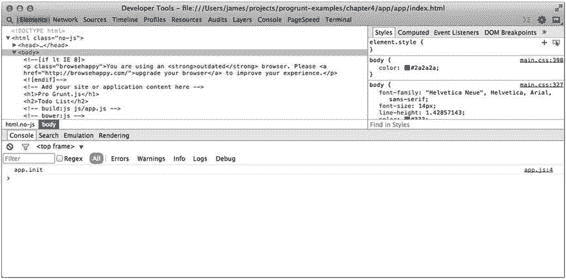
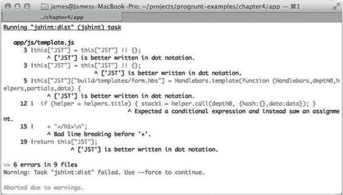
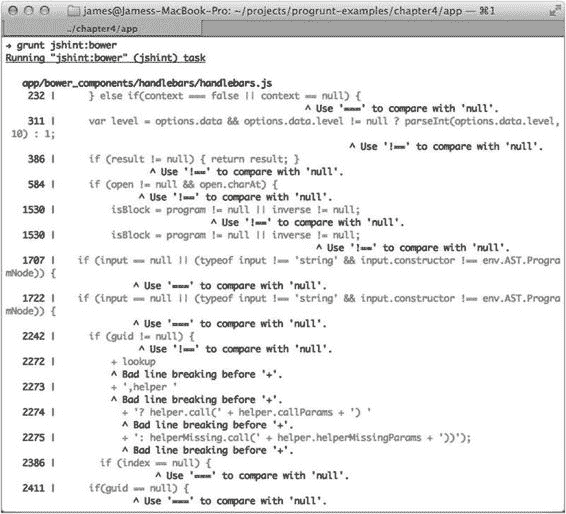
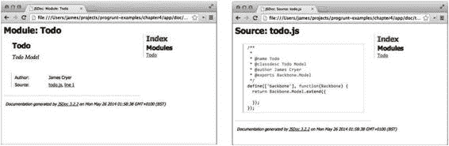

# 第 4 章 使用 Grunt 处理 JavaScript

### Grunt 与 JavaScript 模块化开发

至此，我已经介绍了如何在一个项目上设置`Grunt`，并且你已经看到了它在处理`CSS`和`HTML`时的作用。接下来，我们将开始探索在 JavaScript 开发中使用`Grunt`的好处。正如最初介绍`Grunt`时提到的，它是基于`Node.js`平台（一个 JavaScript 引擎）编写的。这一事实使得`Grunt`成为处理 JavaScript 工作时的完美工具，因为开发者可以利用现有的`Node.js`模块快速处理插件以扩展他们的工作流程。在本章中，我将介绍`Grunt`如何帮助进行 JavaScript 模板化、处理 JavaScript 模块以及自动化测试。首先，我将概述我们计划如何扩展待办事项列表应用，并使用`Grunt`来自动化我们的工作流程和构建过程。

#### 增强我们的待办事项列表应用

目前，我们的待办事项列表应用仍然非常基础。我们已经有了一个完全使用`Grunt`构建的 HTML 和 CSS 大纲。在本章中，我们将继续在此基础上进行构建，使用`Grunt`添加一个由流行的 JavaScript 框架`BackBone.js`驱动的丰富用户界面。此外，我们将研究如何测试我们的应用、生成文档，以及通过 lint 和压缩 JavaScript 来为生产环境构建我们的应用。

首先，让我们使用`Bower`安装`Backbone.js`。图 4-1 演示了通过`Bower`安装`Backbone`的过程。



图 4-1 安装`Backbone.js`也会导致安装`underscore.js`，因为`Backbone`依赖于这个库。

接下来，我们需要更新我们的应用。运行`Grunt`将更新项目根目录下的`index.html`文件，以包含对`Backbone.js`和`underscore.js`的引用。

`Backbone.js`提供了一种 MV* 架构，允许开发者将应用逻辑划分为逻辑部分。它松散地遵循了许多现代 Web 应用框架（如 Ruby on Rails）所遵循的相同模式。这将使我们能够以模块化的方式开发待办事项应用：一个模块负责存储数据，另一个负责展示数据，再另一个负责控制应用流程。这很好地引出了`Grunt.js`如何帮助我们使用模块开发 JavaScript 应用并优化它们以便交付到生产环境的话题。

#### JavaScript 模块

使用不同模块开发应用的好处是众所周知的。模块化软件通常能提高可维护性，因为每个模块被设计为执行单一任务，并且可以与系统的其他部分解耦。此外，模块有助于封装功能，对模块用户隐藏实现细节。这使得修改模块内部结构变得更容易，而不会影响系统的其他部分。

大多数现代编程语言原生支持分发和导入模块，但遗憾的是，当前版本的 JavaScript 并不支持。然而，ECMAScript 6（也称为`Harmony`或`ES6`），即下一版本的 JavaScript，将支持将模块导入到我们的 JavaScript 应用中。虽然本文编写时浏览器还不支持 ES6 模块加载，但我们仍然可以使用框架和工具来开始在 JavaScript 应用中使用模块。

除了 ES6 定义的模块格式外，目前还有两种其他流行的格式：AMD 和 CommonJS。在了解`Grunt.js`如何帮助我们利用 JavaScript 应用中模块的强大功能之前，让我们先简要了解一下每种格式。

##### AMD

AMD 代表 *Asynchronous Module Definition*（异步模块定义），旨在让 JavaScript 开发者现在就能在浏览器中使用模块。AMD 源于 Dojo 框架在使用 XHR + eval 过程中的实际经验，并试图避免这些方法的弱点。AMD 格式规定了如何定义模块以及要异步加载的依赖关系。

与传统的网页 JavaScript 方法相比，AMD 提供了许多优势。不再需要多个`script`标签和拥挤的全局命名空间，而是使用一个单一的 JavaScript 应用文件，所有其他模块都异步加载。每个模块封装了自己的功能，并且必须显式地返回一个接口供其他模块使用。

定义和使用 AMD 模块时有两个基本概念。第一个是`define`函数。`define`函数提供了一种命名模块、声明依赖关系和模块实现的方法。清单 4-1 展示了一个非常基础的 AMD 模块，它返回两个属性：`keys`和`cities`。清单 4-1 演示了 AMD 模块的一些基本方面。`define`函数用于定义我们的模块，它接受三个参数：模块名称、模块依赖关系以及包含模块实现的回调函数。在这个例子中，我们将模块命名为`simpleModule`，并定义了对`underscore`框架的单一依赖。最后一个参数是模块的实现。需要注意的是，`underscore`作为参数传递给了我们的回调函数，以便在模块中使用它。通过允许依赖项被传递到模块的作用域内，就不需要将模块分配给全局命名空间。这减少了模块之间副作用的风险，因为每个模块只访问其作用域内的变量。

`清单 4-1` 一个基础的 AMD 模块

```
define(
  'simpleModule',
  ['/underscore'],
  function(_) {
    var places = {
      'nyc': 'New York',
      'lon': 'London'
    };
    return {
      keys: _.keys(places),
      cities: _.values(places).sort()
    };
  }
);
```

在清单 4-1 中，返回了一个包含两个值`keys`和`cities`的对象。然而，AMD 并没有规定模块必须返回的类型。例如，模块可以返回一个单一的值，或者一个可以稍后执行的函数。在结束对定义 AMD 模块的介绍之前，重要的是要注意最佳实践是不命名模块，并且每个 AMD 模块都应该定义在自己的文件中。通过应用这两个原则，模块的可移植性会提高，其他开发者可以将模块移动到不同的路径，从而为模块赋予不同的名称/ID。

现在我们有了一个定义的模块，我们需要一种方法将它包含在我们的应用中，以便可以使用它。AMD 模块的另一个基本概念是`require`函数。`require`函数用于加载模块。清单 4-2 演示了一个加载并使用清单 4-1 中定义的模块的小型 JavaScript 应用。

`清单 4-2` 使用`require`加载和使用其他模块

```
define(['jquery'], function($) {
  require(['data/cities'], function(data) {
    $('#cities').text(data.cities.join(', '));
  });
});
```

在清单 4-2 中，我们首次看到`require`函数的使用。在这个特定的例子中，我们是在一个新模块的作用域内使用`require`。该模块依赖于`jQuery`，然后使用`require`函数加载我们在清单 4-1 中定义的模块。到目前为止，我们还没有探讨模块 ID 的话题。在清单 4-2 中，我们使用模块 ID `data/cities`加载了（在清单 4-1 中定义的）模块。模块 ID 可以被视为相当于文件夹路径。为了帮助说明这一点，图 4-2 展示了一个文件夹结构，代表了清单 4-2 中的例子。



图 4-2. 清单 4-1 和 4-2 中的示例演示了模块 ID

在清单 4-2 的示例中，我们使用了模块 ID `data/cities`，这与图 4-2 中突出显示的文件夹结构相匹配。模块 ID 中的`data`部分代表文件夹，而`cities`部分则代表文件`cities.js`。

到目前为止，我已经讨论了关于 AMD 模块的核心概念，但还没有讨论实际的模块加载。有两个流行的 JavaScript 框架实现了 AMD 模块加载：`require.js`和`curl.js`。在本书的剩余部分，我们将使用`require.js`来加载 AMD 模块。可以使用 Bower 将`require.js`添加到项目中，如图 4-3 所示。



图 4-3. 使用 Bower 将 require.js 添加到项目中

在项目上运行`grunt`之后，`require.js`现在应该已被加载到我们的示例应用程序中。在研究如何将`require.js`完全集成到项目之前，让我们先探索另一种 JavaScript 模块化格式：CommonJS。

##### CommonJS

# CommonJS

CommonJS 是另一种 JavaScript 模块化格式，旨在通过指定一个用于声明服务端模块的简单 API，来标准化模块和包。CommonJS 规范不涉及 IO 和文件系统等更广泛的问题。在第 2 章首次介绍 Node.js 模块时，已经讨论过 CommonJS。CommonJS 模块的结构比 AMD 模块更简单，因为它没有包装函数。相反，功能通过一个`exports`变量提供给依赖代码。要使用一个模块，可以使用`require()`函数；然而，由于模块不是异步加载的，它们会立即返回。清单 4-3 演示了清单 4-1 中模块的 CommonJS 实现。

`清单 4-3`. 简单地点模块的 CommonJS 实现

```
var _ = require('underscore');

var places = {
  "nyc": "New York",
  "lon": "London"
};

exports.data = {
  keys: _.keys(places),
  cities: _.values(places).sort()
};
```

清单 4-3 中的模块提供了与清单 4-1 中定义的模块相同的功能。此实现的关键区别在于我们如何定义依赖关系和暴露模块功能。依赖关系通过使用`require()`函数加载，而功能则通过使用`exports`变量暴露，该变量在模块被包含到应用程序中时会被注入。清单 4-4 演示了我们这个非常简单的 CommonJS 模块的用法。

`清单 4-4`. 演示 CommonJS 模块的用法

```
'use strict';

var data = require('./data/cities').data;
console.log(data.cities.join(', '));
```

如前所述，CommonJS 旨在用于服务端，而非浏览器中。因此，清单 4-4 只是将城市列表输出到控制台，而不是将它们插入到页面中。然而，这两个模块提供的实际功能是相同的。在我们开始探索如何在 Grunt.js 工作流中使用 AMD 模块之前，需要注意的是，现在有一个新的通用模块加载器——称为 Browserify——可用。Browserify 允许您开发 CommonJS 模块，然后将它们打包成一个单独的 JavaScript 文件加载到浏览器中。这带来了额外的好处：无需修改即可在服务器端和客户端使用相同的 JavaScript。Browserify 还构思了转换器，允许将 CommonJS 和 AMD 模块加载到同一个应用程序中。虽然混合使用不同模块格式来开发应用程序是一种好做法，但如果您最喜欢的 JavaScript 前端框架仅作为 AMD 模块发布，这会非常方便。

## 结合 Grunt.js 和 JavaScript 模块

现在让我们修改我们的应用程序，使其在开发过程中使用`require.js`来加载 JavaScript 模块。这使我们能够以模块化的功能来开发应用程序，鼓励我们不要在模块之间混合职责，从而基本上实现一组更松散耦合的模块。如清单 4-5 所示，我们的应用程序包含了 jQuery、Bootstrap、Underscore.js、Backbone.js 和`require.js`。

`清单 4-5`. 当前应用程序中的 JavaScript 包含项

```
<!-- build:js js/app.js -->
<!-- bower:js -->
<script src="bower_components/jquery/dist/jquery.js"></script>
<script src="bower_components/bootstrap/dist/js/bootstrap.js"></script>
<script src="bower_components/underscore/underscore.js"></script>
<script src="bower_components/backbone/backbone.js"></script>
<script src="bower_components/requirejs/require.js"></script>
<!-- endbower -->
<script src="js/main.js"></script>
<!-- endbuild -->
```

虽然这在开发中很有效，但稍后当我们打算将 JavaScript 编译成一个单独的文件以供发布时，可能会遇到一些问题，因为目标库可能与`require.js`使用的库冲突。为了解决这个问题，可以修改 JavaScript 包含项，以使用一个名为`grunt-bower-requirejs`的新 Grunt 插件。`grunt-bower-requirejs`插件类似于`grunt-bower-install`，它会读取你的 Bower 组件，并将它们与你的`require.js`路径配置合并。清单 4-6 演示了修改后的`index.html`文件，其中包含使用`grunt-bower-install`插件所需的配置。

`清单 4-6`. 修改后的 index.html 以支持 require.js

```
<!-- build:js js/main.js -->
  <script src="bower_components/requirejs/require.js"></script>
  <script src="js/paths.js"></script>
  <script src="js/main.js"></script>
<!-- endbuild -->
```

在清单 4-6 中，`index.html`已被修改，移除了`grunt-bower-install`配置。取而代之的是引入了三个 script 标签。第一个包含了`require.js`库本身；第二个是一个包含`require.js`路径配置的 JavaScript 文件；最后一个 script 标签加载我们的应用程序。`path.js`文件被`grunt-bower-requirejs`插件用于合并我们的 Bower 组件。清单 4-7 演示了在运行`grunt-bower-requirejs`之前的`path.js`文件。开始时，该文件只需要使用一个空配置对象调用`requirejs.config()`方法。

`清单 4-7`. 运行 grunt-bower-requirejs 之前的 path.js 文件

```
requirejs.config({});
```

接下来，我们的`Gruntfile.js`必须被修改以支持新的`grunt-bower-requirejs`插件。清单 4-8 演示了添加到`Gruntfile.js`中以支持该新插件的配置。

`清单 4-8`. 用于`grunt-bower-requirejs`的配置，以使用 Bower 组件维护`require.js`路径

```
bower: {
    dist: {
      rjsConfig: 'app/js/paths.js',
      options: {
        baseUrl: 'app/'
      }
    }
}
```

第一个选项定义了我们的`require.js`配置文件的路径。这将是任务运行时将修改的文件。第二个选项`baseUrl`定义了所有路径的前置 URL。当您希望将模块移动到同一项目中的新位置时，例如，在为生产环境构建应用程序时，这非常有用。运行`bower`任务现在应该会修改`path.js`以匹配清单 4-9。这将允许我们在 AMD 模块中使用 Bower 组件。

`清单 4-9`. 配置并运行`grunt-bower-requirejs`后的`path.js`

```
requirejs.config({
  paths: {
    backbone: "bower_components/backbone/backbone",
    bootstrap: "bower_components/bootstrap/dist/js/bootstrap",
    jquery: "bower_components/jquery/dist/jquery",
    requirejs: "bower_components/requirejs/require",
    underscore: "bower_components/underscore/underscore"
  },
  packages: [

]
});
```

`index.html`文件中包含的第三个脚本将是我们的主应用程序 JavaScript 模块。这将是加载其他模块和初始化应用程序的起点。清单 4-10 演示了`main.js`文件。

`清单 4-10`. 包含我们初始化代码的`main.js`文件

```
require(['js/app'], function(app) {
  $(function() {
    app.init();
  });
});
```

清单 4-10 使用`require`加载名为`js/app`的模块。加载后，使用 jQuery 的`isReady`缩写，然后期望`js/app`模块返回一个`init`函数。清单 4-11 定义了模块`js/app`，我们的第一个 AMD 模块。

## 清单 4-11. 用作应用程序代码起点的应用模块

```
define(function() {

var initialize = function() {
    console.log('app.init');
  };

return {
    init: initialize
  };
});
```

清单 4-11 定义了一个简单的 AMD 模块，目前不依赖于任何其他模块。它定义了一个名为`initialize`的私有方法，并通过`return`语句将其作为`init`函数暴露给模块的用户。如果您现在在您喜欢的浏览器中加载应用程序，您应该会在控制台中看到“app.init”打印出来，如图 4-4 所示。



**图 4-4**. 使用`require.js`加载应用模块的演示

既然我们已经确认应用程序正在加载 AMD 模块，让我们为待办事项应用程序添加一些骨架代码。清单 4-12 列出了组成完整待办事项应用程序的几个新模块。

## 清单 4-12. 构成完整应用程序的 AMD 模块

```
// js/app.js

define([
  'js/collections/todos',
  'js/views/form',
  'js/views/todo-item'
  ], function(Collection, FormView, TodoView) {

var initialize = function() {
    console.log('app.init');
    var todos = new Collection();
    new FormView().render();
    new TodoView(todos).render();
  };

return {
    init: initialize
  };
});

// js/collections/todos.js

define(['backbone', 'js/models/todo'], function(Backbone, Todo) {
  return Backbone.Collection.extend({
    model: Todo
  });
});

// js/models/todo.js

define(['backbone'], function(Backbone) {
  return Backbone.Model.extend({

});
});

// js/views/form.js

define(['backbone'], function(Backbone) {
  return Backbone.View.extend({

tagName: 'div',

className: 'todo-form',

render: function() {

}
  });
});

// js/views/todo-item.js

define(['backbone'], function(Backbone) {
  return Backbone.View.extend({

tagName: 'li',

className: 'todo-item',

render: function() {

}
  });
});
```

清单 4-12 添加了四个新的 AMD 模块：一个 Backbone 集合、一个模型和两个视图。目前，应用程序功能不多，因为我们还没有为 Backbone 视图定义要渲染的模板。然而，它确实建立了应用程序结构，我们可以开始基于此改进工作流程。在当前状态下，向应用程序添加新模块相对容易：创建一个新文件，然后添加对它的引用。但是，我们没有优化生产环境中 JavaScript 代码的流程。让我们更新`Gruntfile`以优化出现在`dist`文件夹中的 JavaScript。

首先，让我们引入一个新的`Grunt.js`插件来将我们的`require.js`模块编译到单个文件中。如前一章所述，在生产环境中，您希望尽量减少 HTTP 调用次数，这意味着更少的资源。在我们的特定示例中，如果我们能够在生产环境中合并 JavaScript 文件，我们将把连接数从 11 个减少到 1 个。我们将使用的`Grunt.js`插件称为`grunt-contrib-requirejs`。该插件可用于自动化运行`require.js`优化器。`require.js`优化器旨在解析使用 AMD 模块的 JavaScript 应用程序，并将这些模块合并到单个文件中。除此之外，优化器还可以使用名为`Uglify`的库来压缩合并后的 JavaScript。清单 4-13 演示了`grunt-contrib-requirejs`的配置。

## 清单 4-13. 添加`grunt-contrib-requirejs`配置

```
requirejs: {
  dist: {
    options: {
      baseUrl: 'app/',
      name: '../.tmp/concat/js/main',
      out: 'dist/js/main.js',
      optimize: 'uglify2',
      paths: {
        backbone: 'bower_components/backbone/backbone',
        bootstrap: 'bower_components/bootstrap/dist/js/bootstrap',
        jquery: 'bower_components/jquery/dist/jquery',
        requirejs: 'bower_components/requirejs/require',
        underscore: 'bower_components/underscore/underscore',
        handlebars: 'bower_components/handlebars/handlebars'
      }
    }
  }
},
```

新配置设置了一些选项。首先，`baseUrl`设置与应用程序路径匹配，因为我们的应用程序位于`app`文件夹内。这使得`require.js`优化器能够正确找到 AMD 模块。下一个配置选项`main`告诉优化器哪个主文件是应用程序的起点。这指向`.tmp`目录，因为我们想要将 AMD 模块与作为`usemin`插件一部分生成的合并 JavaScript 结合起来。因此，`requirejs`任务必须在`concat`任务完成后运行。`out`选项，如您所料，指定了任务的输出应放置的位置。最后，该任务提供了指定应用哪种优化的能力。在我们的配置中，我们选择了`UglifyJS2`。要禁用优化，可以传递`none`值。

将此配置添加到您的`Gruntfile.js`文件后，您还需要将此任务添加到默认任务中。清单 4-14 显示了更新后的默认任务。

## 清单 4-14. 修改后的默认任务，包含`grunt-contrib-requirejs`

```
grunt.loadNpmTasks('grunt-contrib-requirejs');

// Default task.
grunt.registerTask('default', [
  'useminPrepare',
  'sass',
  'bowerInstall',
  'autoprefixer',
  'recess',
  'uncss',
  'copy',
  'cssmin',
  'concat',
  'requirejs',
  'rev',
  'usemin'
]);
```

### 注意任务顺序

必须注意任务的执行顺序。我们必须将`requirejs`任务放在`concat`之后，以确保在运行`requirejs`任务之前，我们的应用程序文件已经拼接完成并放入`.tmp`文件夹。现在，新任务已加载，并且`requirejs`任务已添加到默认任务中，运行`grunt`应该会生成`js/main.js`文件。

在进入下一个主题之前，我们需要进一步优化输出到`dist`文件夹的 JavaScript 文件。我们还必须修改`grunt-rev`任务，使其包含我们的 JavaScript 文件。这是一个小改动，用于确保`dist`目标与清单 4-15 中的目标一致。

## 清单 4-15. 更新`grunt-rev`以包含 JavaScript，确保缓存有效

```
rev: {
  dist: {
    src: ['dist/css/main.css', 'dist/js/main.js']
  }
},
```

### 清理构建过程

随着构建过程的增加，可能会有一些构建产物残留下来。一个常见的例子是，一个临时文件在压缩之前，但在合并过程中生成之后。这些文件通常是无害的，因为它们通常不会出现在生产代码中。然而，最佳实践要求确保每次构建都是干净的。我们可以引入一个任务来解决这个问题，我们将添加的是`grunt-contrib-clean`。`grunt-contrib-clean`插件可用于删除特定文件或递归清理目录。`清单 4-16`展示了用于待办事项应用的配置。

`清单 4-16`。`grunt-contrib-clean`的配置

```
clean: {
  tmp: {
    src: ['.tmp', '.sass-cache', 'dist', 'app/js/template.js']
  }
}
```

`清单 4-16`中概述的配置将简单地删除`.tmp`、`.sass-cache`和`dist`文件夹。这三个文件夹都是在构建过程中生成的，因此删除它们无害。最好将`clean`任务添加到默认任务中（参见`清单 4-17`），这样每次运行`grunt`时都会清理应用程序。最佳实践建议它应该是第一个运行的任务，以确保每次构建在运行前都处于原始状态。如果`clean`只被添加到构建过程的末尾，那么之前失败的构建可能会污染新的构建。

`清单 4-17`。修改后的默认任务示例

```
// Default task.
grunt.registerTask('default', [
  'clean',
  'useminPrepare',
  'sass',
  'bowerInstall',
  'autoprefixer',
  'recess',
  ....
]);
```

## JavaScript 模板

随着我们的 AMD 模块作为工作流的一部分被集成，让我们将注意力转向待办事项应用的实现。在本节中，我们将探讨 JavaScript 模板库的使用，以及如何使用 Grunt 自动化这些模板的生成并将其集成到工作流中。

对于具有丰富用户界面的现代 Web 应用程序，将应用程序划分为执行特定任务的模块非常重要，如前一节所述。这导致了遵循模型-视图-控制器（MVC）常见设计模式的前端框架的迅速涌现。

在 MVC 设计模式中，应用程序模块被分为三个关注点。模型包含应用程序的状态；视图是该状态的表示；控制器编排从视图触发的动作，以修改模型中的状态，并通知视图状态的变化。在大多数现代框架中，视图是通过使用模板引擎生成的。通常，像`Backbone`这样的框架并不指定要使用的模板引擎，而是允许开发者选择最适合其需求的引擎。

JavaScript 有大量的模板引擎可用，它们提供了诸如局部模板和助手函数等强大功能。每个引擎的能力各不相同，从最简单的形式（如`underscore.js`的`template`函数）到功能更丰富的函数（如`handlebars.js`）。在我们的大多数示例中，我们将使用`handlebars.js`，并将其集成到待办事项应用的`Grunt.js`工作流中。在更新`Grunt`工作流之前，让我们探讨一下在使用 JavaScript 模板时可以应用的各种实现策略。

第一种技术也是三种中最简单的一种，是根本不使用模板引擎，而是以编程方式构建视图。`清单 4-18`演示了使用`jQuery`创建一个`<h1>`元素，并将一个局部变量赋值为其文本，从而构建一个`Backbone`视图。在这个简单的例子中，解决方案可能看起来足够，但是当视图变得更复杂并且我们必须遍历大量元素时，这种方法很快就会失效。

`清单 4-18`。使用`Backbone.js`的简单视图渲染

```
define(['backbone'], function(Backbone) {
  return Backbone.View.extend({

    tagName: 'div',

    className: 'todo-form',

    render: function() {
      var title = "Hello World!";
      this.$el.html(
        $('<h1 />').text(title)
      );
    }
  });
});
```

下一种方法是使用内联模板，其中模板字符串存储在一个局部变量中，然后传递给模板引擎。在`清单 4-19`中，使用了`underscore.js`的`template`函数来演示内联模板的使用。

`清单 4-19`。使用`underscore.js`的`template`函数进行内联模板

```
define(['backbone'], function(Backbone) {
  return Backbone.View.extend({

    tagName: 'div',

    className: 'todo-form',

    template: _.template('<h1><%= title %></h1>'),

    render: function() {
      var title = "Hello World!";
      this.$el.html(
        this.template({title: title})
      );
    }
  });
});
```

这种方法存在与第一种方法相同的问题：当模板简单时，内联模板运行良好。如果我们将`清单 4-19`中的示例扩展为具有迭代循环的多行模板，它将很快变得难以维护。

第三种方法通过提高可维护性，解决了前两种方法带来的问题。模板存储在 DOM 内的`<script>`标签中。每个模板都有一个唯一的 ID，以便可以从 DOM 中选择它，然后将其内容传递给模板引擎。`清单 4-20`演示了如何从 DOM 加载模板并将其传递给`underscore.js`的`template`函数。

`清单 4-20`。从 DOM 加载模板

```
// index.html

<script type="text/template" id="title-tmpl">
  <h1><%= title %></h1>
</script>

// view.js

define(['backbone', 'underscore'], function(Backbone, _) {
  return Backbone.View.extend({

    tagName: 'div',

    className: 'todo-form',

    template: _.template(document.getElementById('title-tmpl').innerHTML),

    render: function() {
      var title = "Hello World!";
      this.$el.html(
        this.template({title: title})
      );
    }
  });
});
```

该解决方案与前两个方案的关键区别在于加载模板内容的方法。模板不再存储在 JavaScript 应用程序代码中，而是迁移到了 DOM 中。通过使用`document.getElementById`将模板内容传递给模板函数来加载模板内容。这解决了维护更复杂模板的问题，因为模板的可读性大大提高，其标签可以像其他任何 HTML 模板一样进行编辑。然而，这种方法也带来了一个问题：每个模板都需要一个额外的脚本标签，这会使页面变得臃肿。如果你只有少数几个模板，这可能不是问题，但模板数量会迅速增加，从而引发新的可维护性问题。这引出了我们的最终解决方案，该方案使用 Grunt 来改善 JavaScript 模板的可维护性和可读性。

在这种最终方法中，我们将使用一个 Grunt 插件将模板预编译成单个 JavaScript 模板（JST）文件。需要注意的是，在这个解决方案中，我们将从`underscore.js`模板切换到`handlebars.js`。然而，在开始编写模板之前，我们必须先在`Grunt.js`文件中添加一个新插件。本解决方案中使用的插件是`grunt-contrib-handlebars`。`清单 4-21`显示了用于生成 JST 文件的配置。

`清单 4-21`。Grunt 对 `grunt-contrib-handlebars` 的配置

```
handlebars: {
    dist: {
      options: {
        namespace: 'JST',
        amd: true
      },
      files: {
        'app/js/template.js': ['build/templates/**/*.hbs']
      }
    }
  },
```

上述配置将加载`build/templates`文件夹中的所有模板，并将它们编译成一个 AMD 模块，输出到`app/js/template.js`。然后，通过将模板模块作为依赖项添加，可以在我们的 AMD 模块中使用这些模板。`清单 4-22`演示了更新后使用新模板模块的视图。

`清单 4-22`。在视图模块中使用模板模块

## JavaScript 模板化

```javascript
define(['backbone', 'js/template'], function(Backbone, Template) {
  return Backbone.View.extend({
    tagName: 'div',
    className: 'todo-form',
    template: Template["build/templates/form.hbs"],
    render: function() {
      var title = "Hello World!";
      this.$el.html(
        this.template({title: title})
      );
    }
  });
});
```

清单 4-20 和 4-22 之间的主要区别在于将模板从 HTML 中移除。这带来了两个好处：首先，它减少了需要管理 HTML 中哪些模板的问题。对于具有许多模板且每个页面都需要这些模板的复杂应用程序来说，这是一个问题。将模板从 HTML 中移除也减少了初始页面加载的数据量，这对加载时性能很有好处。模板被编译到 JavaScript 应用程序代码中并在生产环境中压缩，这进一步提高了性能。第二个好处是，通过将每个单独的模板放在一个单独的文件中，实现了分离。这使维护更加容易，因为你可以专注于一个特定的模板，而不必担心影响其他模板。清单 4-23 显示了一个示例模板。

**清单 4-23**. 保存在 `build/templates/form.hbs` 中的示例模板

```html
<h1>{{title}}</h1>
```

要在项目中使用`handlebars`，我们还必须使用`bower`添加它。添加后，`grunt-bower-requirejs`会包含非 AMD 版本的`handlebars`库。因此，我们必须添加一个`shim`，以便`require.js`将其导出为全局变量。清单 4-24 演示了添加到`paths.js`和`Gruntfile.js`中的`shim`。

**清单 4-24**. 修改后的 `handlebar.js` 配置

```javascript
// paths.js
requirejs.config({
  shim: {
    handlebars: {
      exports: 'Handlebars'
    }
  },
  paths: {
    backbone: 'bower_components/backbone/backbone',
    bootstrap: 'bower_components/bootstrap/dist/js/bootstrap',
    jquery: 'bower_components/jquery/dist/jquery',
    requirejs: 'bower_components/requirejs/require',
    underscore: 'bower_components/underscore/underscore',
    handlebars: 'bower_components/handlebars/handlebars'
  },
  packages: [

]
});

// Gruntfile.js
requirejs: {
  dist: {
    options: {
      baseUrl: 'app',
      name: '../.tmp/concat/js/main',
      out: 'dist/js/main.js',
      optimize: 'uglify2',
      mainConfig: 'app/js/paths.js',
      shim: {
        handlebars: {
          exports: 'Handlebars'
        }
      },
      paths: {
        backbone: 'bower_components/backbone/backbone',
        bootstrap: 'bower_components/bootstrap/dist/js/bootstrap',
        jquery: 'bower_components/jquery/dist/jquery',
        requirejs: 'bower_components/requirejs/require',
        underscore: 'bower_components/underscore/underscore',
        handlebars: 'bower_components/handlebars/handlebars'
      }
    }
  }
},
```

本节关于 JavaScript 模板化的内容到此结束。你已经了解了如何创建、编译和优化用于生产环境的模板。我介绍了`handlebars.js`的使用；然而，还有许多其他可用的模板化选项。另一个流行的模板引擎是 `Jade`，通常与 `Express` 框架一起使用。

## JavaScript 代码检查

在上一章中，我讨论了使用 RECESS（一个来自 Twitter 的 CSS 检查工具）来确保项目中的 CSS 符合一组样式规则并检测常见错误。在本节中，我们将探讨如何将 JSHint 与 Grunt 结合使用，以自动化 JavaScript 代码检查过程。JSHint 是一个社区驱动的代码质量工具，用于检测 JavaScript 应用程序中的错误和潜在问题。它帮助团队标准化其 JavaScript 编码风格。JSHint 是 JSLint 的一个分支，比其父项目更少一些“固执己见”。JSHint 还为开发者提供设置标志以启用和禁用某些规则的能力。自 2011 年发布以来，JSHint 已被 Facebook、Twitter 和 jQuery 等公司的工程师采用。

幸运的是，有一个现有的插件可以将 JSHint 集成到我们的 Grunt 工作流中。这个名为`grunt-contrib-jshint`的插件是核心插件之一。清单 4-25 演示了为 JSHint 配置的更新后的`Gruntfile.js`。

**清单 4-25**. JSHint 的配置

```javascript
jshint: {
  dist: {
    src: ['Gruntfile.js', 'app/js/**/*.js']
  }
}

// These plugins provide necessary tasks.
grunt.loadNpmTasks('grunt-contrib-jshint');

// Default task.
grunt.registerTask('default', [
  'clean',
  'useminPrepare',
  'sass',
  'bowerInstall',
  'autoprefixer',
  'jshint',
  'handlebars',
  'recess',
  'uncss',
  'copy',
  'cssmin',
  'concat',
  'requirejs',
  'rev',
  'usemin'
]);
```

如清单 4-25 所示，将 JSHint 集成到现有工作流中非常简单。`grunt-contrib-jshint`插件只需要一组要分析的源文件。注意任务运行的顺序很重要，`jshint`在`handlebars`任务之前执行，因为`handlebars`任务的输出不会通过所有 JSHint 规则。图 4-5 显示了一个示例 Grunt 配置，其中`jshint`和`handlebars`任务的顺序被颠倒了。



图 4-5. 颠倒任务顺序会导致错误

在某些应用中，你可能希望对通过 `bower` 引入的 JavaScript 进行 lint 检查。这可能会产生如图 4-5 所示的错误，这些问题可以通过修改 `JSHint` 所应用的规则来解决。在与 `Grunt` 集成的过程中，有三种方法可以修改 `JSHint` 应用的规则集。第一种方法是通过 `Grunt` 配置项应用配置；第二种是使用 `.jshintrc` 文件；最后一种是在 `package.json` 中定义规则集。当需要为不同的源文件通过规则集应用配置时，第一种方法非常有用。例如，你可以为你的应用程序代码应用一套规则，而为其他人开发的库应用另一套规则。清单 4-26 展示了第一种方法。

**清单 4-26**. 包含配置项的配置

```
jshint: {
  dist: {
    src: ['Gruntfile.js', 'app/js/**/*.js']
  },
  bower: {
    options: {
      "eqnull": true,
      "eqeqeq": true,
      "laxbreak": true,
    },
    src: ['app/bower_components/handlebars/handlebars.js']
  }
}
```

在清单 4-26 中，`Grunt` 配置已扩展以涵盖由 `bower` 引入的 `handlebars` 库。由于 `handlebars` 无法通过所有 `JSHint` 规则，因此添加了配置项以放宽某些规则。在本例中，关于空值相等、三等号和换行符的规则已被抑制。图 4-6 展示了如果这些特定规则未被抑制时，上述任务产生的输出。



图 4-6. Handlebars 未通过 JSHint 规则检查

另一种放宽 `JSHint` 规则的方法是应用全局运行时配置。这需要在你的项目根目录下创建一个新文件。该文件应命名为 `.jshintrc`，其内容应格式化为有效的 JSON。该 JSON 对象应包含一组需要被抑制的规则。清单 4-27 中给出了一个示例。为了让 `JSHint` 使用此文件，`Grunt` 配置需要一个额外的配置项设置。这个配置项是 `jshintrc`，它可以设置为 `true` 或者一个指向 `jshintrc` 文件的路径。如果你同时在 `Grunt` 文件和 `.jshintrc` 文件中设置了配置项，规则集不会合并，而是会使用 `jshintrc` 文件配置来代替 `Gruntfile` 中的配置。

***清单 4-27***. JSHint 运行时配置

```
{
  "eqnull": true,
  "eqeqeq": true,
  "laxbreak": true
}
```

最后一种方法与使用 `.jshintrc` 文件类似。对规则集的修改在项目的 `package.json` 中的 `jshintConfig` 属性下声明。

### Modernizr

`Modernizr` 是一个用 JavaScript 编写的流行的特性检测库，用于确定浏览器支持 HTML5 和 CSS3 规范中的哪些特性。它在开发社区中变得非常流行，因为它允许设计师和开发者利用最新的 Web 技术，同时确保使用落后浏览器的用户也能保持良好的体验。`Modernizr` 是一个可以加入你工具箱的优秀工具，尤其是在实现渐进增强时。

`Modernizr` 在页面内快速运行，生成一个 JavaScript 对象，并向页面的 HTML 元素添加类，这些类在你的 CSS 中充当钩子。清单 4-28 演示了生成的 JavaScript 对象的使用，而清单 4-29 展示了 `Modernizr` 如何向 HTML 元素添加 CSS 类。

***清单 4-28***. 使用 Modernizr JavaScript 检测 localStorage

```
if (Modernizr.localstorage) {
  // 使用 localstorage
} else {
  // 使用替代存储
}
```

***清单 4-29***. Modernizr 修改 HTML 元素，在 CSS 中提供方便的钩子

```
<html lang="en" class="js no-touch postmessage history multiplebgs boxshadow opacity cssanimations csscolumns cssgradients csstransforms csstransitions fontface localstorage sessionstorage svg inlinesvg no-blobbuilder blob bloburls download formdata">
```

`Modernizr` 团队开发了一个 `Grunt` 插件，其功能与其 `Modulizr` 相似。`grunt-modernizr` 插件会处理你的 JavaScript、CSS 和 SCSS 文件，为你的项目构建一个优化版本。优化版本的 `Modernizr` 将只包含你项目中使用的特性的测试。这有助于减少应用程序生产版本中使用的 JavaScript 的总大小，从而缩短页面加载时间。清单 4-30 展示了为 `grunt-modernizr` 插件修改后的 `Gruntfile` 配置。

***清单 4-30***. grunt-modernizr 的 Gruntfile 配置

```
modernizr: {
   dist: {
     devFile : "remote",
     outputFile : "app/js/modernizr.js",
     extra : {
       shiv : true,
       load : false,
       cssclasses : true
     },
     uglify : true,
     parseFiles : true,
     files : {
       src: ["build/styles/**/*.scss", "app/js/**/*.js"]
     }
   }
 }
```

`grunt-modernizr` 插件需要一个开发版本的 `Modernizr` 来生成优化版本。在清单 4-30 中，`devFile` 选项被设置为 `remote`。此选项用于防止任务运行时出现误报。例如，如果你在本地安装了某个版本的 `Modernizr` 并运行该任务，则该文件有可能被该任务处理，从而导致生成了未优化的 `Modernizr` 版本。下一个选项 `outputFile` 告诉任务优化后的 `Modernizr` 版本应输出到何处。接下来的选项标记为 `extra`，它关联到 `Modernizr` 下载页面上可用的附加功能。清单 4-30 中的配置包含了 `html5shiv` 以及向 HTML 元素添加 CSS 类的支持，同时明确排除了 `Modernizr.load`（这是一个资源加载器）。`parseFiles` 选项与 `files` 选项结合使用，配置该任务以爬取项目中引用 `Modernizr` 特性的文件。清单 4-31 包含了一段 JavaScript 代码片段，这将导致该任务包含对浏览器是否支持 `localStorage` 的测试。

***清单 4-31***. 将触发浏览器包含 Modernizr 对 localStorage 测试的 JavaScript 代码片段

```
if (Modernizr.localstorage) {
  var item = localStorage.getItem("favourite");
}
```

下一个示例，清单 4-32，演示了该任务如何解析 SCSS 文件，以确定优化版 `Modernizr` 需要检测哪些特性。

***清单 4-32***. 包含与 Modernizr 中类名相匹配的 CSS 类的 SCSS 文件

```
.profile {
  .boxshadow {
    box-shadow: 0px 0px 10px 1px rgba(0, 0, 0, 0.5);
  }
}
```

下次运行该任务时，它会在 SCSS 文件中找到 `boxshadow` 类，并包含对盒阴影的测试。

### 代码压缩

到目前为止，本章我们重点讨论了优化 JavaScript 代码，以确保我们的应用程序没有错误并进行压缩。由于使用了 `usemin`，我们不需要显式配置压缩任务，因为 `usemin` 会自动使用 `Uglify` 来压缩和混淆 JavaScript。我们将简要地看一下如何配置 `Grunt`（不使用 `usemin` 任务）来压缩 JavaScript 文件。

存在许多用于压缩 JavaScript 的插件。为简单起见，我们将重点介绍使用 `Uglify` 来压缩并随后混淆我们的 JavaScript。有一个核心插件可用于将 `Uglify` 集成到 `Grunt` 工作流中。清单 4-33 包含了 `grunt-contrib-uglify` 插件的示例配置。

#### `grunt-contrib-uglify` 配置

***清单 4-33***. `grunt-contrib-uglify` 配置

```
uglify: {
  options: {
    report: 'gzip'
  },
  dist: {
    files: {
      'dist/js/main.js': ['app/js/main.js']
    }
  }
}
```

清单 4-33 中的配置相当简单；它设置了任务生成的报告（涉及大小、节省空间），以及要操作的文件。`report` 选项决定了任务的输出。将该选项设置为 `gzip` 会打印一个额外的大小，该大小表示输出 JavaScript 若经过 gzip 压缩后的大小。除了上述内容，在生产应用程序中合并多个文件也是个好主意。同样，这个任务也可以通过之前的 `usemin` 任务来执行。通过合并文件，压缩率应该会更高。另外，还有一个核心插件可用来执行此任务：`grunt-contrib-concat` 插件可用于将多个文件合并成一个文件。清单 4-34 展示了该任务的示例配置。

### `grunt-contrib-concat` 配置

***清单 4-34***. `grunt-contrib-concat` 配置

```
concat: {
  dist: {
    files: {
      'dist/js/main.js': ['app/js/**/*.js']
    }
  }
}
```

上述配置将合并所有 JavaScript 文件，然后将输出存储到 `dist` 文件夹。在这个阶段，最好对 `concat` 任务输出的文件运行 `uglify` 任务。

### 文档生成

在最后这一节，我们将简要探讨如何使用 Grunt 来自动化生成 JavaScript 应用程序的文档。如果你正在开发供其他开发者使用的库，自动化生成文档非常重要。没有自动化，维护一套完整的文档会变得困难，并且可能导致其他开发者在尝试复用 JavaScript 库时很快感到沮丧。有一个插件可用于生成文档，即 `grunt-jsdoc`。该插件提供了一个 `jsdoc` 任务，能够生成 HTML 格式的文档。清单 4-35 包含了为项目生成文档的示例配置。

### 生成 HTML 文档的 `grunt-jsdoc` 配置

***清单 4-35***. 用于生成 HTML 文档的 `grunt-jsdoc` 配置

```
jsdoc : {
  dist : {
    src: ['app/js/**/*.js'],
    options: {
      destination: 'doc'
    }
  }
}
```

清单 4-35 非常简单：它定义了要解析文档的所有 JavaScript 文件的源，以及一个配置输出目录（文档将在此创建）的选项。要生成文档，需要向我们的 JavaScript 模块中添加注解。清单 4-36 展示了更新了用于生成文档的注解后的待办事项模型。

### 带有 JSDoc 注解的待办事项模型（修改版）

***清单 4-36***. 带有 JSDoc 注解的修改后的待办事项模型

```
/**
 * @name Todo
 * @classdesc Todo Model
 * @author James Cryer
 * @exports Backbone.Model
 */
define(['backbone'], function(Backbone) {
  return Backbone.Model.extend({

});
});
```

清单 4-36 并未提供所有可用注解的详尽列表。除了模块，模块内的单个函数也可以被注解。图 4-7 展示了为清单 4-36 中的模块自动生成的文档。



图 4-7. 使用 Grunt 自动生成的 JSDoc 文档

## 总结

在本章中，我介绍了 Grunt 如何通过使用 JavaScript 模块和模板来优化我们的 JavaScript 工作流。在讨论过程中，我们探讨了与性能相关的话题，以及确保生产版本的 JavaScript 代码经过优化以便交付给用户。除了这些话题，还介绍了其他工具，例如 `JSHint` 和 `Modernizr`，以进一步增强 JavaScript 开发工作流。最后，我以对复杂 JavaScript 应用程序自动生成文档的简要讨论作为结束。

下一章将关注页面可视化元素的工作流，探讨使用 Grunt 来自动化处理图像、Web 字体和 SVG 相关的任务。
