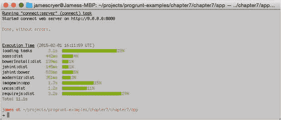
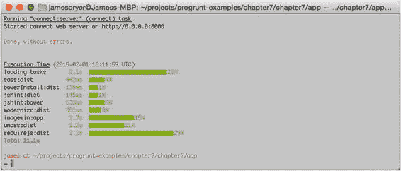
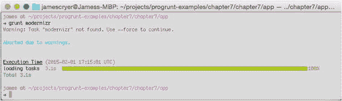
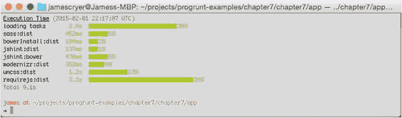
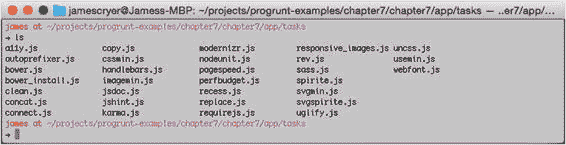
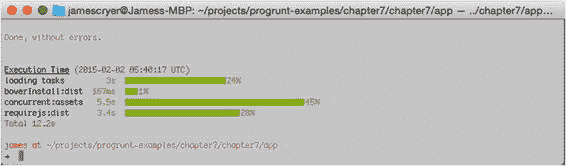
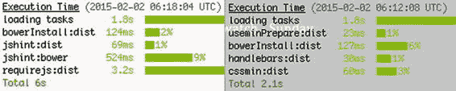
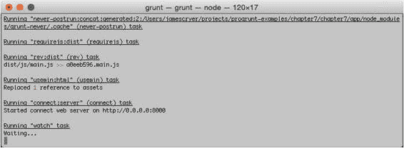
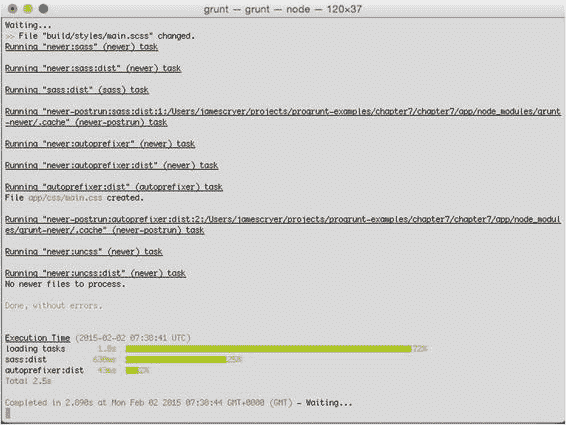
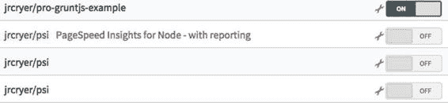

# 第 7 章 优化您的 Grunt 工作流

### 优化 Grunt 工作流程

在前面的章节中，我们集中讨论了自动化构建过程以优化资源并确保它们符合特定质量标准。在本章中，我们将专注于优化 `Grunt` 工作流程本身。随着项目的增长，除非注意提高可维护性，否则项目通常会变得难以维护。你的 `Grunt` 工作流程也不例外。当你在项目中使用 `Grunt` 执行更多任务时，你可能会开始觉得 `Gruntfile` 变得有点笨重。在接下来的几个小节中，我将介绍一些技术，以确保随着项目的增长，你的 `Grunt` 任务仍然易于理解和快速运行。

#### 测量性能

与所有类型的性能优化一样，最好先了解问题并收集统计数据来测量和分析所做的任何更改，以确保做出正确的更改。就 `Grunt` 而言，了解每个任务运行所需的时间以及构建的整体性能是有益的。这将确保我们可以减少构建应用程序所需的时间，并识别构建中现有或新出现的问题。构建过程的性能与你的应用程序同样重要。在这种情况下，我们作为开发人员就是用户，但同样的可用性基本原则同样适用。例如，如果我们的构建过程耗时超过一秒，我们的注意力很可能会转移到另一个任务上。

如果你打算将 `Grunt` 作为构建工具引入开发团队，性能将是团队成员可能提出疑问的问题之一。在本节中，我们将介绍一种机制，让你能够展示构建的性能，并在项目增长时持续监控构建过程。

插件 `time-grunt` 将允许我们测量构建的性能。`time-grunt` 显示 `grunt` 任务的已用执行时间，并且与我们到目前为止使用的所有插件不同。`time-grunt` 不会引入新任务；相反，它会挂接到 `Grunt` 进程来测量已用执行时间。`清单 7-1` 演示了如何将 `time-grunt` 添加到项目中。

`清单 7-1`. 将 `time-grunt` 添加到项目

```
npm install time-grunt --save-dev
```

现在插件已添加到项目中，我们必须更新 `Gruntfile` 以确保 `time-grunt` 挂接到我们的构建过程。`清单 7-2` 演示了如何将 `time-grunt` 添加到我们的 `Gruntfile`。在这种情况下，我们将其添加到了 `Gruntfile` 的顶部。`清单 7-2` 的重要部分是将 `Grunt` 对象传递给 `time-grunt` 插件，因为这允许它挂接到 `grunt.log` 调用，从而针对我们的构建生成时间测量结果。为了测量已用时间，`time-grunt` 使用了另一个名为 `hooker` 的 `npm` 模块。`hooker` 模块使用一种称为猴子补丁（`monkey patching`）的方法来修改被修补的原始对象的运行时。对于 `time-grunt`，使用了预钩子（`pre-hook`），因此每次调用 `grunt.log` 都会在 `time-grunt` 插件内执行一个函数，从而允许它测量给定任务开始和结束之间的时间差。

`清单 7-2`. 将 `time-grunt` 添加到我们的 `Gruntfile`

```
'use strict';

module.exports = function(grunt) {

// 加载 time-grunt 以测量性能
  require('time-grunt')(grunt);

};
```

现在 `time-grunt` 已添加到我们的 `Gruntfile`，运行我们的构建应该会生成类似于 图 7-1 所示的输出。当 `Grunt` 完成最后一个任务时，`time-grunt` 将输出每个任务运行所花费的时间、运行所花费的时间百分比以及每个任务所花费时间的可视化表示。`time-grunt` 的最终输出是所有任务完成所花费的总时间。目前，我们的任务总共需要 11 秒才能完成。在本章的其余部分，我们将研究减少构建过程执行时间和提高 `Grunt` 工作流程可维护性的技术。



图 7-1. 最后一个任务结束时 `time-grunt` 的输出

在开始讨论如何改进加载 `Grunt` 插件的方法之前，重要的是要注意，即使 `Grunt` 因致命错误而停止，`time-grunt` 仍会输出结果。图 7-2 显示了一个示例输出，其中 `grunt-contrib-jshint` 抛出了致命错误，因为在应用程序的 JavaScript 中发现了一个错误。



图 7-2. 即使 `Grunt` 未执行所有预期任务，`time-grunt` 也会输出

#### 加载插件

在本章的第一节中，我们发现了当前总构建时间需要 11 秒。加载插件目前占我们某个任务每次运行总时间的大约 3 秒。在本节中，我们将研究几种加载任务的方法。在修改我们的 `Gruntfile` 以通过替代方法加载插件之前，让我们重新审视一下我们当前是如何将插件加载到 `Grunt` 工作流程中的。目前，我们在 `Gruntfile` 中单独加载插件，如 `清单 7-3` 所示。

`清单 7-3`. 单独加载 `Grunt` 插件

```
grunt.loadNpmTasks('grunt-contrib-sass');
grunt.loadNpmTasks('grunt-bower-install');
grunt.loadNpmTasks('grunt-recess');
grunt.loadNpmTasks('grunt-autoprefixer');
grunt.loadNpmTasks('grunt-contrib-cssmin');
grunt.loadNpmTasks('grunt-contrib-concat');
grunt.loadNpmTasks('grunt-contrib-jshint');
grunt.loadNpmTasks('grunt-contrib-requirejs');
grunt.loadNpmTasks('grunt-contrib-handlebars');
grunt.loadNpmTasks('grunt-contrib-uglify');
grunt.loadNpmTasks('grunt-modernizr');
grunt.loadNpmTasks('grunt-bower-requirejs');
grunt.loadNpmTasks('grunt-uncss');
grunt.loadNpmTasks('grunt-contrib-copy');
grunt.loadNpmTasks('grunt-usemin');
```

每次我们想在 `Gruntfile` 中使用插件时添加它的过程会很快变得成本高昂且容易出错。人们常犯的一个错误是在为插件定义配置后忘记调用 `grunt.loadNpmTasks`。图 7-3 显示了一个示例，其中正在运行 `grunt-modernizr`，但该插件尚未在 `Gruntfile` 中加载。



图 7-3. 尝试从未加载的插件运行任务

##### 使用 `matchdep` 自动化加载

单独加载插件可能会占用 `Gruntfile` 的很大一部分。为了解决这个问题，让我们探索自动加载 `Gruntfile` 中的任务。我们将使用的第一个模块是 `matchdep`，它能够按名称过滤依赖项。`matchdep` 将允许我们使用 `minimatch` 库支持的模式来过滤从 `package.json` 加载的包。如果你还记得，`minimatch` 也被 `Grunt` 用于文件模式匹配。因此，如果你对 `Grunt` 的文件匹配感到满意，使用 `matchdep` 也应该易于理解。`清单 7-4` 将模块添加到我们的项目中。

`清单 7-4`. 将 `node-matchdep` 添加到我们的项目

```
npm install --save-dev matchdep
```

现在模块已添加到项目中，我们可以在 `Gruntfile` 中使用它，如 `清单 7-5` 所示。

`清单 7-5`. 使用 `matchdep` 加载 `Grunt` 任务

```
'use strict';

module.exports = function(grunt) {

// 加载 time-grunt 以测量性能
  require('time-grunt')(grunt);

// 加载所有 grunt 任务
  require('matchdep').filterDev('grunt-*').forEach(grunt.loadNpmTasks);
};
```

### 列表 7-5

`Gruntfile` 新增了一行代码，该行负责将 `matchdep` 模块集成到 `Gruntfile` 中，然后使用它加载 Grunt 插件。`matchdep` 模块提供了多个用于过滤 Node 依赖项的函数。在示例中，我们使用了 `filterDev` 函数，该函数会在最近的 `package.json` 中查找 `devDependencies`，然后应用过滤器。`matchdep` 提供的每个函数都会将依赖项作为字符串数组返回。在列表 7-5 中，我们获取依赖项数组，逐个遍历，并将其传递给 `grunt.loadNpmTasks`。这最后一步确保加载了所有 Grunt 插件。我们还可以指定只加载由 Grunt 核心团队生成的所有插件。列表 7-6 演示了如何针对 Grunt 插件的一个子集进行加载。

### 列表 7-6. 仅加载 Grunt 核心团队生成的 Grunt 插件

```js
// 加载所有 grunt 任务
require('matchdep').filterDev('grunt-contrib-*').forEach(grunt.loadNpmTasks);
```

除了按名称定位依赖项外，`matchdep` 还允许指定包含依赖项的文件位置。列表 7-7 提供了一个包含此功能的示例。

### 列表 7-7. 从其他位置加载依赖项

```js
// 从另一个 json 文件加载所有 grunt 任务
require('matchdep').filterAll('grunt-*', './build/tasks.json').forEach(grunt.loadNpmTasks);
```

在上述示例中，我们指定了加载依赖项的位置。列表 7-8 包含了列表 7-7 中使用的 `tasks.json`。

### 列表 7-8. 示例依赖项文件：`tasks.json`

```json
{
  "devDependencies": {
    "grunt": "⁰.4.5",
    "grunt-a11y": "0.1.0",
    "grunt-autoprefixer": "².0.0",
    "grunt-bower-install": "¹.4.0",
    "grunt-bower-requirejs": "⁰.11.0",
    "grunt-contrib-clean": "⁰.5.0"
  }
}
```

列表 7-8 包含了一个较小的项目依赖项子集。如果你现在运行 `grunt-contrib-clean`，该任务仍将成功执行；但如果你尝试运行 `grunt-contrib-jshint`，则会抛出错误，因为该插件未被加载。能够加载不同的依赖项非常有用。例如，它提供了根据某个选项加载不同依赖项集合的能力。列表 7-9 演示了如何使用这样的选项来切换使用的依赖项文件。列表 7-9 加载了一个名为 `deploy` 的选项，该选项可以在运行时作为参数传递给 Grunt。如果设置了该选项，则使用 `./build/tasks.json` 文件；否则加载 `package.json`。这可以在部署时减少加载依赖项所花费的时间，同时允许本地开发环境运行更复杂的任务集。列表 7-10 包含一个如何向 `grunt` 传递选项的示例。如果设置了该选项，它会返回 `true`；否则返回 `false`。

### 列表 7-9. 在加载时修改依赖项

```js
module.exports = function(grunt) {

var deploy  = grunt.option('deploy');
  var depFile = deploy ? './build/tasks.json' : './package.json';

// 加载 time-grunt 以测量性能
  require('time-grunt')(grunt);

// 加载依赖项
  require('matchdep').filterDev('grunt-*', depFile).forEach(grunt.loadNpmTasks);

};
```

### 列表 7-10. 使用 Grunt 的布尔选项，本例中选项为 `deploy`

```sh
grunt clean --deploy
```

`Grunt` 允许你指定一个选项值，而不是使用布尔选项。例如，可以使用一个选项来指定环境。列表 7-11 和列表 7-12 包含了使用环境选项来切换加载哪个依赖文件的示例。这提供了一种灵活的解决方案，因为只需创建一个新文件，然后更新传递给 `Grunt` 的环境选项，即可快速添加新环境。如果你为开发、持续集成、测试和生产环境制定了不同的构建方案，这将非常有用。

### 列表 7-11. 使用选项切换加载哪个依赖文件的 Grunt 配置

```js
module.exports = function(grunt) {

var env = grunt.option('environment') || 'dev';

// Load time-grunt to measure performance
  require('time-grunt')(grunt);

// Load dependencies
  require('matchdep').filterDev('grunt-*', './build/' + env + '.json').forEach(grunt.loadNpmTasks);

};
```

### 列表 7-12. 使用指定值的 Grunt 选项

```sh
grunt build --environment=test
```

## 使用 `load-grunt-tasks` 自动化加载

`matchdep` 并非唯一可用于自动化加载 `Grunt` 插件的插件。另一个用于加载 `Grunt` 插件的流行插件是 `load-grunt-tasks`。这两个插件类似，但 `load-grunt-tasks` 提供了一种更简洁的方法来加载 `Grunt` 插件。列表 7-13 演示了使用 `load-grunt-tasks` 加载 `Grunt` 插件的最基本方法。

### 列表 7-13. 使用 `load-grunt-tasks` 加载 Grunt 插件

```js
module.exports = function(grunt) {
  require('load-grunt-tasks')(grunt);
};
```

如列表 7-13 所示，与 `matchdep` 模块相比，使用 `load-grunt-tasks` 加载 `Grunt` 插件所需的代码量更少。`load-grunt-tasks` 也支持 `matchdep` 所支持的同系列强大选项，以实现更高级的用法。列表 7-14 包含了一个示例，演示如何使用 `load-grunt-tasks` 基于传递给 `Grunt` 的选项来加载依赖，这与列表 7-11 中使用 `matchdep` 所演示的加载过程相同。

### 列表 7-14. 使用选项修改使用 `load-grunt-tasks` 加载的依赖

```js
module.exports = function(grunt) {

var env = grunt.option('environment') || 'dev';

// Load dependencies
  require('load-grunt-tasks')(grunt, {
    pattern: 'grunt-*',
    config: './build/' + env + '.json'
  });

};
```

`load-grunt-tasks` 接收三个选项：`pattern`、`config` 和 `scope`。`pattern` 选项允许我们通过名称过滤要加载的插件，就像我们之前用 `matchdep` 做的那样。`config` 选项允许你指定要加载哪个 JSON 依赖文件。`scope` 选项用于指定你希望在哪种类型的依赖中搜索插件。`scope` 选项允许以下值：`dependencies`、`devDependencies`、`peerDependencies` 和 `bundledDependencies`。

## 延迟自动化加载

自动化加载任务的能力不仅简化了向 `Gruntfile` 添加新插件的过程，还让我们能够轻松优化插件的加载。我们现在可以决定在特定时间点加载哪些插件。我们可以将特定插件的加载延迟到某个任务运行时进行。列表 7-15 包含了一个示例，在该示例中，我们直到自定义的图像任务运行时才加载 `grunt-contrib-imagemin` 和 `grunt-spritesmith`。

***Listing 7-15***. 延迟加载开销大的插件直到它们被使用

```js
module.exports = function(grunt) {

var env = grunt.option('environment') || 'dev';

require('load-grunt-tasks')(grunt, {
    pattern: ['grunt-*', '!grunt-contrib-imagemin', '!grunt-spritesmith'],
    config: './build/' + env + '.json'
  });

grunt.registerTask('images', [], function () {
    require('load-grunt-tasks')(grunt, { config: './build/images.json' });
    grunt.task.run('imagemin', 'sprite');
  });

};
```

`Listing 7-15` 中有两个根本性的变化。第一个是传递给第一个 `load-grunt-tasks` 调用的 `pattern` 经过了修改，排除了 `grunt-contrib-imagemin` 和 `grunt-spritesmith` 插件。第二个变化是定义了一个名为 `images` 的新任务。在该任务的主体内部，我们在告诉 `grunt` 运行 `imagemin` 和 `sprite` 任务之前，使用 `load-grunt-tasks` 来加载定义在另一个文件中的图像依赖。这种方法会将 `grunt-contrib-imagemin` 和 `grunt-spritesmith` 的加载延迟到我们运行 `images` 任务时。将插件的加载延迟到需要时，可以减少运行所有其他任务所花费的时间。

在本节中，我们开始通过自动化加载插件、根据选项切换加载的插件以及将插件加载延迟到需要时，来改进我们加载任务的方式。`Figure 7-4` 显示了从主任务中移除 `grunt-contrib-imagemin` 后我们应用的输出。我们的总时间从 11 秒下降到了 9.1 秒。时间的减少并不是特别显著，但演示了如何开始减少你的构建时间。在本章中，我们将通过加入更多优化构建过程的技巧来继续减少时间。



`Figure 7-4`. 更改后总运行时间的减少

#### 组织你的 Gruntfile

在上一节中，我们优化了如何将插件加载到我们的 `Grunt` 工作流中，并且在此过程中，我们从 `Gruntfile` 中移除了 30 行代码。在本节中，我们将从 `Gruntfile` 中移除大约 300 行代码，同时探索以改进的方式管理任务配置的方法。上一节减少了 `Grunt` 任务运行所花费的额外时间。本节的目标是使我们的任务配置更易于维护。改进维护的第一步是将我们的任务配置提取到更易于管理的模块中。第二步是将所有硬编码的路径从 `Grunt` 配置中提取到配置对象中，从而更容易在任务之间共享配置。

##### 使用模块

为了进行首次改进，我们将把整个配置从 `Gruntfile` 中移出，放入每个任务各自的独立模块中。为了实现这一点，我们将使用 `Grunt` API 的一部分，通过单个 API 调用来加载我们的配置。`Listing 7-16` 包含了更新后的 `Gruntfile`，它通过使用 `grunt.task.loadTasks` 利用 `Grunt` API 来简化我们的 `Gruntfile`。使用 `grunt.task.loadTasks` 将加载提供的文件夹路径中的所有文件。在我们的示例中，我们将文件夹指定为 `tasks`，因此 `Grunt` 将尝试加载相对于 `Gruntfile` 的 `tasks` 文件夹内的文件。需要注意的是，我们不再调用 `grunt.initConfig` 了。

`Listing 7-16`. 从主 Gruntfile 中移除任务配置

```js
module.exports = function(grunt) {

// Measure performance
  require('time-grunt')(grunt);

// Load main tasks
  require('load-grunt-tasks')(grunt, {
    pattern: ['grunt-*', '!grunt-contrib-imagemin', '!grunt-spritesmith']
  });

// Custom task for images
  grunt.registerTask('images', [], function () {
    require('load-grunt-tasks')(grunt, { config: './build/images.json' });
    grunt.task.run('imagemin', 'sprite');
  });

// Load configuration
  grunt.task.loadTasks('tasks');
};
```

`Listing 7-17` 包含 `tasks` 目录中某个文件的内容。在 `Listing 7-17` 中，我们使用 `Grunt` 对象通过 API 调用 `grunt.config` 为每个任务单独添加配置。`grunt.initConfig` 与 `grunt.config` 的接口不同。`grunt.config` 的第一个参数是要更新的属性字符串，第二个参数是与该属性关联的值。在新的设置中，每个任务的配置都存储在单独的文件中。这有助于维护配置，因为每个模块都专注于配置单个任务。将配置任务的职责分散到多个文件中还能提高可读性，并使新团队成员更容易清晰地看到每个任务的配置位置。以前，新团队成员需要翻阅数百行代码来找出负责给定任务的配置部分。在新创建的模块中，配置通常少于 20 行。`Figure 7-5` 是 `tasks` 文件夹中包含的文件的截图。

`Listing 7-17`：来自 `tasks` 文件夹的 Grunt 模块示例

```js
'use strict';

module.exports = function (grunt) {
  grunt.config(
    'jshint', {
    options: {
      jshintrc: true
    },
    dist: {
      src: ['Gruntfile.js', 'app/js/**/*.js']
    },
    bower: {
      src: ['app/bower_components/handlebars/handlebars.js']
    }
  });
};
```



`Figure 7-5`：`tasks` 文件夹中保存的所有模块

##### 使用分组

目前，我们仍然在主 `Gruntfile` 中定义了默认任务，这是一个庞大的任务列表。下一个针对 Grunt 工作流的优化是开始将任务分组为逻辑组。这开始为我们的任务运行器添加我们自己的语言，这将帮助我们向团队中的其他人传达构建思路。此外，它允许我们定位特定的一组任务而无需运行所有任务。由于我们已经将任务配置移到了单独的模块中，我们将在 `task` 文件夹内创建新的模块来保存我们的自定义任务。新创建的模块将命名为 `aliases.js`，因为它将包含其他任务的别名。`Listing 7-18` 显示了新创建模块的内容。

`Listing 7-18`：将任务分组为逻辑组以简化任务

```js
'use strict';

module.exports = function (grunt) {

grunt.registerTask('prepare', ['clean', 'useminPrepare']);
  grunt.registerTask('css', ['sass', 'autoprefixer', 'uncss']);
  grunt.registerTask('dependencies', ['bowerInstall']);
  grunt.registerTask('js', ['jshint', 'handlebars']);
  grunt.registerTask('minify', ['copy', 'cssmin', 'concat', 'rev', 'requirejs', 'usemin']);
  grunt.registerTask('build', ['prepare', 'dependencies', 'css', 'js', 'minify']);

grunt.registerTask('default', ['build', 'connect:server']);
  grunt.registerTask('serve', ['build', 'connect:dev']);

};
```

`Listing 7-18`中的模块定义了许多新任务。每个任务执行一个或多个其他任务。通过分组任务，我们可以开始为特定任务构建更灵活的任务运行器。在我们的示例中，我们有一个通用的`build`任务，用于准备开发和发布环境的应用程序。通过定义一个`build`任务，我们可以通过简单地更改最后运行的任务来轻松加载应用程序进行测试或开发。现在我们有一套基本的构建应用程序的步骤，添加新任务变得轻而易举。例如，让我们添加一个测试任务，如`Listing 7-19`所示。

**`Listing 7-19`**：通过基本的构建步骤，添加新任务要容易得多

```
grunt.register('test', ['build', 'karma']);
```

### 提取通用配置选项

我们可以对 Grunt 配置进行的最终优化是从每个任务配置中提取通用配置选项。例如，与其对分发文件夹的路径进行硬编码，不如遵循“不要重复自己”的原则，在配置中定义一次并重复使用。由于 Grunt 允许我们在任务配置中定义变量，因此我们可以实现这一点。清单 7-20 包含了 `grunt-contrib-cssmin` 的修改后配置。

***清单 7-20***. Grunt 插件配置中的变量使用

```
'use strict';

module.exports = function (grunt) {
  grunt.config(
    'cssmin', {
    dist: {
      options: {
        report: 'gzip'
      },
      files: {
        '<%= paths.css.dest %>main.css': '<%= paths.css.src %>main.css'
      }
    }
  });
};
```

通过将任务配置与源文件夹和目标文件夹等通用路径分离，我们减少了任务的脆弱性，甚至提高了跨项目的复用性。要使用这种方法，我们必须先在 Grunt 配置中定义这些变量。清单 7-21 包含了一个可以添加到 `tasks` 文件夹的新模块。这个模块将被称为 `config.js`。

***清单 7-21***. 示例配置模块

```
'use strict';

module.exports = function (grunt) {
  grunt.config.merge({
    paths: {
      css: {
        src: 'app/css/',
        dest: 'dest/css/'
      }
    }
  });
};
```

该配置模块定义了一组键/值对，这些键/值对随后可以在我们的 Grunt 任务配置中使用。清单 7-21 展示了项目所需整体配置中一个非常小的子集。它可以扩展以包含诸如本地开发使用的端口号等属性。正如前一节所讨论的，我们也可以使用 `grunt options` 根据环境切换配置，例如，当本地开发环境与持续集成环境的路径不同时。另一个基于环境配置的好用例是测试运行器。在本地，为了速度和效率，您可能选择仅在无头浏览器中运行测试。然而，在测试环境中，您可能希望针对多个浏览器运行测试。

至此，我们对 Grunt 配置优化的讨论告一段落。在此过程结束时，我们的 `Gruntfile` 已缩减到 22 行，并且每个任务配置现在都由一个单独的模块管理，通过共享通用路径，我们可以轻松更新项目结构。接下来，我们将继续探索减少 Grunt 任务运行器运行时间的方法。

### 并行运行任务

在上一节中，我们开始将任务分组为逻辑组，这是泛化任务运行器并在团队中进行沟通的一个好方法。将任务分组并未减少总时间，但它确实使我们接下来的优化变得稍微容易一些。在本节中，我们将探索并行运行任务。由于 Grunt 是一个基于文件的任务运行器，一个任务输出的文件将成为下一个任务的输入，这在试图并行化构建的某些部分时会带来问题。例如，在 SASS 编译完成并输出之前，我们无法运行 CSS 压缩过程。然而，我们构建过程的某些部分是可以并行化的，例如，CSS 任务可以与 JavaScript 任务同时运行。

为了实现任务的并行运行，我们必须向项目引入一个新的插件。用于并行化构建的插件称为 `grunt-concurrent`。清单 7-22 展示了如何将该插件包含到项目中。

***清单 7-22***. 添加 `grunt-concurrent` 到项目

```
npm install --save-dev grunt-concurrent
```

现在插件已添加到项目中，我们必须定义配置。为此，我们在 `tasks` 文件夹中创建一个新的配置文件（参见 清单 7-23）。

***清单 7-23***. `grunt-concurrent` 的配置

```
'use strict';

module.exports = function (grunt) {
  grunt.config(
    'concurrent', {
    assets: ['css', 'js']
  });
};
```

清单 7-23 中定义的配置很简单，它定义了一组并发的任务。赋给 `assets` 属性的值是一个要并发运行的任务数组。要并行运行这些任务，您可以像使用任何其他任务一样使用 Grunt。并发任务也可以包含在其他任务中，从而允许顺序任务和并发任务混合使用。清单 7-24 包含了一个更新后的别名模块版本，用于新的并发任务。

***清单 7-24***. 在别名模块中使用 `grunt-concurrent`

```
module.exports = function (grunt) {

grunt.registerTask('prepare', ['clean', 'useminPrepare']);
  grunt.registerTask('css', ['sass', 'autoprefixer', 'uncss']);
  grunt.registerTask('dependencies', ['bowerInstall']);
  grunt.registerTask('js', ['jshint', 'handlebars']);
  grunt.registerTask('minify', ['copy', 'cssmin', 'concat', 'requirejs', 'rev', 'usemin']);
  grunt.registerTask('build', ['prepare', 'dependencies', 'concurrent:assets', 'minify']);
  grunt.registerTask('default', ['build', 'connect:server']);
  grunt.registerTask('serve', ['build', 'connect:dev']);
  grunt.registerTask('test', ['build', 'karma']);
};
```

清单 7-24 中的 `build` 任务已更新，现在可以并行运行我们的 CSS 和 JavaScript 任务。运行我们的默认任务应该可以让我们衡量是否有任何性能提升。图 7-6 包含了一个示例输出，结果可能令人惊讶，总体时间反而增加了——这并非预期效果。要分析问题的根本原因，可以使用 `verbose` 标志来了解性能下降的原因。在这种情况下，性能下降可归因于使用 `grunt-concurrent` 时 Grunt 任务被第二次加载。要解决此问题，最好回顾初始部分使用的技术，并审查哪些模块应作为主运行器的一部分加载，哪些是为并发任务加载的。



图 7-6. 使用 `grunt-concurrent` 导致的性能下降

### 在文件变更时运行任务

在我们优化 Grunt 工作流的进一步尝试中，接下来要探索的方法是使用一个名为 `grunt-newer` 的新插件。`grunt-newer` 插件旨在通过仅在任务的源文件发生更改时才执行任务，来减少 Grunt 必须执行的工作量。该插件本身不需要任何额外配置。相反，要利用其功能，应在任务名称前加上前缀 `newer:`。清单 7-25 演示了如何将该插件添加到项目中。

***清单 7-25***. 添加 `grunt-newer` 到项目

```
npm install --save-dev grunt-newer
```

要在我们的项目中使用该插件，我们必须使用新的前缀更新别名模块。清单 7-26 提供了支持此功能的示例配置。

***清单 7-26***. 使用 `grunt-newer` 的修改后配置

```
'use strict';

module.exports = function (grunt) {
```

`grunt.registerTask('prepare', ['clean', 'useminPrepare']);`

# Grunt 任务配置与自动重载

`grunt.registerTask('css', ['newer:sass', 'newer:autoprefixer', 'newer:uncss']);`

`grunt.registerTask('dependencies', ['bowerInstall']);`

`grunt.registerTask('js', ['newer:jshint', 'handlebars']);`

`grunt.registerTask('minify', ['copy', 'cssmin', 'newer:concat', 'requirejs', 'rev', 'usemin']);`

`grunt.registerTask('build', ['prepare', 'dependencies', 'css', 'js', 'minify']);`

`grunt.registerTask('build:concurrent', ['prepare', 'dependencies', 'concurrent:assets', 'minify']);`

`grunt.registerTask('default', ['build', 'connect:server']);`

`grunt.registerTask('serve', ['build', 'connect:dev']);`

`grunt.registerTask('test', ['build', 'karma']);`

现在配置已更新为使用 `grunt-newer`，连续运行 `build` 任务应该会获得更快的第二次运行速度，因为第一次运行的输出已被缓存。但是，如果某个任务依赖的文件发生了更改，则不会使用缓存。图 7-7 展示了我们任务两次运行的时间对比。左侧是第一次运行，右侧是缓存运行的结果。



图 7-7. 测量 `grunt-newer` 带来的性能提升（右侧为缓存运行）

## 在浏览器中自动重新加载更改

本章所做的更改提高了 Grunt 工作流的速度和可维护性。在本节中，我们将探讨另一种技术，以加快 Grunt 任务的反馈速度。为此，我们将 `grunt-contrib-watch` 与即时重载功能结合使用，以在浏览器中自动重新加载资源。这并不会降低 Grunt 任务的整体性能，但会带来感知上的性能提升，因为我们将根据正在更改的文件来定位要运行哪些任务。插件 `grunt-contrib-watch` 可用于监视一组文件，并在这些文件发生更改时运行一组任务。代码清单 7-27 演示了如何将该插件添加到项目中。

### 代码清单 7-27. 将 `grunt-contrib-watch` 添加到项目

```
npm install --save-dev grunt-contrib-watch
```

接下来，必须将新插件的配置添加到项目中。为此，我们在 `tasks` 文件夹中添加一个名为 `watch.js` 的文件（见代码清单 7-28）。

### 代码清单 7-28. `grunt-contrib-watch` 自动运行配置

```
'use strict';

module.exports = function (grunt) {
  grunt.config(
    'watch', {
    css: {
      files: ['<%= paths.sass.src %>**/*.scss'],
      tasks: ['css'],
      options: {
        livereload: true
      }
    }
  });
};
```

代码清单 7-28 包含了新插件的配置。`grunt-contrib-watch` 的每个目标都接受两个选项：`files` 和 `tasks`。`files` 选项是一个或多个要监视的文件模式。这些模式由 `minimatch` 库支持，如本章前面所述。下一个选项是 `tasks` 选项。它指定当匹配 `files` 选项模式的文件之一发生更改时应运行哪些任务。在我们的示例中，我们添加了 `livereload` 并将其值设置为 `true`。如果我们希望每次进行更改时都在浏览器中自动重新加载 CSS，那么这个最终选项非常重要。为了将其完全集成到我们的应用任务运行器中，我们必须修改别名模块。修改后的配置显示在代码清单 7-29 中，方法是将 `watch` 任务放置在开发服务器启动之后。但是，如果你现在运行任务，`watch` 任务将永远不会运行，因为 `connect` 永远不会退出。因此，Grunt 永远不会运行新任务。为了解决这个问题，我们需要进行最后一项更改，即从配置中移除 `keepalive` 选项。`keepalive` 选项最初用于确保本地开发服务器不会关闭。由于新的 `watch` 任务不会退出，它会持续监听被监视文件之一的更改，然后触发关联的作业运行。一旦从 `grunt-contrib-connect` 中移除 `keepalive` 选项，运行默认任务应该会生成如图 7-8 所示的输出。如图 7-8 所示，除非强制 Grunt 退出，否则它将不会退出，因为 `grunt-contrib-watch` 不会退出，除非被强制终止。

### 代码清单 7-29. 更新后的别名模块，在 `grunt-contrib-connect` 之后包含 `grunt-contrib-watch`

```
'use strict';

module.exports = function (grunt) {

grunt.registerTask('prepare', ['clean', 'useminPrepare']);
  grunt.registerTask('css', ['newer:sass', 'newer:autoprefixer', 'newer:uncss']);
  grunt.registerTask('dependencies', ['bowerInstall']);
  grunt.registerTask('js', ['newer:jshint', 'handlebars']);
  grunt.registerTask('minify', ['copy', 'cssmin', 'newer:concat', 'requirejs', 'rev', 'usemin']);
  grunt.registerTask('build', ['prepare', 'dependencies', 'css', 'js', 'minify']);

grunt.registerTask('default', ['build', 'connect:server', 'watch']);
  grunt.registerTask('serve', ['build', 'connect:dev']);
  grunt.registerTask('test', ['build', 'karma']);

};
```



图 7-8. 默认任务运行后永不退出，因为 `grunt-contrib-watch` 正在监听更改

编辑应用程序中的某个 SASS 文件将触发 `grunt-contrib-watch` 执行操作。如图 7-9 所示。当 `main.scss` 文件发生更改时，关联的任务会运行。接下来，我们必须使用 `grunt-contrib-watch` 的 `livereload` 功能，在浏览器中自动重新加载 CSS。通过将 `livereload` 选项设置为 `true`，`grunt-contrib-watch` 将启动一个小的 HTTP 服务器，当文件发生更改时，它会向任何正在监听更改的客户端发出事件。让我们的设置完全正常工作的下一步是将 JavaScript 注入到我们的网页中，以监听由 `grunt-contrib-watch` 创建的 `livereload` 服务器发出的更改。为此，我们可以使用针对 Firefox 和 Chrome 的 `livereload` 插件。Chrome 插件可从 Chrome 网上应用店获取，安装后只需单击一个按钮即可将 JavaScript 注入页面。图 7-10 显示了 Chrome 浏览器中的该按钮。需要注意的是，在单击按钮启用 LiveReload 之前，`livereload` 服务器必须可用。



图 7-9. 由于文件更改，`grunt-contrib-watch` 运行已注册任务时的输出


图 7-10. LiveReload 按钮：在应用程序中启用 LiveReload

在浏览器中自动重新加载资产的能力非常强大。它可以减少你离开最喜爱的文本编辑器的需求，因为浏览器会在后台持续刷新自身，从而使你能够即时看到更改的结果。如本节开头所述，`grunt-contrib-watch` 并不会缩短我们任务的执行时间，但通过自动加载刷新后的资产，它能够加快我们的工作流程。

### 持续集成

目前，我们通过缩短执行时间缩减了 Grunt 任务的反馈循环，并缩短了更改在浏览器中生效所需的时间。接下来，我将介绍改善 Grunt 工作流程的最后一步。在本书中，我提到了持续集成的使用。在本节中，我们将把它引入到工作流程中。虽然严格来说，它并非 Grunt 工作流程的一部分，但它可以——并且应当——成为你开发工作流程的一部分。有许多可用的持续集成解决方案，包括 `Jenkins`、`AppVeyor` 和 `Travis`。我们将重点介绍 `Travis CI`，因为它为开源项目提供了免费的开放源代码构建环境。

与 `Travis CI` 集成的最简单方法之一是将你的项目托管在 `github.com` 上。该网站为开源项目提供免费托管。`GitHub` 允许你定义一个提交后钩子，该钩子将在 `Travis CI` 上触发应用程序的构建。图 7-11 显示了来自 `travis.org` 的一个屏幕。此屏幕允许你切换哪些仓库应在 `Travis CI` 上进行构建。



#### 7-11. 将 Travis CI 与 GitHub 仓库集成

将仓库切换为“开启”。现在，服务已添加到 `GitHub` 仓库，我们需要在项目中添加一个文件来测试 `Travis CI`，指定要在其上测试项目的构建环境，并确定需要运行哪些命令来构建和测试我们的应用程序。此文件是一个 `YAML` 文件，存储在项目的根目录中，名为 `.travis.yml`。清单 7-30 包含了 `.travis.yml` 的内容。

### 清单 7-30. Travis CI 的 `.travis.yml` 配置

```
language: node_js
node_js:
  - "0.10"

addons:
  firefox: "17.0"

before_script:
  - npm install -g bower grunt-cli
  - bower install
  - export DISPLAY=:99.0
  - sh -e /etc/init.d/xvfb start
```

`.travis.yml` 配置为我们的项目定义了许多属性。首先，定义了 `Node` 的语言，因为我们将在 `Node` 环境中运行应用程序。接下来，我们指定要运行的 `Node` 版本。在此示例中，我们选择了最新的稳定版本 `0.10`。下一行定义了 `Firefox` 浏览器版本 `17.0` 的附加组件。我们将使用 `Firefox` 在持续集成环境中运行测试。再下一组选项定义了一组在安装应用程序之前要运行的命令。第一行安装了用于构建应用程序的 `bower` 和 `grunt-cli` `Node` 模块。下一行用于安装我们应用程序的前端组件。第三行和第四行用于配置一个名为 `PhantomJS` 的无头浏览器。

现在我们已经完成了 `Travis CI` 的集成，每次推送到 `GitHub` 的提交都会在 `Travis CI` 上触发一次构建，如果构建失败，你将收到通知。为了确保测试成功运行，我们必须确保我们的 `package.json` 文件包含正确的测试命令。清单 7-31 包含了修改后的 `package.json`。

### 清单 7-31. 将 Grunt 测试添加到我们的 `package.json`

```
{
  "engines": {
    "node": ">= 0.10.0"
  },
  "devDependencies": {
    ...
  },
  "scripts": {
    "test": "grunt test"
  }
}
```

#### `package.json` 中最重要的部分是文件的 `scripts` 节。Travis CI 在构建应用程序时会运行测试脚本。因此，运行正确的 Grunt 任务至关重要。经过这最后的修改，我们的项目现在已准备好部署到 Travis CI 上。每次你对项目进行修改时，你都能确信自己没有在多个环境中破坏项目。

### 总结

在整本书中，我们一直专注于通过持续添加 Grunt 任务来解决每个 Web 项目中常见的普遍问题，从而优化我们的应用程序开发者工作流程。在本章中，我们借机审查了我们的 Grunt 实现，它已经变得臃肿且笨拙。我们引入了许多技术来将 Grunt 的执行时间缩短几秒钟，并改进了任务配置的结构，使我们的项目处于一种能够适应下一系列挑战的状态。

至此，我们通过 Grunt 的旅程就结束了。我希望你觉得这本书很有帮助，并且它教会了你使用 Grunt 来改进工作流程的新颖有趣的方法。在这个不断发布新软件功能成为常态的苛求世界中，我们必须通过使用能够自动化和简化任务的工具来帮助自己，以便我们能够专注于更困难的问题。Grunt 是一个强大且灵活的工具，可用于自动化任意数量的任务，如果当前没有满足你特定需求的插件，那么 Grunt 提供的丰富 API 也会让编写插件变得简单。
