# 如何在项目中使用 Grunt

在上一章中，你简要了解了 `Grunt` 以及在项目中使用 `Grunt` 的好处。本章将更详细地介绍 `Grunt`、如何安装 `Grunt`，以及如何在你的项目中使用 `Grunt`。在了解 `Grunt` 本身之前，充分理解 `Node.js` 非常重要。`Grunt` 构建在 `Node.js` 之上，因此，充分理解 `Node.js` 以及模块在 `Node.js` 中的运作方式，将使学习和理解 `Grunt` 变得更加容易。

## Node.js

`Node.js` 是一个应用程序平台，允许开发者实现构建在 Chrome 的 JavaScript 引擎 V8 之上的事件驱动应用程序。正如你们中许多人知道的那样，JavaScript 最初是一种客户端语言；它被用来实现交互式界面。`Node.js` 将 JavaScript 用作服务器端的脚本语言，并通过非阻塞 I/O 操作实现高可扩展性。为了实现非阻塞 I/O 操作，`Node.js` 应用程序使用异步执行，而传统上，应用程序按给定顺序执行代码。非阻塞 I/O 是一个过程，允许在等待一个耗时的 I/O 操作响应时继续执行其他处理。例如，如果一个 `Node.js` 应用程序向远程 HTTP 服务发送请求以获取数据，它不会在等待响应后再处理其他请求。在请求发送到远程 HTTP 服务后，`Node.js` 应用程序将继续处理其他请求，直到远程 HTTP 服务响应后，才返回到原始例程。这种在等待 I/O 操作时继续处理其他请求的能力可以显著提升性能。

### Node.js 简介

`Node.js` 由 Ryan Dahl 于 2009 年创建。他的灵感来自于那些会持续轮询服务器以获取更新的网站。Dahl 希望创建一个事件驱动的框架，允许服务器将数据推送到浏览器，而不是通过持续轮询来获取数据。

`Node.js` 在多个平台上均可使用：Linux、Windows 和 Mac OS X。每个平台的安装过程都相对简单，你必须在能够使用 `Grunt` 之前安装好 `Node.js`。

### 在 Linux 上安装

`Node.js` 可以从其源码下载，但也可以通过大多数流行的包管理器（如 `yum` 和 `aptitude`）获取。例如，在 Ubuntu 12.04 及更高版本上，可以使用以下命令安装 `Node.js`：

```
sudo yum apt-get install Node.js
```

关于在你的 Linux 发行版上安装 `Node.js` 的更多具体细节，请参考官方文档（[`github.com/joyent/node/wiki/Installing-Node.js-via-package-manager`](https://github.com/joyent/node/wiki/Installing-Node.js-via-package-manager)）。

### 在 Windows 上安装

对于使用 Windows 的读者，请前往 [`nodejs.org/`](http://nodejs.org/) 并下载 Windows 安装程序。完成安装过程后，`Node.js` 即可使用。

### 在 Mac OS X 上安装

在 Mac OS X 上，可以从 [`nodejs.org`](http://nodejs.org) 获取官方安装程序；不过，你也可以选择从你偏好的包管理器安装最新版本。`Node.js` 在 Mac OS X 平台上的大多数流行包管理器中均可使用。

要使用 `Homebrew` 安装 `Node.js`，请使用以下命令：

```
brew install node
```

或者，要使用 `MacPorts` 安装 `Node.js`，请使用以下命令：

```
sudo port install Node.js
```

### 确认安装

完成上述安装步骤后，`Node.js` 即可使用。作为安装的一部分，包管理器 `npm` 现在也被安装了。在 `Node.js` 版本 0.6.3 之前，`npm` 是单独安装的。要确认 `node` 和 `npm` 是否可用，请打开终端（或 Windows 中的命令提示符），然后输入以下命令：

```
node --version
npm –version
```

你应该会看到与图 2-1 中所示类似版本号的输出，具体取决于各自的环境。

在本书的剩余部分，我们将使用 `Node.js` 版本 0.10.26 和 `npm` 版本 1.4.3，如图 2-1 所示。

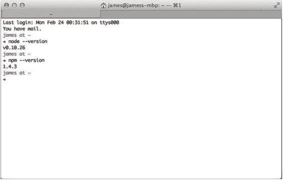

图 2-1. 检查已安装的 `node` 和 `npm` 版本

## npm

`npm` 提供了一种便捷的方式来跨多个项目创建、共享和安装 `Node.js` 包。这些包会被发布到一个中央 `npm` 注册表，允许全球的开发者在其自身项目中安装并重用这些包。`npm` 提供了一种标准方法来定义易于跨项目重用的 JavaScript 包。每个包都有一个名称、描述、作者以及一组依赖项。

正如前一章所述，`Grunt` 采用了基于插件的架构，允许开发者在不同项目之间混合搭配任务。为了实现这种极高的灵活性，`Grunt` 利用了 `Node.js` 和 `npm` 提供的现有模块化机制。每个 `Grunt` 插件都是一个可以使用 `npm` 安装的 `Node.js` 包。

`npm` 允许开发者定义一个包的依赖项。当其他人安装一个包时，`npm` 会管理该包的安装及其依赖项，因此你无需为此操心。

在首次了解 `Grunt` 之前，我将介绍 `Node.js` 和 `npm` 的两个关键特性，我们在安装和使用 `Grunt` 时会用到它们。

### 查找模块

`npm` 允许开发者搜索所有 `Node.js` 包的注册表。针对注册表的搜索可以接受一个或多个搜索词。搜索词也可以是正则表达式，这些正则表达式以 `/` 开头。

要搜索一个包，请打开命令行或命令提示符并输入：

```
npm search grunt
```

此命令将返回所有在标题、描述、作者和/或标签中包含单词 `grunt` 的 Node.js 包。你将在本章后面了解如何为包定义这些元数据。搜索结果应类似于**图 2-2** 所示，其中搜索词会被高亮显示。

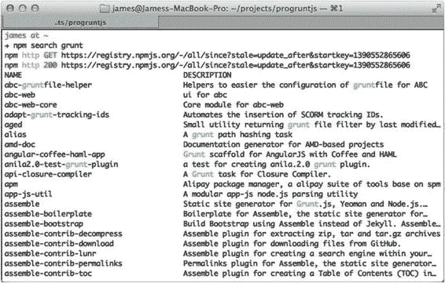

**图 2-2**. 使用 `npm` 搜索 Node 包

首次对仓库运行 `npm search` 时，会构建一个本地索引。该本地索引包含对所搜索仓库中所有包的引用。本地索引旨在加速后续搜索，但如果你在小网络环境下运行搜索命令，可能需要一些时间。

搜索结果会分别以列的形式返回模块名称和描述。如果针对特定包作者进行搜索，还会显示作者列。例如，搜索 `jrcryer`

```
npm search jrcryer
```

将返回我编写的所有插件（参见**图 2-3**）。

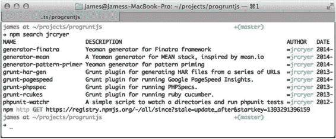

**图 2-3**. 按作者搜索 Node 包

寻找 Grunt 插件最快的方法是搜索标签 `gruntplugin`。这是建议插件作者与他们的插件关联的标签。此标签可与其他限定词结合使用，以返回特定任务的插件。例如，要搜索与 PHP 相关的 Grunt 插件，可以执行以下搜索：

```
npm search gruntplugin php
```

一旦找到你需要的包，就必须安装它。你将在下一节了解 `npm` 如何让这一过程变得简单。

### 安装模块

`npm` 提供了一种非常简单的方法，可以从以下位置安装 Node.js 包：

*   使用包名从注册表安装
*   从本地存储的 tarball 文件安装
*   从 tarball URL 安装
*   从文件夹安装

例如，要安装流行的 Node.js HTTP 客户端 `request`，请使用以下命令：

```
npm install request
```

这会将 `request` 包安装到当前目录下的 `node_modules` 文件夹中。在 `node_modules` 文件夹中，`npm` 还会安装 `request` 所依赖的包。作为安装过程的一部分，`npm` 会列出它尝试安装的所有包。当安装 `request` 时，你的命令行界面应类似于 **图 2-4** 中的输出。

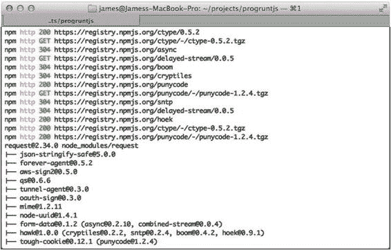

**图 2-4**. 使用 `npm` 安装名为 `request` 的包

### 模块

如上图所示，使用 `npm` 发现和安装新包相对容易。在开始探索 Grunt 的使用之前，理解 Node.js 模块的构成至关重要。

Node.js 模块系统是 CommonJS 模块系统的一种实现。CommonJS 规范旨在解决如何编写 JavaScript 模块以提高互操作性的问题。它旨在填补 JavaScript 目前尚未解决的空白，允许开发者创建定义清晰的模块，这些模块可以跨项目共享。

从最简单的形式来看，模块就是一个 JavaScript 文件。Node.js 为开发者提供了将一个文件中定义的 JavaScript 包含到另一个文件中并使用其功能的能力。最简单的模块如下所示：

```
exports.test = "value";
```

可以将上述内容保存到名为 `something.js` 的文件中，它为 `test` 模块定义了一个单一属性。然后可以像下面这样复用：

```
var mod = require('./something');
console.log(mod.test);
```

在上面的代码示例中，我们包含了 `something` 模块，并在本地将其引用为 `mod`。然后，我们可以通过在 `mod` 上引用 `test` 属性，在应用程序中使用该属性。上述应用程序将把字符串值输出到命令行。

如你所见，模块内部有一个名为 `exports` 的 JavaScript 对象。当 Node.js 加载一个模块时，它会创建一个新的上下文并注入 `exports` 对象。然后，`exports` 对象作为 `require` 调用的一部分被返回。为了将任何功能公开为 Node.js 模块的一部分，可以将属性分配给 `exports` 对象。我们再来看另一个示例（**代码清单 2-1**），其中有一个暴露函数的模块。

**代码清单 2-1**. 作为 Node.js 模块的一部分导出函数

```
exports.add = function(a, b) {
  return a + b;
};
```

将上述模块保存为 `something.js` 后，可以像下面这样使用（**代码清单 2-2**）：

**代码清单 2-2**. 从导入的模块调用函数

```
var simple = require('./something');
console.log(simple.add(1,2));
```

运行此应用程序将在命令行输出 `3`。

使用模块还提供了在模块内部隐藏复杂功能实现的能力，同时为模块用户提供简化的接口。下面（**代码清单 2-3**）是一个向模块用户隐藏 `display` 属性的模块。

**代码清单 2-3**. 演示私有变量的 Node.js 模块

```
var display = false;

module.exports = {
  isHidden: function() {
     return display === false;
  },
  hide: function() {
     display = false;
  },
  show: function() {
     display = true;
  }
};
```

在上面的例子中，该模块允许用户通过 `hide` 和 `show` 方法来操作 `display` 属性。

此时，你可能在想这与 Grunt 有何关系。如前所述，Grunt 插件就是 Node.js 包。Grunt 插件通常由一个或多个模块组成，并且通常依赖其他 Node.js 包来实现其目标。深入了解 Node.js、其模块系统以及其运作方式，将为你项目中使用 Grunt 打下坚实的基础。到目前为止，你已经了解了如何加载相对于当前模块的模块。这些被称为文件模块。除了文件模块，还可以从 `node_modules` 目录加载模块。`node_modules` 是当你运行 `npm install` 命令时，`npm` 将创建并安装项目依赖项的目录。让我们快速看一个示例。

## 从 `node_modules` 加载模块

在我们的示例中，我们将再次安装名为 `request` 的 Node.js 包，使用以下命令：

```
npm install request
```

一旦 `npm` 完成安装，你会注意到当前文件夹中创建了一个新文件夹（参见**图 2-5**）。如果你打开 `node_modules` 文件夹，你会看到另一个与已安装的 Node.js 包名称匹配的文件夹。`request` 文件夹包含了 `request` 包的内容。

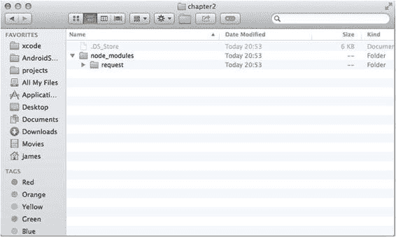

**图 2-5**. 本地安装包时创建的 `node_modules` 目录

现在包已安装，它就可以在我们的项目中使用。下面（**代码清单 2-4**）是一个示例应用程序，它加载 `request` 模块并使用它向 `'http://www.guardian.co.uk'` 发起请求。

**代码清单 2-4**. 加载并使用 `request` 模块

```
var request = require('request');

request.get('http://www.guardian.co.uk', function(error, response, body) {
  if (!error && response.statusCode == 200) {
    console.log(body);
  }
});
```

上述示例应用程序可以保存为 `index.js`，放在 `node_modules` 目录旁边。然后可以在命令行中运行它，如下所示：

```
node index.js
```

以上内容将输出*卫报*首页的 HTML 内容（见图 2-6）。在应用程序的第一行，我们引入了 `request` 包，并用变量名 `request` 存储了对它的引用。这使得我们可以在自己的应用程序中使用该包中定义的函数。在本例中，我们使用了 `request` 包提供的 `get` 方法，该方法允许我们向提供的 URL 发送一个 HTTP GET 请求。

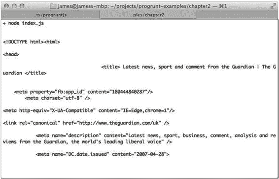

**图 2-6**：示例应用程序从*卫报*网站输出的 HTML

这里需要注意的重要一点是，在 `require` 的开头没有 `/`、`../`、`"` 或 `./`。如果传递给 `require` 的模块标识符不是一个核心 Node.js 模块，并且不以 `/`、`../` 或 `./` 开头，Node.js 将尝试从当前模块的父目录加载模块，并在其后添加 `node_modules`。如果在该目录中未找到模块，它会继续向上寻找其父目录，以此类推。

例如，如果我们的应用程序位于 `/Users/james/projects/progrunt/index.js`，Node.js 将尝试在以下位置加载 `request` 包：

* `/Users/james/projects/progrunt/node_modules/request`

* `/Users/james/projects/node_modules/request`

* `/Users/james/node_modules/request`

* `/Users/node_modules/request`

* `/node_modules/request`

这允许应用程序定位其依赖项，从而避免冲突（见图 2-7）。

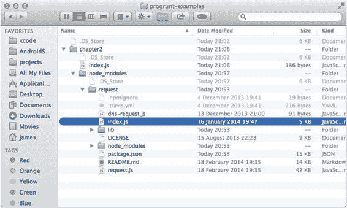

**图 2-7**：当运行 `require('request')` 时，`index.js` 从 `request` 目录加载

眼尖的读者可能已经注意到，在前面的例子中，我们加载的是文件，但 `request` 却是从一个目录加载的。Node.js 也支持从文件夹加载模块。Node.js 将尝试根据以下规则从文件夹加载模块：

* 从文件夹内 `package.json` 中的 `main` 属性

* `index.js` 文件

* `index.node` 文件

在我们的例子中，`request` 包同时满足了第一条规则和第二条规则。

至此，我们介绍了 Node.js 加载包的各种方法。理解每种方法都很重要，因为你将在本书的后续部分用到它们。接下来，我们将研究如何为你的 Node.js 项目定义属性和依赖项。同样，这也是一个需要理解的重要部分，因为在项目中使用 Grunt 时你将用到相同的技术。

## 定义 Node.js 项目

Node.js 提供了一种便捷的方法来定义包的元数据。这些元数据在通过 `npm` 搜索包时使用，同时也会在 `npm` 网站（[www.npmjs.org](http://www.npmjs.org)）上显示，以便开发者了解包的功能和用法。此外，元数据还允许开发者定义开发该包所需的依赖项以及运行该包所需的依赖项。

包元数据必须包含以下内容：

* 包名称

* 包的当前版本

* 包的作者，包括其电子邮件地址

除了这些必填属性外，元数据还可以包含以下内容：

* 包描述

* 关键字

* 许可证

* 贡献者列表

* 仓库——指向包源代码控制仓库的 URL

* 开发依赖项——开发该包所需的依赖项

* 依赖项——运行该包所需的依赖项

* 引擎——支持的 Node.js 版本

包的元数据保存在模块根目录下名为 `package.json` 的文件中。在前面的示例中，`package.json` 文件会与 `index.js` 文件位于同一目录。下面是一个示例 `package.json`（见代码清单 2-5）：

# 代码清单 2-5：用于定义包元数据的示例 `package.json` 文件

```json
{
  "name": "grunt-pagespeed",
  "version": "0.1.2",
  "description": "Grunt plugin for running Google PageSpeed Insights.",
  "homepage": "https://github.com/jrcryer/grunt-pagespeed",
  "author": {
    "name": "James Cryer",
    "email": "chat@jamescryer.com",
    "url": "http://www.jamescryer.com/"
  },
  "repository": {
    "type": "git",
    "url": "git://github.com/jrcryer/grunt-pagespeed.git"
  },
  "contributors": [],
  "main": "Gruntfile.coffee",
  "engines": {
    "node": ">=0.8.0"
  },
  "devDependencies": {
    "grunt": "~0.4.1"
  },
  "dependencies": {
    "googleapis": "~0.6.1"
  },
  "keywords": [
    "gruntplugin",
    "pagespeed",
    "insights",
    "grunt",
    "performance"
  ]
}
```

以上是我用于对网站运行 `pagespeed insights` 的 Grunt 插件的 `package.json` 文件副本。前面示例中需要注意的重要属性是 `devDependencies` 和 `dependencies`。这些属性允许我们定义项目所需的其他 Node.js 包。在本章后面，你将看到 Grunt 插件的依赖项是如何在此处体现的。

`npm` 提供了一个用于快速启动项目的便捷命令。它会询问一系列问题，并根据你的回答生成一个 `package.json` 文件。让我们回顾一下之前的示例，并为该项目生成一个 `package.json`。首先，确保你位于项目的根文件夹（包含 `index.js` 的文件夹）中，然后运行以下命令：

```
npm init
```

随后，`npm` 会提示你回答一系列问题（见图 2-8）。

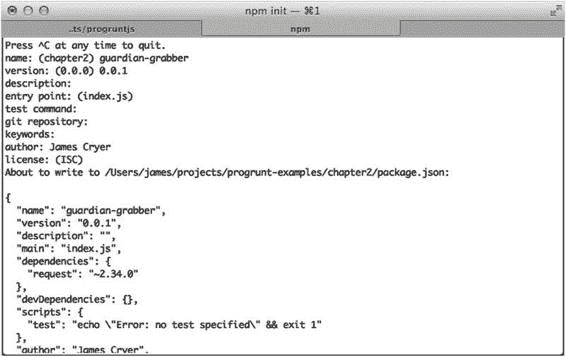

图 2-8：示例应用程序从 *卫报* 网站输出的 HTML

`npm` 会显示即将生成的 `package.json`，并询问是否正确。如果你选择“是”，你会发现在项目根目录下现在有了一个 `package.json` 文件。你可能还注意到，`npm` 足够智能，可以检测到我们已经安装了 `request`，并将其添加到生成的 `package.json` 文件中。

一旦 `package.json` 文件被添加到项目中，安装包时你需要添加一个额外的标志，以确保 `npm` 更新 `package.json`。例如，如果我们想为项目添加一个流行的单元测试框架 `nodeunit`，我们需要运行以下命令：

```
npm install nodeunit --save
```

`--save` 标志告诉 `npm` 我们希望将此包添加为依赖项。或者，我们可以使用 `--save-dev` 将包添加到开发依赖项中。运行上述命令后，`package.json` 文件应该类似于下面的代码清单 2-6：

## 代码清单 2-6：安装 `nodeunit` 后的 `package.json`

```json
{
  "name": "guardian-grabber",
  "version": "0.0.1",
  "description": "",
  "main": "index.js",
  "dependencies": {
    "request": "~2.34.0",
    "nodeunit": "⁰.8.6"
  },
  "devDependencies": {},
  "scripts": {
    "test": "echo \"Error: no test specified\" && exit 1"
  },
  "author": "James Cryer",
  "license": "ISC"
}
```

现在我们已经明确了什么是 Node.js 包，以及如何在自己的项目中搜索和安装它们，接下来我们可以进入 Grunt 本身。

### Grunt

如前所述，Grunt 插件是 Node.js 包。但是，我还没提到 Grunt 本身也是一个 Node.js 包。在本书中，我们将使用 Grunt 0.4.x 版本。注意 Grunt 的版本很重要，因为 0.3.x 和 0.4.x 版本之间有一些重大的变化。最大的变化是将 Grunt 包拆分为三个独立的包：

* `grunt-cli`

* `grunt`

* `grunt-init`

这一设计决策背后的原因稍后将会明确。首先，让我们通过运行以下命令来安装第一个包 `grunt-cli`：

```
npm install -g grunt-cli
```

这将全局安装 `Grunt` 命令行界面。安装后，`grunt` 命令将在你的命令行（适用于 OS X、*nix 或 BSD 等系统）或 Windows 命令提示符中可用。根据你的配置，上述命令可能需要在相应平台上使用 `sudo` 或以管理员身份运行。

一旦 `grunt-cli` 安装完成，你应该能够运行以下命令：

```
grunt –version
```

之后，你将会看到与图 2-9 中类似的输出。

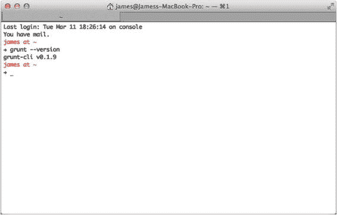

图 2-9。命令行中的 Grunt 版本输出

`Grunt` 命令行界面本身并不是一个任务运行器；它负责运行每个项目中安装的本地版本的 `Grunt`。这减少了全局安装任务运行器的需要，并允许项目在需要时安装不同版本的 `Grunt`。

在项目中使用 `Grunt` 的下一步是安装第二个 `Grunt` 包，名为 `grunt`。

#### 创建一个使用 Grunt 的新项目

要在项目中使用 `Grunt`，需要两个特定的文件：

*   `package.json`

*   `Gruntfile`

我们在探索 Node.js 模块时已经见过 `package.json` 文件。此文件将包含对 `grunt` 本身以及项目所需相关插件的开发依赖项。

`Gruntfile`，无论是 `Gruntfile.js` 还是 `Gruntfile.coffee`，都是包含任务配置和/或自定义任务定义的文件。

#### 向项目添加 Grunt 和插件

如前所述，可以使用 `npm init` 来添加 `package.json` 文件。`Grunt` 也提供了一种替代方法，即使用 `grunt-init` 通过 `Grunt` 来搭建项目脚手架，我们将在本书后面部分介绍该方法。首先，让我们复用 `npm init` 命令来生成一个 `package.json` 文件，如清单 2-7 所示。

## 清单 2-7。示例 `package.json` 文件

```
{
  "name": "grunt-file-example",
  "version": "0.0.1",
  "description": "",
  "main": "index.js",
  "scripts": {
    "test": "echo \"Error: no test specified\" && exit 1"
  },
  "author": "James",
  "license": "ISC"
}
```

现在要将 `Grunt` 添加到项目中，请在项目的根文件夹中运行以下命令：

```
npm install grunt --save-dev
```

这会将最新稳定版的 `Grunt` 添加到你的项目，并应在你的 `package.json` 中存储一个引用，现在看起来像清单 2-8。

## 清单 2-8。添加了 Grunt 依赖项后更新的 `package.json`

```
{
  "name": "grunt-file-example",
  "version": "0.0.1",
  "description": "",
  "main": "index.js",
  "scripts": {
    "test": "echo \"Error: no test specified\" && exit 1"
  },
  "author": "James",
  "license": "ISC",
  "devDependencies": {
    "grunt": "⁰.4.3"
  }
}
```

注意：`devDependencies` 已添加到文件末尾，并且引用了 `grunt`。如果你按如下方式重新运行 `grunt` 命令，输出将显示 `grunt-cli` 和 `Grunt` 包的版本（参见图 2-10）：

```
grunt –version
```

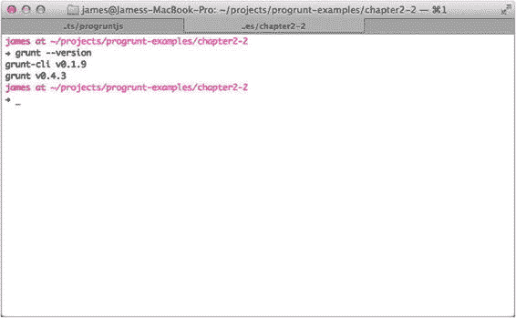

图 2-10。命令行中的 Grunt 版本输出

此时，如果你在项目中不带任何其他标志运行 `grunt` 命令，你将看到一个错误。此错误提示你无法找到 `Gruntfile`。

在项目的根目录中创建一个新文件，并将其命名为 `Gruntfile.js`。这将创建一个 JavaScript 的 `Gruntfile`；但是，如果你想改用 CoffeeScript，请将文件保存为 `Gruntfile.coffee`。本书中的所有 `Gruntfile` 都将使用 JavaScript；不过，我建议你尝试使用 CoffeeScript 编写你的 `Gruntfile`。就这项特定任务而言，我个人更偏爱 CoffeeScript 而非 JavaScript，因为它提供了更清晰、更易读的配置文件。

一个 `Gruntfile` 包含以下部分：

*   模块导出，有时也称为“包装器”函数

*   项目和任务配置

*   加载 Grunt 插件和任务

*   自定义任务

让我们将上述内容添加到我们的 `Gruntfile.js` 文件中。首先，我们必须将模块的导出语句添加到 `Gruntfile` 中（参见清单 2-9）。

***清单 2-9***。`Gruntfile.js` 的开头

```
module.exports = function(grunt) {

};
```

我希望这看起来让你熟悉，因为它遵循了 Node.js 模块使用的相同模式。需要注意的是，我们从 `Gruntfile` 中导出的函数期望接收一个参数，我们将其命名为 `grunt`。这个 `grunt` 变量将允许我们访问 `Gruntfile` 中的 `Grunt` API。这对配置我们的任务运行器和定义自定义任务至关重要。

接下来，我们必须添加我们的项目配置和任务。由于这是我们的第一个 `Grunt` 项目，我们将从简单的开始，添加一个用于连接文件的任务。修改后的 `Gruntfile` 及其添加的配置如下（清单 2-10）：

***清单 2-10***。将 `grunt-concat` 添加到 `Gruntfile.js`

```
module.exports = function(grunt) {

// Project configuration.
  grunt.initConfig({
    pkg: grunt.file.readJSON('package.json'),

concat: {
      options: {
        separator: ';',
      },
      dist: {
        src: ['src/fileA.js', 'src/fileB.js'],
        dest: 'dist/built.js',
      }
    }
});
};
```

如你所见，文件中添加了相当多的行。第一个新行是对 `grunt.initConfig` 的调用。此函数初始化当前项目的配置，并期望向其传递一个配置对象。配置对象实际上就是一个普通的 JavaScript 对象。几乎你编写的每个 `Gruntfile` 都会包含对此函数的调用。

接下来，我们来检查传递给 `initConfig` 调用的配置对象。它有两个顶级属性：`pkg` 和 `concat`。第一个属性 `pkg` 存储了对项目 `package.json` 内容的引用。有时在 `Gruntfile` 中使用我们项目定义中的属性会很有用。我们将在本书后面探讨如何使用这些属性。第二个属性 `concat` 是我们的第一个任务配置。

我们在这个第一个项目中要使用的 `Grunt` 插件是 `grunt-contrib-concat`。该插件定义了一个名为 `concat` 的任务，因此我们可以通过使用相同的键来定义此任务的配置。`concat` 内定义的下两个关键属性是 `options` 和 `dist`。`options` 允许我们作为开发者覆盖插件作者提供的默认值。在我们的示例中，我们通过指定字符 `;` 来覆盖 `separator` 选项的默认值。`dist` 属性被称为*目标*。目标允许我们在多个上下文中配置给定的任务，并为每个上下文提供替代选项。在我们的第一个示例中，我们的目标用于定义任务的输入和输出文件。该任务将在 `src/` 文件夹中查找两个文件：`fileA.js` 和 `fileB.js`。它们将被合并，输出将存储在 `dist/built.js` 中。

目前，我们的 `Gruntfile` 是无效的，因为我们还没有加载插件。加载插件很简单，因为 `Grunt` 提供了一个易于使用的 API 来加载每个任务。通过添加以下内容来更新我们的 `Gruntfile`（清单 2-11）：

***清单 2-11***。将 `loadNpmTasks` 添加到文件中以加载插件

```
module.exports = function(grunt) {

// Project configuration.
  grunt.initConfig({
    pkg: grunt.file.readJSON('package.json'),

concat: {
      options: {
        separator: ';',
      },
      dist: {
        src: ['src/fileA.js', 'src/fileB.js'],
        dest: 'dist/built.js',
      }
    }
  });

// Load the plugin that provides the "concat" task.
  grunt.loadNpmTasks('grunt-contrib-concat');
};
```

添加的代码行调用了 `loadNpmTasks` 函数。该函数负责从特定插件加载任务，并且需要将插件名称作为参数传递给它。

在尝试运行 `Gruntfile` 之前，我们还需要在其中添加最后一条语句。直接在 `loadNpmTasks` 调用之后添加以下代码行（清单 2-12）。

***清单 2-12***. 定义当 Grunt 在没有指定任务名称的情况下运行时所要执行的默认任务

```
// Default task(s).
grunt.registerTask('default', ['concat']);
```

这最后一行代码定义了一个默认任务，当有人在我们的项目中运行 `grunt` 命令且未传递任何其他值时，该任务就会按照定义执行。如果我们的 `node_modules` 文件夹中缺少相关插件，Grunt 将无法正常运行，如图 2-11 所示。

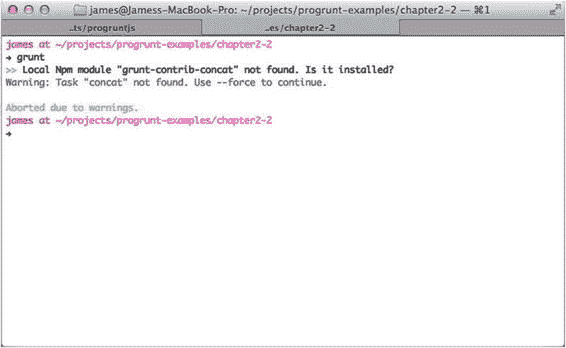

Figure 2-11. Grunt 无法运行

至此，我们完成了第一个完整的 `Gruntfile`。保存文件并返回命令行。在根文件夹中，运行 `grunt` 会返回错误，因为我们尚未安装 `grunt-contrib-concat` 插件。要将此插件添加到项目中，请运行以下命令：

```
npm install grunt-contrib-concat --save-dev
```

请注意，我们的插件是一个 Node.js 包，并且我们还将依赖关系保存到了 `package.json` 中（通过在 `install` 命令中传递 `--save-dev`）。重新运行 `grunt` 命令现在会返回成功消息。然而，由于我们的源文件还不存在，`dist` 文件夹中的输出文件 `built.js` 目前是空的。

在项目中创建一个名为 `src` 的新文件夹。在此文件夹内，创建 `fileA.js` 和 `fileB.js`。在每个文件中，分别放入两段不同的内容（建议我分别放入“A”和“B”）。重新运行 `grunt` 任务后，`built.js` 文件现在应包含 `fileA.js` 和 `fileB.js` 的内容，并用 `;` 合并和分隔（参见图 2-12）。

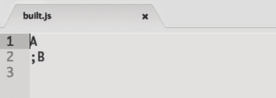

Figure 2-12. 合并后的输出

因此，我们已在项目上成功安装、配置并运行了 Grunt。在探索 Grunt 优化工作流程的各种方法之前，了解 Grunt 背后的关键概念非常重要。让我们从配置任务开始。

### 配置任务

如前所述，任务的配置包含在项目的 `Gruntfile` 中。在此 `Gruntfile` 内部，配置通过 `grunt.initConfig` 方法传递给 Grunt。传递给 `grunt.initConfig` 的大部分配置将位于以任务命名的属性下，但也可以包含任意数据。如果配置中的属性与任务名称冲突，则这些属性会被忽略。

由于 `Gruntfile` 是 JavaScript（或者如果你选择的话，也可以是 CoffeeScript）文件，配置并不严格局限于 JSON。这使得任务配置非常强大，因为它可以通过编程方式生成。为了阐明这一原理，让我们重新审视第一个 `Gruntfile`，并将文件位置指定为配置的一部分（参见清单 2-13）。

***清单 2-13***. 在 Gruntfile 中使用变量

```
module.exports = function(grunt) {

var app_files = ['src/fileA.js', 'src/fileB.js'],
         output = 'dist/built.js';

// Project configuration.
  grunt.initConfig({
    pkg: grunt.file.readJSON('package.json'),

concat: {
      options: {
        separator: ';',
      },
      dist: {
        src: app_files,
        dest: output
      }
    }
  });

// Load the plugin that provides the "concat" task.
  grunt.loadNpmTasks('grunt-contrib-concat');
};
```

在上面的 `Gruntfile` 中，我们将源文件和输出文件的定义分别移到了任意属性 `app_files` 和 `output` 中。随后，我们更新了任务配置来使用这些属性。

当运行 `grunt` 时，它会扫描配置对象，寻找与任务名称匹配的属性。此配置将被应用到任务提供的默认配置之上。任务还允许指定多个配置；每组配置被称为一个目标（`target`）。每个目标都有一个任意名称。以下 `Gruntfile`（清单 2-14）扩展了我们之前的版本，添加了一个名为 `test` 的额外目标。

***清单 2-14***. 多目标允许我们从同一个 Gruntfile 以多种方式配置任务

```
module.exports = function(grunt) {

var app_files = ['src/fileA.js', 'src/fileB.js'],
         output = 'dist/built.js',
    test_output = 'test/built.js';

// Project configuration.
  grunt.initConfig({
    pkg: grunt.file.readJSON('package.json'),

concat: {
      options: {
        separator: ';',
      },
      dist: {
        src: app_files,
        dest: output
      },
      test: {
        src: app_files,
        dest: test_output
      }
    }
  });

// Load the plugin that provides the "concat" task.
  grunt.loadNpmTasks('grunt-contrib-concat');
};
```

有了额外的目标，我们将合并后的文件输出到一个新的位置，即 `test` 文件夹。Grunt 提供了运行特定目标或所有目标的能力。要运行特定目标，可以使用以下命令：

```
grunt concat:test
```

上述命令将仅运行名为 `concat` 的任务中名为 `test` 的目标。要运行给定任务的所有目标，可以省略目标名称，如下面的代码所示。运行该命令将依次执行 `dist` 和 `test` 目标。

```
grunt concat
```

这会遍历每个目标并依次执行它们。上述命令的输出可以在图 2-13 中看到。

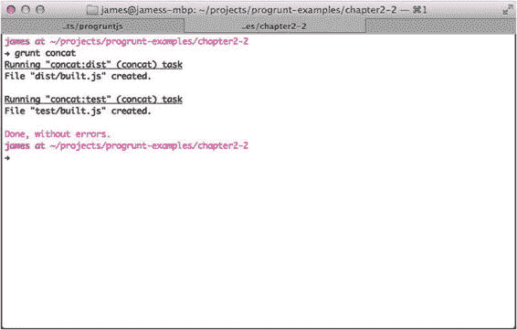

Figure 2-13. 运行多个目标时的输出

在任务配置中，可以指定 `options` 参数来覆盖任务设置的默认值。这些选项可以被目标级别的选项覆盖。目标级别选项由目标内的 `options` 属性定义。在以下示例（清单 2-15）中，我们的 `Gruntfile` 已被修改，以更改 `test` 目标的分隔符。

***清单 2-15***. 使用选项的示例

```
module.exports = function(grunt) {

var app_files = ['src/fileA.js', 'src/fileB.js'],
         output = 'dist/built.js',
    test_output = 'test/built.js';

// Project configuration.
  grunt.initConfig({
    pkg: grunt.file.readJSON('package.json'),

concat: {
      options: {
        separator: ';',
      },
      dist: {
        src: app_files,
        dest: output
      },
      test: {
        options: {
          separator: ' ',
        },
        src: app_files,
        dest: test_output
      }
    }
  });

// Load the plugin that provides the "concat" task.
  grunt.loadNpmTasks('grunt-contrib-concat');
};
```

上述配置将用值 `;` 覆盖由 `concat` 任务为所有目标设置的默认分隔符。此外，`test` 目标覆盖了此设置，并指定分隔符为单个空格。

本章的最后一部分涵盖了 Grunt 为选择每个任务的输入和输出文件提供的各种选项。

## 使用文件

Grunt 提供了一个丰富且强大的 API，用于选择任务将要操作的文件。有多种方法可以为每个任务声明源文件和目标文件的映射，每种方法在复杂性和灵活性方面各有不同。

### 紧凑格式

### 紧凑文件格式

紧凑文件格式通常用于只读任务。由于它接受单一的源文件到目标文件的映射，因此 `src` 属性不需要对应的 `dest` 属性。它适用于对一组文件执行操作并报告这些文件状态的任务。此类任务的一个例子是单元测试运行器，它针对一组测试用例执行操作并报告每个测试的结果。

以下是使用 `grunt-mocha-test` 插件的紧凑文件格式示例（清单 2-16）。对于不熟悉 Mocha（[`mochajs.org/`](http://mochajs.org/)）的读者，它是一个 JavaScript 测试运行器。

***清单 2-16***. 使用紧凑文件格式运行 Mocha 测试

```
module.exports = function(grunt) {

grunt.initConfig({
    // 配置一个 mochaTest 任务
    mochaTest: {
      test: {
        options: {
          reporter: 'spec'
        },
        src: ['test/**/*.js']
      }
    }
  });

// 添加 grunt-mocha-test 任务。
  grunt.loadNpmTasks('grunt-mocha-test');
  grunt.registerTask('default', 'mochaTest');

};
```

上述 `Gruntfile` 加载了 `grunt-mocha-test` 插件，并用它来处理 `test` 文件夹中所有扩展名为 `.js` 的文件。为了匹配 `test` 目录内的所有文件，我们使用了通配符模式。该模式将匹配顶级 `test` 目录及其任何子目录中的所有文件。如果我们只想匹配顶级 `test` 文件夹内的文件，我们可以将模式简化为 `*.js`。这里需要注意的重点是缺少 `dest` 属性，因为任务不会输出到文件。

### 文件对象格式

文件对象格式允许定义多个源文件到目标文件的映射。文件对象格式将映射声明为一个 JavaScript 对象，其中目标文件作为属性键，而值可以是一个或多个源文件。由于每个映射本质上以“目标”文件为键，因此一个目标可以包含多个映射。当你希望将一组文件合并成单个文件时（例如在拼接 JavaScript 文件的情况下），通常会使用这种格式。

以下`Gruntfile`（清单 2-17）演示了文件对象格式的使用。

***清单 2-17***. 使用文件对象格式拼接文件

```
module.exports = function(grunt) {

// 项目配置。
  grunt.initConfig({
    pkg: grunt.file.readJSON('package.json'),

concat: {
      options: {
        separator: ';',
      },
      dist: {
        files: {
          'build/app.js': ['src/fileA.js', 'src/fileB.js']
        }
      }
    }
  });

// 加载提供"concat"任务的插件。
  grunt.loadNpmTasks('grunt-contrib-concat');
};
```

上述`Gruntfile`重访了我们之前的例子，但不同之处在于，它将目标文件定义为属性名本身，而不是定义`src`和`dest`属性。

## 文件数组格式

文件数组格式扩展了紧凑格式，允许每个目标包含多个源文件到目标文件的映射。它不是使用单一的`src`和`dest`属性，而是将文件声明为一个`files`属性，该属性的值是紧凑格式的数组。以下示例（清单 2-18）修改了我们现有的例子，将 CSS 拼接功能添加到了同一个目标中。

***清单 2-18***. 使用文件数组格式将多个文件拼接在一起

```
module.exports = function(grunt) {

// 项目配置。
  grunt.initConfig({
    pkg: grunt.file.readJSON('package.json'),

concat: {
      options: {
        separator: ';',
      },
      dist: {
        files: [
          {src: ['src/fileA.js', 'src/fileB.js'], dest: 'build/app.js'},
          {src: ['src/stylesA.css', 'src/stylesB.css'], dest: 'build/app.css'}
        ]
      }
    }
  });

// 加载提供"concat"任务的插件。
  grunt.loadNpmTasks('grunt-contrib-concat');
};
```

在上例中，`src`和`dest`属性已被替换为`files`属性。`files`属性被赋予一个对象数组。每个对象都有`src`和`dest`属性，从而可以声明多个源文件到目标文件的映射。`dist`目标的输出将是`build/app.js`和`build/app.css`。

### 总结

在本章中，你已开始探索如何将 Grunt 引入项目。首先，你熟悉了 Node 和 npm，因为它们是理解 Grunt 及其插件生态系统工作原理的基础。本章其余部分讨论了在项目中安装 Grunt、安装第一个任务以及如何为任务提供所需配置的方法。最后，介绍了 Grunt 提供的灵活 API，用于在项目中模式匹配文件，从而为任务定义输入和输出。

下一章将开始探讨使用 Grunt 自动化处理与 HTML 和 CSS 相关的常见任务的实际用例。