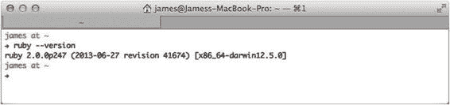
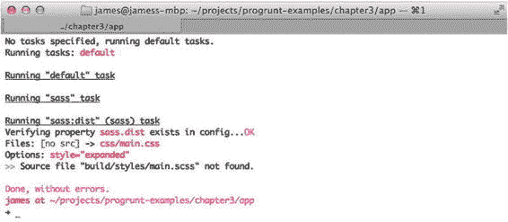
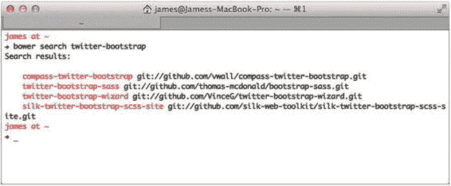
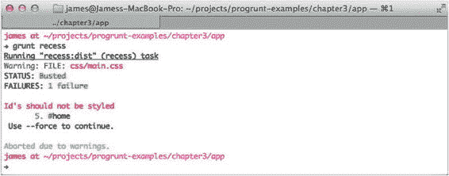
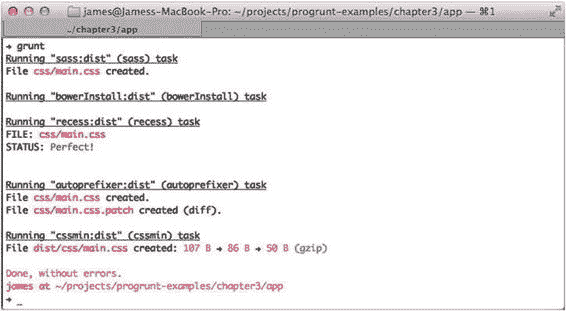

# 将 Grunt 与 HTML 和 CSS 结合使用

在上一章中，我们探讨了如何引导项目使用 Grunt，以及如何在项目中安装和配置任务。接下来，我们将介绍多种有用的插件，它们可以在处理 Web 基础——HTML 和 CSS——时帮助我们优化工作流程。本章涵盖的主题包括 CSS 预处理、简化第三方依赖的安装，以及优化内容以进行公开发布。

在探索可用于自动化处理 HTML 和 CSS 的任务之前，让我先介绍一个项目，我们将用它来演示所有可用的优秀插件。

### 演示应用

在本书余下部分，我们将介绍多种免费的 Grunt 插件，供你在未来的项目中使用。为了帮助演示每一种插件，我们将开发一个应用程序。这个应用程序将是一个简单的 Node 应用程序，允许用户在浏览器中维护一个简单的待办事项列表。如果你对 Node 不太熟悉，也不必担心，因为我们只会使用 Node 来运行一个非常简单的 Web 服务器。

该应用程序的绝大部分将涉及 HTML、CSS 和 JavaScript。首先，让我们使用一个精简版的 HTML5 boilerplate HTML（参见清单 3-1）。

***清单 3-1***. 待办事项列表应用的 HTML 模板

```
<!DOCTYPE html>
<html class="no-js">
 <head>
  <meta charset="utf-8">
  <meta http-equiv="X-UA-Compatible" content="IE=edge">
  <title>Pro Grunt.js: 待办事项列表</title>
  <meta name="description" content="">
  <meta name="viewport" content="width=device-width, initial-scale=1">

<link rel="stylesheet" href="css/main.css">
 </head>
 <body>
  <!--[if lt IE 8]>
   <p class="browsehappy">你正在使用一个<strong>过时</strong>的浏览器。请<a href="http://browsehappy.com/">升级你的浏览器</a>以提升体验。</p>
  <![endif]-->

<!-- 在此处添加你的网站或应用内容 -->
  <h1>Pro Grunt.js</h1>
  <h2>待办事项列表</h2>

<script src="//ajax.googleapis.com/ajax/libs/jquery/1.11.0/jquery.min.js"></script>
  <script>window.jQuery || document.write('<script src="js/vendor/jquery-1.11.0.min.js"><\/script>')</script>
  <script src="js/main.js"></script>
 </body>
</html>
```

从清单 3-1 可以看出，目前这个 HTML 文档非常小巧。`head`元素中包含了一个 CSS 文件；`body`标签末尾引入了 jQuery 和`main.js` JavaScript 文件。现在不必担心 CSS 和 JavaScript 文件，这些将在本书后面部分介绍。首先，让我们看看 Grunt 如何帮助我们生成、检查（lint）和压缩 CSS 文件。

#### CSS 预处理


#### CSS 预处理

`CSS 预处理`是一项相对较新的技术，其存在时间大约只有过去五年。在这五年间，它迅速被开发者采用，主要原因是它解决了使用 CSS 时的一些痛点。目前，主要有三种 CSS 预处理器可用：LESS（[`lesscss.org`](http://lesscss.org)）、Sass（[`sass-lang.com`](http://sass-lang.com)）和 Stylus（[www.stylus.com](http://www.stylus.com)）。CSS 预处理器越来越流行，以至于浏览器厂商已开始在其开发者工具中提供支持。

CSS 预处理器通常对 CSS 进行扩展，提供诸如定义变量和嵌套选择器等新功能。这通常会带来更清晰、更易于维护的 CSS。为便于演示，本书将使用 Sass。要使用 Sass，你必须安装 Ruby 语言。

#### 安装 Sass

要安装 Sass，你需要在你的机器上安装 Ruby。成功安装后，即可通过命令行或命令提示符使用 Ruby。

##### 在 Linux 上安装 Ruby

在 Linux 上安装 Ruby，最好通过你的发行版包管理器或诸如 `rbenv` 或 `rvm` 之类的工具来安装。

##### 在 Windows 上安装 Ruby

在 Windows 上，Ruby 有一个一键安装程序。安装完成后，即可在命令提示符下使用 Ruby。

##### 在 Mac OS X 上安装 Ruby

Mac OS X 预装了 Ruby；但安装的版本取决于你运行的 Mac OS X 版本。Mountain Lion 随附版本 1.8.7，而 Mavericks 则随附 Ruby 2.0.0。

在使用 Sass 时，我建议运行 2.0.0 版本。对于使用 Mountain Lion 或更早版本的读者，我建议使用 `rbenv` 来安装和维护你的 Ruby 安装。

#### 检查你的 Ruby 安装

安装 Ruby 后，你应该能够从命令行或命令提示符运行 Ruby 命令。清单 3-2 演示了如何检查你安装的 Ruby 版本。

***清单 3-2***。检查已安装的 Ruby 版本

```
ruby --version
```

该命令应输出类似于图 3-1 所示的内容。



图 3-1。当前安装的 Ruby 版本

如果你没有看到与上述类似的输出，我建议仔细检查你所运行平台的安装步骤。要开始使用 Sass，下一步是安装 gem。与 Node 类似，Ruby 有一个名为 Ruby Gems 的包管理系统，每个 Ruby 包都打包为一个 gem。清单 3-3 演示了如何从命令行或命令提示符安装 Sass，并随后检查已安装的 Sass 版本。

***清单 3-3***。安装 Sass Gem

```
gem install sass
sass --version
```

如果 Sass 安装成功，将打印类似 `Sass 3.3.3 (Maptastic Maple)` 的输出。现在我们已安装 Sass，让我们简要了解一下它的主要特性，然后再了解 Grunt 如何在使用 Sass 时帮助我们。

#### Sass 简介

如前所述，Sass 是一种 CSS 预处理器。你可能想知道这意味着什么。简单来说，Sass 接收一些输入，对其执行处理，然后输出 CSS。通过此过程，输入可以是 SCSS 或 Sass 文件。SCSS 是 Sass 3 的主要语法，也是本书将要用到的。Sass 是一种稍旧的、受 HAML 启发的语法，其编译规则更为严格。

SCSS（也称为 Sassy CSS）是 CSS3 的超集，这意味着任何 CSS3 样式表都是有效的 SCSS 样式表。SCSS 文件的扩展名为 `.scss`。清单 3-4 演示了如何使用 Sass 从命令行将 SCSS 文件编译为 CSS。

***清单 3-4***。使用 Sass 将 SCSS 文件编译为 CSS

```
sass input.scss output.css
```

运行清单 3-4 中的命令将输出一个包含 SCSS 文件 `input.scss` 中所有样式的 CSS 文件。命令行工具 `sass` 也可以传递多个标志来修改生成的 CSS 文件。我们将在本章后面介绍其中一些标志。在此之前，我们先探讨 Sass 中能提高 CSS 文件可维护性和可读性的特性。

##### 变量

对于具有 JavaScript 或 Ruby 等语言编程经验的读者来说，变量应该很熟悉。变量提供了一种存储值的方法，以便我们稍后重用。变量还为引用此值提供了一个方便且易于记忆的名称。在 Sass 中，变量可用于存储 CSS 属性值。清单 3-5 演示了我们如何存储颜色的十六进制值，以便在 SCSS 文件中稍后使用。

***清单 3-5***。用于存储颜色值的变量

```
$primary-color: #A2A2A2;
$background-color: #C3C3C3;

body {
    color: $primary-color;
    background: $background-color;
}
```

变量以 `$` 开头，后跟变量名。变量的值出现在 `:` 之后。在我们的示例中，仅使用变量来存储颜色值，但变量也可以存储任何 CSS 属性的值。当 Sass 进行处理时，变量会被替换为变量值，但变量定义不会被替换。清单 3-6 显示了上述示例处理后的结果。

***清单 3-6***。处理清单 3-5 中 SCSS 文件后输出的 CSS

```
body {
    color: #A2A2A2;
    background: #C3C3C3;
}
```

##### 嵌套

另一个强大的功能是能够嵌套选择器，这允许 CSS 作者嵌套其 CSS 选择器以匹配 HTML 的视觉表示。清单 3-7 演示了如何使用嵌套使 CSS 更具可读性和可维护性。

***清单 3-7***。使用嵌套选择器

```
header {
    width: 936px;
    padding: 12px;

    h1 {
        font-size: 2.4em;
        line-height: 1em;
        margin: 0 0 12px;
    }

    nav {
        padding: 12px;
    }
}
```

请注意 `h1` 和 `nav` 选择器是如何嵌套在 `header` 选择器中的。当 Sass 处理 SCSS 文件时，它会展开嵌套的选择器以生成更复杂的选择器。清单 3-7 中 SCSS 文件的输出如清单 3-8 所示。

***清单 3-8***。嵌套选择器的输出

```
header {
    width: 936px;
    padding: 12px;
}

header h1 {
    font-size: 2.4em;
    line-height: 1em;
    margin: 0 0 12px;
}

header nav {
    padding: 12px;
}
```

除了嵌套选择器之外，还有一个更高级的功能可用于组合嵌套的伪类选择器（如清单 3-9 所示）。

***清单 3-9***。伪类选择器与嵌套选择器的组合

```
a {
    text-decoration: none;

    &:hover,
    &:focus {
        text-decoration: underline;
    }
}
```

请注意清单 3-9 中 & 符号（`&`）的使用。这会导致当前选择器被附加到父选择器上，在我们的示例中，父选择器是 `a`。我们示例的输出如清单 3-10 所示，生成了选择器 `a:hover, a:focus`。

***清单 3-10***。使用 `&` 附加伪类选择器

```
a {
    text-decoration: none;
}

a:hover, a:focus {
    text-decoration: underline;
}
```

##### 局部文件和导入


##### Partials（局部文件）

Partials（局部文件）允许开发者创建包含 CSS 片段（snippet）的 SCSS 文件。这些片段可以被包含到其他 SCSS 文件中。将其他片段包含到其他 SCSS 文件中的能力，极大地提高了所编写 SCSS 的可重用性，因为你可以选择要包含哪些 partials（局部文件）。Partials（局部文件）有一个文件命名约定，即它们必须以**下划线**开头。这告诉 Sass 该文件不直接生成输出。例如，用于头部模块的 partial 可能被命名为 `_header.scss`。

要将 partials（局部文件）包含在一个文件中，必须使用 `@import` 指令。Imports（导入）与 partials（局部文件）结合使用，可以将 CSS 拆分成更易于管理和阅读的块。列表 3-11 演示了如何使用 `@import` 指令。

***列表 3-11***. 使用 `@import` 指令将多个文件与 Sass 合并

```
// _reset.scss

html, body, ul, ol, h1, h2, h3, h4, h5, h5, p {
    margin: 0;
    padding: 0;
}

// _header.scss

header {
    h1 {
        font-size: 2em;
        margin: 12px 0;
    }
}

// main.scss

@import 'reset';
@import 'header';

body {
    color: #A2A2A2;
    background: #C3C3C3;
}
```

在列表 3-11 中，共有三个文件：`_reset.scss`、`_header.scss` 和 `main.scss`。`main.scss` 文件导入了 `_reset.scss` 和 `_header.scss` 文件的内容。需要注意的是，在使用 `@import` 指令时，必须包含文件扩展名 `.scss`。当 Sass 处理 `main.scss` 时，它将生成一个文件，而不是三个文件。不要将 Sass 中的 `@import` 指令与 CSS 中的 `@import` 指令混淆。它们提供的功能非常不同。使用 Sass 中的 `@import` 指令时，文件的内容会合并到导入该 partial 的文件中。而使用 CSS imports 时，每个文件保持独立，浏览器会为每个文件进行单独的 HTTP 调用。列表 3-12 显示了编译 `main.scss` 文件后的输出结果。

***列表 3-12***. 使用 Imports 和 Partials 编译 Sass 的输出

```
html, body, ul, ol, h1, h2, h3, h4, h5, h5, p {
    margin: 0;
    padding: 0;
}

header {
    h1 {
        font-size: 2em;
        margin: 12px 0;
    }
}

body {
    color: #A2A2A2;
    background: #C3C3C3;
}
```

##### Mixins（混合器）

Mixins（混合器）提供了一种便捷的方法来重用 CSS，允许你定义一组选择器或属性，并在不进行复制粘贴的情况下多次重用它们。除此之外，mixins 还可以接受参数，这样每次使用时，都可以稍作修改以满足特定需求。Mixins 的主要优势在于提高了可维护性，因为如果以后需要更新 CSS，只需在一个地方进行修改即可。Mixins 的一个常见用途是处理浏览器前缀。你可以将所有浏览器厂商的特定实现捕获到一个单一的 mixin 中，而不必每次都重复定义它们。这意味着，如果浏览器厂商更改了其实现，你只需要修改 mixin，其余的 CSS 输出将随更改而更新。列表 3-13 演示了这样一个关于 CSS3 属性 `border-radius` 的示例。

***列表 3-13***. 为 CSS3 属性 `border-radius` 定义一个 Sass 的 Mixin

```
@mixin border-radius($radius) {
    -webkit-border-radius: $radius;
    -moz-border-radius: $radius;
    -ms-border-radius: $radius;
    border-radius: $radius;
}

.panel {
    @include border-radius(4px);
}

.login-box {
    @include border-radius(10px);
}
```

在列表 3-13 中，我们定义了一个名为 `border-radius` 的 mixin，然后通过将其应用于类选择器 `.panel` 来使用该 mixin。Mixin 以指令 `@mixin` 开头，后跟名称和一组参数。在我们的示例中，有一个参数 `radius`，它是一个 Sass 变量，因此以 `$` 开头。在这个 mixin 中使用参数允许我们传入要应用于选择器的半径值。要使用一个 mixin，需要使用 `@include` 指令。`@include` 后跟 mixin 的名称和一组参数（如果需要的话）。列表 3-14 展示了列表 3-13 中 Sass 代码的输出结果。

***列表 3-14***. 使用 Mixins 的 CSS 输出

```
.panel {
    -webkit-border-radius: 4px;
    -moz-border-radius: 4px;
    -ms-border-radius: 4px;
    border-radius: 4px;
}

.login-box {
  -webkit-border-radius: 10px;
  -moz-border-radius: 10px;
  -ms-border-radius: 10px;
  border-radius: 10px;
}
```

需要注意的是，mixin 本身不会输出到 CSS 中，只有使用 mixin 的地方（即它被包含的地方）才会输出。

##### Extend/Inheritance（扩展/继承）

在本介绍中，我们要看的最后一个 Sass 特性是继承。继承允许你保持 CSS 的**DRY**。对于那些不熟悉 DRY 原则的人来说，它代表“不要重复自己”（Don't Repeat Yourself），旨在减少重复。Sass 通过指令 `@extend` 提供了保持 CSS DRY 的能力。列表 3-15 演示了如何使用 `@extend`。

***列表 3-15***. 使用 `@extend` 保持 CSS 输出的 DRY 原则

```
.notice {
    border: 1px solid #FBCE2D;
    padding: 8px;
}

.alert {
    @extend .notice;
    border-color: #F0F0F0;
}
```

在列表 3-15 中，我们定义了类选择器 `.notice` 和 `.alert`。`@extend` 指令被用作 `.alert` 属性定义的一部分，后面跟着我们想要扩展的选择器名称。在 CSS 生成过程中，`.notice` 和 `.alert` 选择器被合并到一个规则中。这可以在列表 3-16 中看到。

***列表 3-16***. 使用 `@extend` 的输出

```
.notice, .alert {
    border: 1px solid #FBCE2D;
    padding: 8px;
}

.alert {
    border-color: #F0F0F0;
}
```

既然我们已经了解了 Sass 在简化大型复杂样式表工作方面所能提供的强大功能，那么让我们看看 Grunt 如何帮助我们加速工作流程。

##### Sass with Grunt（Sass 与 Grunt 的结合）

要使用 Grunt 编译 Sass 文件，可以使用一个名为 `grunt-contrib-sass` 的 Grunt 插件。以“grunt-contrib”开头的插件是 Grunt 核心团队官方支持的插件。要安装此插件，请遵循上一章介绍的相同步骤。（见列表 3-17）。

***列表 3-17***. 安装 `grunt-contrib-sass`

```
npm install grunt-contrib-sass --save-dev
```

至此，`grunt-contrib-sass` 已添加到我们的项目中，并且依赖项也已添加到我们的 `package.json` 文件中。接下来，我们必须将该任务添加到我们的 `Gruntfile` 中。列表 3-18 演示了我们的 `Gruntfile`，其中配置了新添加的插件来编译我们的 Sass。

***列表 3-18***. 配置了 `grunt-contrib-sass` 的 Gruntfile

```
/*global module:false*/
module.exports = function(grunt) {

// Project configuration.
  grunt.initConfig({

// Task configuration.
    sass: {
      dist: {
        options: {
          style: 'expanded'
        },
        files: {
          'css/main.css': 'build/styles/main.scss'
        }
      }
    }
  });

// These plugins provide necessary tasks.
  grunt.loadNpmTasks('grunt-contrib-sass');

// Default task.
  grunt.registerTask('default', ['sass']);
};
```


好的，这是根据您的要求和示例格式翻译的中文版本。


在 `Listing 3-18` 中，`Gruntfile` 看起来与上一章使用的非常相似。`grunt-contrib-sass` 任务在文件末尾加载，而 `sass` 任务被设置为默认任务。`Gruntfile` 的其余部分由该任务的配置组成。我们添加了一个名为 `dist` 的目标，并在其中设置了一个选项 `style`。`grunt-contrib-sass` 任务封装了 `Sass` 命令，并公开了 `Sass` 命令接受的一些用于改变 CSS 输出的标志。

`style` 选项会修改输出 CSS 的格式。该选项有四个可能的值：`nested`、`expanded`、`compact` 和 `compressed`。默认值是 `nested`，它会对 CSS 进行缩进，类似于 Sass 文件。`expanded` 值最为冗长，看起来类似于手写 CSS。在本地处理棘手的 CSS 问题时，这种样式非常有用。`compact` 和 `compressed` 样式，顾名思义，是更小的格式。`compact` 样式将每个选择器及其所有 CSS 属性和值输出在一行中。`compressed` 样式输出最小化的内容。除了每个选择器所需的空格之外，所有空白字符都被删除。使用 `compressed` 样式，所有选择器都出现在同一行，这非常适合在您的在线网站上使用。除了样式选项之外，`grunt-contrib-sass` 还提供了在 CSS 输出中输出源代码行号的选项，既可以缓存编译后的 sass，也可以生成 source map。我将在本书后面（作为高级主题的一部分）介绍 source map。

我们的 Sass `Gruntfile` 配置的最后一部分定义了要使用的文件。在这种情况下，我们选择使用文件对象格式来配置任务使用哪些文件。如您所见，我们在 `build/styles` 路径下使用了 SCSS 文件 `main.scss`。需要注意的是，这是相对于 `Gruntfile` 的路径。让我们来试运行我们的 `Gruntfile`。打开命令行并导航到项目空间。此时运行 `Grunt` 应该会输出类似于 `Figure 3-2` 所示的内容。



`Figure 3-2.` 由于缺少源文件而失败的 Sass Grunt 配置

如您所见，`Grunt` 执行失败，并显示一条错误消息，告知我们无法找到源文件。请添加 `styles` 文件夹。此文件夹应位于 `build` 文件夹内。现在重新运行 `Grunt`，应该会成功完成，并显示消息 “File css/main.css created.”。如果您打开应用程序文件夹，您现在应该会看到一个 `css` 文件夹被创建，并且其中包含 `main.css`。`Listing 3-19` 说明了此阶段的项目结构。

`***Listing 3-19***`. 我们的演示应用的 `main.scss`

```
$primary-color: #a2a2a2;

body {
  color: $primary-color;
}
```

在这个阶段，我们的待办事项应用程序看起来非常基础——只有一个标题。让我们开始增加一些功能，并通过引入一些库来美化样式。在下一节中，您将看到 `Grunt` 如何帮助简化将库导入到我们项目中的过程。

#### 使用 Grunt 处理前端框架

在过去的几年里，对 Web 应用程序的需求不断增加，要求它们提供与原生应用程序相同的丰富沉浸式体验。为了满足这一需求，Web 应用程序变得越来越复杂。随着复杂性的增加，我们看到了强大的前端框架的出现，以帮助开发人员快速为这些 Web 应用程序原型设计和交付新功能。这带来了一个新的挑战：作为开发人员，我们如何安装和管理这些依赖关系。像 Ruby 和 Java 这样的后端技术，有依赖管理器工具来解决这个问题已经有一段时间了。值得庆幸的是，现在也有针对前端库的解决方案，形式是来自 Twitter 的名为 `Bower` 的工具。在探讨如何将 `Bower` 与 `Grunt` 集成之前，让我们先了解更多关于 `Bower` 本身的信息。

##### Bower

`Bower` 是一个为 Web 构建的包管理器，旨在解决前端包管理的问题。`Bower` 与 `npm` 一样，不会全局安装包；相反，包被隔离到本地项目中。如果您必须在多个项目之间工作并且不想共享依赖关系，这非常有用。包通过 `Git` 安装；然而，每个包的内容可能会有所不同，因为 `Bower` 不规定一个包应该包含什么。例如，一个包可能包含 JavaScript 或 CSS，或者就此而言的任何其他类型的资源。

##### 安装 Bower

`Bower` 与 `npm` 一样，依赖于 Node。`Listing 3-20` 演示了如何安装 `Bower`。在这一点上，您应该对此感到相当熟悉。

`***Listing 3-20***`. 安装 Bower

```
npm install -g bower
```

请注意，我们使用 `-g` 标志来安装 `Bower`，因为 `Bower` 是通过命令行访问的。安装过程完成后，`Bower` 现在应该可以通过命令行使用。要检查其是否可用，您可以运行 `Listing 3-21` 中显示的命令。

`***Listing 3-21***`. 检查已安装的 Bower 版本

```
bower --version
```

除了安装 `Bower`，您还必须安装 `Git`。`Git` 网站为每个平台提供了一些很好的安装说明（[`git-scm.com/book/en/Getting-Started-Installing-Git`](http://git-scm.com/book/en/Getting-Started-Installing-Git)）。

##### 使用 Bower

`Bower` 有一套非常简单的命令来管理依赖关系。这些命令包括安装、搜索和卸载包。`Bower` 有几种安装包的方法。首先，`Bower` 可以读取一个称为 `bower.json` 的配置文件。`bower.json` 类似于 `package.json`，因为它定义了一个项目的前端依赖关系，而 `package.json` 则定义一个项目的 Node 依赖关系。`Listing 3-22` 提供了一个 `bower.json` 示例以及使用 `bower.json` 安装依赖关系所需的命令。

`***Listing 3-22***`. `bower.json` 和安装依赖关系

```
// bower.json
{
  "name": "todo-app",
  "dependencies": {
    "jquery": "~2.1.0"
  }
}

bower install
```

将上述文件保存在项目根目录后，运行 `bower install` 命令。这将在本地或远程查找 `jQuery`。一旦找到，该包就会被下载并安装到一个名为 `bower_components` 的文件夹中。在 `bower_components` 文件夹中，每个包都包含在其各自的文件夹中。我们很快就会看到如何控制 `Bower` 用于安装包的文件夹。在此之前，让我们继续了解安装包的各种方法。`Listing 3-23` 演示了如何通过传递包名称并将依赖关系自动保存到 `bower.json` 文件中来安装一个包。

`***Listing 3-23***`. `bower.json` 和安装依赖关系

```
bower install backbone -S
```


这将把流行的 JavaScript MVC 框架 `Backbone.js` ([`backbonejs.org/`](http://backbonejs.org/)) 安装到 `bower_components` 文件夹中。由于 `Backbone.js` 包定义了对 `Underscore.js` 库的依赖，`Bower` 也会在单个命令中为我们安装它。清单 3-24 展示了在 清单 3-23 中的命令成功执行后的 `bower.json` 文件。

***清单 3-24***. 安装 Backbone.js 后的 bower.json

```
{
  "name": "todo-app",
  "dependencies": {
    "jquery": "~2.1.0",
    "backbone": "~1.1.2"
  }
}
```

在前面的例子中，`Bower` 包是通过包名安装的。但是，这可以替换为 Git 仓库、SVN 仓库、zip 文件或 tar 文件的 URL。

除了安装包，`Bower` 还提供了通过命令行搜索包的功能。图 3-3 展示了对 `Twitter Bootstrap` 的搜索示例。匹配结果包含包名和包的可用 URL。



图 3-3. 使用 Bower 搜索前端包

如前所述，`Bower` 安装包的文件夹可以通过 `.bowerrc` 文件中的设置来控制。清单 3-25 通过显示 `.bowerrc` 文件的内容来演示如何修改文件夹。`.bowerrc` 文件应保存在项目的根目录中，与 `bower.json` 文件一起。

***清单 3-25***. 将 Bower 包安装到特定文件夹的 bowerrc 文件

```
{
  "directory": "build/bower_components"
}
```

运行 `bower install` 命令不会导致组件被安装到 `build` 文件夹中。

这就结束了关于 `Bower` 的简要介绍。它是一个非常强大的工具，在处理大量前端框架时会很有帮助。接下来，你将看到如何结合使用 `Grunt` 和 `Bower`，在 `Bower` 组件安装后自动化地将它们插入到我们的页面中。

#### Bower 与 Grunt

没有 `Grunt` 的 `Bower` 已经是一个很出色的工具，但当它们一起使用时，可以显著减少搭建前端依赖所需的时间。连接 `Bower` 和 `Grunt` 的插件叫做 `grunt-bower-install`。`grunt-bower-install` 插件可用于自动注入由 `Bower` 安装到 HTML 中的前端 JavaScript 和 CSS 文件。为了实现这一点，`grunt-bower-install` 依赖于一个 Node 模块 `wiredep`。当 `wiredep` 运行于你的源文件时，它会查找 HTML 中的特殊注释。如果找到注释，它会将相关的标签注入到 HTML 中。

首先，让我们更新 `Gruntfile.js` 以使用这个新插件。不要忘记你也需要安装这个插件。清单 3-26 展示了添加了该任务后的更新版 `Gruntfile` 文件。

***清单 3-26***. 将 Bower 包安装到特定文件夹的 bowerrc 文件

```
/*global module:false*/
module.exports = function(grunt) {

// Project configuration.
  grunt.initConfig({
    // Task configuration.
    ...

bowerInstall: {
      dist: {
        src: ['*.html'],
        dependencies: true,
        devDependencies: true,
        exclude: []
      }
    }
  });

// These plugins provide necessary tasks.
  grunt.loadNpmTasks('grunt-contrib-sass');
  grunt.loadNpmTasks('grunt-bower-install');

// Default task.
  grunt.registerTask('default', ['sass', 'bower-install']);
};
```

清单 3-26 引入了一个新任务 `bowerInstall`，其目标是 `dist`。这个目标有几个选项，第一个是 `src`。`grunt-bower-install` 插件会更新 HTML；因此它不需要目标文件。接下来的两个选项决定了哪些依赖应该被注入到 HTML 中。`Dependencies` 是生产和开发依赖，而 `devDependencies` 则仅与开发所需的 `Bower` 包相关。最后一个选项是 `exclude`，在我们的例子中是空的，但可以用来排除特定库，使其不被插件处理。该插件还有许多其他可用选项，包括向 Sass 文件注入导入语句的能力。

在项目上运行该任务之前，还有最后一步：更新 HTML。清单 3-27 包含了我们在本章开头首次看到的 HTML 文件，但已从页脚中移除了 `jQuery`。取而代之的是添加了一条新的注释，供 `wiredep` 在处理 HTML 文件时使用。

***清单 3-27***. 支持 grunt-bower-install 插件的 HTML 修改

```
<!doctype html>
<html class="no-js">
<head>
<meta charset="utf-8">
<meta http-equiv="X-UA-Compatible" content="IE=edge">
<title>Pro Grunt.js: Todo List</title>
<meta name="description" content="">
<meta name="viewport" content="width=device-width, initial-scale=1">

<!-- bower:css -->
<!-- endbower -->
<link rel="stylesheet" href="css/main.css">

</head>
<body>
    <!--[if lt IE 8]>
    <p class="browsehappy">You are using an <strong>outdated</strong> browser. Please <a href="http://browsehappy.com/">upgrade your browser</a> to improve your experience.</p>
    <![endif]-->

<!-- Add your site or application content here -->
   <h1>Pro Grunt.js</h1>
   <h2>Todo List</h2>

<!-- bower:js -->
   <!-- endbower -->
   <script src="js/main.js"></script>
</body>
</html>
```

在 `body` 末尾的最后一个 `script` 标签之前添加的注释，是 `wiredep` 用来将 `Bower` 组件的引用注入到输出 HTML 文件中的占位符。要运行该任务，请使用 清单 3-28 中所示的命令。

***清单 3-28***. 运行 grunt-bower-install

```
grunt bowerInstall
```

当任务运行时，它会通知其在运行时更新了哪些文件。在我们的示例中，这应该是 `index.html` 文件。任务完成后，如果你打开 `index.html` 文件，你会发现对 `jQuery`、`Backbone.js` 和 `Underscore.js` 的引用已被添加到 `bower:js` 注释之间。清单 3-29 包含了任务运行后的 HTML 片段。

***清单 3-29***. Grunt 任务执行后的 index.html 片段

```
<!-- bower:js -->
<script src="build/bower_components/jquery/dist/jquery.js"></script>
<script src="build/bower_components/underscore/underscore.js"></script>
<script src="build/bower_components/backbone/backbone.js"></script>
<!-- endbower -->
```

目前看来，这或许没什么用，但想象一个场景：你在三个月后回到一个项目中。你有一个想要在项目中使用的新的框架。只需两个命令就能将其下载并注入到你的页面中。

#### 代码检查

到目前为止，我们已经看到了如何生成 CSS 和导入第三方库。这两个任务都会生成一些输出或修改项目中的某个文件。在本节中，你将看到 `Grunt` 如何提供工具来验证我们的 HTML 和 CSS，使其遵循一套通用的规则。


##### 为团队制定 CSS 标准

尽管开发者社区普遍认为，随着浏览器厂商在官方标准最终确定前就努力实现最新特性（这可能会使验证复杂化），HTML 验证已失去一些相关性，但这不应阻止团队为 HTML 和 CSS 设定一个基线标准。拥有完善标准的团队能更快地让新成员上手，因为他们有了一套可遵循的规则，且当前的 HTML 和 CSS 也遵循着相似的模式。

#### 为你的 CSS 设定标准

让我们介绍来自 Twitter 团队的另一个工具 `RECESS`。`RECESS` 是一个 Node 命令行工具，它可以检查（lint）或从 LESS 文件构建你的 CSS。`RECESS` 会检查你的 CSS，确保样式整洁一致。在执行检查时，它会应用一系列规则检查你的 CSS。以下是这些规则的列表：

-   **无 ID**：CSS 不应包含 ID 选择器。
-   **无 JS 前缀**：CSS 不应包含以 `.js-` 开头的类选择器。
-   **选择器不过度限定**：CSS 不应包含过度限定的选择器，例如 `div#home.page`。
-   **无下划线**：CSS 类选择器的名称不应包含下划线。
-   **无通配选择器**：CSS 不应包含 `*` 选择器。
-   **无带单位的零值**：CSS 不应包含带有单位的零值属性。例如，`padding: 0px;` 是无效的，而应使用 `padding: 0`。
-   **严格的属性顺序**：CSS 应遵循 `RECESS` 的属性顺序规则。

`RECESS` 可作为独立的 Node 命令行类工具使用。不过，已经有一个 Grunt 插件包装了该 Node 工具，使得 CSS 检查可以自动化。该 Grunt 插件的名称是 `grunt-recess`。列表 3-30 展示了修改后的项目 Gruntfile，其中包含了 `RECESS`。

***列表 3-30***. 修改后的 Gruntfile，包含 RECESS

```javascript
/*global module:false*/
module.exports = function(grunt) {

// Project configuration.
  grunt.initConfig({
    // Task configuration.
    ...
    recess: {
      dist: {
        options: {
          compile: false,
          noIDs: true
        },
        files: {
          'src': 'css/main.css',
      }
    }
  });

// These plugins provide necessary tasks.
  grunt.loadNpmTasks('grunt-bower-install');
  grunt.loadNpmTasks('grunt-contrib-sass');
  grunt.loadNpmTasks('grunt-recess');

// Default task.
  grunt.registerTask('default', ['sass', 'bower-install', 'recess']);

};
```

在上面的 Gruntfile 中，我们添加了 `RECESS` 任务并附带了一些新配置。为了与其他任务保持一致，我们定义了一个目标 `dist`。对于这个目标，我们将 `compile` 选项设置为 `false`。`RECESS` 能够编译 LESS 和 CSS，并按照其规则重组规则。由于我们通过 Sass 生成 CSS，因此将此选项设置为 `false`。另一个设置的选项是 `noIDs`。这对应于 `RECESS` 应用的一组规则。将 `noIDs` 设置为 `true` 将导致 `RECESS` 在 CSS 包含 ID 选择器时报告无效 CSS。这在图 3-4 中展示。



图 3-4. 由于 ID 选择器导致的 RECESS 任务失败

其余的配置定义了我们要 `RECESS` 处理的文件。由于此任务不生成文件输出，我们只需定义源文件，不需要目标文件。添加此任务后，每次运行 `grunt` 命令时，我们的 Sass 将被编译，CSS 输出到 `css/main.css`。之后，`RECESS` 将处理我们的 CSS，以确保其整洁一致。

目前，`RECESS` 任务只寻找单个 CSS 文件。然而，Grunt 能够在文件路径中使用通配符来匹配多个文件。列表 3-31 演示了如何在文件路径中使用通配符。

***列表 3-31***. 使用通配符匹配多个 CSS 文件

```javascript
recess: {
  dist: {
    options: {
      compile: false,
      noIDs: true
    },
    files: {
      'src': 'css/**/*.css',
  }
}
```

通过做出列表 3-31 中概述的这一小改动，我们可以向 `css` 文件夹添加更多 CSS 文件。除了向 `css` 文件夹添加额外的 CSS 文件外，我们还可以添加包含 CSS 文件的文件夹，Grunt 也将处理这些文件。

我希望，在这一点上，你能开始看到我们如何将不同的任务组合在一起，为整个团队创建一个可重复的流程。

#### 前缀（Prefixing）

目前，我们已经拥有一个可重复且可靠的 CSS 生成和检查流程。接下来，我们将探讨如何利用 Grunt 来消除为 CSS 添加前缀的需求。

CSS 前缀由浏览器厂商引入，旨在让前端工程师能够使用 W3C 标准尚未最终确定的涌现特性。例如，当浏览器厂商最初引入 CSS 渐变时，标准仍在变化中，且实现方式各不相同。每个浏览器厂商允许开发者通过为 CSS 属性添加前缀，使用自己特定的实现来应用相同的视觉效果。列表 3-32 演示了 CSS3 渐变的 CSS 前缀。

***列表 3-32***. CSS 前缀

```css
.super-gradient {
    background: #7abcff;
    background: -moz-linear-gradient(-45deg,  #7abcff 0%, #60abf8 44%, #4096ee 100%);
    background: -webkit-gradient(linear, left top, right bottom, color-stop(0%,#7abcff),
    color-stop(44%,#60abf8), color-stop(100%,#4096ee));
    background: -webkit-linear-gradient(-45deg,  #7abcff 0%,#60abf8 44%,#4096ee 100%);
    background: -o-linear-gradient(-45deg,  #7abcff 0%,#60abf8 44%,#4096ee 100%);
    background: -ms-linear-gradient(-45deg,  #7abcff 0%,#60abf8 44%,#4096ee 100%);
    background: linear-gradient(135deg,  #7abcff 0%,#60abf8 44%,#4096ee 100%);
}
```

列表 3-32 演示了线性 CSS 渐变的不同实现，特别是 FireFox（以 `-moz` 为前缀）和 webkit（以 `-webkit` 为前缀）之间的差异。你可能已经注意到，上述 CSS 中存在大量重复。社区中的一些开发者反对使用前缀，因为它们会导致 CSS 臃肿，因为每个属性都必须为每个浏览器重复，这很容易使网站所需的 CSS 变得臃肿。

为了解决重复这一首要问题，有一个名为 `autoprefixer` 的工具。你可以通过其名称猜到它的功能，但为了澄清，`autoprefixer` 解析 CSS，并使用来自流行网站 Can I Use（http://caniuse.com/）的值，为 CSS 规则添加特定于厂商的前缀。`Autoprefixer` 是一个 Node 应用程序，可以使用 `npm` 安装，或集成到其他 Node 应用程序中以编程方式使用。列表 3-33 展示了如何在命令行中使用 `autoprefixer`。

***列表 3-33***. 命令行中的 Autoprefixer

```bash
autoprefixer styles/main.css
```

前面的命令将解析 CSS 样式表，并将特定于厂商的前缀添加到同一文件中。列表 3-34 中的示例展示了使用 `autoprefixer` 前后的对比。

***列表 3-34***. 使用 Autoprefixer 时 CSS 的前后对比

```css
/* Before */

h1 {
  box-sizing: border-box;
}

/* After */

h1 {
  -webkit-box-sizing: border-box;
  -moz-box-sizing: border-box;
  box-sizing: border-box;
}
```


从清单 3-34 可以看出，`autoprefixer`可以节省大量时间，因为它会自动添加供应商特定的规则。使用`autoprefixer`的另一个好处是减少了学习每个供应商对新功能具体实现的需求。除了这两个好处外，`autoprefixer`会保持最新状态，因为它使用的是"Can I Use"网站，从而减少了跟踪浏览器实现变化的需求。接下来，我们将看看一个可以自动为 CSS 添加前缀的插件。

有一个 Grunt 插件封装了 Node 模块，可以通过 Grunt 运行`autoprefixer`。该插件名为`grunt-autoprefixer`。清单 3-35 展示了`Gruntfile`中的新任务。

**清单 3-35**. Grunt 任务

```
/*global module:false*/
module.exports = function(grunt) {

// Project configuration.
  grunt.initConfig({
  ...
    autoprefixer: {
      dist: {
        options: {
           diff: true
        },
        src: 'css/main.css',
      },
    }
  });

// These plugins provide necessary tasks.
  grunt.loadNpmTasks('grunt-contrib-sass');
  grunt.loadNpmTasks('grunt-bower-install');
  grunt.loadNpmTasks('grunt-recess');
  grunt.loadNpmTasks('grunt-autoprefixer');

// Default task.
  grunt.registerTask('default', ['sass', 'bowerInstall', 'recess', 'autoprefixer']);

};
```

安装 Grunt 插件`grunt-autoprefixer`并将上述`Gruntfile`应用到项目后，自动添加前缀的过程就自动化了。每次运行 Grunt 时，生成的 CSS 都会被解析并传递给`autoprefixer`以添加供应商特定的前缀。在我们的配置中，我们还定义了`diff`选项并将其设置为`true`。当`autoprefixer`修改 CSS 时，可以指示它生成一个补丁文件，其中包含源 CSS 与`autoprefixer`生成的 CSS 之间的差异。除此之外，`autoprefixer`可以配置为在生成供应商前缀时针对特定浏览器。这些选项可以通过`options`传递给 Grunt 任务。

如前所述，添加前缀有时会不受欢迎，因为它可能导致 CSS 臃肿。在下一节中，我们将研究能够自动压缩 HTML 和 CSS 以提升项目性能的 Grunt 任务。

#### 压缩

Web 应用程序的性能应该是每个开发人员都关心的问题。作为开发人员，你有责任尽最大努力优化应用程序。影响 Web 应用程序加载性能的关键因素之一是页面中资源的大小。例如，大型 CSS 或 JavaScript 文件可能导致性能不佳，因为浏览器下载它们需要更长时间，最终可能阻塞浏览器初始渲染页面。因此，应用程序的开发人员有责任确保其实际系统中交付的资源是经过优化的。

压缩的目标始终是保留代码的操作特性，同时减少其总体字节占用。在此上下文中，压缩 HTML 和 CSS 意味着通过去除不必要的内容来减少每个资源的大小。如果查看 CSS，可以通过多种修改来减小其大小。

- 删除注释
- 删除空白
- 删除声明块中的最后一个分号
- 删除多余的分号
- 归约零值
- 去除浮点数值的前导零
- 压缩颜色
- 将`none`转换为零值

幸运的是，多年来已有工具可以自动化这一过程。一个由 Yahoo!开发的流行工具是`YUICompressor`。`YUICompressor`是一个基于 Rhino JavaScript 引擎的 Java 工具。不过，`YUICompressor`有一个 Node 移植版本，称为`mincss`。它作为一个 Node 模块提供，而不是命令行工具，因此可以集成到你的 Node 应用程序中。

核心 Grunt 团队开发了一个执行类似压缩的 Grunt 任务。然而，这个任务并没有封装`mincss`模块；而是使用了`CleanCSS`。与`mincss`不同，`CleanCSS`提供了一个用于压缩 CSS 的命令行接口和一个 Node 模块。这个 Grunt 插件叫做`grunt-contrib-cssmin`。让我们更新项目以包含此插件。清单 3-36 演示了更新后的`Gruntfile`。

**清单 3-36**. 包含`grunt-contrib-cssmin`配置的`Gruntfile`

```
/*global module:false*/
module.exports = function(grunt) {

// Project configuration.
  grunt.initConfig({
    // Task configuration.
    ...
    cssmin: {
      dist: {
        files: {
          'dist/css/main.css': 'css/main.css'
        }
      }
    }
  });

// These plugins provide necessary tasks.
  grunt.loadNpmTasks('grunt-contrib-sass');
  grunt.loadNpmTasks('grunt-bower-install');
  grunt.loadNpmTasks('grunt-recess');
  grunt.loadNpmTasks('grunt-autoprefixer');
  grunt.loadNpmTasks('grunt-contrib-cssmin');

// Default task.
  grunt.registerTask('default', [
    'sass',
    'bowerInstall',
    'recess',
    'autoprefixer',
    'cssmin'
  ]);
};
```

与我们之前的配置相比，这里应该没有太大不同。我们添加了`grunt-contrib-cssmin`插件来加载，并将`cssmin`添加到默认任务中。`cssmin`本身的配置声明了一个名为`dist`的目标，它使用`css/main.css`文件（来自`sass`任务的输出）并将压缩后的 CSS 输出到新位置`dist/css/main.css`。图 3-5 显示了当前项目运行默认任务的情况。`grunt-contrib-cssmin`插件的输出是最后一个，并且很有帮助地报告了压缩前后 CSS 的大小差异。此外，可以配置`grunt-contrib-cssmin`来报告使用 gzip 结合压缩时的大小。为了优化 CSS 的交付，最好使用 gzip 压缩提供内容。

内容的 gzip 压缩通常在 Web 服务器级别处理，因为并非所有客户端都接受 gzip 压缩的内容。大多数现代 Web 服务器支持启用 gzip 的指令。在这些服务器的配置中，必须根据内容类型定义哪些文件应被压缩。对于 CSS，你需要为`text/css`启用它。一旦添加，如果客户端请求 CSS 时带有`Content-Encoding`头设置为`gzip`，那么 Web 服务器将在发送给客户端之前使用 gzip 压缩 CSS。



图 3-5. Grunt 默认任务运行多个任务

在进入下一个主题之前，让我们看看我们之前定义规则的 CSS 前后对比。为了可读性，空白没有被去除，但实际上，压缩后的 CSS 输出会出现在单行上，并尽可能去除所有空白。清单 3-37 演示了一个已压缩的 CSS 文件。输出 CSS 中的第一个修改是针对`body`选择器的声明。`body`的`color`已通过将颜色从`#333333`更新为`#333`来压缩。第二个修改是去除了`border-top`声明末尾的多余分号。接下来的更新是从输出中删除了注释。在处理复杂 CSS 样式表时，注释可以是一个很好的沟通工具。然而，在生产环境中使用 CSS 时，这并不是必需的，去除注释可以减少 CSS 样式表的最终大小。`paragraph`选择器的声明演示了零值的压缩；段落的`padding`从`0px 0px`简化为`0`。浮点数值也被修改，去除了小数点前出现的`0`。对 CSS 的最后修改是去除了每个声明块中的最后一个分号。


##### 移除未使用或重复的 CSS

在发布项目前，还有一个优秀的工具可用于优化 CSS。这个名为 `UnCSS` 的工具用于从样式表中移除未使用的 CSS。`UnCSS` 提供了命令行工具和可集成到现有应用的 `Node` 模块。为了分析样式表，`UnCSS` 会执行以下流程：

1.  `PhantomJS`（一个无头浏览器）加载 HTML 文件，并执行其中的 JavaScript。
2.  从生成的 HTML 中提取已使用的样式表。
3.  使用 `Node` 模块 `css-parse` 将样式表合并并解析规则。
4.  使用 `document.querySelector` 过滤出 HTML 中未使用的选择器。
5.  将剩余的规则转换回 CSS。

***列表 3-37***. 使用 `grunt-contrib-cssmin` 前后的 CSS 对比

```
/* 之前 */

body {
  color: #333333;
  border-top: 2px solid #2a2a2a;;
}

/* 某些注释 */
p {
  margin: 0px 0px;
  padding: 0.333em 0.6em;
}

h1 {
  -webkit-transition: -webkit-transform 1s;
  transition: transform 1s;
}

/* 之后 */

body{color:#333;border-top:2px solid #2a2a2a}

p{margin:0;padding:.333em .6em}

h1{-webkit-transition:-webkit-transform 1s;transition:transform 1s}
```

`UnCSS` 的局限性之一是需要静态 HTML 文件。显然，并非所有 Web 应用都由一组 HTML 文件构建而成。对此有一个解决方案：开发一个**模式库**。模式库最好被描述为一种沟通工具，团队可以通过它在应用或网站中迭代 UI 元素。模式库由可在应用中使用的 UI 组件组成。每个组件都包含示例 HTML 和 CSS。由于模式库包含了最终构建应用所需的所有 HTML 和 CSS，它提供了一组页面，这些页面应包含你的 CSS 中定义的所有选择器。如果任何 CSS 在这些页面中显示为未使用，那么你的应用就不需要它。MailChimp 的 UX 团队制作了一个优秀的模式库，你可以通过 [`ux.mailchimp.com/patterns/`](http://ux.mailchimp.com/patterns/) 在线查看。

`Addy Osmani` 编写了一个封装了 `UnCSS` 的 `Grunt` 插件，允许用户将 `UnCSS` 集成到他们的构建流程中。在该 `Grunt` 插件的文档中，`Addy` 指出像 `Twitter Bootstrap` 和 `TopCoat` 这样的框架被广泛使用。然而，在大多数网站中，这些大型框架只使用了其中的 10%。列表 3-38 包含了 `grunt-uncss` 的配置。`uncss` 任务的配置与我们之前看到的其他任务略有不同，因为源文件类型与目标文件类型不同。`uncss` 任务接收一个 HTML 文件数组作为输入，输出是一个单一的 CSS 文件。你可能想知道，如果你的 HTML 文件引用了多个 CSS 文件会发生什么。由于 CSS 被 `UnCSS` 标记化，在其流程的第 5 阶段，所有 CSS 会被转换回 CSS 并合并到一个全局样式表中。因此，如果你正在使用像 `Bootstrap` 这样的 CSS 框架，所有来自 `Bootstrap` 的未使用 CSS 都会被移除，并与你的应用代码合并。这是两全其美的做法：你既能使用强大的 CSS 框架来启动项目，又能保持应用 CSS 的精简。

让我们更新应用以包含 `Bootstrap`，来演示此解决方案的灵活性。要在项目中包含 `Bootstrap`，我们可以使用 `Bower`。列表 3-38 显示了用于安装 `Bootstrap` 的命令。安装 `Bootstrap` 后，运行 `Grunt` 将执行我们的 `bowerInstall` 任务，该任务会自动将 `Twitter Bootstrap` 注入到 HTML 文档的 `<head>` 中。如列表 3-39 所示。

***列表 3-38***. 配置了 `uncss` 任务的 Gruntfile

```
...
    cssmin: {
      dist: {
        options: {
          report: 'gzip'
        },
        files: {
          'dist/css/main.css': 'dist/css/main.css'
        }
      }
    },

uncss: {
      dist: {
        files: {
          'dist/css/main.css': ['index.html']
        }
      }
    }
  });

// 这些插件提供了必要的任务。
  ...
  grunt.loadNpmTasks('grunt-uncss');

// 默认任务。
  grunt.registerTask('default', [
    'sass',
    'bowerInstall',
    'recess',
    'autoprefixer',
    'uncss',
    'cssmin'
  ]);
};
```

***列表 3-39***. 使用 `Bower` 安装 `Twitter Bootstrap`

```
bower install  bootstrap –-save-dev
```

现在 `Bootstrap` 已安装到我们的应用中，如果重新运行 `grunt` 任务，你应该会注意到 CSS 文件大小的变化。之前，我们的 CSS 只有几个字节。现在，CSS 的初始大小跃升至约 120KB。在 `UnCSS` 处理完我们的 CSS 后，大小从 120KB 显著减小到 2.39KB。`dist/css/main.css` 中的 CSS 输出包含了 `Bootstrap` 的 CSS 和我们应用的 CSS，合并为一个文件。这是另一个巨大的性能胜利，因为我们应该努力减少页面中 CSS 文件的数量。通常，每个页面的请求越少越好。由于建立新连接时的延迟成本，更少的请求通常能提升性能。这对于使用较慢网络连接访问网站的移动设备尤其重要。如需更深入地学习和研究浏览器性能，我推荐阅读 Ilya Grigorik 的《高性能浏览器网络》（O'Reilly Media, 2013）。

正如你在列表 3-40 中看到的，我们的 `index.html` 文件目前仍然引用着未优化的 CSS 文件。理想情况下，在将应用发布给公众之前，我们希望将引用更新为优化的 CSS 文件。幸运的是，`Grunt` 也可以帮助完成这项任务。让我们看看怎么做。

***列表 3-40***. 自动更新并注入 `Bootstrap` 后的 HTML `<head>` 部分

```
<head>
<meta charset="utf-8">
<meta http-equiv="X-UA-Compatible" content="IE=edge">
<title>Pro Grunt.js: Todo List</title>
<meta name="description" content="">
<meta name="viewport" content="width=device-width, initial-scale=1">

<!-- bower:css -->
<link rel="stylesheet" href="build/bower_components/bootstrap/dist/css/bootstrap.css" />
<!-- endbower -->
<link rel="stylesheet" href="css/main.css">
</head>
```

#### 为生产环境打包你的应用

如前一节所述，我们现在有了优化的 CSS 文件，但它并未在当前项目中使用。由于 `Grunt` 的工作原则是多个任务协作处理一组文件，每个任务修改文件并产生输出供下一个任务使用，因此我们必须引入一个任务，用优化后的 CSS 的引用更新我们的 HTML，这与我们的 `bowerInstall` 任务将 `Bower` 组件的引用注入项目的方式类似。

`Yeoman` 团队创建了一个解决此问题的插件，名为 `grunt-usemin`。这个插件与我们之前遇到的略有不同。它引入了两个任务：`useminPrepare` 和 `usemin`。

`useminPrepare` 任务应用于准备文件，以便 `usemin` 任务更新你的 HTML 文件，使其包含对静态资源（如 CSS）的正确引用。`Grunt-usemin` 与 `grunt-bower-install` 类似，它使用 HTML 中的特殊 HTML 注释来巧妙地替换文件引用。`grunt-usemin` 插件还为我们的项目带来了一些“魔法”，因为它会自动生成我们任务的配置，例如合并和压缩任务。因此，我们可以从 `Gruntfile` 中移除 `cssmin` 配置，因为 `usemin` 会为我们自动生成。

列表 3-41 展示了 HTML 为支持 `usemin` 所需的修改，特别是为了支持重写资源名称而添加的区块。


***清单 3-41***. 为 `usemin` 添加了额外区块的修改版 `index.html`

```
<head>
<meta charset="utf-8">
<meta http-equiv="X-UA-Compatible" content="IE=edge">
<title>Pro Grunt.js: Todo List</title>
<meta name="description" content="">
<meta name="viewport" content="width=device-width, initial-scale=1">

<!-- build:css css/main.css -->
<!-- bower:css -->
<link rel="stylesheet" href="build/bower_components/bootstrap/dist/css/bootstrap.css" />
<!-- endbower -->
<link rel="stylesheet" href="css/main.css">
<!-- endbuild -->
</head>
```

现在我们已经准备好与 `usemin` 配合使用的 HTML 文件，接下来需要在 `Gruntfile` 中配置 `useminPrepare` 和 `usemin` 任务。清单 3-42 展示了 `usemin` 任务的输出，最值得注意的是重写后的路径，用于支持新的优化 CSS。

***清单 3-42***. 添加了 `useminPrepare` 和 `usemin` 的 `Gruntfile`

```
copy: {
    dist: {
      expand: true,
      cwd: 'app/',
      src: 'index.html',
      dest: 'dist/'
    }
  },

useminPrepare: {
    dist: {
      src: 'app/index.html',
      dest: 'dist/'
    }
  },

usemin: {
    html: 'dist/index.html'
  }

// 默认任务。
grunt.registerTask('default', [
  'useminPrepare',
  'sass',
  'bowerInstall',
  'autoprefixer',
  'recess',
  'uncss',
  'usemin'
]);
```

如你所见，`useminPrepare` 和 `usemin` 本身的实际配置相当精简。我们告诉 `usemin` 用于准备的 HTML 文件位置，以及后续要由 `usemin` 处理的文件位置。目前，我们的 `dist` 文件夹中还没有 `index.html` 文件；因此，我们需要引入一个新的 Grunt 插件，名为 `grunt-contrib-copy`。该插件用于在项目内部将文件或文件夹从一个位置复制到另一个位置。在我们的项目中，我们将使用 `grunt-contrib-copy` 将 `index.html` 文件从 `app/index.html` 复制到 `dist/index.html`。然后，该文件将由 `usemin` 处理，以更新对优化后 CSS 的引用。在 `dist` 文件夹中拥有 `index.html` 文件，使我们能够在构建包含正确引用了优化 CSS 的发布版本之前，先使用应用的开发副本进行本地工作。清单 3-43 包含了 `grunt-contrib-copy` 的配置。

***清单 3-43***. `<head>` 元素已被修改为包含对优化后 CSS 的引用

```
<head>
<meta charset="utf-8">
<meta http-equiv="X-UA-Compatible" content="IE=edge">
<title>Pro Grunt.js: Todo List</title>
<meta name="description" content="">
<meta name="viewport" content="width=device-width, initial-scale=1">
<link rel="stylesheet" href="css/main.css">
</head>
```

如你所见，`index.html` 现在包含了对优化后 CSS 的引用，已准备好部署到生产环境。在下一节中，我们将探讨静态资源优化缓存的资源版本控制，以及 Grunt 如何在这一过程中为我们提供帮助。

#### 版本控制

在本章的最后一节中，我们将了解如何使用 Grunt 进一步提升生产环境代码的性能。本节将探讨如何交付带版本号的资源。交付带版本号的资源的主要原因是能够为我们的静态资源安全地设置遥远的未来缓存头。设置遥远的未来缓存头可以提高性能，因为客户端可以缓存你的资源副本，从而避免每次加载页面时都必须返回服务器重新请求资源。通常，我们会为 CSS、Web 字体和 JavaScript 等资源设置一个遥远的未来过期头。有关过期头配置的 Web 服务器示例，请查看 HTML5 Boilerplate 的 `.htaccess` 文件。这为使用 Apache Web 服务器的用户提供了一个很好的起点，它将大多数静态资源的过期时间设置为从它们被访问之时起的一个月后。

如前所述，Grunt 可以帮助通过设置遥远的未来缓存头来交付静态资源。简单地发送一个遥远的未来日期作为过期头可能存在风险。对该资源的任何更新都不会被客户端获取，直到缓存过期并且客户端从服务器重新请求该资源为止。解决这个问题有几种方法。一种流行的方法是为资源的 URL 添加一个缓存破坏器。当资源本身发生变化时，缓存破坏器会更新，强制客户端从服务器重新请求该资源。清单 3-44 显示了一个附加了缓存破坏器的 CSS 文件的示例 URL。

***清单 3-44***. 附加了缓存破坏器的 CSS 示例 URL

```
http://mysite.com/styles/app.css?c=20140303
```

不幸的是，某些代理服务器默认配置为不缓存包含查询字符串的 URL。因此，我们需要一种替代方法。清单 3-45 展示了这两种方法。

***清单 3-45***. 替代资源版本控制方法

```
http://mysite.com/0.1.0/styles/app.css
http://mysite.com/styles/app.0.1.0.css
```

第一种方法是将版本号插入到资源的路径中。这也是 BBC 当前对其资源进行版本控制所采用的方法。例如，BBC 主页有以下引用：[`static.bbci.co.uk/h4clock/0.69.3/style/h4clock.css`](http://static.bbci.co.uk/h4clock/0.69.3/style/h4clock.css)。在此例中，版本号为 `0.69.3`。另一种方法，即将版本号包含在资源文件名中，是 jQuery 在其 CDN 上提供 jQuery 服务时所使用的方式。例如，在撰写本文时，最新版 jQuery 的 URL 是 [`code.jquery.com/jquery-1.11.0.min.js`](http://code.jquery.com/jquery-1.11.0.min.js)。

有一个名为 `grunt-rev` 的 Grunt 插件可用于执行资源版本化生产。`grunt-rev` 插件基于文件内容生成一个哈希值。它提供了多种生成哈希值的算法，例如 `md5` 和 `sha256`。为文件生成的哈希值会被注入到文件扩展名之前。除此之外，`grunt-rev` 可以与上一节介绍的 `usemin` 插件完美配合。清单 3-46 展示了这两个文件的最新配置。

***清单 3-46***. 静态资源版本控制的配置

```
rev: {
  dist: {
    src: 'dist/css/main.css'
  }
}
```

如你所见，作为早期任务的一部分在临时文件夹中生成的 CSS，现在被 `rev` 任务获取并放入 `dist/css` 文件夹。完成后，`usemin` 会修改 `dist` 文件夹中的 `index.html` 文件，使其包含指向新版化 CSS 的路径。在这种情况下，使用哈希代替时间戳的好处是，哈希只应在文件内容本身发生更改时才改变。当有多个团队生成相同的静态资源时，这一点尤为重要。你只希望当文件内容发生真正更改时，资源名称才发生变化。

### 总结

在本章中，我们探讨了在使用 HTML 和 CSS 时，如何使用 Grunt 来简化我们的开发工作流。我们从 CSS 预处理器的简要介绍以及 Grunt 如何帮助我们编译 CSS 开始。之后，我们转向 Bower，一个强大的前端依赖管理器，它可以与 Grunt 集成，使我们在项目中轻松管理前端库。本章的剩余部分介绍了一些可用于优化 HTML 和 CSS 的插件，以便将其发布到公共网络。

在下一章中，我们将继续了解 Grunt 在应对前端技术时如何提供帮助，届时你将发现一套强大的插件，用于辅助 JavaScript 开发。

