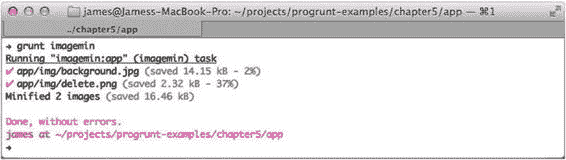
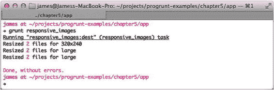
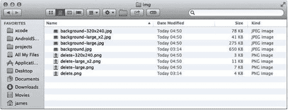
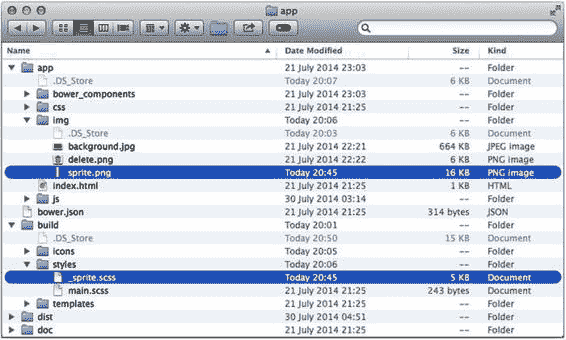
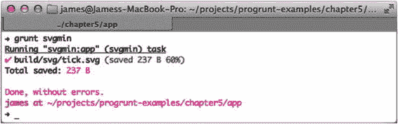
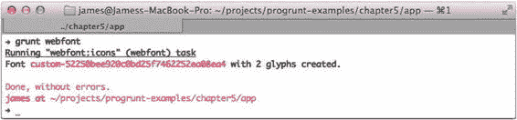

# 使用 Grunt 处理图像、SVG 和图标

到目前为止，我们已经探索了如何使用 Grunt 来优化处理 HTML、CSS 和 JavaScript。接下来，我们将发现如何将 Grunt 用于 Web 开发的另一个基本任务：生成视觉资源。自移动革命开始以来，随着 Flash 的衰落和高密度像素显示屏的出现，为生产环境准备视觉资源变得越来越复杂。在本章中，我们将使用 Grunt 来优化图像，为不同设备生成多个版本，并压缩 SVG 文件。和往常一样，使用 Grunt 会产生一套强大的工具，可以用于多个项目。

## 压缩图像

本章我们将讨论的第一个话题是图像优化。在本节中，我们将探讨如何使用 Grunt 来优化图像，使其可供在我们的应用中使用。图像优化是提高现代 Web 应用加载时性能的重要组成部分，因为图像通常占据页面总大小的重要部分。优化可以在不牺牲图像质量的前提下，减小图像的文件大小。

在 Web 应用中使用图像时，需要考虑多种因素。你需要回答的首要问题是：哪种格式适合你的图像？需要考虑两种格式：矢量图和光栅图。我将在本章后面更深入地讨论矢量图像，届时会回顾如何使用 `SVG`（可缩放矢量图形）与 `Grunt` 配合。`SVG` 是一种矢量格式，可用于生成高度可缩放的图像，而文件大小不会增加。首先，我将重点介绍光栅图像。

光栅图像在 Web 上的使用更为传统，这主要得益于浏览器厂商的支持。光栅图像可以提供多种格式，例如 `GIF`、`PNG` 或 `JPEG`。由于光栅图像的数据以像素网格的形式存储，它们不具备可缩放图像格式的特性。随着图像尺寸的增加，文件大小也会增加。每种光栅图像格式通常用于特定目的。如 Google 的 Web 基础（[`developers.google.com/web/fundamentals/media/images/optimize-images-for-performance`](https://developers.google.com/web/fundamentals/media/images/optimize-images-for-performance)）所述，`JPEG` 图像通常用于摄影，而 `PNG` 用于纯色图形，例如标志。

正如本书中反复提到的，在开发现代 Web 应用时，加载时性能对于应用的成功至关重要，因为用户对页面加载时间有感知。因此，我们必须努力提供最增强的体验，同时优化页面使其快速加载。由于图像在一般用户体验中扮演着重要角色，我们在开发应用时还必须考虑如何优化这些资源。此处的优化意味着在保证图像质量的前提下，减小图像的文件大小。光栅图像的文件大小可以通过使用应用了无损和有损压缩的工具进行显著缩减。

### 无损压缩与有损压缩

无损压缩得名于其能完全还原原始文件，不会丢失任何数据。它基于将文件分割成更小部分进行传输或存储的原理。有损压缩则采用不同的原则：在压缩过程中会移除图像数据，输出结果无法用来重建原始文件。`Grunt` 可自动在应用中使用这些压缩文件，并报告每张图像的文件大小缩减百分比。

本节我们将介绍一个新插件：`grunt-contrib-imagemin`。该插件支持压缩 `GIF`、`JPEG`、`PNG` 和 `SVG` 格式。目前我们将先探索其在光栅图像中的应用。首先将新插件添加到项目中（见列表 5-1）。

***列表 5-1***。使用 `npm` 将 `grunt-contrib-imagemin` 添加到 `package.json`

```
npm install grunt-contrib-imagemin –-save-dev
```

插件安装到项目后，接下来需要配置插件以查找图像并进行优化。列表 5-2 展示了新添插件的 `Gruntfile` 配置示例。

***列表 5-2***。`grunt-contrib-imagemin` 的 `Gruntfile` 配置

```
...
imagemin: {
  app: {
    options: {
      optimizationLevel: 6,
      progressive: true,
      use: [pngquant()]
    },
    files: [{
      expand: true,
      cwd: 'src/',
      src: ['**/*.{png,jpg,gif}'],
      dest: 'dist/'
    }]
  }
}
...
```

列表 5-2 中配置的选项将优化级别设为 6，`JPEG` 压缩转为渐进式，最后使用名为 `pngquant` 的插件。我们逐一分析这些选项。

我们将 `optimizationLevel` 选项设为 6。该选项控制压缩 `PNG` 图像 `IDAT` 块时运行的尝试次数，这主要是插件内置的 `PNG` 压缩工具 `optipng` 的功能。`IDAT` 块本质上是 `PNG` 文件的图像数据。尝试次数越多，压缩耗时越长，因为 `optipng` 需要更多努力来寻找最优方案。每次尝试都会运用一系列压缩技术来减小文件大小，且不影响图像质量。该选项接受 0 到 7 的值：0 表示不对文件进行压缩，7 表示将运行 240 次尝试来缩小图像尺寸。

`progressive` 选项影响 `grunt-contrib-imagemin` 使用的 `JPEG` 压缩工具 `jpegtran` 的工作方式。该选项可启用或禁用。当设为 `true` 启用时，生成的 `JPEG` 文件将采用渐进式 `JPEG` 格式。顾名思义，渐进式 `JPEG` 会逐步渲染：最初显示低质量版本，随着网络传输更多数据，图像质量逐渐提升。研究显示（[`calendar.perfplanet.com/2012/progressive-jpegs-a-new-best-practice/`](http://calendar.perfplanet.com/2012/progressive-jpegs-a-new-best-practice/)），若原始图像大于约 30KB，渐进式 `JPEG` 还能获得更好的压缩率。

我们来看最后一个选项 `use`。该选项允许配置 `grunt-contrib-imagemin` 使用其他 `imagemin` 插件。`Grunt-contrib-imagemin` 封装了 `NodeJS` 模块 `imagemin`，因此任何 `imagemin` 插件都可用于此。总计有十个插件可与 `imagemin` 配合使用，每个插件都让 `grunt-contrib-imagemin` 能够运用一系列压缩工具。在我们的示例中，配置了 `grunt-contrib-imagemin` 使用 `pngquant`。

在进入本章下一主题前，我们先查看 `grunt-contrib-imagemin` 的示例输出（见图 5-1）。为此，我们向项目添加两张新图像：一张是 `JPEG` 格式的大型背景图，另一张是 `PNG` 格式的删除图标。



图 5-1。`grunt-contrib-imagemin` 示例输出

如 图 5-1 所示，`grunt-contrib-imagemin` 会列出所有处理的文件。针对每个文件，输出文件来源、总节省空间及缩减百分比。最后汇总处理的文件总数与总缩减量。虽然图像压缩是应用构建流程的重要部分，但它无法解决响应式网站的图片适配问题。下一节我们将使用 `Grunt` 来准备针对不同断点优化的图像。

## 生成响应式图像

如前所述，移动设备的使用增长惊人。这带来了新挑战，因为移动设备通常比人们访问网络应用的传统设备拥有更小的屏幕。因此，我们需要一种解决方案来让图像适配不同设备。自 Ethan Marcotte 所著《响应式 Web 设计》（A Book Apart，2011 年）推广后，广泛采用的一种方法在列表 5-3 中进行了概述。

***列表 5-3***。使用 `max-width` 确保图像在填充可用容器宽度时保持宽高比

```
.container > img {
  max-width: 100%;
}
```

列表 5-3 中的 `CSS` 确保图像填充 `class` 属性为 `.container` 的元素内的可用宽度。使用 `max-width` 属性还能在图像填充可用宽度时保持宽高比。这可以配合 `CSS3` 标准中引入的媒体查询，针对不同设备类别以不同宽度渲染图像。列表 5-4 演示了使用媒体查询调整图像宽度。

***列表 5-4***。使用媒体查询优化图像显示

```
.container > img {
  max-width: 100%;
}

@media screen and (min-width: 400px) {
  .container {
    width: 368px;
  }
}

@media screen and (min-width: 768px) {
  .container {
    width: 416px;
  }
}
```

列表 5-4 首先将 class 属性为 `container` 元素内的图像设置为拉伸至可用宽度。接着应用媒体查询：首先针对显示宽度为 400px 及以上的设备，将图像约束为 368px；最后针对显示宽度为 768px 及以上的设备，将图像宽度增加至 416px。

此方案在大多数场景下效果良好，但存在两个缺点。第一个问题是不同设备网络接入的差异。例如，有些移动设备可能通过 3G 连接访问应用，而其他人则使用光纤宽带连接的台式机。为保证桌面端体验，必须使用大图提供高分辨率图像。但在移动设备上，显示尺寸更小，因此可缩小图像以降低页面加载量。第二个问题是性能影响。目前，浏览器执行图像缩放仍是高开销操作。图像越大，为移动显示缩小图像的代价越高。

#### 使用 Grunt 调整图像尺寸

让我们先解决第二个问题：消除浏览器为适应设备宽度而调整图片大小的需求。为了解决这个问题，我们将以多种断点生成图片。然后可以为每个设备使用最合适的图片。每次需要发布新内容时生成多个图片成本高昂且是重复性任务，因此非常适合集成到 `Grunt` 工作流中。让我们引入一个新插件：`grunt-responsive-images`。这个插件封装了图像处理工具 `GraphicsMagick` 和 `ImageMagick`，并允许指定一组尺寸来调整原始图片的大小。清单 5-5 演示了该插件的安装。

***清单 5-5***。安装 `grunt-responsive-images`

```
npm install --save-dev grunt-responsive-images
```

在可以使用该插件之前，必须安装 `GraphicsMagick` 或 `ImageMagick`。在我们的示例中，我们将使用 `GraphicsMagick`。要安装 `GraphicsMagick`，请访问 `GraphicsMagick` 下载页面（[`sourceforge.net/projects/graphicsmagick/files/graphicsmagick/`](http://sourceforge.net/projects/graphicsmagick/files/graphicsmagick/)），Mac 以外的所有平台均适用。Mac 用户可以使用 `Homebrew` 安装 `GraphicsMagick`，如清单 5-6 所示。

***清单 5-6***。使用 `Homebrew` 安装 `GraphicsMagick`

```
brew install GraphicsMagick
```

接下来，必须将插件的配置添加到项目中。清单 5-7 演示了项目的示例配置。

***清单 5-7***。`grunt-responsive-images` 的 `Grunt` 配置

```
responsive_images: {
  dest: {
    options: {
      sizes: [{
        width: 320,
        height: 240
      },{
        name: 'large',
        width: 640
      },{
        name: "large",
        width: 1024,
        suffix: "_x2",
        quality: 60
      }]
    },
    files: [{
      expand: true,
      src: ['img/**.{jpg,gif,png}'],
      cwd: 'app/',
      dest: 'dist/'
    }]
  }
}
...
grunt.loadNpmTasks('grunt-responsive-images');
```

`grunt-responsive-images` 是一个非常灵活的插件，它为您提供了对输出图片的大量控制。让我们分解清单 5-7 中的配置，解释每个选项的作用。首先，我们定义 `options`，它是一个 `sizes` 数组。每个 `sizes` 至少定义一个输出图片的维度，并将为传递给插件的每个图片生成一个此尺寸的新图片。

第一个 `sizes` 是最简单的示例。我们仅定义图片的高度和宽度。这将生成一个具有这些尺寸的新图片，文件名后附加上新的图片尺寸。第二个 `sizes` 选项定义单一维度，即宽度。此配置将在保持宽高比的同时将图片调整为指定维度。这第二组配置引入了一个新选项：`name`。`name` 选项将用作图片后缀的一部分。在我们的示例中，新图片文件名将包含原始图片名称和 `name` 后缀。例如，`background-large.jpg`。最后的配置引入了两个新选项：`suffix` 和 `quality`。`suffix` 选项允许在文件名和 `name` 参数后附加额外的后缀。清单 5-7 中的示例可能生成最终名称为 `background-large_x2.jpg` 的图片。`quality` 参数指作为插件一部分生成的 JPEG 图片的质量。它接受 1 到 100 之间的值，其中 100 将生成最佳质量的图片。

除了这些选项，我们还为我们的目标定义了一个 `files` 配置。这是标准的 `Grunt` 文件数组格式，它将找到 `/app/img` 目录下的所有图片，将这些图片传递给插件，并将输出存储在 `/dist/img` 中。

`grunt-responsive-image` 插件还允许在配置中定义以下内容：

*   `rename`：这提供了替换图片原始文件名的能力，同时保留其后缀。
*   `aspectRatio`：此选项默认保持。将其设置为 `false` 则不保持宽高比。
*   `gravity`：在图片裁剪过程中，此选项控制图片的放置位置。默认设置为 `center`。它接受所有方位点的值（例如，`northwest`，`north`，`northeast` 等）。
*   `upscale`：这决定如果目标尺寸大于原始图片，是否应放大图片。
*   `separator`：这是用于文件名和后缀之间的字符。
*   `units`：这提供了像素、百分比和倍数单位及其表示之间的映射。默认情况下，此选项设置为 `{ percentage: 'pc', pixel: '', multiply: 'x' }`。

在继续讨论如何在应用程序中使用这些新生成的图片之前，我们将快速查看插件的输出，如图 5-2 和图 5-3 所示。



图 5-2. `grunt-responsive-images` 的示例输出



图 5-3. `grunt-responsive-images` 生成的图片

如图 5-2 所示，该插件会为每个尺寸配置输出生成的文件数量。在我们的配置中，有三组不同的图片。这生成了三行输出，对于每组尺寸选项，插件生成了两个图片。图 5-3 显示了根据清单 5-6 中的配置生成并在图 5-2 中列出的图片。两张源图片 `background.jpg` 和 `delete.png` 由插件转换，为每张图片额外生成三张图片。现在我们有一系列图片，必须将它们应用到相关设备。

背景图片可以很容易地使用 CSS 应用。我们可以使用媒体查询针对不同宽度的设备。清单 5-8 演示了为不同类别的设备应用多个版本背景图片的示例。

***清单 5-8***。使用媒体查询应用响应式图片

```
body {
    background: url(../img/background-320x240.jpg);
}

@media screen and (min-width: 600px) {
    body {
        background: url(../img/background-large.jpg);
    }
}
```

### 使用 `srcset` 的响应式图片

这种解决方案对背景图片效果很好，但不能解决内容中图片的问题。在撰写本文时，`srcset` 属性仅在最新版本的 Firefox、Chrome、Safari 和 Opera 中受支持。`srcset` 属性允许开发者为不同的设备属性定义多个图片来源。清单 5-9 演示了一个示例。

***清单 5-9***。使用 `srcset` 定义不同图片

```

```

`srcset` 属性规范已被 `picture` 元素规范取代，后者定义了 `picture` 元素并扩展了原始的 `srcset` 属性。该规范详细描述了一组更丰富的属性，可用于针对特定设备，其方式类似于我们针对特定设备使用 CSS 的方式。在撰写本文时，`picture` 元素（见清单 5-10）仅在最新版本的 Chrome 和 Firefox 中受支持。

***清单 5-10***。`picture` 元素

```markdown
### 使用 picture 元素

```html
<picture>
   <source media="(min-width: 64em)" src="high-res.jpg">
   <source media="(min-width: 37.5em)" src="med-res.jpg">
   <source src="low-res.jpg">
   
   <p>无障碍文本。</p>
</picture>
```

为了在旧版浏览器中实现类似的解决方案，我建议先提供最低质量的图片，然后通过 JavaScript 解决方案渐进式地增强用户体验。其中一个方案是由 BBC 响应式新闻团队开发的 `Imager.js`（<https://github.com/BBC-News/Imager.js/>）。

`Imager.js` 简化了处理响应式图片的工作流程，并防止浏览器下载多张重复图片。它通过使用带有图片源数据属性的元素来替换原有的图片元素。这些元素会交由 `Imager.js` 处理，然后根据可用的图片宽度进行定义，同时还能定义像素密度。之后，`Imager.js` 会在页面上运行，将这些元素替换为最适合当前页面的图片元素。清单 5-11 展示了 `Imager.js` 运行前的 HTML 代码，而清单 5-12 则展示了 `Imager.js` 对页面 HTML 的影响。

**清单 5-11**. `Imager.js` 运行前的 HTML 代码

```html
<div style="width: 240px">
    <div class="delayed-image-load" data-src="http://placehold.it/{width}" data-alt="替代文本"></div>
</div>

<script>
    new Imager({ availableWidths: [200, 260, 320, 600] });
</script>
```

**清单 5-12**. `Imager.js` 修改页面后的 HTML 代码

```html
<div style="width: 240px">
    
</div>

<script>
    new Imager({ availableWidths: [200, 260, 320, 600] });
</script>
```

如清单 5-12 所示，`Imager.js` 修改了原始的 `div` 元素，将其替换为一个新的 `img` 元素。从可用的尺寸数组中，`Imager.js` 为当前设备选择了 260。它会将占位符 `{width}` 替换为选中的宽度，然后将其设置为新图片元素的 `src` 属性。由于图片也采用了懒加载，页面的初始渲染时间也应得到改善。

关于响应式图片的内容到此结束。接下来，我将介绍一个能生成图片精灵（Image Sprites）的新插件。

### 制作图片精灵

这是我们探索使用 Grunt 为现代 Web 应用自动化图片优化的最后一个部分。图片精灵是一种性能优化技术，旨在减少渲染页面时发出的 HTTP 请求数量。图片精灵将多个小图片合并成一张大图。虽然这不一定能减少页面消耗的带宽总量，但可以提升页面的加载性能。从同一域名请求多张图片可能导致页面加载时间的瓶颈，因为部分浏览器对同一域名的并发请求数有限制。例如，Internet Explorer 10 将单个域名的并行下载数限制为 8 个。因此，如果页面上有很多图标，可能会导致某些图标的下载时间超出预期。创建图片精灵有助于解决这个问题，因为只需要为精灵图发起一次请求，而不是每张图片都请求一次。

生成精灵图最简单但最耗时的方法是手工操作。这意味着打开你最喜欢的图片编辑软件，将所有图标导入其中，仔细地将每张图片相邻放置，然后将新生成的精灵图导出为优化后的图片。手工制作完精灵图后，你还需要编写 CSS 来正确定位精灵图，以便在正确的元素中只显示一个图标。每次为网站添加新图标或 Logo 时，你都必须重新打开精灵图并修改 CSS。显然，这并不理想，并且会带来大量的维护开销。如果你还想为具有更高像素密度显示器的设备制作视网膜精灵图，维护工作量还会翻倍。

第二种方法是使用免费的在线工具，例如 [www.spritebox.net](http://www.spritebox.net)，它提供了上传和创建精灵图的便捷方式。这些在线工具比之前描述的手动方法更强大，因为它们通常会生成 CSS、LESS 或 SASS，方便集成到你的应用中。使用这些工具的主要缺点是需要联网才能使用，并且它们不能与你的工作流程无缝集成。如果你需要离线工作，就必须等到恢复联网后才能更新你的图片和精灵图。此外，由于图片是在线生成的，一旦你将新的精灵图复制到项目中，还需要对其进行优化。

#### 自动化创建精灵图

如上所述，前面的方法远非完美，但其中一些缺点可以通过使用 `Grunt` 来解决。使用 `Grunt` 生成精灵图的好处是使过程可重复且可复用。除此之外，大多数为精灵图生成而开发的 `Grunt` 插件都可以离线运行。`Grunt` 有许多可用的精灵图生成插件。我将重点介绍其中一个，名为 `grunt-spritesmith`。这个插件拥有丰富的选项，可以完全控制生成的精灵图，并且还提供了为大多数主流 CSS 预处理器输出 CSS 的选项。清单 5-13 演示了如何将 `grunt-spritesmith` 安装到你的项目中。

**清单 5-13**. 安装 `grunt-spritesmith`

```bash
npm install  grunt-spritesmith --save-dev
```

该插件基于精灵引擎（sprite engine）运行。精灵引擎是一个外部的图片处理工具，插件使用它来处理精灵图。在撰写本文时，该插件支持 `pngsmith`、`phantomjs`、`canvas` 和 `GraphicsMagick` 作为精灵引擎。精灵引擎的选择会影响插件的能力。例如，使用 `pngsmith` 会阻止插件处理非 png 格式的图片。虽然 `canvas` 在处理超过 100 个精灵图时性能最佳，但它仅支持 Linux 平台。在我们的示例中，我们将使用能够处理所有图片格式的 `phantomjs`。

让我们开始探索使用 `grunt-spritesmith` 生成精灵图时可用的选项。清单 5-14 提供了一个示例配置，我们将对其进行详细说明。

**清单 5-14**. `grunt-spritesmith` 配置

```javascript
sprite: {
    app: {
      src: ['build/icons/**.png'],
      destImg: 'app/img/sprite.png',
      destCSS: 'build/styles/_sprite.scss',
      imgPath: '../img',
      algorithm: 'top-down',
      padding: 35,
      engine: 'phantomjs',
      cssFormat: 'scss'
    }
  }
```

如列表 5-14 所示，`grunt-spritesmith` 为生成适合特定用例的精灵图提供了极大的灵活性。我将回顾列表 5-14 中定义的每个选项，并解释每个选项对输出的精灵图和 CSS 的影响。第一个选项仅用于定义哪些文件应包含在精灵图中。在示例中，我们在 `build` 文件夹中添加了一个包含所有图标的新文件夹。下一个选项 `destImg` 决定了生成的精灵图的位置和文件名。第三个选项决定了插件生成的 CSS 的位置和文件名。在我们的示例中，我们希望生成 `SCSS` 以集成到现有的 `SCSS` 工作流程中。`imgPath` 选项控制生成的 CSS 中出现的图像路径。如果你的路径与构建路径不同，这会非常有用。在我们的案例中，`CSS` 和图像在构建文件夹中的位置不同；因此，我们指定了图像路径，以便图像能够正确加载。`algorithm` 选项控制图像在生成的精灵图中的布局方式。此选项允许图像从上到下、从左到右或沿对角线添加。这在处理响应式解决方案时特别有用，因为图像可能需要以特定方式布局以支持不同的设备宽度。与 `algorithm` 选项一样，`padding` 选项也控制图像在精灵图中的布局。顾名思义，`padding` 控制每个图标周围的填充量。在我们的示例中，我们选择为每个图标添加 `35px` 的填充。当你有需要应用背景图像的大元素，并且必须确保只有一个图标显示为背景图像图标时，这很有用。如前所述，`grunt-spritesmith` 将图像创建委托给第三方图像工具。`engine` 选项控制用于生成精灵图的工具。在列表 5-14 中，`phantomjs` 被用作创建精灵图的工具。`grunt-spritesmith` 最强大的功能之一是能够以所选格式输出 `CSS`。在我们的示例中，我们指定了 `SCSS`；但是，该插件支持 `LESS`、`SASS`、`Stylus` 和 `CSS` 输出。

列表 5-14 中的配置输出两个资源：精灵图文件和 `SCSS` 文件。图 5-4 展示了项目目录中的输出文件。



图 5-4。`grunt-spritesmith` 插件输出的精灵图和 `SCSS` 文件

使用 `grunt-spritesmith` 为精灵表生成 `SCSS` 的另一个好处是它生成了一组丰富的 `mixin`。列表 5-15 提供了从上述示例生成的完整 `SCSS` 文件示例。

***列表 5-15***。`grunt-spritesmith` 输出的 `SCSS` 示例

```
$upload-x: 0px;
$upload-y: 1443px;
$upload-offset-x: 0px;
$upload-offset-y: -1443px;
$upload-width: 76px;
$upload-height: 76px;
$upload-total-width: 76px;
$upload-total-height: 1741px;
$upload-image: '../img';
$upload: 0px 1443px 0px -1443px 76px 76px 76px 1741px '../img';

@mixin sprite-width($sprite) {
  width: nth($sprite, 5);
}

@mixin sprite-height($sprite) {
  height: nth($sprite, 6);
}

@mixin sprite-position($sprite) {
  $sprite-offset-x: nth($sprite, 3);
  $sprite-offset-y: nth($sprite, 4);
  background-position: $sprite-offset-x  $sprite-offset-y;
}

@mixin sprite-image($sprite) {
  $sprite-image: nth($sprite, 9);
  background-image: url(#{$sprite-image});
}

@mixin sprite($sprite) {
  @include sprite-image($sprite);
  @include sprite-position($sprite);
  @include sprite-width($sprite);
  @include sprite-height($sprite);
}
```

对于添加到精灵表的每个图像，`grunt-spritesmith` 会生成许多以文件名开头的变量。每个变量都包含图像的属性，例如，在精灵表中的 `x` 坐标。这些变量被组合起来，并由生成的 `mixin` 使用。该插件还会生成四个 `mixin`。前四个是便捷 `mixin`，由主 `mixin` `sprite` 使用。`sprite` `mixin` 是实际用于生成包含图标或图像作为背景的 `CSS` 输出的 `mixin`。列表 5-16 演示了如何使用 `sprite` `mixin` 将上传图标添加到我们的 `CSS` 输出中。

***列表 5-16***。使用 `grunt-spritesmith` 在 `CSS` 中生成图标

```
.icon-upload {
  @include sprite-width($icon-upload);
}
```

各种变量的创建与 `grunt-spritesmith` 生成的 `mixin` 相结合，使得维护精灵表变得异常容易。精灵表本身的任何更改对 `SCSS` 都是透明的，因为变量值的更改不需要在 `SCSS` 中进行任何更新。此外，精灵表和 `SCSS` 可以传递给其他 `Grunt` 任务，从而实现诸如代码检查和压缩等任务。

### 使用 SVG

本章的第一部分致力于优化 Web 的光栅图像。在余下的章节中，我将重点优化处理 `SVG` 文件的工作流程。`SVG` 非常适合生成可缩放且可使用 `CSS` 设置样式的轻量级图标。`SVG` 是一种基于 `XML` 的文件格式，适用于生成二维图形，其中元素用于定义路径、形状和多边形。列表 5-17 演示了一个基本的 `SVG` 文件，图 5-5 展示了该 `SVG` 文件的视觉效果。

***列表 5-17***。`SVG` 文档示例

```
<?xml version="1.0" standalone="no"?>
<!DOCTYPE svg PUBLIC "-//W3C//DTD SVG 1.1//EN" "http://www.w3.org/Graphics/SVG/1.1/DTD/svg11.dtd">
<svg xmlns="http://www.w3.org/2000/svg" width="39" height="32" viewBox="0 0 39 32">
    <!-- tick icon -->
    <path d="M15.815 32l23.475-28.046-4.695-3.954-19.521 23.228-11.12-9.266-1.954 10.695z"/>
</svg>
```


图 5-5。列表 5-17 输出的 `SVG` 视觉效果

除了基本的二维图形外，`JavaScript` 和 `CSS` 也可以与 `SVG` 一起使用来制作动画。这并非 `SVG` 成为理想图标格式的唯一特性。使用 `SVG` 作为图标的主要优势在于它们体积轻量，并且可以在不影响图像质量的情况下轻松缩放。过去几年中，`SVG` 文件的使用有所增加，这主要是由人们通过各种设备访问 Web 的趋势推动的。由于 `SVG` 的文件大小通常小于光栅图像，并且如前所述易于缩放，这解决了为高像素密度显示器设备渲染清晰图像的问题。然而，与所有页面资源一样，应谨慎考虑，以避免使页面臃肿、增加页面重量并导致不良的用户体验。`Grunt` 通过提供自动化优化 `SVG` 文件的工具，有助于降低这种风险。

#### 压缩 SVG

与 CSS 和 JavaScript 一样，SVG 文件也可以被压缩。这主要源于一个事实：与其他基于文本的文件格式一样，可以去除不必要的内容和空格。如果你从流行的图形软件包中导出 SVG 图像，这一点尤其适用。幸运的是，`Grunt` 有一个可用于优化 SVG 文件的插件，并能在你的应用程序中直接使用。我现在要介绍的插件叫做 `grunt-svgmin`。`grunt-svgmin` 封装了 Node.js 库 `SVGO`，这是一个 SVG 优化器。`SVGO` 将执行诸如删除空属性、注释、文档类型声明以及将样式转换为属性等优化操作。Listing 5-18 展示了一个 `grunt-svgmin` 的示例配置。

***Listing 5-18***. `grunt-svgmin` 配置

## 优化 SVG 文件

`svgmin` 配置演示了在项目中优化 SVG 文件所需的最简单配置。这里定义了两个选项：`removeViewBox` 和 `removeUselessStrokeAndFill`。第一个选项会从根 `<svg>` 元素中移除 `viewBox` 属性。第二个选项会移除那些 `stroke-width` 属性设置为 `0` 或 `none` 的描边。如果 SVG 包含 `fill` 属性设置为 `none` 且 `opacity` 设置为 `0` 的元素，则 `fill-opacity` 会被移除。此外，`grunt-svgmin` 还会从 SVG 中移除空格、注释和文档类型声明。Listing 5-19 展示了一个示例输入 SVG 文件，优化后的版本见 Listing 5-20。

**Listing 5-19**. 优化前的 SVG 文件

```xml
<?xml version="1.0" standalone="no"?>
<!DOCTYPE svg PUBLIC "-//W3C//DTD SVG 1.1//EN" "http://www.w3.org/Graphics/SVG/1.1/DTD/svg11.dtd">
<svg xmlns="http://www.w3.org/2000/svg" width="39" height="32" viewBox="0 0 39 32">
  <!-- tick icon -->
  <path stroke="0" stroke-width="0" fill="none" fill-opacity="0" d="M15.815 32l23.475-28.046-4.695-3.954-19.521 23.228-11.12-9.266-1.954 10.695z"/>
</svg>
```

**Listing 5-20**. 经 `grunt-svgmin` 优化后的 SVG 文件

```xml
<svg xmlns="http://www.w3.org/2000/svg" width="39" height="32"><path d="M15.815 32L39.29 3.954 34.595 0l-19.52 23.228-11.12-9.266L2 24.657z" fill="none"/></svg>
```

与其他压缩插件一样，`grunt-svgmin` 插件会在压缩后输出文件大小的缩减百分比。Figure 5-6 展示了该插件的一个示例输出。



Figure 5-6. `grunt-svgmin` 的示例输出

## 生成 SVG Sprites

SVG 图像可以通过多种方式包含在页面中，包括使用 `<object>` 元素、`<iframe>` 标签、`` 标签，或者将内容直接嵌入文档。除这些方法外，SVG 文件也可以在 CSS 中被引用为背景。与所有页面资源一样，我们必须尽量减少下载整个页面所需的请求数量。这个规则同样适用于 SVG 文件。想象一个页面，其菜单系统包含大量图标。如果菜单中的每个图标都通过 `` 元素引用一个 SVG 文件，或者使用 CSS `background` 属性来应用，这可能会产生许多不必要的请求。与光栅图像一样，我们可以将多个 SVG 文件合并成一个单一文件，并应用它来代替单个文件。这样做的好处是所有图像只需一次 HTTP 请求，并且这个 SVG Sprite 可以使用 gzip 进行压缩，从而进一步减少带宽消耗。为了实现这些改进，我们可以引入一个名为 `grunt-svg-sprite` 的新插件。Listing 5-21 展示了 `grunt-svg-sprite` 的一些示例配置。

**Listing 5-21**. `grunt-svg-sprite` 配置

```javascript
svgsprite: {
  app : {
    options: {
      render: {
        scss: {
          dest: '../../build/styles/_font.scss'
        },
        css: false
      },
      spritedir: '',
      padding: 35,
      layout: 'vertical'
    },
    src: 'build/svg/',
    dest: 'app/img/'
  }
}
```

Listing 5-21 中概述的配置将生成一个 SVG Sprite 和一个配套的 SCSS 文件。为了实现这一点，`render` 选项被设置为包含 SCSS 文件的目标路径。需要注意的是，此路径是相对于由 `dest` 选项定义的目标目录的。另外，要禁用 CSS 输出，需要将 `css` 选项设置为 `false`。定义的下一个选项是 `spritedir`，它阻止 sprite 被放置在一个专用文件夹中。在我们的示例中，生成的 sprite 将输出在 `dest` 文件夹的根目录下。`padding` 选项与 `grunt-spritesmith` 的 `padding` 选项相同，它控制每个图标周围的间距。提供的最后一个选项是 `layout`，它控制每个图标在 SVG Sprite 中的布局方式。它接受 `vertical`、`horizontal` 或 `diagonal` 这几个值。

通过将导入语句添加到 `main.scss` 文件的顶部，可以轻松地将 SVG Sprite 集成到我们现有的 SASS 工作流中，如 Listing 5-22 所示。

**Listing 5-22**. 将 SVG Sprite 添加到 SASS 文件

```scss
@import 'font';
```

编译后的 CSS 现在将包含新的 CSS 选择器，每个选择器对应 sprite 中包含的一个图标。要使用这些图标之一，我们可以创建 HTML，如 Listing 5-23 所示。

**Listing 5-23**. 演示如何使用 SVG Sprite

```html
<div class="svg-circle"></div>
```

Listing 5-23 中的 HTML 会将 CSS `background` 属性应用于 `<div>` 元素，该元素会渲染出与原始 `circle.svg` 文件相对应的图标。

## 生成图标字体

在结束本章之前，我们将探究如何使用 `Grunt` 生成网页字体，以支持 Internet Explorer 9 及更高版本的可缩放图标。图标字体已成为为页面应用图标的一种流行方式，它既适用于标准像素密度屏幕，也适用于更高像素密度的显示器。有许多网站提供免费资源，例如 `Font Awesome`；然而，选择大型图标字体可能会对用户体验产生负面影响，因为图标可能需要很长时间下载，而整份字体中只有一小部分被使用。最佳方法是创建一种仅包含应用程序或网站将使用的图标，从而节省宝贵的带宽。`Grunt` 有一个插件可用于从一系列 `SVG` 文件创建字体。该插件名为 `grunt-webfont`。清单 5-24 演示了 `grunt-webfont` 的示例配置。

**清单 5-24**. `grunt-webfont` 配置

```javascript
webfont: {
  icons: {
    options: {
      font: 'custom',
      stylesheet: 'scss',
      relativeFontPath: '../fonts',
      htmlDemo: false
    },
    destCss: 'build/styles/',
    src: 'build/svg/**/*.svg',
    dest: 'app/fonts'
  }
}
```

清单 5-24 中的配置定义了许多选项，类似于 `grunt-spritesmith`，因为 `grunt-webfont` 能够以几乎相同的方式生成 `CSS`、`SCSS` 或 `LESS`。第一个选项定义要生成的字体名称。其次，生成的 `CSS` 类型由 `stylesheet` 选项控制。此选项接受 `css`、`less`、`sass` 和 `scss` 值。下一个选项 `relativeFontPath` 控制 `CSS` 输出中定义的字体路径。默认情况下，`grunt-webfont` 会生成一个用于加载字体的演示 `HTML` 文件。将此选项设置为 `false` 可阻止生成 `HTML` 演示文件。`CSS` 的位置可以通过设置 `destCss` 选项来控制。`destCss` 选项接受生成的 `CSS` 文件放置的目录。我们配置中的最后两个选项决定哪些 `SVG` 文件包含在我们的字体中，以及生成的字体的放置位置。

当插件创建字体时，它会输出已为给定字体选择的字形数量。如图 5-7 所示。



图 5-7. `grunt-webfont` 示例输出

### 总结

在本章中，我介绍了如何利用 `Grunt` 来执行生成网站优化视觉资源的重复且耗时的任务。在本章前半部分，我们了解了各种用于处理栅格图像的插件，然后转向了基于矢量的图形，如 `SVG`。本章重点讨论了通过合并和压缩视觉资源来减轻页面重量，旨在提升生产环境中应用程序的性能。

下一章将重点介绍使用 `Grunt` 创建一个用于在本地查看和测试应用程序的 `Web` 服务器。