# 第 6 章


## 使用 Grunt 进行测试和本地开发

在前几章中，我们专注于如何自动化构建过程，以优化我们的资源并确保它们达到特定的质量标准。在本章中，我们将重点介绍使用 `Grunt` 设置本地 `Web` 服务器。设置完成后，我们将探索使用本地 `Web` 服务器在无头浏览器和实际浏览器中执行测试。为了进一步确保我们正在构建的软件符合现代开发的最佳实践，我们将把开发环境暴露到互联网上，从而让我们能够自动化运行性能测试。

### 设置本地服务器

由于 `Grunt` 是构建在 `npm` 环境之上的，设置本地 `Web` 服务器非常简单，因为有众多可用的 `npm` 包可以用于创建它们。更简单的是，有许多 `Grunt` 插件可以自动化启动本地 `Web` 服务器。有一些插件可以启动服务器，使用流行的 `Web` 框架，如 `Flash (Python)`、`Sinatra (Ruby)` 和 `Express (Node)`。在本章中，我们将使用 `grunt-contrib-connect`。这个插件封装了 `npm` 包 `connect` 和 `connect-livereload`，为静态发布提供了一个多功能的本地开发环境。在此上下文中，静态发布指的是将资源动态生成为静态文件，以便在开发或生产环境中使用的过程。

首先，我们必须将 `grunt-contrib-connect` 添加到我们的项目中。与所有 `Grunt` 插件一样，这只需一个简单的 `npm install` 命令，如清单 6-1 所示。

***清单 6-1***. 安装 `grunt-contrib-connect`

```
npm install grunt-contrib-connect --save-dev
```

一旦插件成功添加到项目后，我们接下来通过在 `Gruntfile.js` 文件中定义配置来配置我们的本地 Web 服务器。清单 6-2 提供了设置一个简单 `HTTP` 服务器的示例配置。我们将在本章后面探讨设置 `HTTPS` 服务器。清单 6-2 中的配置将启动一个运行在 `8000` 端口、响应任何主机名、根目录为应用程序文件夹 `app` 的本地 `Web` 服务器。要启动 Web 服务器，你必须运行 `grunt`，如清单 6-3 所示，并且你应该在终端中看到与图 6-1 类似的输出。如果你现在打开浏览器并尝试访问配置在 `8000` 端口上的 Web 服务器（访问 `http://localhost:8000`），你会发现 Web 服务器不可用。你可能已经注意到，一旦 Web 服务器启动，`Grunt` 就会退出。当 `Grunt` 退出时，`connect` Web 服务器也会关闭。`grunt-contrib-connect` 可以与其他插件（如 `grunt-contrib-jasmine`）结合使用，以自动化运行测试。测试运行完毕后，Web 服务器可以关闭。然而，在本地开发或在浏览器中调试问题时，保持 Web 服务器运行会很方便。我们现在将更新配置，以允许我们持续运行服务器。

***清单 6-2***. 配置 `Connect` 以运行本地 `Web` 服务器

```
connect: {
    server: {
      options: {
        port: 8000,
        protocol: 'http',
        hostname: '*',
        base: './app'
      }
    }
  }
```

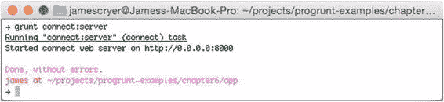

图 6-1. 连接、启动和停止本地 `Web` 服务器

***清单 6-3***. 使用 `grunt-contrib-connect` 启动一个 `Web` 服务器

```
grunt connect:server
```

#### 保持服务器运行

为了允许我们运行一个不会立即退出的服务器，我们必须修改配置以包含 `keepalive` 选项。在清单 6-4 中，我们为另一个可用于本地开发的 `Web` 服务器定义了一个额外配置。

***清单 6-4***. 配置 `connect` 以运行一个用于开发的本地 `Web` 服务器

```
connect: {
    dev: {
      options: {
        port: 8001,
        protocol: 'http',
        hostname: '*',
        base: './app',
        keepalive: true
      }
    }
  }
```


运行上述任务应产生如图 6-2 所示的输出。需要注意的是，在我们的第二个 Web 服务器中，我们将其配置为在 8001 端口上运行。这将使我们稍后能够在 8000 端口对我们的服务器运行测试，同时让我们的开发服务器继续运行。正如预期的那样，如果你尝试将两个 Web 服务器绑定到同一个端口号，第二个服务器将无法启动（图 6-3）。这一点在后面当文件发生变化时、测试在后台运行的情况下需要牢记。

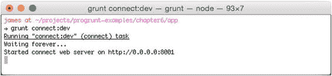

图 6-2。无限期运行本地 Web 服务器

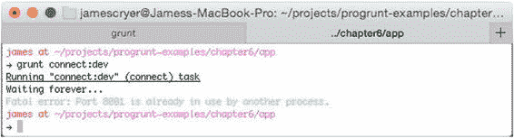

图 6-3。尝试在同一个端口号上运行两个 Web 服务器

如果你现在在浏览器中访问 `http://localhost:8001`，应该能看到我们的应用程序正在运行。要停止 Web 服务器，我们必须按下 `Ctrl+C`。

一种常见的开发模式是使用一个名为 `serve` 的 Grunt 任务来设置开发服务器。这是 Yeoman 团队采用的模式，并且可以在许多项目生成器（例如 Backbone.js）中找到。`serve` 任务通常构建所有开发资源，启动一个 Web 服务器，然后为应用程序打开一个浏览器。代码清单 6-5 包含了一个示例 `serve` 任务的配置。

代码清单 6-5 中定义的任务为了演示目的略显冗长。随着项目的发展，最好开始将任务分解成组，这样可以让其他团队成员了解构建的每个阶段完成的功能，而无需了解每个单独阶段的细节。我们将在下一章探讨如何优化你的构建过程。

***代码清单 6-5***。用于构建和启动开发环境的示例 `serve` 任务

```
grunt.registerTask('serve', [
  'clean',
  'useminPrepare',
  'sass',
  'bowerInstall',
  'autoprefixer',
    'jshint',
  'modernizr',
  'handlebars',
  'imagemin',
  'uncss',
  'copy',
  'cssmin',
  'concat',
  'requirejs',
  'rev',
  'usemin',
  'connect:dev'
]);
```

### 自动启动浏览器

代码清单 6-5 中定义的任务缺少的一个步骤是自动打开浏览器。这可以通过使用 `grunt-open` 或 `grunt-contrib-connect` 来实现。对于我们当前的工作流程，我们将保持简单，并使用 `grunt-contrib-connect`。随着我们工作流程的进阶，我们将改用 `grunt-open`。

代码清单 6-6 为我们的开发服务器提供了一个更新的配置，该配置将在 Web 服务器启动后自动打开我们的应用程序。

***代码清单 6-6***。使用 `grunt-contrib-connect` 在 Web 服务器启动后启动浏览器

```
connect: {
  dev: {
    options: {
      port: 8001,
      protocol: 'http',
      hostname: '*',
      base: './app',
      keepalive: true,
      open: true
    }
  }
}
```

添加 `open` 选项并将其值设置为 `true` 将导致你的默认浏览器在 Web 服务器启动后立即自动打开你的应用程序。

### 记录发送到服务器的请求

使用当前的配置，我们无法看到发送到 Web 服务器的请求，因为日志记录默认未启用。在本地开发期间，查看哪些请求已成功、HTTP 响应码以及生成响应所需的时间会非常方便。幸运的是，`grunt-contrib-connect` 具备此功能。要启用日志记录，我们必须将 `debug` 选项设置为 `true`，如代码清单 6-7 所示。图 6-4 展示了我们应用程序初始页面加载时的示例输出。

***代码清单 6-7***。向开发服务器配置添加 `debug` 选项

```
dev: {
  options: {
    port: 8001,
    protocol: 'http',
    hostname: '*',
    base: './app',
    keepalive: true,
    open: true,
    debug: true
  }
}
```

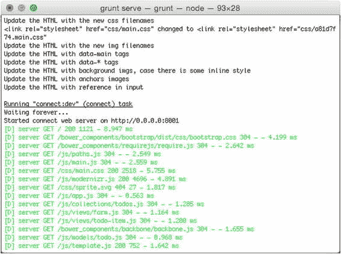

图 6-4。`grunt-contrib-connect` 记录发送到 Web 服务器的请求

### 使用压缩响应扩展我们的服务器

现在我们已经让 Web 服务器运行起来，并且自动打开和记录每个发送到终端的请求，让我们探索如何用新功能扩展我们的 Web 服务器。由于 `grunt-contrib-connect` 封装了 Node 模块 `connect`（在撰写本文时为 2.x 版本），我们可以使用所有可用的中间件插件来扩展我们的 connect 服务器（[`github.com/senchalabs/connect/wiki`](https://github.com/senchalabs/connect/wiki)）。有适用于 BasicAuth、OAuth 和缓存等功能的中间件。在我们的示例中，我们将使用其中一个内置的中间件功能：压缩。这将动态提供 gzip 压缩内容，前提是客户端在请求中发送了正确的头部信息。由于 `grunt-contrib-connect` 封装的是 `connect` 的 2.x 版本，压缩中间件是 `connect` 的一部分。在最新版本的 `connect` 中，核心中间件功能已经迁移到它们自己的模块中。

代码清单 6-8 修改了我们现有的开发 Web 服务器配置，以支持服务器响应的压缩。

***代码清单 6-8***。添加中间件以支持压缩

```
dev: {
  options: {
    port: 8001,
    protocol: 'http',
    hostname: '*',
    base: './app',
    keepalive: true,
    open: true,
    debug: true,
    middleware: function(connect, options, middlewares) {
      middlewares.unshift(connect.compress());
      return middlewares;
    }
  }
}
```

要添加中间件，我们定义一个 `middleware` 选项，并提供一个函数，该函数通过添加内置的 `compress` 中间件来修改现有的中间件模块集合。发送到 Web 服务器的每个请求现在都将经过此中间件。

在 Web 服务器添加了新的中间件之后，我们应该确认响应在被请求时是否被压缩。要测试此功能是否按预期工作，我们可以使用命令行工具 `curl` 来返回每个请求的字节数。图 6-5 演示了两个用于测试响应大小的 `curl` 命令。第一个 `curl` 命令没有发送 `Accept-Encoding: gzip,deflate` 头部，响应未被压缩。第二个 `curl` 命令在请求中添加了 `Accept-Encoding` 头部，Web 服务器正确响应了压缩后的内容。

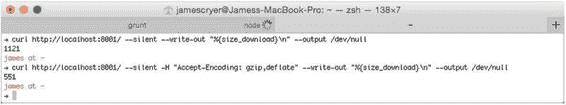

图 6-5。测试我们的中间件是否已按预期加载

至此，我们已经拥有了一个健壮的本地开发服务器和另一个准备好与测试运行器集成的测试服务器。我们能够在本地运行我们的应用程序，甚至像在生产环境中那样压缩响应。在下一章中，我将介绍当磁盘上的文件被修改时，如何自动在浏览器中重新加载资源，而无需手动重新加载或刷新浏览器。接下来，我们将开始以多种方式自动化测试我们的应用程序：单元测试、集成测试、无障碍测试和性能测试。

### 测试

除了运行本地开发服务器，我们还可以使用 Grunt 来自动化运行测试。拥有一套良好的应用程序测试套件的好处毋庸置疑。测试可以帮助防止问题发布到生产环境，作为团队成员之间的沟通工具，降低对复杂应用程序进行更改时的风险，并且它们是可重复的。一套自动化测试套件还可以显著减少验证一个需要在多个设备上运行的应用程序所需的时间，因为测试套件可以在多个设备上并行运行。这对于响应式 Web 应用程序尤其重要。


Grunt 可以自动化从单元测试到系统测试各个级别的测试工作。在接下来的几节中，我们将探索如何设置 Grunt 任务来运行单元测试、在不同浏览器中运行测试、验证应用程序的无障碍性，并最终进行性能测试。

#### 编写第一个测试

让我们从最基本的单元测试开始，踏上使用 Grunt 自动化各种应用程序测试的旅程。市面上有多种测试框架可供选择。在本例中，我们将使用 `nodeunit`。`Nodeunit` 是一个简单但健壮的测试框架，它支持异步运行测试，并支持多种报告格式。有一个名为 `grunt-contrib-nodeunit` 的 Grunt 插件可以封装 `nodeunit` 包。清单 6-9 展示了如何将该插件添加到项目中。

***清单 6-9***. 安装 `grunt-contrib-nodeunit`

```
npm install --save-dev grunt-contrib-nodeunit
```

接下来，需要将任务配置添加到我们的 `Gruntfile.js` 文件中（见清单 6-10）。

***清单 6-10***. `grunt-contrib-nodeunit` 的配置

```
nodeunit: {
    all: ['test/*_test.js'],
    options: {
      reporter: 'junit',
      reporterOptions: {
        output: 'out'
      }
    }
  }
```

清单 6-10 中的配置定义了一个目标，该目标将查找 `test` 文件夹中所有以 `test.js` 结尾的文件。例如，如果 `item_test.js`、`list_test.js` 和 `user_test.js` 文件存在于 `test` 文件夹中，则它们都将匹配该模式。此外，还设置了其他配置选项，用于配置测试运行器的输出。在这个实例中，测试运行器被配置为使用 JUnit 格式化程序输出结果，并且输出结果应存储在 `out` 目录中。

如果现在运行该任务，由于当前没有 `test` 文件夹或任何已编写的测试，我们将得到类似于图 6-6 所示的输出。接下来，我们将创建一个简单的 JavaScript 模块，用于表示待办事项列表中的一个项目。清单 6-11 包含了该待办事项模块的定义，该模块扩展了 `Backbone.Model` 模块。

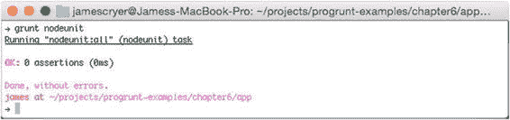

图 6-6. 在未定义任何测试的情况下运行 `grunt-contrib-nodeunit`

***清单 6-11***. 表示待办事项的简单 JavaScript 模块

```
/**
  *
  * @name Todo
  * @classdesc Todo Model
  * @author James Cryer
  * @exports Backbone.Model
  */
'use strict';

var Backbone = require('backbone');

module.exports = Backbone.Model.extend({
  defaults: {
    'title': '',
    'date': '19/02/2015',
    'complete': false
  },

complete: function () {
    this.set('complete', true);
  }
});
```

`Todo` 模块定义了一组默认属性：`title`、`date` 和 `complete` 状态。此外，还定义了一个用于将 `Todo` 模块实例标记为已完成的函数。`Backbone.Model` 模块使得为 `Todo` 模块的每个实例轻松定义属性默认值成为可能。

`complete` 函数使用 `Backbone.Model` 提供的 `set()` 函数来修改 `Todo` 模块实例的属性。清单 6-12 提供了一个如何在应用程序中使用这个简单模块的示例。这个简单的示例创建了一个 `Todo` 模块的新实例，并传入了 `title` 和必须完成的 `date`。创建待办事项后，我们将其设置为已完成。目前，除非我们在浏览器中运行它，否则我们没有办法验证新的 `Todo` 模块是否按预期工作。现在，让我们结合使用 `nodeunit` 和 `grunt-contrib-nodeunit` 来编写一个测试，这样每次我们对模块进行更改时都可以运行它。

***清单 6-12***. 使用 `Todo` 模块的示例

```
define([
  'js/model/todo'
], function (Todo) {
  var todo = new Todo({
    'title': 'buy groceries',
    'date': '20/02/2015'
  });
  todo.complete();
});
```

为了创建我们的第一个测试，我们必须首先在应用程序的根目录下创建一个新文件夹。在测试文件夹中创建一个与应用程序代码相匹配的镜像结构通常非常有用。为了保持测试文件夹结构与应用程序文件夹同步，最好在新创建的 `test` 文件夹内创建一个 `models` 文件夹。在 `models` 文件夹中，我们将为 `Todo` 模块创建第一组测试。该文件应命名为 `todo_test.js`，以便与我们在 Grunt 配置中定义的模式相匹配。清单 6-13 包含了测试模块的内容。

***清单 6-13***. 第一个测试：确认 `Todo` 模块按预期工作

```
'use strict';

exports.todo = {
      setUp: function (done) {
        var Todo = require('../../app/js/models/todo');

this.todo = new Todo({
          'title': 'Test Item',
          'date': '24/02/2014'
        });
        done();
      },
      item_has_a_title: function (test) {
        test.equal(this.todo.get('title'), 'Test Item');
        test.done();
      },
      item_is_not_complete: function (test) {
        test.equal(this.todo.get('complete'), false);
        test.done();
      },
      item_can_be_completed: function (test) {
        this.todo.complete();
        test.ok(this.todo.get('complete'));
        test.done();
      }
    };
```

清单 6-13 中显示的测试模块总共包含三个测试：确保项目有标题、确保项目默认未完成、以及确保项目可以被标记为已完成。如果你现在运行 `nodeunit` 任务，如图 6-7 所示，你将看到总共执行了三个断言。断言不应与测试混淆；每个测试可以有多个断言。通常认为每个测试只做一个断言是最佳实践；然而，这并不是一个金科玉律，而更像是一个原则，旨在鼓励编写仅测试系统一小部分的测试。例如，在我们的测试模块中，我们将检查调用 `complete` 函数后 `complete` 属性是否被设置为 `true` 的测试拆分开来。我们本可以将此测试与之前检查 `complete` 属性值是否为 `false` 的测试合并。然而，通过拆分这些测试，如果默认值发生更改或者 `complete` 函数出现故障，将更容易发现问题的原因。

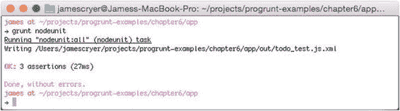

图 6-7. 使用 grunt 运行 `nodeunit` 测试

#### 修改 Nodeunit 的输出

`grunt-contrib-nodeunit` 的输出非常简洁，仅显示测试总体是否通过、运行的断言数量以及完成测试所花费的时间。由于我们当前选择了 JUnit 报告器，该插件还会输出包含测试结果的文件的位置。清单 6-14 包含了在项目上运行 `grunt-contrib-nodeunit` 生成的输出。

***清单 6-14***. 来自 `grunt-contrib-nodeunit` 的 JUnit 报告器输出示例

```
<?xml version="1.0" encoding="UTF-8" ?>
<testsuite name="todo_test.js"
           errors="0"
           failures="0"
           tests="3">
  <testcase name="todo - item_has_a_title"></testcase>
  <testcase name="todo - item_is_not_complete"></testcase>
  <testcase name="todo - item_can_be_completed"></testcase>
</testsuite>
```

运行该插件生成的输出可以在持续集成环境中使用。我们将在本章后面探讨如何设置这样的环境。

### 使用 Grunt 进行测试驱动开发


#### 测试驱动开发与测试夹具

现在我们已经编写了第一批测试，让我们探讨一下为 `Todo` 模块添加新功能会变得多么容易。在本节中，我们将探索一种测试方法：先编写自动化测试，再编写少量代码来通过测试。一旦测试通过，我们就可以自由地重构实现以满足开发标准。这个过程被称为测试驱动开发，通常简称为 `TDD`。例如，让我们添加撤销完成待办事项的功能。清单 6-15 演示了新添加的用于将项目标记为未完成的函数。

***清单 6-15***. 一个表示待办事项的简单 JavaScript 模块

```
/**
  *
  * @name Todo
  * @classdesc Todo 模型
  * @author James Cryer
  * @exports Backbone.Model
  */
'use strict';

var Backbone = require('backbone');

module.exports = Backbone.Model.extend({
  defaults: {
    'title': '',
    'date': '19/02/2015',
    'complete': false
  },

complete: function () {
    this.set('complete', true);
  },

undo: function () {
    this.set('complete', true);
  }
});
```

接下来，我们必须添加一个测试来验证 `undo` 函数是否按预期工作，如清单 6-16 所示。

***清单 6-16***. 更新测试模块以验证 `undo` 函数是否符合预期

```
'use strict';

exports.todo = {
  setUp: function (done) {
    var Todo = require('../../app/js/models/todo');

this.todo = new Todo({
      'title': 'Test Item',
      'date': '24/02/2014'
    });
    done();
  },
  ...

item_can_be_marked_as_incomplete: function (test) {
    this.todo.complete();
    this.todo.undo();
    test.equal(this.todo.get('complete'), false);
    test.done();
  }
};
```

重新运行测试应该会导致失败，因为当前 `undo` 函数中存在缺陷。目前，它将 `complete` 属性设置为 `true`，而本应设置为 `false`。图 6-8 显示了重新运行测试的输出，其中包含失败的测试。

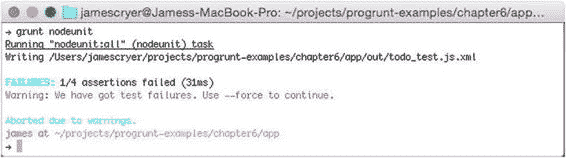

图 6-8. `grunt-contrib-nodeunit` 报告测试失败

如果你打开该插件生成的测试结果文件，它会提供更详细的失败原因输出。或者，如果你想在控制台中查看输出，默认的 reporter 会输出 `nodeunit` 产生的所有错误，如图 6-9 所示。

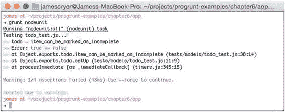

图 6-9. 失败的测试输出到控制台

失败的测试所生成的输出信息量很大，它提供了测试失败的文件、测试名称、失败原因以及行号，这进一步支持了最小化测试数量的原则。简洁的测试通常更容易理解和追溯失败原因。在我们的示例中，失败的原因仅仅是将值设置为 `true` 而不是 `false`。如果按照清单 6-17 更新 `undo` 函数，所有测试将再次通过。

***清单 6-17***. 修改后的 `undo` 函数以解决测试失败问题

```
...

undo: function () {
  this.set('complete', false);
}
...
```

在编写测试时，使用测试数据通常很有用，这样可以方便地在运行测试时修改应用程序的状态。在下一节中，我们将探讨如何在运行测试之前使用 `Grunt` 生成或修改测试夹具。

#### 生成夹具

如上一节所示，拥有一套每次更改应用程序时都能自动运行的测试套件非常强大，这对于大型、复杂的应用程序尤其有用，因为手动测试所需的时间远大于运行一套自动化测试所需的时间。然而，随着应用程序复杂性的增加，你很可能会想要测试应用程序可以转换和不可以转换的各种状态。这时，一组测试夹具就会很有帮助，因为它允许你根据加载到应用程序中的数据快速切换应用程序上下文。

顾名思义，夹具通常是已知且预定义的。但是，有时你可能需要部分动态的夹具，例如，你想要验证应用程序是否能正确响应未来的日期。如果你有一个固定日期，那么要么必须确保应用程序配置为在给定的时间段内运行，要么修改你的文本夹具以确保它们的日期总是在将来。

让我们从前一节的示例进行扩展，为我们的 `Todo` 模块添加一个新函数。该函数将判断待办事项的日期是否已过，本质上允许我们找出所有已过期的待办事项。清单 6-18 包含了修改后的 `Todo` 模块，其中添加了 `hasExpired` 函数。

***清单 6-18***. 修改后的 `Todo` 模块，能够检查项目是否已过期

```
module.exports = Backbone.Model.extend({
  defaults: {
    'title': '',
    'date': '19/02/2015',
    'complete': false
  },

complete: function () {
    this.set('complete', true);
  },

undo: function () {
    this.set('complete', false);
  },

hasExpired: function () {
    return new Date(this.get('date')) < new Date();
  }
});
```

接下来，我们必须添加一个测试来确保我们的新函数按预期工作。清单 6-19 包含了修改后的测试模块，其中添加了对 `hasExpired` 函数的测试。

***清单 6-19***. 测试模块，包含针对过期功能的附加测试

```
exports.todo = {
  setUp: function (done) {
    var Todo = require('../../app/js/models/todo');

this.todo = new Todo({
      'title': 'Test Item',
      'date': '24/02/2014'
    });
    done();
  },
  ...
  item_has_expired: function (test) {
    this.todo.set('date', '2011-05-26T07:56:00.123Z');
    test.ok(this.todo.hasExpired());
    test.done();
  }
};
```

在最新的测试中，我们用一个新的过去日期更新了我们的 `todo` 实例，并验证了当我们在实例上调用 `hasExpired` 时，返回值是 `true`。这看起来问题不大，因为测试总会通过。想象一个场景，我们想要开始处理多个待办事项以形成一个待办事项列表。在这组待办事项中，我们希望能够过滤出所有活跃的、尚未过期的项目。在这样的测试中，我们必须确保始终有一些未过期的项目可用，同时，由于有多个实例，我们不希望用大量数据使测试模块变得臃肿。在这样的场景下，最好的方法是创建一个包含测试数据的外部文件，并在运行测试时加载数据。这引出了一个新的问题，因为我们的测试文件包含静态数据，而我们必须确保测试数据是动态的。

### 在运行时自动化生成夹具

`Grunt` 可用于在每次测试运行前自动生成动态测试数据。为此，我们可以使用另一个名为 `grunt-text-replace` 的 `Grunt` 插件。顾名思义，`Grunt-text-replace` 允许你配置该插件以替换文件中的文本模式，并将结果输出到另一个位置。首先，让我们安装该插件，如清单 6-20 所示。


### 安装`grunt-text-replace`

***清单 6-20***. 安装`grunt-text-replace`

```
npm install –save-dev grunt-text-replace
```

在配置任务之前，我们先生成静态测试数据并将其保存到`build`文件夹中。在应用的`build`文件夹内，创建一个名为`fixtures`的新文件夹。在新`fixtures`文件夹中，我们可以创建一个名为`todo.json`的文件来存放待办事项的测试数据。清单 6-21 包含了测试数据，其中所有需要未来日期的条目都将`FUTURE_DATE`作为占位符。现在，我们已经有了基本的文本测试数据，接下来可以配置`grunt-text-replace`来生成每次运行测试时使用的测试数据。

#### 待办事项的测试数据

***清单 6-21***. 待办事项的测试数据

```
[
  {
    "title": "Past Item",
    "date": "2011-05-26T07:56:00.123Z"
  },
  {
    "title": "Future item 1",
    "date": "FUTURE_DATE"
  },
  {
    "title": "Future item 2",
    "date": "FUTURE_DATE"
  }
]
```

### 配置`grunt-text-replace`以动态生成测试日期

清单 6-22 包含了`grunt-text-replace`的任务配置。该配置包含源文件夹、目标文件夹以及一个替换数组。该插件支持简单的文本替换、正则表达式替换，或者像本例中一样，使用函数来替换源文件中的文本。替换完成后，修改后的文本将输出到目标文件夹，并保留与原文件相同的文件名。在我们的示例中，文件从`build/fixtures`读取，然后写入`tests/fixtures`。

***清单 6-22***. 配置`grunt-text-replace`以动态生成测试日期

```
replace: {
  fixtures: {
    src: ['build/fixtures/*.json'],
    dest: 'tests/fixtures/',
    replacements: [{
      from: 'FUTURE_DATE',
      to: function () {
        var today = new Date();
        return new Date(today.getFullYear() + 1, today.getMonth(), today.getDate())
      }
    }]
  }
}
```

现在，`grunt-text-replace`已经配置了目标和任务，我们可以像使用其他任何`grunt`插件一样，通过`grunt-cli`的`npm`包来运行它。不幸的是，`grunt-text-replace`默认不会提供关于读取或写入文件的任何反馈。要查看运行任务时哪些文件被写入，可以使用 Grunt 的`verbose`标志，如清单 6-23 所示。使用`verbose`标志将生成类似于图 6-10 的输出。

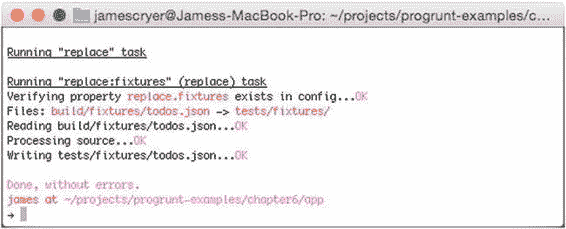

图 6-10. 启用`verbose`标志运行`grunt-text-replace`的示例输出

***清单 6-23***. 使用`verbose`标志输出`grunt-text-replace`生成的文件

```
grunt replace –v
```

#### 应用动态数据生成

现在我们已经拥有一组动态测试数据，接下来可以编写一个模块来处理待办事项列表。我们将使用 Backbone 库中的一个模块——`Collection`。`Collection`提供了一种方便的方式来处理一个或多个模型，追踪一组项目中的变化，并对这些项目应用函数。清单 6-24 包含了一个新的待办事项集合的完整可运行示例。

#### 用于处理多个待办事项的 Backbone 集合

***清单 6-24***. 用于处理多个待办事项的 Backbone 集合

```
'use strict';

var _ = require('underscore');
var Todo = require('../models/todo');
var Backbone = require('backbone');

module.exports = Backbone.Collection.extend({

model: Todo,

activeItems: function () {
    return _.filter(this.models, function(item) { return !item.hasExpired(); });
  },

expiredItems: function () {
    return _.filter(this.models, function(item) { return item.hasExpired(); });
  }
});
```

如清单 6-24 所示，我们的集合期望接收一个`Todo`模块的实例作为模型。该集合还包含两个用于过滤集合的函数：第一个用于查找所有活跃项目，第二个用于查找集合中所有已过期的项目。为了验证函数是否按预期工作，我们可以在`tests/collections`中创建一个新的测试模块。与我们的第一个测试一样，该文件的名称应与被测试的模块相同，但以`_test`作为后缀。

#### 待办事项集合的测试模块

清单 6-25 包含了`todos_test.js`的内容，即对我们集合的测试。该集合有三个测试：一个用于确认集合使用了正确的模型，另一个用于验证我们可以按活跃项目过滤集合，最后一个用于过滤集合中的过期项目。测试模块的一个重要部分是突出显示在每个测试之前执行的`setUp`函数。该函数用于加载测试数据。请注意，我们从`tests`文件夹内加载测试数据文件，因此使用的是由`grunt-text-replace`生成的数据。这些数据随后被加载到待办事项集合中，然后在每个测试中使用。

***清单 6-25***. 待办事项集合的测试模块

```
'use strict';

exports.todos = {
  setUp: function (done) {
    var data = require('../fixtures/todos');
    var Todos = require('../../app/js/collections/todos');

this.todos = new Todos(data);
    done();
  },

collection_has_model_of_todo: function (test) {
    var Todo = require('../../app/js/models/todo');
    test.equal(this.todos.model, Todo);
    test.done();
  },

collection_can_filter_active_items: function (test) {
    test.equal(this.todos.activeItems().length, 2);
    test.done();
  },

collection_can_filter_expired_items: function (test) {
    test.equal(this.todos.expiredItems().length, 1);
    test.done();
  }
};
```

运行`grunt-contrib-nodeunit`任务应生成与图 6-11 相同的输出。

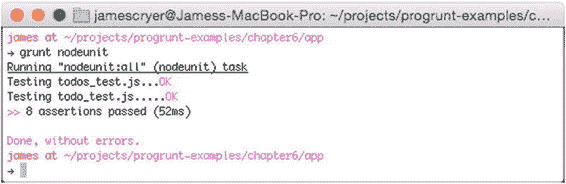

图 6-11. 同时运行集合和模型测试的`grunt-contrib-nodeunit`

将一套测试与一组通过时间动态修改的可靠测试数据相结合，会变得非常宝贵，尤其是在时间紧迫、错误容易潜入项目的情况下。除了单元级别的测试，我们还可以开始探索更高级别的测试。我们可以在浏览器中测试应用——实际上，可以在多个浏览器中测试。在下一节中，我将介绍一个新的 Grunt 插件，它可以帮助我们自动化这一过程。

### 在浏览器中测试

对更高级、性能更佳的 Web 应用的需求日益增长。作为开发者，我们通过在浏览器中构建高度交互和复杂的应用来回应这一需求。页面通常运行着大量的 JavaScript 代码。到目前为止，我们进行的测试都完全在 Node 环境中运行。在本节中，我们将编写可以在浏览器中运行的测试。这将确保我们的生产代码能够在最接近用户最终使用环境的环境中运行。借助自动化工具的强大功能，我们可以在多个浏览器中运行测试，这有助于验证应用的稳定性。


```markdown

### 使用 Karma 测试运行器

在本节中，我们将探索使用一个名为 `Karma` 的新测试运行器。流行前端框架 `AngularJS` 背后的团队开发了 `Karma`。`Karma` 项目旨在使测试驱动开发更简单、更快速，同时允许开发人员在真实的浏览器中运行测试。`Karma` 可用于在本地开发和持续集成环境中运行测试。`Karma` 不是一个测试框架，而是一个测试运行器，因此它可以轻松地与流行的 `JavaScript` 测试框架（如 `Jasmine`、`Mocha` 等）集成。在撰写本文时，`Karma` 支持在以下浏览器中运行测试：`Chrome`、`Firefox`、`Safari`、`PhantomJS`、`Opera`、`IE`、`BrowserStack` 等。`Karma` 的核心团队还开发了一个 `Grunt` 插件，用于轻松地将 `Karma` 与你的构建流程集成。该插件名为`grunt-karma`。

#### 配置 Karma 测试运行器

首先，让我们安装 `grunt` 插件并将其添加到我们的项目中。清单 6-26 演示了如何安装新插件，清单 6-27 包含了要添加到`Gruntfile.js`中的配置。

***清单 6-26***. 安装`grunt-karma`

```
npm install --save-dev grunt-karma
```

***清单 6-27***. `grunt-karma`的 Grunt 配置

```
karma: {
  all: {
    configFile: 'tests/karma.conf.js'
  }
}
```

`grunt-karma`插件允许你选择如何定义任务配置。它允许你定义一个配置文件或作为 Grunt 选项的特定配置。在我们的配置中，如清单 6-27 所示，我们选择使用配置文件。也可以通过指定目标中的选项来覆盖配置文件。例如，你可以在配置文件中定义通用配置，并在持续集成环境中运行测试时覆盖特定配置。清单 6-28 包含了将保存在`karma.conf.js`文件中的配置。

***清单 6-28***. Karma 配置文件

```
'use strict';

module.exports = function(config) {
  config.set({
    files: [
      'tests/main.js',
      {pattern: 'app/js/**/*.js', included: false},
      {pattern: 'tests/specs/**/*.js', included: false},
      {pattern: 'tests/fixtures/**/*.js', included: false}
    ],
    basePath: '../',
    frameworks: ['jasmine', 'requirejs'],
    reporters: ['progress'],

runnerPort: 9000,
    singleRun: false,
    browsers: ['PhantomJS', 'Firefox'],
    logLevel: 'ERROR'
  });
};
```

配置文件包含要加载到浏览器中的文件设置，以及用于解析文件的基础路径。下一个配置指定了要使用的测试框架以及如何报告测试结果。最后一组选项配置 `Karma` 在端口 9000 上运行本地 Web 服务器，并在 `PhantomJS` 和 `Firefox` 浏览器中运行测试。

在使用 `Karma` 运行测试之前，我们必须安装额外的 `npm` 包，其中包含让 `Karma` 与我们选择的浏览器和测试框架集成的插件。清单 6-29 包含了成功运行 `Karma` 之前需要安装的所有包。

***清单 6-29***. 安装额外插件以支持我们的 Karma 测试

```
npm install --save-dev karma-jasmine karma-requirejs karma-phantomjs-launcher karma-firefox-launcher
```

如果我们现在尝试运行`grunt-karma`任务，我们应该会看到一个浏览器窗口启动，并加载一个类似于图 6-12 所示的页面。接下来，我们必须添加一个额外的文件来配置我们的测试运行器以与 `RequireJS` 配合使用，从而提供将应用程序和测试模块作为 AMD 模块加载的能力。清单 6-30 演示了新文件`test/main.js`。当 `Karma` 加载页面时，该文件将首先被加载。它负责配置 `RequireJS` 以拥有正确的路径。因此，当一个模块请求它依赖的另一个模块时，`RequireJS` 知道正确的 `require` 路径。

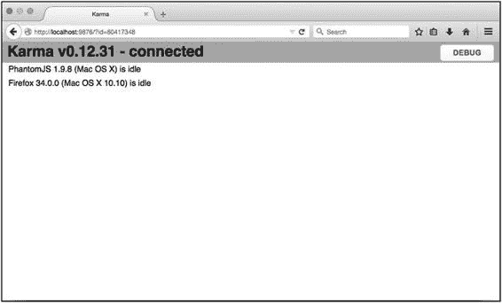

图 6-12. 在浏览器中启动 Karma

***清单 6-30***. 支持使用 Karma 的 RequireJS 和 AMD 模块的配置

```
var allTestFiles = [];
var TEST_REGEXP = /(spec|test)\.js$/i;

var pathToModule = function(path) {
  return path.replace(/^\/base\//, '').replace(/\.js$/, '');
};

Object.keys(window.__karma__.files).forEach(function(file) {
  if (TEST_REGEXP.test(file)) {
    // Normalize paths to RequireJS module names.
    allTestFiles.push(pathToModule(file));
  }
});

require.config({
  // Karma serves files under /base, which is the basePath from your config file
  baseUrl: '/base',

// dynamically load all test files
  deps: allTestFiles,

// we have to kickoff jasmine, as it is asynchronous
  callback: window.__karma__.start,

paths: {
    'jquery': 'app/bower_components/jquery/dist/jquery',
    'backbone': 'app/bower_components/backbone/backbone',
    'underscore': 'app/bower_components/underscore/underscore',
    'fixtures': 'test/fixtures'
  }
});
```

#### 修改我们的应用程序以使用 AMD

既然我们已经有了支持运行测试的配置，我们应该能够开始编写和运行测试了。重新运行 `grunt` 任务，然后点击页面右上角的 `Debug` 按钮，应该可以让你检查测试文件是否按预期加载。图 6-13 说明了此时你将看到的示例调试页面。现在测试运行器已在浏览器中正确加载，你应该会在控制台中注意到一条消息，表明没有测试被跳过。此时，是时候开始添加测试来验证我们的应用程序是否按预期工作了。我们将重新审视上一节中为 Todo 模块编写的测试。这一次，Todo 模块将被封装为一个 AMD 模块。完成的模块如清单 6-31 所示。

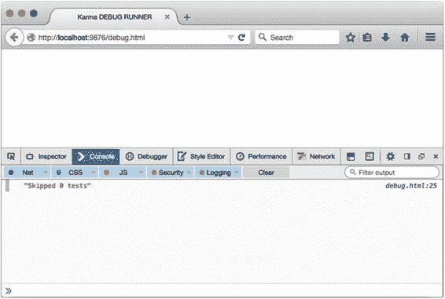

图 6-13. 在浏览器中调试 Karma 测试

清单 6-31 和 6-32 包含了待办事项项及其关联的测试。这些实现与上一节所示的类似。这些文件的唯一区别在于它们是 AMD 模块，并且使用 `Jasmine` 测试框架而不是 `nodeunit`。再次运行测试将导致所有三个测试通过。`Karma` 会将测试结果输出到控制台，如果你选择在浏览器中调试测试，也会输出到浏览器中。图 6-14 包含了控制台中`grunt-karma`的输出。你可能已经注意到，当你对应用程序或测试文件进行更改时，`grunt-karma` 将自动重新运行测试。每次 `Karma` 运行时，它都会在配置中包含的所有浏览器中运行测试，并报告任何给定浏览器中的错误（参见图 6-15）。

***清单 6-31***. 作为 AMD 模块封装的 Todo 模块

```
define(['backbone'], function(Backbone) {
  'use strict';

return Backbone.Model.extend({
    defaults: {
      'title': '',
      'date': '19/02/2015',
      'complete': false
    },

complete: function () {
      this.set('complete', true);
    }
  });
});
```

```


***清单 6-32***. 待办事项的 Jasmine 测试

```
define([
  'app/js/models/todo'
], function(Todo) {

describe('A todo item', function() {
    'use strict';

var todo;

beforeEach(function() {
      todo = new Todo({
        'title': 'Test Item',
        'date': '24/02/2014'
      });
    });

it('should have a title', function() {
      expect(todo.get('title')).toBe('Test Item');
    });

it('should not be complete', function() {
      expect(todo.get('complete')).toBe(false);
    });

it('should be marked as completed', function() {
      todo.complete();
      expect(todo.get('complete')).toBe(true);
    });

});
});
```

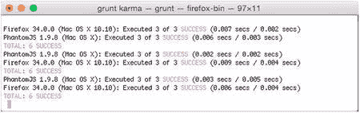

图 6-14. 控制台中 `grunt-karma` 的输出

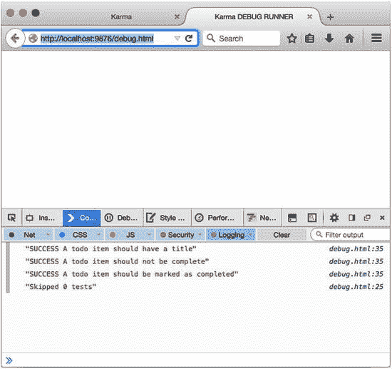

图 6-15. Karma 调试视图中的控制台输出，包含每个测试的名称及其通过状态

在我们的示例中，我们仅仅是初步探索了 Karma 在测试应用程序方面的强大能力。在实际应用中，Karma 能够在一秒钟内在每个浏览器中运行数百个测试。你也可以选择在你用户使用的所有主流浏览器中运行所有测试。

在下一章中，当我们为项目搭建持续集成环境时，我们将再次讨论 `grunt-karma`。我们将探讨如何在虚拟化环境中的多个浏览器中运行测试。

### 自动化可访问性测试

任何 Web 应用测试策略的另一个关键组成部分应该是可访问性测试。进行可访问性测试是为了确保所有访问你应用程序或网站的用户都能获得良好的体验，并且不会受到限制，无法访问应用功能或网站内容。人们常犯的一个错误是，认为可访问性测试只关乎验证网站是否对视力较差或完全失明的用户友好。可访问性的范畴远不止于此，还有更多的检查项需要执行，以确保网站或应用是易于访问的。在本节中，我们将探讨如何使用工具来自动化检测 Web 应用中的可访问性问题。为了执行测试，我们将使用 Chrome 无障碍工具来验证我们的应用或页面。幸运的是，已经有一个封装了 `npm` `a11y` 包的 `grunt` 插件可供使用。

首先，我们需要将 `grunt-a11y` 插件添加到项目中。清单 6-33 展示了安装过程。

***清单 6-33***. 安装 `grunt-a11y`

```
npm install --save-dev grunt-a11y
```

现在，我们的 `grunt` 工作流程中已经可以使用 `a11y` 了，接下来我们需要配置该插件，如清单 6-34 所示。

***清单 6-34***. 配置 `grunt-ally` 为我们的应用程序运行可访问性测试

```
a11y: {
  live: {
    options: {
      urls: ['www.twitter.com']
    }
  }
}
```

如清单 6-34 所示，该插件可以通过一系列 URL 进行简单配置。在我们的示例中，我们将 URL 硬编码到了 `Gruntfile` 中，但在大型应用的构建过程中，这应该被推入一个配置文件，并在构建时加载。这意味着 URL 更易于维护，并且可以在任务之间共享。我们将在下一章进一步探讨这一点。

除了 `urls` 选项外，`grunt-a11y` 插件还接受另一个选项，允许插件在检测到所测试 URL 存在可访问性问题时抛出错误。如果你希望将这些测试作为持续集成环境的一部分，并且希望在可访问性测试失败时导致构建失败，那么这个选项就变得非常重要。图 6-16 展示了该插件的示例输出。

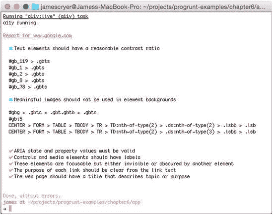

图 6-16. 运行 `grunt-a11y` 的示例输出

`grunt-a11y` 插件会报告缺少标签、ARIA 属性、元数据或元素对比度低等问题。这并不能替代使用其他工具套件进行的实际可访问性测试。但是，该插件可以作为一种辅助工具，帮助确保应用程序中维护了可访问性的基线标准。

### 将本地服务器暴露给外部世界

在本地开发应用程序时，能够与他人分享和展示你的工作进行中状态总是很方便的。此外，第三方工具有时也需要能够在开放的 Web 上查看你的应用程序，才能有效地工作。像 Google PageSpeed Insights 或 WebPagetest 这样的工具就是如此，它们可以用来分析应用程序的网络性能。幸运的是，有一个名为 `ngrok` 的工具，它允许你通过一个公共 URL 将本地开发环境安全地暴露到网络上。在本节中，我们将探讨如何配置我们的 `Grunt` 工作流程，以便轻松地暴露我们的应用程序。

`ngrok` 可以从 [`ngrok.com`](https://ngrok.com) 下载二进制文件，也可以作为 Node 模块使用，这意味着我们可以轻松地将其集成到我们的 `Grunt` 工作流程中。首先，我们通过使用 `npm` 安装包来将 `ngrok` 包含到我们的项目中，如清单 6-35 所示。

***清单 6-35***. 安装 `ngrok`

```
npm install ngrok --save-dev
```

为了在我们的 `Grunt` 工作流程中使用 `ngrok`，我们将在 `Gruntfile` 中注册一个任务。我们的新任务 `ngrok` 是异步的，因为它会向 `ngrok` API 发送请求，为我们的应用程序请求一个公共 URL。我们将应用程序配置为在开发期间本地运行在端口 `8000` 上，因此我们将端口号 `8000` 传递给对 `ngrok` 的调用。`ngrok` 库会返回一个错误和/或一个公共 URL。一旦返回 URL，我们就可以修改其他 `Grunt` 任务的配置，使其针对我们的公共 URL 运行。例如，我们可以修改 `grunt-a11y` 任务中的 URL，使其针对本地开发环境而不是生产环境运行。清单 6-36 展示了完整的自定义任务。

***清单 6-36***. 用于运行 `ngrok` 的自定义 Grunt 任务

```
var ngrok = require ('ngrok');

module.exports = function (grunt) {

grunt.registerTask('ngrok', 'Running ngrok', function () {
    var done = this.async();
    var port = 8000;

ngrok.connect(port, function (err, url) {
      if (err !== null) {
        grunt.fail.fatal(err);
        return done();
      }
      grunt.log.write(url);
      done();
    });
  });

// Register default tasks
  grunt.registerTask('default', ['ngrok']);
};
```

如果你在需要代理的公司网络内工作，那么你很可能可以将 `ngrok` 与其他 `Grunt` 插件结合使用，以便在代理环境下运行它们。在下一节中，我们将暴露我们的应用程序，以便能够对我们的网站进行性能测试。

### 性能测试

在本章的最后一节，我们将探讨可用于自动化性能测试的工具。我们将特别关注网络性能，评估我们的应用程序在网络传输方面的优化程度。有许多很棒的工具可以用来执行这类测试。我们将重点介绍两个插件：`grunt-pagespeed` 和 `grunt-perfbudget`。


#### Grunt-pagespeed 与 Grunt-perfbudget

`Grunt-pagespeed` 封装了 Node 模块 `PSI`。`PSI` 是 *PageSpeed Insights* 的缩写。PageSpeed Insights 是 Google 的一款产品，允许开发者通过浏览器中的表单、API 或浏览器插件来运行性能测试。Node 模块直接与 API 交互。该 API 接受多个参数，但主要是网站的 URL。API 随后获取 URL，向其发出请求，并对页面生成的请求（例如，CSS 的请求）执行分析。分析会应用一系列规则来确定页面的整体性能，并返回一个介于 0 到 100 之间的分数，其中 100 表示性能最佳。`grunt-pagespeed` 模块允许你定义一个阈值，该阈值必须在每次运行性能测试时达到。如果未达到阈值，该插件将抛出错误。如果你希望在发布到生产环境之前，将性能测试作为构建过程的一部分来运行以验证性能，这将特别有用。该插件还支持多种输出格式，包括 `TAP` 和 `JSON`。

`Grunt-perfbudget` 与另一个名为 WebPagetest 的类似 PageSpeed Insights 的性能工具交互。与 PageSpeed Insights 一样，WebPagetest 可以通过多种方式使用：通过网络表单、API 或在自己的安装上运行。Grunt 插件使用公共 API；但是，它可以配置为针对 WebPagetest 的本地安装运行。`Grunt-perfbudget` 与 `grunt-pagespeed` 不同，因为它允许你为每个指标（例如，请求数量）定义性能阈值。

让我们开始同时安装这两个插件（参见清单 6-37）。

***清单 6-37***. 安装 `grunt-pagespeed` 和 `grunt-perfbudget`

```
npm install grunt-pagespeed grunt-perfbudget --save-dev
```

现在两个插件都已可用，我们必须对它们进行配置。我们将从 `grunt-pagespeed` 开始，其配置如清单 6-38 所示。

***清单 6-38***. `grunt-pagespeed` 配置

```
pagespeed: {
  options: {
    nokey: true,
    url: "https://developers.google.com"
  },
  prod: {
    options: {
      locale: "en_GB",
      strategy: "desktop",
      threshold: 80
    }
  }
}
```

`Grunt-pagespeed` 允许你定义多个参数，这些参数将修改对所提供的 URL 运行的测试。在我们的示例中，我们正在测试单个 URL：`https://developers.google.com`；但是，该插件支持针对多个 URL 运行测试，每个 URL 都会对照定义的阈值进行检查。除了 `url` 选项外，还有用于设置预期策略和 API 密钥的选项。`strategy` 决定对给定 URL 执行的分析类型。它可以是 `mobile` 或 `desktop`。`API key` 是通过 Google APIs 控制台获得的密钥。然而，按照我们的配置，Google 提供了无需密钥即可使用 PageSpeed Insights 的功能。这会限制你对 API 的使用，如果你打算在生产环境或正式构建过程中使用 PageSpeed Insights，那么我建议设置一个 API 密钥。在我们的示例中，我们还将阈值设置为 80，这意味着如果我们的整体性能分数低于 80，将会抛出一个错误。

图 6-17 显示了使用上述配置运行 Grunt 插件的示例输出。如您所见，整体分数、策略和 URL 都定义在输出的顶部。此外，还给出了每条规则的明细，以及按类型分组的静态资源大小的相关值。

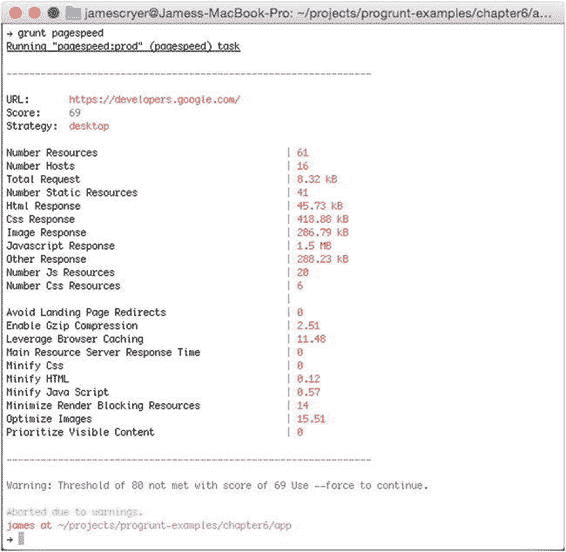

图 6-17. `grunt-pagespeed` 的示例输出

### 性能开发环境

如您所见，当长期在项目上工作时，这可能非常有用。它可以帮助您跟踪出现的任何性能问题，并确保您的应用程序在每个版本中都达到基准。如果您在一个有许多开发人员的项目上工作，且每个版本都添加新的前端依赖项，这将特别有用。另外值得注意的是，`grunt-pagespeed` 可以与 `ngrok` 结合使用，在将应用程序发布到公共 URL 之前测试您的本地开发环境。清单 6-39 通过再次使用上一节中的 `ngrok` 任务，演示了如何实现这一点。

***清单 6-39***. 使用 `ngrok` 和 `grunt-pagespeed` 进行本地性能测试的自定义任务

```
grunt.registerTask('ngrok', 'Running ngrok', function () {
  var done = this.async();
  var port = 8000;

ngrok.connect(port, function (err, url) {
    if (err !== null) {
      grunt.fail.fatal(err);
      return done();
    }
    grunt.config.set('pagespeed.options.url', url);
    grunt.task.run('pagespeed');
    done();
  });
});
```

关键的修改在于传递给 `connect` 函数的回调中。在最后几行，我们使用 `grunt.config` API 在执行 `pagespeed` 任务之前设置了 `grunt-pagespeed` URL 的值。然后，`pagespeed` 任务将使用从 `ngrok` 服务返回的 URL 运行。

接下来，我们将把 `grunt-perfbudget` 集成到项目中。这与 `grunt-pagespeed` 略有不同，因为我们可以对照 WebPagetest 的响应中的每个指标来定义阈值。清单 6-40 包含用于测试我们应用程序的示例配置。

***清单 6-40***. `grunt-perfbudget` 的配置

```
perfbudget: {
  default: {
    options: {
      url: 'https://developers.google.com',
      key: 'API_KEY_HERE',
      budget: {
        visualComplete: '4000',
        SpeedIndex: '1500'
      }
    }
  }
}
```

运行上述配置将输出测试的 URL、所选预算的分数以及预算是否达标。图 6-18 显示了 `grunt-perfbudget` 的示例输出。与 `grunt-pagespeed` 一样，如果某个特定预算未达标，将会抛出一个错误。

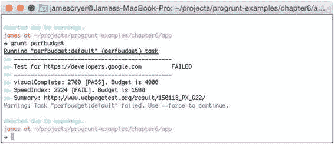

图 6-18. `grunt-perfbudget` 的输出

与 `grunt-pagespeed` 一样，`grunt-perfbudget` 可以与 `ngrok` 结合使用来测试本地开发环境，如果您希望在发布应用程序之前开始分析页面性能。为了简化对大量 URL 的测试，这两个插件都可以与 `grunt-text-replace` 结合使用，以动态生成一组 URL。例如，如果您想测试不同的环境，并且每个环境中的路径相同，则可以动态写入域名或子域名，同时只需维护一个 URL 列表。

### 总结

在本章中，我们探讨了如何使用 Grunt 来辅助搭建本地开发环境、设置测试环境以及在本地开发环境中对我们的应用程序执行基准测试。我们还探讨了编写测试的好处，以及如何在各种浏览器上运行这些测试。最后，我们介绍了一些工具，这些工具可以帮助验证，当我们将更改引入应用程序时，不会同时引入性能瓶颈。

此时，我们的 `Gruntfile` 变得臃肿且难以管理，存在大量重复。除了庞大的 `Gruntfile`，每次运行 Grunt 时（即使只运行单个任务），我们都会加载大量插件。在最后一章中，我们将研究一些工具和技术，以使我们的 Grunt 工作流本身更加优化。最终目标是拥有一个精简且易于理解的构建过程，团队中的任何人都可以轻松使用。

