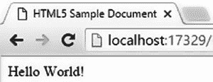
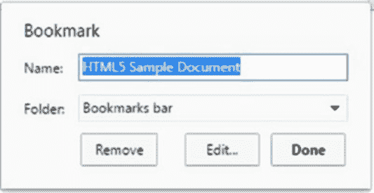

# 排版后的内容

请注意，`meta` 元素没有结束标签。有些元素无需使用结束标签，它们被称为*自闭合*标签。这或许显而易见，但这些元素不能包含任何内容，因为内容应放置在开始和结束标签之间。标签末尾的“/”字符在技术上并非必需，但普遍共识是应当包含它，并且某些 HTML 验证器会在缺少该字符时发出警告。

请记住，浏览器会忽略制表符、回车符和多余空格等空白字符。你可以将所有文本左对齐，渲染后的 HTML 结果将完全相同。甚至可以故意将整个文档写在一行内。但常规惯例和最佳实践是按照此处所示的方式格式化 HTML。

在继续之前，我想再补充一点：所有这些结构都是可选的。事实上，如果你将以下内容作为整个 HTML 文档输入，浏览器会渲染出完全相同的内容。

```
Hello World!
```

> **注意** 浏览器通常非常擅长在文档中省略细节时使用默认配置。然而，我假设你阅读本书是因为你想创建专业质量的 Web 应用。这些额外的元素提供了重要信息，你应当养成编写结构良好的文档的习惯，以尽可能提高页面的实用性。

## 第 1 章 ■ 超文本标记语言

HTML 标签不区分大小写。普遍惯例是使用小写标签，本书也将全程遵循此惯例。但你可以使用 `<HEAD>` 或 `<Head>`，它们同样有效。

## HTML 元素

如你所见，`html` 元素是根节点：即文档的起始点。关于它没什么可多说的。`html` 元素可以包含一个 `head` 元素和一个 `body` 元素。除了全局属性外，它还支持 `manifest` 属性。

```html
<html manifest="www.mywebsite.com/cache.appcache">
```

`manifest` 属性用于定义应用程序缓存。该属性的值是缓存清单的 URL 或地址，缓存清单是一个列出应缓存资源的文本文件。这可以是绝对或相对 URL。当这些资源缓存在客户端后，即使断开网络连接，你的页面也能正常加载。缓存这些资源还可以让页面加载更快，并减轻 Web 服务器的负载。

> **提示** 清单文件的标准扩展名是 `.appcache`。Web 服务器必须以正确的 MIME 类型（即 `text/cache-manifest`）提供此文件。根据你使用的 Web 服务器类型，配置方式会有所不同。更多信息请参阅此文章：[`www.html5rocks.com/en/tutorials/appcache/beginner/`](http://www.html5rocks.com/en/tutorials/appcache/beginner/)。

### Head 元素

`head` 元素中没有实际内容；那是 `body` 元素的职责。在第 4 章到第 8 章中，我将解释所有用于定义主体内容的各种元素。但本章的剩余部分，我们将探讨 `head` 元素。

现在，让我们看看可以包含在 `head` 元素内的元素。你已经见过 `title` 和 `meta` 元素，稍后我会更详细地介绍它们。还有一些其他有用的元素也属于这里。

#### Title 元素

`title` 元素指定了此页面的标题。它会在几个地方显示：

- 在浏览器标题栏或选项卡中（见图 1-1）
- 搜索引擎通常会在搜索结果中包含此标题
- 将页面添加到收藏夹或书签时，此标题会用作名称（见图 1-2）






