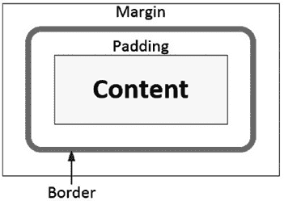

# 关键字

在大多数样式声明中，有少数关键字可以作为“单位”使用。它们是 `auto`、`inherit`、`initial`、`revert` 和 `unset`。

- `inherit` — `inherit` 关键字表示该属性应使用其父元素的值。大多数属性默认会继承，因此将值设置为 `inherit` 实际上不会改变任何内容；它无论如何都会继承父元素的值。添加它可能有助于更好地表达作者的意图。你可能想创建一条规则，使用 `inherit` 来覆盖另一条规则的值。

- `initial` — `initial` 关键字用于将属性重置为初始默认设置。在许多情况下，这指的是浏览器的默认值。例如，默认颜色通常是黑色，因此 `color: initial;` 会将颜色设置为黑色。截至撰写本文时，任何版本的 Internet Explorer 均不支持此关键字。

- `auto` — `auto` 值有点棘手，其行为会因使用位置而异。例如，设置 `padding: auto;` 会自动调整左右内边距以将内容居中。设置 `height: auto;` 会使得高度自动增长以适配内部内容。

- `revert` — `revert` 关键字指定浏览器应忽略任何作者样式，并使用浏览器的默认值。截至撰写本文时，许多浏览器尚不支持此关键字。

- `unset` — `unset` 关键字是 `inherit` 和 `initial` 的组合。基本上，它对所有可继承属性表现得像 `inherit`，对其余属性表现得像 `initial`。


`properties`。与 `revert` 一样，`unset` 关键字不受某些浏览器支持。

#### 优先级

选择器返回元素集合，这些集合可能重叠。结果是多个规则可以应用于同一元素。如果一个规则设置字体大小，另一个设置颜色，第三个设置背景，则没有冲突。然而，如果一个规则将颜色设为红色，另一个设为绿色，会发生什么？这时就需要应用优先级规则。

#### 样式表来源

首先，样式表有三种来源：

- **作者**：这些是 Web 开发者创建的样式表，通常提到样式表时指的就是它。
- **用户**：用户也可以创建样式，专门用于控制网页在自己浏览器上的显示方式。
- **用户代理**：用户代理（Web 浏览器）拥有默认样式表。例如，如果你创建了一个没有样式规则的文档，浏览器会使用默认的字体系列和大小显示内容。这些实际上是在浏览器特定的样式表中定义的。

渲染页面时，浏览器必须处理来自所有这些来源的样式，以确定每个元素的适当样式。当规则冲突时，作者样式表优先级高于用户样式表，用户样式表优先级高于用户代理样式（浏览器默认值）。

> **提示**：你可能会发现查看默认浏览器样式表很有用。它们通常是可以获取的，尽管你可能需要做一些搜索才能找到。例如，你可以使用这个链接查看 Chrome 使用的样式表：[`trac.webkit.org/browser/trunk/Source/WebCore/css/html.css`](http://trac.webkit.org/browser/trunk/Source/WebCore/css/html.css)

## 特指度规则

此外，即使在作者样式表内部，也可能存在冲突的声明。例如，一个样式表可能包含以下内容：

```css
p {
  color: black;
}

header p {
  color: red;
}
```

`header` 元素内的 `p` 元素被两个规则同时选中，那么哪一个会生效？在这种情况下，适用特指度规则，该规则规定使用更具体的选择器，也就是 `header p` 选择器。

由于存在多种选择器，确定哪个更具体并不像你想象的那么简单。`ID` 选择器被认为比类或属性选择器更具体，而类或属性选择器又比元素选择器更具体。

当应用特指度规则逻辑时，浏览器会分析每个选择器，并根据使用的选择器类型为其打分。这个分数由四个值组成：

1.  内联样式的数量（包含 `style` 属性的元素）
2.  `ID` 选择器的数量
3.  类、属性或伪类选择器的数量
4.  元素选择器的数量

分析会比较第一个值，只有在平局时才会继续比较下一个值。因此，如果一个选择器包含 `ID` 选择器而另一个没有，则无需进一步分析。包含 `ID` 选择器的获胜。最后，如果所有四个值都相同，则采用最后出现的规则来打破平局。

> **提示**：理解这些优先级规则很重要，因为冲突会发生，你需要知道如何处理它们。不过，你应该规划好你的样式表以避免冲突。

## `!important` 关键字

一个“王牌”是 `!important` 关键字。如果在样式规则中使用它，它将覆盖所有其他规则。你可以这样添加 `!important` 关键字：

```css
p {
  color: red !important;
}
```

请记住，`!important` 关键字应用于声明，而不是规则。它仅适用于单个声明，并且必须在你希望应用它的每个声明上重复使用。

如果两个冲突的规则都使用了 `!important` 关键字，则优先级将根据我前面提到的规则确定。然而，当涉及到样式表的来源时，它们的应用顺序是相反的。用户样式表中的 `!important` 规则会覆盖作者样式表中的 `!important` 规则。

这有一个重要的应用（并非双关语）。这允许用户覆盖作者对某些属性的样式。例如，视障人士可能需要增大字体大小。`!important` 标签将确保此样式不会被覆盖。

> **警告**：你可能想使用 `!important` 关键字来快速修复并覆盖层叠的样式规则。考虑到我刚才描述的所有优先级规则，你不应该需要这样做。我建议将其作为最后的手段。过度使用 `!important` 关键字会使你的样式表难以维护。

#### 盒模型

文档中的每个元素都占据一定的空间，这取决于该元素的内容。此外，诸如内边距和外边距等因素也会影响这一点。内边距是内容与元素边框之间的空间。外边距是边框与相邻元素之间的空间。如图 2-2 所示。



***图 2-2.** 盒模型*

我之前解释过 `margin` 属性。同样，你可以使用 `padding` 声明来指定内边距。内边距和外边距非常相似；主要区别在于内边距位于边框内部。

在确定使用的空间时，请记住包括边框宽度。例如，如果内边距设置为 `10px`，外边距设置为 `5px`，并且 `border-width` 设置为 `3px`，则（除了实际元素内容之外）使用的空间为 `(2 * 10) + (2 * 5) + (2 * 3) = 36px`。

### 厂商前缀

哦，走在技术前沿的乐趣！与 HTML5 的其他领域一样，浏览器厂商对 CSS 规范的支持程度各不相同。然而，在许多情况下，这些厂商会在新属性成为官方推荐标准之前就实现它们。事实上，CSS3 规范中的许多内容已经可以在一个或多个浏览器中使用了。

当浏览器厂商添加不属于 CSS3 推荐标准的新特性时，该属性会被赋予一个特定于厂商的前缀，以表明这是一个非标准特性。如果这成为推荐标准的一部分，前缀最终会被移除。为了利用一些较新的属性，你可能需要使用特定于厂商的属性，并且由于你希望页面能在所有厂商的浏览器上工作，你需要添加所有这些属性。例如，要指定边框圆角，除了标准的 `border-radius` 属性外，你可能还需要像这样设置所有特定于厂商的属性：

```css
header {
  -moz-border-radius: 25px;
  -webkit-border-radius: 25px;
  -ms-border-radius: 25px;
  border-radius: 25px;
}
```

表 2-1 列出了最常见的厂商前缀。还有其他一些，但此表涵盖了绝大多数浏览器。

***表 2-1.** 厂商前缀*

| 前缀 | 浏览器厂商 |
| :--- | :--- |
| `-moz-` | Firefox |
| `-webkit-` | Chrome, Safari, Opera |
| `-ms-` | Internet Explorer |

你不能盲目地假设所有带厂商前缀的属性都与标准属性具有相同的名称（只是加上前缀），尽管大多数情况确实如此。这里有一篇好文章列出了许多特定于厂商的属性：[`peter.sh/experiments/vendor-prefixed-css-property-overview`](http://peter.sh/experiments/vendor-prefixed-css-property-overview)


[overview](http://peter.sh/experiments/vendor-prefixed-css-property-overview)。遗憾的是，这个页面已经有一段时间没有更新，可能已经过时了。如果你发现某个标准属性在特定浏览器中不工作，你可能需要做些研究，看看他们的开发者网站上是否有可用的带前缀属性。例如，通过这个链接查看 Webkit 扩展: [`developer.mozilla.org/en-US/docs/Web/CSS/Reference/Webkit_Extensions.`](https://developer.mozilla.org/en-US/docs/Web/CSS/Reference/Webkit_Extensions)

> **警告**: 你应该始终将标准属性放在最后，这样它才能覆盖特定于供应商的版本。

某些浏览器会同时支持两者，虽然大多数情况下实现方式相同，但有时特定于供应商的版本行为会有所不同。

#### 样式属性

`style` 属性不属于样式表的一部分，但它的目的类似，因此我将在此进行解释。`style` 属性是所有元素都支持的全局属性之一。它允许你在单个元素上设置一个或多个声明。虽然普通样式规则包含一个选择器，用于确定该规则应用于哪些元素，但由于 `style` 属性直接包含在元素中，因此不需要选择器。使用 `style` 属性被称为**内联样式**。一个使用内联样式的示例元素可能看起来像这样:

```html
<p style="font-size: 1.5rem; color: hsla(175, 80%, 60%, .8);">
Hello World!
</p>
```

> **提示**: 在上面的示例中，我使用了之前解释过的 `rem` 单位，因此字体将比根字体大小大 50%。颜色由色相 175°（介于绿色和蓝色之间）、饱和度 80%、明度 60% 和透明度 80% 定义。

与其他属性一样，其值在双引号内指定。该值由一个或多个声明组成。这些声明的格式与样式表中的声明完全相同：一个名称/值对，用冒号分隔，并以分号结束。你可以在 `style` 属性中设置任何在外部样式表中可以设置的属性。

> **警告**: 我把`style` 属性留到最后才讲，是希望你永远不要使用它。通过包含内联样式，你就不再分离内容和样式了。如果你后来决定蓝绿色字体不好看，仅仅通过修改 CSS 是无法修复的。请记住，内联样式的优先级高于任何基于 CSS 的规则。

#### 总结

在本章中，我解释了创建样式表时使用的一些基本概念。我们将通过创建几个可以包含在网页中的外部样式表来应用这些概念。

首先，我们将从一个非常简单的样式表开始，如清单 2-1 所示。这个文件名为 `Initial.css`。

***清单 2-1.**`Initial.css` 文件*

```css
/* Make sure the non-content elements are hidden */
head, title, meta, script, link, style, base {
    display: none;
}

/* Default styling for emphasis and strong elements */
em {
    font-style: italic;
}

strong {
    font-weight: bold;
}

/* Style the text */
body>h1 {
    font-size: 1.5rem;
    color: hsla(175, 80%, 60%, .8);
}
```

第一条规则确保你在第 [1 章](http://dx.doi.org/10.1007/978-1-4842-2463-2_1)学到的非内容元素不会被显示。浏览器的默认样式表无论如何都会设置这些。第二条规则设置了我之前讨论过的 `强调` 和 `重要` 元素的属性。再次强调，这些是默认样式。最后一条规则使用我在本章中解释的 `rem` 和 `hsla` 单位设置了文本的字体大小和颜色。

接下来，我们将创建第二个用于打印模式的 CSS 文件。这个文件如清单 2-2 所示，命名为 `Print.css`。

***清单 2-2.**`Print.css` 文件*

```css
body>h1 {
    color: black;
}

body {
    border: 1px solid;
    border-color: black;
    border-radius: 25px;
    padding: 24px;
}
```

这包含两条规则：第一条将颜色设置为黑色，第二条为整个文档添加边框。

最后，修改 `MainPage.html` 文件，用下面的 `link` 元素替换两个 `style` 元素。这将引用新的 CSS 文件，而不是在 HTML 文档中指定样式规则。

```html
<link rel="stylesheet" href="Initial.css" />
<link rel="stylesheet" href="Print.css" media="print" />
```

`Initial.css` 在引用时没有使用媒体属性，因此它将同时应用于屏幕和打印模式。`Print.css` 文件将仅在打印模式下使用。请注意，两个文件都使用了 `body>h1` 选择器，由于它们完全相同，因此具有相同的特异性。这依赖于后定义的规则会覆盖前一条规则的行为。

`Initial.css` 文件包含一个 `font-size` 声明，而 `Print.css` 文件没有，因此 `font-size` 将同时应用于屏幕和打印模式。只有 `color` 属性在打印模式下被覆盖。

现在显示网页，你应该会看到“Hello World!”文本以蓝绿色字体显示。然后从浏览器中打印文档。根据你使用的浏览器，输出应该类似于图 2-3 所示。

***图 2-3.** HTML 文档的打印版本*

注意标题（在 `title` 元素中指定）显示在页面顶部。

> **注意**: 每个浏览器处理打印模式的方式不同。有些左对齐标题，有些在页面顶部放置 URL，有些包含页码，有些显示打印日期。

下一章将介绍本书的第三个主要领域：JavaScript。本章将解释 JavaScript 语言的概念，这是第 4 和第 5 部分所讨论主题的基础。

### 第 3 章：JavaScript 基础

在本章中，我将解释 HTML5 开发的第三大支柱：JavaScript。在第 [16](http://dx.doi.org/10.1007/978-1-4842-2463-2_16) 章至第 [20](http://dx.doi.org/10.1007/978-1-4842-2463-2_20) 章中，我将演示你可以使用 JavaScript 在 HTML5 网页中做的许多事情。但本章中，我必须首先解释这门语言本身。

## JavaScript 介绍

这里内容很多，因为 JavaScript 语言非常强大。起初可能会觉得有些别扭，特别是对于那些具有 C++ 或 C# 等编译语言背景的人来说。但这并不难学；我将在这里解释这些基本概念，然后你将在后面的章节中应用它们。

#### 对象

JavaScript 中的主要构建块是*对象*。对象是元素的集合；每个元素可以是*属性*或*方法*。属性保存单个数据值，而方法将执行某个定义为函数的操作。另一种说法是，属性只是一个在对象上定义的变量（注意 `var` 关键字）。同样，方法是一个在对象上定义的函数。

创建对象最简单的方法是通过一组名称/值对来指定成员，如下所示：

```javascript
var myObject = {
    color: "Red",
    count: 5
};
```

> **注意**: 你可能熟悉使用 JavaScript 对象表示法 (JSON) 格式化数据。这正是这种表示法，也是 JSON 的来源。

你也可以使用这种表示法定义方法，如下所示：

```javascript
var myObject = {
    color: "Red",
    count: 5,
    log: function () {
        console.log("Quantity: " + this.count + ", Color: " + this.color);
    }
};
```

以这种方式创建对象有时被称为*对象字面量*表示法。名为 `myObject` 的对象包含两个属性，`color` 和 `count`，以及一个函数 `log()`。然后你可以使用点表示法访问这些属性和函数，如下所示：

```javascript
window.alert(myObject.color);
myObject.log();
```


