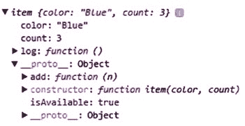
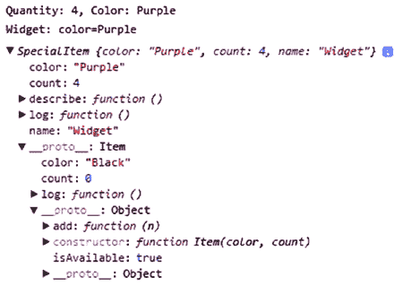
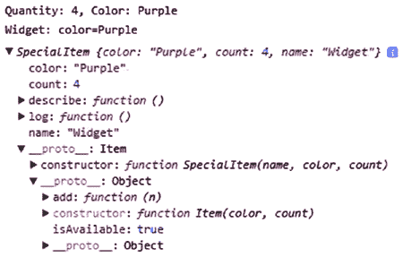

# 提示

本段代码演示了两种流行的调试方法。在 `window` 对象上调用 `alert()` 函数会显示一个模态对话框，其中包含传递给该函数的文本。在 `console` 对象上调用 `log()` 函数会将指定的文本写入浏览器控制台，你可以通过浏览器提供的开发者工具访问该控制台。请注意，`window` 和 `console` 是包含属性和函数的对象。它们将在第 [16 章](http://dx.doi.org/10.1007/978-1-4842-2463-2_16)和[第 17 章](http://dx.doi.org/10.1007/978-1-4842-2463-2_17)中详细解释。

另一种创建对象的方法是使用对象构造函数。这需要使用 `new` 关键字并调用默认构造函数。以下代码将创建完全相同的对象：

```
var redObject = new Object();
redObject.color = "Red";
redObject.count = 5;
redObject.log = function() {
    console.log("Quantity: " + this.count + ", Color: " + this.color);
}
```

如果你需要一个主要用于存储数据的简单对象，JSON 风格可能稍微更直观、更简洁。然而，对于面向函数的对象，构造函数风格提供了更强大的功能，我稍后将对此进行说明。

例如，如果你需要第二个实例来计算你的绿色物品，只需像这样重复代码：

```
var greenObject = new Object();
greenObject.color = "Green";
greenObject.count = 7;
greenObject.log = function() {
    console.log("Quantity: " + this.count + ", Color: " + this.color);
}
```

然后，你可以在代码中使用这两个对象，例如：

```
if (greenObject.count > redObject.count) {
    console.log("You have more green items than red item");
}
```

#### 构造函数

请注意，你必须在两个对象中都定义 `log()` 方法。如果你熟悉基于类的语言（如 C#），这可能会显得有些奇怪。类被用作模板，从中创建该类的每个实例。当你使用类来创建对象时，所有属性和方法的定义都会从类中复制过来。

然而，JavaScript 不使用类。相反，你可以通过创建一个构造函数来重用对象定义。在前面的示例中，你使用了通用构造函数 `Object()`，它创建了一个空对象。但你可以像这样定义一个自定义构造函数：

```
function Item(){
    this.color = undefined;
    this.count = 0;
    this.log = function() {
        console.log("Quantity: " + this.count + ", Color: " + this.color);
    };
}
```

构造函数是用于实例化对象的函数。这个构造函数创建了一个名为 `color` 的属性，但未定义其值。它还创建了一个名为 `count` 的属性，并将其初始化为零。`log()` 方法也被定义，并使用这两个属性。现在，你可以通过调用 `Item()` 构造函数，使用这个原型来创建一个对象：

```
var redObject = new Item();
redObject.color = "Red";
redObject.count = 5;
```

你需要为该实例设置属性值，但无需设置方法。然后你可以像之前创建的其他对象一样使用它。将此代码添加到脚本中，会将 `color` 和 `count` 属性写入控制台，就像之前一样：

```
redObject.log();
```

像任何其他函数一样，构造函数可以接受参数，这通常用于初始化属性。例如，你可以重写构造函数，使其接受一个 `color` 和一个 `count` 参数：

```
function Item(color, count){
    this.color = color;
    this.count = count;
    this.log = function () {
        console.log("Quantity: " + this.count + ", Color: " + this.color);
    };
}
```

然后像这样创建 `greenObject` 变量：

```
var greenObject = new Item("Green", 7);
```

你不能拥有多个同名的构造函数。例如，你不能同时定义一个 `Item()` 构造函数和一个 `Item(color, count)` 构造函数。如果这样做，第二个定义将替换第一个定义。

然而，参数是可选的，因此你可以定义一个接受两个参数的构造函数，但调用它时可以不传参。如果你打算这样使用它，构造函数应该处理未定义的参数，例如像这样提供默认值：

```
function Item(color, count){
    this.color = color;
    this.count = count;
    // 处理缺失的参数
    if (color == undefined){this.color = "Black";}
    if (count == undefined){this.count = 0;}
    this.log = function () {
        console.log("Quantity: " + this.count + ", Color: " + this.color);
    };
}
```

#### 原型

所有对象都有一个原型。原型是一个模型或蓝图，实际对象从中实例化出来。

如果你需要额外的属性怎么办？你可以像这样向现有对象添加一个属性：

```
greenObject.isAvailable = true;
```

这将仅向 `greenObject` 添加 `isAvailable` 属性；但是，如果你将其添加到 `Item` 原型中，那么新属性将对所有实例可用。你可以通过访问构造函数上的 `prototype` 属性来修改原型：

```
Item.prototype.isAvailable = true;
```

这会在原型上定义新属性并将其初始化为 `true`。现在，所有通过 `Item()` 构造函数创建的对象都将拥有 `isAvailable` 属性：

```
var blueObject = new Item("Blue", 3);
if (blueObject.isAvailable){
    console.log("The blue object is available");
}
```

你可以以相同的方式向原型添加方法：

```
Item.prototype.add = function(n){this.count += n;};
```

#### 继承

让我们深入探讨一下。考虑以下 JavaScript 代码：

```
var blueObject = new Item("Blue", 3);
console.log(blueObject);
```

这将使用 `Item()` 构造函数创建一个 `blueObject`，并将结果输出到控制台。在展开部分条目后，控制台窗口将类似于 图 3-1。



***图 3-1.** 在控制台窗口中显示对象*

`color` 和 `count` 属性的值被显示出来，并且 `log()` 方法也如预期列出。

注意 `__proto__` 属性，它被定义为 `Object` 类型。这就是原型属性。如果展开它，你会看到 `isAvailable` 属性和 `add()` 方法，以及 `Item()` 构造函数。

> **提示** 你可以通过像 `o.newProperty = 5;` 这样简单定义来向对象添加属性和方法。你也可以通过在构造函数原型上定义它们来向原型添加，例如 `Item.prototype.newProperty = 5;`。向对象添加仅影响该对象，但向原型添加则使新属性对所有使用该构造函数的对象可用。

正如我在本章开头所述，对象是属性和/或方法的集合。这些被称为其*自身*成员。术语*自身*表示这些成员直接由对象拥有，而非继承而来。每个对象也有一个原型，它本身也是一个对象，并拥有自己的成员。

当从对象访问一个成员（例如 `o.someProperty`）时，JavaScript 会首先在 `o` 对象自身的成员集合中查找 `someProperty`。如果在那里找不到，搜索将会在对象的原型中进行。

#### 使用原型

JavaScript 通过一种称为*原型继承*的方法支持继承。这意味着一个原型本身作为一个对象，也会有一个 `prototype` 属性。当然，这个原型也可以有自己的原型，以此类推。这被称为*原型链*。

注意，`Item` 原型中还有另一个列为成员的 `__proto__` 属性。这是所有对象都派生自的 `Object` 原型。如果你在控制台窗口中展开它，会发现许多方法列表，例如你之前用过的 `Object()` 构造函数和 `toString()` 方法。但它没有 `__proto__` 属性；这是原型链的终点。


### Tip
在某些浏览器（如 IE）中，`Object` 原型的 `__proto__` 属性会显示为 `null` 值。这实际上更准确：所有对象都有一个 `prototype` 属性，但如果没有进一步的继承，该属性将为 `null`。

## 第 3 章 JavaScript 要点

了解了这点后，你可以通过简单地将 `prototype` 属性赋值为父类构造函数来建立继承关系。假设你希望创建一个新对象 `SpecialItem`，使其继承自 `Item`。创建 `SpecialItem()` 构造函数：

```javascript
function SpecialItem(name) {
  this.name = name;
  this.describe = function() {
    console.log(this.name + ": color=" + this.color);
  };
}
```

这会创建一个由构造函数初始化的 `name` 属性，同时创建一个 `describe()` 方法，用于将名称和颜色属性输出到控制台。要设置继承关系，按如下方式设置 `prototype` 属性：

```javascript
// 使用原型继承建立继承关系
SpecialItem.prototype = new Item();
```

由于构造函数中未指定 `color` 和 `count` 属性，因此使用了默认值。你可以通过在 `SpecialItem()` 构造函数中添加 `color` 和 `count` 参数，并将其传递给 `Item()` 构造函数来解决这个问题。修改 `SpecialItem()` 构造函数，添加加粗部分的代码：

```javascript
function SpecialItem(name, color, count) {
  Item.call(this, color, count);
  this.name = name;
  this.describe = function() {
    console.log(this.name + ": color=" + this.color);
  };
}
```

这里使用了父对象的 `call()` 方法，我将在本章后面解释。使用 `SpecialItem()` 构造函数创建对象后，你可以同时访问 `log()` 方法和 `describe()` 方法。要验证这一点，添加以下代码：

```javascript
var special = new SpecialItem("Widget", "Purple", 4);
special.log();
special.describe();
console.log(special);
```

控制台窗口将类似于图 3-2。



**图 3-2.** 测试 `specialItem()` 构造函数

### 使用 `create` 方法

还有一种实现继承的技术，称为*经典继承*。它使用 `Object.create()` 函数来建立父对象和子对象之间的关系。

要使用这种方法，你需要使用 `create()` 方法定义子对象的 `prototype`。例如，用以下代码替换之前设置 `SpecialItem.prototype` 的语句：

```javascript
// 使用经典继承建立继承关系
SpecialItem.prototype = Object.create(Item.prototype);
SpecialItem.prototype.constructor = SpecialItem;
```

你可以使用与之前相同的代码测试 `SpecialItem()` 的新实现：

```javascript
var special = new SpecialItem("Widget", "Purple", 4);
special.log();
special.describe();
console.log(special);
```

新对象的功能与之前相同，但元素的继承方式不同。注意，大多数属性和方法都显示在子类中，而不是父类原型中，如图 3-3 所示。



**图 3-3.** 使用经典继承的 `SpecialItem` 对象

### 使用 `class` 关键字

ECMAScript 6 引入了一些新关键字，使 JavaScript 中的继承对于熟悉基于类的继承的开发者来说更易用。这些关键字包括 `class`、`constructor`、`extends` 和 `super`。此方法底层实现与之前使用 `Object.create()` 方法的方式完全相同。它使用了一些新关键字和微小的语法变化，但实现了相同的功能。

#### 注意
虽然浏览器支持正在迅速增长，但并非所有浏览器都支持 ECMAScript 6 的所有功能。以下链接展示了当前可用的功能：http://kangax.github.io/compat-table/es6

`Item()` 和 `SpecialItem()` 函数的完整实现见列表 3-1。

**列表 3-1.** 演示 `class` 关键字


```javascript
class Item {

  constructor(color, count) {

    this.color = color;

    this.count = count;

    this.log = function () {

      console.log("数量: " + this.count + ", 颜色: " + this.color);

    };

  }

}

class SpecialItem extends Item {

  constructor(name, color, count) {

    super(color, count);

    this.name = name;

    this.describe = function () {

      console.log(this.name + ": 颜色=" + this.color);

    }

  }

};
```

为确保每种方法之间的解决方案等效，请添加以下代码来定义 `isAvailable` 和 `add()` 成员。这与之前使用的代码完全相同。

```javascript
Item.prototype.isAvailable = true;

Item.prototype.add = function(n){this.count += n;};
```

虽然这段代码使用了新的 `class` 关键字，但它定义的构造函数与之前创建的相同。`extends` 关键字定义了父构造函数的名称，而 `super` 关键字则替代了调用父构造函数的 `Item.call(this);` 语句。

要测试这一点，请使用与之前相同的调用。运行后，控制台窗口将显示与图 3-3 完全相同的内容。

```javascript
var special = new SpecialItem("小部件", "紫色", 4);

special.log();

special.describe();

console.log(special);
```

**警告** 当调用继承的方法时，`this` 的值将指向被调用的对象，不一定是定义该方法的对象。在前面的示例中，调用 `special.log()` 时，`this` 指向 `SpecialItem` 对象，即使 `log()` 方法是在 `Item()` 构造函数上定义的。当子类重写其父类的任何成员时，请务必牢记这一点。

## 重写成员

无论使用哪种语法实现继承，处理重写成员的方式都是相同的。如前所述，每个对象都有一组成员，这些成员称为自有属性（或成员）。允许自有成员与继承对象中的成员同名，对此没有任何限制。

当访问属性或调用方法时，JavaScript 首先会查找具有指定名称的自有成员。如果未找到，则会沿着原型链向上查找。对于方法而言，其工作方式很可能与你预期的一致。如果子对象中定义了该方法，则会使用子对象的实现；否则，将调用父对象的方法。

对于属性，如果父对象和子对象中存在同名的属性，则会有两个独立的实例，各自拥有不同的值。具体使用哪一个取决于作用域，这一点我将在后面解释。

#### 属性

我之前对属性的概念一带而过，是因为我想先重点介绍对象、原型和继承。现在让我稍微回顾一下，更详细地解释属性。

正如你所见，属性可以是简单数据类型（字符串、数字和布尔值）之一。你无需显式声明数据类型；相反，JavaScript 会根据赋给它的值来推断数据类型。随着新值的赋值，数据类型可能会发生变化。例如：

```javascript
var test = "某个字符串";

test = 5;

test = true;
```

这段代码首先创建了一个字符串，然后将其更改为数字，最后更改为布尔值。要验证数据类型确实发生了变化，可以运行以下代码：

```javascript
var test = "某个字符串";

console.log(test + ': ' + isNaN(test));

test = 5;

console.log(test + ': ' + isNaN(test));
```

如果传入的值不是数字数据类型，`isNaN()` 函数将返回 `true`。如果运行这段代码，你会在控制台中看到类似下面的内容：

```
某个字符串: true

5: false
```

#### 数组

JavaScript 中的数组就是属性的集合。数组本身有一个名称，可以是对象的成员，也可以是一个变量。数组中的项目通过数字索引进行访问。数组使用字面量表示法创建，例如：

```javascript
var colors = ["红色", "绿色", "蓝色", "黄色", "紫色", "橙色"];
```

你还可以创建一个空数组，并使用 `push()` 方法向其中添加项目：

```javascript
var colors = [];

colors.push("红色");

colors.push("绿色");
```


