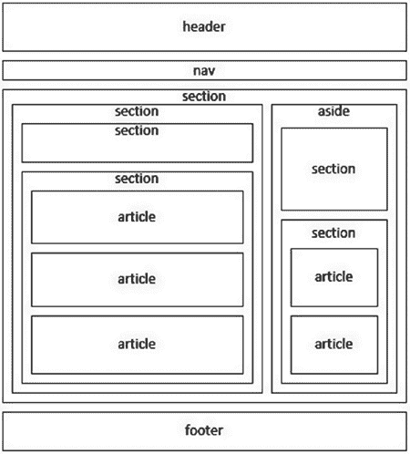
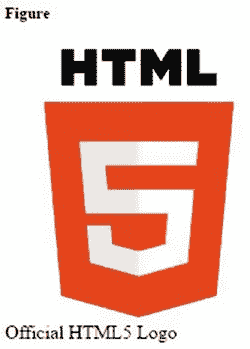

# 我的示例页面

## 导航

## 顶层

### 主内容

#### 精选内容

#### 文章

##### 文章 1

### 相关内容

`Chapter 4 ■ StruCtural htMl eleMentS`

#### HTML 参考

#### 图书列表

##### 图书 1

如果仅使用默认样式在浏览器中渲染此页面，页面将显示为 `Figure 4-2.`。

**图 4-2.** 应用默认样式的示例文档

请注意，尽管所有标签都使用了同一个 `h1` 元素，但每个标签的字体却各不相同。样式会根据元素在文档大纲中的位置自动更新。

`Chapter 4 ■ StruCtural htMl eleMentS`

**注意：**`aside` 元素位于主区块下方，而非侧边。各区块的对齐方式将通过 CSS 控制。我将在 `Cha[pter 13.](http://dx.doi.org/10.1007/978-1-4842-2463-2_13)` 中对此进行说明。

为了进一步说明这一点，有一个便捷的网页可以读取你的 HTML 文档并显示其大纲。你可以访问 `https://gsnedders.html5.org/outliner` 这个网站。粘贴你的 HTML 文档，然后点击“Outline this”按钮。显示的大纲将类似于 `Figure 4-3.`。

**图 4-3.** 查看文档大纲

#### 文档标题

HTML5 支持文档标题元素。除了本例中使用的 `h1` 元素外，还有 `h2`、`h3`、`h4`、`h5` 和 `h6` 元素。每个元素都用于指示标题在文档大纲中应处的指定层级。`h1`–`h6` 元素的默认样式与显式大纲文档中使用的样式相同。

在 HTML5 之前，区块元素尚不存在。但是，使用 `h1`–`h6` 元素，你可以提供隐式区块。如果前一个标题使用了 `h2` 元素，而当前标题使用了 `h3`，则会隐式定义一个新的区块。同样，从 `h3` 回到 `h2` 则会关闭当前区块。

若要创建具有类似大纲的文档，你可以使用 `h1`–`h6` 元素创建隐式区块。

你不需要在所有地方都使用 `h1` 元素，而是使用不同的元素来指示其在层级结构中的级别。以下 HTML 将生成完全相同的大纲（以及浏览器中的输出）：

```html
<body>
  <h1>我的示例页面</h1>
  <h2>导航</h2>
  <h2>顶层</h2>
  <h3>主内容</h3>
  <h4>精选内容</h4>
  <h4>文章</h4>
  <h5>文章 1</h5>
  <h3>相关内容</h3>
  <h4>HTML 参考</h4>
  <h4>图书列表</h4>
  <h5>图书 1</h5>
</body>
```

`Chapter 4 ■ StruCtural htMl eleMentS`

然而，W3C 的官方建议是不要依赖区块元素的轮廓。

`Figure 4-4 shows` 显示了 W3C 文档（`http://www.w3.org/TR/html5/sections.html`）中的警告信息。

**图 4-4.** 关于轮廓算法的警告

你绝对应该使用区块元素来将 HTML 文档组织成各个区块。此警告是建议，在可行的情况下，你也应根据文档层级使用相应的 `h1`–`h6` 元素。

`article` 元素适用于可复用的内容。在这种情况下，内容通常不与主 HTML 文档位于同一文件中。它可能从数据库中读取、通过某种内容提要提供或从单独的文件中提取。它可能对该内容被插入的文档大纲一无所知。`article` 应从 `h1` 级别开始，并根据需要包含额外的区块元素。当 `article` 被包含到文档中时，实际的大纲级别将根据插入时的当前层级进行调整。


■ **注意** 创建大纲的具体算法在 W3C 推荐标准中有详细说明，你可以通过以下地址查看：[`www.w3.org/TR/html5/sections.html#outlines`](http://www.w3.org/TR/html5/sections.html#outlines)

#### 页眉与页脚

在组织页面时，你还应考虑在顶部添加一个 `header` 元素，在底部添加一个 `footer` 元素。这些元素可用于对文档某一部分的引言或结语内容进行分组。

与 `article` 或 `section` 等分区元素不同，`header` 和 `footer` 元素不会在文档大纲中创建新的分区。它们仅用于对所在分区的内容进行分组。通常你会在 `body` 元素中使用 `header` 和 `footer` 元素来定义页面页眉和页脚。它们也可以放置在子分区（例如 `section` 元素）内部。在这种情况下，它们仅对该分区的引言内容进行分组。



#### 规划页面布局

在创建新网页之前，最好先勾勒出基本的页面结构。这有助于你直观地了解整体布局，并看清元素是如何嵌套在一起的。

本章中我将演示的页面将在顶部使用 `header` 和 `nav` 元素，在底部使用 `footer` 元素。中间的主区域将使用一个 `section` 元素，并包含两个并排的区域，每个区域都包含一系列 `article` 标签。较大的区域将被另一个 `section` 元素包裹，并提供主要内容，这些内容被组织成 `article` 元素。右侧较小的区域将使用一个 `aside` 元素，其中包含一个 `section` 元素。该 `section` 元素将包含一系列 `article` 元素，用于展示相关信息。图 4-5 展示了该页面布局。

***图 4-5.** 规划页面布局*

■ **注意** 此示意图在元素之间显示了间距，以便于理解。在实际网页中，大多数情况下，通过将 `margin` 属性设置为 0 可以移除这些间距。

#### 分区根元素

有少部分 HTML 元素被称为分区根元素，它们拥有自己的大纲，且不参与文档其余部分的大纲。`body` 元素便是其中之一，尽管这可以说是一个特例；`body` 元素的大纲也就是文档的大纲。此类别中的其他元素包括 `blockquote`、`details`、`fieldset`、`figure` 和 `td`。我将在第 8 章中解释 `fieldset` 元素，在第 6 章中解释 `td` 元素。

### Blockquote

当你需要在文档中包含一段长引用时，可以使用 `blockquote` 元素。引用的内容放置在 `blockquote` 元素内部，可以包含多个元素，包括标题文本、段落和嵌入内容。一个简单的引用示例如下：

```
<blockquote cite="www.apress.com">
<h1>引用</h1>
<p>这是一段引用</p>
</blockquote>
```

标题文本（`h1`–`h6`）会在引用内部定义分区，但这些分区不会成为文档大纲的一部分。你可以通过将 `blockquote` 元素添加到文档中，并使用我之前提到的大纲工具来运行验证这一点。

除了全局属性，`blockquote` 元素还支持 `cite` 属性。使用该属性来标识引用来源的 URL，或包含引用相关信息的资源地址。

■ **提示** `cite` *属性*提供了有关引用的详细信息，但不会（至少通常不会）显示出来。浏览器可以使用这些信息，但它基本上作为元数据提供。要显示来源或引用信息，应使用 `cite` *元素*，该元素将在下一章中解释。

### Details

`details` 元素允许你创建可折叠的内容区域。在 `details` 元素内部，你可以包含一个可选的 `summary` 元素，该元素包含在元素折叠时显示的内容。如果未使用 `summary` 元素，则折叠时显示的文本将是“详情”。

`details` 元素的其余内容在折叠时将被隐藏。`details` 元素的初始状态为折叠状态。如果你希望在页面加载时显示内容，请添加 `open` 布尔属性。

```
<details open>
<summary>这是折叠文本</summary>
<h1>详情</h1>
<p>这些是可折叠的详情内容</p>
</details>
```

同样，与其他分区根元素一样，你可以在 `details` 元素中包含 `h1`–`h6` 元素，这些元素将为 `details` 定义一个大纲。但是，这些分区不会包含在文档大纲中。



■ **注意** 截至撰写本文时，`details` 元素不受 Internet Explorer 或 Edge 浏览器支持，并且 Firefox 浏览器也未完全支持。

### Figure

`figure` 元素用于对自包含的内容进行分组，这些内容在逻辑上可以移动到其他位置而不会影响文档的主要流程。`figure` 元素的一个独特功能是能够在内容中包含标题。

`figure` 元素通常用于将图像或其他嵌入内容与标题组合在一起。它也可用于将文本（例如代码清单）与标题组合在一起。

要添加标题，请在 `figure` 元素内包含 `figcaption` 元素。`figcaption` 元素必须是 `figure` 元素中的第一个或最后一个子元素。如果 `figcaption` 元素是第一个子元素，标题将位于内容上方。否则，标题将位于内容下方。

以下是一个包含嵌入图像的简单 `figure` 示例。在 Chrome 浏览器中的渲染效果如下图所示（图 4-6）。

```
<figure>
<h1>图形</h1>

<figcaption>官方 HTML5 徽标</figcaption>
</figure>
```

***图 4-6.** 使用 figure/figcaption 元素*

#### 分组元素

上一节描述了用于将 HTML 文档组织成更小分区的元素，以及与文档大纲相关的元素。现在我将解释其余的分组元素。

这些元素主要用于语义目的，不会影响大纲。

### 段落

段落（`p`）元素用于定义一个段落，即包含单一思想或观点的文本部分。它通常在视觉上与其他段落有所区别。例如，在本书中，大多数段落的首行会缩进，以使段落更醒目。`p` 元素的默认样式会设置外边距，从而在段落之间增加一些额外的空白。

`p` 元素可能是最被滥用的元素之一。我再怎么强调也不为过——所选元素应基于其语义含义。段落是文档中一个独特的部分，包含单一思想或观点。如果这描述了你正在添加的内容，请使用 `p` 元素。如果不是，请继续寻找。下一章将描述短语元素，其中某一种可能更合适。

如果使用了合适的元素，默认样式通常也会是合理的。但你不应基于元素自带的样式来选择元素。只要一致地使用合适的元素，就可以通过 CSS 轻松更改样式。

### 水平线

在 HTML4 中，`hr` 元素用于创建水平线。由于 HTML5 为其元素提供了更多的语义定义，该元素已被重新定义为主题分隔。当话题发生转变时，它通常放置在段落之间。


`hr` 元素仍会渲染为水平线以保持向后兼容。当然，这可以通过 CSS 进行修改。`hr` 元素内没有内容，且无需闭合标签。添加一个 `hr` 元素的方式如下：

```html
<p>段落 1</p>

<hr />

<p>段落 2</p>
```

## 预格式化

放置在预格式化（`pre`）元素中的内容将完全按照输入方式呈现，包括空白字符。正如我在第 1 章中所解释的，浏览器通常会忽略空白字符，包括回车符、制表符和额外空格。使用 `pre` 元素可以告知浏览器保留这些字符。默认样式会使用等宽字体，这也有助于保持格式。

> **注：** `pre` 元素是少数例外之一，其使用并非主要出于语义原因。

`pre` 元素用于包含已经格式化且需要保持该格式的内容。包含代码片段就是一个很好的例子。`pre` 元素的另一个常见用途是包含诗歌。例如：

```html
<pre>我听到圣诞节的钟声响起

它们演奏着古老而熟悉的颂歌，

甜美而狂野

词句反复吟唱

人间和平，善意待人！</pre>
```

<cite>亨利·沃兹沃思·朗费罗 - 1863 年，公共领域</cite>

这在浏览器中的渲染效果如图 4-7 所示。

**图 4-7：** 使用 `pre` 元素

尝试将 `pre` 元素替换为标准段落（`p`）元素。内容将显示在一行上，并根据页面宽度自动换行。

> **注：** 这里有一个小趣闻：这首诗是美国内战期间由亨利·沃兹沃思·朗费罗所作。他在不久前失去了妻子，随后得知儿子查尔斯在战斗中受伤。正值圣诞时节，听到教堂钟声奏响颂歌，他开始怀疑是否真的存在和平与善意。这首诗反映了作者对此的挣扎，并在结尾得出结论：只要教堂钟声仍在敲响，希望就依然存在。

## 主要内容

`main` 元素用于表示其内容呈现了文档的主要目的或主题。

它标识了文档的核心和中心主题。因此，`main` 元素不能放置在 `article`、`aside`、`footer`、`header` 或 `nav` 元素内部，因为这些元素用于辅助性内容。此外，每个文档只能有一个 `main` 元素，这一点应相当明确。`main` 元素中的内容应具有文档独特性，不应与其他文档共享。

当然，`main` 元素可以根据需要划分为多个部分。虽然对在 `main` 元素中包含 `article`、`aside` 或 `nav` 元素没有限制，但这通常被认为是糟糕的实践。`article` 包含可复用或独立的内容，因此很少在文档中具有独特性。`aside` 元素用于不属于主要内容流的内容，很可能不属于 `main` 元素所保留的中心主题。然而，如果 `aside` 或 `article` 元素的内容满足 `main` 元素的标准，也可以使用它们。

`main` 元素没有默认样式；它的使用纯粹是语义性的。使用它有助于屏幕阅读器或搜索引擎等应用程序直接跳转到文档的核心内容。

## 分区

我将 `div` 元素留到了最后。正如我之前提到的，在 HTML5 之前，`div` 元素用于所有类型的分组。现在我们有了专门用于特定目的的新元素：按主题划分（`section`）、独立或可复用内容（`article`）、正常流程之外（`aside`）以及导航（`nav`）。此外，还有一些可用于语义分组的元素，如 `main`、`figure` 和 `blockquote` 元素。`div` 元素则用于所有其他分组需求。


