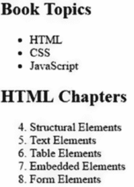
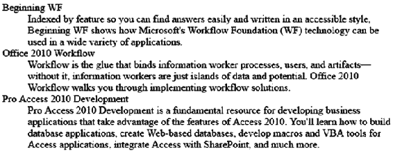
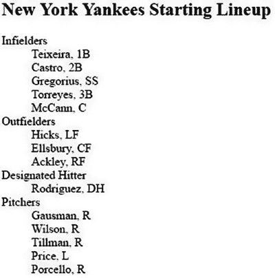

# HTML5 结构化元素

## 使用 `div` 元素进行样式控制

`div` 元素的一个常见用途是将样式应用于其所有子元素。大多数样式属性会从父元素继承。因此，在 `div` 元素上设置一个属性将向下传播到 `div` 内的所有元素。例如，你可能需要根据用户输入或网页状态隐藏或显示某些内容。通过将所有内容放在一个 `div` 中，你可以简单地更新 `div` 属性。

### 列表元素

现在我们来学习用于列出内容的元素，例如项目符号列表。然而，HTML5 中的列表并不局限于一系列项目符号或编号项。任何时候你有一个事物列表，即使这些“事物”是大的内容块，你也应该考虑将它们创建在这些列表元素之一中。再次强调，这关乎语义；将内容放在列表中可以清楚地表明你在枚举一个列表。

### 列表

HTML5 既支持使用 `ol` 元素的有序列表，也支持使用 `ul` 元素的无序列表。除了有序列表可用的一些额外属性外，它们的工作方式基本相同。对于任何一种列表，元素的顺序都是固定的，由项在列表中的包含顺序决定。根据语义选择合适的类型。如果列表的顺序没有意义，请使用无序列表。例如，如果你列出一些流行的运动，如 Football、Baseball 和 Basketball，请使用无序列表。相反，如果你要指定最受欢迎的三项运动，你可能希望按受欢迎程度列出它们。在这种情况下，顺序是有意义的，你应该使用有序列表。

无序列表的默认样式是为每个项添加某种类型的项目符号，并且所有项使用相同的符号。对于有序列表，默认样式将使用数字，并且数字将按顺序分配。

列表（无论有序还是无序）中的项由列表项元素 `li` 表示。可以包含在 `ul` 或 `ol` 元素内的唯一元素是 `li` 元素。但是，你可以在 `li` 元素内放置任何流元素。清单 4-2 展示了一个简单的无序列表和一个有序列表。

使用默认样式，这将呈现如图 4-8 所示。

**清单 4-2.** 示例无序列表和有序列表

```html
<h2>Book Topics</h2>

<ul>
  <li>HTML</li>
  <li>CSS</li>
  <li>JavaScript</li>
</ul>

<h2>HTML Chapters</h2>

<ol start="4">
  <li>Structural Elements</li>
  <li>Text Elements</li>
  <li>Table Elements</li>
  <li>Embedded Elements</li>
  <li>Form Elements</li>
</ol>
```



第 4 章 ■ 结构化 HTML 元素

**图 4-8.** 示例无序列表和有序列表

如前所述，有序列表支持一些额外的属性。最常见的是 `start` 属性，我在前面的例子中使用过。在这个例子中，我列出了本书中介绍 HTML 元素的章节。前三章包含了介绍性材料，因此关于 HTML 的第一章就是本章，[第 4 章](http://dx.doi.org/10.1007/978-1-4842-2463-2_4)。`start` 属性指示用于第一个 `li` 元素的数字；在本例中是 4。如果省略，编号将从 1 开始。

`reversed` 属性是一个布尔属性，用于按倒序分配数字。例如，如果你要列出最受欢迎的三项运动并希望将最受欢迎的放在最后，你会使用此属性。编号将是倒序的：3，2，1。如果你未指定 `start` 属性，则第一个项的数字会被设置为使得最后一个元素为 1。如果你在一个列表中放入十个项并指定了 `reversed` 属性但没有指定 `start` 属性，则项将从 10 到 1 编号。如果你同时指定了 `start` 和 `reversed`，第一个项将使用 `start` 属性中指定的值，其余项将依次递减，因此你最终可能得到负数。

> **提示：** `reversed` 属性不会改变 `li` 元素的顺序。它们始终按照在列表中的包含顺序渲染。`reversed` 属性仅影响项的编号。

`type` 属性指定要使用的“编号”类型。以下是支持的值：

- `1` - 使用数字（如果未指定，这是默认值）
- `A` - 使用大写字母（例如 A, B, C, D）
- `a` - 使用小写字母
- `I` - 使用大写罗马数字（例如 I, II, III, IV）
- `i` - 使用小写罗马数字

无论为 `type` 指定了什么值，`start` 属性始终是数字。它将被转换为适当的类型表示。例如，如果你指定了 `4` 并且 `type` 是 `I`，则第一个元素将使用 `IV`。

> **注意：** 字母或罗马数字不支持零或负数。如果需要这些值，它们将以数字形式显示。例如，如果你在列表中有五个项，并将 `ol` 元素指定为 `<ol start="3" type="a" reversed>`，则编号将是 `c, b, a, 0, -1`。

你可以使用列表来呈现一系列链接，例如菜单。例如：

```html
<nav>
  <h1>Navigation</h1>
  <ul>
    <li><a href="/">Home</a></li>
    <li><a href="http://www.apress.com">Apress</a></li>
    <li><a href="http://www.theCreativePeople.com">My Site</a></li>
  </ul>
</nav>
```

这将显示一个带项目符号的链接列表。但是，使用 CSS，你可以以多种方式呈现它，包括按钮或水平排列的链接。我将在[第 13 章](http://dx.doi.org/10.1007/978-1-4842-2463-2_13)中演示这一点。

## 描述列表

描述列表元素 `dl` 用于定义术语列表。它被实现为一组名称/值对。它常用于创建词汇表。在这种情况下，名称是要定义的术语，值是这些术语的定义或描述。你可以在 `dl` 元素内放置一系列术语元素 `dt` 和描述元素 `dd`。

例如，一个简单的 `dl` 元素可能像这样使用：

```html
<dl>
  <dt>Term1</dt>
  <dd>Definition</dd>
  <dt>Term2</dt>
  <dd>Definition</dd>
</dl>
```

> **注意：** 在 HTML4 中，`dl` 元素被称为定义列表，旨在定义一个术语列表。HTML5 中的语法没有改变，但名称已更改为描述列表，以传达该元素的更广泛用途。在 HTML5 中，它用于提供术语/描述对的组合。

清单 4-3 说明了如何使用此模式来列出一系列书籍以及每本书的描述。图 4-9 显示了在仅使用默认格式的浏览器中将如何显示。



第 4 章 ■ 结构化 HTML 元素

**清单 4-3.** 使用 `dl`、`dt` 和 `dd` 元素

```html
<dl>
  <dt>Beginning WF</dt>
  <dd>
    Indexed by feature so you can find answers easily and written in an accessible style,
    Beginning WF shows how Microsoft's Workflow Foundation (WF) technology can be used in a wide
    variety of applications.
  </dd>
  <dt>Office 2010 Workflow</dt>
  <dd>
    Workflow is the glue that binds information worker processes, users, and artifacts—
    without it, information workers are just islands of data and potential. Office 2010 Workflow
    walks you through implementing workflow solutions.
  </dd>
  <dt>Pro Access 2010 Development</dt>
  <dd>
    Pro Access 2010 Development is a fundamental resource for developing business
    applications that take advantage of the features of Access 2010. You'll learn how to build
    database applications, create Web-based databases, develop macros and VBA tools for Access
    applications, integrate Access with SharePoint, and much more.
  </dd>
</dl>
```

# 第 4 章 ■ 结构性 HTML 元素

***图 4-9.** 渲染描述列表*

然而，你并不局限于这种一对一映射。`dl` 元素的另一种用途是列出带有分组标题的事物组。你可以通过使用 `dt` 元素作为分组标题，`dd` 元素作为组成员来实现这一点。例如，清单 4-4 包含了纽约洋基队的首发阵容，按位置类别整理。图 4-10 显示了该内容的默认渲染效果。



**清单 4-4.** 为每个术语使用多个描述元素

```html
<h2>New York Yankees Starting Lineup</h2>

<dl>

<dt>内野手</dt>

<dd>Teixeira, 一垒手</dd>

<dd>Castro, 二垒手</dd>

<dd>Gregorius, 游击手</dd>

<dd>Torreyes, 三垒手</dd>

<dd>McCann, 捕手</dd>

<dt>外野手</dt>

<dd>Hicks, 左外野手</dd>

<dd>Ellsbury, 中外野手</dd>

<dd>Ackley, 右外野手</dd>

<dt>指定打击</dt>

<dd>Rodriguez, DH</dd>

<dt>投手</dt>

<dd>Gausman, 右投</dd>

<dd>Wilson, 右投</dd>

<dd>Tillman, 右投</dd>

<dd>Price, 左投</dd>

<dd>Porcello, 右投</dd>

</dl>
```

**图 4-10.** 纽约洋基队首发阵容

另一种可能是让多个术语引用同一个描述项。你也可以这样做，但需要将同类术语放在一起。例如：

```html
<dl>

<dt>Hicks, 左外野手</dt>

<dt>Ellsbury, 中外野手</dt>

<dt>Ackley, 右外野手</dt>

<dd>外野手 - 棒球中在内场菱形区域后方草地（即外场）上进行防守的位置。这些位置包括左外野手、中外野手和右外野手。</dd>

</dl>
```

`dt` 元素理应相对简短，例如一个单词或短语。对于 `dt` 元素中可以包含哪些类型的元素，有特定的限制。你不能在 `dt` 元素内部使用标题、页脚或任何分区内容。即便如此，也并没有什么能阻止你在 `dt` 元素中包含段落的文本内容。然而，从语义规则的角度来看，这样做是不恰当的。`dl` 元素用于描述术语列表，而一个文本段落并非术语。

`dd` 元素则没有此类限制。你可以在 `dd` 元素中放置任何流式内容，包括分区内容和嵌入内容。

#### 内联框架

`iframe` 元素用于在当前文档中嵌入另一个网页。我将在此简要介绍，我们将在第 17 章更详细地探讨。你可以使用如下标记包含一个 `iframe`：

```html
<iframe src="http://www.apress.com" width="100%" height="400">

<p>您的浏览器不支持 iframe</p>

</iframe>
```

只有在浏览器不支持 `iframe` 元素时，`iframe` 元素内部的容才会被渲染。`iframe` 元素支持多个属性，可用于配置元素的渲染方式以及允许哪些选项。

- `allowfullscreen` - 如果指定了此布尔属性，则嵌入页面中的脚本可以通过调用 `requestFullScreen()` 方法切换到全屏模式。
- `height` - `iframe` 元素的高度，以像素或相对于父页面的百分比表示。
- `name` - 当从父文档中提供指向 `iframe` 的链接时，可以使用 `name` 属性。
- `sandbox` - 可用于限制在嵌入页面中可以执行的操作。这将在第 17 章中介绍。
- `src` - 用于指定要嵌入的页面的 URL。
- `srcdoc` - 如果指定并受支持，`srcdoc` 属性将覆盖 `src` 属性的值。这通常与 `sandbox` 属性一起使用。
- `width` - `iframe` 元素的宽度，以像素或相对于父页面的百分比表示。

## 已弃用的元素

一些分组元素已从 HTML5 规范中移除。我将在此简要描述它们。为了确保向后兼容性，这些元素可能还会被支持一段时间。但是，你不应在任何新的开发工作中使用它们。

### `hgroup` 元素

`hgroup` 元素曾用于对 `h1`–`h6` 元素进行分组，并在文档大纲中仅保留第一个标题，隐藏其余标题。例如，若你希望为某个章节同时设置主标题和副标题，可能会使用 `h1` 元素作为主标题，`h2` 作为副标题。然而，`h2` 元素会在文档大纲中开始一个新的章节。

将两者放入 `hgroup` 元素中，则只会创建一个单独的章节，并使用 `h1` 标题。

建议的做法是，不使用 `hgroup` 元素，而是将主标题和副标题放入 `header` 元素中。主标题应使用 `h1`–`h6` 元素来定义章节，并加入文档大纲。其余标题内容，如副标题或标语，应放在 `p` 或 `span` 标签中，然后通过 CSS 进行适当的样式设置。更多信息和示例，请参阅 W3C 规范：

[`www.w3.org/TR/html5/common-idioms.html#sub-head`](http://www.w3.org/TR/html5/common-idioms.html#sub-head)

### `dir` 元素

目录列表 (`dir`) 元素曾用于展示目录列表。此列表中的项目包含在 `li` 元素中。`dir` 元素在 HTML5 中已被弃用。你应该使用无序列表 (`ul`) 代替。

### `frame` 和 `frameset` 元素

`frame` 和 `frameset` 元素曾用于将页面组织成多个部分。这包括逻辑分区和页面布局。逻辑分区现在可以借助我之前介绍的分区内容来实现，例如 `section`、`aside` 和 `article`。布局则通过 CSS 配置，我将在第 [13](http://dx.doi.org/10.1007/978-1-4842-2463-2_13) 章中进行演示。

#### 小结

在本章中，我演示了用于组织内容的所有 HTML 元素。这些元素为内容分组提供了语义含义。

文档通过使用分区内容来组织，以定义文档的较大区块。这些内容与标题元素 (`h1`–`h6`) 共同定义了文档大纲。`header` 和 `footer` 元素用于标识文档级别以及章节内的引言和结论内容。

分区根元素包括 `blockquote`、`details` 和 `figure` 元素，它们拥有自己的章节，不影响文档大纲。

还有其他几个分组元素不影响大纲，但在较低层面提供语义分组。这些包括 `main`、段落 (`p`)、水平线 (`hr`) 和分区 (`div`) 元素。

预格式化 (`pre`) 元素主要用于保留内容的格式，而非出于语义原因。最后，有序列表 (`ol`)、无序列表 (`ul`) 和描述列表 (`dl`) 提供了呈现项目列表的方式。

通过使用这些元素，你可以为内容提供语义细节，这将使得应用一致的样式规则更加容易。即使没有自定义 CSS，文档也会开始呈现出“形状”，因为默认样式会根据每个元素的语义目的一致地渲染内容。

清单 4-5 中显示的 HTML 文档演示了本章描述的所有技术。

此文档也可在源代码下载中找到。在下一章中，我将开始在此结构上放置一些实际内容。我将解释为文本内容提供语义含义的各种元素。

***清单 4-5.*** 第 4 章的完整 HTML 文档

```html
<!DOCTYPE html>
<html lang="en">
<head>
<meta charset="utf-8" />
<meta name="author" content="Mark J Collins" />
<meta name="description" content="Sample HTML document" />
<title>HTML5 Sample</title>
<link rel="stylesheet" href="Initial.css" />
<link rel="stylesheet" href="Print.css" media="print" />
<link rel="icon" type="image/x-icon" href="HTMLBadge.ico" />
<link rel="alternate" type="application/pdf" href="MainPage.pdf" />
<link rel="author" href="mailto:markc@thecreativepeople.com" />
</head>
```