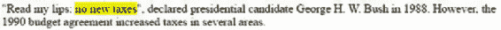
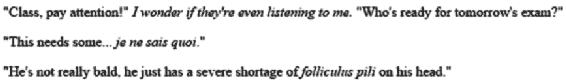

# 排版结果

此处的思路是，你引用其他来源的内容，并因该内容在当前语境中的相关性而添加强调。关键点在于，与强调元素（importance）和着重元素（emphasis）的区别是，这种强调并非原文原有，而是后加的，只因它在当前语境中具有相关性。

这种做法有两种常见应用场景。首先，你可以使用关联元素（`mark`）来高亮引用内容中与当前用法特别相关的部分。例如：

```html
<p>
"请仔细听好了：**<mark>** 不会增加新税收**</mark>** "，总统候选人乔治·H·W·布什在 1988 年宣称。然而，1990 年的预算协议却在多个领域增加了税收。
</p>
```

默认样式会将背景色设置为黄色，如图 5-1 所示。



关联元素的第二个常见用途是在显示搜索结果时。它用于高亮显示符合指定搜索条件的单词或短语。例如，如果某人搜索“HTML”这个词，而页面显示了包含该文本的文章。在这种情况下，你可能需要高亮显示所有出现“HTML”文本的地方。关联元素（`mark`）正是用于实现这一目的。

**提示** 请记住，关联元素（`mark`）用于高亮从其他来源引用的文本，且原文中原本并没有强调。不要用它来强调原创文本；而应使用其他元素，例如强调元素（importance）或着重元素（emphasis）。

## 替代语音 (`i`)

`i` 元素在 HTML4 中用于表示斜体显示，但在 HTML5 中被赋予了语义含义。以下是 W3C 规范对其的描述：

*`i` 元素代表一段与周围内容相隔离的文本，不传达任何额外的强调或重要性，其传统排版表现为斜体文本；例如，生物分类学名称、技术术语、来自其他语言的惯用短语、一段思绪或船名。*

本质上，当文本需要以与周围文本不同的样式呈现，但你无需暗示任何更高的重要性或强调时，就应该使用 `i` 元素。遗憾的是，这个定义并非十分具体，且往往与我接下来要描述的 `b` 元素有所重叠。

然而，规范进一步提供了适合使用 `i` 元素的示例。这些场景可以概括为使用一种*替代语音*，我认为这有助于理解该元素何时适用。

如果文本引用了某人的话语，而你希望在其中插入一段思绪，请使用此元素，例如：

```html
<p>
"同学们，注意了！" **<i>** 我怀疑他们到底有没有在听我说话。 **</i>** "谁准备好明天的考试了？"
</p>
```

这段思绪是一种不同的语音，因为它是在头脑中而非从口中说出的。另一个例子是当某人用英语说话时，引用了一个外来词或短语。这与文本其余部分语音不同，因为它是一种不同的语言。

```html
<p>
"这需要一些... **<i>** 我说不出的气质**</i>** 。"
</p>
```

该概念的另一种应用是使用技术术语。此处语音发生了变化，因为它从日常英语变成了熟悉度有限的术语。

```html
<p>
"他并非真的秃顶，只是他的头上严重缺乏 **<i>** 毛囊菌**</i>** 。"
</p>
```

在所有这些示例中，文本都通过替代语音 (`i`) 元素进行标识，以指示语音或语气的变化：无论是从一种语言切换到另一种语言，从言语转为内心独白，还是从日常用语切换为技术行话。默认样式会将其渲染为斜体，如图 5-2 所示。



### 图 5-2. 备选声音元素的渲染效果

#### `small`（小号文本）

你是否听过“阅读小字”这种说法？通常指那些虽然有时被忽略，但却很重要的法律术语。HTML5 定义了 `small` 元素，你可以将这类内容放入其中。

`small` 元素适用于提供与主要内容通常无关的细节性短文本。

请使用 `small` 元素来放置版权信息、免责声明或其他法律信息。你也可以用它来包含披露声明、许可详情，或注明材料来源。不要将 `small` 元素用于主文档流之外的大块内容，这类情况应使用 `aside` 元素。

■ **注意** 在 HTML4 中，`small` 元素被用来使字体变小。而在 HTML 中，它已被重新定义为提供语义含义，尤其是针对法律细节。不要仅仅为了让字体变小而使用 `small` 元素，这一操作应在 CSS 中完成。

`small` 元素并不暗示任何较低的重要性。事实上，`small` 元素中的细节往往非常重要。如果内容是主流程之外的法律细节，请将其放入 `small` 元素中。如果它同时也是重要信息，还应将其包含在表示重要性的元素（`strong`）内。

#### 删除线（`s`）

删除线元素（`s`）用于表示不再具有*相关性*或*准确性*的内容。“相关”和“准确”这两个术语来自 HTML5 规范，是你在判断删除线元素是否为语义正确选择时需要考虑的关键概念。

■ **警告** 在 HTML4 中，`s` 和 `strike` 元素都受支持，用于以删除线字体渲染文本。但在 HTML5 中，`strike` 元素已被废弃。

在大多数情况下，如果信息不准确，你通常会直接修正；不相关的数据则会删除或替换。然而，如果你希望突出显示已做出的更改，可以保留旧文本，但将其包裹在删除线元素中，如下所示：

```html
<p>
  限时优惠 **<s>$9.95</s>** $7.99 即可获得...
</p>
```

在此例中，`$9.95` 的价格已不再准确，价格已更新为 `$7.99`。但显示先前价格是为了展示降价幅度。

■ **提示** 不要使用删除线元素来表示已删除的文本。用于此目的的是删除（`del`）和插入（`ins`）元素，我将在本章后面进行解释。

假设你有一个页面，列出了某支体育队伍所有主场比赛的日期和时间。这些信息可能每个都链接到可预订比赛座位的页面。那么，你可以将所有已结束或已售罄的比赛放入删除线元素中。你保留这些比赛列表，因为它们可能是有用的信息，但对于当前预订座位的目的而言已不相关。

在我给出的示例中，删除线元素内的内容都是文本，默认样式会以删除线字体渲染。然而，删除线元素用于其语义含义，因此它也适用于其他类型的内容，如图像、音频/视频以及输入控件。你需要在 CSS 中定义如何渲染不准确或不相关的图像，但将其包含在 HTML 的删除线元素内，在语义上绝对是有效的。

#### 文体偏移（`b`）

HTML4 中的旧加粗元素（`b`）在 HTML5 中被重新定义为**文体偏移**内容，且不传递重要性。我在这里用了一个非常清晰的名称来称呼它：*文体偏移*。以下是 HTML5 规范对其的定义：

*`b` 元素表示一段文本区间，出于实用目的而吸引注意力，但不传递任何额外的重要性，也不暗示存在替代性内容。*