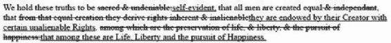

# HTML 语义化元素指南

## 语气或情绪

例如文档摘要中的关键词、评论中的产品名称、交互式文本驱动软件中的可操作词或文章导语。

换句话说，当文本需要以某种方式突出显示，而之前描述的其他元素都不适用时，应使用此元素。它并不重要，不需要任何强调，也不反映另一种语气或情绪。然而，出于其他原因，你希望引起读者对此文本的注意。

规范继续列举了一些应使用样式偏移（`stylistically offset`）元素的示例：

- 关键词
- 产品名称
- 可操作词
- 文章导语（开头段落）

由于此元素是故意通用的，最好包含一个`class`属性，指明该元素为何需要突出显示。这不仅明确了语义含义，还使`CSS`能够根据使用原因进行不同的样式设置。例如：

```html
<p>
  文本高亮元素包括<b class="keyword">重要性</b>、
  <b class="keyword">强调</b>以及<b class="keyword">另一种语气</b>。
</p>
```

**提示：** 样式偏移元素（`<b>`）是最通用的元素，仅应在没有更具体的元素适用时使用。

## 未明确说明的内容（`<u>`）

下划线元素（`<u>`）在`HTML4`中用于指定应加下划线的文本。除了像`<b>`和`<i>`元素那样纯粹的表现性之外，`<u>`元素也常被避免使用，因为带下划线的文本常被误认为是超链接。然而，`<u>`元素在`HTML5`中被赋予了“未明确说明内容”（*unarticulated*）的语义含义。

规范对于何时使用此元素并不十分明确，仅举了两个示例：拼写错误的单词和中文专有名词。规范的实际定义是：“一种未明确说明、但明确呈现的非文本注释。”本质上，这意味着当你需要注释文本（让其以不同格式显示）但没有其他元素能清晰定义你这样做的原因时，应使用`<u>`元素。

规范进一步指出，通常有更合适的元素可用：

> 在大多数情况下，另一个元素可能更合适：表示加重语气应使用`<em>`元素；表示关键词或短语，根据上下文应使用`<b>`元素或`<mark>`元素；表示书名应使用`<cite>`元素；为文本标注明确的文本注释应使用`<ruby>`元素；表示科技术语、分类名称、音译、某种想法或西方文本中的船名，应使用`<i>`元素。

换句话说，请将此作为最后的手段。那么何时应使用`<u>`元素？让我们看看给出的两个示例。当指示拼写错误的单词时，标准惯例是加下划线。同样，为中文专有名词加下划线也是一种标准做法。在西方语言中，专有名词通过首字母大写来指示。而在中文中，指示专有名词的方法则是加下划线。因此，如果你包含中文内容，专有名词应包含在`<u>`元素中。

对于这两个示例，你都有需要以某种方式注释的文本；其他元素均不具备合适的语义含义，且公认的惯例是加下划线。然而，通常情况下，只要没有更具体的元素适用，你都可以使用`<u>`元素。

与`<b>`元素一样，你应该包含一个`class`属性来说明文本被注释的原因，因为元素本身并不能明确这一点。例如，以下内容突出显示了文中的拼写、语法和用词错误：

```html
<p>
  请务必**<u class="spelling">检查</u>**你的**<u class="usage">四</u>**个拼写**<u class="grammar">错误</u>**。
</p>
```

你可以在`CSS`中使用`class`属性来改变下划线的颜色。例如，对拼写错误使用红色下划线，对语法错误使用绿色下划线。

**提示：** 如果你只想简单地给文本加下划线，而不表示“未明确说明的标注”的语义含义，请将文本放入`<span>`标签中，并使用`CSS`应用下划线样式。

## 元素回顾

我用英语写这本书，并且假设你们中的大多数人都能相当流利地阅读英语。然而，`HTML`用于渲染世界上任何语言。重要性、强调等语义概念是通用的，但它们在网页上的物理表示方式可能因语言或文化而异。这也是内容作者应关注这些元素的语义含义而非其默认表示的另一个原因。

- **重要性** - `<strong>` - 不应错过的关键点或核心概念
- **强调** - `<em>` - 以强调方式阅读，发音不同的内容
- **相关性** - `<mark>` - 为参考目的而高亮显示的文本
- **另一种语气** - `<i>` - 外来词、科技术语等
- **小号文本** - `<small>` - 主流程之外的法律细节短文本
- **删除线** - `<s>` - 不再准确或相关的内容
- **样式偏移** - `<b>` - 需要突出显示的关键词或其他短语
- **未明确说明的内容** - `<u>` - 指示拼写或语法错误、专有名词或姓氏

**提示：** W3C 提供了一篇简短但有用的文章，解释了更通用的元素`<b>`和`<i>`应在何时以及如何使用。可以在 [`www.w3.org/International/questions/qa-b-and-i-tags`](http://www.w3.org/International/questions/qa-b-and-i-tags) 找到。我建议通读此文，其中的示例非常有帮助。

### 其他语义短语

`HTML5`提供了几个具有非常特定用途的元素。如果这些元素符合你正在添加的内容，请使用它们来提供适当的语义信息。

### 代码、示例、键盘输入和变量

如果你在记录一个计算机应用程序，`<code>`、`<kbd>`和`<samp>`元素有助于区分这些类型的内容。`<var>`元素在此场景以及其他场景（如包含公式）中也很有用。这些都属于内联短语元素，通常不跨段落。

`<code>`元素表示某种计算机代码的一部分，通常是源代码或某种计算机脚本。它也可以用于文件名、数据库表或服务器名。基本上，`<code>`元素用于任何计算机程序可识别的文本。

**提示：** 没有明确的机制来指示源代码的计算机语言。然而，建议使用`class`属性，并以`language-`为前缀。例如：

```html
<code class="language-javascript">Item.prototype.isAvailable = true;</code>
```

在我看来，接下来的两个元素`<kbd>`和`<samp>`命名不当。`<kbd>`元素标识输入到计算机中的内容，例如键盘输入。相反地，`<samp>`元素用于指示某种计算机输出的内容，例如屏幕上的提示符或写入控制台窗口或日志文件的文本。规范有时称此为样本输出，`samp`这个名字即由此而来。

这里的关键点是：`<kbd>`用于输入，`<samp>`用于输出。它们也可以用在`<code>`元素内，因为它们都是计算机程序可识别的。然而，`<kbd>`和`<samp>`更具体，在适当的情况下应优先于`<code>`使用。


如果代码片段超过一行，应将代码元素包含在预格式化（`pre`）元素内。正如前一章所述，预格式化元素会保留空白字符，并完全按照输入时的原样渲染内容。

在代码片段内部，可以使用变量元素（`var`）来标识变量，这有助于提高代码的可读性。变量元素的默认样式是使用斜体字体。

以下 HTML 代码包含一段 `JavaScript` 代码。其默认渲染效果见图 5-3。

```
<pre>
<code class="language-javascript">
this.log = function () {
	console.log("Quantity: " + <var> this.count</var> + ", Color: " + <var> this.color</var> );
};
</code>
</pre>
```

***图 5-3.** 使用 code、pre 和 var 元素*

**提示** 键盘元素（`kbd`）和示例元素（`samp`）用于语义目的，指示内容是向计算机程序输入或从计算机程序输出的内容。它们也可以嵌套使用。例如，当输出的某部分是被回显到屏幕上的输入时，输入应放在键盘元素内，而整个输出则应放在示例元素内。

变量元素也可以在其他上下文中使用。例如：

`<p>长度为 <var> l</var>、宽度为 <var> w</var> 的矩形的面积为 <var> l</var> * <var> w</var> 。</p>`

## 缩写词与定义

缩写元素（`abbr`）用于包含缩写词或首字母缩略词的完整形式。

缩写形式作为元素的内容提供（位于开始和结束标签之间）。`title` 属性包含缩写词的完整版本，该版本在鼠标悬停于缩写词上之前不会显示。

例如，以下代码在缩写元素中使用了术语 `HTML`，其渲染效果见图 5-4。

`<p>使用 <abbr title="超文本标记语言"> HTML</abbr> 极大地促进了基于 Web 的应用程序的普及。<br /></p>`

***图 5-4.** 显示缩写词*

`title` 属性是可选的。如果没有 `title` 属性，缩写元素仅表明所包含的文本是一个缩写词或首字母缩略词。这可能会很有用，尤其是在你想应用不同样式时。如果指定了 `title` 属性，它应仅包含完整形式。如果用完整形式替换缩写词，句子应仍然读得通。

定义实例元素（`dfn`）用于标识正在被定义的术语。将被定义的术语放在定义实例元素内，而实际的定义放在该元素之外，通常在其后面。例如，以下代码表明术语 `HTML` 正在被定义。

`<p><dfn>HTML</dfn> 是一种添加语义信息以支持内容丰富格式化的标准化方式。</p>`

W3C 规范规定，如果使用了 `dfn` 元素，则最近的父元素必须包含对该 `dfn` 元素内术语的定义。在此示例中，包含 `dfn` 元素的段落元素也包含了该术语的定义。

定义实例元素的默认样式是以斜体显示文本。在本书中，术语首次出现时以斜体显示，后跟其定义。定义实例元素为此技术提供了语义框架。

与缩写元素一样，你也可以包含一个 `title` 属性，当鼠标悬停在该元素上时会显示该属性。此外，如果你希望能够在文档后面再次使用该术语时引用该定义，可以包含一个 `id` 属性。例如，此标记演示了同时使用 `title` 和 `id` 属性。在第二段中，使用了术语 `HTML` 并带有一个指向最初定义的链接。

`<p><dfn id="htmlDef" title="超文本标记语言" >HTML</dfn> 是一种添加语义信息以支持内容丰富格式化的标准化方式。<br /></p>`

`<p>学习 <a href="#htmlDef"> HTML</a> 当然是值得且有收获的。</p>`

当被定义的术语也是一个缩写词或首字母缩略词时，你可以像这样同时使用缩写元素和定义实例元素：

`<p><dfn><abbr title="超文本标记语言">HTML</abbr></dfn> 是一种添加语义信息以支持内容丰富格式化的标准化方式。</p>`

你可以通过在定义实例元素中简单地包含 `title` 属性来实现悬停文本展开缩写。然而，使用缩写元素提供了语义含义，明确了 `title` 是缩写词的完整形式。

## 下标与上标

如果你需要将文本显示为下标，请使用下标元素（`sub`）。这会使字符比其他字符略微降低。类似地，使用上标元素（`sup`）可以使文本显示得更高。例如，以下代码的渲染效果见图 5-5。

`<p>H<sub> 2</sub> O 是水的化学分子式。<br />e=mc<sup> 2</sup> 是质能等价公式。</p>`

***图 5-5.** 使用下标和上标*

**注意** 不应纯粹出于展示目的使用下标和上标元素。仅当不使用它们会改变内容含义时才应使用。例如，没有上标的 `e=mc2` 含义不同；上标中的字符 `2` 意味着变量应被平方。同样，在某些语言中，字符的上标或下标会改变单词的含义。

下标元素也可以作为变量元素（`var`）的一部分使用，我之前演示过这一点。

## 时间

`time` 元素允许你为指向时间点的文本提供语义含义。然后你可以使用 `datetime` 属性来包含一个机器可读的版本。例如：

`<p>您的复诊预约将在 <time datetime="2016-06-28"> 星期二</time> 后的一周。</p>`

`datetime` 属性不会显示；它仅提供给可能需要访问此信息的脚本和其他应用程序使用。如果你希望显示实际日期，请将其放在 `time` 元素的内容部分。

如本例所示，`datetime` 属性可以包含一个特定的日期。它也可以同时指定时间和日期，或者仅指定时间本身。`datetime` 属性的格式有多种不同方式。W3C 规范提供了许多带有示例的详细信息，可以在 `http://www.w3.org/TR/html5/text-level-semantics.html#the-time-element` 找到。

## 编辑

如果你想显示对文档所做的更改，可以将它们包含在插入元素（`ins`）和删除元素（`del`）中。将从原始版本中删除的内容放在删除元素中，并将添加的内容放在插入元素（`ins`）中。如果文本发生了变化，请将原始版本放在删除元素中，将新版本放在插入元素中。

例如，以下 HTML 显示了《独立宣言》初稿在最终版本发布前是如何被编辑的。

`<p>我们认为这些真理是`


**<del cite="https://www.loc.gov/exhibits/declara/ruffdrft.html" datetime="1776-06-28">** 神圣

& 不可否认；**</del><ins>** 不言而喻，**</ins>** 人人生而平等<del> & 独立**</del>** ，**<del>** 从这种平等诞生中，他们获得了固有且不可剥夺的权利**</del><ins>** 造物主赋予他们若干不可剥夺的权利**</ins>** ，**<del>** 其中包括保护生命、自由和追求幸福的权利；**</del><ins>** 其中包括生命权、自由权和追求幸福的权利。**</ins>**

这些元素的默认样式是对新文本加下划线，对删除文本加删除线，如图 e 5-6.所示。



## 第 5 章 ■ HTML 元素的措辞

**图 5-6.** 默认编辑渲染效果示意

除了全局属性外，插入元素和删除元素都支持两个特定属性：

- `cite` - 使用此属性来指明更改的来源。如果使用，该属性值应为指向在线资源的引用。此属性不会显示，但可被搜索引擎以及脚本使用。
- `datetime` - 指明更改发生的日期/时间。标准格式为 `YYYY-MM-DDThh:mm:ss` *(时区)*。

**■ 提示** 当然，你始终可以通过 CSS 和 JavaScript 更改默认样式。例如，你可以在页面上提供一个选项，仅显示最终版本。为此，可以将删除元素的样式设置为 `display: none`，并对插入元素使用标准样式。而通过隐藏插入元素并对删除元素使用标准样式，你也可以显示原始版本。

#### 引用

在上一章中，我介绍了 `blockquote` 元素，它是一种结构元素，用于包含长篇引用及其相关元素。现在，我将介绍使用引用的推荐技术，包括 `blockquote`、行内引用（`q`）和引用来源（`cite`）元素。

当你想在当前句子或段落中包含一段简短引用时，请使用行内引用（`q`）元素。例如：
```html
<p>
    正如亚伯拉罕·林肯曾说的，**<q>** 无论你是什么人，都做一个好人**</q>** 。
</p>
```
行内引用不会开始一个新段落，其内容会像其他措辞元素（如 `strong` 或强调）一样，从上一个元素延续下来。此外，行内引用不应跨越多个段落。

相比之下，`blockquote` 元素定义了一个新的区块，就像 `div` 或更具语义的元素（如 `aside` 和 `section`）一样。它可以包含多个段落以及其他元素，包括标题文本和页脚。例如，以下 HTML 的渲染效果见图 5-7。
```html
<blockquote>
    <h1>葛底斯堡演说</h1>
    <p>
        八十七年前，我们的先辈在这个大陆上创立了一个新国家，它孕育于自由之中，奉行一切人生而平等的原则。
    </p>
    <p>
        现在我们正从事一场伟大的内战，以考验这个国家，或者任何一个孕育于自由并奉行上述原则的国家，是否能够长久存在下去。我们在这场战争的一个伟大战场上集会。我们来此，是为了将战场的一部分奉献给那些为使这个国家能够生存下去而献出自己生命的人，作为他们最后的安息之地。我们这样做是完全应该且正当的。
    </p>
    <footer>
        <small>亚伯拉罕·林肯，1864 年</small>
    </footer>
    <cite>
        <a href="http://www.abrahamlincolnonline.org/lincoln/speeches/gettysburg.htm">
            葛底斯堡演说
        </a>
    </cite>
</blockquote>
```
**图 5-7.** 块引用的默认渲染效果

所有引用都应注明出处，以尊重来源。由于行内引用不能包含除其他措辞元素之外的元素，因此引用使用之前解释过的 `cite` 属性来注明。

`cite` 属性的值应为指向提供有关该引用更多信息的页面的 URL。此信息通常不会由浏览器显示。要提供可视化的引用标注，你需要在行内引用元素之外添加额外的文本，例如本例中的“正如亚伯拉罕·林肯曾说的”。

对于块引用，引用通过 `cite` 元素进行标注。被引用来源的名称（例如“葛底斯堡演说”）应放在 `cite` 元素内部。如果你还想包含一个链接，请为此目的添加一个锚点（`a`）标签。通过将其放入 `cite` 元素内部，链接的语义含义变得更加明显。

**■ 提示** 由于 `blockquote` 是一个流式元素，你几乎可以在其中包含任何内容。例如，你可以包含一张图片，或一个音频或视频片段。如果你想包含一幅《蒙娜丽莎》的图片，将其置于 `blockquote` 元素中能清楚地表明你是在引用他人的作品。同时，在 `blockquote` 中包含一个 `cite` 元素来注明作品名称“蒙娜丽莎”，并添加其他内容以表明它是由列奥纳多·达·芬奇于约 1506 年绘制的。

## Span

`span` 元素是一个通用容器，不提供任何语义含义。但是，你可以在 `span` 元素上使用属性来指明语义信息。`class` 属性是用于此目的最常用的属性，但还有其他属性，如 `lang` 和 `dir`，也可能很有用。

考虑以下 HTML：
```html
<p>
    三原色是 <span class="red">红色</span>、<span class="blue">蓝色</span> 和 <span class="yellow">黄色</span>。
</p>
```
`span` 元素没有语义含义；它也没有默认样式。没有任何 CSS 规则时，此内容中的 `span` 元素不会产生任何效果。但是，你可以使用 CSS 来改变这些文本部分的字体颜色或背景颜色。

## 添加换行符

有几种方法可以用于在文档中添加空白。这些方法可以强制或建议在文本内进行换行。

### 换行

换行元素（`br`）在文本中插入一个换行符。回顾上一章，浏览器会忽略 HTML 中的空白字符。如果你需要文本从新的一行开始，请在文本之前或前一个文本之后插入一个换行元素。例如：
```html
<p>
    八十七年前，**<br />**
    我们的先辈在这片大陆上创立了**<br />**
    一个新国家，它孕育于自由之中**<br />**
    并奉行一切人生而平等的原则。**<br />**
</p>
```
换行元素是一个*空*元素，意味着它在开始和结束标签之间没有内容。事实上，HTML5 并不区分开始标签（`<br>`）和结束标签（`</br>`）。如果你输入
```html
One <br> Two </br> Three
```
每个单词都会显示在不同行，因为开始和结束标签都会产生一个换行。HTML5 相当宽松，允许 `<br>`、`</br>`、`<br/>` 和 `<br />` 作为有效语法。在本书中，我将一致使用 `<br />` 格式约定来处理所有自闭合标签。

**■ 注意** 不要仅仅为了在元素之间添加垂直间距而使用换行元素。这应该通过 CSS 样式来完成。换行元素只应在你需要强制文本换到新行时使用。格式化地址块就是一个很好的例子。

### 单词换行时机

浏览器会自动换行文本，以使其适合为元素定义的水平空间。有几种方法可以控制用于换行的规则，我将在第 [10](http://dx.doi.org/10.1007/978-1-4842-2463-2_10) 章中介绍。换行通常发生在单词之间存在空白或标点符号的位置。但是，如果你遇到一个相当长的单词，这种方式可能不会如你所愿地工作。


