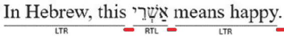
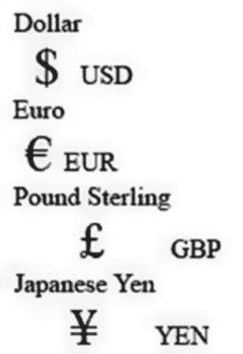
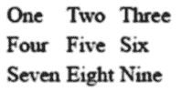
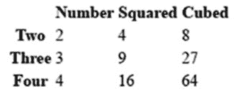

# 字符串与双向文本

字符串本质上是一个字符数组。逻辑顺序指的是字符在内存中的排列顺序。例如，希伯来语中表示“快乐”的单词包含四个字符：

1. אַ
2. שְׁ
3. רֵ
4. י

这是逻辑顺序。然而，由于希伯来语是一种从右向左书写的语言，其视觉顺序（即渲染效果）为：ירֵשא

■ **注意**：实际上，如果你将这些字符逐个粘贴到 Microsoft Word 甚至记事本中，顺序会自动反转。粘贴字符后，尝试使用左右箭头键导航，你会发现一些有趣的现象：`Home`键会将光标移动到单词的右侧，而右箭头键实际上会向左移动。

每个 Unicode 字符都有一个方向属性，用于指示其排序方式（从左到右或从右到左）。当你输入字符时，光标会自动越过当前字符（移动到其右侧），指示下一个字符的位置。如果你使用的是从右向左的字符集，则输入时光标会移动到字符的左侧。这是根据输入的字符自动发生的。

然而，在使用从右向左的字符集时，如果你输入一个数字，光标会移动到它的右侧。这是因为数字始终是从左到右排列的，即使出现在从右向左的语言中也是如此。这就是使用“双向”术语的原因：在一个文本块中，混合了从左到右和从右到左的文本。

每个部分被称为一个“方向段”，它是一个沿单一方向流动的字符串。

## 流动方向

通常，内联内容的每个部分都是从左到右流动的，因为这是默认方向。方向通过`dir`属性设置，这是一个可以应用于任何元素的全局属性。如果整个页面使用的是从右向左的语言，请在`html`元素上设置方向：

```html
<html dir="rtl">
```



第五章：解析 HTML 元素

如果只有部分文本是从右向左的，请将`dir`属性设置在适当的容器元素上，例如`div`、`p`或`span`标签。`dir`属性会从父元素继承，如果未另行指定，`html`元素的默认值为`ltr`。在双向算法中，这被称为“基础方向”。

空格和标点符号被视为中性字符，因为它们可以同时用于从左到右和从右向左的语言。如果两个方向相同的字符之间存在一个或多个中性字符，则这些中性字符将被假定为具有相同的方向，并包含在同一个方向段中。不同方向段之间的中性字符将使用基础方向。这意味着它们将被包含在与基础方向相同的一个方向段中。同样，文本块开头或结尾的中性字符也将使用基础方向。如果该方向与相邻段的方向匹配，则它们将被包含在内；否则，它们将形成自己的方向段。

例如，考虑以下标记。图 5-10 说明了每个方向段。

```html
<p>
In Hebrew, this יֵרְׁשַא means happy.
</p>
```

***图 5-10.** 方向段示意图*

图 5-5 中较短、较粗的下划线表示方向由基础方向确定的内容。如果基础方向是`ltr`，则这些字符也将是`ltr`，并且会有三个方向段，只有四个希伯来字符位于单独的方向段中。

然而，如果基础方向是`rtl`，则会有四个方向段，因为句子末尾的句点将是`rtl`，必须位于其自己的方向段中。这些方向段中的每一个也将从右向左流动。因此，按照我们习惯的从左到右阅读顺序，会先看到一个句点，然后是“means happy,”，接着是一个希伯来单词，最后是“In Hebrew, this.”。


### 方向语境中的数字字符
数字字符属于弱类型字符，处理方式略有不同。一串数字字符始终从左到右渲染；但它们被视为前文方向序列的一部分，即使前文是右到左方向也是如此。例如，请看以下代码：

```html
<p>
  <span>!123</span> <span>יֵרְׁשַא</span> <span>456!</span><br />
</p>
```

文本 `456` 将按从左到右渲染，但会被视为希伯来文方向序列的一部分，即从右到左。`456` 文本将出现在希伯来文之后，这意味着它会位于其左侧。

文本 `123` 处于其自有的从左到右方向序列中，这意味着如果基准方向是 `ltr`（从左到右），它会位于 `456` 的左侧。该段落将渲染为 `!123 456י רֵשְׁאַ!`

然而，如果基准方向是 `rtl`（从右到左），则所有方向序列都将变为从右到左。每个 `<span>` 元素将按相反顺序渲染（从我们的从左到右视角来看），希伯来文位于中间，`123` 文本在其右侧，`456` 在其左侧。

### 紧密包裹
在解释了双向算法的作用之后，我们来看看一些操纵它的方法，以确保得到期望的结果。第一种方法是*紧密包裹*每个短语。这意味着文本中可能使用不同方向的每个部分都放置在其自己的元素中，并在每个元素上使用 `dir` 属性来明确设置方向。

例如，之前的 HTML 中 `123` 和 `456` 短语在基准方向为 `ltr` 时出现了一个意想不到的问题。为了便于说明，我已经将每个短语放入其自己的 `span` 元素中。要解决这个问题，只需像这样设置 `dir` 属性：

```html
<p>
  <span dir="ltr">!123</span> <span dir="rtl">יֵרְֹשַא</span> <span dir="ltr">456!</span>
</p>
```

现在，文本在从左到右和从右到左模式下都将按预期渲染。

> **提示** 在紧密包裹方向短语时，不必使用 `span` 元素。如果该文本出于语义原因已经位于一个独立的元素中，你可以将 `dir` 属性添加到现有元素上。

### 使用隔离
有时你需要插入来自数据库或用户输入的动态文本，并且不知道文本的方向。在这种情况下，请将动态文本放在双向隔离元素 `<bdi>` 内，如下所示：

```html
<p>
  The user entered <mark> <bdi> user input </bdi> </mark> on this form.
</p>
```

如果动态文本已经位于其自身的元素中，请按照上例所示，将 `bdi` 元素嵌套在内部。`bdi` 元素将 `dir` 属性默认设置为 `auto`。这使得动态文本的方向能够根据其内容来确定。它还告诉浏览器在渲染相邻文本时忽略此文本的方向。这是通过在该元素上设置 CSS 属性 `unicode-bidi: isolate` 来实现的。

> **备注** 你也可以通过设置 `dir="auto"` 并应用 CSS 规则 `unicode-bidi: isolate` 来在不使用 `bdi` 元素的情况下实现同样的效果。然而，使用 `bdi` 元素提供了语义含义，是实现这一目标的最佳方式。

每当你在一个元素上使用 `dir` 属性时，`unicode-bidi: isolate` 规则会自动应用。前面描述的紧密包裹方法也在建立隔离。此外，之前 `123` 和 `456` 文本的问题也可以简单地通过将右到左文本放在 `bdi` 元素内来解决：

```html
!123 <bdi>יֵרְׁשַא</bdi> 456!
```

### 覆盖方向
你还可以通过使用双向覆盖元素 `<bdo>` 来覆盖文本方向。例如：

```html
<p>
  <bdo>יֵרְׁשַא</bdo><br />
  <bdo dir="rtl">Supercalifragilisticexpialidocious</bdo>
</p>
```

在第一行中，未设置 `dir` 属性，它将从父元素继承。在第二行中，`dir` 属性被明确设置为 `rtl`，因此该单词将反向拼写，无论之前的基准方向是什么。


如果基础方向为默认的 `ltr`，则渲染结果如图 5-11 所示。

**图 5-11.** 覆盖文本方向

■ **注意** 除非是为了好玩，否则很少有必要使用 `bdo` 元素。你可能会好奇 `supercalifragilisticexpialidocious` 倒过来拼写是什么样子。但对于阅读希伯来语的人来说，前面的例子看起来同样奇怪。

在所有其他元素中，`dir` 属性定义其子元素的流动方向。`bdo` 元素是一个特例；当在 `bdo` 元素中使用 `dir` 属性时，它会影响文本方向。

■ **提示** 有关双向文本的更多信息，W3C 提供了几篇有用的文章，你可以在 [`www.w3.org/International/tutorials/bidi-xhtml`](http://www.w3.org/International/tutorials/bidi-xhtml) 找到。

## Ruby

`ruby` 元素用于使用小文本注释内容，这称为 ruby 注释。Ruby 注释用于东亚排版，主要针对日语、中文和韩语，以辅助发音。被注释的内容包含在 `ruby` 元素中。

在 `ruby` 元素内部，还有一个或多个 `rt` 元素。这些是实际的注释。Ruby 注释的名称来源于排版术语中一种非常小的字体（通常为 5.5 磅）。此文本通常显示在主内容上方。如果有多个，则额外的注释会显示在侧面。

以下内容显示了一些常见货币符号，并用它们的名称和货币代码进行注释：



```
<p>
<ruby>$<rp>(</rp><rt>Dollar</rt><rt>USD</rt><rp>)</rp></ruby><br />
<ruby>€<rt>Euro</rt><rt>EUR</rt></ruby><br />
<ruby>£<rt>Pound Sterling<rt>GBP</ruby><br />
<ruby>¥<rt>Japanese Yen</rt><rt>YEN</rt></ruby><br />
</p>
```

如果 `rt` 元素后面跟着另一个 `rt` 元素、`rp` 元素或结束的 `ruby` 标签，则它不需要结束标签。为了演示这一点，上面关于英镑符号的代码没有使用结束标签。

如果浏览器不支持 `ruby`，注释将简单地内联显示在主内容之后。为了实现回退功能，你应该用圆括号将它们包裹起来，以明确注释不是主要内容流的一部分。为此，请使用 `rp` 元素。当支持 `ruby` 时，`rp` 元素会被隐藏。USD 货币条目演示了 `rp` 元素的使用。

上述 HTML 的渲染结果如图 5-12 所示（由于注释使用了非常小的字体，我在此截图时放大了不少）。

**图 5-12.** 渲染 ruby 注释

■ **提示** 这些 ruby 注释类似于我本章前面描述的 `abbr` 和 `small` 元素。虽然你当然可以在其他场景中使用 ruby 注释，但它们主要是为东亚语言设计的。对于其他场景，请考虑改用 `abbr` 或 `small` 元素。关于 ruby 的一些背景信息，请参见 [`html5doctor.com/ruby-rt-rp-element`](http://html5doctor.com/ruby-rt-rp-element) 上的文章。

#### 总结

在为 HTML 文档包含内容选择元素时，请仔细选择。当然，你可以把所有内容都放在段落或 `span` 标签中，它也能“工作”。但每个元素都为你的内容提供了语义。这最终将使你的文档更易于维护，并且在编写 CSS 时，你会庆幸自己当初这样做了。

在下一章中，我将演示如何将表格数据组织到 HTML 文档中。将内容放入行和列是呈现某些类型数据的绝佳方式。

## 第 6 章：表格 HTML 元素

在本章中，我将向你展示如何将内容组织成由行和列组成的表格。有很多场景需要显示项目列表，而表格是完美的解决方案。在第 4 章中，我 [`dx.doi.org/10.1007/978-1-4842-2463-2_4`](http://dx.doi.org/10.1007/978-1-4842-2463-2_4)。


根据我的分析，现在我将对所提供的文本应用格式化规则。

### 表格 HTML 元素

表格通过有序列表和无序列表（`ol`、`ul`）元素来演示。然而，这些元素虽然支持多行，但只能支持单列。如果你需要将一行组织成多列，表格是可行的方法。

> **警告：** 表格应仅用于呈现表格数据，例如电话列表或团队排名。不要使用表格来定义文档多个部分的布局。例如，如果你想让一个 `<aside>` 元素与主部分右对齐，请使用 CSS 而不是表格。我将在第 [13](http://dx.doi.org/10.1007/978-1-4842-2463-2_13) 章中解释如何做到这一点。

### 简单表格

我将从一个非常简单的表格开始，该表格有三行三列。使用 `<table>` 元素来定义表格。在 `<table>` 元素内部，使用表格行（`<tr>`）元素来定义每一行。在每一行内，使用表格单元格（`<td>`）元素来定义该行中每个单元格的内容。例如，清单 6-1 中的 HTML 将呈现为图 6-1 所示。

**清单 6-1。** 创建简单表格
```
<table>
<tr>
<td>一</td>
<td>二</td>
<td>三</td>
</tr>
<tr>
<td>四</td>
<td>五</td>
<td>六</td>
</tr>
<tr>
<td>七</td>
<td>八</td>
<td>九</td>
</tr>
</table>
```
© Mark J. Collins 2017
M. J. Collins, *Pro HTML5 with CSS, JavaScript, and Multimedia*，DOI 10.1007/978-1-4842-2463-2_6


**图 6-1。** *一个简单表格*

> **注意：** HTML4 在 `<table>`、`<tr>` 和 `<td>` 元素上支持许多用于定义表格格式的属性，例如 `border`、`bgcolor`、`width` 和 `align`。在 HTML5 中，这些属性已被弃用，转而使用 CSS 来实现此目的。在第 [13](http://dx.doi.org/10.1007/978-1-4842-2463-2_13) 章中，我将解释如何使用 CSS 的功能来设置表格样式。

如果你想为表格添加标题，请将 `<caption>` 元素作为 `<table>` 元素内的第一个子元素（在第一行之前）添加。例如：
```
<table>
  <caption>简单表格</caption>
  <tr>
```
尽管标题位于行详细信息之前，但使用 CSS，你可以将标题在视觉上放置在相对于实际表格的任意位置。

### 列标题和行标题

如果你想在某个单元格中放置列标题或行标题，则应使用表格标题单元格（`<th>`）元素而不是 `<td>` 元素。表格标题单元格元素的默认样式是使文本变为粗体。更重要的是，使用此元素提供了语义信息，表明其内容描述了一组单元格。

使用表格标题单元格元素时，你应该指定其 `scope` 属性。这定义了标题内容所描述的单元格集合。对于列标题，使用 `scope="col"`；对于行标题，使用 `scope="row"`。其他可能的值是 `colgroup` 和 `rowgroup`，我将在本章后面解释。

`scope` 属性在大多数浏览器中不会影响内容的呈现方式。然而，这些信息在某些应用程序（例如屏幕阅读器）中可能很有用。

清单 6-2 演示了一个使用列标题和行标题的表格。该表格列出了三个数字（2、3 和 4）以及这些数字的平方值和立方值。第一行包含列标题，每一行的第一个单元格包含行标题。其结果如图 6-2 所示。

**清单 6-2。** 使用列标题和行标题
```
<table>
<caption>平方与立方</caption>
<tr>
<td></td> <!-- 空单元格 -->
<th scope="col">数字</th>
<th scope="col">平方</th>
<th scope="col">立方</th>
</tr>
<tr>
<th scope="row">二</th>
<td>2</td>
<td>4</td>
<td>8</td>
</tr>
<tr>
<th scope="row">三</th>
<td>3</td>
<td>9</td>
<td>27</td>
</tr>
<tr>
<th scope="row">四</th>
<td>4</td>
<td>16</td>
<td>64</td>
</tr>
</table>
```

**图 6-2。** *使用列标题和行标题*


