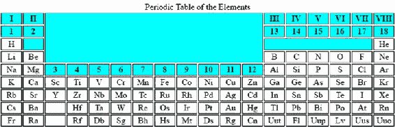
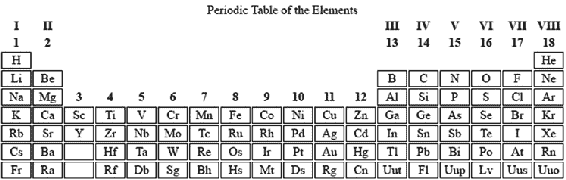

# HTML 表格元素与嵌入内容

## 使用 `colspan` 和 `rowspan` 合并表格单元格

假设你有一个包含五列的表格。每个表格行元素总共包含五个 `td` 或 `th` 元素（这些元素可以互换使用）。如果你将其中一个元素的 `colspan` 属性设置为 `2`，它将占据两个单元格的空间，并且该行只需要四个元素。如图 6-6 所示。

**图 6-6.** 使用 `colspan` 属性

第一行包含五个元素。然而，第二行只有四个元素，因为其中一个元素占据了两个单元格。这与之前我在 `colgroup` 或 `col` 元素中解释的 `span` 属性的工作方式类似。

`rowspan` 属性的工作方式与之相同，区别在于单元格是向下扩展（包含其下方的单元格），而非向右扩展。当然，你也可以同时包含 `colspan` 和 `rowspan` 属性。在这种情况下，合并后的单元格将同时变得更宽和更高，如图 6-7 所示。

**图 6-7.** 使用 `colspan` 和 `rowspan` 属性

这会给后续的行元素带来一些有趣的副作用。在图 6-7 所示的表格中，第二行只有四个元素，因为一个元素占用了两个单元格。然而，在第三行中，单元格 2 和 3 已经被上一行的合并单元格分配掉了。只剩下三个可用单元格，因此第三行只会添加三个元素。第四行也是如此。

## 构建元素周期表

现在，让我们应用这个概念来构建元素周期表。如果你上过基础化学课，很可能见过这个表的某个版本。它以表格形式列出了所有元素。列和行具有特殊含义，与其原子结构有关。例如，最后一列的所有元素被称为稀有气体；其左侧的列包含所有卤族元素。

由于这种表格布局，网格中会存在空隙，尤其是在前几行。虽然我们可以创建大量空单元格，但更好的做法是将这些空单元格合并成一个单元格。

## 第 6 章：表格 HTML 元素

此表格的部分 HTML 代码如清单 6-4 所示。为简洁起见，我已省略了表格的最后四行。下载的代码将包含完整的源代码。完整表格有十八列、七行数据以及两行表头。

**清单 6-4.** 元素周期表源代码

```html
<table id="Periodic">

<caption>元素周期表</caption>

<tr>

<th>I</th>

<th>II</th>

<th colspan="10" rowspan="4"></th>

<th>III</th>

<th>IV</th>

<th>V</th>

<th>VI</th>

<th>VII</th>

<th>VIII</th>

</tr>

<tr>

<th>1</th>

<th>2</th>

<!-- 跳过 10 个单元格-->

<th>13</th>

<th>14</th>

<th>15</th>

<th>16</th>

<th>17</th>

<th>18</th>

</tr>

<tr>

<td>H</td>

<th></th> <!-- 空单元格 -->

<!-- 跳过 10 个单元格-->

<th colspan="5"></th>

<td>He</td>

</tr>

<tr>

<td>Li</td>

<td>Be</td>

<!-- 跳过 10 个单元格-->

<td>B</td>

<td>C</td>

<td>N</td>

<td>O</td>

<td>F</td>

<td>Ne</td>

</tr>

<tr>

<td>Na</td>

<td>Mg</td>

<th>3</th>

<th>4</th>

<th>5</th>

<th>6</th>

<th>7</th>

<th>8</th>

<th>9</th>

<th>10</th>

<th>11</th>

<th>12</th>

<td>Al</td>

<td>Si</td>

<td>P</td>

<td>S</td>

<td>Cl</td>

<td>Ar</td>

</tr>

<!-- 为简洁起见，省略最后四行 -->

</table>
```

第一行有一个元素跨越了十列和四行。在随后的三行中，我添加了注释以指示被跳过的单元格位置。这些空间被那个大的合并单元格占据。我在前四行中使用 `th` 元素来处理所有标题数据以及空单元格。

## 添加 CSS 来格式化表格

我将在第 [13](http://dx.doi.org/10.1007/978-1-4842-2463-2_13) 章中解释如何使用 CSS 格式化表格。不过现在，为了让这个表格看起来熟悉，我会添加一些非常简单的 CSS。因为元素太多，添加内联样式不切实际。在 `head` 元素中，我将添加以下 `style` 元素：

```css
<style>

#Periodic td {

width: 35px;

border: 1px solid black;

padding: 1px;

margin: 1px;

text-align: center;

}

</style>
```

这个选择器会找到所有位于 `id` 为 `Periodic`（即该表格元素的 `id`）的元素内部的 `td` 元素。这些声明设置了每个元素的宽度，并使文本居中并添加边框。元素周期表将呈现如图 6-8 所示的效果。





**图 6-8.** 元素周期表

为了能够看到合并的单元格，请在 `style` 元素中添加以下以粗体显示的 CSS 规则。这将为 `th` 元素添加边框并设置背景色。

```css
<style>

#Periodic td {

width: 35px;

border: 1px solid black;

padding: 1px;

margin: 1px;

text-align: center;

}

#Periodic th {

border: 1px solid black;

background-color: #0ff;

padding: 1px;

margin: 1px;

text-align: center;

}

</style>
```

现在表格将呈现如图 6-9 所示的效果。

**图 6-9.** 为 `th` 元素设置样式

请注意表格中间的大块区域。它有四行高、十列宽。整个区域周围有一个边框，因为它被视为一个单一的单元格。

### 本章小结

在本章中，我解释了如何使用 `table` 元素来呈现表格数据。一个表格由行组成，行由 `tr` 元素表示。每一行包含一组 `td` 和/或 `th` 元素。列并没有明确定义，而是基于 `td` 或 `th` 元素的存在来推断。例如，每行的第一个元素被视为第一列。

你可以使用 `colgroup` 和/或 `col` 元素来定义列。这实际上并不会创建或定义任何表格单元格，但允许你将样式应用于特定列或列组。出于语义目的，你还可以将表格行分组到 `thead`、`tbody` 和 `tfoot` 元素中。

最后，你可以使用 `colspan` 和 `rowspan` 属性将单元格合并为一个单元格。由于合并后的单元格会占用更多空间，因此包含合并单元格的那一行所需的元素会更少。

使用 `rowspan` 属性尤其有趣，它要求你在后续行中跳过一些单元格。我建议你在表格中添加注释以指示被跳过的单元格。

在下一章中，我将解释如何在文档中包含嵌入内容，例如图像。

我还会演示如何使用原生的 `audio` 和 `video` 元素。