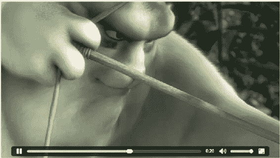

# 视频元素

在本节中，我将使用随下载源代码提供的演示视频。这是来自*Big Buck Bunny*电影的预告片。该视频由创用共享许可提供，可自由再分发（版权 2008，Blender Foundation / [www.bigbuckbunny.org](http://www.bigbuckbunny.org/)）。当然，你也可以使用自己的视频，但建议使用 MP4 格式以确保兼容所有主流浏览器。

`video`元素与`audio`元素几乎相同。你可以在元素内提供后备内容，该内容仅在`video`元素或文件类型不被支持时显示。只需将`src`属性设置为视频文件的 URL，如下所示：

```
<video src="Media/BigBuckBunny.mp4" autoplay>
  <p>HTML5 视频在你的浏览器上不被支持</p>
</video>
```

`autoplay`属性会在页面加载时开始播放视频，但由于没有原生控件，你将无法暂停或重新播放片段。不过，如果你在视频上右键单击，会弹出一个选项菜单，可与此视频交互，包括显示原生控件。具体选项可能因浏览器而异。Chrome 中的菜单如图 7-10 所示。Firefox 还允许你调整播放速度，以及暂停、静音和切换到全屏模式。

`图 7-10. Chrome 中的视频菜单`

添加`controls`属性将提供与音频片段相似的控件，如图 7-11 所示。这些控件通常隐藏，除非鼠标悬停在`video`元素上。



`图 7-11. 显示带原生控件的视频`

`video`元素还允许你通过`source`元素指定多个资源来源，与`audio`元素类似。如果你提供的是 MP4 格式的视频，通常不需要使用此功能。

`poster`属性受`video`元素支持（但`audio`元素不支持）。在视频播放之前，你可以使用`poster`属性指定显示的图像。如果未指定，浏览器通常会打开视频并显示第一帧。要添加海报，只需将图像包含在你的项目中，并在`poster`属性中引用它。使用海报时，通常不应设置`autoplay`属性，否则海报将不会被看到。

不过有一件事需要小心。如果你定义了海报，`video`元素的初始大小将是海报图像的大小。如果这不同于视频的大小，则视频开始播放时会改变大小。你应确保图像与视频大小一致，或明确设置`video`元素的大小，这将拉伸（或缩小）海报图像以适应。

以下是使用海报图像的示例。这在 Firefox 中的渲染效果见图 7-12。请注意，海报变暗，播放按钮显示在视频中央。

```
<video src="Media/BigBuckBunny.mp4" controls
       poster="Media/BBB_Poster.png" width="852" height="480">
  <p>HTML5 视频在你的浏览器上不被支持</p>
</video>
```


`图 7-12. 在 Firefox 中显示视频海报`