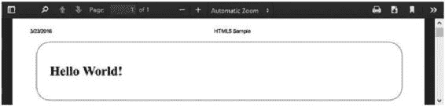

# 轨道元素

`audio`和`video`元素都支持`track`元素，它用于提供与媒体片段时间同步的基于文本的内容。例如，你可以在音频播放时显示歌词。对于视频，你可能希望包含隐藏式字幕或字幕。

`track`元素是一个空元素；它使用自闭合标签，完全通过其属性进行配置。`track`元素只能用在`audio`或`video`元素内部。如果你使用`source`元素提供多种文件类型，则`track`元素应放在`source`元素之后。

`kind`属性指定轨道内容的用途。允许的值包括：

- **captions** - 用于隐藏式字幕，轨道提供对话的转录以及相关音效，例如“笑声”或“电话铃声”等。这用于听力障碍用户或音频静音时。
- **chapters** - 用于较长的片段，当用户浏览媒体文件时提供章节标题。
- **descriptions** - 对音频或视频文件内容的文本描述。用于视障用户或视频不可用时。
- **metadata** - 提供供脚本使用的数据；通常不显示给用户。
- **subtitles** - 如果未指定`kind`属性，这是默认值。字幕提供不同语言对话的翻译。它还可以提供附加信息，例如所描绘事件的日期和地点。

`src`属性是必需的，它指定包含轨道内容的文件 URL。这通常是 WebVTT 文件，但其他格式也可能受支持。该文件包含一系列提示点，每个提示点都有开始和结束时间（相对于文件开始）以及在此间隔内应显示的文本。时间元素以小时、分钟、秒和毫秒指定，例如“00:02:15:420”，表示片段中的 2 分 15 秒 420 毫秒处。示例 WebVTT 文件如清单 7-1 所示。

***清单 7-1.*** `bbb.vtt`，一个示例轨道文件

```
WEBVTT - For Big Buck Bunny trailer.

NOTE This is for demonstrational purposes

00:00:09.231 --> 00:00:11.121
- [Bunny looks around]

00:00:15.712 --> 00:00:16.892
- [Rodents snickering]

00:00:25.528 --> 00:00:27.631
- [Squirrel takes aim]
```

Mozilla 提供了一些有用的 WebVTT 文件示例，可在[`developer.mozilla.org/en-US/docs/Web/API/Web_Video_Text_Tracks_Format`](https://developer.mozilla.org/en-US/docs/Web/API/Web_Video_Text_Tracks_Format)找到。


[网页视频文本轨道格式](https://developer.mozilla.org/zh-CN/docs/Web/API/Web_Video_Text_Tracks_Format)也支持其他格式的轨道文件。下文提供了更多关于可选格式的详细信息：[`www.miracletutorials.com/`](http://www.miracletutorials.com/how-to-create-captionssubtitles-for-video-and-audio-in-webtvv-srt-dfxp-format/)

[如何为 WebVTT、SRT、DFXP 格式的视频和音频创建字幕/说明。](http://www.miracletutorials.com/how-to-create-captionssubtitles-for-video-and-audio-in-webtvv-srt-dfxp-format/)

> **注意：** 轨道文件必须通过 Apache 或 IIS 等网络服务器提供。你不能像访问 HTML 文档那样，直接从本地文件夹访问 WebVTT 文件。你可能还需要定义 MIME 类型为 `text/vtt`。

`srclang` 属性指定了文本内容的语言。如果 `kind` 属性设置为 `subtitles`，则此属性是必需的。`label` 属性定义了用户选择相应轨道时显示的文本。要为 Big Buck Bunny 视频添加轨道，请像这样添加 `track` 元素：

```html
<video src="Media/BigBuckBunny.mp4" controls
       poster="Media/BBB_Poster.png" width="852" height="480">
    <track kind="captions" src="bbb.vtt" srclang="en" label="英语" />
    <p>您的浏览器不支持 HTML5 视频</p>
</video>
```

由于 `video` 元素包含一个含有字幕的 `track` 元素，原生控件将包含一个额外的按钮，使用户能够控制字幕显示。`label` 属性会显示在隐藏式字幕菜单中，如图 7-13 所示。如果包含了多个 `track` 元素，用户便可以从可用的轨道中进行选择。




**图 7-13.** Edge 浏览器中的隐藏式字幕菜单

> **提示：** 有一个由 Google 开发的关于使用轨道实现字幕的简单演示。你可以在 [`html5-demos.appspot.com/static/video/track/index.html`](http://html5-demos.appspot.com/static/video/track/index.html) 试试看。这使用了 WebM 视频格式，并非所有浏览器（尤其是 IE 或 Edge）都支持。请在 Chrome 中打开以查看演示。

### HTML5 插件

到目前为止，我已经解释了如何使用适当的元素将图像、音频和视频嵌入到 HTML 文档中。这类内容非常普遍，因此提供了特定的元素来访问浏览器的内置功能。在本节最后，我将介绍如何使用 `object` 元素嵌入几乎任何内容。

`object` 元素是任何外部内容的通用容器。对象的实际类型由 `type` 属性定义，并以 MIME 类型的形式提供。例如，如果你要嵌入 Flash 视频，请使用 `application/x-shockwave-flash`；如果你要嵌入 PDF 文件，请使用 `application/pdf`。当然，浏览器可能需要合适的插件才能呈现内容，但使用 `object` 元素提供了一种处理自定义嵌入内容的标准方法。

`object` 元素有两个必需的属性：我已经提到的 `type` 属性，以及指定嵌入内容 URL 的 `data` 属性。`data` 属性定义外部资源，`type` 属性指定应使用哪个应用程序（或插件）来呈现内容。

你还可以指定 `height` 和 `width` 属性来为此内容分配所需的空间。

例如，要将 PDF 文件嵌入 HTML 文档，请添加以下内容，它将如图 7-14 所示呈现。

```html
<object data="MainPage.pdf" type="application/pdf" width="850" height="200">
    <a href="MainPage.pdf">主页</a>
</object>
```

**图 7-14.** 嵌入 PDF 文档

请注意 `object` 元素内部的备用内容。这是一个指向同一 PDF 文件的超链接。如果不支持 `object` 元素或特定类型，用户将看到指向该文件的链接，而不是嵌入的文件。如果你使用的是自定义插件，你可能希望在此处放置如何安装该插件的说明。如果未安装插件，他们将看到这些说明，而不是嵌入的内容。

`object` 元素还允许你使用 `param` 元素向插件传递参数。`param` 元素有两个属性：`name` 和 `value`。你使用 `param` 元素来提供一组名称/值对。`param` 元素使用自闭合标签，只能在 `object` 元素内部使用，并且应该放在任何回退内容之前。例如：

```html
<object data="some file" type="application/some plug in">
    <param name="paramName" value="paramValue" />
    <p>回退内容</p>
</object>
```

> **提示：** 并非所有插件都支持使用 `param` 元素传递参数。例如，向 PDF 查看器传递选项需要包含在 URL 中。例如，使用 `data="MainPage.pdf#zoom=50"` 会将初始缩放比例设置为 50%。你需要检查你正在使用的插件支持哪些功能。

HTML5 也支持 `embed` 元素，它类似于 `object` 元素。`embed` 元素在 HTML4 中就受支持，而 `object` 元素相对较新。许多文章建议 `embed` 元素已被弃用，但在撰写本文时，它仍包含在 HTML5 规范中。然而，普遍的共识是 `object` 元素比 `embed` 更受青睐。

`embed` 元素是一个空元素，这意味着它使用自闭合标签。这也意味着它不支持回退内容或 `param` 元素。除此之外，它的工作方式与 `object` 元素非常相似，只是资源的 URL 在 `src` 属性中提供。你可以像这样使用 `embed` 元素嵌入 PDF 文档：

```html
<embed src="MainPage.pdf" type="application/pdf" width="850" height="150"/>
```

#### 总结

在本章中，我解释了如何将外部内容嵌入到 HTML5 文档中。嵌入内容的主要类型是图像、音频和视频，HTML5 为这些类型中的每一种都提供了特定的元素。你可以提供多个图像文件，让浏览器根据设备特征选择最合适的文件来下载和呈现。你还可以在图像上定义可点击的区域，这些区域可以用作链接。

主流浏览器都已将 MP3 标准化为音频格式，MP4 标准化为视频格式，这使得在 HTML 文档中包含它们变得非常容易。对于音频和视频，你还可以包含时间同步的文本，这些文本将作为字幕、说明或其他详细信息出现。

对于其他类型的嵌入内容，`object` 元素提供了一种标准化的包含方式。这可能需要自定义浏览器插件，但 `object` 元素是引用它们的一致方式。当插件不受支持时，你还可以提供回退内容。

在下一章中，我将演示支持用户输入的 HTML 元素。无论你是创建一个完整的输入表单，还是只是一个简单的搜索字段，这些元素都提供了用户与你的网页进行交互的能力。


## 第 8 章

## HTML 表单元素

在传统的 Web 应用程序中，表单是一个网页或其中的一部分，其中包含供用户输入信息的位置。一旦数据输入完毕，表单便会连同输入数据一起提交给服务器。服务器处理这些数据，并返回新页面，然后由客户端渲染该页面。

在本章中，我将解释如何在 HTML5 中创建表单。我还将演示通常与表单相关的 HTML 元素，例如 `label`、`input` 和 `button` 元素。其中许多元素也可以在不实际位于表单上的情况下在 HTML5 文档中使用。

### 概述


