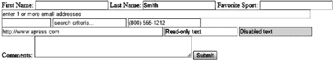
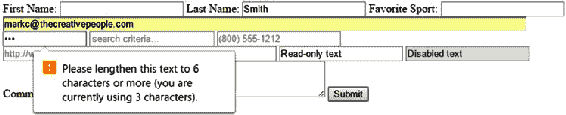

# HTML 表单输入属性

`HTML`将使用指定的值预填充字段。`value`属性对于`checkbox`和`radio`类型是必需的，但对于所有其他类型是可选的。对于按钮类型，`value`属性提供按钮上的显示文本。

- `disabled` - 这是一个布尔属性，当为`true`时，将禁用对`input`元素的任何用户交互。此外，禁用字段不会随表单数据一起提交。

- `readonly` - 一个布尔属性，防止用户更改`input`元素的值。这与`disabled`属性略有不同，在`disabled`属性中，用户可以与元素交互但无法更改值。标记为`readonly`的元素在提交表单时也会被提交。但是，`readonly`属性会被几种输入类型忽略，包括`checkbox`、`color`、`file`、`hidden`、`radio`、`range`或按钮类型之一（`button`、`image`、`reset`、`submit`）。

- `required` - 一个布尔属性，指示用户必须为此元素输入（或选择）一个值。提交表单时，页面验证将强制执行此设置。您可以使用伪类 `:optional` 和 `:required` 为必需或可选元素应用样式。我将在[第 9 章](http://dx.doi.org/10.1007/978-1-4842-2463-2_9)中介绍这些内容。`required`属性不允许用于`hidden`类型或按钮类型之一。

- `autofocus` - 一个布尔属性，指示页面加载时`input`元素应获得焦点。只有一个元素可以设置此属性，并且此属性不允许用于`hidden`类型，我稍后会解释。

还有几个特定于某些输入类型的属性。我将在演示这些类型时进行解释。

## 回顾

为了快速回顾文本输入类型，以下是一段演示其中许多类型的`HTML`代码片段：

```html
<input type="email" name="Email" size="100"
placeholder="enter 1 or more email addresses" multiple required />
<input type="password" name="Password" maxlength="12" minlength="6" size="12" />
<input type="search" name="Search" placeholder="search criteria..." autofocus />
<input type="tel" name="Phone" placeholder="(800) 555-1212"
pattern="^(\+\d{1,2}\s)?\(?\d{3}\)?[\s.-]\d{3}[\s.-]\d{4}$" />
```





第 8 章 ■ HTML 表单元素

```html
<input type="url" name="Website" placeholder="http://www.apress.com" size="50" />
<input type="text" value="Read-only text" readonly name="ReadOnly" />
<input type="text" value="Disabled text" disabled />
<label for="iComments">Comments:</label>
<textarea id="iComments" rows="3" cols="50" wrap="hard" maxlength="250" name="Comments">
</textarea>
```

在电子邮件字段上，将`size`设置为 100 以使其足够大以容纳一个或两个电子邮件地址。这还具有`multiple`属性以允许输入多个地址。密码字段使用`minlength`和`maxlength`属性提供客户端长度验证。电话号码字段包含一个支持美国电话号码的正则表达式模式。`placeholder`属性还提供了号码格式的提示。

这包括一个禁用和一个只读文本框，以便您了解它们工作方式的差异。对于这两种情况，值都是通过`value`属性设置的，因为它无法在表单上输入。您可以突出显示只读字段上的文本并复制它，但无法在禁用字段上执行此操作。最后，注释字段使用一个`textarea`元素，显示三行文本。其最大长度为 250 个字符。

如果您将这些输入元素添加到本章开头显示的初始表单中，它看起来将类似于图 8-4。

***图 8-4.** 添加示例文本字段*

光标应位于搜索框中，因为该元素具有`autofocus`属性。当您提交表单时，如果任何验证失败，表单将显示错误，如图 8-5 所示。

***图 8-5.** 显示验证错误*

## 选择元素

有几种结构允许你在表单上呈现一组固定的选项。复选框和单选按钮可以通过 `input` 元素的 `type` 属性来创建。下拉列表则通过 `select` 和 `option` 元素来创建。

## 复选框

复选框用于表示布尔值，例如“可用？”或“可以打电话？”。值为真时选中，值为假时取消选中。通过将 `input` 元素的 `type` 属性设置为 `checkbox` 来创建复选框。

当你希望从一组选项中允许多选时，也可以使用复选框。例如，如果你正在订购披萨并选择配料，你可能希望列出所有可用的项目，如蘑菇、香肠、橄榄等，并在每个项目旁边放一个复选框。从技术上讲，每个项目都是一个具有布尔值的独立字段：你要蘑菇吗？你要香肠吗？

要指示复选框已被选中，请使用布尔属性 `checked`。如果存在此属性，则复选框被选中；否则不选中。提交表单时，只有选中的元素才会包含在表单数据中，而 `value` 属性决定了实际提交的内容。如果你希望数据为 `CanCall=true`，那么将 `name` 属性设置为 `CanCall`，`value` 属性设置为 `true`。在披萨示例中，你可以将所有复选框的 `name` 属性设置为 `Topping`，并将 `value` 属性设置为 `Mushrooms`、`Sausage` 或 `Olives`。提交表单时，每个被选中的复选框都会提交一个 `Topping` 字段及其对应的值。

> **提示：** 复选框要么选中要么未选中；没有不确定的值。HTML5 不支持三态复选框（选中、未选中、未指定），尽管有一些 JavaScript 解决方案可以提供此功能。例如，[请参阅 http://jquer.in/jquery-plugins-for-html5-forms/tristate/](http://jquer.in/jquery-plugins-for-html5-forms/tristate/)

`input` 元素并不显示任何文本。`name` 和 `value` 属性仅在提交数据时使用。你可以为每个 `input` 元素使用一个 `label` 元素，或者简单地将内容环绕在复选框周围。例如，选定的配料可以这样呈现：

```html
<p>配料：

<input type="checkbox" name="Topping" value="Mushrooms" />蘑菇？

<input type="checkbox" name="Topping" value="Sausage" />香肠？

<input type="checkbox" name="Topping" value="Olives" />橄榄？

</p>
```

当 `required` 属性用于 `type="checkbox"` 的 `input` 元素时，表示在提交表单之前必须选中该复选框。当用户需要在继续之前确认某些事项（例如条款和条件）时，你会用到此功能。

## 单选按钮

通过使用 `input` 元素并将 `type` 属性设置为 `radio` 来创建单选按钮。单选按钮的工作方式与复选框非常相似：`checked` 属性指示是否被选中；只有选中的值才会被提交；`value` 属性指定应提交的文本。

主要区别在于，单选按钮通常作为一组按钮提供，并且一组中只能选择一个单选按钮。当选中一个单选按钮时，该组中所有其他元素的 `checked` 属性都会被移除。单选按钮组由 `name` 属性决定。所有具有相同 `name` 属性值的元素被视为同一组。

回到我们的披萨示例。假设你提供三种类型的饼皮：薄皮、厚皮和深盘。你可以添加三个单选按钮，它们的 `name` 属性都设置为 `Crust`。每个按钮的值不同，分别为 `Thin`、`Thick` 或 `DeepDish`。提交表单时，例如，如果选择了厚皮选项，该字段将提交为 `Crust="Thick"`。和复选框一样，你可以在单选按钮周围定义额外的文本：

# 表单元素

```html
<p>饼皮：

<input type="radio" name="Crust" value="Thin" />薄皮

<input type="radio" name="Crust" value="Thick" />厚皮

<input type="radio" name="Crust" value="DeepDish" />深盘

</p>
```

你可以通过在其中一个单选按钮上添加 `checked` 属性来默认选中一个选项。如果你要求必须进行选择，请将 `required` 属性添加到其中一个单选按钮上；哪个按钮添加该属性无关紧要。在多个按钮上添加 `required` 属性没有额外效果。如果存在 `required` 属性，浏览器将不会提交表单，直到选中其中一个单选按钮，如图 8-6 所示。

> **图 8-6.** 验证必选的单选按钮

## 下拉列表

对于前两种输入类型，所有选项始终可见。使用复选框可以进行多项选择；使用单选按钮每组只能选择一个。然而，对于下拉列表，在用户点击下拉菜单之前，只显示选中的选项，然后才显示可用选项。

使用 `select` 元素创建下拉列表。在 `select` 元素内部，为每个可用选项包含一个 `option` 元素。在 `select` 元素上设置 `name` 属性，以指定提交表单时将发送的字段名。在 `option` 元素上使用 `value` 属性，以指示选中该选项时将提交的字段值。

`option` 元素可以通过嵌套在 `optgroup` 元素内来进行分组。这仅用于视觉目的，对提交的数据或选项的选中与取消选中没有影响。当选项列表相对较长时，`optgroup` 元素会很有帮助。`optgroup` 元素有一个必需的 `label` 属性。在此处指定组文本，该文本会显示在选项之前。`optgroup` 元素中的选项也会进行缩进。

默认情况下，第一个选项将被选中并在提交表单时提交。你可以通过将 `selected` 属性添加到所需的 `option` 元素，来选择另一个选项作为默认选项。只有一个选项应具有 `selected` 属性；如果多个选项具有 `selected` 属性，则除最后一个外，其他都将被忽略。

通过选择另一个选项来取消选中当前选项。没有办法取消选中选项使得没有任何选项被选中。为了解决这个问题，你可以包含一个*未选中*的选项，其 `value` 属性设置为空字符串。通常你会为其指定一个显示字符串，例如 `请选择`。如果选择了此选项，则会向服务器提交一个空字符串。你可以在 `select` 元素上添加 `required` 属性，以要求选择某个其他选项（该选项的 `value` 属性非空）。

可以像这样创建一个带有分组的下拉列表。其渲染结果如图 8-7 所示。

```html
<p>附加品：

<select name="Addons" required>

<option value="">请选择...</option>

<option value="None">仅披萨</option>

<optgroup label="附加品">

<option value="Wings">一份布法罗鸡翅</option>

<option value="GarlicBread">添加蒜香面包</option>

</optgroup>

</select>

</p>
```

> **图 8-7.** 带有分组的选择选项

在此示例中，初始选项的 `value` 属性为空，并且 `select` 元素具有 `required` 属性。用户在提交表单之前需要在此下拉菜单中做出选择。

## 多选列表

如果你添加了 `multiple` 属性，`select` 元素允许你选择多个选项。使用 `multiple` 属性后，用户界面会显著改变。这不再是一个只显示选中选项的下拉列表。相反，它更像一个显示所有选项的简单列表。你可以通过设置 `size` 属性来控制可见选项的数量。如果选项多于该数量，用户可以通过滚动列表来查看它们。