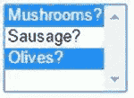
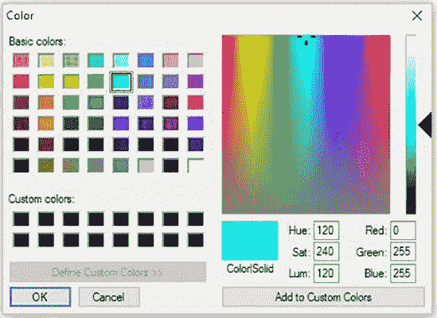
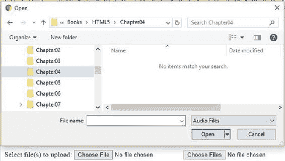

# 使用多选列表

要选择多个选项，您需要在单击所需选项的同时按住`Ctrl`键。您也可以先选择一个选项，按住`Shift`键，再选择另一个选项，这将选中两者之间的所有选项。在不按住`Ctrl`或`Shift`键的情况下单击某个选项，将会首先取消所有选项的选中状态。

为了演示这一点，我们使用一个多选列表框（如以下代码所示）重新实现`Toppings`字段。选择几个选项后，其渲染效果将如图 8-8 所示。

```html
<select name="Toppings" multiple size="4">
  <option label="Mushrooms?" value="Mushrooms" />
  <option label="Sausage?" value="Sausage" />
  <option label="Olives?" value="Olives" />
</select>
```



**图 8-8.** 使用多选列表框

> **注意：** `size`属性也支持下拉列表（即不包含`multiple`属性的情况）。这将始终显示指定数量的选项。然而，从用户界面（UI）角度看，这样做通常没有意义。

当表单提交时，发布的数据将与使用复选框的初始实现完全相同。`name`属性定义了所使用的字段名称，`value`属性指定了提交时的字符串。每个被选中的选项都会提交一个独立的字段。

---

## 其他类型

有几种用于特殊用途的其他输入类型，每种都有特定的属性来控制这些元素的独特方面。

### 数字（Number）

数字输入类型相当直接。它的行为很像文本框，但只允许输入数字。它允许输入小数值，但不会强制任何特定的格式或数字类型（例如仅限整数）。如果需要这些限制，您可以像前面描述的那样使用`pattern`属性。

您可以使用`min`和`max`属性来指定此字段的允许范围。浏览器将确保输入的数字在此范围内。大多数浏览器还提供上下箭头，可用于递增或递减当前值。这仅适用于整数，如果预期输入小数值则无效。

以下是数字输入字段的典型实现：

```html
<p>Number of utensils:
  <input type="number" min="1" max="4" value="1" name="Utensils" />
</p>
```

### 颜色（Color）

颜色输入类型将显示所选颜色的示例。点击该示例时，浏览器会显示一个颜色选择器，如图 8-9 所示。



**图 8-9.** 一个颜色选择器示例

当表单提交时，所选颜色将以 RGB 表示法提供。例如，绿色指定为`#00ff00`。然而，如果进行 URL 编码，井号（`#`）会被替换为`%23`。

> **注意：** 截至撰写本文时，只有 Chrome、Firefox 和 Opera 支持颜色输入类型。

### 文件（File）

使用文件输入类型可以轻松选择一个或多个文件。如果您希望允许选择多个文件，请添加`multiple`属性。您还可以通过使用`accept`属性来提供所需文件类型的提示。该属性接受一个以逗号分隔的 MIME 类型列表，例如`text/css`。您可以使用通配符，例如以下几种常见值：

- `text/*` - 文本文件
- `image/*` - 图像文件
- `audio/*` - 音频文件
- `video/*` - 视频文件



您也可以列出一个或多个文件扩展名，例如`accept=".jpg, .gif"`。以下是一个包含两个输入字段的简单示例。第一个可以选择单个音频文件；第二个可以选择一个或多个扩展名为`.jpg`或`.png`的图像文件：

```html
<p>Select file(s) to upload:
  <input type="file" name="music" accept="audio/*" />
  <input type="file" name="pictures" multiple accept=".jpg, .png" />
</p>
```

> **注意：** `accept`属性有助于引导用户选择合适的文件类型。但是，