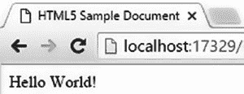
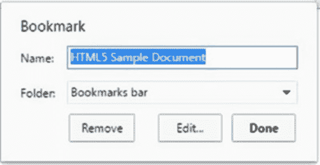

## 第 1 章：超文本标记语言

本章我将探讨 `HTML5` 三要素中的第一环，即将在网页中呈现的实际内容。在接下来的两章中，我将解释如何用 `CSS` 样式化这些内容，并介绍 `JavaScript` 语言。不过我们将从内容开始。

> **注意** 我差点将之称为*原始*内容，但这描述不准确。一个格式规范的 `HTML` 文档具有完整的结构和组织。

回想你早年的校园时光，老师批改作业时会用红笔做标记。拼写错误、语法错误或其他问题都会被圈出或高亮。你可能称之为*标记过的*文档，通常标记越多，分数越低。

同样，标记语言用于标注文档的特定部分，并提供指令或背景信息。不同之处在于受众。你可能擅长阅读 `HTML`，读完本书后你肯定更擅长，但你并非其预期接收者。标记是为浏览器提供的指令，指示应如何呈现内容。因此，标记本身必须句法精确。

> **提示** `HTML5` 是一个相对成熟的标准，更准确地说，是由万维网联盟（`W3C`）管理的一套标准。例如，整体 `HTML` 句法在[`www.w3.org/TR/html5/syntax.html`](https://www.w3.org/TR/html5/syntax.html)中定义。本书中的许多内容都可以从这些规范中获取，我鼓励你查阅其中的部分内容，并了解它们的存在。这些标准会随时间修改或扩展，而这些规范是最终权威依据。

### HTML 文档

`HTML` 通常以文档形式生成和消费。我们可能会谈论 `HTML` 片段，但大多数情况下，网站会用完整的 `HTML` 文档响应请求，然后由客户端解析并在设备上呈现。

作为 `HTML` 句法的简要介绍，我们来看一个非常简单的 `HTML` 文档。清单 1-1 包含一个"Hello World"版本的 `HTML` 文档。

© Mark J. Collins 2017

M. J. Collins, *Pro HTML5 with CSS, JavaScript, and Multimedia*, DOI 10.1007/978-1-4842-2463-2_1

**清单 1-1.** 简单的 `HTML5` 文档

```
<!DOCTYPE html>
<html lang="en">
<head>
  <meta charset="utf-8" />
  <title>HTML5 Sample Document</title>
</head>
<body>
  Hello World!
</body>
</html>
```

### 元素

让我们稍作分解，看看本文档使用的结构。这些基本概念将用于你后续编写的所有内容。文档由多个 `HTML` 元素组成，这些元素以层级方式嵌套。

与其他标记语言一样，*标签*用于为内容附加有用信息。`HTML` *元素*通常遵循以下结构：

`<tag attribute="value" ... > content </tag>`

例如，文档标题"My First HTML5 Document"由开始标签`<title>`和结束标签`</title>`标识。大多数情况下，每个元素都有开始和结束标签，两者相同，只是结束标签前多一个"/"字符。有时元素和标签可互换使用；但准确来说，元素由开始标签、结束标签及其间的内容组成。

元素通常包含其他元素。注意在示例文档中，`html`元素包含`head`和`body`元素。`head`元素还包含`meta`和`title`元素。为提高可读性，这种嵌套层次通过缩进子元素来体现。

### DOCTYPE

`DOCTYPE` 元素是一个特例，不遵循任何标准元素格式。它背后也有一段历史。在 `Web` 开发的早期（如 `IE4` 和 `Netscape` 时代），网页是根据当时浏览器的实现方式来开发的。随着 `HTML` 规范的演进和成熟，基于更新规范开发的新浏览器无法兼容旧网页。因此引入了 `DOCTYPE` 元素，让每个页面指定其遵循的规范版本。浏览器需要解读此信息并提供必要的向后兼容性。

我不打算深入所有繁琐细节，但你可以想象，这对浏览器厂商和 `Web` 开发者来说都是一团乱麻。幸运的是，在 `HTML5` 中，`DOCTYPE` 基本可以忽略。只需将其设置为`html`：

```
<!DOCTYPE html>
```

### 属性

开始标签可以包含一个或多个*属性*，示例文档中就有两个例子。本章稍后我将解释可用的不同属性。属性用于提供元素的详细信息。例如，`html`元素包含`lang="en"`，告知浏览器内容是用英文编写的。如果浏览器当前语言不是英文，它可能会利用此信息提示翻译内容。

有一组称为*全局属性*的属性可用于任何 `HTML` 元素。附录 C 提供了这些属性的完整列表及其他参考资料。你最常用的两个是`id`和`class`。`id`属性定义元素的唯一键；它必须在整个 `HTML` 文档中唯一。这常用于在 `JavaScript` 中访问元素。`class`属性有时被称为 `CSS` 类，因为它常用于为元素应用样式。与`id`不同，`class`属性是非唯一键；单个值应用于需要相同格式的元素。

除全局属性外，每种元素类型可能支持其他属性。注意`meta`元素包含`charset`属性：

```
<meta charset="utf-8" />
```

`charset`属性指定此页面使用的字符集编码类型。你应始终定义字符集；尤其是当页面需要显示非标准字符时，这一点尤为重要。

有些布尔属性不需要值；它们的存在表示真值，缺失表示假值。例如，复选框选中时包含`checked`属性，未选中时则移除该属性。你可能会看到`checked="checked"`这样的写法，尤其是在服务器端代码生成的动态 `HTML` 中。但浏览器会忽略该值，你只需包含属性即可；无需提供值。

### 杂项结构规则

# 排版后的内容

请注意，`meta` 元素没有结束标签。有些元素无需使用结束标签，它们被称为自闭合标签。这或许显而易见，但这些元素不能包含任何内容，因为内容应放置在开始和结束标签之间。标签末尾的“/”字符在技术上并非必需，但普遍共识是应当包含它，并且某些 HTML 验证器会在缺少该字符时发出警告。

请记住，浏览器会忽略制表符、回车符和多余空格等空白字符。你可以将所有文本左对齐，渲染后的 HTML 结果将完全相同。甚至可以故意将整个文档写在一行内。但常规惯例和最佳实践是按照此处所示的方式格式化 HTML。

在继续之前，我想再补充一点：所有这些结构都是可选的。事实上，如果你将以下内容作为整个 HTML 文档输入，浏览器会渲染出完全相同的内容。

```
Hello World!
```

> **注意** 浏览器通常非常擅长在文档中省略细节时使用默认配置。然而，我假设你阅读本书是因为你想创建专业质量的 Web 应用。这些额外的元素提供了重要信息，你应当养成编写结构良好的文档的习惯，以尽可能提高页面的实用性。

## 第 1 章 ■ 超文本标记语言

HTML 标签不区分大小写。普遍惯例是使用小写标签，本书也将全程遵循此惯例。但你可以使用 `<HEAD>` 或 `<Head>`，它们同样有效。

## HTML 元素

如你所见，`html` 元素是根节点：即文档的起始点。关于它没什么可多说的。`html` 元素可以包含一个 `head` 元素和一个 `body` 元素。除了全局属性外，它还支持 `manifest` 属性。

```html
<html manifest="www.mywebsite.com/cache.appcache">
```

`manifest` 属性用于定义应用程序缓存。该属性的值是缓存清单的 URL 或地址，缓存清单是一个列出应缓存资源的文本文件。这可以是绝对或相对 URL。当这些资源缓存在客户端后，即使断开网络连接，你的页面也能正常加载。缓存这些资源还可以让页面加载更快，并减轻 Web 服务器的负载。

> **提示** 清单文件的标准扩展名是 `.appcache`。Web 服务器必须以正确的 MIME 类型（即 `text/cache-manifest`）提供此文件。根据你使用的 Web 服务器类型，配置方式会有所不同。更多信息请参阅此文章：[`www.html5rocks.com/en/tutorials/appcache/beginner/`](http://www.html5rocks.com/en/tutorials/appcache/beginner/)。

### Head 元素

`head` 元素中没有实际内容；那是 `body` 元素的职责。在第 4 章到第 8 章中，我将解释所有用于定义主体内容的各种元素。但本章的剩余部分，我们将探讨 `head` 元素。

现在，让我们看看可以包含在 `head` 元素内的元素。你已经见过 `title` 和 `meta` 元素，稍后我会更详细地介绍它们。还有一些其他有用的元素也属于这里。

#### Title 元素

`title` 元素指定了此页面的标题。它会在几个地方显示：

- 在浏览器标题栏或选项卡中（见图 1-1）
- 搜索引擎通常会在搜索结果中包含此标题
- 将页面添加到收藏夹或书签时，此标题会用作名称（见图 1-2）





# 第一章 ■ 超文本标记语言

**图 1-1.** 在浏览器标签页中显示标题

**图 1-2.** 在书签中使用标题

虽然这看起来显而易见，但你的文档中只能有一个 `title` 元素。如果忽略这条规则，浏览器通常会显示第一个 `title` 元素，并忽略其余内容。

## Meta 元素

`meta` 元素是元数据（metadata）的缩写，元数据是描述其他数据的数据。在本例中，`meta` 元素描述的是 HTML 文档的内容。`head` 元素可以包含任意数量的 `meta` 元素，每个元素通过名称/值对结构提供单一数据点。例如：

```
<meta name="author" content="Mark J Collins" />
```

```
<meta name="description" content="Sample HTML document" />
```

```
<meta http-equiv="refresh" content="45" />
```

名称/值对中的值部分通过 `content` 属性指定；但名称部分则根据所设置数据的类型，通过 `name` 属性或 `http-equiv` 属性来定义。`name` 属性用于描述 HTML 文档内容的元数据。`name` 属性最常见的取值包括 `application-name`、`author`、`description` 和 `keywords`。

这些属性含义都比较直观。对于 `keywords`，其 `content` 属性会包含一个用逗号分隔的关键词列表。

`http-equiv` 属性用于模拟 HTTP 响应头。更常见的取值包括：

- `content-type` —— `content` 属性用于指定内容类型，通常为 `text/html` 及字符集。例如：`content = "text/html; charset=UTF-8"`。

- `default-style` —— 用于指定默认样式表。

- `refresh` —— 可强制页面在指定时间间隔后自动刷新，该间隔以秒为单位，在 `content` 属性中指定。

如示例文档所示，字符集也可以使用简写形式指定：`<meta charset="utf-8" />`。

> **注意** 你还可以使用许多其他 meta 名称。如果感兴趣，请参阅[`www.html-5.com/metatags`](http://www.html-5.com/metatags)上的文章。该网站将这些名称按逻辑分组，例如搜索引擎优化（SEO）、移动设备等，并提供了每个名称的详细信息。

## Script 元素

`script` 元素用于在页面中加载 JavaScript。要使用某个函数，你必须在页面中定义该函数，或者加载包含该函数的外部脚本文件。这两种操作都可以通过 `script` 元素完成。

要直接定义 JavaScript，将代码放在起始和结束标签之间，如下所示：

```html
<script type="text/javascript">
function doSomething() {
  alert("Hello World!");
}
</script>
```

`type` 属性是可选的，如果未指定，则默认为 `text/javascript`。这个属性在 HTML4 中是必需的，因此你经常会看到它被包含在内。

通常，最佳实践是将 JavaScript 放在单独的外部文件中。这样做的一个显著优势是可以在多个页面之间共享相同的脚本。要引用外部文件，使用 `src` 属性，并且不要在起始和结束标签之间包含任何内容。如果需要加载多个文件，请将每个文件放在单独的 `script` 元素中。例如：

```html
<script src="../scripts/sample.js" type="text/javascript"></script>
<script src="../scripts/demo.js" type="text/javascript"></script>
```

通常，当浏览器解析 HTML 文档时，遇到 `script` 元素会先加载并执行脚本，然后才继续解析文档的其余部分。对于外部文件，你可以使用 `async` 或 `defer` 属性来改变这一行为。这两个都是布尔属性。如果指定了 `async` 属性，文件会在解析过程继续进行的同时，以并行方式加载并执行。

或者，如果使用了 `defer` 属性，脚本将在页面完全解析完成之后才执行。

```html
<script src="../scripts/demo.js" defer ></script>
```

## 注意事项

如果脚本包含立即执行的代码，并且引用了任何 HTML 元素，则应使用 `defer` 属性。如果脚本在文档解析之前执行，由于元素尚不可用，脚本可能会失败。

---

# 第 1 章：超文本标记语言

## 链接元素

`link` 元素用于引用额外的外部资源，这些资源可分为两类。第一类链接用于加载渲染源文档所需的资源——其中最常见的是层叠样式表。第二类是链接到其他相关文档。读者可以选择导航到这些文档，但它们并非渲染当前页面所必需的。

`link` 元素使用自闭合标签，并且链接的资源完全通过属性来指定。这是通过定义资源地址的 `href` 属性和 `rel` 属性来完成的。`rel` 属性是 `relationship`（关系）的缩写，指示源文档与链接资源之间的关系。

以下是一些典型的 `link` 元素：

```html
<link rel="stylesheet" type="text/css" href="Sample.css" />
<link rel="icon" type="image/x-icon" href="HTMLBadge.ico" />
<link rel="alternate" type="text/plain" href="TextPage.txt" />
```

这将加载一个名为 `Sample.css` 的 CSS 文件和一个名为 `HTMLBadge.ico` 的图标文件。请注意，`type` 属性指示了文件的格式。对于样式表，这是可选的，因为默认类型为 `text/css`。对于其他文件，例如图标文件，由于也可能使用 `.png` 或 `.bmp` 文件，因此需要指定该属性。最后一个链接引用的是该页面的纯文本版本。

我将在下一章中解释样式表。图标文件会显示在浏览器标签页中，如图 1-3 所示。它也会在书签、收藏夹以及历史记录等其他地方使用。

**图 1-3.** 在浏览器中显示指定的图标

> **注意：** `link` 元素可用于因各种原因引用多种不同类型的资源。不幸的是，术语 `relationship`（关系）并不总能很好地传达此属性的含义。对于诸如 `stylesheet` 和 `icon` 等一些最常见的值，将其解释为资源类型可能比关系更恰当。而对于像 `first`、`next` 和 `alternate` 这样的值，关系 (relationship) 确实是合适的术语。然而，为了保持一致性，`rel` 属性被用于所有链接的资源。

表格 1-1 和 1-2 列出了 `link` 元素中普遍支持的当前 `rel` 值。还有其他一些值已被弃用，但可能在短期内仍受支持。此外，截至撰写本文时，还有一些值已被提出但尚未被采纳。这里列出的值是你应该在新文档中使用的。这些值的官方规范可以在 [`www.w3.org/TR/html5/links.html#linkTypes`](https://www.w3.org/TR/html5/links.html#linkTypes) 找到。

---

### 表 1-1. 资源类型关系

| Rel | 描述 |
|-----|-------------|
| `icon` | 如前所述，加载页面使用的图标。使用此关系时，支持 `sizes` 属性，以便使用所需的大小，因为图标文件通常包含多种尺寸。`type` 属性预期为图像文件类型，例如 `"image/x-icon"` 或 `"image/png"`。 |
| `prefetch` | 通知浏览器可能稍后需要该外部资源，并应尽可能提前加载。 |
| `preload` | 告知浏览器当前文档将需要该相关资源，并应尽快加载。 |
| `stylesheet` | 加载层叠样式表；`type` 属性可选，默认为 `text/css`。 |

### 表 1-2. 引用类型关系

| Rel | 描述 |
|-----|-------------|
| `alternate` | 引用源文档的替代形式。这可以以不同方式使用，稍后将详细说明。 |
| `author` | 引用提供源文档作者信息的资源。这通常是一个 `mailto` 引用，例如 `href=mailto://markc@thecreativepeople.com`，它将向作者发送电子邮件。也可以是一个包含作者详细信息的网页链接。 |
| `help` | 引用提供当前网页帮助信息的页面。 |
| `next` | 用于引用系列中的下一个文档。 |
| `license` | 指定指向提供许可详细信息的页面的链接。 |
| `pingback` | 提供指向 pingback 服务的链接。这用于在另一个页面链接到该页面时通知该页面。这主要用于博客和社交媒体网站。有关此技术的更多详细信息，请参见 [`www.w3.org/wiki/Pingback`](https://www.w3.org/wiki/Pingback)。 |
| `prev` | 指向系列中前一个文档的链接。 |
| `search` | 引用的文档可用于在当前文档或网站内进行搜索。 |

> **注意：** `rel` 属性也可以用在锚点（`a`）元素和 `area` 元素中。这将在[第 7 章](http://dx.doi.org/10.1007/978-1-4842-2463-2_7)中介绍。在这些元素中还可以使用其他在 `link` 元素中不支持的 `rel` 值。这里列出的值仅在 `link` 元素中受支持。

`alternate` 关系链接有多种使用方式，但它们都遵循链接到提供源文档替代形式的另一个资源这一基本概念。主要有两种类型的替代文档：

* **类型** – 该链接以不同格式引用当前文档。使用 `type` 属性指定替代文档的类型，例如 `type="application/pdf"`。一个常见的用途是将文档作为订阅源（如 ATOM）提供。在这种情况下，`type` 属性指定为 `type="application/atom+xml"`。

* **语言** – 该链接引用当前文档翻译成另一种语言的版本。为此，使用 `hreflang` 属性指定引用文档的语言。例如，`hreflang="es"`。

这两种变体可以组合在单个 `link` 元素中。例如，如果当前文档的法语版本以 PDF 文档形式提供，则使用 `type="application/pdf" hreflang="fr"`。

`next` 和 `prev` 链接用于链接属于系列文档的一部分：例如，如果你有一篇文章分三部分发布。第一和第二部分应使用 `next` 关系提供指向下一部分的链接。同样，第二和第三部分应使用 `prev` 关系提供指向前一部分的链接。在许多情况下，`previous` 关系仍然受支持，其作用与 `prev` 相同。一些较旧的值如 `first`、`last` 和 `up` 现已过时。

> **提示：** 正如我之前所说，`head` 元素中实际上没有实际内容，尽管可以说 `title` 元素可以算作内容。`head` 元素的目的是提供关于文档的元数据。`link` 元素也是如此；将它们添加到 `head` 元素中不会在你的页面上生成用户可以导航的超链接。如果你想要一个实际的超链接，你需要在 `body` 中添加一个 `anchor` 元素。

提供 `link` 元素类似于在书中提供扉页；通常没有人会阅读它，但提供这些细节是一种良好的做法。在在线文档中这更为重要，因为搜索引擎依赖这些细节。

# 样式元素

`preload` 和 `prefetch` 这两种关联关系很相似。两者都是向浏览器提示应加载某个资源，以便在需要时可用。主要区别在于紧迫性。`preload` 关系表示该资源应在整个页面渲染过程的早期加载。当前文档会用到它，因此指示浏览器尽快加载。

相比之下，`prefetch` 用于那些可能稍后才会用到的资源，也许是在后续页面中。资源应当被加载，但不应拖慢当前页面的加载速度。

元素的特定样式属性（如 `color` 或 `size`）可以直接在元素上明确指定，这被称为内联样式。然而，更常见且更推荐的做法是定义一组规则，用于确定应用到整个文档的特定样式属性。下一章将描述这些规则如何实现。

这些规则要么包含在外部样式表中（并通过 `link` 元素引用），要么在 `style` 元素中定义。在这方面，`style` 元素与 `script` 元素有些相似，只是它包含的是 CSS 内容而非 JavaScript。

> **提示** `style` 元素和 `script` 元素有一个重大区别。`script` 元素用于包含 JavaScript，既可以写在 `script` 元素的内容中，也可以通过 `src` 属性引用外部文件。而包含样式时，你使用 `style` 元素来定义样式；但加载外部文件则需使用 `link` 元素。另一个区别是，`link` 元素只能放在 `head` 元素内部；`style` 元素可以放在 `head` 或 `body` 元素中，尽管这一用法尚未得到广泛支持。

## 第 1 章 ■ 超文本标记语言

一个非常简单的 `style` 元素可能看起来像这样：

```html
<style>
html {
  color: red;
}
</style>
```

这将把 `html` 元素内所有元素的 `color` 属性设置为 `red`，正如我所解释的，`html` 元素是整个文档的根元素。这意味着文档中的所有内容都将变为 `red`（红色）。

`style` 元素支持 `media` 属性，允许你包含一个媒体查询。媒体查询是一个布尔表达式，可以有条件地应用一组样式。只有当表达式计算结果为 `true` 时，这些样式才会被应用。媒体查询最初是为了让同一文档在打印时能有不同的格式。例如，以下样式仅在打印文档时应用：

```html
<style media="print">
html {
  color: black;
}
</style>
```

然而，媒体查询已得到显著增强，使你能根据多种不同因素调整样式。其常见用途之一是创建响应式设计，即页面的格式和布局会根据屏幕分辨率自动调整。媒体查询将在[第 9 章](http://dx.doi.org/10.1007/978-1-4842-2463-2_9)中更详细地介绍。

> **注意** 通常 `style` 元素放在 `head` 元素中。唯一的例外是使用 `scoped` 属性时。`scoped` 属性表示样式仅应用于父元素及其所有后代元素。截至撰写本文时，`scoped` 属性仅受 Firefox 浏览器支持。

# 基础元素

`base` 元素用于定义文档中所有其他引用应使用的基础 URL。这允许你在其他地方使用相对 URL。这可以节省一些输入，并且在需要更改基础地址时也很方便。`base` 元素支持两个特定属性：`href`，用于定义基础 URL；以及 `target`，用于指定选择链接时的默认行为。

一个 `base` 元素可能看起来像这样：

```html
<base href="www.thecreativepeople.com/html5" target="_self" />
```

# 注意

`base` 元素应为 `head` 元素的第一个子元素，或至少位于任何 `link` 元素之前，以确保基础地址能应用于后续的 `link` 元素。

## 第 1 章：超文本标记语言

如你所见，`base` 元素使用自闭合标签。将 `target` 属性设置为 `_self` 表示链接应在与当前页面相同的窗口和标签页中打开。这一行为可通过特定链接中设置不同的 `target` 值来覆盖。`target` 属性支持的值如下：

- `_blank` - 在新窗口或标签页中打开
- `_self` - 在当前窗口或标签页中打开（若未指定 `target`，此为默认值）
- `_parent` - 在父框架中打开
- `_top` - 在最顶层框架中打开

## 注意

HTML5 不支持 `frameset` 和 `frame` 元素，因此除非你使用 `iframe`，否则 `_parent` 和 `_top` 值不适用。关于浏览上下文的详细信息，请参阅规范 [`www.w3.org/TR/html5/browsers.html#windows`](https://www.w3.org/TR/html5/browsers.html#windows)。

## 摘要

在本章中，我讲解了创建 HTML 文档（常被称为标记）的基本语法。同时，我还介绍了可包含在 `head` 元素中的细节内容。本书第 2 节将描述可用于文档实际内容的元素。

下一章将介绍层叠样式表（CSS）以及如何为标记添加样式。将样式与内容分离有助于构建更易维护的网页。

在本书第 2 节的学习过程中，每章都将基于前一章创建的网页进行构建。本章的重点是 `head` 元素。列表 1-2 展示了基于本章内容生成的示例网页。

***列表 1-2.*** 示例 HTML 文档

```html
<!DOCTYPE html>
<html lang="en" manifest="sample.appcache">
<head>
  <meta charset="utf-8" />
  <meta name="author" content="Mark J Collins" />
  <meta name="description" content="Sample HTML document" />
  <title>HTML5 Sample</title>
  <link rel="icon" type="image/x-icon" href="HTMLBadge.ico" />
  <link rel="alternate" type="application/pdf" href="MainPage.pdf" />
  <link rel="author" href="mailto:markc@thecreativepeople.com" />
  <link rel="author" type="text/html" href="http://www.thecreativepeople.com" />
  <style>
    html {
      color: red;
    }
  </style>
  <style media="print">
    html {
      color: black;
    }
  </style>
</head>
<body>
  <h1>Hello World!</h1>
</body>
</html>
```

正如预期，生成的网页（如图 1-4 所示）内容极少，但标题和图标会显示在浏览器标签页中。

***图 1-4.** 第 1 章的最终网页*

包含图标文件在内的完整解决方案可在源代码下载中找到。下一章，我们将用外部样式表替换 `style` 元素。
