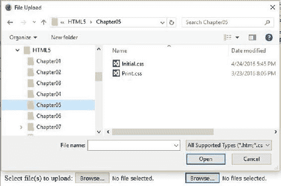
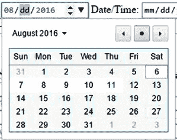

# 文件输入与范围输入

用户通常可以轻松覆盖默认设置并选择不同类型的文件。但服务器端代码应始终验证文件是否为正确的类型。

图 8-10 和图 8-11 分别展示了 Chrome 和 Firefox 中的输入按钮及文件对话框。

***图 8-10.** Chrome 中的文件输入与对话框*



*第 8 章 ■ HTML 表单元素*

***图 8-11.** Firefox 中的文件输入与对话框*

如您所见，其格式和具体功能可能有所不同，但基本能力是一致的。

## 范围（Range）

范围输入类型在 W3C 规范中也被称为“不精确的数字输入控件”。它通常用于当具体数值不如其在某种尺度上的相对值重要时。

不过，此输入类型最终会有一个数值。其用户界面呈现为一个滑块，用户可以拖动它，并根据其位置确定一个值。

范围输入类型具有 `min` 和 `max` 属性，用于定义滑块两端的值。当滑块位于刻度左侧（或底部）时，其值为 `min` 属性指定的值。`max` 属性必须大于 `min` 属性，但两者或其中之一可以为负值。

您还可以指定 `step` 属性，该属性定义了滑块上的停止点。例如，将 `step` 属性设置为 `10` 将只允许您以 10 的间隔停止。默认值为 `1`，这将确保用户只能选择整数。如果您将值设置为 `any`，则没有预设的停止点，用户可以在任意位置停止。

■ **注意**：设置 `step="any"` 时要小心，因为该值将是一个浮点数，例如 `44.9814126394052`（我在测试时恰好得到了这个值）。由于这被称为“不精确的数字输入控件”，这可能是您不想要的精度。如果您需要比 `1` 更精细的粒度，可以对 `step` 属性使用小数值，例如 `.1`。


*第 8 章 ■ HTML 表单元素*

您可以在滑块上方显示刻度标记，以指示停止点的位置。但要做到这一点，您必须使用 `datalist` 元素来定义它们。为每个需要显示刻度标记的位置添加一个带有 `value` 属性的 `option` 元素。然后，在 `input` 元素中使用 `list` 属性引用该 `datalist`。例如：

```
<datalist id="SurveyStops">
  <option value="0" />
  <option value="10" />
  <option value="20" />
  <option value="30" />
  <option value="40" />
  <option value="50" />
</datalist>

<p>您对订购流程的满意度如何？
  <input type="range" name="Survey" min="0" max="50" step="10" list="SurveyStops" />
</p>
```

不同浏览器实现之间的用户界面差异很大。例如，Chrome、Firefox、IE 和 Opera 对此标记的渲染效果分别如图 8-12、8-13、8-14 和 8-15 所示。

***图 8-12.** Chrome 中的范围输入类型*

***图 8-13.** Firefox 中的范围输入类型*

***图 8-14.** IE 中的范围输入类型*

***图 8-15.** Opera 中的范围输入类型*

由于停止点和刻度标记是独立定义的，它们不必相同。您可以将停止点设置为每隔 5 一个，而刻度标记设置为每隔 10 一个。当然，它们也可以完全不同步，例如每 7 个标记一个刻度，而 `step` 设置为 `10`。然而，这会让用户感到困惑，应避免这样做。

在撰写本文时，Firefox 不支持刻度标记，如图 8-13 所示。此外，在 IE 11 中，如果您没有通过 `datalist` 元素指定刻度标记，它会自动根据 `step` 属性显示它们。在 IE 和 Edge 中，当用户点击输入字段时，选中的数值会显示在滑块上方。

*第 8 章 ■ HTML 表单元素*

## 隐藏输入（Hidden Input）

`<input>`元素也支持`hidden`类型。正如你所料，这种类型没有用户界面；用户无法看到或修改它的值。不过，当表单提交时，它会与其他元素一起提交。这允许你在提交的数据中包含一些硬编码的内容。例如，假设你有多个表单提交到同一个服务器地址，你可以在隐藏输入字段中包含使用的是哪个页面。为此，只需在标记中设置`value`属性即可。

这种类型的另一个更常见的应用是捕获通过 JavaScript 收集的数据。例如，你可以使用 JavaScript 获取用户的位置，并将其包含在表单数据中。在这种情况下，`value`属性是通过 JavaScript 设置的。

### 日期与时间数据

HTML5 规范定义了许多与日期/时间值相关的输入类型。其中五种类型得到了大多数主流浏览器的支持，而 Firefox 是最显著的例外。此外，IE 也不支持这些类型，但它们可以在 Edge 浏览器中工作。如果不被支持，这些输入元素将显示为简单的文本框。你应该包含`placeholder`属性来指示预期的格式。在支持该输入类型的浏览器中，`placeholder`会被忽略。

这五种类型是：

- `date` - 不含时间部分的日期
- `datetime-local` - 日期和时间；时间为（浏览器的）本地时间 - 不支持世界时或时区
- `time` - 本地时间；同样不支持时区
- `month` - 特定的年份和月份
- `week` - 特定的周，表示为年份和周数（1-53）

> **注意**：是的，通常一年只有 52 周。然而，52 * 7 只有 364 天，所以每年会多出一天，大约每四年会多出两天。因此，每五到六年，我们就会有一个第 53 周。

这些类型都允许使用`min`和`max`属性来定义允许输入值的范围。

然而，浏览器对这些属性的支持程度参差不齐。对于`month`和`week`类型，没有任何浏览器支持它们。对于其他三种类型，它们在大多数情况下得到支持，但并不一致。

不过，你应该始终提供额外的客户端或服务器端验证，而不是依赖浏览器。

你应该酌情定义这些属性，因为在支持它们的浏览器中，浏览器可以提供更好的用户体验。

`step`属性也针对这些类型进行了定义。不过，目前它仅支持`time`和`datetime-local`类型。用户界面通常会提供向上/向下箭头，让用户可以在允许的值之间滚动。规范并未明确说明`step`属性应如何使用。支持该属性的浏览器主要将其用于秒数。例如，如果你设置`step="15"`，单击向上箭头将使所选时间增加 15 秒。

与其他输入类型一样，你可以通过添加`value`属性来设置初始值。如果未指定，字段通常会使用当前日期（或时间）。这可能会受到`min`和`max`属性的影响。例如，如果`min`属性是未来的日期，那么它通常会成为初始值。初始值仅影响日期选择器和滚动功能。除非在标记中提供了值，否则在用户输入值之前，字段的实际值将为`null`。



第 8 章 ■ HTML 表单元素

以下标记将创建每种受支持类型的一个实例：

```
<p>
  Date:
  <input type="date" name="Date" min="2016-08-06" max="2016-08-11"
    placeholder="mm/dd/yy" />
  Date/Time:
  <input type="datetime-local" name="DateTime" step="30"
    placeholder="mm/dd/yy hh:mm:ss AM" />
  Time:
  <input type="time" name="Time" min="10:00:00" max="17:00:00" step="15"
    placeholder="hh:mm:ss AM" />
  Month:
  <input type="month" name="Month" min="2016-01-01" max="2017-12-31"
    placeholder="yyyy-mm" />
  Week:
  <input type="week" name="Week" min="2016-01-01" max="2017-12-31"
</p>
```

`placeholder="yyyy-W##"` />

每个浏览器呈现的 UI 差异很大。Chrome 和 Opera 中的日期选择器可能是最自然的。它显示一个可滚动浏览的月历。由于我使用了`min`和`max`属性将日期范围设置为 8 月 6 日至 11 日，因此所有其他日期都显示为灰色，如图 8-16 所示。月份滚动也被禁用，因为这些日期在允许范围之外。

**图 8-16.** Chrome 中的日期选择器

大多数浏览器支持滚动功能来选择单独的日期/时间元素。例如，在`datetime-local`类型中有七个部分：月、日、年、时、分、秒、上午/下午，如图 8-17 所示。您可以点击每个部分，然后使用上/下箭头为该部分选择一个值。我将`step`属性设置为`30`，因此在滚动秒数时只有两个值：0 和 30。如果设置了`min`和`max`属性，滚动功能通常会遵循这些限制。例如，在最大值时向上滚动会将值更改为最小值。

**图 8-17.** Chrome 中的`datetime-local`输入类型

截至撰写本文时，只有 Edge 浏览器支持时间选择器。要查看时间选择器，请点击时间字段或`datetime-local`字段中的时间部分的任意位置。桌面浏览器的 UI 略有不同，但与移动设备上的预期类似。小时、分钟、秒和上午/下午值显示在列中。您可以在某一列上悬停，然后使用鼠标滚轮滚动该列，如图 8-18 所示。

**图 8-18.** Edge 中的时间选择器

从图 8-18 可以看出，可用小时数仅限制为 10 和 11，这是因为`min`属性设置为上午 10:00。要选择中午之后的值，请将上午/下午列更改为下午，您将看到小时数 12-5，因为`max`属性设置为下午 5:00。如果您选择了 5 小时，则唯一可用的分钟值是 00。

Edge 中的日期选择器以相同的方式工作。您可以单独滚动月份、日期和年份列以选择所需日期。这同样遵循`min`和`max`属性的限制，如图 8-19 所示。

**图 8-19.** Edge 中的日期选择器

Edge 日期选择器的最大缺点是不显示星期几。例如，如果您想选择下周一，则必须知道具体日期。使用 Chrome 的日期选择器，由于它显示月历，因此您可以轻松查看。

Safari 不提供任何日期或时间选择器。此外，您无法选择单独的部分并滚动以选择其值。它有一个滚动功能，但针对的是整个字段。对于`date`类型，这将一次滚动一天。对于`datetime-local`或`time`类型，除非设置了`step`属性，否则它将一次滚动一秒。

使用`week`输入类型时，您需要选择年份和周数（1-53）。Chrome 和 Opera 中的 UI 显示一个月历，您可以在其中选择特定周。实际周号也会显示，如图 8-20 所示。

**图 8-20.** Chrome 中的周选择器

在 Edge 中，只显示年份和周号（见图 8-21）。

**图 8-21.** Edge 中的周选择器

## 其他视觉元素

有几个元素用于向表单提供视觉信息，而不是接受用户输入。您无疑见过`label`元素，因为它几乎用于每个表单。其他元素如`output`、`meter`和`progress`有更专门的用途，但可能非常有用。

### 标签

我在本章开头介绍了`label`元素，但没有详细说明。您需要为表单中的字段添加标题，以便用户知道在每个字段中输入什么。然而，正如我在本章中多次演示的，您可以在表单中包含内容，而无需使用`label`元素。由于 HTML5 注重语义，作为标题（或标签）的内容应通过将其放入`label`元素中来称为标签。

`label`元素应该与其描述的`input`元素关联，有两种方法可以实现。我个人更倾向于简单地将`input`元素嵌入到`label`元素内部。另一种选择是使用`label`元素的`for`属性。`for`属性指定了输入类型的`id`。当然，这要求您为`input`元素分配一个唯一的`id`。这两种技术如下所示：

```html
<p>Deliver to: <br />
<label>
Address:
<input type="text" size="30" name="Address" />
</label>
<label>
ZipCode:
<input type="text" maxlength="5" size="5" name="Zip" />
</label>
<label for="telephone">Phone #:</label>
<input type="tel" id="telephone" name="Phone" />
</p>
```

使用关联的`label`元素有一个优点（除了更好的语义之外）。如果您点击一个`label`元素，关联的`input`元素将获得焦点，用户可以开始向其中输入数据。

在前面的示例中，如果您点击**Deliver to:** 文本，则不会发生任何事情。但如果您点击**Address:**、**ZipCode:** 或 **Phone #:** 文本，关联的`input`元素将被选中。

### Output 元素

如果表单有输入，那么它们也可以有输出，这似乎也很合理，对吧？在 HTML5 之前，答案是否定的，但现在我们有了`output`元素。它用于计算出的数据，这些数据通常基于用户的输入，但并非直接输入。例如，在选择完所有披萨选项后，您会希望显示应付款总额。这正是`output`元素的用途。

当页面首次加载时，您可能不知道`output`元素的值。您可以使用默认值（如 0），或者添加`hidden`属性使其不显示。一旦输入了必要的值，您可以在客户端执行计算并更新`output`元素。然而，在我们的披萨订单示例中，您可能需要将表单提交到服务器，而回发响应将设置`output`元素的内容。

您应该为计算出的值添加一个标签，可以像这样将其嵌套在`label`元素内：

```html
<p>
<label>Total due:
<output id="total" name="Total">$0.00</output>
</label>
</p>
```

`output`元素支持`for`属性，您可以在其中指定用于计算此值的输入元素。每个输入元素的`id`应包含在`for`属性中，用空格分隔。

### Meter 元素

`meter`元素类似于我前面描述的`range`元素，它显示一个值，不是作为具体数字，而是通过其在刻度线上的位置来显示。然而，用户无法更改`meter`元素的值。

`meter`元素类似于汽车中的温度表。我并不关心温度是 205° 还是 210°，我只想知道它是否*正常*。有一天我开车去上班，开了一会儿后碰巧注意到温度表显示在低温区域。我觉得这很有趣，但并没有太担心。过了一会儿，我看到它显示发动机运行温度比正常高；我觉得这更有趣了。不久，它超出了刻度范围，我知道自己有麻烦了。您可能已经猜到了，我的节温器卡住了。起初它卡在开启状态，然后卡在了关闭状态。温度表通过简单地将值显示为低温、正常、高温或“靠边停车！”告诉我需要知道的一切。