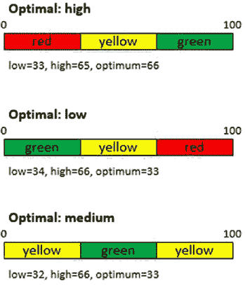
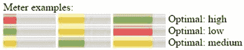
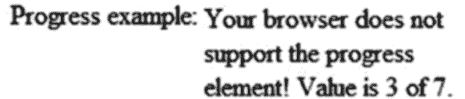

# HTML 表单元素

## `<meter>` 元素

`meter` 元素的工作原理与此相同。通过指定 `min` 和 `max` 属性来定义刻度，然后 `value` 属性会在该连续区间内显示对应的位置。与温度计类似，你可以在该刻度内定义范围，以指示最佳值所在区域。`meter` 元素支持定义这些范围的 `low`、`high` 和 `optimum` 属性。

然而，这可能有点难以理清，因为最佳范围可能位于刻度的低端、高端，或者中间某个位置。你如何设置这些属性取决于不同的场景。

图 8-22 展示了每种场景，并说明了每种情况下应如何设置这些属性。





**图 8-22.** *定义最佳范围*

为了测试这一点，以下标记将为每种场景创建三个 `meter` 元素，并在每个元素上设置 `value` 属性，以测试所有三个范围。在 Chrome 中渲染的结果内容如 图 8-23 所示。

```
<p>Meter 示例：<br />

<meter min="0" max="100" low="33" high="65" optimum="66" value="25"></meter>

<meter min="0" max="100" low="33" high="65" optimum="66" value="50"></meter>

<meter min="0" max="100" low="33" high="65" optimum="66" value="75"></meter> 最佳值：高<br />

<meter min="0" max="100" low="34" high="66" optimum="33" value="25"></meter>

<meter min="0" max="100" low="34" high="66" optimum="33" value="50"></meter>

<meter min="0" max="100" low="34" high="66" optimum="33" value="75"></meter> 最佳值：低<br />

<meter min="0" max="100" low="32" high="66" optimum="33" value="25"></meter>

<meter min="0" max="100" low="32" high="66" optimum="33" value="50"></meter>

<meter min="0" max="100" low="32" high="66" optimum="33" value="75"></meter> 最佳值：中<br />

</p>
```

**图 8-23.** *Chrome 中的 `meter` 元素*




你可以在 `meter` 元素内部提供备用内容，当浏览器不支持 `meter` 元素时，将显示该内容。

## `<progress>` 元素

`progress` 元素与 `meter` 元素类似，只是没有 `low`、`high` 和 `optimum` 属性。它还有一个非常特定的语义目的——显示进度。例如，你可能想在一个表单上显示进度。假设有七个输入字段。你可以添加一个 `min` 属性设为 `0`、`max` 属性设为 `7` 的 `progress` 元素。每输入一个字段，客户端代码就可以将 `progress` 元素的 `value` 加一。这能让用户直观地了解还剩多少工作。

另一个更有用的例子是，当有多个表单必须提交时。

例如，如果你在申请一份工作，可能需要填写不同的表单，如教育经历、工作经验、联系详情等。在每个表单上提供一个 `progress` 元素，可以直观地反馈用户在整个流程中所处的位置。

一个简单的 `progress` 元素创建如下。在 Firefox 中渲染的结果如 图 8-24 所示。

```
<p>进度示例：

<progress min="0" max="7" value="3">

您的浏览器不支持 progress 元素！当前值为 3/7。

</progress>

</p>
```

**图 8-24.** *Firefox 中的进度条*

如果元素中的信息很重要，并且浏览器可能不支持它，你应该包含备用文本。例如，由于 Safari 不支持 `progress` 元素，其渲染结果如 图 8-25 所示。

**图 8-25.** *Safari 中的进度条*

### 按钮类型

在一个典型的表单中，你会拥有向用户提供信息的内容、用户输入信息的输入元素，以及启动操作的按钮。我之前已经演示过如何使用 `type` 属性设置为 `submit` 的 `input` 元素来创建提交按钮。实际上有两种创建表单按钮的方法：第一种，就像我演示过的，是使用带有适当 `type` 属性的 `input` 元素（有四种类型可以生成按钮）。第二种方法是使用 `button` 元素，它也支持 `type` 属性，并且有三种不同的类型，这些类型基本上与 `input` 的类型等效。

`input` 元素支持以下按钮类型：

- `submit` - 点击后，将提交表单。
- `reset` - 点击后，将清除输入元素并将表单重置为原始值。
- `image` - 功能类似于 `submit` 类型，但支持 `src` 属性来指定用作按钮的图像。
- `button` - 创建一个没有默认操作的按钮。你可以使用它通过 JavaScript 实现自定义操作。

`button` 元素支持以下 `type` 值：

- `submit` - 提交表单，就像 `submit` 输入类型一样。
- `reset` - 重置表单，就像 `reset` 输入类型一样。
- `button` - 一个没有定义操作的按钮，就像 `button` 输入类型一样。

使用 `input` 类型长期以来一直是 Web 表单的标准，而 `button` 元素则相对较新。早期浏览器无法正确处理 `button` 元素存在一些问题，但这已不再是主要考虑因素。

如前所述，`input` 元素没有内容。按钮的文本通过 `value` 属性设置，`src` 属性可用于指定图像（仅适用于 `image` 类型）。然而，`button` 元素内部确实有内容，因此你拥有更大的灵活性；你可以使用任何类型的短语内容。正因如此，`button` 元素无需单独的 `image` 类型；所有 `button` 元素都可以包含图像。此外，由于 `button` 元素使用常规内容（而非通过属性），你可以拥有更多样式选项，包括 `::before` 和 `::after` 伪元素。

将 `input` 元素改为 `button` 元素对页面没有影响：

```
<!--<input type="submit" value="提交" />-->

<button type="submit">提交</button>
```

### 组织表单

一个布局良好的表单会将相关信息分组，组织成逻辑清晰的各个部分。例如，在我们的披萨订单中，用户会选择饼底、挑选配料、选择附加配菜、输入配送详情等。按照这些线索对各种输入元素进行分组，可以使订购过程更易于理解。

这对于复选框，尤其是单选按钮来说，确实如此。在我们的饼底示例中，有三个单选按钮，每个选择不同类型的饼底。通过将所有按钮的 `name` 属性设置为相同的值，浏览器可以在选中一个时自动取消选择其他按钮。但是 `name` 属性对用户是不可见的，也没有视觉提示表明这三个输入元素是组合在一起的。

`fieldset` 元素用于提供这些输入元素的视觉分组。它会在输入元素周围绘制一个框。你还可以在 `fieldset` 元素内部包含一个 `legend` 元素，以定义在框上显示的文本。例如，我们之前示例中的配料和饼底选择，可以像这样使用 `fieldset` 和 `legend` 元素：

```
<fieldset>

<legend>配料：</legend>

<input type="checkbox" name="Topping" value="Mushrooms" />蘑菇？

<input type="checkbox" name="Topping" value="Sausage" />香肠？

<input type="checkbox" name="Topping" value="Olives" />橄榄？

</fieldset>

<fieldset>

<legend>饼底：</legend>

<input type="radio" name="Crust" value="Thin" required />薄底

<input type="radio" name="Crust" value="Thick" />厚底

</fieldset>
```

```html
<input type="radio" name="Crust" value="DeepDish" />铁盘披萨
```

`</fieldset>`

页面渲染后的效果见图 8-26。

**图 8-26.** 使用 `fieldset` 和 `legend` 元素

`fieldset` 元素支持 `disabled` 属性。如果设置该属性，`fieldset` 中的所有 `input` 元素都将被禁用。

**注意：** `fieldset` 元素支持 `name` 属性；但这并不能替代单个 `input` 元素上的 `name` 属性。`input` 元素的 `name` 属性用于表单提交以及单选按钮的分组。

### 验证

当表单提交时，你应当始终提供服务器端验证，而不能仅依赖客户端验证。不过，这超出了本书的讨论范围。同时，你也应尽可能提供实用的客户端验证。在客户端发现验证错误通常能带来更好的用户体验。

第一步是使用最合适的 `input` 类型。虽然每个输入字段都可以使用标准文本框，但使用更具针对性的类型往往能启用一些内置验证功能。例如，使用日期选择器比验证输入的日期字符串是否有效要方便得多。

下一步是定义所有适用的约束验证。例如，你可以为所有文本输入类型设置 `maxlength` 属性。如果数据库列只支持 30 个字符，就应将 `input` 元素的 `maxlength` 属性设置为 `30`，以防止截断错误。在适用的情况下，使用 `pattern` 属性确保数据有效。如果某个字段不应包含空格，则设置 `pattern` 属性在表单提交前进行检查。

在 `placeholder` 属性中提供提示信息，让用户了解预期输入内容。这虽然不能确保用户按此格式输入数据，但有助于向用户明确字段格式，从而可能减少验证错误。使用 `required` 属性指定必填字段。除了在提交时提供验证外，你还可以对这些字段设置样式，使用户清楚知道它们为必填项。

**提示：** Mozilla 提供了一篇关于客户端表单验证的优秀文章：[`developer.mozilla.org/en-US/docs/Web/Guide/HTML/Forms/Data_form_validation`](https://developer.mozilla.org/en-US/docs/Web/Guide/HTML/Forms/Data_form_validation)。建议阅读本文并应用其中适用的技术。其中部分内容需要 JavaScript，我将在第 4 节中介绍。

## 本章总结

在本章中，我解释了表单的提交方式以及用于收集信息的 `input` 元素。几乎每种类型的信息都使用同一个 `input` 元素，通过 `type` 属性来指定具体的数据输入类型和应使用的验证。这些类型在附录 C 的参考信息中列出。

本章中，我介绍了大多数主流浏览器所提供的功能。截至本书撰写时，有少数浏览器支持有限，我已指出这些情况。你可以放心使用我所演示的所有内容，相信大多数用户都能获得良好体验。

请定期访问 `html5test.com` 等网站查看最新的浏览器支持情况，因为新功能会不断发布。

HTML 标记元素部分至此结束。下一部分（第 [9–15 章](http://dx.doi.org/10.1007/978-1-4842-2463-2_9)）将探讨 CSS 的功能，使你能够对内容进行样式化。下一章将演示用于定义样式规则应用到哪些元素的 CSS 选择器。