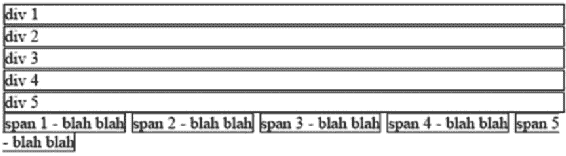
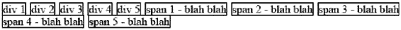
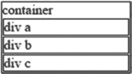
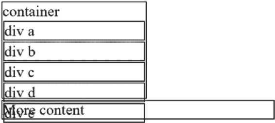
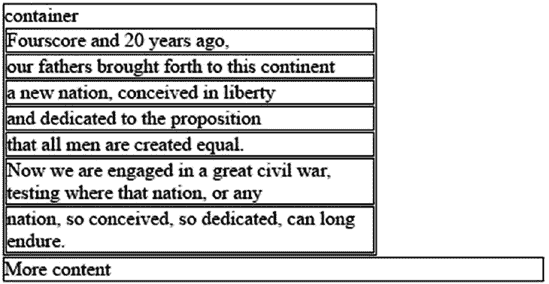
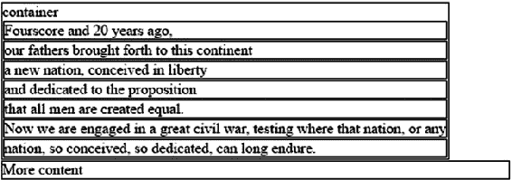
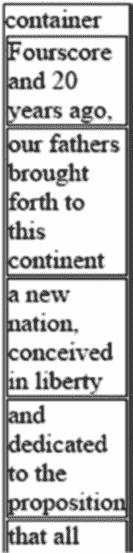

# 第三部分

## CSS

创建好 HTML 内容后，你将使用 CSS 来定义用于格式化内容的样式规则。

正如您将看到的，CSS 可以完成许多工作。这实际上是三个部分中最长的一节，因为有各种各样的功能可用于显著改变 HTML 文档的呈现方式。

本节包含以下章节：

- **第 9 章 选择器** – 每一条 CSS 规则都包含一个选择器，用于确定该规则应用于哪些元素；本章描述了构建这些选择器时可用的功能。
- **第 10 章 布局与定位** – 本章解释元素如何相对于其他元素进行定位，以及可用于控制其排列的各种方法。
- **第 11 章 文本** – 本章演示如何选择字体及字体特性、文本对齐、间距，以及包括阴影和装饰在内的多种特殊效果。
- **第 12 章 边框与背景** – 本章展示如何使用颜色、图像、渐变和多种样式来配置元素的背景和边框。
- **第 13 章 表格** – 本章涵盖样式化表格数据以及使用表格结构排列非表格元素。
- **第 14 章 Flex** – 本章演示如何使用 `flexbox` 模型定义动态页面布局。
- **第 15 章 动画** – 本章解释如何使用 CSS 创建动画，以及变换和过渡效果。

## 第 9 章 CSS 选择器

在[第 2 章](http://dx.doi.org/10.1007/978-1-4842-2463-2_2)中，我概述了如何使用层叠样式表对 HTML 进行样式化。样式表是一组样式规则，每条规则由一个选择器和一个或多个声明组成。选择器决定规则应用于哪些元素；声明则指定要设置的样式属性。在本章中，我将演示构建选择器时可用的功能。本节后续章节将解释一旦选中合适的元素后，CSS 能实现的所有精彩功能。

快速回顾一下，如果您希望所有段落元素使用绿色 12px 字体，样式规则如下所示：

```css
p {
    color: green;
    font-size: 12px;
}
```

第一部分 `p` 是选择器。它简单地选择所有段落（`p`）元素。花括号内有两个声明：一个设置 `color` 属性，另一个设置 `font-size` 属性。

### 选择器概述

选择器会根据元素的某些方面从 HTML 文档中选择零个或多个元素。共有六种选择器类型，每种类型使用元素中的不同信息进行选择。这些选择器类型包括：

- **元素选择器**（有时称为类型选择器）
- **类选择器**
- **ID 选择器**
- **属性选择器**
- **伪类选择器**
- **伪元素选择器**

© Mark J. Collins 2017
M. J. Collins, *Pro HTML5 with CSS, JavaScript, and Multimedia*, DOI 10.1007/978-1-4842-2463-2_9

#### 元素选择器

第一种我刚才展示的是元素选择器，也称为类型选择器。使用它时，只需指定元素类型，例如 `p`、`h1`、`input`、`ol`、`div` 等。在本书的前一部分中，我演示了所有可用的 HTML 元素。

正如我多次强调的，选择合适的元素能提供丰富的语义信息。如果您一直仔细且一致地选择元素，那么在应用样式时将有巨大优势。这些上下文相关的元素能更清晰地传达其用途，因此更有可能对所有内容应用一致的格式。

#### 类选择器

当然，认为所有样式仅通过元素选择器就能完成是天真的。您很可能需要为某些内容应用独特的样式，这就是类选择器发挥作用的地方。

所有 HTML 元素都支持 `class` 属性，它是一个全局属性。`class` 属性可以包含一个以空格分隔的类列表。例如：

```html
<p class="featured new">some text...</p>
```

此元素拥有两个类（class）：`featured` 和 `new`。类选择器（class selector）允许你选择具有特定类属性的元素。因此，类属性通常被称为 CSS 类。类选择器的创建方式是在类名前加上一个点号（`.`），如下所示：

```css
.featured {
  background-color: yellow;
}
```

此规则会将 `background-color` 属性应用到所有包含 `featured` 类的元素。类选择器会查找与选择器值完全匹配的完整单词。

#### ID 选择器

ID 选择器的工作原理与类选择器类似，区别在于它使用 `id` 属性而非 `class`，并且需要在前面加上一个井号（`#`），如下所示：

```css
#Submit {
  color: blue;
}
```

ID 选择器基于元素的唯一 ID 来指定单个元素，因此，按照定义，该样式不会被复用。更好的做法是基于元素或类来定义样式，这样相似的元素才能以相同的方式设置样式。

ID 选择器应谨慎使用，并且仅用于样式无需复用的独特场景。

#### 属性选择器

属性选择器为你提供了极大的灵活性，允许你根据元素的任意属性来选择元素。其指定方式为 `[属性=值]`，如下所示：

```css
[class="book"] {
  background-color: yellow;
}
```

这与使用 `.book` 类选择器在功能上是等价的；然而，属性选择器允许你仅使用属性值的一部分来进行匹配。为此，需要在等号（`=`）前加上以下前缀之一：

- `~`（例如，`[class~="book"]`）：属性值必须包含选择器值所指定的单词（例如，`class="some book titles"`）。这正是类选择器的工作方式。
- `|`（例如，`[class|="book"]`）：属性值必须以匹配选择器值的单词开头（例如，`class="book titles"`）。
- `^=`（例如，`[class^="book"]`）：属性值必须以选择器值开头（例如，`class="books"`）。
- `$`（例如，`[class$="book"]`）：属性值必须以选择器值结尾（例如，`class="checkbook"`）。
- `*`（例如，`[class*="book"]`）：属性值必须包含选择器值（例如，`class="overbooked"`）。

你也可以指定不带值的属性，这将返回所有包含该属性的元素。

一个很好的例子是 `[href]` 选择器，它将选择所有拥有 `href` 属性的元素，无论其值是什么。你还可以在属性选择器之前加上一个元素选择器，以进一步限制所选的元素。例如，以下规则将返回所有 `src` 属性以 `https:` 开头的 `img` 元素：

```css
img[src^="https"] {
  color: blue;
}
```

此示例将元素选择器与属性选择器结合使用。当这样结合时，它们构成一个逻辑“与”（AND）操作。它将选择那些既是图片元素，又满足 `src` 属性以 `https` 开头的元素。类似地，你也可以组合多个属性选择器，例如：

```css
[src^="https"][target="_self"] {
}
```

这将进一步将所选元素限制为仅那些具有 `_self` 目标（target）的元素。

#### 伪类选择器

伪类类似于常规的类属性，区别在于它们是浏览器自动添加的，而不是在 HTML 标记中设置的。伪类以冒号（`:`）为前缀。其中许多是根据元素的状态动态应用的。例如，考虑一个超链接。如果该链接已被访问过，通常会以不同的颜色显示。这可以通过如下所示的 CSS 规则实现，该规则将改变所有具有 `:visited` 伪类的元素的颜色。

```css
:visited {
  color: blue;
}
```

以下是伪类的完整列表：

- `:active` - 选择刚刚被点击的链接。
- `:checked` - 选择被选中的元素（适用于复选框）。
- `:default` - 选择表单中的默认元素，通常是提交按钮。
- `:disabled` - 选择当前被禁用的元素（通常用于输入元素）。
- `:empty` - 选择没有子元素的元素（包含文本的元素不会被选中）。
- `:enabled` - 选择已启用的元素（通常用于输入元素）。
- `:first-child` - 选择作为其直接父元素第一个子元素的元素。
- `<tag>:first-of-type` - 选择在其父元素中属于指定类型的第一个子元素的元素。
- `:focus` - 选择当前获得焦点的元素。
- `:hover` - 选择鼠标当前悬停在其上的元素。
- `:in-range` - 选择值在指定范围内的输入元素。
- `:indeterminate` - 选择一组单选按钮中尚未选定任何一个的情况。同时也会选中处于不确定状态的复选框（此状态必须通过 JavaScript 设置）。
- `:invalid` - 选择值无效的输入元素。
- `:lang(value)` - 选择拥有以指定值开头的 `lang` 属性的元素。
- `:last-child` - 选择作为其父元素最后一个子元素的元素。
- `<tag>:last-of-type` - 选择在其父元素中属于指定类型的最后一个子元素的元素。

# CSS 选择器

## 伪类

- `:link` - 选择所有未访问过的链接。
- `:nth-child(n)` - 选择作为其父元素第 n 个子元素的元素。
- `:nth-last-child(n)` - 选择作为其父元素倒数第 n 个子元素的元素。
- `<tag>:nth-last-of-type(n)` - 选择在其父元素中属于指定类型且为倒数第 n 个子元素的元素。
- `<tag>:nth-of-type(n)` - 选择在其父元素中属于指定类型且为第 n 个子元素的元素。
- `:only-child` - 选择作为其父元素唯一子元素的元素。
- `<tag>:only-of-type` - 选择在其父元素中属于指定类型且为唯一兄弟元素的元素。
- `:optional` - 选择非必填的输入元素（即没有 `required` 属性的元素）。
- `:out-of-range` - 选择值超出允许范围的输入元素。
- `:read-only` - 选择具有 `readonly` 属性的输入元素。
- `:read-write` - 选择不具有 `readonly` 属性的输入元素。
- `:required` - 选择具有 `required` 属性的输入元素。
- `:root` - 选择文档的根元素。
- `:target` - 选择带有 `target` 属性且该目标为当前活动元素的元素。
- `:valid` - 选择值有效的输入元素。
- `:visited` - 选择所有已被访问过的链接。

> **注意**：有四个伪类可用于锚点（`a`）元素，分别是 `:link`、`:visited`、`:hover` 和 `:active`。如果你使用多个伪类，它们在样式规则中应按此顺序出现。例如，如果同时使用了 `:link` 和 `:visited`，那么 `:hover` 必须放在它们之后。同样，`:active` 必须放在 `:hover` 之后。你可以用这个简单的助记口诀来记住正确顺序：**爱恨情仇**。

`nth-child(n)` 选择器会计算父元素的所有子元素，而 `nth-of-type(n)` 选择器仅计算指定类型的子元素。这里的区别虽细微但很重要。`only-child` 和 `only-of-type` 选择器也是如此。

> **提示**：有一篇非常有用的文章通过示例解释了伪类，你可以在 [`www.smashingmagazine.com/2016/05/an-ultimate-guide-to-css-pseudo-classes-and-pseudo-elements/`](https://www.smashingmagazine.com/2016/05/an-ultimate-guide-to-css-pseudo-classes-and-pseudo-elements/) 找到它。如果你想了解更多信息并了解这些伪类如何工作，不妨一读。

## 伪元素

虽然伪类提供了一种选择元素的机制，但伪*元素*实际上会返回新的、虚拟的元素，你可以为这些元素设置样式，而它们并非 DOM 的一部分。这些元素要么是空元素，要么是现有元素的一部分。

伪元素（Pseudo-elements）以双冒号（`::`）开头，以区别于伪类（pseudo-classes）。以下是可用的伪元素：

- `::after` - 在选择元素之后创建一个空元素。
- `::before` - 在选择元素之前创建一个空元素。
- `::first-letter` - 选择每个选中元素的第一个字符。
- `::first-line` - 选择每个选中元素的第一行。第一行是指文本换行到下一行之前的文本部分。
- `::selection` - 返回用户选中的元素部分。

**注意**：双冒号语法是在 CSS3 中引入的；在此之前，伪类和伪元素均使用单冒号。为了向后兼容，大多数浏览器允许为伪元素使用单冒号。

### 插入内容

你可以向选择器添加 `::before` 或 `::after` 限定符，从而在文档中选中元素之前或之后插入内容。使用 `content:` 关键字指定内容，并包含任何所需的样式命令（样式仅适用于插入的内容）。例如，要在每个紧跟在标题标签后面的 `p` 标签前添加“重要信息！”，请使用以下规则。这还会将“重要信息！”文本设置为粗体红色字体。

```css
header+p:before {
    content:"重要信息！ ";
    font-weight:bold;
    color:red;
}
```

**警告**：使用 `::after` 或 `::before` 伪元素插入的内容是由 CSS 生成的，不属于 DOM 的一部分。有几个副作用你应该知晓。首先，文本无法被选中——如果你复制粘贴网页内容，额外生成的内容将被省略。其次，部分屏幕阅读器不支持此功能，因此文本将不会被朗读。不要将其用于关键信息，因为在某些情况下它将不可用。

### 伪元素的限制

使用 `::first-letter` 和 `::first-line` 伪元素时，可设置的样式属性存在一些限制。本质上，你可以使用任何字体或背景属性。对于 `::first-letter` 伪元素，你还可以包含外边距（`margin`）、内边距（`padding`）和边框（`border`）属性。

此外，这些伪元素仅在块级布局（block layout）下被支持。我将在[第 10 章](http://dx.doi.org/10.1007/978-1-4842-2463-2_10)中解释布局选项。

## 使用组合器

我刚才描述的不同类型的选择器也可以组合起来，以执行更复杂的选择。

### 组合元素选择器和类选择器

你可以通过简单附加类选择器来组合元素选择器和类选择器。例如，这将选择所有具有 `featured` 类的段落元素：

```css
p.featured {
}
```

使用相同的语法，你还可以组合多个类选择器。它们将以逻辑与（AND）运算符进行处理。例如，这将选择所有同时具有 `featured` 和 `new` 类的段落元素：

```css
p.featured.new {
}
```

### 伪选择器

伪类选择器通常与元素选择器组合使用，例如：

```css
a:visited {
}
```

这将选择所有已被访问过的锚标签。在这种情况下，伪类进一步细化了元素选择器。它们也可以与类选择器组合，例如：

```css
.featured:focus {
}
```

然而，伪类也可以单独使用。一个常见的例子是 `:default` 伪类，它选择默认元素，通常是表单上的提交按钮：

```css
:default {
}
```

不过，伪元素始终会修改元素选择器或类选择器。它们实际上并不选择元素；它们要么返回选中元素的某一部分，要么在选中元素之前或之后返回一个新的空元素。因此，它们前面必须跟某种实际的选择器。

## 组合运算符

你可以组合选择器来指定特定的元素层级。通过将元素与以下任意一种*组合器*相结合，你可以创建更复杂的选择器。

- **Group**（例如 `p`, `h1`）：逻辑或运算符，选择所有 `p` 元素以及所有 `h1` 元素。
- **Descendant** 空格（例如 `header p`）：选择第二个元素，当它位于第一个元素内部时。例如，如果你想选择所有位于 `header` 元素内部的 `p` 元素，使用 `header p`。`header` 元素不必是直接父元素，只需在节点的祖先链中的某个位置即可。
- **Child** `>`（例如 `header > p`）：选择第二个元素，当第一个元素是其直接父元素时。`header > p` 选择器返回所有直接父元素为 `header` 元素的 `p` 元素。
- **Adjacent Sibling** `+`（例如 `header + p`）：选择第二个元素，当第一个元素是第二个元素的前一个兄弟元素时。
- **Follows** `~`（例如 `p ~ header`）：选择第二个元素，当它跟在第一个元素之后时（不一定是紧跟着）。

为了说明最后两个选择器，如果你的文档如下所示，`h1 + p` 选择器不会返回任何元素，但 `h2 + p` 和 `h1 ~ p` 都会返回 `p` 元素：

```html
<h1>Some header</h1>
<h2>Some sub-header</h2>
<p>Some text</p>
```

星号（`*`）用作通用选择器；它基本上是一个通配符，会匹配所有元素。将其与其他选择器组合通常没有效果。然而，在组合运算符时它可能很有用。考虑以下选择器：

```css
h2 * p {
}
```

请注意星号前后各有一个空格；它们是后代运算符。仅使用 `h2 *` 本身会选择所有是 `h2` 元素后代的元素。添加另一个后代运算符将选择后代的后代元素。这将返回所有是 `h2` 元素孙元素（或更晚的后代）的段落元素。

> **提示**：选择器和运算符之间的空格会被忽略。因此 `header > p` 和 `header>p` 是等价的。

然而，重要的是要记住，选择器之间的空格（包括通用选择器`*`）表示后代运算符。所以`h2 * p`包含三个选择器，每个都通过后代运算符组合。

类似地，使用`h2 > * > p`将返回所有是`h2`元素孙元素的段落元素。只有孙元素被选中，因为`>`组合符特指子关系，而不是像空格组合符那样的一般后代关系。

### Not 选择器

你也可以在任何选择器前加上`:not`来返回所有未被选择的元素。然而，选择器不能以`:not`开头；你必须以另一个选择器开头。例如，以下选择器选择`body`中除`header`元素之外的所有元素：

```css
body:not(header) {
    color: purple;
}
```

### Group 运算符

如果你想将相同的声明应用于多个元素类型，可以像这样对它们进行分组：

```css
p, h1, h2 {
    color: green;
    font-size: 12px;
}
```

逗号（`,`）字符作为逻辑或运算，例如，“所有类型为`p`或`h1`或`h2`的元素”。你也可以通过逗号分隔将复杂选择器组合成逻辑或关系。每个选择器可以是任何更复杂的类型。例如，这也是一个有效的选择器：

```css
header + p, .book, a:visited {

}
```

它将返回所有元素，这些元素要么是紧跟在`header`元素之后的段落元素，要么是具有`book`类的元素，要么是被访问过的锚点元素。

#### 解决冲突

凭借编写复杂选择器的能力，两条或多条规则指定冲突的样式是不可避免的。拥有一个组织良好的 HTML 文档并适当使用元素当然会有所帮助。同样，应用一致且命名良好的类属性也能最大限度地减少冲突。

要解决确实出现的问题，你需要理解 CSS 规则是如何应用的。样式应用的顺序基于它们定义的位置。规则的特定性也是一个重要因素。我在[第 2 章](http://dx.doi.org/10.1007/978-1-4842-2463-2_2)中已经涵盖了这两个主题。

### 媒体查询

CSS 2.1 引入了`media`关键字，允许你定义打印机友好的样式表。例如，你可以使用类似这样的东西：

```html
<link rel="stylesheet" href="Initial.css" />
<link rel="stylesheet" href="Print.css" media="print" />
```

然后，你可以为浏览器（`screen`）和网页的打印版本定义不同的样式表。或者，你可以在单个样式表中嵌入特定于媒体的样式规则。例如，这将在打印时更改字体大小：

```css
@media print {
    h1, h2, h3 {
        font-size: 14px;
    }
}
```

> **提示**：还有其他支持的媒体类型，包括`aural`、`braille`、`handheld`、`projection`、`tty`和`tv`。如你所见，媒体类型最初用于表示渲染页面的设备类型。此外，`all`类型也被支持，如果没有指定媒体类型，它也是隐含的。具有`all`类型的样式应用于每种设备。

#### 媒体属性

在 CSS3 中，这得到了显著增强，允许你查询各种属性以确定适当的样式。例如，你可以像这样在窗口宽度为`600px`或更小时应用样式：

```css
@media (max-width: 600px) {
    h1 {
        font-size: 12px;
    }
}
```

可以在媒体查询中选择的特性如下：

- `width`

- `height`

- `device-width`

- `device-height`

- `orientation`

- `aspect-ratio`

- `device-aspect-ratio`

- `color`（如果是单色则为`0`，或用于指定颜色的位数）

- `color-index`（可用的颜色数量）

- `monochrome`（如果是彩色则为`0`，或用于灰度的位数）

- `resolution`（以`dpi`或`dpcm`指定）

- `scan`（用于电视，指定扫描模式）

- `grid`（如果是网格设备如`TTY`显示则为`1`，如果是位图则为`0`）

这些特性大多支持`min-`和`max-`前缀，这意味着你不需要使用大于或小于运算符。例如，如果你想要一个窗口宽度在`500px`到`700px`（包括两端）之间的样式，你可以这样指定：

```css
@media screen and (min-width: 500px) and (max-width: 700px)
```

注意在这个例子中，我还包含了`screen`媒体类型。在这种情况下，该样式对于所有其他类型（如`print`）被忽略。

> **提示**：关于每个特性的完整定义，请参见 W3 规范：[www.w3.org/TR/css3-mediaqueries/#media1](http://www.w3.org/TR/css3-mediaqueries/#media1)。

#### 使用媒体查询

你可以使用媒体查询做很多事情来动态设置网页样式。例如，你可以使用`color`和`monochrome`特性在单色设备上显示时应用更合适的样式。`color`特性返回支持的颜色数量，所以`(min-color: 2)`将选择所有彩色设备。你也可以使用`(orientation: portrait)`和`(orientation: landscape)`根据设备的方向排列元素。

媒体查询最常见的用途之一是确定窗口的宽度。随着窗口宽度的缩小，样式会逐渐调整以适应大小，同时尽可能保留原始布局。这被称为`响应式`网页设计。

一种典型的方法是规划三种不同的样式：大、中、小。大样式可能是为桌面用户最初设计网站的方式。可能会有侧边栏和多列内容。中等样式将保持相同的基本布局，但根据需要开始缩小区域。一个有用的技术是使用相对大小，这样随着窗口缩小，每个元素也会逐渐缩小。小样式将用于手持设备，并且通常会将布局保持为单列。由于页面现在往往会变长，指向页面内书签的链接变得更加重要。

# CSS 选择器与定位

在本章中，我将解释从 HTML 文档中选择元素的各种方法。当 HTML 使用适当的元素进行了一致的标记时，元素选择器将非常有用。类选择器能让您更精细地控制样式的应用方式。伪类和伪元素选择器提供了一套令人印象深刻的功能，允许对文档进行动态样式设计。

这些选择器中的每一个都可以通过多种组合器进行组合，这些组合器允许您根据元素在文档中相对于其他元素的位置来选择元素。分组组合器允许您将一组声明应用于多个选择器。

最后，您可以使用媒体查询根据使用的设备调整样式。这将使您能够构建一个能在任何设备上良好渲染的响应式网页。

在下一章中，我将演示可用于控制布局和定位内容的 CSS 技术。

## 第十章：定位内容

在[第 2 章](http://dx.doi.org/10.1007/978-1-4842-2463-2_2)中，我解释了基本的盒模型，在本章中，我将演示每个“盒子”是如何相对于页面上的其他内容进行定位的。每个 HTML 元素都会占用一定的空间，该空间被定义为一个矩形；它有一个高度和一个宽度。此外，内边距（`padding`）、边框（`border`）和外边距（`margin`）也增加了必须分配的空间。

因此，一个 HTML 文档可以被视为一系列盒子。在[第 4 章](http://dx.doi.org/10.1007/978-1-4842-2463-2_4)中，我解释了定义较大盒子的结构元素，例如 `header`、`section` 和 `article` 元素。这些元素定义了文档的结构。在这些元素内部，您将放置较小的元素，例如段落和图像元素。而在段落元素内部，您可以使用我在[第 5 章](http://dx.doi.org/10.1007/978-1-4842-2463-2_5)中描述的短语元素（例如 `strong`、`emphasis` 和 `span` 元素）来包含大量小盒子。

在前面的章节中，我告诉您不要担心所有这些内容将如何排列。HTML 文档的重点是以逻辑方式组织内容，遵循“这属于那”的逻辑推理。现在是时候操心了！为了有效地布局 HTML 文档的内容，您需要理解几个概念，我将在本章中解释这些概念。

### 显示（`Display`）

关于 CSS 布局最基本的属性是 `display` 属性。有两个基本选项：`block` 和 `inline`。还有其他支持的值，我将在后面解释。但现在，我将重点介绍这两个（以及 `none` 选项）。

- `block` - 该元素使用其父元素的整个宽度。额外的块级元素然后垂直堆叠，正好位于前一个元素的下方。
- `inline` - 该元素水平排列。每个内联元素都放置在前一个元素的右侧（假设使用从左到右的方向）。如果没有足够的空间容纳该元素，则部分或全部元素内容会换到下一行。
- `none` - 该元素根本不渲染。内容不仅被隐藏，而且不在屏幕上占用任何空间。

浏览器在默认 CSS 属性方面做得很好，因此无需添加任何 CSS 规则，元素就能以合理的方式渲染。例如，每个元素对于 `display` 属性都有一个默认值。像 `section`、`article` 和 `div` 这样的结构元素（默认情况下）都是块级元素。

像 `strong` 和 `emphasis` 这样的短语内容是内联元素。段落元素是个明显的例外，它是一个块级元素，因为段落通常会占据页面或部分的整个宽度。

© Mark J. Collins 2017

M. J. Collins, *Pro HTML5 with CSS, JavaScript, and Multimedia*, DOI 10.1007/978-1-4842-2463-2_10





以下 HTML 提供了一个简单的演示。它包含五个 `div` 元素和五个 `span` 元素，并带有简单的文本内容。

```html
<div>div 1</div>
<div>div 2</div>
<div>div 3</div>
<div>div 4</div>
<div>div 5</div>
<span>span 1 - blah blah</span>
<span>span 2 - blah blah</span>
<span>span 3 - blah blah</span>
<span>span 4 - blah blah</span>
<span>span 5 - blah blah</span>
```

为了使布局更易于可视化，我将添加以下 CSS 规则。这将在每个 `div` 或 `span` 元素周围放置一个细边框，并在边框之间放置一个小间距。

```css
div, span {
    border: 1px solid black;
    margin: 1px;
}
```

这将渲染为图 10-1 所示。

***Figure 10-1.** 默认显示对齐*

您可以看到 `div` 元素是垂直堆叠的，而 `span` 元素是水平排列的。当然，您可以覆盖默认设置。将 `display: inline;` 添加到 CSS 规则中，将导致两个元素都水平排列，如图 10-2 所示。

***Figure 10-2.** 使用内联格式化*



■ **提示** 关于 `display: none;` 设置，正如我提到的，这会导致页面渲染时就好像该元素不存在一样。或者，您可以将 `visibility` 属性设置为 `hidden`（`visibility: hidden;`），这也会隐藏内容，但会在页面上留下一个空白区域，如果没有隐藏的话，该元素会显示在那里。这两种方法都有重要的应用，了解它们各自的工作原理很重要。

块级元素占据其容器的整个宽度。在前面的示例中，这是浏览器窗口的宽度。如果嵌套在另一个元素内部，它只会使用其父元素内可用的空间。

为了演示这一点，以下标记在一个父元素内创建了三个 `div` 元素：

```html
<div class="container">container
    <div>div a</div>
    <div>div b</div>
    <div>div c</div>
</div>
```

请注意，我给父元素指定了一个 `class` 属性。这将允许我使用类选择器设置其 `width` 属性，如下所示：

```css
.container {
    width: 150px;
}
```

这些 `div` 元素然后被渲染为图 10-3 所示。

***Figure 10-3.** 在父 div 中包含 div 元素*

### 定义尺寸

有许多方法可以定义元素的大小，每种方法都有其后果。

#### 绝对尺寸

在前面的示例中，我设置了 `width` 属性，给它一个 150 像素的绝对宽度。您也可以设置 `height` 属性。这将强制分配那么多空间，无论是否需要，也无论是否可用——后者问题更大。



如果空间不可用，元素将溢出其容器。如果外部容器是浏览器窗口，并且元素大小超过了窗口大小，则会出现滚动条，以便您滚动查看丢失的内容。虽然应避免水平滚动，但这并不太糟糕，因为内容仍然可见。

然而，考虑一下容器只是文档的一部分并且周围还有其他内容的情况。为了演示会发生什么，在前面的示例中，我们也可以设置 `height` 属性，如下所示：

```css
.container {
    width: 150px;
    height: 100px;
}
```

这将高度固定为 100px。容器中有一点额外的空间。但是，如果您在此容器内再添加几个 `div` 元素，并在其后添加一些额外内容，您将会看到溢出问题，如图 10-4 所示。在屏幕截图中，我进行了放大以便更容易查看。

```html
<div class="container">container
    <div>div a</div>
    <div>div b</div>
    <div>div c</div>
    <div>div d</div>
    <div>div e</div>
</div>
<div>More content</div>
```

***Figure 10-4.** 演示溢出问题*

`div d`的一部分以及整个`div e`都位于容器元素之外，并叠加在更多内容区域的上方。希望到现在你已看到设置绝对大小的谬误，尤其是设置高度时。这确实会让你陷入困境（双关语），并使页面容易受到多种可能破坏布局的场景的影响。例如，考虑页面被翻译且翻译后的文本比原文占用更多字符的情况。此外，如果用户指定的 CSS 增加了字体大小，你的布局可能会被破坏。

### 相对大小

我在[第 2 章](http://dx.doi.org/10.1007/978-1-4842-2463-2_2)中简要提到，距离单位也可以表示为百分比。与其将宽度指定为固定大小（例如`300px`），你可以将其指定为百分比。这将相对于元素的直接父元素来计算：

```css
.container {
  width: 70%;
}
```

在创建响应式网页时，使用相对大小非常有用，因为尺寸会根据可用空间自动调整。

#### 设置最大值

如果你主要处理文本，定义容器的宽度有助于约束容纳文本的区域。文本会根据需要自动换行以适配指定区域。然而，如果可用空间小于此值，内容会像我之前演示的那样溢出该区域。

一个简单的改进是使用`max-width`属性代替`width`。将 CSS 规则中的两个声明都替换为`max-width`：

```css
.container {
  max-width: 300px;
}
```

通过移除`height`属性，垂直溢出问题得到解决。通过将`width`替换为`max-width`，如果窗口尺寸缩小，容器将根据需要缩小以适应当前窗口。为了更好地演示这些，我们在这些`div`元素中添加一些额外文本。将容器`div`及其所有子元素替换为以下内容。每个元素将根据需要自动换行，以适配一个`300px`的`div`，如图 10-5 所示。

```html
<div class="container">container
  <div>Fourscore and 20 years ago,</div>
  <div>our fathers brought forth to this continent</div>
  <div>a new nation, conceived in liberty</div>
  <div>and dedicated to the proposition</div>
  <div>that all men are created equal</div>
  <div>Now we are engaged in a great civil war, testing where that nation, or any</div>
  <div>nation, so conceived, so dedicated, can long endure.</div>
</div>
```



第 10 章 ■ 定位内容

**图 10-5.** 使用`max-width`属性自动换行

## 基于内容的大小

有两种设置可用于根据元素内容定义其宽度：

* `min-content` - 在充分利用所有换行机会的情况下，使用能够容纳内容的最小可能区域。

* `max-content` - 在不换行任何内容的情况下，使用所需的最小空间。

为了演示这一点，使用`max-content`设置高度和宽度属性。在大多数浏览器中，渲染结果如图 10-6 所示。容器的宽度将基于其内部最宽元素的宽度。高度则基于所有子元素的总体大小。

```css
.container {
  width: -moz-max-content;
  height: -moz-max-content;
  width: max-content;
  height: max-content;
}
```

> **注意** 在撰写本文时，Firefox 需要带前缀的版本。





第 10 章 ■ 定位内容

**图 10-6.** 使用`max-content`

如果你使用`min-content`代替`max-content`，内容将如图 10-7 所示渲染。

宽度现在基于最大不可换行的内容，恰好是单词“proposition”。

如果存在其他类型的内容（如图片），最宽的那个将决定容器宽度。

**图 10-7.** 使用`min-content`

第 10 章 ■ 定位内容

## IE 的变通方案