# Markdown 文档排版

截至撰写本文时，IE 和 Edge 浏览器均不支持 `min-content` 和 `max-content` 属性。不过，可以使用自定义的 `-ms-grid` 属性作为替代方案。你需要先将容器放置在另一个父元素（实际上是祖父元素）中，然后将属性应用于该祖父元素。因此，HTML 代码将如下所示：

```
<div class="grandParent">
  <div class="container">container
    <div>Fourscore and 20 years ago,</div>
    <div>our fathers brought forth to this continent</div>
    ...
  </div>
</div>
```

我设置了类属性，以便可以通过以下附加规则来设置其样式：

```css
.grandParent {
  border: none;
  margin: 0px;
  display: -ms-grid;
  -ms-grid-columns: max-content;
}
```

新增的祖父级 div 仅用于分配样式属性；我们不希望绘制额外的框。因此，清除了 `border` 和 `margin` 属性。然后，将 `display` 属性设置为 `-ms-grid`，并设置自定义的 `-ms-grid-columns` 属性。由于这些是带前缀的属性或值，除 IE 和 Edge 之外的所有其他浏览器都会忽略它们。

完成这些更改后，所有其他浏览器中的页面渲染效果将与之前保持一致。

然而，IE9 及以上版本以及 Edge 浏览器也会以相同的方式显示内容。你也可以使用 `min-content` 替代 `max-content`，容器的大小将基于单词“proposition”。

## Min-Content 示例

前面的示例有些刻意为之，旨在演示 `min-content` 和 `max-content` 的工作原理。当你拥有图像和文本等混合内容时，`min-content` 属性最为实用。文本可以自动换行以适应几乎任何大小的容器，但图像则不能。为了演示一个更实用的示例，我将使用一个包含较长标题的 figure 元素。以下是标记代码：

```html
<figure>
  
  <figcaption>
    The HTML5 badge is a well-recognized symbol in the web design community.
  </figcaption>
</figure>
```

`figure` 元素包含两个子元素：一个图像和一个标题。我在第 4 章中解释过，这是为图像添加标题的首选方法。

默认情况下，这使用块级布局，因此标题将位于图像下方，并占据其容器（即 `figure` 元素）的整个宽度。`figure` 元素本身也是一个块级元素，因此它会占据窗口的整个宽度。如果窗口足够宽，较长的标题将显示在一行上。


第 10 章 ■ 内容定位

理想情况下，你希望标题根据需要自动换行，使其始终位于图像下方。这正是 `min-content` 属性大显身手的地方。添加以下 CSS 规则即可实现这一效果。

```css
figure {
  border: 1px solid black;
  margin: 1px;
  width: -moz-max-content;
  width: min-content;
}
```

此规则还设置了边框和外边距，以便你更直观地查看布局效果。在大多数浏览器中，渲染结果如图 10-8 所示。

***图 10-8.** 在 figure 中使用 `min-content`*

## 盒模型尺寸

正如我在第 2 章中解释的那样，分配给元素的空间除了实际元素内容外，还包括内边距、边框和外边距。请务必记住，我目前介绍的尺寸设置仅适用于实际内容。实际占用的空间可能更大，有时甚至会大很多，具体取决于这些其他设置。

当你尝试对齐具有不同属性的元素时，这可能会导致问题。为了演示这一点，请考虑以下标记代码：

```html
<section>
  <article class="bigBorder">I am really padded!</article>
  <article class="smallBorder">Me, not so much.</article>
</section>
```

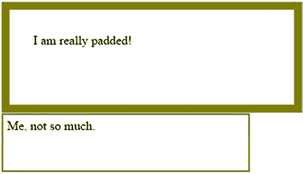

第 10 章 ■ 内容定位

`section` 元素包含两个 `article` 元素，每个元素都有一些简单的文本内容。每个 `article` 元素都有不同的类属性。现在应用以下 CSS 规则：

```css
article {
  width: 300px;
  height: 60px;
  margin: 1px;
}

.bigBorder {
  padding: 30px;
  border: 10px solid olive;
}
```


```css
.smallBorder {
  padding: 5px;
  border: 2px solid olive;
}
```

首先，将 `article` 元素设置为固定尺寸：300px × 60px。然后通过类选择器应用不同的 `padding` 和 `border` 设置。内容渲染效果如图 10-9 所示。

***图 10-9.** 不同尺寸的元素*

鉴于两个元素都被设置为相同尺寸，结果可能会有些令人意外。实际上它们的尺寸确实相同，但周围的 `padding` 和 `border` 不同。你可以通过补偿额外的 `padding` 和 `border` 来解决此问题，将第一个元素的宽度设置得更小（准确来说是缩小 66px）。

不过，利用新增的 `box-sizing` 属性有更简便的方法。该属性指定如何应用 `height` 和 `width` 属性。默认值 `content-box` 表示尺寸仅作用于实际元素内容。或者，你可以将其设置为 `border-box`，尺寸属性将在 `padding` 和 `border` 添加后生效。我们可以通过添加以下 CSS 规则来修正：

```css
* {
  box-sizing: border-box;
}
```

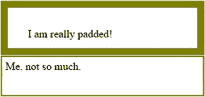

第 10 章 ■ 定位内容

请记住，[第 9 章](http://dx.doi.org/10.1007/978-1-4842-2463-2_9)中提到星号是通用选择器，意味着此规则适用于所有元素。有了这条规则，所有尺寸属性都将包含 `padding` 和 `border`。调整后，内容渲染效果如图 10-10 所示。

***图 10-10.** 尺寸完全相同的元素*

■ **注意：** 还有其他一些已定义的宽度设置，但浏览器对这些设置的支持尚不完善。如果你想尝试这些设置，Mozilla 网站提供了更多信息：[`developer.mozilla.org/en-US/docs/Web/CSS/width`](https://developer.mozilla.org/en-US/docs/Web/CSS/width)

### 浮动

`float` 属性用于使块级内容对齐到其包含元素的左侧或右侧边缘。例如，为元素添加 `float: left;` 将使其左对齐。

容器中后续的内容将环绕浮动内容进行排列。例如，以下标记包含一个 `div` 元素，其后跟随一段文本内容。

```html
<header>
  <div>div</div>
  <p>Lorem ipsum dolor sit amet, consectetur adipiscing elit, sed do eiusmod ...</p>
</header>
```

添加以下 CSS 规则将在 `div` 元素周围增加一些空间，并使其向左浮动，从而允许文本环绕。渲染效果如图 10-11 所示。

```css
header > div {
  padding: 25px;
  float: left;
}
```

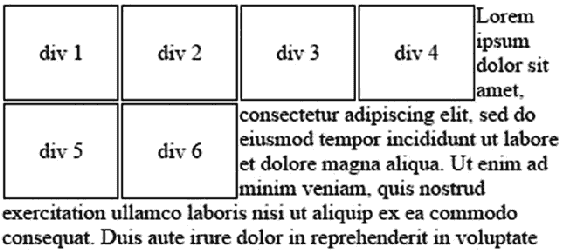  
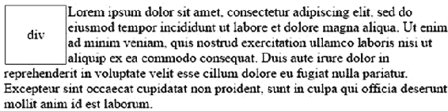

第 10 章 ■ 定位内容

***图 10-11.** 使用 `float: left`*

请记住，块级内容通常占据其容器的整个宽度。为元素设置 `float` 属性后，后续内容将像内联内容一样被定位。额外的元素将位于浮动内容的右侧。如果它们也设置了 `float: left`，后续内容将继续向右排列。为了演示这一点，我将添加更多 `div` 元素。之前的 CSS 规则将使所有这些元素都 `float: left`，渲染效果如图 10-12 所示。

```html
<header>
  <div>div 1</div>
  <div>div 2</div>
  <div>div 3</div>
  <div>div 4</div>
  <div>div 5</div>
  <div>div 6</div>
  <p>Lorem ipsum dolor sit amet, consectetur adipiscing elit, sed do eiusmod ...</p>
</header>
```

***图 10-12.** 多个浮动 `div` 元素*

■ **提示：** 使用 `float: right;` 将使内容对齐到容器的右侧。后续的浮动块将位于第一个块的左侧，这实际上会使它们以相反顺序渲染。

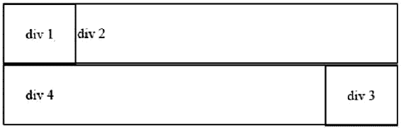

第 10 章 ■ 定位内容

#### 清除浮动

`float` 属性还会影响后续内容的定位。浮动元素向左或向右对齐，但后续内容可以继续内联显示，而不是像普通块级内容那样另起一行。为了说明这一点，以下标记创建了四个 `div` 元素，并使用内联样式显式设置 `float` 属性。

```html
<section>
  <div style="float: left; padding: 25px">div 1</div>
  <div style="padding: 25px">div 2</div>
  <div style="float: right; padding: 25px">div 3</div>
  <div style="padding: 25px">div 4</div>
</section>
```

第一个元素向左浮动。第二个元素未浮动，但由于前一个元素是浮动的，它仍在同一行上继续显示。由于此元素未浮动，它将占据当前行的剩余空间。第三个元素向右浮动，最后一个元素则定位在左侧并占据该行的剩余空间。效果如图 10-13 所示。

***图 10-13.** 演示浮动与非浮动内容*

如果你想取消先前浮动对后续元素的影响，可以使用 `clear` 属性。

这不会影响前一个元素的定位方式，但会消除浮动对后续元素的影响。`clear` 属性可以设置为 `left`、`right` 或 `both`。因此，你可以移除所有先前浮动的影响，或仅移除左浮动或右浮动的影响。为了演示，我将在之前的标记中添加 `clear` 属性，渲染效果如图 10-14 所示。

```html
<section>
  <div style="float: left; padding: 25px">div 1</div>
  <div style="clear: left; padding: 25px">div 2</div>
  <div style="float: right; padding: 25px">div 3</div>
  <div style="clear: right; padding: 25px">div 4</div>
</section>
```

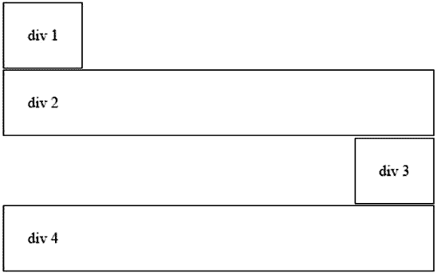

第 10 章 ■ 定位内容

***图 10-14.** 使用 `clear` 属性*

第一个 `div` 按预期左对齐。第二个 `div` 定位在下一行，像普通块级内容一样占据整行。

为了举一个稍微复杂的例子，我将使用 `:nth-of-type` 选择器让奇数元素向左浮动，偶数元素向右浮动，同时使用 `clear` 属性移除对先前浮动的影响。

这将使左对齐和右对齐的 `div` 元素垂直堆叠，而不是内联排列。同时，为容器元素设置 `background-color` 以演示我将要解决的另一个问题。

```css
header {
  background-color: #f3f3f3;
}

header > div {
  padding: 25px;
}

header > div:nth-of-type(odd) {
  float: left;
  clear: left;
}

header > div:nth-of-type(even) {
  float: right;
  clear: right;
}
```

这从 `header > div` 选择器中移除了 `float: left;` 声明，并使用[第 9 章](http://dx.doi.org/10.1007/978-1-4842-2463-2_9)中描述的 `:nth-of-type` 伪类创建了新的选择器。这些选择器使用了 `even` 和 `odd` 关键字。

渲染效果如图 10-15 所示。

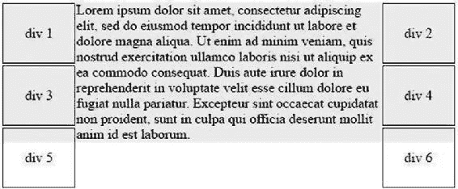  
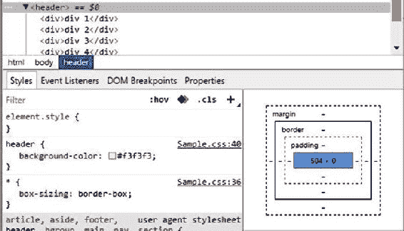

第 10 章 ■ 定位内容

***图 10-15.** 使用左浮动和右浮动*

#### 包含浮动

图 10-15 展示了浮动的一个常见问题。基本上，浮动内容在计算容器高度时不会被考虑。为了更清楚地看到这一点，我将使用以下 CSS 规则（将 `display` 属性设置为 `none`）移除文本。

```css
header > p {
  display: none;
}
```

渲染后，你会看到左侧有奇数 `div` 元素，右侧有偶数 `div` 元素，中间没有任何文本。如果你使用浏览器工具检查 `header` 元素，会发现元素的高度被设置为 0，如图 10-16 所示。

***图 10-16.** 在 Chrome 中检查 `header` 元素*

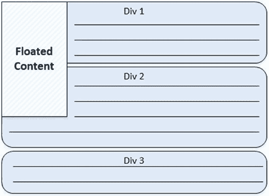

第 10 章 ■ 定位内容


我为 `header` 元素设置了灰色背景，由于 `div` 元素位于 `header` 元素内部，我期望它们也具有灰色背景。然而，由于 `header` 元素的计算高度为 0，因此没有显示灰色区域。类似地，在图 10-15 中，你可以看到只有部分 `div` 元素具有灰色背景，因为文本没有浮动内容那么大。

乍一看，这似乎是浏览器的一个 bug；父元素的大小没有考虑其子元素。然而，这种行为有一个重要的原因。浮动内容旨在跨越多个块。例如，图 10-17 中显示的布局有三个带有文本内容的 `div` 元素。浮动内容跨越了其中两个。

***图 10-17.** 跨越块的浮动内容*

如果第一个 `div` 的大小包含了浮动内容，那么第二个 `div` 要到浮动内容结束后才开始，这会留下大量空白空间。在我们的场景中，当我们希望将浮动内容包含在尺寸计算中时，至少有两种常见的解决方案可以实现这一点。

### 设置溢出

最简单的解决方案（尽管可能不那么直观）是使用 `overflow` 属性。这指定了当元素的内容超出其容器区域时，浏览器应如何处理。`overflow` 属性支持以下值：

- `visible` - 这是默认值，表示溢出内容应显示而不影响容器。正如我所展示的，容器高度为零，但其所有内容仍然显示出来。
- `hidden` - 内容被裁剪，因此容器外部的任何内容都不可见。
- `scroll` - 即使内容适合容器内部，也会始终创建水平和垂直滚动条。
- `auto` - 仅当内容溢出容器时才创建滚动条；否则不创建。

第 10 章 ■ 定位内容

然而，在这种场景下，使用除 `visible` 之外的任何值，浏览器都会在计算容器大小时考虑浮动内容。这解决了背景颜色未覆盖所有 `div` 元素的问题。使用 `scroll`，你还会得到滚动条，这可能不是你想要的。我建议为任何包含浮动内容的容器使用 `overflow: auto;` 来解决此问题。

### 使用伪元素

另一种解决方案是使用 `::after` 伪元素在容器之后创建额外的内容，并对该内容使用 `clear` 属性。例如，添加此 CSS 规则将在浮动内容之后添加内容。

```
header::after {
  content: "";
  display: block;
  clear: both;
}
```

必需的 `content` 声明被设置为空字符串，因此这不会添加任何实际内容。然而，伪元素将具有 `clear: both;` 声明。这会导致内容“出现在”浮动内容之后，但仍然是容器的一部分。这也会强制将浮动内容包含在容器大小中。

### 内联块

在本章开头，我告诉过你 `display` 属性有两个基本值：`block` 和 `inline`，并且我演示了它们的工作方式。实际上，`display` 属性有相当多的可用值。其中大部分与表格有关，我将在[第 13 章](http://dx.doi.org/10.1007/978-1-4842-2463-2_13)中介绍。但我将在此处解释 `inline-block` 值。

正如我所解释的，`block` 元素使用其父元素的整个宽度，并且每个 `block` 元素创建一个新行。相比之下，`inline` 元素仅使用所需的水平空间，后续元素在现有行上继续，必要时换行。

使用 `inline` 元素时存在一些限制，例如无法设置 `height` 和 `width` 属性。在前面的一些示例中，当有一行框时，必须将它们创建为 `block` 内容并使用 `float` 属性来允许它们水平排列。

以下标记在 `nav` 元素内创建了六个 `div` 元素：

```
<nav>
  <div>div a</div>
  <div>div b</div>
  <div>div c</div>
  <div>div d</div>
  <div>div e</div>
  <div>div f</div>
</nav>
```

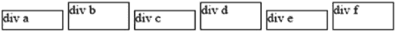

第 10 章 ■ 定位内容

默认情况下，每个 `div` 元素都将显示为 `block` 内容并位于单独的行上。但是，我们可以使用 `inline-block` 来允许它们排列在一行上（或者在必要时换行）。这通过如下 CSS 规则应用：

```
nav>div {
  display: inline-block;
  width: 75px;
  height: 25px;
  vertical-align: bottom;
  clear: both;
}
```

这还设置了 `div` 元素的 `height` 和 `width`。需要 `clear` 属性来清除上一个示例中的浮动（如果你使用浮动，你会发现你也会经常使用 `clear`）。

CSS 规则还设置了 `vertical-align` 属性，以便所有元素的底部边缘将对齐。由于它们大小相同，对齐并不是真正的问题。为了更有趣，我将使用此 CSS 规则调整某些元素的高度，这将使每隔一个元素变大。

结果如图 10-18 所示。

```
nav>div:nth-of-type(even) {
  height: 35px;
}
```

***图 10-18.** 使用具有对齐功能的 `inline-block`*

### 定位

到目前为止，我们在本章中处理的所有元素都是静态定位的。这是默认行为，其中元素使用 `block` 或 `inline` 布局一个接一个地排列。这是通过设置 `position: static;` 来定义的，但由于这是默认值，因此实际上不必将其添加到你的 CSS 中。

`position` 属性有多个值，我将解释每一个：

- `static` - 这是默认值；内容根据其在文档中的位置和分配的流属性进行定位。
- `relative` - 元素位置相对于其正常流位置进行偏移。
- `absolute` - 元素定位在特定位置；不为它分配空间。
- `fixed` - 元素相对于视口定位；其在屏幕上的位置在滚动文档时不会改变。

第 10 章 ■ 定位内容

■ **提示** 非静态定位的内容有时被称为*定位*内容。这不是一个很有见地的术语，因为所有内容都是定位的；只是定位方式不同。但是，如果你看到该术语，它通常适用于使用 `relative`、`absolute` 或 `fixed` 位置值的内容。

#### 相对定位

使用相对定位时，内容的定位方式与静态定位相同，只是它会从其原始计算位置偏移。元素的移动不会影响其他元素的位置。基于元素原始位置为其分配的空间仍然保留。这通常会导致一些内容重叠以及空白区域。

将 `position` 属性设置为 `relative` 后，你可以使用 `top`、`bottom`、`left` 或 `right` 属性指定偏移量。如果你想将元素向下移动，请将 `top` 属性设置为其应调整的距离。类似地，要向上移动位置，请使用 `bottom` 属性。要将元素向右移动，请使用 `left` 属性。这起初可能看起来是相反的，但它类似于增加左边距，这将把元素推向右方。

■ **提示** 将 `top` 属性设置为正值会将元素向下移动；使用负值会将元素向上移动。所以 `top: -20px;` 和 `bottom: 20px;` 是等效的。同样，将 `left` 属性设置为负值与将 `right` 属性设置为正值效果相同。


为了演示相对定位，我将使用以下标记，它创建了四个`div`元素。

```
<header>
<div class="square red">div 1</div>
<div class="square yellow">div 2</div>
<div class="square blue">div 3</div>
<div class="square green">div 4</div>
</header>
```

我还会使用以下 CSS 规则为每个方块设置背景色。（如果你对我选择的颜色感到好奇，我特意使用了较浅的颜色，因为它们在打印时效果更好，尤其是在使用灰度进行黑白打印时。）

```css
.red {
  background-color: pink;
}
.yellow {
  background-color: yellow;
}
.blue {
  background-color: cyan;
}
.green {
  background-color: chartreuse;
}
```

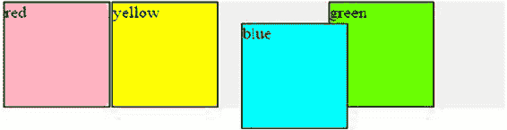

## 第 10 章 ■ 定位内容

每个`div`元素都分配了`square`类，并且每个元素也有一个不同的颜色类。然后使用一对类选择器完成定位：

```css
header>div.square {
  padding: 0px;
  float: left;
  clear: none;
  width: 100px;
  height: 100px;
}

.blue {
  position: relative;
  top: 20px;
  left: 20px;
}
```

我将此示例的标记和 CSS 规则添加到之前示例使用的同一个文件中，其中已经有一个`header>div`选择器。这个新的选择器`header>div.square`更具体，因此会覆盖任何冲突的声明。我在[第 2 章](http://dx.doi.org/10.1007/978-1-4842-2463-2_2)中解释了特异性规则。之前的声明设置了`padding`、`float`和`clear`属性；但是，我希望这些新的方块`div`元素具有不同的样式，因此这些特定的声明被覆盖了。

> **注意：** 请注意这里设置了`clear: none;`，这是该属性的默认值。有时在覆盖不太具体的规则时，你必须设置默认值。

蓝色类选择器设置了相对位置并指定了偏移量。只有一个`div`元素具有此类，因此只有包含蓝色类的`div`会被偏移。渲染结果如图 10-19 所示。

**图 10-19.** 演示相对定位

请注意，现在蓝色`div`的顶部和左边缘附近有多余的空间，并且蓝色`div`与绿色`div`重叠。还要注意，`header`元素的背景并未覆盖整个蓝色`div`。正如我所说，偏移是在元素上执行的，不对其他元素进行任何调整。所有其他内容都基于元素的原始位置（在应用偏移之前）进行定位。

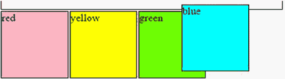

## 第 10 章 ■ 定位内容

> **提示：** 如果你想移动一个元素，并且希望新位置和原始位置在正常（静态）内容流中都被保留，请改用`margin`属性。这会给元素增加额外的空间，使其看起来像是被移动了。但是，剩余内容会基于元素尺寸的新增大小进行调整。

#### 绝对定位

绝对定位与相对定位类似，不同之处在于元素被完全从内容流中移除。原始位置不被保留；就好像该元素从未存在过一样。它使用相同的`top`、`bottom`、`left`和`right`属性来指定位置。然而，使用绝对定位的棘手之处在于确定定位上下文。

明确地说，`position`属性的`relative`或`absolute`值都会使元素相对于某物定位。两者都使用`top`、`bottom`、`left`或`right`属性指定偏移。

设置`position: relative;`将使元素相对于其原始位置定位。使用`position: absolute;`将使元素相对于其定位上下文定位。

当使用相对或绝对定位时，就会创建定位上下文。当使用绝对定位时，浏览器会遍历元素的祖先，查找具有`position`属性设置为`absolute`或`relative`的最近祖先。如果未找到，则使用文档作为默认定位上下文。


为了演示这一点，我将添加以下 CSS 规则：

```
header {
  position: relative;
}
```

这将使每个`header`元素成为一个定位上下文。但请注意，我没有指定偏移量。

这不会影响`header`元素；它的定位方式将与使用静态定位时一样。然而，如果它的任何子元素使用了绝对定位，它们将基于`header`元素的位置进行定位。

在修改了`header`之后，我将创建`blue`类选择器。`blue`的`div`现在应该基于`header`元素进行定位，其上边缘位于`header`上方 10 像素处，右边缘距离`header`的右边缘 50 像素，如图 10-20 所示。

```
.blue {
  position: absolute;
  top: -10px;
  right: 50px;
}
```

**图 10-20.** 基于父元素位置的绝对定位

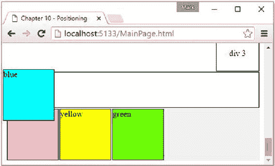

第 10 章 ■ 定位内容

#### 固定定位

固定定位与绝对定位相同，区别在于定位上下文始终是视口（viewport）。无论文档如何滚动（水平或垂直），内容将始终保持在屏幕上的同一位置。为了演示这一点，我将通过将之前的 CSS 规则替换为以下内容来更改`blue`的`div`的位置：

```
.blue {
  position: fixed;
  top: 50px;
  left: 0px;
}
```

`top`或`bottom`属性是必需的；否则内容将不会显示。在这个例子中，我设置了内容的上边缘将从窗口顶部开始 50 像素。`left`或`right`属性是可选的；如果省略，将使用`left: 0px;`。渲染结果如图 10-21 所示。

**图 10-21.** 使用固定定位

## Z-Index

`x`轴指的是页面上的水平方向，`y`轴是垂直方向。由于网页是二维的，实际上并没有`z`轴，尽管它被用来描述重叠内容如何堆叠在其他内容之上。因此，`z-index`属性，从某种意义上说，定义了堆叠顺序。具有最高`z-index`的内容将位于最上层。

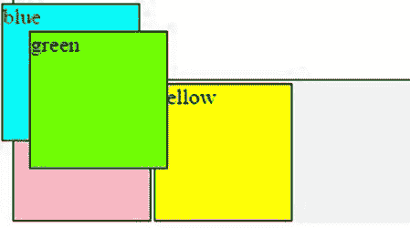

第 10 章 ■ 定位内容

对于静态定位的内容，您不需要关心`z-index`。实际上，`z-index`仅适用于非静态定位的内容。然而，对于其他定位值（`relative`、`absolute`和`fixed`），您需要考虑“堆叠顺序”。

`z-index`的默认值为 0。因此，如果所有内容都具有相同的`z-index`，浏览器如何知道哪个放在最上面？这里有一些需要遵循的规则。

首先，所有非静态定位的内容将位于其他内容之上。回头看看图 10-19、10-20 和 10-21，注意`blue`的`div`始终位于其他内容之上。如果您不希望这种行为，将`z-index`设置为`-1`，该内容将出现在静态定位的内容下方。

其次，在文档中位于后面的内容将位于先前内容之上。为了测试这一点，我将添加以下规则，使`green`的`div`使用固定定位：

```
.green {
  position: fixed;
  top: 70px;
  left: 20px;
}
```

`green`的`div`现在将固定在`blue`的`div`附近，但由于它在文档中位于其后，它将出现在`blue`的`div`之上，如图 10-22 所示。您可以尝试对`yellow`的`div`进行同样的操作，您会发现它将位于`blue`的`div`之下，因为它出现在它之前。

**图 10-22.** 显示两个固定元素

在确定显示顺序时，浏览器使用*堆叠上下文*。堆叠上下文是在文档级别为所有静态定位的内容创建的。每当使用`relative`、`absolute`或`fixed`定位时，就会创建一个新的堆叠上下文。该元素内的所有子元素都使用相同的堆叠上下文。


