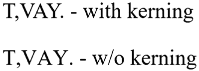
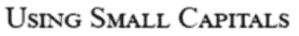
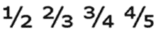
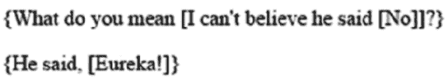
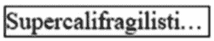

# 文本样式

## 网络安全字体

第一种被称为*网络安全字体*，这个说法其实有些名不副实。所有操作系统都内置了字体；为了在屏幕上显示文本，需要字体将每个字符代码映射到字形。浏览器可以使用这些内置字体中的任何一种。但问题是，并非所有操作系统都支持同一套字体。网络安全字体是指那些普遍被大多数设备支持的字体。这与其说是科学，不如说是艺术，没有哪种字体能在所有操作系统上获得 100%的支持。不过，有一些字体，如 Arial、Verdana、Times New Roman 和 Courier New，是比较稳妥的选择。在 [`www.cssfontstack.com/`](http://www.cssfontstack.com/) 上有篇文章展示了这些字体在 Windows 和 Mac 上的可用性（遗憾的是，它没有显示 Android 或 iOS 上的覆盖情况）。

## Web 字体

你可能已经意识到，使用网络安全字体，你的选择范围是有限的。第二种方法能显著增加你的选项，那就是使用*Web 字体*。Web 字体由浏览器下载，就像 CSS 和图片文件等其他资源一样。这种方法有两个缺点：

-   较旧的浏览器不支持 Web 字体；不过，这只会影响一小部分且日益减少的用户群体。
-   额外的下载可能会减慢页面的加载速度，特别是当你使用多种 Web 字体时。这些字体通常会被浏览器缓存，所以通常只影响首次加载。

如果你有兴趣使用 Web 字体，请访问 [`fonts.google.com/`](https://fonts.google.com/)。截至撰写本文时，该网站提供了 808 个字体族，并拥有一个出色的用户界面用于预览和选择字体。选择字体后，该网站会提供如何将其包含到 HTML 文档中的说明。要包含一个 Web 字体，你可以像这样使用 `link` 元素：

```html
<link href="https://fonts.googleapis.com/css?family=Cabin" rel="stylesheet">
```

或者，你也可以使用 `@import` 规则将字体包含在 CSS 文件中，如下所示：

```css
@import url(//fonts.googleapis.com/css?family=Cabin);
```

两种方式达到的效果相同。使用 `link` 元素将其放在标记中，而 `@import` 规则则在 CSS 中完成。我建议使用 `@import`，这样所有样式更改都集中在 CSS 文件中。

如果你之后决定更改字体，应该无需修改 HTML 标记就能做到。

前面提到的 CSS 字体栈网站也提供了一个很好的用户界面，用于选择字体、配置 CSS 以及预览字体定义。它同样引用了相同的 `fonts.googleapis.com` 网站来获取实际的字体资源。

## 自定义字体

第三种方法是将你自己的字体定义嵌入到 CSS 文件中。就像图片一样，定义字体也有多种格式。TrueType 字体（TTF）已经存在大约 30 年了，它和 OpenType 字体（OTF）一起，是在台式电脑上安装字体的标准格式。主流浏览器也支持这些格式。但是，Web 开放字体格式（WOFF）是 W3C 推荐的标准，并且也被大多数浏览器支持。此外，WOFF 2.0 的受欢迎程度和支持度也在不断提升。

创建字体定义超出了本书的范围。但是，一旦你创建或购买了字体定义文件，就可以将其复制到你的 Web 服务器上。然后，你需要使用 `@font-face` 规则在 CSS 文件中引用它。就像音频和视频文件一样，你可以提供多种文件格式，以便浏览器根据其支持的类型进行选择。例如，为了支持 TTF、WOFF 和 WOFF2.0，你需要包含如下规则。当然，你需要在服务器上提供这些文件格式的每一种。

```css
@font-face {
  font-family: 'CustomFont';
  src: url('custom.ttf') format('truetype'),
       url('custom.woff') format('woff'),
       url('custom.woff2') format('woff2');
}
```

还有其他提供字体的网站，例如 [`www.fontsquirrel.com/`](https://www.fontsquirrel.com/) 和 [`www.fontex.org/`](http://www.fontex.org/)。这两个网站都提供字体文件下载，你需要将这些文件托管到你的 Web 服务器上，并作为自定义字体进行引用。

#### 字体族

字体通过术语*族*来标识。Arial、Courier New 和 Times New Roman 这些术语就是字体族。在前面的自定义字体示例中，我们定义了 `font-family` 属性，CSS 后续就是通过这个属性来选择它的。此外还有一组通用字体族，图 11-1 展示了每种字体族的示例：

-   **cursive（手写体）** - 该字体族的字体模仿手写体而非印刷体。有时字符之间会相互连接，给人一种手写的感觉。
-   **fantasy（幻想体）** - 这些字体更具装饰性，带有装饰或非标准的字符表现。
-   **monospace（等宽体）** - 等宽字体的所有字符都具有相同的宽度。
-   **sans-serif（无衬线体）** - sans 意为“没有”，serif 是一个额外的笔画，通常是渐变的末端。所以无衬线字体没有这些额外的标记，通常看起来更朴素。
-   **serif（衬线体）** - 这些是更传统的字体，尤其在印刷文本中。你现在读到的就是这种字体。

***图 11-1.** 示例通用字体族*

因此，浏览器拥有一组可供使用的字体，无论是操作系统原生字体、链接的 Web 字体还是嵌入的自定义字体。你可以像这样使用 `font-family` 属性来选择使用哪一种：

```css
p {
  font-family: Cabin;
}
```

但是，由于你无法保证每个浏览器都支持这种字体，你应该提供一些额外的选项作为后备方案。这被称为*字体栈*。你可以通过逗号分隔来指定多个字体族。例如：

```css
p {
  font-family: Cabin, Verdana, sans-serif;
}
```

浏览器会按顺序处理这些字体，所以把你的首选放在第一位。你应该总是以一个通用字体结尾，这样至少能得到一个与你预期相似的字体。前面的示例使用了一种典型方法：先放自定义字体或 Web 字体，接着放一个类似的网络安全字体，最后放一个通用字体族。你可以通过将 `Cabin` 改为 `Cabin1`，然后将 `Verdana` 改为 `Verdana1` 来测试这一点。每次修改后，你都应该注意到字体变了，但仍然与首选相似。

**注意：** 如果字体族名称包含标点符号或数字，例如 `Modern No. 20`，你需要将名称用引号括起来。

#### 字体设置

然而，选择字体族只是第一步。还有其他属性，如字号、字重和字体样式，可以更精确地配置字体。还有一些高级功能可以让你更有力地处理特殊情况。

### 字体样式

`font-style` 属性用于选择斜体字体。有三个可能的值：`normal`（默认）、`italic` 和 `oblique`。Oblique 意为倾斜或偏斜。`oblique` 关键字支持度不太好，通常会产生与 `italic` 相同的效果。

### 字号

历史上，字号是以字母“M”的宽度来衡量的；但现在，它代表了大写字母的高度。当然，在非西方字符集中，这个定义可能并不完全适用。

在设置字体大小时，有数量惊人的选项。其值是一个距离单位，我在第二章中解释了所有可用于定义距离的单位。附录 C 的参考资料中也总结了这些单位。

```markdown

# 字体大小与样式

设计师应避免使用绝对尺寸（如`12px`）。若用户因无障碍需求调整字体大小，绝对尺寸将无法随之改变。使用相对尺寸还有助于页面设计，尤其在处理响应式布局时。因此，除了标准距离单位外，还有多种设置字体大小的方法。

浏览器定义了一组关键字，它们会根据用户的字体设置映射到物理单位：

- `xx-small`
- `x-small`
- `small`
- `medium`
- `large`
- `x-large`
- `xx-large`

这些关键字允许你设置字体大小，同时仍允许用户根据需要增大或减小字体。

还有两个关键字可相对于父元素的字体大小设置字体：

- `smaller`
- `larger`

它们会按与上述关键字之间大致相同的幅度调整字体大小。例如，若父元素使用`small`，则使用`larger`大致相当于选择`medium`。

你也可以将字体大小表示为父元素字体大小的百分比。设置`font-size: 120%;`将使字体比父元素的字体大 20%。

我在第 2 章中描述的一些距离单位是相对单位。例如，`em`单位基于当前字体大小，而`rem`基于根元素的字体大小。还有视口相对单位，如`vh`，它代表视口高度的 1%。

> **提示**：有一篇好文章在[`css-tricks.com/almanac/properties/f/font-size/`](https://css-tricks.com/almanac/properties/f/font-size/)，其中提供了各种大小调整方法的示例。

## 字重

`font-weight`属性用于设置粗体字体，它支持两个值：`normal`（默认）和`bold`。不过，你也可以将其设置为具体值：`100`、`200`、`300`、`400`、`500`、`600`、`700`、`800`或`900`。

大多数字体仅支持常规和粗体字形，可能不支持全部 9 种字重。对于仅支持常规和粗体的字体，`100`-`500`将映射为常规，`600`-`900`将映射为粗体。对于支持更精确值的字体，`normal`关键字映射为`400`，`bold`映射为`700`。

还有相对关键字，可相对于父元素的字体设置字重。使用`lighter`将使字重比父元素更轻，`bolder`则相反。为了演示大小和字重的相对值，请考虑以下标记：

```html
<p class="relative">
  This is going to be big, <strong>big, <strong>big</strong></strong>.
</p>
```

此文本包含一个嵌套在另一个`strong`元素内部的`strong`元素。我在第 5 章中解释过，这具有语义含义，表示这段文本非常重要。为了设置样式，以下 CSS 规则考虑了这种含义。

```css
.relative {
  font-family: Arial;
  font-size: medium;
}

strong {
  font-size: larger;
  font-weight: bolder;
}
```

第一条规则仅选择字体并将字体大小设置为`medium`。下一条规则使用了大小和字重的相对值：`larger`和`bolder`。按此方式实现后，嵌套的`strong`元素将两次应用`larger`和`bolder`值。结果如图 11-2 所示。

**图 11-2.** 演示相对大小和字重

## 颜色

字体颜色通过`color`属性设置。我在第 2 章中解释了各种颜色单位，它们在附录 C 的参考资料中也有总结。你还可以设置`opacity`属性，指定一个从 0 到 1 的数字，其中 1 表示完全不透明，0 表示完全透明。你也可以使用`rgba()`或`hsla()`函数同时设置`color`和`opacity`属性。

## 字距调整

```


一般情况下，每个字符由一个矩形定义的空间所占据。在使用比例字体时，每个字符的宽度都不相同。然而，有些字符更像三角形，例如大写的`A`和`V`是最典型的例子。如果这两个字符连在一起（比如`VA`），使用矩形模型时，它们之间会显得有额外的空间。另一个例子是句点或逗号紧挨着像`T`或`Y`这样顶部沉重的字符。

字距调整（*Kerning*）是一种消除这种空间的功能，使字符之间的间距更一致。

这由`font-kerning`属性控制。该属性支持以下值：

- `auto` - 这是默认值，允许浏览器决定何时应使用该功能。在多数情况下，字距调整会启用；但对于较小的字体大小，浏览器通常会将其关闭。
- `normal` - 这将强制字距调整始终开启。
- `none` - 这将关闭字距调整。

解释字距调整效果的最佳方式是通过演示。以下标记包含两个段落，它们的字符相同；第一个段落包含`kerning`类，第二个段落包含`noKerning`类。

```
<p class="kerning">T,VAY. - with kerning</p>
<p class="noKerning">T,VAY. - w/o kerning</p>
```

然后，以下 `CSS` 规则将为两个段落分配一个大号衬线字体，并根据`class`属性设置`font-kerning`属性。渲染结果如图 11-3 所示。

```
.kerning, .noKerning {
    font-family: serif;
    font-size: 48px;
}
```



**图 11-3** 演示字距调整

```
.kerning {
    font-kerning: normal;
}
.noKerning {
    font-kerning: none;
}
```

注意当字距调整开启时，`V`、`A`和`Y`字符的矩形会重叠。此外，句点和逗号也更靠近`T`和`Y`字符。

### 拉伸（Stretch）

字体大小描述的是字体的高度，而非宽度。某些字体提供了多种具有不同字符宽度的版本。较宽的字体称为*拉伸（stretched）*，较窄的字体称为*压缩（condensed）*。

您可以使用`font-stretch`属性来控制宽度。以下是定义的值：

- `ultra-condensed`
- `extra-condensed`
- `condensed`
- `semi-condensed`
- `normal`
- `semi-expanded`
- `expanded`
- `extra-expanded`
- `ultra-expanded`

特定的字体可能不支持所有这些选项，浏览器会选择最接近请求值的可用宽度。此属性对仅提供一种宽度的字体没有影响。作为演示，以下标记有两个段落：一个带有`stretched`类，另一个带有`condensed`类。后续的 `CSS` 选择了 `Arial` 字体，并对这两个类应用了`font-stretch`属性。结果如图 11-4 所示。

```
<p class="stretched">stretched</p>
<p class="condensed">condensed</p>
```

```
.stretched, .condensed {
    font-family: arial;
    font-size: 48px;
}
.stretched {
    font-stretch: extra-expanded;
}
.condensed {
    font-stretch: extra-condensed;
}
```

**图 11-4** 演示 `font-stretch`

### 变体大写（Variant Capitals）

`font-variant-caps`属性允许您为小写字符使用大写字形。此功能不受 `IE` 或 `Edge` 浏览器支持，并且也受限于字体的功能。该属性支持以下值：

- `all-petite-caps` - 如果支持，小写和大写字符都将使用特小号大写字形。如果不支持，则两者都将使用小型大写字形。
- `all-small-caps` - 小写和大写字符都将使用小型大写字形。
- `normal` - 这是默认值，将禁用大写字形的使用。
- `petite-caps` - 仅小写字符将使用特小号字形；如果不支持，则改用小型大写字形。
- `small-caps` - 小型大写字形将用于小写字符；大写字符将使用正常字形。


• `titling-caps` - 为大写和小写字符使用特殊字形，这些字形被设计为在长段文本使用大写字符时不会显得过于粗重。如果不支持这些字形，则此属性会被忽略。
• `unicase` - 仅对大写字符使用小型大写字形。这会导致大写字符与小写字符尺寸相同。




## 第 11 章 ■ 文本样式

作为一个快速演示，下面的标记包含一个带有`smallCaps`类的段落，并且 CSS 将`font-variant-caps`属性设置为`small-caps`。在大多数浏览器中的渲染效果如图 11-5 所示。

```html
<p class="smallCaps">使用小型大写字母</p>
```

```css
.smallCaps {
  font-size: x-large;
  font-variant-caps: small-caps;
}
```

***图 11-5.** 演示小型大写字母*

### 数字

`font-variant-numeric`属性提供了控制某些数字内容呈现方式的能力。例如，像 1st、2nd 和 3rd 这样的序数可以显示为上标。同样，分数可以渲染为对角线形式（½）或堆叠形式。IE、Edge 或 Safari 目前不支持此属性。此外，这要求字体支持这些特殊字形。我发现对角线分数似乎相当一致地工作，但其他特性大部分时间都不起作用。如果你想进一步研究，Mozilla 对 W3C 推荐标准定义的选项有一个很好的解释，可以在[`developer.mozilla.org/en-US/docs/Web/CSS/font-variant-numeric`](https://developer.mozilla.org/en-US/docs/Web/CSS/font-variant-numeric)找到。

可以通过以下标记和 CSS 来演示对角线分数。其渲染效果如图 11-6 所示。

```html
<p class="diagonal">1/2 2/3 3/4 4/5</p>
```

```css
.diagonal {
  font-family: Verdana;
  font-size: xx-large;
  font-variant-numeric: diagonal-fractions;
}
```

***图 11-6.** 演示对角线分数*

### 特性设置

`font-feature-settings`属性提供了低级访问权限，以控制特定字体的高级特性。它可以通过设置字体特定的配置值来修改 OpenType 字体特性。只有在无法通过其他属性实现所需效果时才应使用此属性。在[`css-tricks.com/almanac/properties/f/font-feature-settings/`](https://css-tricks.com/almanac/properties/f/font-feature-settings/)有一个关于此属性的好文章。但是，请检查你使用的字体支持哪些特性。

## 第 11 章 ■ 文本样式

### 简写符号

我在第[2 章](http://dx.doi.org/10.1007/978-1-4842-2463-2_2)中解释过，通常可以使用简写符号通过单个声明设置多个属性。`font`属性就是一个很好的例子。使用单个声明，你可以设置以下属性：

* `font-family`
* `font-size`
* `font-weight`
* `font-style`
* `font-stretch`
* `font-variant`
* `line-height`（本章稍后解释）

但是，有一些限制。`font-family`和`font-size`是必需的；其他的是可选的。`font-family`属性必须列在最后。如果指定了`font-weight`、`font-style`或`font-variant`属性，它们必须放在`font-size`之前。如果违反了这些规则中的任何一条，整个声明将被忽略。如果指定了`line-height`属性，它必须紧跟在`font-size`属性之后，并且两者之间应该用斜杠（`/`）字符分隔。

> **警告**：`font-stretch`属性相对较新，可能不被某些浏览器支持。如果不支持且它被包含在简写符号中，整个声明将被忽略。因此，你不应该包含`font-stretch`，而应单独指定它。

使用简写符号时，有几个预定义的关键字可以用来设置所有字体属性，以匹配操作系统使用的字体。这些是支持的字体值：

* `caption`
* `icon`
* `menu`
* `message-box`
* `small-caption`
* `status-bar`

例如，设置`font: icon;`将使用与桌面图标匹配的字体。

> **提示**：谷歌在这篇文章中提供了对字体的很好的概述：[`developers.google.com/fonts/docs/getting_started`](https://developers.google.com/fonts/docs/getting_started)。这篇文章还演示了一些高级技术，例如字体效果。其中许多效果仅受 Chrome 浏览器支持，因此要注意这一点；但它仍然是很有用的信息。

## 第 11 章 ■ 文本样式

### 文本格式化

还有一些 CSS 属性可以用来控制文本的格式化方式，例如对齐和缩进。你还可以使用阴影和其他效果来装饰文本。

#### 水平对齐

`text-align`属性定义了文本在其块内如何水平对齐。主要的值有`left`、`right`、`center`和`justify`，它们的工作原理正如你所预期的那样。有两个新值，`start`和`end`，Edge 目前还不支持它们。`start`值对于从左到右的语言等同于`left`，但在从右到左的语言中则是右对齐。如果使用了`justify`，则`text-justify`属性指定了两端对齐的方法。默认方法是在单词之间添加空格。目前对`text-justify`属性的支持非常少。

#### 缩进

`text-indent`属性指定了块的第一个行应该如何缩进（或悬挂缩进）。它以绝对或相对单位输入一个距离。负值表示第一行是悬挂缩进的。也可以使用百分比，它将占包含块宽度的百分比。

#### 溢出

如果文本无法换行到下一行，它可能会溢出其水平空间。我稍后会在本章中解释换行属性。当这种情况发生时，并且`overflow`属性没有设置为`visible`，无法容纳的文本部分将被隐藏。`text-overflow`指定了浏览器应如何处理这种情况。有两个关键字可以使用：`clip`和`ellipsis`。`clip`值只是裁剪文本，但`ellipsis`值会在块内包含一个省略号（…），表明还有更多文本无法显示。这也会减少可以显示的文本量。

> **注意**：此属性的 W3C 规范提供了一个或两个参数。如果指定了单个参数，它表示在块的右侧要做什么。如果指定了两个参数，它们分别指定左侧和右侧。然而，目前只有 Firefox 支持双值版本。

作为演示，以下标记包含一个相当长的单词。CSS 规则随后设置了一个固定宽度并将`overflow`设置为`hidden`。最后，使用`text-overflow: ellipsis;`来指示应该显示省略号。其渲染效果如图 11-7 所示。

```html
<p class="overflow">Supercalifragilisticexpialidocious</p>
```

```css
.overflow {
  font-size: large;
  border: 1px solid black;
  width: 150px;
  overflow: hidden;
  text-overflow: ellipsis;
}
```




## 第 11 章 ■ 文本样式

***图 11-7.** 设置`text-overflow`属性*

#### 引号

引号在几种情况下由浏览器自动创建。最常见的是当使用`quote`（`q`）元素时。浏览器还会检测是否存在嵌套的引用元素，例如：


