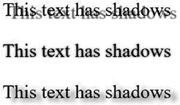

# 排版后的文本

**<q>**你什么意思<q>我不敢相信他说了<q>不</q></q>？**</q>** 在此情况下，外层引号会使用双引号，内层引号会使用单引号。显示效果为：“你什么意思‘我不敢相信他说了’不“？””。不过，你可以使用 `quotes` 属性来控制引号所使用的字符。例如，以下 CSS 规则将告知浏览器对外层引号使用花括号，对内层引号使用方括号。`quotes` 属性提供了四个字符串值；前两个用于外层引号，后两个用于内层引号。

```
* {
  quotes: "{" "}" "[" "]"
}
```

另一种需要输入引号的情况是使用 `::before` 和 `::after` 伪元素时。为了演示这一点，下面的标记包含一个带有内嵌引用的段落：

```html
<p class="quote">他说，<q>找到了！</q></p>
```

接着，这些 CSS 规则使用伪元素在文本前后添加引号。正如我在第 [9](http://dx.doi.org/10.1007/978-1-4842-2463-2_9) 章中解释的那样，`content` 属性用于指定应向所选元素追加或前置的内容。在此情况下，它被设置为 `open-quote` 和 `close-quote` 关键字。

```css
.quote::before {
  content: open-quote;
}

.quote::after {
  content: close-quote;
}
```

应用这些 CSS 规则后，两个示例的渲染结果如图 11-8 所示。

***图 11-8.** 演示 quotes 属性*



请注意，`找到了！` 周围的引号使用的是内层引号。因为引号是由伪元素添加的；浏览器将 `<q>` 元素视为嵌套在外层引号之内。如果在伪元素中改用 `no-open-quote` 和 `no-close-quote` 关键字，则不会渲染外层引号，但 `<q>` 元素仍会像嵌套使用内层引号一样被处理。

#### 阴影

为了增添有趣的效果，你可以使用 `text-shadow` 属性为文本添加阴影。该属性接受一个颜色值和三个距离值。颜色值可以作为第一个或最后一个参数。从技术上讲它是可选的；但为了获得最佳兼容性，你应始终包含它。某些浏览器（如 Safari）在未指定颜色时将不会显示阴影。大部分浏览器会默认将颜色设为文本颜色。

三个距离值分别为 x 偏移量、y 偏移量和模糊半径，且必须按此顺序提供。模糊半径定义了原始文本图像的扩散范围。模糊半径越大，阴影就越宽越淡。该参数可选，默认为 0。x 和 y 偏移量为必填项，表示阴影相对于文本的位置。正值将向右和向下偏移；负值则向左和向上偏移。

为了演示文本阴影的不同效果，下面的标记包含三个拥有相同文本和不同类值的段落。为每个类定义了一条不同的 CSS 规则，其 `text-shadow` 属性值各不相同。渲染结果如图 11-9 所示。

```html
<p class="shadow">这段文本有阴影</p>
<p class="background">这段文本有阴影</p>
<p class="blurred">这段文本有阴影</p>
```

```css
.shadow {
  font-size: xx-large;
  text-shadow: 10px 5px 1px gray;
}

.background {
  font-size: xx-large;
  text-shadow: 0px 0px 5px gray;
}

.blurred {
  font-size: xx-large;
  text-shadow: 10px 5px 10px gray;
}
```

***图 11-9.** 演示文本阴影*

## 大小写

`text-transform` 属性可用于强制改变文本的大小写。它仅影响字符在浏览器中的渲染方式；在 DOM 中，文本保留其原始值。`text-transform` 属性支持以下值：


