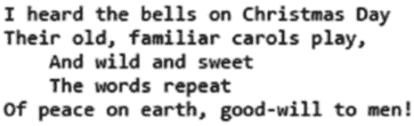
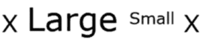
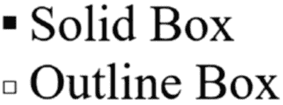

# 文本样式与排版

## 大小写转换

- `capitalize` - 每个单词的首字母转换为大写。但请注意，这不支持标题大小写规则，即标题中间诸如“a”或“the”之类的单词不会被大写。
- `uppercase` - 所有字符转换为大写。
- `lowercase` - 所有字符转换为小写。
- `none` - 不进行任何更改（用于覆盖之前的规则）。

**注意** 某些语言具有独特的大小写规则，浏览器对此的支持程度各不相同。有些情况下这些规则会被正确处理，而有些则不会。

### 间距与对齐

您可以使用`CSS`属性控制 HTML 文档中文本的间距。您还可以定义浏览器应如何处理内容中的空白字符。内联元素的垂直对齐可以通过`vertical-align`属性实现。

#### 基本间距

有三个简单的`CSS`属性允许您控制字母、单词和行之间的间距。这些属性无需过多解释，我将简要描述它们：

- `letter-spacing` - 正值会在字符之间创建额外间距，负值会减少间距并可能导致重叠。允许除百分比外的所有距离单位，包括像素等绝对值和`em`、`rem`、`vw`等相对单位。默认值为`normal`，允许字体执行标准间距（包括两端对齐）。
- `word-spacing` - 影响单词和内联元素之间的间距。允许使用任何距离单位；但只有`Firefox`支持百分比。值可以是绝对值或相对值，但不支持负值。默认值为`normal`。
- `line-height` - 指定每行文本使用的垂直空间。默认值为`normal`，大约比字体大小多 20%。`line-height`可以指定为数字（如`1.2`）或百分比（如`120%`），这些值会乘以字体大小；或者指定为距离单位（如`20px`或`3em`）。避免使用绝对距离单位，因为这可能会产生意外结果。`line-height`属性也可以使用我之前解释过的`font`简写符号进行设置。



第 11 章 ■ 文本样式

### 处理空白字符

在[第 1 章](http://dx.doi.org/10.1007/978-1-4842-2463-2_1)中，我提到空白字符通常被忽略，除非内容位于`pre`元素内部，这是默认行为。但是，您可以通过`white-space`属性更改空白字符的处理方式。它支持以下值：

- `normal` - 默认值。空白字符序列被压缩为单个空格，换行符被视为空格。文本仅在需要填充块时进行换行。
- `nowrap` - 空白字符的压缩方式与`normal`相同，但文本从不换行。
- `pre` - 功能类似于`pre`元素；保留空白字符，文本仅在换行符处换行。
- `pre-wrap` - 功能类似于`pre`值，但文本也会在必要时换行以填充块。
- `pre-line` - 空白字符的压缩方式与`normal`值相同，但文本会在换行符处换行，并且在必要时也会换行以填充块。

为了演示这一点，我将使用我在[第 4 章](http://dx.doi.org/10.1007/978-1-4842-2463-2_4)中介绍的亨利·沃兹沃斯·朗费罗的诗。这次，它将位于一个普通的段落元素内，而不是预格式化元素中，但我可以使用`CSS`实现相同的效果。

```html
<p class="whitespace">I heard the bells on Christmas Day

Their old, familiar carols play,

And wild and sweet

The words repeat

Of peace on earth, good-will to men!</p>
```

仅应用默认样式时，此文本将位于单行上，或根据窗口宽度在必要时换行。但是，以下`CSS`规则将把它视为预格式化文本，如图 11-10 所示。

```css
.whitespace {
  font-family: monospace;
  white-space: pre;
}
```


### **图 11-10.** 在 CSS 中处理预格式化文本

## 第 11 章 ■ 文本样式

#### 垂直对齐

垂直对齐可能比较棘手。`vertical-align` 属性用于此目的，但其行为并非总是直观易懂。它对于表格单元格效果很好，这将在第 [13](http://dx.doi.org/10.1007/978-1-4842-2463-2_13) 章中介绍。对于其他内容，它仅适用于内联元素和内联块元素。对于内联内容（包括内联块），定义了以下值：

-   `baseline` - 元素的基线与父元素的基线对齐。
-   `bottom` - 元素的底部与当前行的底部对齐。
-   `middle` - 这个值可能与你预期的略有不同；元素的中间与父元素的基线加上父元素小写字母`x`高度的一半对齐。
-   `sub` - 基线与父元素的下标基线对齐。
-   `super` - 基线与父元素的上标基线对齐。
-   `text-bottom` - 元素的底部与父元素的底部对齐。
-   `text-top` - 元素的顶部与父元素的顶部对齐。
-   `top` - 元素的顶部与当前行的顶部对齐。

你也可以使用绝对或相对单位输入一个距离值，这将调整此元素的基线相对于父元素基线的位置。也可以使用百分比，它会乘以行高。也允许使用负值。

除了`top`和`bottom`值之外，对齐都是基于父元素的。为了演示这一点，我将使用以下标记，在一个段落元素内放置两个`span`元素。

```
<p id="Align">
  X
  <span class="large">Large </span>
  <span class="small">Small</span>
  X
</p>
```

段落是父元素，我在`span`元素前后都包含了一个“X”，以便你可以直观地看到`span`元素所要对齐的父元素位置。然后，我将创建三条 CSS 规则。第一条规则简单地定义了父元素的字体。

```
#Align {
  font-family: Verdana;
  font-size: 36px;
}
```

```
.large {
  font-size: 48px;
  vertical-align: text-bottom;
}
```

```
.small {
  font-size: 24px;
  vertical-align: text-top;
}
```



接下来的两条规则设置了`span`元素的字体大小，并设置了`vertical-align`属性。大号字体对齐到底部，小号字体对齐到顶部。结果如图 11-11 所示。

### **图 11-11.** 演示垂直对齐

你可能已经注意到，文本并没有像你预期的那样完美对齐。这是因为浏览器计算基线以及用于执行对齐的其他因素的方式。如果你想进一步研究这个问题，可以看看 [`christopheraue.net/2014/03/05/vertical-align/`](http://christopheraue.net/2014/03/05/vertical-align/) 上的一篇好文章。

作为第二个示例，我将把一个固定大小的`div`元素与一个文本元素对齐。以下是标记；有两个带有`align`类的`div`元素。每个里面都有一个带有`box`类的空`div`元素和一个包含一些文本的`span`元素。

```
<div class="align">
  <div class="solid box"></div>
  <span>Solid Box</span>
</div>
<br />
<div class="align">
  <div class="outline box"></div>
  <span>Outline Box</span>
</div>
```

为了设置样式，以下 CSS 规则将使第一个内部`div`显示为一个实心方块，第二个显示为一个轮廓方块。`box`这个`div`和`span`元素都将`vertical-align`属性设置为`middle`。渲染结果如图 11-12 所示。

```
.align {
  display: inline-block;
  font-size: 48px;
}

.box {
  display: inline-block;
  height: 10px;
  width: 10px;
  border: 1px solid black;
  vertical-align: middle;
}

.solid {
  background-color: black;
}

.align>span {
  vertical-align: middle;
}
```



### **图 11-12.** 将方块与文本对齐

### 断开

有一些 CSS 属性可以用来控制何时应发生换行和分页。分页主要用在打印文档时。

#### 单词换行

`overflow-wrap` 属性决定了可以在何处插入换行符以换行文本，使其适应其容器的宽度。`normal` 值表示只能在单词之间、在断字位置（`wbr`）元素处或在硬连字符或软连字符处插入换行符。这些已在第 [5](http://dx.doi.org/10.1007/978-1-4842-2463-2_5) 章中解释过。`break-word` 值表示可以在任意点断开单词，以适应允许的空间。

> **注意：** 大多数浏览器支持 `word-wrap` 属性，但它已被 `overflow-wrap` 取代。`word-wrap` 属性可能会在很长一段时间内继续得到支持，但你应该改用 `overflow-wrap`。

还有一个额外的 `word-break` 属性，它与 `overflow-wrap` 类似。它支持 `normal` 和 `break-all` 值，这些值大致相当于 `overflow-wrap` 的 `normal` 和 `break-word` 属性。`word-break` 属性还支持 `keep-all` 值，主要适用于中文、日文和韩文。`overflow-wrap: break-word;` 和 `word-break: break-all;` 在不同浏览器和上下文中的行为存在一些细微差别。除非你正在处理这些特定语言，否则我建议坚持使用 `overflow-wrap` 属性。

当换行符插入到单词中间时，你可能还想在行尾添加一个连字符，以表明单词还在继续。`hyphens` 属性控制这种情况的发生时间，并支持以下值：

- `none` - 断词时从不使用连字符。
- `manual` - 仅当在单词断开处存在硬连字符或软连字符字符时才使用连字符。
- `auto` - 默认值。它的工作方式类似于 `manual`，区别在于，当语言特定的资源确定适合使用连字符时，也可能会添加连字符。当然，这依赖于语言特定的支持，而这种支持目前非常有限。在大多数情况下，它的功能类似于 `manual`。

#### 分页

在渲染要打印的 HTML 时，你可以控制如何生成分页。有三个属性可以应用：

- `page-break-after` - 定义在元素末尾应用的规则。
- `page-break-before` - 指定应在元素之前应用的分页规则。
- `page-break-inside` - 指示是否允许在元素内部进行分页。

对于这些属性中的每一个，默认值都是 `auto`，它不定义任何规则；浏览器通常会在页面的底部换到新的一页。`page-break-inside` 属性支持另一个值 `avoid`。使用此值可以防止在特定元素中间分页。例如，如果你不想在标题元素中间分页，创建以下规则：

```
header {
  page-break-inside: avoid;
}
```

另外两个属性 `page-break-before` 和 `page-break-after`，除了 `auto` 和 `avoid` 之外，还支持以下值：

- `always` - 应始终在元素之前（或之后）进行分页。
- `left` - 工作方式类似于 `always`，但它可能生成一个或两个分页符，以强制下一页为左手页。
- `right` - 与 `left` 类似，只是下一页将是右手页。

例如，你可以使用 `page-break-before` 属性为每个 `h1` 元素强制分页。你也可以根据文档的结构，对每个 `section` 或 `article` 元素执行相同操作。

> **注意：** 这些分页属性正在被通用的 `break` 属性取代。例如，`page-break-after` 将被 `break-after` 取代。但是，在撰写本文时，尚不支持这些新属性。

### 光标


