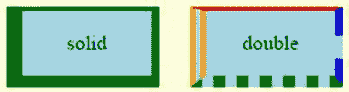
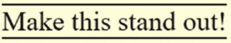
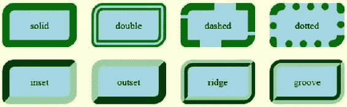

# 第 12 章 边框与背景

### 边框

在前几章的一些示例中，我通过在元素周围添加边框来帮助可视化它们所占用的空间。我使用了如下的 CSS 规则：

```css
border: 1px solid black;
```

这使用了简写符号，设置了边框的三个主要方面：宽度、样式和颜色。这相当于分别设置每个属性：

```css
border-width: 1px;
border-style: solid;
border-color: black;
```

#### 基本样式

共有八种边框样式，如图 12-1 所示。所有主流浏览器都支持这些样式，尽管具体实现因浏览器而异。

---

**图 12-1.** 基本边框样式

© Mark J. Collins 2017  
M. J. Collins, *Pro HTML5 with CSS, JavaScript, and Multimedia*, DOI 10.1007/978-1-4842-2463-2_12

---

为了创建此演示，我使用了以下标记，创建了八个 `div` 元素，每个元素都带有 `box` 类属性以及针对八种样式各自的特定类。

```html
<section>
  <div class="box solid">solid</div>
  <div class="box double">double</div>
  <div class="box dashed">dashed</div>
  <div class="box dotted">dotted</div>
  <div class="box inset">inset</div>
  <div class="box outset">outset</div>
  <div class="box ridge">ridge</div>
  <div class="box groove">groove</div>
</section>
```

为了更容易观察，我使用了以下样式规则，为这些元素设置固定大小、背景色，并使文本居中。

```css
section {
  background-color: lightyellow;
}

.box {
  display: inline-block;
  width: 100px;
  height: 50px;
  margin: 10px;
  background-color: lightblue;
  text-align: center;
  line-height: 50px;
}
```

以下规则仅通过类选择器设置边框样式；未指定宽度和颜色，允许浏览器使用默认值。

```css
.solid { border-style: solid; }
.double { border-style: double; }
.dashed { border-style: dashed; }
.dotted { border-style: dotted; }
.inset { border-style: inset; }
.outset { border-style: outset; }
.ridge { border-style: ridge; }
.groove { border-style: groove; }
```

默认宽度为 `3px`，对于简单样式，默认颜色为黑色。然而，后四种样式使用多种颜色来实现 3D 效果。为了使这一点更明显，我通过将以下规则添加到 `box` 选择器中来使边框更宽。结果如图 12-2 所示。

```css
border-width: 12px;
```

---

**图 12-2.** 加宽后的边框效果


### 使用更宽的边框

你也可以像这样调整颜色：

`border-color: green;`

对于前四种样式，由于它们使用纯色，`border-color`属性的工作方式与预期完全相同。然而，3D 样式会使用明暗组合来创建阴影效果。

当你指定颜色时，大多数浏览器会针对亮部采用该颜色，并针对阴影区域使用黑色。例如，Chrome 会将其渲染为图 12-3 所示。

### 在 Chrome 中使用 3D 效果和颜色

在我看来，这削弱了 3D 效果，看起来不太真实。相比之下，Firefox 使用指定颜色的浅色和深色色调，效果要好得多，如图 12-4 所示。

### 在 Firefox 中使用 3D 效果和颜色

#### 单独边缘

`border-style`、`border-width` 和 `border-color` 这些属性实际上本身也是简写属性。你可以分别为每条边指定属性。例如：

```
.solid {
  border-top-width: 3px;
  border-right-width: 6px;
  border-bottom-width: 9px;
  border-left-width: 12px;
}
```




第 12 章 ■ 边框与背景

对于每条边也有一个简写形式，允许你通过单个声明指定宽度、样式和颜色，如下所示：

```
.double {
  border-top: 3px solid red;
  border-right: 6px dashed blue;
  border-bottom: 9px dotted green;
  border-left: 12px double orange;
}
```

**注意** 能做到并不意味着应该做。CSS 语法为你控制边框属性提供了极大的灵活性。然而，作为一般设计原则，边框在边缘周围应保持一致。看一下图 12-5 混合边框属性时的糟糕效果。如果你不统一应用边框，3D 效果当然会完全失效。

### 混合边框属性

为了演示单独边框属性的更恰当用法，我将创建一个新的`<p>`元素并应用以下 CSS 规则：

```
<p class="standOut">Make this stand out!</p>
.standOut {
  border-top: 2px solid black;
  border-bottom: 2px solid black;
  display: inline-block;
  text-align: center;
  font-size: xx-large;
}
```

我只设置了顶部和底部边缘的实线边框，这将在文本上方和下方添加一条线，如图 12-6 所示。

### 仅使用顶部和底部边框



第 12 章 ■ 边框与背景

#### 圆角

你可以通过设置 `border-radius` 属性轻松创建圆角。例如，要将所有四个角设置为半径为 5px 的圆角，请使用：

`border-radius: 5px;`

同样，这实际上是一个简写属性；你也可以分别设置各个值。然而，圆角应用于角而不是边，因此各个属性如下：

- `border-top-left-radius`
- `border-top-right-radius`
- `border-bottom-right-radius`
- `border-bottom-left-radius`

你也可以通过单个 `border-radius` 声明指定多个值。如我所示，传递单个值会调整所有四个角。如果传递两个值，第一个将应用于左上角和右下角，第二个应用于右上角和左下角。如果传递三个值，第一个将应用于左上角，第二个应用于右上角和左下角，第三个应用于右下角。如果传递四个值，每个值将应用于不同的角，从左上角开始按顺时针顺序进行。

为了演示这一点，我将向 `box` 类选择器添加以下声明。这将使左上角和右下角的半径大于其他两个角。渲染结果如图 12-7 所示。

`border-radius: 20px 10px;`

### 应用不同的圆角半径


