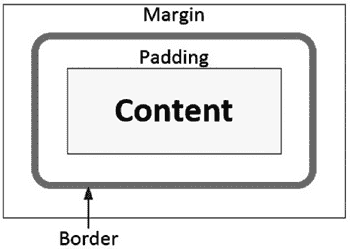

## 第 2 章：层叠样式表

本章我将介绍 HTML 开发的第二部分：层叠样式表。在创建 HTML 文档时，将实际内容与样式规则分离始终是一个好习惯。原因有以下几点。

- **关注点分离** - 这通常是一种合乎逻辑的职责（和技能）划分：作者擅长文字工作，而平面设计师则懂得如何运用字体、颜色和布局使文章在视觉上更具吸引力。这并非说一个人不能同时做好两件事，但你通常会发现一个人更擅长其中一项。
- **一致性** - 在不同内容上应用一套标准样式，通常能带来更一致的外观与体验。
- **可复用性** - 只需对相同内容应用不同样式，便可在多个网站上重复使用同一篇文章。
- **可维护性** - 内容往往更加稳定，而样式则常来常去。你可以为网页换上新外观，而无需更新实际内容。

### 样式指南

那么，如何实现这种与内容独立定义的丰富样式呢？解决方案包含两个部分。首先，要有组织良好且经过恰当注释的内容，以提供上下文信息。然后，你需要定义一组规则，规定如何将适当的样式属性应用于所需元素集合。

### 组织内容

尽管内容中不应包含显式的格式化，但标识需要特殊处理的文本是恰当且可取的。例如，需要强调的单词或短语应放在 `em` 元素中。同样，当你想要对某事做出强烈强调时，应将其放入 `strong` 元素，如下所示：

```html
<p>这件<em>需要</em>被强调，不要<strong>忘记</strong>它！</p>
```

你可能已经知道，`em` 元素的默认样式是使字体变为斜体，而 `strong` 元素通常为粗体。然而，这里的关键点在于，使用 `em` 元素并非因为你想要文本变成斜体；相反，你是在指示该文本需要强调。样式表的创建者将决定如何实现这种强调。他们可能选择使用不同的字体或颜色，而非斜体。

© Mark J. Collins 2017

M. J. Collins, *Pro HTML5 with CSS, JavaScript, and Multimedia*, DOI 10.1007/978-1-4842-2463-2_2

**提示** 请记住，你的样式表可能并非唯一读取内容的东西。屏幕阅读器（如盲文输出设备或文本转语音软件）可能会解读你的 `em` 和 `strong` 元素。

希望这能让你深刻理解：内容中提供的上下文信息，其用途可能远超我们当前的想象。

另一个要点是，`em` 和 `strong` 这类元素应当一致使用。我将在第 4-9 章介绍所有可用的语义元素。你应该了解每个元素的用途及使用时机。最终，在 `em` 和 `strong` 之间做出抉择将归结为判断力的考量。你需要制定一些指南，以便每个人都清楚何时使用哪个元素合适。

### 应用样式

一旦有了格式良好且注释充分的内容，你就可以应用所需的样式。样式表由一组*规则*组成。规则有时也被称为*规则集*或*规则块*。一条规则包含一个*选择器*（用于定义应用该规则的元素集合）以及一个或多个*声明*。每个声明设置单一属性的值。规则的一般形式如下：

```
选择器 { 声明; 声明; ...}
```

声明包含一个属性和值，用冒号分隔，例如 `color:red`，将元素的 `color` 属性设置为红色。规则的各部分如图 2-1 所示；选择器为 `p`，选中所有段落元素，声明设置了 `font-size` 和 `color` 属性。

***图 2-1.** CSS 规则的组成部分*

与 HTML 一样，CSS 中会忽略空格，因此通常写成如下形式：

```css
p {
  font-size:10px;
  color:red;
}
```

关于这些规则的“最佳”格式化方式存在一些争论，没有绝对的对错。不过，我将遵循这种风格，因为它似乎最为普遍。

与 HTML 不同，CSS 本身并非层次结构，因此规则不会通过缩进来显示与其他规则的关系。

# CSS 核心概念与规范

## CSS3 规范

与 HTML 类似，CSS 的能力由一套不断演进的规范定义。当前已发布的推荐标准是 CSS 2.1，下一版草案被称为 `CSS3`。然而，`CSS3` 已被拆分为超过 50 个“模块”，每个模块都有独立的规范。截至本文撰写时，其中一些模块已成为 W3C 官方推荐标准（`REC`）；但许多仍处于提案推荐标准（`PR`）或候选推荐标准（`CR`）状态。W3C 鼓励使用这些规范中的任何一个。还有相当多的模块处于工作草案（`WD`）状态，尚未准备好广泛采用。

> **提示**：由于每个 CSS 模块的状态都在不断变化，要了解每个模块的完整最新状态，请参阅 [www.w3.org/Style/CSS/current-work](http://www.w3.org/Style/CSS/current-work) 上的文章。

所以，实际的 `CSS3`“规范”目前还是一个移动的目标，浏览器对这些规范的支持也会有所不同。不过，已经有许多很酷的功能可以普遍使用了，我将在第[9-15 章](http://dx.doi.org/10.1007/978-1-4842-2463-2_9)中演示它们。

**提示**：这是一份多年前由 Natalie Downe 制作的演示文稿，其中包含许多编写优秀 CSS 的建议（[`clearleft.s3.amazonaws.com/2008/cssSystems_notes_small.pdf`](http://clearleft.s3.amazonaws.com/2008/cssSystems_notes_small.pdf)）。虽然有些内容略显过时，但大部分在今天仍然非常适用。我建议你快速浏览一下，它相当容易阅读。但最重要的是，我希望她对 CSS 的热忱能感染你。编写优秀的软件既是科学也是艺术。我可以教你科学……但艺术不是那么容易学会的。

---

## CSS 概念

在本章的剩余部分，我将介绍样式表工作的基本概念。在第[9](http://dx.doi.org/10.1007/978-1-4842-2463-2_9)章到第[15](http://dx.doi.org/10.1007/978-1-4842-2463-2_15)章，我会更详细地介绍每个概念。

## 选择器

选择器非常强大，尤其是在 `CSS3` 中有了许多改进，但掌握它们可能需要一些努力。我将在这里简要解释它们，然后在第[9 章](http://dx.doi.org/10.1007/978-1-4842-2463-2_9)中详细介绍。最常见的选择器之一是**元素选择器**。在其最简单的形式中，你指定声明应该应用到的元素类型。例如：

```css
em {
  font-style: italic;
}

strong {
  font-weight: bold;
}
```

使用这条规则，所有在强调元素中的内容将使用斜体字体。同样，所有在 `strong` 元素中的内容将使用粗体字体。正如我之前提到的，这些是这些元素的默认样式。浏览器有自己的内部样式表来定义这些默认样式。因此，即使你不提供任何样式规则，内容也会使用默认规则以合理的方式呈现。

选择器通常具有级联性，因此 `body` 选择器会选择所有 `body` 元素以及所有位于 `body` 元素内部的元素。选择器还可以以各种方式组合。例如，逗号分隔符用作逻辑或运算符。因此，`h1, h2, h3` 会选择所有位于 `h1` 元素、`h2` 元素或 `h3` 元素内部的元素。同样，空格分隔符是逻辑与运算符。所以 `h1 p` 会选择所有位于 `h1` 元素且同时位于 `p` 元素内部的元素。

## 声明

选择器决定规则应用于哪些元素，而声明则指定应用于这些选中元素的样式属性。在许多情况下，每个声明设置单个属性的值。名称和值由冒号分隔，声明以分号结束，例如：`color:red;`。你可以设置的样式属性似乎无穷无尽，我将在第[10 章](http://dx.doi.org/10.1007/978-1-4842-2463-2_10)到第[15 章](http://dx.doi.org/10.1007/978-1-4842-2463-2_15)中演示它们。

CSS 支持快捷方式，允许你在单个声明中指定多个属性。`margin` 属性就是一个很好的例子。`margin` 属性指定元素与其相邻元素之间的空间量。上方、下方、左侧和右侧的空间可以独立指定。要将它们全部设置为 5 像素，可以使用以下声明：

```css
margin-top: 5px;
margin-right: 5px;
margin-bottom: 5px;
margin-left: 5px;
```

CSS 还允许你在一个简短的声明中设置所有四个值：

```css
margin: 5px 5px 5px 5px;
```

声明中的四个值分别指定上、右、下、左的边距值。

> **提示**：这里的值顺序很重要，因为值不是通过名称而是通过顺序来确定的。为了帮助记住正确的顺序，想一下时钟。一天从午夜（上方）开始，然后顺时针继续到 3 点（右侧），然后到 6 点（下方），最后到 9 点（左侧）。

不过，这个快捷方式还可以进一步缩短。如果未提供右侧值，它将设置为与左侧边距相同的值。同样，下方边距将使用与上方边距相同的值。所以也可以这样设置：

```css
margin: 5px 5px;
```

这里只指定了上方和右侧的值；下方设置为与上方相同的值，左侧设置为与右侧相同的值。最后，由于所有值都相同，你也可以使用最简单的快捷方式：

```css
margin: 5px;
```

---

## 单位

在我之前的示例中，我使用了一些任意单位来设置字体大小、颜色和边距。让我们看看最常用的可用单位。

### 距离单位

距离单位（有时称为长度或大小）在许多声明中使用，并支持多种类型。基本的绝对单位包括英寸（`in`）、厘米（`cm`）、毫米（`mm`）和四分之一毫米（`q`）。

这些单位无需过多解释，大家都知道英寸和厘米是什么。然而，它们在排版领域的“近亲”——派卡（`pc`）、点（`pt`）和像素（`px`）——似乎更为普遍。1 英寸等于 6 派卡、72 点或 96 像素。

> **警告**：单位像素（`px`）并不等同于设备像素，除非你的设备分辨率恰好是 96 dpi（每英寸点数）。为了避免混淆，W3C 文档中将其称为“视觉角度单位”。然而，这个单位仍然普遍被称为像素。它的定义是 1/96 英寸；请注意，实际的设备像素数可能不同。

使用这些绝对单位的一个基本缺点是，它们很少与现实世界的尺寸相关。一个屏幕上的实际尺寸与另一个屏幕可能差别很大，这取决于设备分辨率。绝对单位在打印时更有用，因为物理尺寸能更准确地呈现。对于正常的屏幕显示，推荐使用相对单位。有两种类型的相对尺寸：字体相对和视口相对。

# 字体相对单位

字体相对单位是相对于字体大小而言的，通常指当前字体的尺寸。这些单位包括字体大小（`em`）、字符高度（`ex`）、零宽度（`ch`）和根字体大小（`rem`）。术语“em”来源于排版领域，曾用于表示大写字母“M”的宽度。如今，字体大小被定义为字体的高度，包括其上下的空间。`em` 单位等同于字体大小。例如，如果字体大小是 `12px`，那么 `1em = 12px`。

**提示：** `&emsp;` 字符会创建一个宽度为 `1em` 的空格。同样，`&mdash;` 字符会创建一个长度为 `1em` 的破折号（连字符）。有趣的是，`&ensp;` 字符会创建一个宽度为 `1/2em` 的空格。

`ex` 单位定义为小写字母“x”的高度。类似地，`ch` 单位定义为数字“0”的宽度。当特定字体不包含“x”或“0”字符时，会使用一些特殊规则。如果无法用其他方式定义 `ex` 或 `ch` 单位，则会使用 `1/2em` 的值。

`em`、`ex` 和 `ch` 单位都基于当前字体定义。在一个典型的 HTML 文档中，会使用不同的字体大小，而字体相对单位会根据当前使用的字体相应地进行调整。例如，在 `h1` 元素中，`em` 的值通常大于段落（`p`）元素。相比之下，`rem` 单位基于根元素的字体大小，正如我在前一章所述，根元素通常是 `html` 元素。因此，`rem` 单位在整个文档中的值始终相同。所以，如果你希望元素大小基于当前字体，请使用 `em`（或 `ex`、`ch`）；但如果希望大小保持不变，请使用 `rem`。

# 视口相对单位

视口相对单位包括视口宽度（`vw`）、视口高度（`vh`）、视口最小值（`vmin`）和视口最大值（`vmax`）。这些单位表示适用视口尺寸的 `1%`。例如，如果设备（或浏览器窗口）的视口宽 `600` 像素、高 `400` 像素，那么 `1vw = 6px`，`1vh = 4px`。`vmin` 单位基于视口的最小尺寸，在这种情况下为 `400` 像素，所以 `1vmin = 4px`。这与视口的方向无关。类似地，`vmax` 基于最大尺寸，所以 `1vmax = 6px`。提示：虽然严格来说不算“单位”，但距离尺寸也可以指定为百分比，例如 `width: 20%;`。按此方式定义时，宽度表示为包含元素的百分比。相比之下，`vw` 和 `vh` 是相对于初始包含块的百分比，初始包含块即整个窗口的尺寸。

# 颜色单位

## 十六进制表示

颜色属性由红、绿、蓝各分量的值定义。标准形式是将每个分量指定为从 `0` 到 `xFF` 的十六进制值。颜色由六位数字定义，其中前两位定义红色分量，中间两位定义绿色分量，最后两位定义蓝色分量。以此方式指定时，十六进制数前面需加上井号（`#`）。例如，黑色定义为 `#000000`，白色定义为 `#FFFFFF`。

有几种替代方式可指定颜色属性。第一种是每个分量仅使用一位数字。例如，白色可定义为 `#FFF`。按此格式表达时，两位数字形式通过复制一位数字得到。因此 `#567` 会转换为 `#556677`。

## rgb() 函数

对于偏好以十进制值输入的用户，可以使用 `rgb()` 函数。`rgb()` 函数接受三个参数，即红、绿、蓝分量，以 `0` 到 `255` 之间的十进制值表示。（`255` 是 `xFF` 的十进制等效值。）使用此格式，白色指定为 `rgb(255,255,255)`。为了更简便，还可以指定最大值的百分比。按此方法，白色定义为 `rgb(100%,100%,100%)`。

**提示：** 还有一个 `rgba()` 函数，它包含第四个参数 alpha，用于指定不透明度。alpha 的值可以在 `0` 到 `1` 之间。值为 `1` 表示完全不透明，值为 `0` 表示完全透明。

## 颜色关键字

有十六个关键字可以定义特定的颜色值，例如 `red`、`blue` 和 `black`。你可以使用其中一个关键字，而无需指定 RGB 值。这些关键字以及它们各自的 RGB 等效值列在附录 C 的参考资料中。此外，CSS3 定义了许多扩展颜色关键字，这些关键字得到了许多浏览器的支持。你可以在 [`www.w3.org/TR/css3-color/#svg-color`](https://www.w3.org/TR/css3-color/) 找到完整列表。

## HSL 颜色模型

使用 RGB 定义颜色始于第一代彩色阴极射线管（CRT）的引入。CRT 能够显示三种颜色：红色、绿色和蓝色。屏幕上的每个点或像素都可以独立调节这三种颜色的强度。因此，使用 RGB 术语是基于现有硬件能力的结果。虽然我们最终可能需要用 RGB 值来渲染特定颜色，但使用色相、饱和度和亮度（HSL）是一种更直观的颜色表达方式。

色相以角度表示。想象一个色轮，红色在 `0°`，绿色在 `120°`，蓝色在 `240°`。介于之间的颜色是相邻颜色的相对混合。饱和度表示颜色的强度，以百分比表示，`100%` 为完全饱和，`0%` 为灰色。亮度也以百分比表示，`100%` 为白色，`0%` 为黑色。典型值为 `50%`。随着亮度增加，颜色会变淡并开始呈现白色。随着亮度降低，颜色变暗，最终变为黑色。

### hsl() 函数

要使用色相、饱和度和亮度定义颜色，请使用 `hsl()` 函数。纯红色可表示为 `hsl(0,100%,50%)`。第一个参数默认以度为单位，因此无需添加单位。你还可以使用 `hsla()` 函数，它包含用于指定不透明度的 alpha 参数。

**注意：** W3C 关于单位的规范可在 [`www.w3.org/TR/css3-values`](https://www.w3.org/TR/css3-values) 找到。关于颜色单位的更多详情，请参见 [`www.w3.org/TR/css3-color`](https://www.w3.org/TR/css3-color)。

# 关键字

在大多数样式声明中，有少数关键字可以作为“单位”使用。它们是 `auto`、`inherit`、`initial`、`revert` 和 `unset`。

- `inherit` — `inherit` 关键字表示该属性应使用其父元素的值。大多数属性默认会继承，因此将值设置为 `inherit` 实际上不会改变任何内容；它无论如何都会继承父元素的值。添加它可能有助于更好地表达作者的意图。你可能想创建一条规则，使用 `inherit` 来覆盖另一条规则的值。

- `initial` — `initial` 关键字用于将属性重置为初始默认设置。在许多情况下，这指的是浏览器的默认值。例如，默认颜色通常是黑色，因此 `color: initial;` 会将颜色设置为黑色。截至撰写本文时，任何版本的 Internet Explorer 均不支持此关键字。

- `auto` — `auto` 值有点棘手，其行为会因使用位置而异。例如，设置 `padding: auto;` 会自动调整左右内边距以将内容居中。设置 `height: auto;` 会使得高度自动增长以适配内部内容。

- `revert` — `revert` 关键字指定浏览器应忽略任何作者样式，并使用浏览器的默认值。截至撰写本文时，许多浏览器尚不支持此关键字。

- `unset` — `unset` 关键字是 `inherit` 和 `initial` 的组合。基本上，它对所有可继承属性表现得像 `inherit`，对其余属性表现得像 `initial`。

`properties`。与 `revert` 一样，`unset` 关键字不受某些浏览器支持。

## 优先级

选择器返回元素集合，这些集合可能重叠。结果是多个规则可以应用于同一元素。如果一个规则设置字体大小，另一个设置颜色，第三个设置背景，则没有冲突。然而，如果一个规则将颜色设为红色，另一个设为绿色，会发生什么？这时就需要应用优先级规则。

### 样式表来源

首先，样式表有三种来源：

- **作者**：这些是 Web 开发者创建的样式表，通常提到样式表时指的就是它。

- **用户**：用户也可以创建样式，专门用于控制网页在自己浏览器上的显示方式。

- **用户代理**：用户代理（Web 浏览器）拥有默认样式表。例如，如果你创建了一个没有样式规则的文档，浏览器会使用默认的字体系列和大小显示内容。这些实际上是在浏览器特定的样式表中定义的。

渲染页面时，浏览器必须处理来自所有这些来源的样式，以确定每个元素的适当样式。当规则冲突时，作者样式表优先级高于用户样式表，用户样式表优先级高于用户代理样式（浏览器默认值）。

> **提示**：你可能会发现查看默认浏览器样式表很有用。它们通常是可以获取的，尽管你可能需要做一些搜索才能找到。例如，你可以使用这个链接查看 Chrome 使用的样式表：[`trac.webkit.org/browser/trunk/Source/WebCore/css/html.css`](http://trac.webkit.org/browser/trunk/Source/WebCore/css/html.css)

## 特指度规则

此外，即使在作者样式表内部，也可能存在冲突的声明。例如，一个样式表可能包含以下内容：

```css
p {
  color: black;
}

header p {
  color: red;
}
```

`header` 元素内的 `p` 元素被两个规则同时选中，那么哪一个会生效？在这种情况下，适用特指度规则，该规则规定使用更具体的选择器，也就是 `header p` 选择器。

由于存在多种选择器，确定哪个更具体并不像你想象的那么简单。`ID` 选择器被认为比类或属性选择器更具体，而类或属性选择器又比元素选择器更具体。

当应用特指度规则逻辑时，浏览器会分析每个选择器，并根据使用的选择器类型为其打分。这个分数由四个值组成：

1.  内联样式的数量（包含 `style` 属性的元素）

2.  `ID` 选择器的数量

3.  类、属性或伪类选择器的数量

4.  元素选择器的数量

分析会比较第一个值，只有在平局时才会继续比较下一个值。因此，如果一个选择器包含 `ID` 选择器而另一个没有，则无需进一步分析。包含 `ID` 选择器的获胜。最后，如果所有四个值都相同，则采用最后出现的规则来打破平局。

> **提示**：理解这些优先级规则很重要，因为冲突会发生，你需要知道如何处理它们。不过，你应该规划好你的样式表以避免冲突。

## `!important` 关键字

一个“王牌”是 `!important` 关键字。如果在样式规则中使用它，它将覆盖所有其他规则。你可以这样添加 `!important` 关键字：

```css
p {
  color: red !important;
}
```

请记住，`!important` 关键字应用于声明，而不是规则。它仅适用于单个声明，并且必须在你希望应用它的每个声明上重复使用。

如果两个冲突的规则都使用了 `!important` 关键字，则优先级将根据我前面提到的规则确定。然而，当涉及到样式表的来源时，它们的应用顺序是相反的。用户样式表中的 `!important` 规则会覆盖作者样式表中的 `!important` 规则。

这有一个重要的应用（并非双关语）。这允许用户覆盖作者对某些属性的样式。例如，视障人士可能需要增大字体大小。`!important` 标签将确保此样式不会被覆盖。

> **警告**：你可能想使用 `!important` 关键字来快速修复并覆盖层叠的样式规则。考虑到我刚才描述的所有优先级规则，你不应该需要这样做。我建议将其作为最后的手段。过度使用 `!important` 关键字会使你的样式表难以维护。

## 盒模型

文档中的每个元素都占据一定的空间，这取决于该元素的内容。此外，诸如内边距和外边距等因素也会影响这一点。内边距是内容与元素边框之间的空间。外边距是边框与相邻元素之间的空间。如图 2-2 所示。



***图 2-2.** 盒模型*

我之前解释过 `margin` 属性。同样，你可以使用 `padding` 声明来指定内边距。内边距和外边距非常相似；主要区别在于内边距位于边框内部。

在确定使用的空间时，请记住包括边框宽度。例如，如果内边距设置为 `10px`，外边距设置为 `5px`，并且 `border-width` 设置为 `3px`，则（除了实际元素内容之外）使用的空间为 `(2 * 10) + (2 * 5) + (2 * 3) = 36px`。

### 厂商前缀

哦，走在技术前沿的乐趣！与 HTML5 的其他领域一样，浏览器厂商对 CSS 规范的支持程度各不相同。然而，在许多情况下，这些厂商会在新属性成为官方推荐标准之前就实现它们。事实上，CSS3 规范中的许多内容已经可以在一个或多个浏览器中使用了。

当浏览器厂商添加不属于 CSS3 推荐标准的新特性时，该属性会被赋予一个特定于厂商的前缀，以表明这是一个非标准特性。如果这成为推荐标准的一部分，前缀最终会被移除。为了利用一些较新的属性，你可能需要使用特定于厂商的属性，并且由于你希望页面能在所有厂商的浏览器上工作，你需要添加所有这些属性。例如，要指定边框圆角，除了标准的 `border-radius` 属性外，你可能还需要像这样设置所有特定于厂商的属性：

```css
header {
  -moz-border-radius: 25px;
  -webkit-border-radius: 25px;
  -ms-border-radius: 25px;
  border-radius: 25px;
}
```

表 2-1 列出了最常见的厂商前缀。还有其他一些，但此表涵盖了绝大多数浏览器。

***表 2-1.** 厂商前缀*

| 前缀 | 浏览器厂商 |
| :--- | :--- |
| `-moz-` | Firefox |
| `-webkit-` | Chrome, Safari, Opera |
| `-ms-` | Internet Explorer |

你不能盲目地假设所有带厂商前缀的属性都与标准属性具有相同的名称（只是加上前缀），尽管大多数情况确实如此。这里有一篇好文章列出了许多特定于厂商的属性：[`peter.sh/experiments/vendor-prefixed-css-property-overview`](http://peter.sh/experiments/vendor-prefixed-css-property-overview)


[overview](http://peter.sh/experiments/vendor-prefixed-css-property-overview)。遗憾的是，这个页面已经有一段时间没有更新，可能已经过时了。如果你发现某个标准属性在特定浏览器中不工作，你可能需要做些研究，看看他们的开发者网站上是否有可用的带前缀属性。例如，通过这个链接查看 Webkit 扩展: [`developer.mozilla.org/en-US/docs/Web/CSS/Reference/Webkit_Extensions.`](https://developer.mozilla.org/en-US/docs/Web/CSS/Reference/Webkit_Extensions)

> **警告**: 你应该始终将标准属性放在最后，这样它才能覆盖特定于供应商的版本。

某些浏览器会同时支持两者，虽然大多数情况下实现方式相同，但有时特定于供应商的版本行为会有所不同。

### 样式属性

`style` 属性不属于样式表的一部分，但它的目的类似，因此我将在此进行解释。`style` 属性是所有元素都支持的全局属性之一。它允许你在单个元素上设置一个或多个声明。虽然普通样式规则包含一个选择器，用于确定该规则应用于哪些元素，但由于 `style` 属性直接包含在元素中，因此不需要选择器。使用 `style` 属性被称为`内联样式`。一个使用内联样式的示例元素可能看起来像这样:

```html
<p style="font-size: 1.5rem; color: hsla(175, 80%, 60%, .8);">
Hello World!
</p>
```

> **提示**: 在上面的示例中，我使用了之前解释过的 `rem` 单位，因此字体将比根字体大小大 50%。颜色由色相 175°（介于绿色和蓝色之间）、饱和度 80%、明度 60% 和透明度 80% 定义。

与其他属性一样，其值在双引号内指定。该值由一个或多个声明组成。这些声明的格式与样式表中的声明完全相同：一个名称/值对，用冒号分隔，并以分号结束。你可以在 `style` 属性中设置任何在外部样式表中可以设置的属性。

> **警告**: 我把`style` 属性留到最后才讲，是希望你永远不要使用它。通过包含内联样式，你就不再分离内容和样式了。如果你后来决定蓝绿色字体不好看，仅仅通过修改 CSS 是无法修复的。请记住，内联样式的优先级高于任何基于 CSS 的规则。

### 总结

在本章中，我解释了创建样式表时使用的一些基本概念。我们将通过创建几个可以包含在网页中的外部样式表来应用这些概念。

首先，我们将从一个非常简单的样式表开始，如清单 2-1 所示。这个文件名为 `Initial.css`。

***清单 2-1.**`Initial.css` 文件*

```css
/* Make sure the non-content elements are hidden */
head, title, meta, script, link, style, base {
    display: none;
}

/* Default styling for emphasis and strong elements */
em {
    font-style: italic;
}

strong {
    font-weight: bold;
}

/* Style the text */
body>h1 {
    font-size: 1.5rem;
    color: hsla(175, 80%, 60%, .8);
}
```

第一条规则确保你在第 [1 章](http://dx.doi.org/10.1007/978-1-4842-2463-2_1)学到的非内容元素不会被显示。浏览器的默认样式表无论如何都会设置这些。第二条规则设置了我之前讨论过的 `强调` 和 `重要` 元素的属性。再次强调，这些是默认样式。最后一条规则使用我在本章中解释的 `rem` 和 `hsla` 单位设置了文本的字体大小和颜色。

接下来，我们将创建第二个用于打印模式的 CSS 文件。这个文件如清单 2-2 所示，命名为 `Print.css`。

***清单 2-2.**`Print.css` 文件*

```css
body>h1 {
    color: black;
}

body {
    border: 1px solid;
    border-color: black;
    border-radius: 25px;
    padding: 24px;
}
```

这包含两条规则：第一条将颜色设置为黑色，第二条为整个文档添加边框。

最后，修改 `MainPage.html` 文件，用下面的 `link` 元素替换两个 `style` 元素。这将引用新的 CSS 文件，而不是在 HTML 文档中指定样式规则。

```html
<link rel="stylesheet" href="Initial.css" />
<link rel="stylesheet" href="Print.css" media="print" />
```

`Initial.css` 在引用时没有使用媒体属性，因此它将同时应用于屏幕和打印模式。`Print.css` 文件将仅在打印模式下使用。请注意，两个文件都使用了 `body>h1` 选择器，由于它们完全相同，因此具有相同的特异性。这依赖于后定义的规则会覆盖前一条规则的行为。

`Initial.css` 文件包含一个 `font-size` 声明，而 `Print.css` 文件没有，因此 `font-size` 将同时应用于屏幕和打印模式。只有 `color` 属性在打印模式下被覆盖。

现在显示网页，你应该会看到“Hello World!”文本以蓝绿色字体显示。然后从浏览器中打印文档。根据你使用的浏览器，输出应该类似于图 2-3 所示。

***图 2-3.** HTML 文档的打印版本*

注意标题（在 `title` 元素中指定）显示在页面顶部。

> **注意**: 每个浏览器处理打印模式的方式不同。有些左对齐标题，有些在页面顶部放置 URL，有些包含页码，有些显示打印日期。

下一章将介绍本书的第三个主要领域：JavaScript。本章将解释 JavaScript 语言的概念，这是第 4 和第 5 部分所讨论主题的基础。
