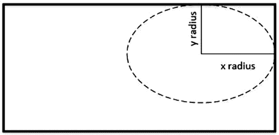
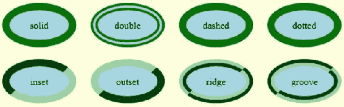
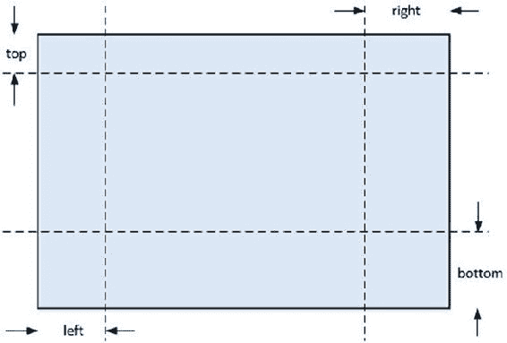
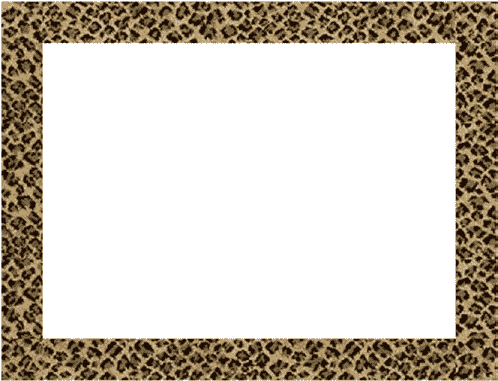
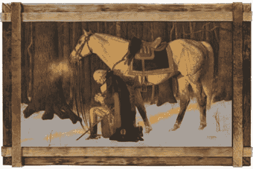
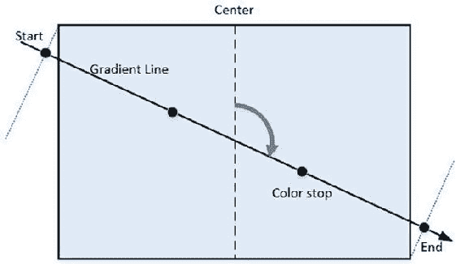
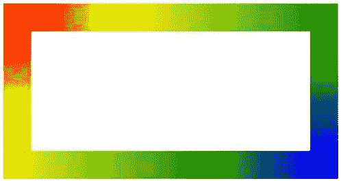
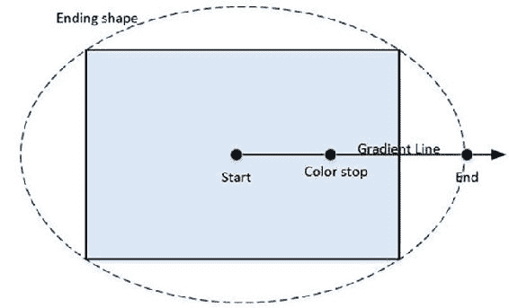
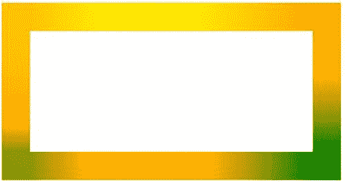

# CSS 边框与背景

每个角实际上有两个半径：一个水平方向，一个垂直方向。如图 12-8 所示。



**图 12-8.** 椭圆角解释

如果只提供一个值（如前面的示例），它将同时用于`x`半径和`y`半径。在这种情况下，边框形状是一个圆形。输入两个值的语法是用`/`字符分隔它们。

例如：

```
border-radius: 5px / 10px;
```

如果为每个角指定不同的半径，先指定`x`值，然后添加`/`，再输入`y`值。可以为`x`半径提供 1-4 个值，为`y`半径提供 1-4 个值。不必为`x`和`y`使用相同数量的值。例如，可以为`x`提供一个值，为`y`提供四个值，反之亦然。举例说明，以下声明集合是等效的：

```
border-radius: 20px 10px 5px / 5px 10px;
```

等效于：

```
border-top-left-radius: 20px / 5px;
border-top-right-radius: 10px / 10px;
border-bottom-right-radius: 5px / 5px;
border-bottom-left-radius: 10px / 10px;
```

在前面的示例中，半径指定为绝对长度；但是，也可以将其指定为元素尺寸的百分比。一个特别有趣的应用是像这样设置半径，渲染结果如图 12-9 所示。

```
border-radius: 50% / 50%;
```



**图 12-9.** 使用椭圆边框

#### 使用图像

除了八种标准边框样式外，还可以使用图像获得几乎无限的灵活性。图像文件通过`border-image-source`属性指定：

```
border-image-source: url(pattern.png);
```

### 切片

图像文件具有固定大小，但添加边框的元素可能会根据内容收缩和增长。也可以将图像边框应用于不同形状和大小的元素。为了有效处理这个问题并避免图像失真，图像文件被*切片*成碎片并重新组装。边框图像使用指定的偏移值被切分为九个区域，如图 12-10 所示。



**图 12-10.** 切片边框图像

这些偏移量通过`border-image-slice`属性指定，提供上、右、下、左的值：

```
border-image-slice: 20 25 30 35;
```

这些值指定为不带单位的数字；对于位图图像，它们将被解释为像素；对于光栅图像（如 SVG），则被解释为坐标。也可以将这些值指定为百分比，表示整体图像宽度（或高度）的比例。按照典型的 CSS 方式，也可以提供少于四个的值。单个值将用于所有四个偏移量。如果提供两个值，第一个用于顶部和底部，第二个用于左侧和右侧。如果提供三个值，第一个是顶部偏移量，第二个是左右偏移量，第三个是底部偏移量。还可以在值列表中的任何位置包含关键字`fill`。如果省略，图像的中心部分将被丢弃。如果指定了`fill`，中心将作为背景使用。

### 分配空间

现在有了八个（或九个）碎片，需要定义如何使用它们来创建边框。第一步是为边框分配空间。最简单的方法是定义一条普通的实线边框，并使用透明颜色。例如：

```
border: 35px solid transparent;
```

这不会添加可见的边框，但会在现有元素周围定义一个 35 像素宽的空间。后续的边框属性将应用于此空间。另一种方法是使用`border-image-width`属性：

```
border-image-width: 35px;
```

这也会分配一个 35 像素宽的空间，但有一个非常重要的区别。`border`属性会在元素外部分配空间。例如，如果一个元素是 100 像素宽的正方形，添加边框将使总占用空间增加到 170 像素。然而，`border-image-width`属性会在元素内部分配空间。同样是 100 像素的正方形，现在只有 30 像素可用于渲染实际内容。可以通过`border-image-outset`属性进行调整。

```
border-image-outset: 35px;
```

这将把每个边缘的位置向外移动；左边缘向左移动指定的距离，右边缘向右移动，等等。现在元素的实际内容将拥有原始的 100 像素正方形。然而，这引入了另一个问题：`border-image-outset`属性不会在 DOM 中分配额外的空间；相邻元素的位置不会改变，可能导致溢出情况。这可以通过增加外边距来解决。因此，需要以下声明：

```
border-image-width: 35px;
border-image-outset: 35px;
margin: 35px;
```

> **提示**：为简单起见，我为这些属性中的每一个传递单个值来定义宽度、外移量和外边距，这将为所有四个边缘使用相同的距离。也可以指定两个、三个或四个值，按照前面描述的方式应用。

如我所述，使用`border`属性是最简单的方法。但无论哪种方式，现在在元素周围都有一个 35 像素宽的条带，用于显示图像碎片。

### 组装

回到八个或九个图像碎片；现在将它们组装到分配的空间中。图 12-10 说明了如何将图像文件切片成区域。类似的进程也会发生在正在添加边框的元素上。沿边缘的窄条的宽度由边框宽度定义（在当前示例中为 35 像素）。顶部和底部条带的长度由元素宽度决定。同样，左右边缘的长度由元素高度决定。角落部分由边框宽度定义：在这种情况下是一个 35 像素的正方形。

来自图像文件的对应切片随后被缩放以适合边框的空间。角落部分相当直接。实际上，如果将切片的偏移量设置为与边框宽度相同，则无需缩放；角落完全不会变形。然而，边缘通常需要相当大的缩放，特别是在为不同大小的元素添加边框时。有几种选项可以通过`border-image-repeat`属性解决这个问题。

- `stretch` — 图像文件中的碎片根据需要进行拉伸或收缩以适应边框。如果切片偏移量与边框宽度相同，通常只需要在一个方向上进行此操作。
  
  

- `repeat` — 碎片根据需要重复多次以填充空间，通常最后一个实例会裁剪部分副本。

- `round` — 碎片像`repeat`选项一样重复，但只使用整数个碎片，并且单个碎片会被缩放以适应空间。这可以防止渲染部分副本。

为了演示这一点，我使用了一个带有动物印花图案（我想这是美洲豹）的图像文件，用于边框。标记将创建一个简单的`div`元素：

```
<div class="pattern"></div>
```


CSS 规则将设置固定的宽度和高度，然后定义一个 35 像素的边框。我还使用了`35`作为切片偏移量，这样角落就不会被缩放。无论实际元素的大小如何，边缘部分只会在一个方向上缩放。如果图像被拉伸，由于所使用的图案，这种拉伸会稍微明显一些，因此我使用了`repeat`选项。最终的 CSS 规则如下，元素渲染结果如图 12-11 所示。

```
.pattern {
  width: 350px;
  height: 250px;
  margin: 10px;
  border: 35px solid transparent;
  border-image-source: url(pattern.png);
  border-image-slice: 35;
  border-image-repeat: repeat;
}
```

**图 12-11.** 使用 `repeat` 的图像边框



如果仔细观察边框，可以看到因为使用了`repeat`选项，图像被拼接在一起的痕迹。不过，由于该图案整体具有随机性，除非放大查看，否则这种痕迹并不十分明显。这展示了`stretch`、`repeat`和`round`选项之间的权衡。有些图像适合拉伸，而有些则适合重复。

> **注意：** 图像边框不支持圆角。如果你为边框应用了`border-radius`属性，元素本身会显示圆角，但其周围的可见边框仍然会是方角。

为了进一步演示，我将为一个图像添加边框。这张图像是乔治·华盛顿的一幅著名肖像画，我在第[7](http://dx.doi.org/10.1007/978-1-4842-2463-2_7)章中使用过它。边框使用了一张画框的图片。以下是实现此效果的标记和 CSS 规则。

```html

```

```css
img {
  margin: 10px;
  width: 350px;
  border: 34px solid transparent;
  border-image-source: url("frame.jpg");
  border-image-slice: 34;
  border-image-repeat: stretch;
}
```

CSS 与第一个示例类似；我仅指定了图像元素的宽度，以便画像能保持其原始宽高比。边框配置基本相同，只是我使用了`stretch`选项。由于我将切片偏移量和边框宽度都设置为`34px`，角落不会被缩放。边缘部分大多是直线，因此沿着该维度拉伸它们不会显得失真。这同时也避免了图像片段的拼接，而拼接在这种图像上会更加显眼。结果如图 12-12 所示。

**图 12-12.** 使用 `stretch` 选项



#### 渐变

作为最后一种边框选项，你还可以使用颜色渐变。渐变允许颜色在一个区域内逐渐变化。它们常用于背景，我将在本章后面进行演示。它们同样可以应用于边框。渐变有两种类型：

- **线性渐变** - 颜色从一条边（或一个角）向对边（或对角）变化。
- **径向渐变** - 颜色随着从中心向外移动而变化。

渐变的结果本质上是一幅图像。它不是需要下载的资源；然而，它可以在 CSS 中任何需要图像的位置使用。要使用渐变边框，你需要将渐变定义为`border-image-source`属性的值。

### 线性渐变

顾名思义，线性渐变由一条穿过元素中心的线定义，这条线被称为渐变线。如图 12-13 所示。渐变线以一个角度定义，该角度从垂直轴开始顺时针测量；图 12-13 中的渐变线大约为 130°。线的方向很重要；如果你希望起点在右侧，则在该角度上加 180°。

**图 12-13.** 定义线性渐变

渐变线也可以使用`to`关键字来指定。在`to`关键字之后，指定其中一条边（`top`、`right`、`bottom`或`left`）。因此，`to right`将创建一个从左到右的水平渐变。如果你希望渐变从一个角到对角，则将终点角指定为一对边。例如，`to bottom left`，渐变将从对角（即右上角）开始，结束于左下角。这对边的顺序可以调换。



颜色沿着这条线在多个点被指定。至少需要指定起点和终点的颜色。你还可以指定一个或多个颜色停靠点，这些点被定义为起点和终点之间总距离的百分比。在这些指定的点之间，颜色会逐渐变化。为了简单演示，以下标记创建了一个空的`div`元素，CSS 规则将其边框定义为线性渐变。

```html
<div class="linear"></div>
```

```css
.linear {
  width: 350px;
  height: 150px;
  margin: 10px;
  border: 35px solid yellow;
  border-image: linear-gradient(130deg, red, yellow 20%, green 80%, blue);
  border-image-slice: 1;
}
```

这创建了一个线性渐变，颜色从红色、黄色、绿色到蓝色逐渐变化。然而，由于两个颜色停靠点非常接近起点和终点，大部分颜色将介于黄色和绿色之间，起点处有少量红色，终点处有少量蓝色。渲染结果如图 12-14 所示。

**图 12-14.** 使用线性渐变作为边框

> **注意：** 某些浏览器可能不支持渐变，因此你应该设置一个纯色作为后备方案。（目前，Safari 浏览器不支持边框渐变）。与之前示例中将纯色边框设置为透明不同，这里应该将其设置为一种颜色，以便在渐变无法使用时作为替代。此外，`border-image-slice`属性是必需的，但你可以将其设置为`1`。由于渐变会根据元素大小自动缩放，因此无需实际对图像进行切片和重新组装。



### 径向渐变

径向渐变从其中心点开始，颜色向外移动时均匀变化。如图 12-15 所示。渐变结束时的最终形状可以是圆形或椭圆形。与线性渐变类似，你必须指定起始和结束颜色，也可以在这两者之间定义一个或多个颜色停靠点。

**图 12-15.** 径向渐变

要定义径向渐变，你需要指定以下细节：

- **最终形状** - 可以是`circle`或`ellipse`；默认为`ellipse`。
- **范围** - 渐变的最终大小由以下关键字之一决定：（`farthest-corner`、`farthest-side`、`closest-corner`、`closest-side`）。
- **起始位置** - 如果省略，默认为元素的中心。它被指定为与左上角的偏移量。
- **颜色停靠点** - 0% 表示起点，100% 表示终点形状。



为了演示，以下标记创建了一个空的`div`元素，CSS 规则定义了一个要与之配合使用的径向渐变。渲染结果如图 12-16 所示。

```html
<div class="radial"></div>
```

```css
.radial {
  width: 350px;
  height: 150px;
  margin: 20px;
  border: 35px solid yellow;
  border-image: radial-gradient(ellipse farthest-corner at 175px 0px, yellow 0%, orange 75%, green 100%);
  border-image-slice: 1;
}
```

**图 12-16.** 带有径向渐变的边框

### 盒子阴影

在上一章中，我解释了如何配置文本阴影。你可以使用`box-shadow`属性在几乎所有元素上实现类似的效果。该属性接受多个值；有些是必需的，但许多是可选的。如果提供，这些值应按以下顺序排列：


