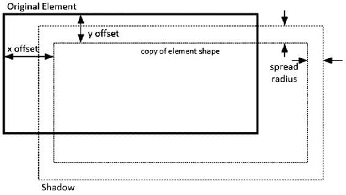
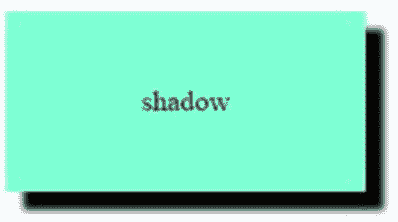
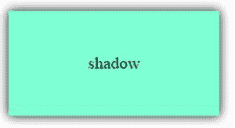
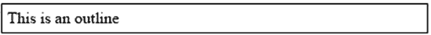

# 盒子阴影 (Box Shadows)

- `inset` - （可选）如果未包含此值，阴影将绘制在元素外部，就像元素位于周围区域之上。如果指定了 `inset`，阴影将绘制在元素内部，就像元素沉入其周围区域之下。
- `x offset` - （必需）阴影的水平偏移量；负值将使阴影位于元素的左侧。
- `y offset` - （必需）阴影的垂直偏移量；负值将使阴影位于元素的上方。



**第 12 章 ■ 边框与背景**

- `blur radius` - （可选）指定阴影超出其原始大小的扩散程度。较大的值会产生更大但更浅的阴影。如果未提供，默认为 `0`；不允许使用负值。
- `spread radius` - （可选）定义阴影的相对大小。默认值为 `0`，意味着阴影与元素大小相同。负值会使阴影缩小，正值则使其变大。
- `color` - （技术上可选，但为了最大兼容性应提供）使用任何颜色单位定义阴影的颜色。

阴影本质上是一个新元素，在 Z 轴上位于原始元素的正下方。其大小和位置相对于原始元素。要计算阴影的大小和位置，原始元素的形状会根据 `x` 和 `y` 偏移值进行移动。然后根据 `spread radius` 指定的值进行拉伸或收缩。这在图 12-17 中进行了说明。阴影使用指定的颜色作为实心填充背景。如果定义了 `blur radius`，其边缘会以模糊效果向指定大小之外拉伸。

***图 12-17.** 计算阴影位置和大小*

`box-shadow` 有两种常见用途。一种是让元素看起来从页面中凸起。这通常通过将阴影稍微向下和向右移动来实现，如图 12-18 所示。这通过以下声明实现：

```
box-shadow: 10px 10px 5px black;
```





**第 12 章 ■ 边框与背景**

***图 12-18.** 使元素从页面凸起*

另一种技术是通过在所有侧边添加模糊效果来柔化元素的线条，如图 12-19 所示。这通过以下声明实现，该声明保持与原始元素相同的大小和位置，仅使模糊效果可见：

```
box-shadow: 0px 0px 15px black;
```

***图 12-19.** 在元素周围添加模糊效果*

> **注意：** 如果使用了 `border-radius`，阴影也将具有圆角。它遵循与原始元素相同的形状。

## 轮廓 (Outlines)

轮廓是绘制在元素周围的框，类似于边框。重要的区别在于它不占用任何空间；它绘制在现有元素分配空间的上方。因此，轮廓通常与 `:hover` 等伪类一起使用，因为可以在不影响页面布局的情况下添加或移除该框。定义轮廓时，可以指定以下属性：

- `outline-color`
- `outline-style`
- `outline-width`

这些属性可以单独设置，也可以像定义边框一样使用 `outline` 简写符号。支持的样式值与边框样式支持的八个值相同（`solid`、`double`、`dashed`、`dotted`、`inset`、`outset`、`ridge` 和 `groove`）。你也可以使用值 `none`，这将隐藏轮廓。



**第 12 章 ■ 边框与背景**

此外，`outline-offset` 属性在元素和轮廓之间添加内边距。例如，添加此属性将使轮廓在所有方向上偏移 `5` 像素。这无法通过 `outline` 简写属性实现。

```
outline-offset: 5px;
```

> **注意：** `outline-offset` 属性目前不支持 IE 或 Edge。

以下标记创建了一个 `div` 元素，CSS 规则为其添加了轮廓，渲染结果如图 12-20 所示。

```html
<div class="outline">This is an outline</div>
```

```css
.outline {
  outline: 1px solid black;
  outline-offset: 5px;
}
```

***图 12-20.** 演示轮廓*

> **注意：** 边框越宽，轮廓占用的空间就越大。它不会调整元素的位置，而是将框叠加到现有空间上。该框始终位于被勾勒元素的*外部*，因此不会影响元素本身，但可能会溢出到相邻元素中。

## 背景 (Backgrounds)

为元素设置背景基本上有两种选择：颜色或图像。要使用颜色，只需使用第 [2](http://dx.doi.org/10.1007/978-1-4842-2463-2_2) 章中解释的任何颜色单位设置 `background-color` 属性。这些也在附录 C 的参考资料中进行了总结。使用图像时，还有一些属性控制图像的显示方式。

### 图像属性

可以使用 `background-image` 属性为元素指定背景图像。这相当简单；只需指定要使用的图像文件的 URL。你可以指定多个图像，它们将按指定的顺序堆叠在一起。但是，还有几个其他属性会影响图像的渲染方式。

**第 12 章 ■ 边框与背景**

### 附着 (Attachment)

`background-attachment` 属性定义图像如何定位，并支持以下值：

- `fixed` - 图像相对于窗口保持固定；滚动窗口对背景图像没有影响。
- `local` - 图像相对于元素的内容固定。如果滚动内容，背景图像将随之滚动。
- `scroll` - （这是默认值）图像相对于元素固定。它会随元素移动，但如果元素内部的内容被滚动，背景不会滚动。

此外，由于可以指定多个图像，因此也可以为 `background-attachment` 属性指定多个值。每个值用逗号分隔，并按指定顺序应用于相应的图像。

### 原点 (Origin)

对于 `local` 和 `scroll` 选项，`background-origin` 属性定义图像的包含矩形。支持以下值：

- `border-box` - 背景扩展到元素边框的外边缘。
- `content-box` - 背景仅覆盖实际元素内容区域（不包括内边距和边框）。
- `padding-box` - 背景包括元素内容和内边距，但不包括边框。

### 重复 (Repeat)

`background-repeat` 属性指定背景图像是否以及如何重复以填充所需空间。图像可以在水平和垂直方向上重复，你可以为 `background-repeat` 属性提供两个不同的值。第一个值适用于水平行为，第二个值用于垂直重复。允许以下值：

- `no-repeat` - 图像不重复，可能留下未被图像覆盖的区域。
- `repeat` - （默认）根据需要尽可能多地重复图像，最后一个重复图像通常被裁剪。
- `round` - 重复图像，但仅显示完整图像。然后均匀拉伸显示的图像以填充任何剩余间隙。
- `space` - 仅重复完整图像，类似于 `round` 选项。但是，不是拉伸图像来填充间隙，而是在它们之间留下均匀的间距。第一个和最后一个图像固定在左右边缘（或底部和顶部），间距位于图像之间。

**第 12 章 ■ 边框与背景**