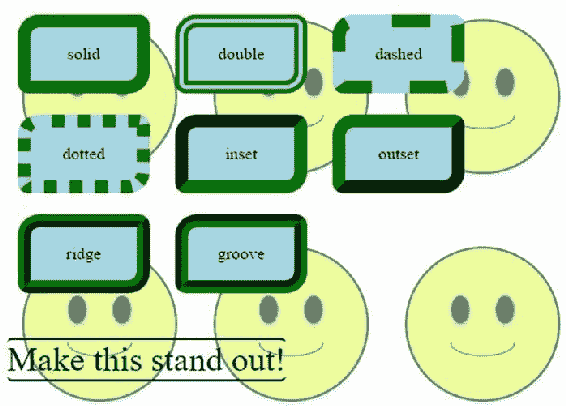
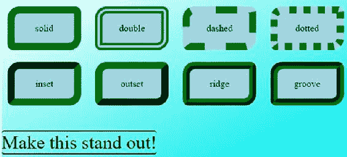
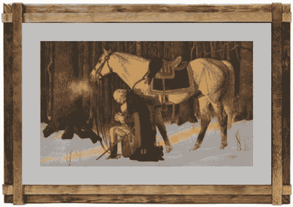

# CSS 背景属性

## 单值简写

还存在一种简写方式，可以用单个值同时指定水平和垂直行为。如果使用单个值如`no-repeat`、`repeat`、`round`或`space`，它将同时应用于水平和垂直方向的值。此外，`repeat-x`表示水平方向使用`repeat`，垂直方向使用`no-repeat`。同样地，`repeat-y`表示相反的情况。

■ **注意**：截至撰写本文时，`round`和`space`值在 Firefox 或 Safari 中不受支持。

### 位置

`background-position` 属性用于指定图像相对于其原点的位置。默认值为 `0 0`，表示左上角。位置可以使用以下关键字之一指定：`top`、`right`、`bottom`、`left` 或 `center`。也可以指定为一对距离值（相对或绝对），用空格分隔。如果使用多个图像，也可以指定多个位置，这些位置应用逗号分隔。

## 大小

图像的大小通过 `background-size` 属性指定。大小可以使用以下关键字之一指定：

- `contain` - 图像在保持原始宽高比的同时尽可能放大。这通常意味着在某一维度上，图像周围会有空白区域。该图像通常居中，除非被 `background-position` 属性覆盖。

- `cover` - 图像在保持宽高比的同时尽可能放大。然而，为了覆盖较小的维度，图像通常在另一维度上被裁剪。

或者，你可以指定单个距离值（相对或绝对），这将定义背景的宽度。在这种情况下，高度将设置为 `auto`。你也可以指定两个值，用空格分隔：第一个定义宽度，第二个定义高度。关键字 `auto` 可以与单个或双值输入一起使用。它指定该维度基于图像的内在大小或根据需要设置以保持宽高比。如果有多个图像，也可以提供多个大小，用逗号分隔。

### 裁剪

`background-clip` 属性指定背景应在何处被裁剪。此属性允许你控制背景是否应延伸到元素的内边距和边框区域。

支持以下值：

- `border-box` - 背景延伸到元素边框的外边缘。

- `content-box` - 背景仅覆盖实际元素内容区域（不包括内边距和边框）。

- `padding-box` - 背景包括元素内容和内边距，但不包括边框。

■ **注意**：这些值与 `background-origin` 属性相同，实际上 `background-clip` 的工作原理与 `background-origin` 非常相似。需要明确的是，`background-origin` 决定图像的定位，即图像与哪个矩形对齐。而 `background-clip` 属性决定背景结束的矩形，无论是对于颜色还是图像背景。

## 背景简写

通常的做法是使用 `background` 简写符号，在单个声明中指定多个背景属性。以下属性可以在 `background` 简写中设置：

- `background-image`
- `background-position`
- `background-size`
- `background-repeat`
- `background-attachment`
- `background-origin`
- `background-clip`
- `background-color`

所有这些属性都是可选的。通常，顺序无关紧要，但 `background-size` 必须直接跟在 `background-position` 之后（如果两者都使用），并且它们之间应用斜杠（`/`）分隔。其他属性用空格分隔。

我之前提到过，可以在背景中定义多个图像，这些被称为图层。使用简写时，应为第一个图层指定所有所需的属性，然后添加逗号，再指定下一个图层的属性。单个图层的属性一起声明，每个图层用逗号分隔。`background-color` 属性只能在最后一个图层上设置。

使用 `background` 简写时，任何未指定的属性都将设置为默认值。如果在某个声明中指定了一个背景属性（例如 `background-position`），然后在另一个声明中使用简写设置，则先前对 `background-position` 的设置将被撤销并恢复为默认值。例如，考虑以下情况。背景将不会居中，因为简写只提供了颜色属性；位置已恢复为默认值。

```css
div {
    background-position: center;
    background: red;
}
```

## 示例

为了快速演示，我将回到本章开头的边框示例，并用图像替换背景颜色，使用 `background` 快捷键。CSS 规则现在如下所示：

```css
section {
    /*background-color: lightyellow;*/
    background: url(smiley.png) scroll space;
}
```



我使用了 `scroll` 作为 `background-attachment`，因为我希望图像固定到包含元素。由于图像相对较小，我需要在两个方向上重复；但是，我不希望任何面部被裁剪，只剩下半张脸。`round` 值可以实现这一点，但会通过拉伸图像来填补间隙而导致图像变形。`space` 值是 `background-repeat` 选项的合适选择。渲染结果如图 12-21 所示。

***图 12-21.** 使用重复背景图像*

为了演示渐变的使用，我将用线性渐变替换它，通过 `background-image` 属性设置。在此示例中，我使用方向关键字而不是角度来定义渐变线。渲染结果如图 12-22 所示。

```css
section {
    /*background-color: lightyellow;*/
    /*background: url(smiley.png) scroll space;*/
    background-image: linear-gradient(to right bottom, #FFF, #0EE);
}
```



***图 12-22.** 使用背景渐变*

当装裱图片时，通常使用衬板来在图片和实际边框之间提供边界。在 CSS 中，可以通过结合使用 `background` 和 `border` 属性来实现相同的效果。我将使用乔治·华盛顿的画作来展示如何做到这一点。我会在之前演示的 CSS 规则中添加内边距和背景颜色。结果如图 12-23 所示。

```css
img {
    margin: 10px;
    width: 350px;
    border: 34px solid transparent;
    border-image-source: url("frame.jpg");
    border-image-slice: 34;
    border-image-repeat: stretch;
    padding: 30px;
    background-color: silver;
}
```



***图 12-23.** 为图片添加衬板*

■ **提示**：如果你想创建多个衬板，可以通过将图像元素放入一个 `div` 元素中来实现。将图像的 `background` 设置为内层衬板，`div` 的 `background` 设置为外层衬板。然后将边框放在 `div` 上而不是图像上。

作为最终演示，我将向 `body` 元素添加一个固定的背景图像：

```css
body {
    background: url(smiley.png) fixed no-repeat center;
}
```

这将使用相同的笑脸图像，但使其固定到窗口。当滚动时，背景图像不会随内容移动。`no-repeat` 值设置了 `background-repeat`。