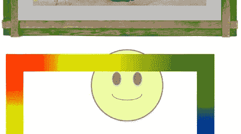

# 该属性确保只显示单个实例。`center`值设置`background-position`属性，使图像居中，在此示例中为窗口居中。效果如图 12-24 所示。

## 第 12 章 ■ 边框与背景

***图 12-24.** 使用固定背景图像*

其工作原理类似于我在第[10 章](http://dx.doi.org/10.1007/978-1-4842-2463-2_10)中解释的`display: fixed;`属性。然而不同之处在于，由于背景图像在 z 轴层级上位于前景元素之后，因此图像的部分或全部可能被遮挡。

> **提示：** 使用固定背景图像时，它被分配给哪个元素并不重要，因为其位置基于窗口而非元素本身。但例如，如果将其添加到`div`或`p`元素，则每个元素都会显示独立的图像。这些图像会位于同一位置，因此不会改变页面显示效果，但渲染多幅图像显然效率更低。由于`body`元素只有一个，因此它是放置固定背景图像最合理的位置。

### 本章小结

在本章中，我介绍了许多利用各类边框和背景来增强网页效果的技术。两者有相似之处，主要在于都可以通过颜色、图像或渐变来定义。此外，两者在 z 轴层级上都位于元素下方。边框会占据文档空间，而背景则不会。我还解释了阴影和轮廓的用法，它们虽然与边框不同，但能达到类似效果。

这里有许多可用的属性，其中大部分可以通过简写符号来表达。特别是边框，由于每条边都可以单独定义，因此有大量属性。不过，可以使用简写来定义单条边的所有属性。同样，也可以使用简写来设置所有边的单个属性。

使用图像作为边框可以产生一些非常有趣的效果，但需要了解浏览器如何使用它们。图像被分割成多个部分，每个部分应用于边框的不同位置。相关属性使您能够控制每个部分如何根据需要拉伸或重复以填充空间。

渐变用于沿特定方向逐渐改变颜色。线性渐变从一条边或一个角向对边或对角改变颜色。径向渐变从中心向外改变颜色。您可以定义起始和结束颜色，还可以沿着渐变定义特定的色标。

在下一章中，我将介绍如何使用表格来排列和格式化内容。

---

