# 表格样式设计

在本章中，我将讲解两个主题，它们虽然都涉及表格，但关联不大。首先，我将演示如何使用 CSS 格式化`table`元素。在第[6 章](http://dx.doi.org/10.1007/978-1-4842-2463-2_6)中，我描述了用于构建表格的各种 HTML 元素，例如`table`、`table row`（`tr`）、`table header cell`（`th`）和`table cell`（`td`）。现在，我将介绍可用于视觉排列这些元素的 CSS 属性。第二个主题是解释如何利用 CSS 将非表格数据转换为类似表格的元素，以便使用类似的样式设计技术。

## 示例表格

我在第[6 章](http://dx.doi.org/10.1007/978-1-4842-2463-2_6)中解释了用于创建表格的标记元素。您可以参考该章获取更多详情；不过，作为快速回顾，下表使用了大部分常见的表格元素。

这提供了国际象棋棋子的摘要。我将使用此表来演示大多数样式选项。其标记如清单 13-1 所示，生成的表格渲染效果见图 13-1。

`清单 13-1.` 一个简单的 HTML 表格

```
<table>
<caption>国际象棋棋子</caption>
<thead>
<tr>
<th>名称</th>
<th>数量</th>
<th>分值</th>
<th>符号</th>
<th>移动方式</th>
</tr>
</thead>
<tbody>
<tr>
<th>王</th><td>1</td><td>无</td>
<td></td>
<td>任意方向 1 格</td>
</tr>
<tr>
<th>后</th><td>1</td><td>10</td>
<td></td>
<td>任意方向任意格数</td>
</tr>
<tr>
<th>车</th><td>2</td><td>5</td>
<td></td>
<td>前后左右任意格数</td>
</tr>
<tr>
<th>象</th><td>2</td><td>3</td>
<td></td>
<td>对角线方向任意格数</td>
</tr>
<tr>
<th>马</th><td>2</td><td>3</td>
<td></td>
<td>上下 2 格并左右 1 格，或上下 1 格并左右 2 格；可跳过棋子</td>
</tr>
<tr>
<th>兵</th><td>8</td><td>1</td>
<td></td>
<td>一般向前 1 格；首次移动可向前 2 格；斜向前方 1 格吃子</td>
</tr>
</tbody>
<tfoot>
<tr>
<th>总计</th><td>16</td><td>40</td><td></td><td></td>
</tr>
</tfoot>
</table>
```

> © Mark J. Collins 2017
>
> M. J. Collins, *Pro HTML5 with CSS, JavaScript, and Multimedia*, DOI 10.1007/978-1-4842-2463-2_13

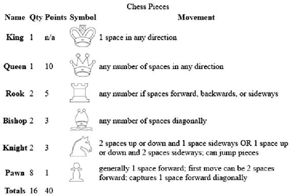

`图 13-1.` 初始未设置样式的表格

## 基础表格样式设计

从图 13-1 可以看出，表格显得很糟糕，我们需要做一些工作。然而，应用一些简单的边框、内边距和对齐属性就能带来显著改善。

### 边框

有四个元素可以放置边框：整个表格（`table`）、标题（`caption`）以及单元格（`th`和`td`）。`table row`（`tr`）元素是一个容器元素，本身没有可见内容。同样地，`thead`、`tbody`和`tfoot`也是容器，没有可见内容。您可以对这些元素应用样式，这些样式会被子元素继承。然而，边框属性出于合理原因不会被继承。稍后我会再讨论行边框，但现在我们先从表格和单元格开始。以下 CSS 规则将为表格添加粗边框，为单元格添加细边框。渲染效果见图 13-2。

```
table {
  border: 3px solid black;
}
th, td {
  border: 1px solid black;
}
```

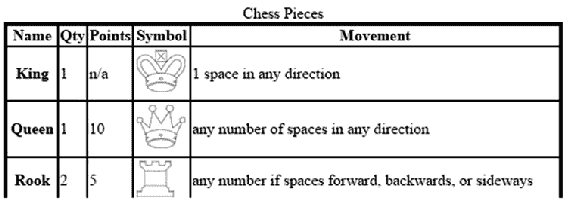

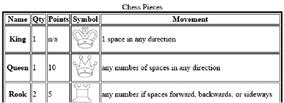

`图 13-2.` 为表格和单元格添加边框

现在每个单元格周围都有边框；然而，浏览器在边框之间放置了间距。

这由`border-spacing`属性控制，其默认值为`2px`。如果您想要更多间距可以增大此值，或将其设置为`0`以完全移除间距。如果我在`table`选择器中添加以下内容，结果如图 13-3 所示。

```
border-spacing: 0;
```

`图 13-3.` 移除边框间距

间距消失了，但边框看起来更粗了。实际上它们并未变粗，但由于相互接触，每条边的宽度被叠加了。如果您不想要这种效果，除了移除边框间距外，还可以使用`border-collapse`属性让相邻单元格共享一个公共边框。该属性支持以下值：

- `separate` - （默认值）相邻单元格之间的边框分别绘制。边框之间的间距由我之前解释过的`border-spacing`属性控制。这会调用浏览器的*分隔边框模型*。

- `collapsed` - 两条相邻边框合并为一条共享边框。

#### 表格样式

## 边框冲突模型

被称为*折叠边框模型*。

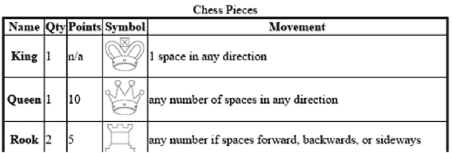

## 第 13 章 ■ 表格样式

当相邻边框具有不同样式属性时，应使用哪一种？W3C 建议提供了简单明了的指南：

*以下规则决定在冲突情况下哪种边框样式“胜出”：*

1. 具有`border-style`值为`hidden`的边框优先于所有其他冲突的边框。任何具有此值的边框都会抑制该位置的所有边框。

2. 样式为`none`的边框优先级最低。只有当在此边缘相交的所有元素的边框属性都为`none`时，边框才会被省略（但请注意，`none`是`border-style`的默认值。）

3. 如果所有样式都不是`hidden`且至少有一个不是`none`，则较窄的边框被舍弃，转而使用较宽的边框。如果有多个边框具有相同的`border-width`，则按以下顺序优先选择样式：`double`、`solid`、`dashed`、`dotted`、`ridge`、`outset`、`groove`，最低优先级的是`inset`。

4. 如果边框样式仅在颜色上不同，则设置在单元格上的样式优先于行上的样式，行上的样式优先于行组、列、列组，最后是表格。当两个相同类型的元素冲突时，位于更左侧（如果表格的`direction`为`ltr`；如果是`rtl`则为右侧）且更靠上的元素获胜。

*层叠样式表第 2 级修订版 1（CSS 2.1），第 17.6.2.1 节，边框冲突解决方案*

将`border-spacing`属性替换为以下声明将使表格呈现为图 13-4 所示。

```
border-collapse: collapse;
```

`图 13-4.` 使用`border-collapse`属性

### 空单元格

如果你使用的是分隔边框模型，则可以使用`empty-cells`属性控制空单元格的行为。此属性有两个值：`show`和`hide`，默认值为`show`。显然，如果单元格为空，则没有内容要显示。但是，仍然可以围绕单元格绘制边框，并且可以显示所使用的任何背景。

如果此值设置为`show`，则边框和背景将显示；这将显示为一个空单元格。如果`empty-cells`属性设置为`hide`，则边框和背景将被隐藏。这将显示为好像单元格不存在一样。

> **注意** `empty-cells`属性仅在分隔边框模型下有效。如果你使用的是折叠边框模型，则此属性将被忽略。

### 行边框

现在让我们来看看如何添加行边框。如前所述，你不能向行添加边框，只能向行内的单元格添加边框。然而，正如我在上一章中解释的那样，你可以单独设置边框的边缘。例如，你只能为顶部和底部边缘设置边框。然后你需要为第一个单元格设置左边框，为最后一个单元格设置右边框。为了说明此技术，将整个 CSS 替换为以下规则，以在行（而不是单个单元格）周围创建边框。

```
table {
  border: 3px solid black;
  border-collapse: collapse;
}

th, td {
  border-top: 1px solid black;
  border-bottom: 1px solid black;
}

table th:first-child, table td:first-child {
  border-left: 1px solid black;
}

table th:last-child, table td:last-child {
  border-right: 1px solid black;
}
```

第一条规则在整个表格周围创建了一个粗边框，并包含了`border-collapse`属性。下一条规则在所有单元格（`th`和`td`）周围创建了细的上边框和下边框。最后两条规则使用`:first-child`和`:last-child`伪类来设置左边框和右边框。渲染结果如图 13-5 所示。

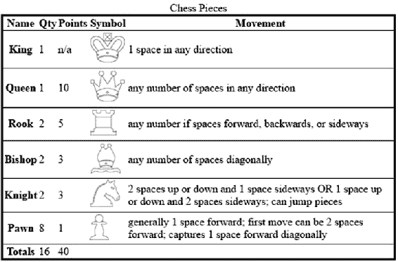

图 13-5. 创建行边框

就个人而言，我认为这对这个特定表格看起来效果不佳，因此我将在剩余的演示中恢复到之前的 CSS。

### 内边距和对齐

关于内边距我不会多说，因为我在前一章已经解释过。然而，默认样式的一个问题是边框离内容太近。你可以通过使用以下规则在所有可见元素上设置内边距来轻松解决此问题。

```
th, td, caption {
  padding: 5px;
}
```

> **注意** 你可能想简单地在`table`元素上设置内边距；但是，`padding`属性不会被继承。因此，你需要在每个元素上设置它。

我在第 11 章中解释了对齐属性，这些属性也适用于表格。默认情况下，表头单元格（`th`）元素在水平和垂直方向上居中。表格单元格（`td`）元素垂直居中但左对齐。作为一般经验法则，文本应该左对齐，数字应该右对齐。虽然可能不被普遍接受，但我建议图片居中。当然，在这个表格中，图片居中对齐看起来会更好。注意兵卒比其他棋子小，看起来不对齐。

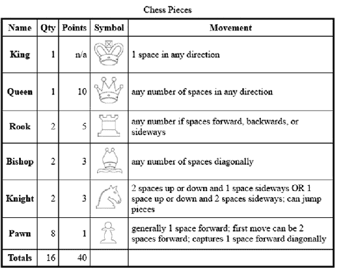

表格单元格被分组为行；没有用于列的此类容器。例如，第 2 列只是每行的第二个单元格。要设置列的对齐方式，我们可以使用我在第 9 章中解释的`:nth-of-type`伪选择器。以下规则将使“数量”和“积分”列右对齐，并使“符号”列居中。

```
td:nth-of-type(1) { /*数量*/
  text-align: right;
}

td:nth-of-type(2) { /*积分*/
  text-align: right;
}

td:nth-of-type(3) { /*符号*/
  text-align: center;
}
```

`:nth-of-type`选择器只计算指定类型的元素：在本例中为表格单元格。它将跳过“名称”列，因为这是一个表头（`th`）元素。生成的表格如图 13-6 所示。

图 13-6. 调整内边距和对齐

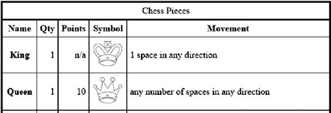

### 标题

请注意，标题在视觉上位于表格外部，默认情况下位于表格上方。即使`caption`元素嵌套在`table`元素内部，但从表格布局角度来看，它不是表格的一部分。

要更改标题的样式，你需要单独设置其样式。为了使标题与表格保持一致，你可以添加以下 CSS 规则。这将为标题提供与表格相同宽度的边框和相同数量的内边距。

```
table caption {
  border: 3px solid black;
}
```

但是，下边框将与表格的上边框相邻，形成一条宽度是其他边框两倍的线。在这种情况下，`border-collapse`属性无济于事，因为标题不是表格元素。相反，我将使底部边缘的宽度为 0，因为它可以使用表格的上边框作为其下边框。最终的 CSS 规则将如下所示，渲染结果如图 13-7 所示。

```
table caption {
  /*border: 3px solid black;*/
  border-style: solid;
  border-color: black;
  border-width: 3px 3px 0px 3px;
}
```

图 13-7. 设置标题样式

使用`caption-side`属性，你可以移动它，尽管唯一支持的值是`top`和`bottom`。如果你选择将其移动到表格下方，请设置`caption-side: bottom;`，并且不要忘记修复边框，因为现在你需要将顶部边缘宽度设为 0 而不是底部。

### 其他表格样式

我们现在有一个看起来不错的表格；但是，我将演示一些其他技术，例如背景和高亮显示，你可以使用这些技术来改进表格布局。

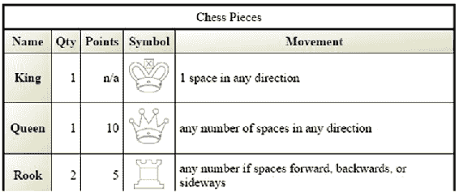

### 背景

你可以为任何表格元素设置背景颜色、图片或渐变效果。我已在上一章解释了这些属性的用法，此处不再赘述。我的典型做法是为表头单元格提供背景颜色或渐变效果。你可以通过如下简单的 CSS 规则实现，效果如图 13-8 所示。

```
th {
  background-color: #DDB;
  background: linear-gradient(to bottom right, #FFF 0%, #DDB 100%);
}
```

图 13-8. 为表头单元格添加渐变效果

但请注意，渐变在每个单元格中会重新开始。每个表头单元格的左上角都是白色。你或许更喜欢这种效果，但可能也期望渐变能平滑地贯穿整个表头行（或列）。你可以通过将渐变应用于整个表格，然后清除其他单元格的背景来实现，代码如下：

```
table {
  background-color: #DDB;
  background: linear-gradient(to bottom right, #F4F4F0 0%, #DDB 100%);
}

td {
  background-color: white;
  background-image: none;
}
```

由于渐变覆盖了更大的区域，为了避免在最初的几个单元格中显得过于淡化，我将起始颜色调整得稍深一些。生成的表格如图 13-9 所示。

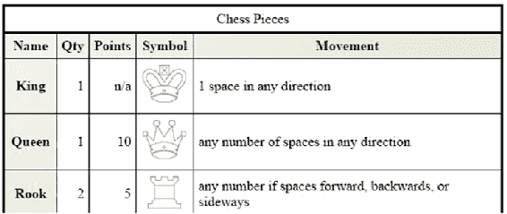

第 13 章 ■ 表格样式设计

图 13-9. 修改后的表头渐变效果

■ **提示**  我同时设置了 `background-color` 和 `background-image`，以防浏览器不支持渐变。`background-image` 属性在最后定义，这样如果两者都支持，它会覆盖颜色设置。这是一种值得遵循的良好实践。

### 斑马纹

另一种简单的技术是利用 `:nth-of-type` 伪选择器来交替设置每行的背景颜色。这被称为斑马纹。通过以下 CSS 规则可以轻松实现。

```
tr:nth-of-type(even) > td {
  background-color: #F4F4F0;
}
```

此处使用了关键字 `even` 而非具体行号，因此它会选择所有偶数行。你也可以使用 `odd` 关键字。但是，我们不想将背景应用于整行，因为表头单元格（`th`）已经应用了之前的渐变。使用 `>` 操作符表示仅选择直接子元素，结合 `td` 元素选择器，它将只返回偶数行上的表格单元格元素。效果如图 13-10 所示。

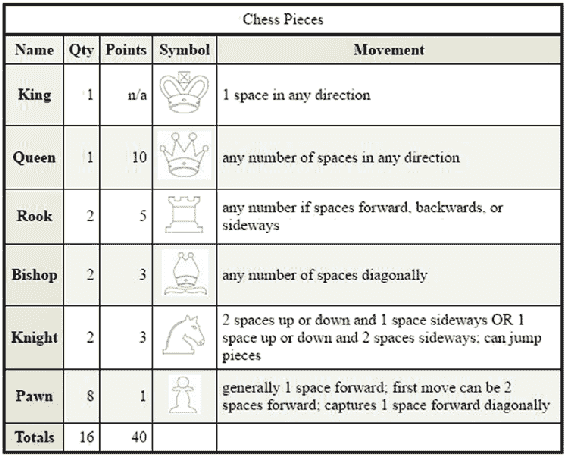

第 13 章 ■ 表格样式设计

图 13-10. 使用斑马纹效果

作为一项杂项更新，我将使用以下规则增大标题（`caption`）的字号。与此表格中的其他文本一样，你也可以更改所有字体属性。可用的选项请参考第[11 章](http://dx.doi.org/10.1007/978-1-4842-2463-2_11)。

```
caption {
  font-size: xx-large;
}
```

### 高亮

你可以通过调整背景颜色轻松高亮某一行。此方法与斑马纹类似，但只选择单个行。此外，在斑马纹示例中我们没有更新表头单元格；而在本例中，我将同时更新表头单元格。然而，在行上设置背景是无效的，你需要设置行中子元素（即表格单元格 `td` 和表头单元格 `th`）的背景。以下 CSS 规则即可实现：

```
tr:nth-child(3) > th, tr:nth-child(3) > td {
  background-color: yellow;
}
```

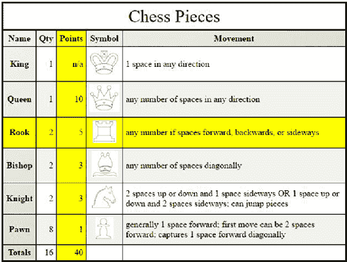

第 13 章 ■ 表格样式设计

你也可以使用类似的技术高亮某一列。同样，你需要组合两个选择器：一个用于表头单元格，另一个用于其他单元格。生成的表格如图 13-11 所示。

```
th:nth-child(3), table td:nth-child(3) {
  background-color: yellow;
}
```

图 13-11. 高亮一行和一列

# 第 13 章 表格样式设计

**提示** 注意，如果算上表头，实际被高亮的是第四行。如果查看标记，`table` 元素有三个子元素：`thead`、`tbody` 和 `tfoot` 元素。`thead` 和 `tfoot` 各有一个子元素 `tr`。`tbody` 有六个 `tr` 子元素。选择器 `tr:nth-child(3)` 会返回任何恰好是其直接父元素的第三个子元素的行。由于 `tbody` 中的行拥有不同的父元素，所以编号重新从 1 开始。另外，我使用的是 `:nth-child` 而不是 `:nth-of-type`，因为我知道所有兄弟元素都是行。在这种情况下，`:nth-child` 和 `:nth-of-type` 会产生相同的结果。我建议在大多数情况下使用 `:nth-of-type`，因为即使之后添加了其他元素类型，它仍然能正常工作。

**注意** 表格中的各个元素是相互层叠堆放的，了解这个堆叠顺序非常重要，尤其是在使用多个背景时。这个顺序相当直观：`table` 元素位于最底部，其上是 `caption`、`thead`、`tbody` 和 `tfoot` 元素。接着是行（`tr`）元素，最后是单元格（`th` 和 `td`）。在大多数情况下，只有 `caption` 和单元格是实际可见的。然而，如果你在处理透明度（`opacity`）问题，其他背景可能会显现出来。

## 使用 CSS 创建表格

如果你在网上搜索过关于 HTML 表格的文章，很可能已经遇到了关于是否使用 HTML `table` 元素的激烈争论。有些人认为永远不应该使用它们——这项工作应该由 CSS 来完成。反对这一观点的人则反驳说，这属于 HTML 的职责范围，而非 CSS。

这可能给你一种印象，即 HTML 表格和 CSS 表格（这两种观点有时被这样称呼）是实现同一目标的两种不同技术。但事实并非如此；这两种技术旨在解决完全不同的问题。

诸如团队排名、股票持仓或联系人详情列表等表格数据，应该使用表格。例如，如果你要显示股票持仓信息，每支股票有四项数据：股票代码、昨日收盘价、涨跌百分比和成交量。单个数据，如 35.87 美元、0.51%或 140 万，如果不与它们所属的股票关联起来，就毫无意义。只有当单个数据项（单元格）被组合在一起（形成行）时，它们才具有意义。这才是 HTML 表格的用途。另一种看待方式是，没有其他合乎逻辑的方式来组织这些数据点。如果你试图将所有股票代码归为一组，再把所有收盘价归为另一组，那将毫无意义。数据有其内在的结构，这种结构应该在 HTML 标记中被捕获。

另一方面，如果你正在尝试布局一个网页，例如左侧有一组链接，右侧有相关文章，这并非表格数据。这是 CSS 的任务。区分这两种场景最简单的方法是问自己：这是唯一合乎逻辑的内容组织方式吗？在这种情况下，答案是否定的，有很多方式可以实现。你可以将链接放在页面顶部，或许文章可以放在左侧。使用 CSS 来实现也使得在不同设备上渲染页面时调整布局变得更加容易。可访问性是另一个不应使用表格进行布局的重要原因。例如，屏幕阅读器会读取 HTML，如果你将非表格数据放入表格中，你网站的呈现方式可能会变得非常混乱。

## Display 属性

首先，你需要理解，表格元素的特定行为完全是由分配给 `display` 属性的值决定的。在第 [10](http://dx.doi.org/10.1007/978-1-4842-2463-2_10) 章中，我们探讨了 `display` 属性的几个值，主要是 `block` 和 `inline`。实际上还有更多的值，它们大多与表格相关。我在第 [6](http://dx.doi.org/10.1007/978-1-4842-2463-2_6) 章中解释的每个表格元素，其默认的 `display` 属性都被分配了这些值之一。事实上，正是特定的显示值才让表格元素按照它们的方式工作。表 13-1 列出了每个元素及其分配的默认显示值。

## 设计表格样式

**表 13-1.** 表格显示属性

| **HTML 元素** | **默认显示属性** |
| :--- | :--- |
| `table` | `table` |
| `tr` | `table-row` |
| `th`, `td` | `table-cell` |
| `thead` | `table-header-group` |
| `tbody` | `table-row-group` |
| `tfoot` | `table-footer-group` |
| `col` | `table-column` |
| `colgroup` | `table-column-group` |
| `caption` | `table-caption` |

### CSS 表格演示

你可以通过简单地为 `display` 属性应用正确的值，使用非表格元素实现相同的布局。为了演示这一点，我将仅使用简单的 HTML 元素（如 `div` 和 `p` 元素）重新创建本章开头使用的同一个表格。这里使用了 `class` 属性，以便于后续选择适当的实体。代码如清单 13-2 所示。

**清单 13-2.** 使用非表格元素

```html
<div class="table">
  <div class="head row">
    <h3>名称</h3>
    <h3>数量</h3>
    <h3>分值</h3>
    <h3>符号</h3>
    <h3>移动方式</h3>
  </div>
  <div class="body row">
    <h3>王</h3><p>1</p><p>无</p>
    <p></p>
    <p>任意方向 1 格</p>
  </div>
  <div class="body row">
    <h3>后</h3><p>1</p><p>10</p>
    <p></p>
    <p>任意方向任意格数</p>
  </div>
  <div class="body row">
    <h3>车</h3><p>2</p><p>5</p>
    <p></p>
    <p>前后或左右任意格数</p>
  </div>
  <div class="body row">
    <h3>象</h3><p>2</p><p>3</p>
    <p></p>
    <p>对角线任意格数</p>
  </div>
  <div class="body row">
    <h3>马</h3><p>2</p><p>3</p>
    <p></p>
    <p>上下 2 格并左右 1 格，或上下 1 格并左右 2 格；可以越过棋子</p>
  </div>
  <div class="body row">
    <h3>兵</h3><p>8</p><p>1</p>
    <p></p>
    <p>通常向前 1 格；首次移动可向前 2 格；斜前方 1 格吃子</p>
  </div>
  <div class="foot row">
    <h3>总计</h3><p>16</p><p>40</p><p></p><p></p>
  </div>
</div>
```

要使用表格布局来设置其样式，完整的 CSS 代码如清单 13-3 所示。其中的 `display` 属性以粗体显示。其余的 CSS 声明应用了与之前示例相同的样式。选择器有所不同，因为我们使用了不同的元素，但从概念上讲，这与之前的 CSS 是相同的。这将使表格的渲染效果与之前的示例完全相同。

**清单 13-3.** 使用表格布局

```css
/* 在非表格元素上模拟表格布局 */
.table {
  display: table;
  border: 3px solid black;
  border-collapse: collapse;
  background-color: #DDB;
  background: linear-gradient(to bottom right, #F4F4F0 0%, #DDB 100%);
}
.row {
  display: table-row;
}
.row>h3, .row>p {
  display: table-cell;
  border: 1px solid black;
  padding: 5px;
  vertical-align: middle;
}
.row img {
  display: table-cell;
  vertical-align: middle;
  margin: 0 auto;
}
```

# 对齐

```css
.row>h3 {
    text-align: center;
    font-size: medium;
}

.row>p:nth-child(2) { /*数量*/
    text-align: right;
}

.row>p:nth-child(3) { /*分值*/
    text-align: right;
}

/* 背景和斑马条纹 */
.body>p, .foot>p {
    background-color: white;
    background-image: none;
}

.body:nth-child(odd)>p, .body:nth-child(odd)>img {
    background-color: #F4F4F0;
}
```

```css
/* 高亮部分 */
.row:nth-child(4)>h3, .row:nth-child(4)>p {
    background-color: yellow;
}

.row>h3:nth-child(3), .row>p:nth-child(3) {
    background-color: yellow;
}
```

**注意：** 我创建此示例是为了说明表格元素除了其默认样式之外并无特殊之处。你可以对任何 HTML 元素使用表格布局。然而，你绝不应该真正用这种方式构建表格。表格数据应放入`table`元素中。

## 应用场景

既然知道可以在任何 HTML 元素上使用表格样式的布局，我将展示几个非常实用的应用场景。

### 对齐元素

如果你希望页面渲染时两个或多个元素对齐，使用表格布局会有所帮助。例如，假设你有一张小图片和一段文字，希望它们并排垂直对齐。下面的简单 HTML 标记创建了一个包含图片和`p`元素的`div`。

```html
<div class="centering">
    <div></div>
    <p>八十七年前，我们的先辈在这片大陆上建立了一个新国家...</p>
</div>
```

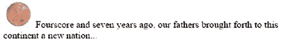

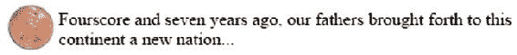

首次尝试样式化时，我们使用了`display: inline;`，让图片和文本处于同一行，同时固定了图片大小。结果如图 13-12 所示。

```css
.centering div, .centering p {
    display: inline;
}

.centering img {
    width: 50px;
}
```

***图 13-12.** 初始样式尝试*

这并非我的本意。让我们对 CSS 稍作修改，采用表格布局。

我将改为`display: table-cell;`，把图片和文本分别放入各自的单元格中。单元格会自动对齐；剩下的只需配置单元格内的对齐方式。结果如图 13-13 所示。

```css
.centering div, .centering p {
    /*display: inline;*/
    display: table-cell;
    text-align: left;
    vertical-align: middle;
}
```

***图 13-13.** 使用表格校正对齐*

使用表格布局可以大大简化元素对齐，因为表格单元格提供了结构。每个元素都放在单元格中，并在单元格内对齐。另一个绝佳的应用是样式化输入表单。表单中包含一系列输入字段，如文本框、单选按钮、复选框，以及标签、按钮和其他内容。通常，以某种方式对齐这些元素是个好主意，而使用表格布局是一种常见且有效的方法。

### 页面布局

最后一个示例，我将使用表格来组织整体页面布局。典型的网页会有页眉和页脚，通常还有一组导航链接，有时还有侧边栏。我将把这些元素添加到本章一直使用的现有表格周围。附加元素如清单 13-4 所示。

***清单 13-4.*** 添加其余页面元素

```html
<body>
    <header>
        <h1>第 13 章 - 样式化表格</h1>
    </header>
    <section>
        <nav role="navigation">
            <ul>
                <li>一</li>
                <li>二</li>
                <li>三</li>
                <li>四</li>
            </ul>
        </nav>
        <main>
            <table>
                <!-- ... 在此处插入现有表格 ... -->
            </table>
        </main>
        <aside>
            <h1>查看这些标题</h1>
            <ul>
                <li>使用工作流 4.0 入门</li>
                <li>Office 工作流 2010</li>
                <li>使用 SharePoint 2010 进行项目管理</li>
                <li>精通 Access 2010</li>
                <li>Office 365 开发</li>
                <li>使用 Visual Studio 2015 的 HTML5</li>
            </ul>
        </aside>
    </section>
    <footer>
        专业 HTML5 - Apress
    </footer>
</body>
```

我将把它们组织成一个相当常见的三列布局，如图 13-14 所示。在每个部分中，我标明了如何设置`display`属性以实现所需布局。

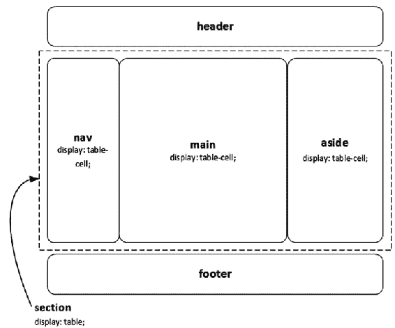

***图 13-14.** 整体页面结构*

`section`元素夹在`header`和`footer`元素之间，将被设置为一个表格。其子元素`nav`、`main`和`aside`被设置为该表格中的单元格。以下 CSS 规则应用了此表格布局以及一些基本格式。

```css
section {
    display: table;
    table-layout: fixed;
}

nav, main, aside {
    display: table-cell;
}

nav {
    min-width: 150px;
}

aside {
    width: 25%;
    text-align: center;
}
```

这还将`table-layout`属性设置为`fixed`。其默认值为`auto`，意味着表格单元格会根据内容自动调整大小。在此模式下，浏览器需要做大量工作，因为它必须先确定哪一行的长度最长，然后使用该大小格式化其余行。将其设置为`fixed`后，此自动调整大小的逻辑将被禁用，你可以手动设置大小。`nav`元素设置为 150 像素，`aside`元素为窗口宽度的 25%。中间剩余区域分配给`main`元素，它将根据窗口宽度自动伸缩。

在标记中，我使用无序列表（`ul`）元素来表示`nav`和`aside`元素中的项目。我使用以下 CSS 规则将它们格式化为表格。

```css
ul {
    display: table;
}

li {
    display: table-row;
    height: 50px;
    text-align: left;
    vertical-align: middle;
}
```

在此示例中，无序列表元素被设置为表格，列表项被设置为行对象。完成这些更改后，内容按预期结构排列，尽管看起来有些朴素——就像本章开头的初始表格一样。为了让其更具视觉吸引力，我将添加以下 CSS 规则。

生成的页面布局如图 13-15 所示。

```css
header, footer {
    border: 1px solid black;
    border-radius: 6px;
    background-color: #F4F4F0;
    text-align: center;
    padding: 5px;
}

nav, aside {
    border: 1px solid black;
    border-radius: 6px;
    background-color: #F0F0F0;
}

aside article:nth-child(even) {
    background-color: #fafbbf;
}

aside {
    padding: 5px;
    font-family: Verdana;
    font-size: small;
}
```

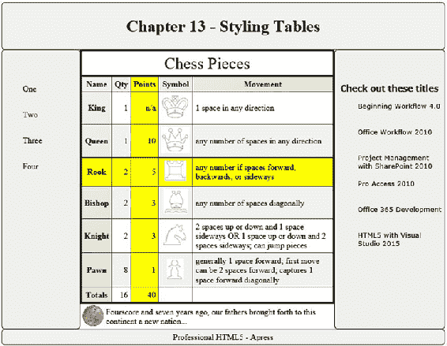

***图 13-15.** 最终页面布局*

### 响应式布局

页面元素使用了标准的语义化`header`、`nav`、`main`、`aside`和`footer`元素。它们之所以被渲染为表格，仅仅是因为我们选择在 CSS 中如此配置。我们完全可以决定以不同的方式排列它们。现在我将展示如何使用媒体查询（在第 2 章中解释过）来根据页面尺寸动态改变布局。

对于此页面，我将阈值设为 700px。作为一个简单示例，我将设置表格布局的 CSS 规则放入媒体查询中。该媒体查询及其内部的条件规则如`清单 13-5`所示。

`清单 13-5.` 使用媒体查询

```css
@media (min-width: 700px) {
    section {
        display: table;
        table-layout: fixed;
    }

    nav, main, aside {
        display: table-cell;
    }

    nav {
        min-width: 150px;
    }

    aside {
        width: 25%;
        text-align: center;
    }

    ul {
        display: table;
    }

    li {
        display: table-row;
        height: 50px;
        text-align: left;
        vertical-align: middle;
    }
}
```

现在，如果你将窗口缩小到 700 像素以下，表格布局将消失，如`图 13-16`所示。

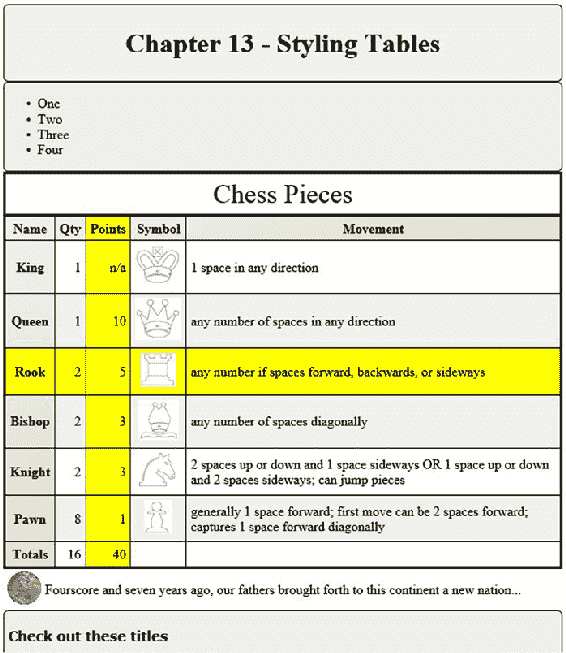

`图 13-16.` 移除表格布局

### 样式化列表

作为最后一个附带话题，列表项还有一些可用的样式选项。列表项通常旁边会有一个标记，例如圆点或数字。通过 CSS 属性，你可以控制标记的样式和位置。