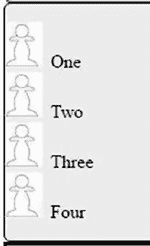

# 第 13 章 表格样式

## 类型

`list-style-type` 属性定义了所使用的标记。以下是支持的标准值：
- `none` - 无标记
- `disc` - 实心圆（无序列表的默认值）
- `circle` - 空心圆
- `square` - 实心方块
- `decimal` - 顺序整数（1, 2, 3…，有序列表的默认值）
- `decimal-leading-zero` - 与 `decimal` 相同，但会添加前导零
- `lower-alpha` - 顺序小写字母（a, b, c…）
- `upper-alpha` - 顺序大写字母（A, B, C…）
- `lower-roman` - 小写罗马数字（i, ii, iii…）
- `upper-roman` - 大写罗马数字（I, II, III…）

前四个选项（`none`、`disc`、`circle` 和 `square`）用于无序列表（`ul`）。其余选项仅用于有序列表（`ol`）。需要明确的是，如果你对有序列表使用了前四个选项中的任何一个（例如 `disc`），每个列表项都将显示相同的标记。有序列表的目的是让浏览器能够依次为它们编号；因此，你实际上已经将其变成了一个无序列表。反之，如果你对无序列表使用了类似 `decimal` 的值，项目将被依次编号，此时你便拥有了一个有序列表。`ul` 和 `ol` 元素之间唯一的真正区别是 `list-style-type` 属性的默认值不同，分别是 `disc` 和 `decimal`。

对于有序列表，你还可以通过在 HTML 标记中分配 `type` 属性来控制所使用的标记，这在[第 4 章](http://dx.doi.org/10.1007/978-1-4842-2463-2_4)中已解释过。它支持 `1`、`a`、`A`、`I` 和 `I` 这些值，分别对应于 CSS 中 `list-style-type` 属性的 `decimal`、`lower-alpha`、`upper-alpha`、`lower-roman` 和 `upper-roman` 值。但请注意，CSS 中应用的样式会覆盖标记设置。

**注意**：还有其他一些通常被支持的标记，例如 `lower-latin` 和 `lower-greek`。此外，还有许多其他语言定义的标记，但浏览器支持度有限。

### 图像

如果这些样式都不合适，你可以通过设置 `list-style-image` 属性来定义自己的标记。没有选项可以定义渲染图像的大小，因此请确保使用的图像具有适合你内容的固有尺寸。以下 CSS 规则将使用 `pawn.png` 图像作为标记。渲染效果如图 13-17 所示。

```
ul {
    list-style-image: url("pawn.png");
}
```



**图 13-17.** 为列表项使用自定义图像

**提示**：在使用自定义图像时，你还应该指定 `list-style-type` 属性。该属性应放在 `list-style-image` 声明之前。如果因某些原因无法加载图像，此属性将用作后备方案。

#### 位置

使用 `list-style-position` 属性，你可以决定标记是否应位于包含块内部。如果指定了值 `inside`，则标记与块对齐，且项目缩进以为标记腾出空间。如果指定了 `outside`，则列表项与块对齐，而标记将位于块的外部。

## 简写属性

与许多其他 CSS 属性一样，存在一个简写属性，允许你在单个声明中指定所有列表项属性。这三个值 —— `type`、`image` 和 `position` 可以按任意顺序提供，并用空格分隔。例如：

```
list-style: url("pawn.png") outside square;
```

#### 总结

在本章中，我演示了如何使用 CSS 为表格设置样式。仅需几条简单的规则，你就可以轻松地将一个不太美观的表格变成视觉上吸引人的呈现。除此之外，你还可以通过更改 `display` 属性，将表格布局技术应用于其他非表格数据。

这种技术的一个常见用途是，在保留原始语义元素的同时，将网页布局为表格元素。由于此布局是在 CSS 中执行的，你可以使用媒体查询根据设备特性应用替代格式。

我还演示了如何使用支持的 CSS 属性为列表项设置样式。此外，使用表格来布局列表项是一种流行的做法。