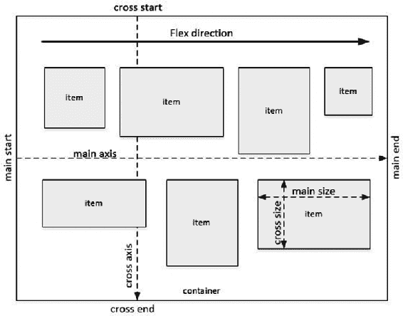

# 第 14 章 Flexbox

在本章中，我将解释 `display` 属性的另一个值：`flex`。这是一种非常灵活（双关语）的布局元素方式。从概念上讲，这非常简单，尽管因其灵活性，术语可能会令人困惑。使用 `flex` 时，你需要一个容器元素，其内部包含子项。在容器和项目上需要配置单独的属性。

它受 IE11 及以上版本以及所有主流浏览器支持，但在 Safari 中存在一些问题。如果你必须支持这些浏览器，你需要提供一个后备解决方案。然而，我相信这将成为首选方法，尤其是在支持响应式网页时。

其术语与方向无关；你不会看到任何诸如 `height`、`width`、`horizontal` 或 `vertical` 之类的值。即使是 `flex-direction` 属性也使用 `row` 和 `column` 这两个值。使用 `flex` 的挑战之一是你需要翻译这些术语。例如，如果我提到一个元素的 `height`（高度）和 `width`（宽度），你会立刻明白我指的是什么。如果我提到它的 `main size`（主轴尺寸），你就需要根据 `flex-direction` 来进行转换。

#### 容器配置

我将首先解释可以在容器上指定的属性。第一个属性当然是 `display` 属性，应将其设置为 `flex`。

```
.container {
    display: -webkit-flex;
    display: flex;
}
```

**警告**：为了支持 Safari，你需要使用 `-webkit` 前缀。

#### 弹性方向

最重要的属性是 `flex-direction`，它为其余属性建立了框架。它应用于容器元素，并支持以下值：

- `row` - (默认值) 项目水平排列。实际方向由 `direction` 属性决定，即 `ltr` 或 `rtl`。如果使用 `ltr` 模式，项目将从左到右排列。
- `row-reverse` - 项目按与 `direction` 属性相反的方向水平排列。
- `column` - 项目垂直排列，从上到下。
- `column-reverse` - 项目从下到上垂直排列。

© Mark J. Collins 2017  
M. J. Collins, *Pro HTML5 with CSS, JavaScript, and Multimedia*, DOI 10.1007/978-1-4842-2463-2_14



图 14-1 说明了当使用 `flex-direction: row;` 且假设为 `ltr` 模式时的术语含义。

**图 14-1.** 说明弹性盒模型术语

许多后续术语都是基于从 `flex-direction` 派生出来的值进行配置的。例如，*主轴* 是弹性方向所在的轴，在此例中为水平轴，而*交叉轴* 则为垂直轴。*主轴起点* 和*主轴终点* 定义了容器元素的开始和结束边缘。在此例中，这是左右边缘。类似地，*交叉轴起点* 和*交叉轴终点* 定义了容器沿另一维度的边缘——在此例中为顶部和底部。容器中项目的大小不由 `width`（宽度）和 `height`（高度）标识，而是由*主轴尺寸* 和*交叉尺寸* 值指定。


