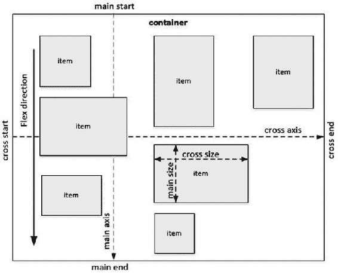
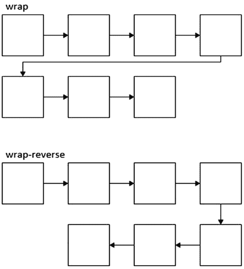
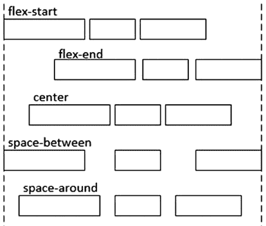
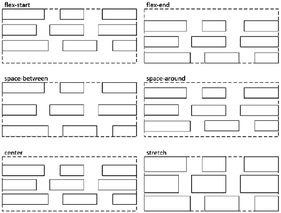
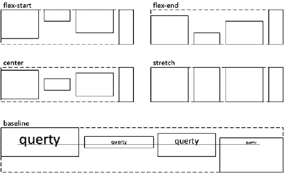
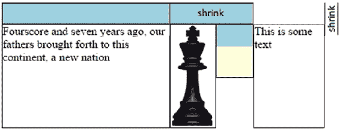
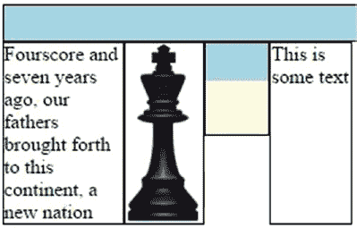
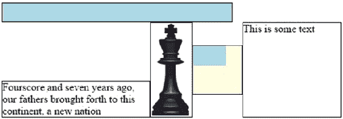

# Flexbox 布局详解

对于特定的 `flex-direction` 值，所有这些术语都会转换为熟悉的含义，例如垂直、左对齐、底部和宽度。当你初次学习使用 Flex 布局时，用这些更熟悉的术语来思考可能会更容易。但请注意，当 `flex-direction` 改变时，这些术语的含义也会随之改变。这一点在图 14-2 中得到了说明，该图展示了当使用 `flex-direction: column;` 时这些值的情况。



**第 14 章 ■ Flexbox**

***图 14-2.** 当弹性方向为 column 时使用的术语*

## Flex Wrap（弹性换行）

当 `flex-direction` 为 `row`（或 `row-reverse`）时，容器中的项目水平排列，效果类似于使用 `display: inline;`。当容器宽度被填满后，后续项目会换行到下一行。`flex-wrap` 属性控制是否以及如何进行换行。有以下三种可选值：

- `nowrap` - （默认值）项目不换行，而是在单行（或单列）中显示。
- `wrap` - 项目会按照初始方向换行到下一行或下一列。
- `wrap-reverse` - 项目会换行到下一行或下一列，但顺序相反。

`wrap` 和 `wrap-reverse` 选项在图 14-3 中进行了展示。



**第 14 章 ■ Flexbox**

***图 14-3.** 换行选项演示*

当使用 `flex-direction: row-reverse;` 时，换行的工作原理相同，只是方向相反。当使用 `flex-direction: column;` 时，项目将从上到下排列。如果指定了 `wrap-reverse`，则在换行到下一列后，项目将从下到上排列。第三行或第三列将使用初始方向。

你可以使用 `flex-flow` 属性同时指定 `flex-direction` 和 `flex-wrap` 属性。该属性需要两个值：分别对应这两个属性，值之间用空格分隔。默认值为 `row nowrap`。

## Justification（主轴对齐）

`justify-content` 属性决定了项目在主轴方向上，在单行（或单列）内的排列方式（稍后我也会解释交叉轴上的对齐方式）。有五个可用选项，如图 14-4 所示。



**第 14 章 ■ Flexbox**

***图 14-4.** 主轴方向上的对齐*

`flex-start` 值表示项目对齐到主轴的起始边缘。同样，`flex-end` 值表示项目对齐到主轴的结束边缘。当使用 `flex-direction: row;` 时，这些值分别转换为左对齐和右对齐，如图 14-4 所示。然而，当使用 `row-reverse` 时，主轴起始边缘和主轴结束边缘会互换。同样，如果 `flex-direction` 使用 `column`，这些边缘则变为顶部和底部边缘。

`space-between` 选项将第一个项目对齐到主轴起始边缘，最后一个项目对齐到主轴结束边缘。然后调整项目之间的间距，使它们均匀分布。`space-around` 选项与之类似，不同之处在于第一个项目之前和最后一个项目之后也会插入相等的间距。

生成的各行（或各列）内容也可以使用 `align-content` 属性沿交叉轴进行对齐。可用选项与 `justify-content` 类似，只是多了一个 `stretch` 选项。这些选项在图 14-5 中进行了展示。



**第 14 章 ■ Flexbox**

***图 14-5.** 交叉轴方向上的对齐*

`flex-start` 和 `flex-end` 选项将内容对齐到交叉轴的起始边缘或结束边缘。如果 `flex-direction` 是 `row` 或 `row-reverse`，这些边缘分别对应于顶部和底部边缘，如图 14-5 所示。对于 `column` 或 `column-reverse`，这些边缘则变为左侧和右侧边缘。`stretch` 选项的工作原理类似于 `space-between`，但项目会沿交叉轴拉伸以填充行（或列）之间的间隙。

> **提示** 你需要记住：`justify-content` 属性沿主轴对齐项目，而 `align-content` 属性沿交叉轴对齐行（或列）。这两个名称本身并没有太大帮助，所以请在心里记下：`justify-content`：主轴，`align-content`：交叉轴。

## Aligning Items（项目对齐）

在我目前为止的所有图示中，所有项目都具有相同的交叉轴尺寸。当使用 `flex-direction: row;` 时，这对应于项目的高度。如果项目尺寸不同，那么你需要决定如何对齐它们。`align-items` 属性提供了五个选项，如图 14-6 所示。我刚才解释了 `align-content` 属性，它用于对齐容器内的行（或列）。相比之下，`align-items` 属性定义了项目在单行（或单列）中的排列方式。两者都沿交叉轴调整对齐。



**第 14 章 ■ Flexbox**

***图 14-6.** 行内项目对齐*

再次强调，`flex-start` 和 `flex-end` 选项分别将项目对齐到交叉轴的起始边缘和结束边缘。`center` 选项将项目沿交叉轴居中。`baseline` 选项将项目对齐，使得它们的基线在行内处于相同位置。

> **提示** “基线”（*baseline*）一词源自印刷领域，字符沿着一条基线对齐。这不一定就是文本的底部，而是大多数字符所坐落的不可见线条。基线为字符放置提供了视觉参考，使文本行看起来笔直。在 CSS 中，这个概念更加复杂，因为我们处理的不只是文本。如果你想深入研究这个主题，这里有一篇不错的文章：[`www.smashingmagazine.com/2012/12/17/css-baseline-the-good-the-bad-and-the-ugly`](http://www.smashingmagazine.com/2012/12/17/css-baseline-the-good-the-bad-and-the-ugly)

## Item Configuration（项目配置）

到目前为止，我已经解释了如何配置容器（即父元素），它提供了项目排列的整体结构。你也可以配置项目本身，以实现对其对齐方式的精细控制。

**第 14 章 ■ Flexbox**

### Grow and Shrink（增长与收缩）

弹性容器中的项目可以增长或收缩以适应容器的大小。这一点非常重要，尤其是在响应式设计中。要配置此工作机制，你需要了解以下三个要素：

- *Basis*（基础尺寸） - 项目的最佳尺寸；默认情况下，是其固有尺寸。
- *Grow*（增长因子） - 当有多余空间时，该项目应如何增长。
- *Shrink*（收缩因子） - 当空间不足时，该项目应如何收缩。

> **注意** 术语 *basis*、*grow* 和 *shrink* 仅适用于主轴方向。

元素的增长和收缩量通过 `flex-grow` 和 `flex-shrink` 属性设置。这些是数值，不带任何单位。浏览器根据项目的增长因子与总增长因子的比例来计算要增加的空间量。例如，如果你有三个项目，其 `flex-grow` 属性分别设置为 `1`、`2` 和 `3`，那么总增长因子为 `6`。在这种情况下，第一个项目将获得 `1/6` 的额外空间，第二个获得 `2/6`，第三个获得 `3/6`。`flex-shrink` 属性的工作方式相同，区别在于它在必要时用于移除空间。

`flex-grow` 和 `flex-shrink` 属性永远不会同时使用。`flex-grow` 仅在有多余空间时使用，而 `flex-shrink` 仅在空间不足时使用。显然，这两种情况不可能同时成立。此外，这两个属性都不允许使用负值。值为 `0` 表示该项目不应增长（或收缩）。

`flex-basis` 属性定义了项目的基础尺寸。这是一个距离单位，可以指定为绝对值或相对单位之一。默认值 `auto` 使用项目的固有尺寸作为基础尺寸。


为了方便，您可以使用`flex`简写属性同时设置三个值：`grow`、`shrink`和`basis`。请确保按照`grow`、`shrink`、`basis`的顺序设置这三个值。还有一些特殊值可以用来同时设置这三个属性：

- `flex: auto;` - 将`grow`和`shrink`设为`1`，`basis`设为`auto`。
- `flex: none;` - 将`grow`和`shrink`设为`0`，`basis`设为`auto`。元素将使用其固有尺寸，并且不会增长或收缩。

#### 演示

`basis`的概念经常被误解。考虑之前的示例，其中三个元素的`flex-grow`分别设置为`1`、`2`和`3`。有些人可能会认为第二个元素总是第一个的两倍大，而第三个元素是第一个的三倍。然而，在大多数情况下，事实并非如此；只有超出其基础尺寸的剩余空间才遵循这个比例。这里的示例将有助于阐明这一点。

以下标记创建了一个`<section>`元素，其中包含四个子元素：两个`<p>`元素、一个`<div>`元素和一个``元素。每个子元素都有一个`class`属性，以便我们可以更轻松地通过 CSS 配置它们。

```
<div class="std1"></div>

<section>

  <p class="i1">Fourscore and seven years ago, our fathers brought forth to this continent, a new nation</p>

  

  <div class="i3">

    <div class="std2"></div>

  </div>

  <p class="i4">This is some text</p>

</section>
```

这里还创建了几个额外的`<div>`元素，我将它们设置为固定大小，以提供参考框架，帮助可视化增长（和收缩）行为。完整的 CSS 代码如清单 14-1 所示。

***清单 14-1.*** flex 演示的 CSS

```
/* 在尺寸值中包含边框 */
* {
  box-sizing: border-box;
}

.std1 {
  height: 30px;
  width: 350px;
  border: 1px solid black;
  background-color: lightblue;
}

.std2 {
  height: 30px;
  width: 50px;
  border: none;
  background-color: lightblue;
}

section {
  display: flex;
  flex-wrap: nowrap;
  justify-content: flex-start;
  align-content: flex-start;
  align-items: stretch;
}

/* 为子元素添加边框 */
section > * {
  border: 1px solid black;
  margin: 0;
}

.i1 {
  flex: 1 3 350px;
}

/* 不是必需的，这是图像的默认值 */
.i2 {
  flex: none;
}

.i3 {
  height: 75px;
  background-color: lightyellow;
  flex: 2 0 50px;
}

.i4 {
  flex: 3 1 auto;
}
```

大部分 CSS 规则用于帮助设置演示；我高亮显示了与 flex 相关的声明。容器设置了`display: flex;`属性，其余属性设置为默认值，可以省略。第一个元素的基础尺寸为`350px`。我还将带有`std1`类的空`<div>`元素设置为相同尺寸。类似地，在第三个元素中，我嵌入了带有`std2`类的空`<div>`元素。其固定尺寸为`50px`，与第三个元素的基础尺寸相同。最后一个`<p>`元素没有显式的`basis`，因此它将使用固有尺寸，即宽度刚好能容纳所有文本而不换行。

对于图像，我将`flex`属性设置为`none`，这是图像的默认值。图像默认不会增长或收缩。对于`<div>`元素，我将`grow`设为`2`，`shrink`设为`0`；该元素将增长但不会收缩。对于两个`<p>`元素，我设置了不同的`grow`和`shrink`值，以演示它们的工作方式。

如果在浏览器中渲染此页面，并将窗口宽度调整为刚好能容纳每个子元素的基础尺寸，效果将如图 14-7 所示。

***图 14-7.*** 具有精确基础尺寸的 flex 元素

提供参考尺寸的两个固定`<div>`元素以蓝色显示。如您所见，子元素恰好是其`basis`的尺寸。另外，最后一个子元素的文本刚好可以容纳而不会换行。


如果此时将窗口放大，图像会按预期保持不变，但其他三个子元素会按照 `flex-grow` 属性成比例增长，如图 14-8 所示。

***图 14-8.** 演示增长行为*



**第 14 章 ■ Flexbox**

当容器尺寸大于各个条目基准尺寸之和时，会采用增长计算。这种情况下，每个条目实际分配到的尺寸可用以下公式表示：

```
基准尺寸 + 剩余空间 * (增长值 / 所有增长值之和)
```

#### 计算收缩

如果将窗口缩小到小于基准尺寸，图像和空 `div` 元素不会收缩，但两个段落元素会收缩。窗口缩小时，页面呈现如图 14-9 所示。

***图 14-9.** 演示收缩行为*

我将第一个段落的 `flex-shrink` 属性设置为 `3`，最后一个段落设置为 `1`；然而，如图 14-9 所示，第一个段落的收缩量远不止最后一个段落的三倍。由于某些原因，收缩计算与增长计算的方式不同。它考虑了条目的基准值。当容器尺寸小于总基准尺寸时，每个条目会采用收缩计算，具体可用以下公式表示：

```
基准尺寸 - 溢出尺寸 * (收缩值 * 基准尺寸 / 所有(收缩值 * 基准尺寸)之和)
```

现在我们来具体计算一下，先计算最终总和。有两个条目的收缩值不为零。

最后一个段落的固有尺寸约为 110 像素。两者之和为 `3 * 350 + 1 * 110 = 1160`。

现在计算比例：第一个条目将是 `3 * 350 / 1160 ≈ 90%`，最后一个段落是 `1 * 110 / 1160 ≈ 10%`。

因此，只有 10% 的溢出尺寸会从最后一个段落中减去。了解这一点后，你可以调整收缩值来应对这种情况。例如，如果你希望它们以相同的速率收缩，在这种情况下，可以将第一个段落的收缩值设置为大约 `0.35` 来实现。

#### 统一增长

我以更复杂的情况开始，是为了了解基准值如何影响条目的增长和收缩。

但对于更简单的应用，你可以将所有条目的基准值设为零。如果基准值为零，收缩值也不再适用；条目只能增长。为此，`flex` 属性允许使用单个数值，该数值会作为 `flex-grow` 属性。这个简写形式还会将 `flex-shrink` 和 `flex-basis` 属性设为零。



**第 14 章 ■ Flexbox**

为了演示这一点，我将修改之前的 CSS 来使用这个简写：

```css
.i1 {
  /*flex: 1 3 350px;
  flex: 1 .35 350px;*/
  flex: 3;
}

.i3 {
  height: 75px;
  background-color: lightyellow;
  /*flex: 2 0 50px;*/
  flex: 1;
}

.i4 {
  /*flex: 3 1 auto;*/
  flex: 2;
}
```

在这个示例中，`div` 元素的增长值为 `1`，两个段落分别设置为 `3` 和 `2`。

第一个段落的大小将是 `div` 元素的三倍，最后一个段落是两倍。但有一个例外，因为 `div` 元素有一个固定宽度的子元素，它不会收缩到比该子元素更小。如图 14-10 所示。

***图 14-10.** 收缩至超过固有尺寸*

对于增长计算而言，`div` 元素的基准尺寸仍然为零。注意，最后一个段落的宽度是第一个段落的 2/3，因为增长值分别设置为 `2` 和 `3`。无论容器尺寸如何，这两个元素都将始终保持这一比例。

#### 顺序

默认情况下，条目按照它们在文档中出现的顺序渲染。对于 flex 条目，你可以设置它们的 `order` 属性来明确定义其顺序。如果未指定，则顺序值为零，所有具有相同顺序的条目将按照它们在文档中的顺序显示。允许使用负值。



**第 14 章 ■ Flexbox**


