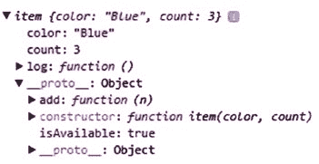
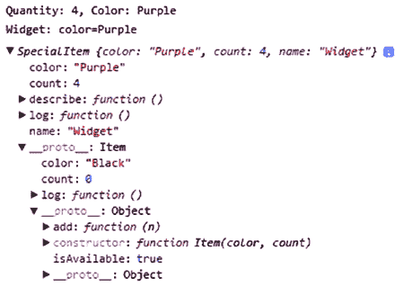
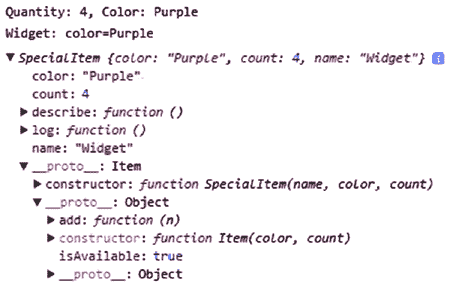

## 第 3 章：JavaScript 基础

在本章中，我将解释 HTML5 开发的第三大支柱：JavaScript。在第 [16](http://dx.doi.org/10.1007/978-1-4842-2463-2_16) 章至第 [20](http://dx.doi.org/10.1007/978-1-4842-2463-2_20) 章中，我将演示你可以使用 JavaScript 在 HTML5 网页中做的许多事情。但本章中，我必须首先解释这门语言本身。

### JavaScript 介绍

这里内容很多，因为 JavaScript 语言非常强大。起初可能会觉得有些别扭，特别是对于那些具有 C++ 或 C# 等编译语言背景的人来说。但这并不难学；我将在这里解释这些基本概念，然后你将在后面的章节中应用它们。

#### 对象

JavaScript 中的主要构建块是*对象*。对象是元素的集合；每个元素可以是*属性*或*方法*。属性保存单个数据值，而方法将执行某个定义为函数的操作。另一种说法是，属性只是一个在对象上定义的变量（注意 `var` 关键字）。同样，方法是一个在对象上定义的函数。

创建对象最简单的方法是通过一组名称/值对来指定成员，如下所示：

```javascript
var myObject = {
    color: "Red",
    count: 5
};
```

> **注意**: 你可能熟悉使用 JavaScript 对象表示法 (JSON) 格式化数据。这正是这种表示法，也是 JSON 的来源。

你也可以使用这种表示法定义方法，如下所示：

```javascript
var myObject = {
    color: "Red",
    count: 5,
    log: function () {
        console.log("Quantity: " + this.count + ", Color: " + this.color);
    }
};
```

以这种方式创建对象有时被称为*对象字面量*表示法。名为 `myObject` 的对象包含两个属性，`color` 和 `count`，以及一个函数 `log()`。然后你可以使用点表示法访问这些属性和函数，如下所示：

```javascript
window.alert(myObject.color);
myObject.log();
```


## 提示

本段代码演示了两种流行的调试方法。在 `window` 对象上调用 `alert()` 函数会显示一个模态对话框，其中包含传递给该函数的文本。在 `console` 对象上调用 `log()` 函数会将指定的文本写入浏览器控制台，你可以通过浏览器提供的开发者工具访问该控制台。请注意，`window` 和 `console` 是包含属性和函数的对象。它们将在第 [16 章](http://dx.doi.org/10.1007/978-1-4842-2463-2_16)和[第 17 章](http://dx.doi.org/10.1007/978-1-4842-2463-2_17)中详细解释。

另一种创建对象的方法是使用对象构造函数。这需要使用 `new` 关键字并调用默认构造函数。以下代码将创建完全相同的对象：

```javascript
var redObject = new Object();
redObject.color = "Red";
redObject.count = 5;
redObject.log = function() {
    console.log("Quantity: " + this.count + ", Color: " + this.color);
}
```

如果你需要一个主要用于存储数据的简单对象，JSON 风格可能稍微更直观、更简洁。然而，对于面向函数的对象，构造函数风格提供了更强大的功能，我稍后将对此进行说明。

例如，如果你需要第二个实例来计算你的绿色物品，只需像这样重复代码：

```javascript
var greenObject = new Object();
greenObject.color = "Green";
greenObject.count = 7;
greenObject.log = function() {
    console.log("Quantity: " + this.count + ", Color: " + this.color);
}
```

然后，你可以在代码中使用这两个对象，例如：

```javascript
if (greenObject.count > redObject.count) {
    console.log("You have more green items than red item");
}
```

### 构造函数

请注意，你必须在两个对象中都定义 `log()` 方法。如果你熟悉基于类的语言（如 C#），这可能会显得有些奇怪。类被用作模板，从中创建该类的每个实例。当你使用类来创建对象时，所有属性和方法的定义都会从类中复制过来。

然而，JavaScript 不使用类。相反，你可以通过创建一个构造函数来重用对象定义。在前面的示例中，你使用了通用构造函数 `Object()`，它创建了一个空对象。但你可以像这样定义一个自定义构造函数：

```javascript
function Item(){
    this.color = undefined;
    this.count = 0;
    this.log = function() {
        console.log("Quantity: " + this.count + ", Color: " + this.color);
    };
}
```

构造函数是用于实例化对象的函数。这个构造函数创建了一个名为 `color` 的属性，但未定义其值。它还创建了一个名为 `count` 的属性，并将其初始化为零。`log()` 方法也被定义，并使用这两个属性。现在，你可以通过调用 `Item()` 构造函数，使用这个原型来创建一个对象：

```javascript
var redObject = new Item();
redObject.color = "Red";
redObject.count = 5;
```

你需要为该实例设置属性值，但无需设置方法。然后你可以像之前创建的其他对象一样使用它。将此代码添加到脚本中，会将 `color` 和 `count` 属性写入控制台，就像之前一样：

```javascript
redObject.log();
```

像任何其他函数一样，构造函数可以接受参数，这通常用于初始化属性。例如，你可以重写构造函数，使其接受一个 `color` 和一个 `count` 参数：

```javascript
function Item(color, count){
    this.color = color;
    this.count = count;
    this.log = function () {
        console.log("Quantity: " + this.count + ", Color: " + this.color);
    };
}
```

然后像这样创建 `greenObject` 变量：

```javascript
var greenObject = new Item("Green", 7);
```

你不能拥有多个同名的构造函数。例如，你不能同时定义一个 `Item()` 构造函数和一个 `Item(color, count)` 构造函数。如果这样做，第二个定义将替换第一个定义。

然而，参数是可选的，因此你可以定义一个接受两个参数的构造函数，但调用它时可以不传参。如果你打算这样使用它，构造函数应该处理未定义的参数，例如像这样提供默认值：

```javascript
function Item(color, count){
    this.color = color;
    this.count = count;
    // 处理缺失的参数
    if (color == undefined){this.color = "Black";}
    if (count == undefined){this.count = 0;}
    this.log = function () {
        console.log("Quantity: " + this.count + ", Color: " + this.color);
    };
}
```

### 原型

所有对象都有一个原型。原型是一个模型或蓝图，实际对象从中实例化出来。

如果你需要额外的属性怎么办？你可以像这样向现有对象添加一个属性：

```javascript
greenObject.isAvailable = true;
```

这将仅向 `greenObject` 添加 `isAvailable` 属性；但是，如果你将其添加到 `Item` 原型中，那么新属性将对所有实例可用。你可以通过访问构造函数上的 `prototype` 属性来修改原型：

```javascript
Item.prototype.isAvailable = true;
```

这会在原型上定义新属性并将其初始化为 `true`。现在，所有通过 `Item()` 构造函数创建的对象都将拥有 `isAvailable` 属性：

```javascript
var blueObject = new Item("Blue", 3);
if (blueObject.isAvailable){
    console.log("The blue object is available");
}
```

你可以以相同的方式向原型添加方法：

```javascript
Item.prototype.add = function(n){this.count += n;};
```

### 继承

让我们深入探讨一下。考虑以下 JavaScript 代码：

```javascript
var blueObject = new Item("Blue", 3);
console.log(blueObject);
```

这将使用 `Item()` 构造函数创建一个 `blueObject`，并将结果输出到控制台。在展开部分条目后，控制台窗口将类似于 图 3-1。



**图 3-1.** 在控制台窗口中显示对象

`color` 和 `count` 属性的值被显示出来，并且 `log()` 方法也如预期列出。

注意 `__proto__` 属性，它被定义为 `Object` 类型。这就是原型属性。如果展开它，你会看到 `isAvailable` 属性和 `add()` 方法，以及 `Item()` 构造函数。

> **提示** 你可以通过像 `o.newProperty = 5;` 这样简单定义来向对象添加属性和方法。你也可以通过在构造函数原型上定义它们来向原型添加，例如 `Item.prototype.newProperty = 5;`。向对象添加仅影响该对象，但向原型添加则使新属性对所有使用该构造函数的对象可用。

正如我在本章开头所述，对象是属性和/或方法的集合。这些被称为其`自身`成员。术语`自身`表示这些成员直接由对象拥有，而非继承而来。每个对象也有一个原型，它本身也是一个对象，并拥有自己的成员。

当从对象访问一个成员（例如 `o.someProperty`）时，JavaScript 会首先在 `o` 对象自身的成员集合中查找 `someProperty`。如果在那里找不到，搜索将会在对象的原型中进行。

### 使用原型

# 第 3 章 JavaScript 要点

JavaScript 通过一种称为`原型继承`的方法支持继承。这意味着一个原型本身作为一个对象，也会有一个 `prototype` 属性。当然，这个原型也可以有自己的原型，以此类推。这被称为`原型链`。

注意，`Item` 原型中还有另一个列为成员的 `__proto__` 属性。这是所有对象都派生自的 `Object` 原型。如果你在控制台窗口中展开它，会发现许多方法列表，例如你之前用过的 `Object()` 构造函数和 `toString()` 方法。但它没有 `__proto__` 属性；这是原型链的终点。

### Tip

在某些浏览器（如 IE）中，`Object` 原型的 `__proto__` 属性会显示为 `null` 值。这实际上更准确：所有对象都有一个 `prototype` 属性，但如果没有进一步的继承，该属性将为 `null`。

了解了这点后，你可以通过简单地将 `prototype` 属性赋值为父类构造函数来建立继承关系。假设你希望创建一个新对象 `SpecialItem`，使其继承自 `Item`。创建 `SpecialItem()` 构造函数：

```javascript
function SpecialItem(name) {
  this.name = name;
  this.describe = function() {
    console.log(this.name + ": color=" + this.color);
  };
}
```

这会创建一个由构造函数初始化的 `name` 属性，同时创建一个 `describe()` 方法，用于将名称和颜色属性输出到控制台。要设置继承关系，按如下方式设置 `prototype` 属性：

```javascript
// 使用原型继承建立继承关系
SpecialItem.prototype = new Item();
```

由于构造函数中未指定 `color` 和 `count` 属性，因此使用了默认值。你可以通过在 `SpecialItem()` 构造函数中添加 `color` 和 `count` 参数，并将其传递给 `Item()` 构造函数来解决这个问题。修改 `SpecialItem()` 构造函数，添加加粗部分的代码：

```javascript
function SpecialItem(name, color, count) {
  Item.call(this, color, count);
  this.name = name;
  this.describe = function() {
    console.log(this.name + ": color=" + this.color);
  };
}
```

这里使用了父对象的 `call()` 方法，我将在本章后面解释。使用 `SpecialItem()` 构造函数创建对象后，你可以同时访问 `log()` 方法和 `describe()` 方法。要验证这一点，添加以下代码：

```javascript
var special = new SpecialItem("Widget", "Purple", 4);
special.log();
special.describe();
console.log(special);
```

控制台窗口将类似于图 3-2。



`图 3-2.` 测试 `specialItem()` 构造函数

### 使用 `create` 方法

还有一种实现继承的技术，称为`经典继承`。它使用 `Object.create()` 函数来建立父对象和子对象之间的关系。

要使用这种方法，你需要使用 `create()` 方法定义子对象的 `prototype`。例如，用以下代码替换之前设置 `SpecialItem.prototype` 的语句：

```javascript
// 使用经典继承建立继承关系
SpecialItem.prototype = Object.create(Item.prototype);
SpecialItem.prototype.constructor = SpecialItem;
```

你可以使用与之前相同的代码测试 `SpecialItem()` 的新实现：

```javascript
var special = new SpecialItem("Widget", "Purple", 4);
special.log();
special.describe();
console.log(special);
```

新对象的功能与之前相同，但元素的继承方式不同。注意，大多数属性和方法都显示在子类中，而不是父类原型中，如图 3-3 所示。



`图 3-3.` 使用经典继承的 `SpecialItem` 对象

### 使用 `class` 关键字

ECMAScript 6 引入了一些新关键字，使 JavaScript 中的继承对于熟悉基于类的继承的开发者来说更易用。这些关键字包括 `class`、`constructor`、`extends` 和 `super`。此方法底层实现与之前使用 `Object.create()` 方法的方式完全相同。它使用了一些新关键字和微小的语法变化，但实现了相同的功能。

#### 注意

虽然浏览器支持正在迅速增长，但并非所有浏览器都支持 ECMAScript 6 的所有功能。以下链接展示了当前可用的功能：http://kangax.github.io/compat-table/es6

`Item()` 和 `SpecialItem()` 函数的完整实现见列表 3-1。

`列表 3-1.` 演示 `class` 关键字

```javascript
class Item {

  constructor(color, count) {

    this.color = color;

    this.count = count;

    this.log = function () {

      console.log("数量: " + this.count + ", 颜色: " + this.color);

    };

  }

}

class SpecialItem extends Item {

  constructor(name, color, count) {

    super(color, count);

    this.name = name;

    this.describe = function () {

      console.log(this.name + ": 颜色=" + this.color);

    }

  }

};
```

为确保每种方法之间的解决方案等效，请添加以下代码来定义 `isAvailable` 和 `add()` 成员。这与之前使用的代码完全相同。

```javascript
Item.prototype.isAvailable = true;

Item.prototype.add = function(n){this.count += n;};
```

虽然这段代码使用了新的 `class` 关键字，但它定义的构造函数与之前创建的相同。`extends` 关键字定义了父构造函数的名称，而 `super` 关键字则替代了调用父构造函数的 `Item.call(this);` 语句。

要测试这一点，请使用与之前相同的调用。运行后，控制台窗口将显示与图 3-3 完全相同的内容。

```javascript
var special = new SpecialItem("小部件", "紫色", 4);

special.log();

special.describe();

console.log(special);
```

**警告** 当调用继承的方法时，`this` 的值将指向被调用的对象，不一定是定义该方法的对象。在前面的示例中，调用 `special.log()` 时，`this` 指向 `SpecialItem` 对象，即使 `log()` 方法是在 `Item()` 构造函数上定义的。当子类重写其父类的任何成员时，请务必牢记这一点。

# 重写成员

无论使用哪种语法实现继承，处理重写成员的方式都是相同的。如前所述，每个对象都有一组成员，这些成员称为自有属性（或成员）。允许自有成员与继承对象中的成员同名，对此没有任何限制。

当访问属性或调用方法时，JavaScript 首先会查找具有指定名称的自有成员。如果未找到，则会沿着原型链向上查找。对于方法而言，其工作方式很可能与你预期的一致。如果子对象中定义了该方法，则会使用子对象的实现；否则，将调用父对象的方法。

对于属性，如果父对象和子对象中存在同名的属性，则会有两个独立的实例，各自拥有不同的值。具体使用哪一个取决于作用域，这一点我将在后面解释。

### 属性

我之前对属性的概念一带而过，是因为我想先重点介绍对象、原型和继承。现在让我稍微回顾一下，更详细地解释属性。

正如你所见，属性可以是简单数据类型（字符串、数字和布尔值）之一。你无需显式声明数据类型；相反，JavaScript 会根据赋给它的值来推断数据类型。随着新值的赋值，数据类型可能会发生变化。例如：

```javascript
var test = "某个字符串";

test = 5;

test = true;
```

这段代码首先创建了一个字符串，然后将其更改为数字，最后更改为布尔值。要验证数据类型确实发生了变化，可以运行以下代码：

```javascript
var test = "某个字符串";

console.log(test + ': ' + isNaN(test));

test = 5;

console.log(test + ': ' + isNaN(test));
```

如果传入的值不是数字数据类型，`isNaN()` 函数将返回 `true`。如果运行这段代码，你会在控制台中看到类似下面的内容：

```
某个字符串: true

5: false
```

## 数组

JavaScript 中的数组就是属性的集合。数组本身有一个名称，可以是对象的成员，也可以是一个变量。数组中的项目通过数字索引进行访问。数组使用字面量表示法创建，例如：

```javascript
var colors = ["红色", "绿色", "蓝色", "黄色", "紫色", "橙色"];
```

你还可以创建一个空数组，并使用 `push()` 方法向其中添加项目：

```javascript
var colors = [];

colors.push("红色");

colors.push("绿色");
```

# JavaScript 基础

要访问数组中的某个元素，需要指定它的索引。例如，`colors[0]` 将返回字符串 `"red"`。

`length` 属性表示数组中有多少个元素。由于索引是从 0 开始的，因此 `length` 属性总是指向最后一个元素之后的位置。所以你也可以通过以下方式在数组末尾添加元素：

```js
colors[colors.length] = "blue";
```

**提示：** 数组中的元素通过从 0 开始的数字索引来访问。数组不支持命名索引（或键）。如果你需要通过名称访问某个项，应将其创建为命名属性或变量，而不是数组元素。

一个数组可以包含不同类型的元素。在同一个数组中包含数字、字符串和对象引用是完全允许的。根据你使用数组的方式，这在逻辑上可能并不正确，但 JavaScript 并不会阻止你这样做。

你可以使用 `for` 循环遍历数组中的元素：

```js
for (var i=0; i < colors.length; i++) {
  console.log(colors[i]);
}
```

### 属性

所有属性都有一组可被读取和更新的特性（attribute）。这些特性如下：

- `value` — 属性的值；这是默认属性。
- `writable` — 如果属性可以被更新，则设置为 `true`。
- `enumerable` — 如果枚举对象成员时应包含此属性，则设置为 `true`。
- `configurable` — 如果属性可以被删除，并且其特性可以被修改，则设置为 `true`。

你可以使用 `getOwnPropertyDescriptor()` 方法来访问属性描述符。属性描述符是一组命名值，用于指定这些特性的值。例如，考虑以下代码：

```js
function Item(color, count) {
  this.color = color;
  this.count = count;
}

var redObject = new Item("Red", 5);
console.log(Object.getOwnPropertyDescriptor(redObject, "color"));
```

这将输出 `redObject` 的 `color` 属性的特性。控制台会显示如下内容：`Object {value: "Red", writable: true, enumerable: true, configurable: true}`

`getOwnPropertyDescriptor()` 方法接收两个参数：第一个参数是包含该属性的对象；第二个参数是属性的名称。它返回一个属性描述符。

你可以使用 `Object.defineProperty()` 方法更新这些特性。该方法的头两个参数分别是一个对象和一个属性名称，与 `getOwnPropertyDescriptor()` 方法类似。然后，你传入一个属性描述符作为第三个参数。你只需要指定想要更改的值。例如，如果你希望 `color` 属性为只读，可以这样调用：

```js
Object.defineProperty(redObject, "color", { writable: false });
```

你也可以使用 `defineProperty()` 方法创建新属性，这样你就可以在属性首次创建时设置这些特性。如果你传入一个不存在的属性名称，则会创建一个新属性。以下代码在 `Item()` 构造函数中添加了 `size` 属性：

```js
function Item(color, count) {
  this.color = color;
  this.count = count;
  Object.defineProperty(this, "size",
    {value: 7, writable: true, enumerable: false, configurable: true});
}
```

你还可以通过调用属性的 `propertyIsEnumerable()` 方法来确定它是否可枚举。

### 特殊类型

除了三种简单类型之外，还有两种特殊的数据类型：`null` 和 `undefined`。`null` 数据类型通常用于属性是一个对象引用，但该对象尚未创建（或引用尚未设置）的情况。你可以使用 `null` 关键字将属性设置为 `null`（`test = null;`）。

`undefined` 数据类型表示该值尚未被定义。考虑以下代码：

```js
var x = null;
var y;

console.log(typeof x);
console.log(typeof y);
```

变量 `x` 已被设置为 `null`，`typeof` 运算符将返回 `"object"`。相比之下，变量 `y` 未被定义，`typeof` 运算符将返回 `"undefined"`。

你可以使用数字作为属性名称；但是，你需要像访问数组索引一样使用方括号来访问该属性。例如：

```js
var myEnum = {1: "Red", 2: "Green", 3: "Blue"};
console.log(myEnum[2]);
```

### 其他主题

JavaScript 有一些特殊的行为，或者至少对 JavaScript 新手来说不太容易理解。以下我将简要介绍它们。

### 比较运算符

JavaScript 支持典型的比较运算符，例如小于、大于等。我不打算详细说明，因为它们大多不言自明。如果你想进一步探索，Mozilla 有一篇关于这个主题的好文章（<https://developer.mozilla.org/en-US/docs/Web/JavaScript/Reference/Operators/Comparison_Operators>）。

不过，有一个地方我需要详细说明。JavaScript 区分等同性（equivalence）和相等性（equality）。例如，数字 `12` 和字符串 `"12"` 被视为等同，但并不相等。在这里，等同性意味着如果两个对象被转换为相同的数据类型，它们将具有相同的值。相等性则意味着两个对象具有相同的类型和值。这有时被称为严格相等。

标准运算符，如等于（`==`）、小于（`<`）、大于或等于（`>=`），使用的是等同性概念。为了测试严格相等性，JavaScript 提供了 `===` 和 `!==` 运算符。例如，`a === b` 将使用严格相等性比较对象 `a` 和 `b`。同样，你可以使用 `!==` 来测试不严格相等。

**提示：** 我使用“等同性”和“相等性”这两个术语，因为它们能更准确地描述这些概念。然而，你经常会看到用“相等性”来指代等同性，而用“严格相等性”来表示相等性。`===` 和 `!==` 运算符是 JavaScript 中相对较新的补充。在此之前，所有的比较运算符都是基于等同性的，我们使用等于运算符（`==`）并称之为等于。现在我们有了一个真正表示相等的运算符（`===`）。

### 变量作用域

变量的作用域决定了它可以在何处被访问。如果变量在函数体外部声明，它将具有全局作用域，这简单意味着所有函数都可以访问它。此外，单个实例由所有函数共享；如果一个函数修改了它的值，那么在它被使用的任何地方，它都会具有这个新值。并且，该变量在浏览器关闭之前一直可用。

在函数内部声明的变量被视为具有局部作用域。该变量仅对函数内部的代码可用。一旦函数返回，该变量就不再可用。每次调用函数时，都会创建该变量的一个新实例，因此调用之间不会共享值。函数参数始终具有局部作用域。

最后一种作用域类型是块级作用域，它将变量的访问限制在其被声明的块内。一个块由围绕它的花括号 `{}` 定义，例如在 `if` 或 `for` 语句中。块级作用域是 JavaScript 中相对较新的功能（在 ECMAScript 第 6 版中引入）。由于 JavaScript 最初不支持块级作用域，例如在 `if` 语句中声明的变量，整个函数都可以访问。如果 JavaScript 突然开始强制执行块级作用域，现有的应用程序将会失败。

相反，块级作用域是通过使用 `let` 关键字而不是 `var` 来选择性地应用的。考虑以下函数定义：

```js
function testScope() {
  var localScope = 5;
  if (localScope > 3) {
    var localScope2 = 7;
    let blockScope = 4;
  }
}
```

# 变量作用域

`console.log(localScope2 + blockScope);` // 输出 11

}

`console.log(localScope2);` // 输出 7

`console.log(blockScope);` // 这将失败

}

`testScope();`

`localScope` 变量是使用传统的 `var` 关键字声明的，它在 `if` 块外部是可用的。然而，`blockScope` 变量是使用 `let` 关键字声明的，它在 `if` 块外部不可用。无论如何，在 `testScope()` 函数外部，局部作用域或块作用域的变量都是不可访问的。

变量作用域中一个棘手的问题是多个变量使用了相同的名称声明。

这不会产生错误，但你可能无法得到预期的结果。例如，请看以下代码：

`var x = 1;` // 全局作用域

```
function testX(x1){
    var x = 2; // 局部作用域
    console.log("传入的原始 x 值: " + x1);
    console.log("局部作用域的 x: " + x);
}
testX(x);
console.log("全局作用域的 x: " + x);
```

一个名为 `x` 的变量在全局作用域和局部作用域中都被创建了。它们实际上是两个不同的对象，各自拥有自己的值。全局作用域对象的值被传入函数，并在函数内作为参数 `x1` 可用。

函数声明了一个名为 `x` 的变量；这是一个新对象，与第一个对象无关，只是它们名字相同。任何引用 `x` 的代码都会使用局部对象；函数不可能访问全局作用域的变量。这被称为*隐藏*对象。在函数内设置 `x` 的值只会改变局部变量。当这段代码执行时，控制台会输出以下内容：

```
original x value passed in: 1
local-scoped x: 2
global-scoped x: 1
```

**注意：** 如果你在函数内使用变量但没有用 `var` 或 `let` 关键字声明，它将被创建为全局作用域变量。例如，如果在函数中添加语句 `x=5;`，变量 `x` 将是全局变量。你应该始终使用 `var` 或 `let` 声明变量，以使你的意图清晰。

#### 严格模式

当使用*严格模式*时，未声明的变量是不被允许的，并且会导致错误。否则，如果不处于严格模式，JavaScript 会为你声明变量。虽然这看起来是个好主意，但可能导致意外结果。例如，考虑以下代码：

```
var myIntervalCounter = 0;
for (var i=0; i < 10; i++)
{
    if (i % 2 == 0) { myInterbalCounter = i * 2; }
}
console.log(myIntervalCounter);
```

注意在 `for` 循环中 `myIntervalCounter` 变量拼写错了。在非严格模式下，会创建一个新变量并设置其值，而不是更新原变量。本应被更新的变量从未被设置，其值仍为 0。


你可以通过在脚本顶部添加以下内容来开启严格模式：

```
"use strict";
```

这将为整个文件开启严格模式。或者，你也可以通过在函数定义的第一行添加它，将其应用于特定函数。在严格模式下，之前的代码会生成一个错误，如图 3-4 所示。

***图 3-4.** 严格模式错误*

**提示：** 严格模式还有其他一些细微差别，例如不允许你使用保留关键字命名变量。Mozilla 有一篇很好的文章详细解释了严格模式的功能，网址为 [`developer.mozilla.org/en-US/docs/Web/JavaScript/Reference/Strict_mode`](https://developer.mozilla.org/en-US/docs/Web/JavaScript/Reference/Strict_mode)。

#### 函数

我们之前已经看过函数，使用函数创建对象。函数也是一个对象，可以像属性一样作为对象成员添加。这满足了面向对象封装的要求。

函数也可以像其他任何类型的变量一样被定义。因此，函数可以在全局作用域（函数体外）中定义，但也可以在其他函数内部定义。考虑以下代码：

```
var functionA = function(){
    var x = 1;
    var functionB = function(){
        var y = 2;
        var functionC = function(){
            var z = 3;
            console.log(x+y+z);
        }
    }
}
```

在这里，`functionA()` 在局部作用域中声明了 `functionB()`，后者又在局部作用域中创建了 `functionC()`。这被称为*词法作用域*，即在一个函数内部定义另一个函数。

每个函数定义了一个新的作用域。`functionA()` 在全局作用域中。在花括号之间定义了一个新的局部作用域；我们称其为作用域 A，它包含变量 `x` 和 `functionB()`。在 `functionB()` 的花括号内部，定义了另一个作用域；我们称其为作用域 B。它包含变量 `y` 和 `functionC()`。类似地，在 `functionC()` 内部有第三个局部作用域，包含变量 `z`。

此时，没有任何函数被调用；你只是在定义它们。只有 `functionA()` 具有全局作用域，并且它是你唯一可以调用的函数。让我们重写这段代码，加入一些函数调用，以便观察实际效果。内部函数 `functionB()` 可以调用 `functionC()`，因为它位于 `functionB()` 的作用域内。

类似地，`functionA()` 可以调用 `functionB()`。由于 `functionA()` 是全局作用域，你可以直接调用它。

```
var functionA = function(){
    var x = 1;
    var functionB = function(){
        var y = 2;
        var functionC = function(){
            var z = 3;
            console.log(x+y+z);
        }
        functionC();
    }
    functionB();
}
functionA();
```

注意，`functionC()` 可以访问 `functionA()` 和 `functionB()` 中的局部作用域变量。

这被称为*闭包*。闭包发生在内部函数访问其外部（包含）函数中的变量时。内部函数也可以访问外部函数的局部作用域中的函数和变量。所以 `functionC()` 可以调用 `functionB()`。它也可以调用 `functionA()`，因为这是全局作用域的。但如果它这样做（在当前的例子中），你会陷入无限循环。

**注意：** 请记住，`functionA()` 不能调用 `functionC()`。一个函数可以访问其局部作用域以及作用域链中往前的任何东西；但它不能访问作用域链中更靠后的任何东西。

所以你不能直接调用 `functionC()`。真的不能吗？实际上，如果返回了对它的引用，你就可以调用它；这是闭包的一种常见用法。只有 `functionB()` 可以访问 `functionC()`，但函数与其他任何变量一样都是对象，可以作为返回值提供给调用者。我稍微重写一下代码来演示这一点。

```
var functionA = function(){
    var x = 1;
    var functionB = function(){
        var y = 2;
        var functionC = function(){
            var z = 3;
            console.log(x+y+z);
        }
        return functionC;
    }
    return functionB();
}
var closure = functionA();
closure();
```

在 `functionB()` 内部，不是调用 `functionC()`，而是返回该函数。注意 `return` 语句中没有括号。这仅仅是返回名为 `functionC` 的变量（它恰好是一个函数），而不实际执行它。在 `functionA()` 内部，它确实调用了 `functionB()` 并返回了 `functionB()` 返回的值，即对 `functionC()` 的引用。

调用 `functionA()` 只是返回一个函数引用，该引用存储在 `closure` 变量中。`closure` 变量现在有了对 `functionC()` 的引用。任何时候你想调用 `functionC()`，只需调用 `closure()`。

## 上下文

`this` 关键字指的是当前的执行上下文，但有时并不清楚 `this` 是什么。这就像去一家餐厅，告诉你的服务员“你想再来一些这个。” 希望你已经指明了这个是什么，否则你可能得不到你想要的。JavaScript 有时就是这样。

`this` 关键字引用单个对象。例如，在函数内部，`this` 指向调用该函数的对象。在包含属性和方法的典型对象中，`this` 通常指向其所属对象。例如：

```javascript
var myObject = {
    color: "Red",
    count: 5,
    log: function () {
        console.log("Quantity: " + this.count + ", Color: " + this.color);
    }
};
```

这里，`log()` 函数使用 `this.count` 来访问其所属对象中的属性。然而，有一个非常重要的点：`this` 的值直到函数被调用时才确定……并且该值通常被设置为调用该函数的对象，尽管这一点可以被覆盖。所以，在这个例子中，我们期望 `log()` 函数通过类似 `myObject.log();` 的方式被调用，在这种情况下，`myObject` 将是调用对象。

如果将一个函数用作回调，例如事件处理器，则调用对象很可能不是其所属对象。例如，如果该函数处理按钮的 `onclick` 事件，那么调用对象将是该按钮。

### `call()`、`apply()` 和 `bind()` 函数

`call()` 函数允许你调用一个函数并指定 `this` 的值。我将用以下代码来演示：

```javascript
function Vehicle(weight, cost) {
    this.weight = weight;
    this.cost = cost;
}

function Truck(weight, cost, axles, length) {
    Vehicle.call(this, weight, cost);
    this.axles = axles;
    this.length = length;
}

var tonka = new Truck(5, 25, 3, 15);
console.log(tonka);
```

你可能认识 `Vehicle()` 函数；这是一种创建对象的典型方式，通常通过如下语句调用：

```javascript
var v = new Vehicle(5, 25);
```

这将创建一个具有两个属性 (`weight` 和 `cost`) 的对象，并用提供的值进行初始化。`Truck()` 函数类似，初始化了 `axles` 和 `length` 属性。但请注意该函数的第一行：

```javascript
Vehicle.call(this, weight, cost);
```

这使用了 `call()` 函数来调用 `Vehicle()`，并向其传递了当前的 `this` 值，该值是对 `Truck` 对象的引用。当 `Vehicle()` 函数以这种方式被调用时，`weight` 和 `cost` 属性会被添加到 `Truck` 对象上，而不是 `Vehicle` 对象上。将新的 `tonka` 变量发送到控制台日志即可验证这一点。你应该会看到以下输出：

```
Truck {weight: 5, cost: 25, axles: 3, length: 15}
```

注意，`call()` 函数传入了三个参数。第一个参数被用作函数内部的 `this` 值。其余参数则被传递给被调用的函数。`apply()` 函数的工作方式与 `call()` 函数完全相同，唯一的区别是额外的参数以数组形式传递。以下两行代码实现相同的功能：

```javascript
Vehicle.call(this, weight, cost);
// 或者
Vehicle.apply(this, [weight, cost]);
```

你可以任选其一使用，这只是一个偏好问题。然而，`apply()` 可以用于参数数量可变的列表。你可以动态构建数组，然后将其作为第二个参数传递给 `apply()`。

`call()` 和 `apply()` 函数都会立即调用它们所作用的函数。因此，当你执行 `Vehicle.call(...)` 时，`Vehicle()` 函数会被立即调用。如果你只想设置好调用但实际并不立即执行呢？例如，当你正在设置一个在点击事件发生时执行的回调函数。这可能会像这样：

```javascript
myButton.click(myHandler);
```

正如我前面提到的，当 `myHandler()` 被调用时，`this` 将是按钮对象。如果你想要一个不同的 `this` 值，你不能使用 `call()` 或 `apply()`，因为你尚未调用该处理器；你只是在为事件触发时的调用做准备。要解决这个问题，可以像这样使用 `bind()` 函数：

```javascript
myButton.click(myHandler.bind(newThis));
```

现在，当事件发生时，`myHandler()` 函数将被调用，并且其 `this` 值将是传入的值 `newThis`。你可以通过在 `this` 引用之后列出它们来向函数传递额外的参数，就像 `call()` 函数那样。

# JavaScript 函数与命名空间

通常情况下，当您在 JavaScript 中定义一个函数时，您只是定义了它；它还没有被调用。如果您希望它运行，您必须随后调用它。例如：

```
var myFunction = function() {
  doSomething();
}
```

现在，如果您想调用它，您需要添加一条像 `myFunction();` 这样的语句。或者，您可以将该函数定义为一个`立即调用函数表达式`（IIFE），发音为“iffy”。

您可以通过将函数放在一对圆括号内，然后添加一对开闭圆括号来将其转换为 IIFE，如下所示：

```
(function() {
  doSomething();
})();
```

如果这段代码定义在全局作用域中，那么 `doSomething()` 函数会在脚本被解析时立即执行。

## 命名空间

在 JavaScript 中，全局作用域内的所有对象都需要具有唯一的名称，以避免名称冲突。请记住，浏览器上运行的所有脚本共享全局作用域。因此，即使您的代码没有冲突，其他第三方脚本也在全局作用域中拥有对象。如果您将所有对象都放在全局作用域中，与其他对象使用相同名称发生冲突的可能性就会大大增加。为了编写良好的防御性代码，您应该使用命名空间来组织代码。

命名空间是一种按层次结构组织代码的技术。一个对象的完全限定名称包含其在层次结构中定义的路径。因此，即使您有两个都名为 `Item` 的类，只要它们位于不同的路径（命名空间）中，它们的完全限定名称就是唯一的。

虽然 JavaScript 不直接支持 `namespace` 关键字，但命名空间的概念可以很容易地通过嵌套对象来实现。这里的基本原则是：在全局作用域中创建一个单一对象，然后将所有其他内容作为该全局对象的成员添加进去。例如，以下代码在全局作用域中创建了一个单一对象，然后创建了一些嵌套对象来定义一个层次结构。

```
var mySample = {}; // 全局对象

// 定义命名空间层次结构
mySample.things = {};
mySample.things.helpers = {};
mySample.otherThings = {};

// 向命名空间中添加内容
mySample.things.count = 0;
mySample.things.helpers.logger = function (msg) {
  console.log(msg);
}
```

如果您的代码分布在多个文件中，或者您在多个地方需要这段代码，您需要确保对象不会被创建两次。您可以通过使用 `||` 运算符来实现这一点：`this.mySample = this.mySample || {};`

一个未定义的对象会返回 `falsy` 值，因此 `||` 运算符会继续执行语句的下一部分，即创建该对象。如果该对象已经被创建，这会返回 `true`，其余代码将被跳过。

您的所有代码都会使用 `mySample` 对象内的对象，因此非常关键的一点是，这个对象必须在任何其他代码执行之前被创建。最简单的方法是在脚本开头将其包含在一个 IIFE 中，所以让我们将其重写为一个 IIFE：

```
(function () {
  window.mySample = window.mySample || {};

  // 在层次结构中添加其他节点
  window.mySample.things = window.mySample.things || {};
  window.mySample.things.helpers = window.mySample.things.helpers || {};
  window.mySample.otherThings = window.mySample.otherThings || {};

  // 设置快捷方式
  window.helpers = window.mySample.things.helpers;

  // 现在添加一些成员
  window.mySample.things.count = window.mySample.things.count || 0;
  window.mySample.things.helpers.logger = function (msg) {
    console.log(msg);
  }
})();
```

请注意，`var` 关键字被移除，并替换为了 `window` 对象；这指的是全局作用域。通过将 `mySample` 定义在 `window` 对象上，您可以使其在任何地方都可用。

最后，我偷偷加入了一个快捷方式，这样我就可以使用较短的引用来访问命名空间。您可以通过遵循命名空间层次结构（`mySample`、`things`、`helpers`）来访问 `logger()` 方法。但您也可以直接从快捷方式 `helpers` 访问它：

`mySample.things.helpers.logger("some text");`

# JavaScript 基础

## 命名空间

`helpers.logger("some more text");`

> **提示** 实现命名空间概念还有其他方式。如需了解这些变体的示例，请参阅 [`addyosmani.com/blog/essential-js-namespacing`](https://addyosmani.com/blog/essential-js-namespacing) 上的文章。同时，这还假设不存在名为 `mySample` 或 `helpers` 的其他全局对象。你可能需要在这些名称前加上公司名称或缩写，以确保唯一性。

## 异常

JavaScript 支持 `try/catch/finally` 模式，这与你在 C# 等其他语言中看到的类似。

可能失败的代码应放入 `try` 块中。如果在 `try` 块内引发了异常，则将执行 `catch` 块。无论是否发生错误，`finally` 块始终会执行。

你还可以使用 `throw()` 函数在代码中生成异常。这使你可以将错误处理放在 `catch` 块中，从而使主代码更清晰。以下是这些结构的一个简单示例：

```javascript
try {
  var x = 5;
  var y = 0;
  if (y == 0) {
    throw("不能除以零")
  }
  console.log(x/y);
}
catch(e) {
  console.log("错误: " + e);
}
finally {
  console.log("Finally 块已执行");
}
```

`finally` 块是放置任何必要的清理代码的好地方，这些代码即使在发生错误时也需要运行。`catch` 和 `finally` 块都是可选的，但你至少需要其中一块。

## Promise

`Promise` 是处理异步函数调用的一种标准化方式。实际上，它只是一个带有两个参数的回调函数：一个函数在成功时被调用，另一个在失败时被调用。Promise 可以处于以下三种状态之一：

- **待定（Pending）** - 操作尚未完成
- **已完成（Fulfilled）** - 操作成功完成
- **已拒绝（Rejected）** - 处理过程中发生错误

有时，已完成和已拒绝被统称为已决。让我们看一个使用 Promise 的简单示例。`getNumber()` 函数等待 2 秒，然后生成一个介于 0 和 100 之间的随机数。如果你请求一个偶数且随机数为偶数，则该函数返回成功。

```javascript
function getNumber(bEven) {
  return new Promise(function (fulfill, reject) {
    // 执行某些长时间运行的任务
    window.setTimeout(
      function () {
        var i = Math.round((Math.random() * 100), 0);
        if ((i % 2 != 0 && bEven) ||
            (i % 2 == 0 && !bEven)) {
          reject(i);
        }
        else {
          fulfill(i);
        }
      }, 2000);
  });
}
```

`getNumber()` 函数返回一个 `Promise` 对象，该对象是一个带有两个参数的函数。工作在这个内部函数中完成。由于代码位于 `getNumber()` 函数内部，因此它可以访问其变量，例如 `bEven` 参数。`fulfill()` 和 `reject()` 函数的引用被传入内部函数，当内部函数完成时，会调用其中一个。

要调用此代码，请添加以下内容：

```javascript
var p = getNumber(true);
p.then(
  function (i) { console.log("Promise 已完成, i = " + i); },
  function (i) { console.log("Promise 已拒绝, i = " + i); }
);
console.log("Promise 已创建...");
```

这将调用 `getNumber()` 函数请求一个偶数。该函数立即返回一个 `Promise` 对象。然后调用 `Promise` 对象的 `then()` 成员，传入两个匿名函数。第一个将在成功时调用，第二个在失败时调用。此时，`getNumber()` 函数尚未完成；它处于待定状态。然后，`Promise` 对象会执行其中一个匿名回调函数。

你也可以捕获错误回调，而不是将其传递给 `Promise` 对象。例如，以下方式可以实现相同的效果：

```javascript
p.then(
  function (i) { console.log("Promise 已完成, i = " + i); }
)
.catch(
  function (i) { console.log("Promise 已拒绝, i = " + i); }
);
```

## 数组方法

处理数组时有相当多的内置功能。我将在此解释更常见的方法，并在附录 C 的参考部分提供完整列表。

### 访问元素

正如我之前提到的，填充数组的最简单方法是使用字面量表示法。例如，这将创建一个包含六个字符串元素的数组：

```javascript
var arr = ["red", "green", "blue", "yellow", "orange", "purple"];
```

第一个元素的索引为 0，其余元素的索引按顺序分配。

元素通过其索引进行访问。要获取第二个元素的值，请使用 `arr[1]`，它将返回字符串 `"green"`。你可以通过直接设置来更新值，例如 `arr[2] = "azure"`。这将用 `"azure"` 替换 `"blue"` 元素。你还可以使用 `delete` 关键字删除元素：`delete arr[3]`。这将删除索引 3 处的值 (`"yellow"`)，但在数组中留下一个空元素。

JavaScript 在处理越界错误方面非常宽容。例如，在上述数组中，有六个元素，每个元素通过索引 0-5 引用。调用 `arr[8]` 不会导致错误，而是返回 `undefined`。同样，你可以调用 `arr[8] = "brown"`，数组将自动增长以容纳九个元素，第九个元素的值为 `"brown"`。这会在数组中留下一些空洞；`arr[6]` 和 `arr[7]` 将是 `undefined`，但 `arr[8]` 将返回 `"brown"`。

有两种添加新元素的方法：`unshift()` 将元素添加到数组的开头，`push()` 将元素添加到数组的末尾：

```javascript
arr.unshift("white");
arr.push("black");
```

执行此操作后，`"white"` 将位于列表的开头，`"black"` 位于末尾。原始六个元素将按原始顺序位于两者之间。这两种方法都返回添加元素后数组的新大小。你还可以通过 `length` 属性获取大小：

```javascript
var numberOfElements = arr.length;
```

还有相应的方法来移除第一个和最后一个元素。`pop()` 方法返回最后一个元素并将其从数组中移除。同样，`shift()` 方法返回第一个元素并将其从数组中移除。

`shift()` 和 `unshift()` 方法因其需要调整元素索引而得名。数组中的第一个元素的索引为 0。当在开头添加新元素时，它将位于索引 0，这意味着每个现有元素的索引都需要递增或上移。同样，移除第一个元素需要索引下移。

> **提示** 你可以通过使用 `push()` 和 `pop()` 方法来实现栈的功能。栈使用后进先出（LIFO），意味着最后添加的元素最先被移除。使用 `push()` 将元素添加到末尾，然后 `pop()` 将移除最后添加的元素。要实现队列（先进先出，FIFO），请使用 `unshift()` 添加新元素，并使用 `pop()` 移除队列中最旧的元素。

### 输出数组

`valueOf()` 方法将返回数组作为值集合。这是数组对象的默认方法；如果你访问数组而不调用其任何方法，则会调用此方法。

此外，你可以通过调用 `toString()` 方法轻松地将数组的内容输出为一组逗号分隔的值。如果你需要使用不同的分隔符字符串输出元素，请使用 `join()` 方法。该方法接受一个参数，指定将放置在每个元素之间的字符串。

如果你不向 `join()` 方法传递任何参数，它将使用逗号字符。例如，如果你有一个名为 `arr` 的数组，以下四个语句将输出其内容：前两个作为字符串集合，后两个作为包含逗号分隔值的单个字符串。

```javascript
console.log(arr);
console.log(arr.valueOf());
console.log(arr.toString());
console.log(arr.join());
```

好的，作为一名高级文档工程师和翻译员，我将遵循您提供的注意事项和示例，对以下英文文本进行翻译。

# JavaScript 中的数组操作方法

JavaScript 中有几种可用的数组操作方法，我将在此简要说明。其中一些方法会修改现有数组，而另一些则不会，而是返回一个新数组。请密切注意这一细节。

## `concat()` 方法

`concat()` 方法用于合并两个或多个数组，并将元素返回到一个新数组中。现有数组不会被修改。`concat()` 方法在第一个数组上调用，而其他数组作为参数传入。例如：

```javascript
var arr1 = ["a", "b", "c"];
var arr2 = ["x", "y", "z"];
var combined = arr1.concat(arr2);
```

生成的数组 `combined` 将包含元素 `a`、`b`、`c`、`x`、`y` 和 `z`。如果你需要合并超过两个数组，只需将其他数组作为附加参数传入即可。

## `slice()` 方法

使用 `slice()` 方法可以创建一个包含现有数组子集的新数组，而不会改变现有数组。传入起始和结束索引以指定要返回哪些元素。请注意，起始索引是包含的，但结束索引是不包含的。因此，调用 `arr.slice(2, 4);` 将返回索引 2 和 3 的元素。结束参数是可选的；如果省略，则返回从起始索引开始的所有元素。

你还可以在调用 `slice` 时使用负值，这将从右侧开始计数。例如，`arr.slice(-3, -1);` 将返回倒数第二个元素以及它前面的那个元素。这种语法可能看起来不太直观；然而，如果你将数组长度加到这些参数上，就更容易理解了。

例如，以下两条语句将返回完全相同的结果：

```javascript
arr.slice(-3, -1);
arr.slice(arr.length-3, arr.length-1);
```

**提示：** 如果你想获取最后 `n` 个元素，请将 `-n` 用作第一个参数，将 `length` 用作第二个参数。例如，要获取最后 5 个元素，请使用 `arr.slice(-5, length);`。

## `splice()` 方法

`splice()` 方法可以同时执行删除数组中的元素以及在指定位置插入新元素的操作。第一个参数指定删除开始的位置，同时也是插入新元素的位置。第二个参数指示应删除多少个元素。如果你不想删除任何元素，请输入 `0`。要插入元素，请将它们作为附加参数传入。

你可以使用 `splice()` 方法仅删除元素，也可以仅插入元素，还可以同时执行这两项操作。例如：

```javascript
arr.splice(2, 1); // 删除索引 2 处的一个元素
arr.splice(2, 0, "teal", "pink"); // 在索引 2 处添加两个元素
arr.splice(2, 1, "teal", "pink"); // 删除 1 个元素并插入 2 个
```

**注意：** `splice()` 方法会返回一个包含被删除元素的数组。在这方面，它的工作方式与 `slice()` 方法类似。事实上，`arr.splice(2,1);` 和 `arr.slice(2,1);` 将返回相同的结果。然而，与 `slice()` 不同，`splice()` 方法会修改调用它的数组。调用 `slice()` 会保持原数组不变，但调用 `splice()` 会从数组中移除元素。当然，如果你使用 `splice()` 来插入元素，数组也会被更新。

## `sort()` 方法

`sort()` 方法会修改现有数组。它接受一个可选参数，用于指定在排序过程中使用的回调函数。如果未提供，`sort()` 方法会在必要时将每个元素转换为字符串，然后按字母顺序对字符串进行排序。考虑以下代码：

```javascript
var numbers = [1, 33, 7, 12, 5];
numbers.sort();
```

执行 `sort()` 方法后，元素将变为 `[1, 12, 33, 5, 7]`，这可能不是你想要的。要纠正这一点，你需要提供一个比较函数。此函数接收两个参数，它们将是数组中的两个元素。如果元素相等（就它们应如何排序而言），它应返回 `0`；如果第一个元素应排在第二个元素之前，则返回 `-1`；如果第一个元素应排在第二个元素之后，则返回 `1`。

以下代码定义了一个 `numericSort()` 函数，并将其传递给 `sort()` 方法。调用此方法后，元素将按数字顺序 `[1, 5, 7, 12, 33]` 排序。

```javascript
function numericSort(a, b){
    if(isNaN(a) || isNaN(b)) return 0; // 如果不是数字，则无法比较
    if(a == b) return 0;
    if(a < b) return -1;
    if(a > b) return 1;
}

var numbers = [1, 33, 7, 12, 5];
numbers.sort(numericSort);
```

## `reverse()` 方法

`reverse()` 方法通过反转其元素的顺序来修改现有数组。它不接受任何参数，并返回修改后的数组。以下代码将输出元素 `[3, 2, 1]`。

```javascript
var numbers = [1, 2, 3];
numbers.reverse();
console.log(numbers);
```

### 搜索

数组对象提供了几种在数组中查找元素的方法。`indexOf()` 方法返回指定元素首次出现的索引。例如，`arr.indexOf("red");` 将返回第一个值为 `"red"` 的元素。类似地，`arr.lastIndexOf("red");` 将返回最后一次出现的位置。

这两种方法都使用严格相等性来执行搜索，这意味着如果你要查找 `"12"` 而数组包含数字 `12`，则无法找到它。`indexOf()` 方法从数组开头开始向前搜索，直到找到第一个匹配项。`lastIndexOf()` 方法从数组末尾开始向后扫描。

两种方法都支持一个 `fromIndex` 参数，该参数指定搜索应从何处开始。如果未指定，则搜索从头开始（对于 `lastIndexOf()` 则是从末尾开始）。也支持负值，表示搜索应从距离数组末尾这么多个元素的位置开始。如果使用负数来定义搜索的起始位置，`indexOf()` 的搜索仍然是向前的，而 `lastIndexOf()` 的搜索仍然是向后的。

```javascript
var arr = ["red", "green", "blue", "yellow", "blue", "purple"]; 
arr.indexOf("blue"); // 返回 2
arr.lastIndexOf("blue"); // 返回 4
arr.indexOf("blue", 3); // 返回 4
arr.lastIndexOf("blue", -3); // 返回 2
```

`find()` 和 `findIndex()` 方法将使用你定义的回调函数来搜索数组中的元素。这使你可以完全控制搜索逻辑。`find()` 方法返回元素，而 `findIndex()` 返回元素的索引。这两种方法都会遍历数组中的元素，执行指定的回调函数。当回调函数返回 `true` 时，搜索停止，并返回当前元素或其索引。

回调函数可以有三个输入参数，但只有第一个是必需的：

- `element` - 当前正在评估的数组元素

- `index` - 当前元素的索引

- `array` - 正在其中搜索的数组对象

例如，如果你想从数组中查找第一种原色，可以将回调函数实现为：

```javascript
function isPrimary(color, index, array) {
    if (color == "red" || color == "blue" || color == "yellow"){
        return true;
    }
    return false;
}
```

然后调用 `find()` 方法，并传入 `isPrimary()` 函数：

```javascript
console.log(arr.find(isPrimary));
```

`find()` 和 `findIndex()` 方法都支持第二个可选参数。这允许调用者在调用回调函数时定义 `this` 的值。

### 创建子集

`filter()` 函数不会修改数组，而是返回一个新数组，该数组是原数组的一个子集。要实现过滤逻辑，你必须指定一个回调函数，该函数将为数组中的每个元素调用。如果元素应包含在子集中，则该函数返回 `true`，否则返回 `false`。

此回调函数的工作方式与 `find()` 方法使用的回调函数相同。实际上，你可以对两者使用相同的函数：

```javascript
var subset = arr.filter(isPrimary);
console.log(subset);
```

这不会影响现有数组，但会返回一个包含 `["red", "blue", "yellow", "blue"]` 的新数组。
