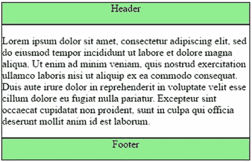

# 使用 Flexbox 实现响应式布局

这是一个非常实用的功能，尤其是在响应式网页设计中。通过 `CSS` 控制排列顺序，意味着可以根据媒体查询进行调整。例如，当使用小型设备时，可以设置 `order` 属性将某些特定内容移至页面底部。

> **提示：** 你无需为所有项目设置 `order` 属性。例如，若想让某个特定项目显示在最前面，只需将其 `order` 设置为 `-1`，其余项目保持初始值即可。所有其他项目的 `order` 值默认为 `0`，因此该元素会排在首位。

## 覆盖对齐方式

我之前解释过，容器上的 `align-items` 属性如何控制行（或列）中项目在交叉轴上的对齐方式。该属性适用于容器中的所有弹性项目。不过，你可以通过为单个项目设置 `align-self` 属性来覆盖此设置。它支持与 `align-items` 属性相同的六个值。举个简单的例子，以下 CSS 为第一个段落和 `div` 元素设置了此属性，结果如图 14-11 所示。

```css
.i1 {
    /*flex: 1 3 350px;
    flex: 1 .35 350px;*/
    flex: 3;
    align-self: flex-end;
}

.i3 {
    height: 75px;
    background-color: lightyellow;
    /*flex: 2 0 50px;*/
    flex: 1;
    align-self: center;
}
```

***图 14-11.*** *使用 `align-self` 属性*

# 第 14 章 ■ Flexbox

## 垂直示例

以一个使用垂直主轴方向的简单示例为例，我将搭建一个包含固定尺寸页眉和页脚的典型页面布局。主体部分将允许根据现有内容自动扩展。标记如下：

```html
<section class="vertical">
    <header>Header</header>
    <footer>Footer</footer>
    <main>
        <p>Lorem ipsum dolor...</p>
    </main>
</section>
```

此 `section` 元素包含 `header`、`footer` 和 `main` 元素。我将 `footer` 元素放在 `main` 元素之前，以演示 `order` 属性。为了格式化此布局，使用了以下 CSS：

```css
.vertical {
    display: flex;
    flex-direction: column;
}

header, footer {
    text-align: center;
    background-color: lightgreen;
    flex: 0 0 35px;
}

main {
    flex: auto;
}

footer {
    order: 3;
}
```

这里将 `flex-direction` 设置为 `column`，因此主轴方向变为垂直。项目将沿垂直方向伸缩。`header` 和 `footer` 不允许伸缩，且基准尺寸设置为 `35` 像素。相比之下，`main` 元素设置了 `flex: auto;` 以允许伸缩，其基准尺寸由内容的固有尺寸决定。`footer` 的 `order` 属性设置为 `3`，因此页脚将排列在最后。渲染结果如图 14-12 所示。



***图 14-12.*** *垂直布局示例*

## 总结

在本章中，我解释了如何使用 flexbox 在灵活布局中排列项目。基本思路是定义预测性规则来排列 HTML 元素，然后让浏览器根据当前窗口尺寸应用这些规则。你可以在容器以及容器内的项目上配置属性。

在容器上，你可以定义项目渲染时的流动方向。其属性和术语与方向无关，例如使用 `start` 和 `end` 而非 `top` 或 `bottom`，因此在构思解决方案时可能需要做一些转换。容器的属性还允许你指定项目行或列的对齐方式。

在项目上，你可以指定项目应如何根据可用空间沿主轴进行伸缩。你可以覆盖沿交叉轴的对齐方式。你还可以设置项目的显示顺序 `order`，从而通过 CSS 调整其排列顺序。这使你能够根据设备特性，利用媒体查询重新定位元素。

在下一章中，我将演示如何使用动画和变换来为你的网页增添趣味与活力。

---

# 第 15 章

## 动画与变换

### 动画