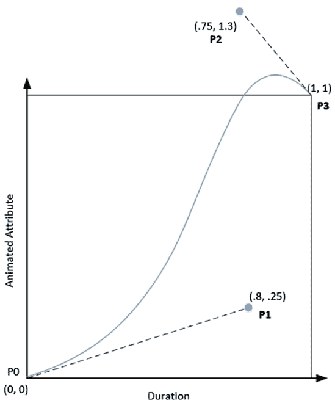

# 关键帧命名与多动画配置

如果你希望为关键帧取一个与属性值同名的名称（例如 `reverse`），则需要小心处理。你必须先指定对应的属性（在本例中为 `animation-direction`），然后再指定 `animation-name`。如果你希望动画方向为 `reverse`，则需要将值 `reverse` 包含两次：第一个用于 `animation-direction`，第二个用于 `animation-name` 属性。你不能让浏览器设置默认值。如果你希望使用默认值 `normal`，则需要在 `reverse` 之前显式包含 `normal`。

## 多动画

你可以在同一个目标元素上定义多个动画。例如，一个动画可以移动元素，另一个动画可以改变其颜色。这些动画是独立应用的。如果你使用 `animation` 简写属性，则需要为第一个动画指定所有所需属性，然后依次为第二个动画指定，以此类推。每个动画的属性之间用逗号分隔。例如，以下代码将为所有带有 `circle` 类的元素应用两个动画：

```css
.circle {
  animation: colors 5s 3, otherKey 2s 4s alternate;
}
```

如果你正在设置各个属性，则需要为每个动画提供一个属性值，这些值之间用逗号分隔。请为每个属性按相同顺序指定值。`animation-name` 的第一个值将与 `animation-direction` 的第一个值对应，以此类推。为了演示，上述动画可以按如下方式指定：

```css
.circle {
  animation-name: colors, otherKey;
  animation-duration: 5s, 2s;
  animation-iteration-count: 3;
  animation-delay: 0s, 4s;
  animation-direction: normal, alternate;
}
```

请注意，对于 `animation-iteration-count`，只指定了一个值，该值将应用于第一个动画。对于 `animation-delay` 和 `animation-direction`，需要提供默认值，以便第二个值可以应用于第二个动画。

> **注意**：并非所有 CSS 属性都可以进行动画。这里有一篇文章列出了所有可动画的属性：[`developer.mozilla.org/en-US/docs/Web/CSS/CSS_animated_properties`](https://developer.mozilla.org/en-US/docs/Web/CSS/CSS_animated_properties)。不可动画的属性通常是那些无法随时间逐渐改变的属性，例如 `font-family`。

### 三次贝塞尔曲线

正如我之前所说，动画本质上是随时间调整一个或多个属性。在最简单的情况下，你定义起始值和结束值，浏览器将插值计算中间值。`animation-timing-function` 属性决定了用于执行插值的函数。有几种常见的值，例如 `ease-in` 和 `linear`，我已经提到过。

其中最简单的是线性函数。假设你有一个持续时间为 5 秒的动画，它修改 `margin-left` 属性。起始值为 `0`，结束值为 `250px`。使用线性函数，每秒将改变 `margin` 值 `50px`。因此，1 秒后为 `50px`，2 秒后为 `100px`，以此类推。使用 `ease-in` 函数时，动画开始较慢并逐渐加速。例如，1 秒后，左边距可能只到 `30px`。

这些值（如 `ease-in`）仅仅是预定义的贝塞尔曲线。贝塞尔曲线使用数学公式计算一个轴作为另一个轴函数的值。具体来说，计时函数使用三次贝塞尔曲线，该曲线需要四个点来定义公式。在本例中，特定的属性值 `margin-left` 是在 5 秒持续时间内每一点计算的。图 15-1 展示了一条说明这一点的三次贝塞尔曲线。

点 `P0` 是起点，代表初始（0%）属性值和持续时间的开始。点 `P3` 是终点，代表 100% 属性值。图形总是按比例缩放，使这些点分别位于 `(0, 0)` 和 `(1, 1)`。点 `P1` 和 `P2` 定义了连接 `P0` 和 `P3` 的曲线的形状。

图 15-1 中的三次贝塞尔曲线由 `P1` 和 `P2` 的值定义，分别为 0.8、0.25 和 0.75、1.3。

在 CSS 中指定如下：

`animation-timing-function: cubic-bezier(0.80, 0.25, 0.75, 1.30);`



**图 15-1.** 三次贝塞尔曲线

在这种情况下，动画开始时速度缓慢，类似于 `ease-in`，但在结束时，它实际上会超出目标值，然后必须回退才能完成动画。

> **提示** 如果你想尝试使用三次贝塞尔曲线，请访问网站 [`cubic-bezier.com`](http://cubic-bezier.com/)。该网站允许你以图形方式调整曲线，并显示 `p1` 和 `p2` 的值，以便你将其输入到你的 CSS 中。

另一个有用的网站是 [`easings.net`](http://easings.net/)。

为了演示这一点，我将创建另一个空的 `div` 元素：

```html
<div class="bounce"></div>
```

对于简单的样式，我使用了以下 CSS 规则：

```css
.bounce {
  width: 100px;
  height: 35px;
  margin-left: 300px;
  border-radius: 10px;
  background-color: lightblue;
}
```

这将创建一个带有圆角的小矩形。然后使用以下规则配置动画：

```css
@keyframes bounce {
  from {
    margin-left: 0;
  }
  to {
    margin-left: 300px;
  }
}

.bounce {
  animation: 3s cubic-bezier(0.80, 0.25, 0.75, 1.30) bounce;
}
```

这将使 `div` 元素在页面上移动，起初缓慢，然后经过其最终位置后，必须反转并稍微回退一点。

### 过渡

当 CSS 属性在运行时（即页面加载后）被更改时，你可以使用过渡来使变化更平滑，而不是突兀的变化。例如，你可以使用 `:hover` 伪类在鼠标悬停时更改元素的背景颜色。通常，一旦鼠标悬停在元素上，该变化会立即发生。但是，你可以定义一个过渡，以使这种变化更渐进。

过渡与动画非常相似，并使用一些相同的技术。主要区别在于，你不需要在过渡中定义关键帧；过渡仅处理目标元素的开始和结束状态。这就像一个只定义了 0% 和 100% 值的关键帧。

另一个主要区别是，与动画不同，过渡不定义开始和结束状态；这些状态在过渡之外定义。开始和结束状态通常在 CSS 中定义。例如，`background-color` 是通过 CSS 规则应用于元素的 CSS 属性。第二个规则使用 `:hover` 伪类，应用不同的 `background-color`。这两个规则定义了开始和结束状态。然后可以添加过渡来操控从一个规则到另一个规则的变化，使其成为一个平滑的过渡，而不是立即的变化。

一个示例有助于演示这一点。以下标记创建了一个空的 `div` 元素。然后，一个 CSS 规则定义其高度和宽度以及边框和背景颜色。下一个规则在鼠标悬停在元素上时修改高度和宽度。

```html
<div class="tran"></div>
```

```css
.tran {
  width: 200px;
  height: 100px;
  background-color: lightyellow;
  border: 1px solid black;
}

.tran:hover {
  width: 420px;
  height: 150px;
}
```

如果你尝试这个，你会看到当鼠标移到元素上时，大小会立即跳转到更大的尺寸。现在你可以定义如何发生这个过渡。有四个 CSS 属性可以应用：

- `transition-property` - （默认值 `all`）指定应应用过渡的属性。
- `transition-duration` - （默认值 `0s`）完成过渡所需的时间长度。
- `transition-delay` - （默认值 `0s`）过渡开始之前的等待时间。
- `transition-timing-function` - （默认值 `ease`）指定过渡如何随时间进行的函数。其工作原理与 `animation-timing-function` 属性相同，并支持相同的值。

好的，作为高级文档工程师，我将根据您提供的规则和示例，将给定的英文文本翻译成中文。

好的，作为高级文档工程师，我将根据您提供的属性，通过添加以下 CSS 规则来使过渡变得平滑。我使用了与上一个动画相同的三次贝塞尔曲线。

```
.tran {
  transition-property: width;
  transition-duration: 3s;
  transition-delay: 0s;
  transition-timing-function: cubic-bezier(0.80, 0.25, 0.75, 1.30);
}
```

现在，当您将鼠标悬停在该元素上时，宽度将逐渐变化。注意，当宽度超出最终状态并需要稍微回调时，会产生轻微的反弹效果。然而，高度会立即改变，因为过渡仅应用于 `width` 属性。您可以为 `transition-property` 属性使用 `all` 关键字，以便过渡应用于所有变化的属性。

您也可以为每个目标属性定义不同的过渡属性。例如，如果您希望高度过渡更快，可以单独定义其 `transition`。为此，需要为每个属性提供多个以逗号分隔的值：

```
transition-property: width, height;
transition-duration: 3s, 1s;
```

这将使宽度过渡耗时 3 秒，而高度过渡仅耗时 1 秒。

`transition-property` 属性定义了过渡的数量。在这种情况下，由于提供了两个值，因此将有两个过渡。其余属性可以具有相同数量的值，这些值按顺序应用，因此 `3s` 持续时间应用于 `width` 属性，`1s` 持续时间应用于 `height` 属性。如果提供的值较少，则提供的值将根据需要重复，以便为 `transition-property` 属性提供的每个值都有一个值。由于 `transition-delay` 属性只有一个值，它将被重复，因此 `0s` 延迟将同时用于 `width` 和 `height` 属性。如果提供的值多于 `transition-property` 属性的值，则多余的值将被忽略。

我将过渡应用于 `.tran` 类选择器，因此它将同时影响过渡到悬停状态以及过渡回初始状态的过程。请注意，如果您将鼠标从元素上移开，它会逐渐过渡回初始状态。如果我将更改应用于 `.tran:hover` 选择器，则过渡到悬停状态将是渐进的，但移开鼠标时，过渡会立即发生。您可以利用此行为来提供不同的过渡。例如，您可以更快地过渡回初始状态。

为此，我将在 `.tran` 选择器中定义一个较慢的过渡，并在 `.tran:hover` 选择器中覆盖持续时间，使其更长。

```
.tran {
  width: 200px;
  height: 100px;
  background-color: lightyellow;
  border: 1px solid black;
  transition-property: width, height;
  transition-duration: 1s;
  transition-delay: 0s;
  transition-timing-function: cubic-bezier(0.80, 0.25, 0.75, 1.30);
}

.tran:hover {
  width: 420px;
  height: 150px;
  transition-duration: 3s, 1s;
}
```

> **提示：** 为了演示过渡，我使用 `:hover` 伪类强制更改属性。但是，过渡适用于任何属性更改，无论其如何触发。在下一节中，我将解释如何通过 JavaScript 操作 HTML 和 CSS。如果您通过客户端脚本修改属性，CSS 中应用于它的任何过渡都将被触发。

您还可以使用 `transition` 简写在一个声明中提供所有四个值。您可以按任意顺序提供这些值；但是，与 `animation` 属性一样，第一个时间值将用作持续时间，第二个用作延迟。如果省略任何值，将使用我之前指出的默认值。例如，此过渡将应用于所有属性，持续时间为 3 秒，并使用 `ease-in` 定时函数。由于未指定延迟，因此将为 `0s`。

```
transition: all 3s ease-in;
```

如果您想定义不同的过渡，可以使用 `transition` 简写，并用逗号分隔每个过渡。

```
transition: width 3s 0s ease-in, height 1s;
```

与其他简写属性一样，未提供的任何值将使用默认值。在此示例中，对于 `height` 属性，由于未指定，将使用默认的 `ease` 定时函数。

在定义多个过渡时，使用单独的属性可能更容易一些，因为如前所述，单个值将应用于所有过渡。

#### 变换

您可以使用 `transform` 属性通过调整元素的坐标系来修改其渲染方式。使用 `transform` 属性时，您必须指定一个变换函数，这些函数可以分为以下几类：

- **平移** - 元素沿水平方向、垂直方向或同时向两个方向移动。元素保留其原始大小和形状，但被移动到不同的位置。

- **旋转** - 元素绕一个或多个轴旋转。与平移一样，它保持其原始大小和形状。

- **缩放** - 元素沿一个或多个轴拉伸或收缩。这将改变元素的大小，并可能改变其宽高比。

- **倾斜** - 元素被扭曲或变形。例如，矩形可以变成平行四边形。

对元素应用 `transform` 会改变其在页面上的渲染方式和位置。但是，这不会影响其相邻元素的布局。这可能导致元素相互重叠的溢出情况。

#### 平移

平移可能是最简单的变换。支持三个函数：

- `translateX()` - 按指定距离水平移动元素

- `translateY()` - 垂直移动元素

- `translate()` - 接受两个值，一个用于 X，一个用于 Y，并水平且垂直地移动元素。

如果调用 `translate()` 函数时只指定一个值，则它将被用于水平平移元素。正值将元素向右（或向下）移动；负值向左（或向上）移动。以下声明将元素向右上方移动：

```
transform: translate(30px, -10px);
```

#### 旋转

旋转元素时，首先需要决定它应该绕哪个轴旋转。X 轴是一条水平线。绕 X 轴旋转元素意味着元素的顶部会离您更近或更远，而底部则相反。想象一下通过向上拉动纸张底部来翻页，露出下一页，就像翻日历一样。这有时被称为**军用翻转**。Y 轴是一条垂直线，绕 Y 轴旋转类似于翻书页。Z 轴垂直于页面。

有四个与旋转相关的函数可用：

- `rotateX()`

- `rotateY()`

- `rotateZ()`

- `rotate()`

前三个函数不言自明，它们使元素沿相应轴旋转指定的角度，该角度作为参数传入。`rotate()` 函数与 `rotateZ()` 功能相同。提供此函数是因为绝大多数时候您会使用 Z 轴，这算是一种快捷符号。

> **警告：** 除非您使用 3D 变换（我将在后面解释），否则绕 X 轴或 Y 轴旋转并不是很有用。在二维系统中，绕 X 轴旋转只会使形状变矮，绕 Y 轴旋转会使元素变窄。但是，旋转 180 度（或半圈）会使元素翻转。大多数情况下，您将绕 Z 轴旋转。

旋转元素时，您还需要决定其旋转的基点。默认情况下，这将是元素的中心。但是，您可以使用 `transform-origin` 属性来更改此设置。