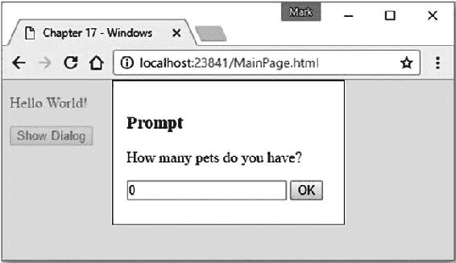

# 操作窗口

创建新窗口后，可以使用窗口的属性和方法来查看和调整其大小、位置和滚动属性。

## 属性

窗口的当前位置和大小可以通过 `window` 对象获取。`open()` 方法返回代表新窗口的 `window` 对象。初始窗口可以利用该对象来查找窗口的位置。你还可以确定窗口的当前滚动位置。以下是可用的属性：

- `innerHeight` - 可用于内容的高度。
- `innerWidth` - 可用于内容的宽度。
- `outerHeight` - 窗口的总高度，包括浏览器 UI 元素。
- `outerWidth` - 窗口的总宽度，包括浏览器 UI 元素。
- `screenX` - 设备左边缘到窗口左边缘的距离。
- `screenY` - 设备顶部边缘到窗口顶部边缘的距离。
- `scrollX` - 文档水平滚动的像素数。
- `scrollY` - 文档垂直滚动的像素数。

## 方法

这些属性都是只读的；但可以通过 `window` 对象提供的一组方法进行操作。以下是可用的方法：

- `moveBy()` - 按指定的像素数移动窗口；需同时指定水平和垂直偏移量。如果某个方向不需移动，则设置为 0。负值将使窗口向上或向左移动。
- `moveTo()` - 移动窗口，使其左上角位于指定位置。
- `resizeBy()` - 按指定量增加窗口大小；需同时指定水平和垂直增量。如果某个维度需要缩小，则设置为负值。窗口的顶部和左边缘保持不变。
- `resizeTo()` - 指定新窗口的大小。窗口的顶部和左边缘保持不变。
- `scrollBy()` - 按指定的像素数滚动；可同时指定水平和垂直值。
- `scrollByLines()` - 按指定的行数垂直滚动文档。
- `scrollByPages()` - 按指定的页数垂直滚动文档。
- `scrollTo()` - 滚动到指定的水平和垂直位置。
- `sizeToContent()` - 更改窗口大小以适应现有内容。

### 演示

为了演示这些功能，我首先在 `PopUp2.html` 文件中添加了一幅大图像（以粗体显示的代码行）。这使你能够看到滚动行为以及 `sizeToContent()` 方法的效果。

```html
<body>
  <p>Hello PopUp 2!</p>
  
</body>
```

然后，我将 `SampleScript.js` 替换为清单 17-1 中所示的代码。

### 清单 17-1：重写`SampleScript.js`以测试窗口操作

```javascript
"use strict";

window.name = "Chapter17";

var popup = window.open("PopUp2.html", "popup", "height=300,width=400,left=400,top=150,location,toolbar,menubar,scrollbars");

var i = 1;

var timer = window.setInterval(adjustWindow, 2000);

function adjustWindow() {

    if (i > 9) {
        clearInterval(timer);
    }
    else {
        console.log("outerH: %i, outerW: %i, innerH: %i, innerW: %i, screenX: %i, screenY: %i, scrollX: %i, scrollY: %i",
            popup.outerHeight, popup.outerWidth, popup.innerHeight, popup.innerWidth,
            popup.screenX, popup.screenY, popup.scrollX, popup.scrollY);
    }

    switch (i) {
        case 1:
            popup.scrollBy(50, 30);
            break;
        case 2:
            popup.moveBy(50, 50);
            break;
        case 3:
            popup.moveTo(200, 100);
            break;
        case 4:
            popup.resizeBy(50, 50);
            break;
        case 5:
            popup.resizeTo(700, 500);
            break;
        case 6:
            popup.scrollByLines(5);
            break;
        case 7:
            popup.scrollByPages(1);
            break;
        case 8:
            popup.sizeToContent();
            break;
        case 9:
            popup.close();
            break;
    }
    i++;
}
```

通过使用上一章中介绍的`setInterval()`方法，`adjustWindow()`函数每 2 秒被重复调用一次。每次调用时，它都使用不同的方法来调整弹出窗口的大小、位置或滚动。在每次迭代中，当前窗口属性都会被写入控制台日志。在最后一次调用时，通过调用`close()`方法关闭弹出窗口。完成时，控制台日志将类似于图 17-6 所示。

**图 17-6.** 控制台日志中的结果

## 焦点

你可以通过编程方式更改哪个窗口获得焦点。当打开一个新窗口时，它通常会获得焦点。如果要打开一个新窗口来显示某些信息，但用户仍在与初始窗口交互，则应在打开新窗口后对初始窗口调用`focus()`方法。这将使主窗口保持焦点。

窗口还支持`blur()`方法。这个名称起初可能看起来有些奇怪，但获得焦点的反义词便是模糊化。调用`blur()`方法会从窗口移除焦点，焦点将转移到 Z 轴顺序中的下一个窗口。

## 模态对话框

到目前为止，我创建的窗口都是*非模态*的，这意味着用户也可以与其他窗口进行交互。相比之下，*模态*窗口会获得焦点，并禁用应用程序的其余部分，直到该窗口被关闭。现在，我将向你展示如何创建模态对话框。

### 标准弹出对话框

在解释更通用的模态对话框之前，我想先指出，通过 JavaScript 有三种标准的模态对话框可用。它们使用起来快速简便，但外观不美观且无法自定义样式。第一个是警告框，我在第 3 章中向你展示过。它仅显示一条文本信息，并带有一个**确定**按钮，用于关闭对话框。第二个是确认框，它显示一条文本信息，但包含**确定**和**取消**两个按钮。如果点击**确定**则返回`true`，点击**取消**则返回`false`。最后一个是提示框，它显示一条文本信息和一个用于输入值的文本字段。输入的值将被返回。以下代码演示了所有三种对话框：

```javascript
window.alert("这是一个警告框。\n 这是第二行");

if (window.confirm("是否继续？")) {
    var answer = window.prompt("你有多少只宠物？", 0);
    console.log("输入了 %i 只宠物。", answer);
}
else {
    console.log("确认失败");
}
```

`alert()`方法展示了如何使用`\n`转义序列来包含换行符。其他两个弹出对话框也支持此功能。`confirm()`方法嵌套在`if`语句中。如果用户点击**取消**按钮，则跳过后续代码并向控制台写入一条消息。`prompt()`方法接受两个参数。第一个参数是对话框中显示的文本，第二个参数是可选的默认值。在 Firefox 中显示的对话框如图 17-7、17-8 和 17-9 所示。每个浏览器对这些对话框的格式化方式各不相同。

**图 17-7.** Firefox 中的警告框

**图 17-8.** Firefox 中的确认框

**图 17-9.** Firefox 中的提示框

### 自定义模态对话框

在 HTML/JavaScript 中创建一个真正的模态对话框颇具挑战性。一段时间以来，存在几种方法，如 `openDialog()` 和 `showModalDialog()`。然而，由于安全漏洞和各种实现问题，这些方法已被弃用。事实上，此功能已在多个浏览器中完全移除。对于任何新应用程序，你绝对不应再使用这些方法。

HTML5 规范定义了一个新的 `<dialog>` 元素，有望简化模态对话框。然而，在撰写本文时，几乎还没有浏览器支持它。存在一些 jQuery 解决方案以及其他 polyfill 可供使用，但这超出了本书的范围。

我将演示一种相当简单的方法来模拟模态对话框，仅使用原生 HTML、CSS 和 JavaScript，这种方法有时被称为`玻璃窗格`方法。其基本思想是用一个透明或半透明的元素覆盖整个窗口，称为`玻璃`。这就像在画作上盖一块玻璃板；虽然你能看到玻璃板下的画作，但却无法实际触摸到画作。实际的对话框及其元素则放置在玻璃之上。你可以与对话框交互，但不能与页面的其余部分交互。从用户的角度来看，它的行为就像一个模态对话框。

> **提示** 为了完成这个任务，我需要让你提前了解一下接下来的两章内容。你将需要通过 `JavaScript` 操作 `DOM` 元素及其样式。

玻璃覆盖层和对话框元素的 HTML 代码包含在主 HTML 文档中，但在你希望打开对话框之前，它们保持隐藏状态。以下是所需的标记代码。

```html
<body>
    <p>你好，世界！</p>
    <button onclick="showDialog()">显示对话框</button>
    <div id="glass" class="glass">
        <div class="dialog">
            <h3>提示</h3>
            <p>你有多少只宠物？</p>
            <input type="number" value="0" id="numPets" />
            <button id="dialogOK" type="Submit" onclick="OK()">确定</button>
        </div>
    </div>
</body>
```

我添加了一个用于显示对话框的按钮；其点击事件将调用需要实现的 `showDialog()` 函数。其余标记代码创建了玻璃，它是一个简单的 `<div>` 元素。在该 `<div>` 元素内部，是另一个包含实际对话框内容的 `<div>` 元素。这包括一个用于标题的标题元素 `<h3>`，一个包含提示的段落元素 `<p>`，一个接受用户输入的 `<input>` 元素，以及一个用于提交条目的按钮。点击该按钮将调用 `OK()` 函数。

玻璃和对话框通过以下两条 CSS 规则进行样式设置：

```css
.glass {
    position: fixed;
    left: 0;
    top: 0;
    background-color: rgba(225,225,225,.7);
    height: 100vh;
    width: 100vw;
    z-index: 100;
}

.dialog {
    height: 125px;
    width: 220px;
    margin: 0 auto;
    padding: 15px;
    border: 1px solid black;
    background-color: white;
}
```

该玻璃层使用了 `position: fixed`，正如我在[第 10 章](http://dx.doi.org/10.1007/978-1-4842-2463-2_10)中解释的那样，这会使元素相对于窗口保持固定。通过将 `left` 和 `top` 设置为 `0`，并将 `height` 和 `width` 分别设为 `100vh` 和 `100vw`，该元素将占据整个窗口区域。`z-index` 被设为 `100`，以确保该元素位于所有其他元素之上。

你可以根据自己的偏好调整背景；我将其设置为透明度为 30%的灰色背景。这能清楚地表明对话框周围的其他控件不可用。你也可以使用完全透明的背景，这样其他元素会正常显示，但用户仍然无法与之交互。或者使用完全不透明的背景来隐藏其他元素。这些选择纯粹是视觉上的，不会影响页面的功能。

对话框的格式非常直接，使用固定尺寸并通过 `margin: 0 auto;` 声明实现水平居中。我没有添加其他美化格式，但你可以根据需要添加更多声明。

将所有内容整合起来所需的 JavaScript 如清单 17-2 所示。

**清单 17-2.** 对话框的实现

```javascript
// 存储对话框的结果
var result = 0;

function showDialog() {
  var dialog = document.getElementById("glass");
  dialog.style.visibility = "visible";
}
```



```javascript
function closeDialog() {
  var dialog = document.getElementById("glass");
  dialog.style.visibility = "hidden";
}

function OK() {
  var input = document.getElementById("numPets");
  result = input.value;
  closeDialog();
  console.log("#Pets: " + result);
}

// 确保对话框在初始状态下是关闭的
closeDialog();
```

前两个函数 `showDialog()` 和 `closeDialog()` 获取 `glass` 元素，并将其 `visibility` 属性设为 `visible` 或 `hidden`。提交按钮调用的 `OK()` 函数从 `input` 元素中获取值，并将其存储在 `result` 变量中，同时还调用了 `closeDialog()` 函数。定义这些函数后，会调用 `closeDialog()` 函数以确保页面首次加载时玻璃层是隐藏的。当点击 Show Dialog 按钮时，页面将如图图 17-10.所示。

**图 17-10.** 模态对话框

## 框架（Frames）

你可以使用内联框架（`iframe`）元素来嵌入来自另一个 HTML 文档的内容。例如，如果你想在页面中包含一个托管在其他网站（如 YouTube）上的视频，`iframe` 正是你需要的。我在[第 4 章](http://dx.doi.org/10.1007/978-1-4842-2463-2_4)中简要介绍过内联框架。

> **警告：** 在 HTML5 之前，`frame` 元素用于组织页面的各个部分，如页眉或侧边栏。每个部分都是一个独立的窗口，拥有独立的文档，并且可以独立于其他框架进行尺寸调整和移动。这是一种难以处理的模式。在 HTML5 中，`frame` 元素已被废弃，取而代之的是我在[第 4 章](http://dx.doi.org/10.1007/978-1-4842-2463-2_4)中介绍的分区元素（sectioning elements）。不过，内联框架得以保留，它提供了在父文档中锚定的同时嵌入另一个文档的能力。

如果你熟悉框架，不要尝试使用内联框架来实现 `frame` 方法；应该使用分区元素并通过 CSS 进行样式设计。

#### 简单示例

内联框架通过使用 `iframe` 元素来嵌入，并将其 `src` 属性设为要包含的文档的位置。例如：

```html
<iframe src="http://www.apress.com"></iframe>
```

与其他元素一样，你可以使用 CSS 对其进行样式设计。以下规则将 `width` 设置为 `95%`，为边框留出一些空间。同时还设置了 `height` 并应用了蓝色边框。结果如图 17-11 所示。

```css
iframe {
  width: 95vw;
  height: 300px;
  border: 3px solid blue;
}
```