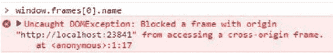
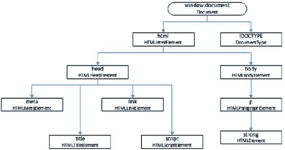
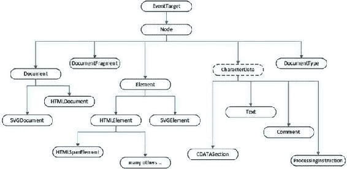

# margin-top: 5px；

}


## 第 17 章 ■ Window 对象

***图 17-11.** 使用简单的 iframe*

内联框架元素支持多种可在标记中设置的属性。

-   `allowfullscreen` - 若希望嵌入窗口能够切换到全屏模式，请包含此属性。
-   `height` - 元素的高度，以像素为单位。
-   `name` - 框架的名称；可用于创建指向此元素的链接。
-   `sandbox` - 用于指定对窗口的限制，我将在后文详细说明。
-   `src` - 要在框架中加载的文档的 URL。
-   `srcdoc` - 与 `sandbox` 属性结合使用。
-   `width` - 元素的宽度，以像素为单位。

#### 访问框架

如前所述，框架实际上是另一个窗口，并且独立于父窗口运行。这包括样式，样式不会级联应用到框架内的内容。这些子窗口在 JavaScript 中可通过 `window` 对象的 `frames` 属性访问。例如，你可以通过调用 `window.frames.length` 查看有多少个框架，或者通过调用 `window.frames[0]` 访问第一个框架。后者会返回一个代表该框架的 `window` 对象。但是，如果你尝试访问它的任何属性，将会遇到跨域错误，如图 17-12 所示。



***图 17-12.** 显示跨域异常*

类似地，嵌入框架中的 JavaScript 可以通过调用 `window.parent` 访问外部窗口。当然，如果两个窗口源不同，你会遇到同样的错误。

#### 使用沙盒

我相信你能想到，在你的网页中嵌入他人的网页会带来一些安全漏洞。为了最小化这种风险，你可以创建内联框架并指定 `sandbox` 属性，该属性将对嵌入窗口强制执行一系列限制。要使用沙盒模式，请在 `iframe` 元素中添加 `sandbox=""`：

```
<iframe src=http://www.apress.com sandbox="" ></iframe>
```

你还可以通过在 `sandbox` 属性的值中列出一些特性，来选择性地允许其中的某些功能。你可以通过包含一个空格分隔的值列表来禁用多个限制。虽然并非所有浏览器都支持所有值，但已定义了以下这些值：

-   `allow-forms`
-   `allow-modals`
-   `allow-orientation-lock`
-   `allow-pointer-lock`
-   `allow-popups`
-   `allow-popups-to-escape-sandbox`
-   `allow-presentation`
-   `allow-same-origin`
-   `allow-scripts`
-   `allow-top-navigation`

### 本章小结

在本章中，我解释了 `window` 对象上用于创建和操作窗口的属性和方法。创建弹出窗口很容易，但这需要弹出窗口拦截器的允许。只有通过 JavaScript 创建的窗口才能通过 JavaScript 进行操作。我演示了标准模态对话框，以及如何通过 HTML、CSS 和 JavaScript 创建自定义模态对话框。我还解释了如何使用内联框架，并简要介绍了可用于降低风险的选项。

在下一章中，我将向你展示如何使用 JavaScript 操作 DOM。这将提供极大的灵活性，并为你提供改进网页功能的工具。

---

## 第 18 章

### DOM 元素

HTML 文档是一种专门的 XML 文档，并且与所有 XML 文档一样，由节点元素的层次结构组成。每个节点可以有一个父节点和零个或多个子节点。在前面的章节中，你通过某种 HTML 编辑器或简单的文本编辑器创建了这些节点。在本章中，我将向你展示如何通过 JavaScript 读取和操作这些节点。

#### 文档对象模型

快速回顾一下，这是一个非常简单的 HTML 文档。它包含一个 `head` 元素，该元素包含四个子元素：`meta`、`title`、`link` 和 `script` 元素。它还包含一个 `body` 元素，该元素只有一个 `paragraph` 元素。“Hello”这个词位于一个 `strong` 元素内部。

```
<!DOCTYPE html>
<html lang="en">
<head>
  <meta charset="utf-8" />
  <title>第 18 章 - DOM 元素</title>
  <link rel="stylesheet" href="Sample.css" />
  <script src="SampleScript.js" defer></script>
</head>
<body>
  <p><strong>Hello</strong> World!</p>
</body>
</html>
```

这些元素中的每一个都是文档中的一个节点。图 18-1 对此进行了说明。

© Mark J. Collins 2017  
M. J. Collins，《精通 HTML5、CSS、JavaScript 与多媒体》，DOI 10.1007/978-1-4842-2463-2_18





***图 18-1.** 一个简单的 HTML 文档*

正如我在[第 16 章](http://dx.doi.org/10.1007/978-1-4842-2463-2_16)中提到的，`window` 对象包含一个 `document` 属性，它允许你访问 HTML 文档。为了演示这一点，如果你打开浏览器控制台并输入 `window.document.childNodes`，将会列出一个节点数组，包含两个元素：`!DOCTYPE` 和 `html`。

#### 元素继承

在图 18-1 中，对于每个节点，我标明了 HTML 元素名称以及在 JavaScript 中代表该元素的对象类型。由于每个元素的行为不同，代表它们的对象类型也必须不同。可以想象，这些对象类型有很多。虽然并非每个 HTML 元素在 JavaScript 中都有专门的类，但许多元素都有。

幸运的是，这些对象类型使用继承，因此大多数元素都实现了一组通用的基对象。例如，`link` 元素由 `HTMLLinkElement` 对象表示。该对象从 `HTMLElement` 对象继承属性和方法，其他所有 HTML 元素对象（如 `script`、`p` 和 `strong`）也是如此。`HTMLLinkElement` 对象提供了 `link` 元素独有的额外功能。图 18-2 说明了一些常见对象的继承层次结构。

***图 18-2.** 继承层次结构*

> **提示** 所有代表 HTML 元素的 JavaScript 对象都派生自 `HTMLElement` 对象。由于有几十个之多，我未在图中全部展示。不过，附录 C 中的参考资料包含一个表格，列出了所有 HTML 元素及其对应的 JavaScript 对象。

`EventTarget` 对象提供了接收和处理事件所需的属性和方法。`Node` 对象提供了拥有父节点和零个或多个子节点的能力，以及遍历和修改它们的方法。`Element` 对象增加了更多在整体文档中操作元素的能力。`Element` 对象更重要的能力之一是查看和更新元素的属性。`HTMLElement` 对象在此基础上进一步扩展，提供了定义语言和分配样式等功能。

#### 简单演示

在详细讲解之前，先做一个快速演示。我将从 HTML 文件中移除 `body` 元素的内容，并使用 JavaScript 创建它。HTML 标记将有一个空的 `body` 元素。`head` 元素中引用的 `SampleScript.js` 文件包含了 `populateBody()` 函数。稍后我将更详细地解释这些方法调用。

```
function populateBody() {
  var body = document.getElementsByTagName("body")[0];
  var paragraph = document.createElement("p");
  paragraph.innerHTML = "<strong>Hello</strong> World!";
  body.appendChild(paragraph);
}
populateBody();
```

第一个调用使用 `getElementsByTagName()` 方法获取 `body` 元素。这会返回一个


