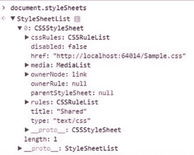
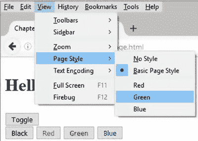
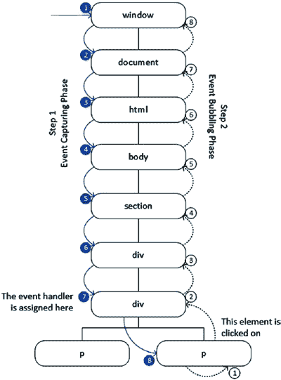
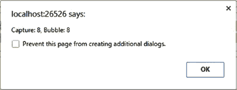
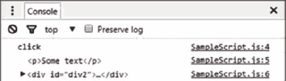
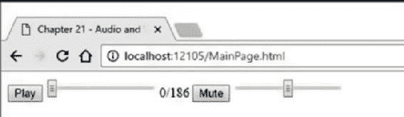
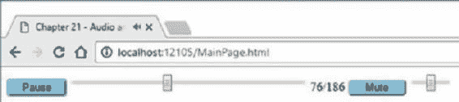
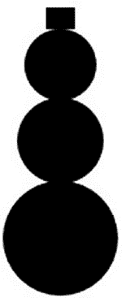
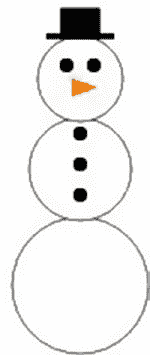
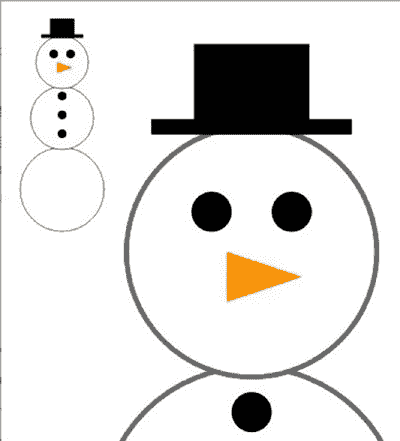

# 使用 JavaScript 实现动态样式

存在一些方法可以创建新的 DOM 元素，以及重新排列或修改现有元素。对于修改这些元素的样式，也存在类似的能力。在本章中，我将介绍四种可以使用 JavaScript 动态更改样式规则的技术：

- 替换样式表
- 更改样式规则
- 修改 CSS 类
- 调整内联样式

这些场景提供了对文档所应用样式越来越精细的控制，从替换整个样式表开始，到更新单个元素的样式结束。

## 更改样式表

我要介绍的第一种方法是替换整个样式表。例如，如果你想支持多个主题，这种技术会很有用。每个样式表都包含一组规则，为网页呈现特定的外观。然后根据用户偏好、用户输入或其他规则应用特定的样式表。你应该将通用规则放入一个始终使用的独立样式表中。主题元素则放入可以动态应用的独立样式表中。

**提示：** 你可以像上一章所介绍的那样，通过创建一个 `link` 元素来向文档添加新的外部样式表。你也可以创建一个新的 `style` 元素来创建内部样式表。

### 启用样式表

可用的样式表可以通过 `document.styleSheets` 属性访问。这会返回一个已加载样式表的集合。使用 `link` 元素将样式表添加到 HTML 文档后，可以在控制台中查看它，如图 19-1 所示。

```html
<link rel="stylesheet" href="Sample.css" title="Shared" />
```

© Mark J. Collins 2017

M. J. Collins, *精通 HTML5、CSS3、JavaScript 与多媒体*, DOI 10.1007/978-1-4842-2463-2_19



**图 19-1.** 查看样式表属性

`stylesheets` 集合的长度为 1，因为只加载了一个样式表。`link` 元素包含 `title` 属性，该属性在 `CSSStyleSheet` 对象上是可用的。

该对象上的大多数属性是只读的；但是，你可以更改 `disabled` 属性。为了演示这一点，我将在页面上添加一个按钮来切换 `disabled` 属性。以下是完整的 HTML 文档。

```html
<!DOCTYPE html>
<html lang="en">
<head>
<meta charset="utf-8" />
<title>第 19 章 - 动态样式</title>
<link rel="stylesheet" href="Sample.css" title="Shared" />
<script src="SampleScript.js" defer></script>
</head>
<body>
<p><strong>你好</strong> 世界！</p>
<button onclick="toggleSS()">切换</button>
</body>
</html>
```

`Sample.css` 文件包含一个使用更大字体的单一样式规则：

```css
p {
  font-size: xx-large;
}
```

`toggleSS()` 函数在 `SampleScript.js` 文件中实现：

```javascript
"use strict";
function toggleSS() {
  for (var i = 0; i < document.styleSheets.length; i++ ) {
    if (document.styleSheets[i].title == "Shared") {
      document.styleSheets[i].disabled = !document.styleSheets[i].disabled;
      break;
    }
  }
}
```

这个函数遍历所有样式表，如果 `title` 是 `"Shared"`，则切换 `disabled` 属性。

### 选择样式表

我们可以应用这种方法来动态选择样式表。文档将加载多个样式表，然后根据用户输入启用其中一个并禁用其他。对于这个示例，我将再使用三个样式表，每个设置不同的颜色。页面将有按钮用于选择颜色，这些按钮会调用一个 JavaScript 函数来启用/禁用相应的样式表。

新的样式表每个都有一条设置 `color` 属性的规则，像这样：

```css
p {
  color: red;
}
```

我将通过 `head` 元素内的以下 `link` 元素添加新的样式表。我没有使用 `title` 属性，我将在本章后面解释原因。

```html
<link rel="stylesheet" href="Red.css" />
<link rel="stylesheet" href="Green.css" />
<link rel="stylesheet" href="Blue.css" />
```

我还将添加四个按钮，用于选择相应的样式表。

```html
<button onclick="disableAll()">黑色</button>
<button onclick="enable('Red')" style="color: red">红色</button>
<button onclick="enable('Green')" style="color: green">绿色</button>
<button onclick="enable('Blue')" style="color: blue">蓝色</button>
```

第一个按钮调用 `disableAll()` 函数，该函数将禁用所有三个样式表。在这种情况下，内容将使用默认的黑色字体。其他按钮调用 `enable()` 函数，该函数将启用指定的样式表并禁用其他样式表。我们需要将这两个方法添加到 `SampleScript.js` 文件中：

```javascript
function disableAll() {
  for (var i = 0; i < document.styleSheets.length; i++ ) {
    if (document.styleSheets[i].title != "Shared") {
      document.styleSheets[i].disabled = true;
    }
  }
}

function enable(color) {
  for (var i = 0; i < document.styleSheets.length; i++ ) {
    if (document.styleSheets[i].href.includes(color)) {
      document.styleSheets[i].disabled = false;
    }
    else if (document.styleSheets[i].title != "Shared") {
      document.styleSheets[i].disabled = true;
    }
  }
}
```

为了找到相应的样式表，`enable()` 函数使用 `href` 属性并检查指定的颜色是否是 URL 的一部分。这两个函数都会忽略共享样式表。样式表默认都是启用的，因此最后加载的 `Blue.css` 会被应用。如果你希望最初使用黑色字体，可以在页面加载时调用 `disableAll()` 函数。

**提示：** IE 不支持 `includes()` 方法。有几种简单的 polyfill 可以替代使用。详情请参阅这篇文章：[`stackoverflow.com/questions/31221341/ie-does-not-support-includes-method`](http://stackoverflow.com/questions/31221341/ie-does-not-support-includes-method)。

### 替代样式表

正如我所演示的，你可以使用 JavaScript 启用或禁用样式表。然而，某些浏览器通过使用 `替代样式表` 为这种方法提供了原生支持。这是通过 `link` 元素的 `rel` 和 `title` 属性来控制的。没有 `title` 属性的元素始终应用于文档。这些被称为*永久*样式表。但是，正如我所展示的，它们可以通过 JavaScript 禁用。

具有 `title` 属性的样式表链接是动态的，并且可以通过用户操作启用或禁用。如果 `rel` 属性不包含 `alternate` 关键字，则该样式被称为*首选*样式；它默认是启用的。你只能有一个首选样式；如果有多个，则只会应用其中一个。首选样式默认启用，但如果选择了替代样式，它们就会被禁用。如果 `rel` 属性包含 `alternate` 关键字，则该样式被称为*替代*样式。替代样式默认是禁用的。这些规则总结在表 19-1 中。

**表 19-1.** 样式表类型

| 类型     | 有标题 | 替代 | 注释                                         |
|----------|--------|------|----------------------------------------------|
| 永久     | 否     | 否   | 始终应用，可通过 JavaScript 禁用             |
| 首选     | 是     | 否   | 默认启用，可通过 JavaScript 或选择替代样式禁用 |
| 替代     | 是     | 是   | 默认禁用，可通过 JavaScript 或选择首选样式启用 |

# 动态样式

| 类型   | 默认 | 替代 | 描述                                       |
|--------|------|------|--------------------------------------------|
| 永久   | 否   | 否   | 这些样式表始终应用。                       |
| 首选   | 是   | 否   | 默认应用；如果选择了替代样式则禁用。       |
| 替代   | 是   | 是   | 默认禁用。                                 |



根据这些规则，为前面的示例添加样式表的正确方法如下。`Sample.css` 始终应用且没有 `title` 属性。`Red.css`、`Green.css` 和 `Blue.css` 是替代样式表；它们有 `title` 属性和 `alternate` 关键字。

```html
<link rel="stylesheet" href="Sample.css" />
<link rel="alternate stylesheet" href="Red.css" title="Red" />
<link rel="alternate stylesheet" href="Green.css" title="Green" />
```

```html
<link rel="alternate stylesheet" href="Blue.css" title="Blue" />
```

在没有 JavaScript 的情况下，这些样式可以通过浏览器选择性启用。例如，在 Firefox 中，可以从“查看”菜单中选择备用样式，如图 19-2 所示。

**图 19-2.** 在 Firefox 中选择备用样式表

例如，如果你希望绿色样式默认启用，则移除 `alternate` 关键字，即 `rel="stylesheet"`。当页面加载时，该样式将被启用，但在选择红色或蓝色样式时会被禁用。

> **注意** Chrome 和 Opera 不支持备用样式表。没有用户界面可以选择备用样式之一。此外，如果有多个 `link` 元素包含 `title` 属性，则只有第一个会被启用。其他样式无法被启用，即使使用 JavaScript 也不行。在 JavaScript 示例中，样式表在添加时没有使用 `title` 属性，以便在 Chrome 中正常工作。

## 使用 style 元素

在前面的示例中，我使用了通过 `link` 元素引入的外部样式表。你也可以使用嵌入在 `style` 元素中的内部样式表；这些样式表同样可以通过 `document.styleSheets` 属性访问。当然，它们不会有 `href` 属性，因此你需要通过 `title` 属性来识别它们。

你可以将包含 `Red.css`、`Green.css` 和 `Blue.css` 的 `link` 元素替换为以下 `style` 元素。

```html
<style title="Red">
    p { color: red; }
</style>

<style title="Green">
    p { color: green; }
</style>

<style title="Blue">
    p { color: blue; }
</style>
```

在 Firefox 中，用于选择备用样式的相同用户界面同样适用于内部样式表。“查看”菜单会根据 `style` 元素中的 `title` 属性显示相同的“红色”、“绿色”和“蓝色”选项。

然而，JavaScript 函数将需要查看 `title` 属性而不是 `href` 属性。列表 19-1 展示了这些函数的一个实现，该实现根据存在的属性支持两种方式。

**列表 19-1.** 用于备用样式的最终 JavaScript 代码

```javascript
"use strict";

function toggleSS() {
    for (var i = 0; i < document.styleSheets.length; i++) {
        if ((document.styleSheets[i].href &&
            document.styleSheets[i].href.includes("Sample")) ||
            document.styleSheets[i].title == "Shared") {
            document.styleSheets[i].disabled = !document.styleSheets[i].disabled;
            break;
        }
    }
}

function disableAll() {
    for (var i = 0; i < document.styleSheets.length; i++) {
        if (!(document.styleSheets[i].href &&
            document.styleSheets[i].href.includes("Sample")) &&
            document.styleSheets[i].title != "Shared") {
            document.styleSheets[i].disabled = true;
        }
    }
}

function enable(color) {
    for (var i = 0; i < document.styleSheets.length; i++) {
        if ((document.styleSheets[i].href &&
            document.styleSheets[i].href.includes(color)) ||
            document.styleSheets[i].title == color) {
            document.styleSheets[i].disabled = false;
        }
        else if (!(document.styleSheets[i].href &&
            document.styleSheets[i].href.includes("Sample")) &&
            document.styleSheets[i].title != "Shared") {
            document.styleSheets[i].disabled = true;
        }
    }
}

disableAll();
```

> **注意** 我之前提到的 Chrome 限制同样适用于 `style` 元素。由于没有 `href` 属性可以替代 `title`，这在 Chrome 或 Opera 中无法工作。要解决这个问题，你需要使用 `style` 元素的 `id` 属性，并通过我在上一章中描述的 `getElementById()` 方法来选择它们。

### 修改规则

在上一节中，我演示了如何动态应用整个样式表，即一组预配置的样式规则。你也可以修改现有样式表的规则。如果只需要进行小调整，请使用此选项。

要查看现有规则，请回到 `document.styleSheets` 属性。每个样式表都有一个 `cssRules` 属性，该属性枚举了样式表中包含的规则。这是一个 `CSSStyleRule` 对象的集合，如图 19-3 所示。

**图 19-3.** 查看样式规则

每个 `CSSStyleRule` 对象都被分配了一个顺序索引。正如我在第 2 章中解释的，规则的包含顺序会影响冲突的解决方式。该索引也很重要，因为你需要它来删除规则。

为了进行简单演示，我将添加以下 JavaScript 代码。`newRuleIndex` 变量将存储新添加规则的索引，该规则添加一个细的黑色边框。`toggleRule()` 函数要么在 `newRuleIndex` 未设置时添加一条新规则，要么使用该变量来移除规则。

```javascript
var newRuleIndex = -1;

function toggleRule() {
    if (newRuleIndex == -1) {
        newRuleIndex = document.styleSheets[0].insertRule("p {border: 1px solid black;}", 1);
    }
    else {
        document.styleSheets[0].deleteRule(newRuleIndex);
        newRuleIndex = -1;
    }
}
```

newRuleIndex = -1;

}

}

```

这里我采取了一些捷径，只是将规则添加到第一个样式表中。你可能需要先选择要修改的样式表。最后，我们需要在页面上放置一个按钮来调用此函数。

当点击按钮时，边框会被添加，如图 19-4 所示。

```html
<button onclick="toggleRule()">Border</button>
```

图 19-4. 添加边框

■ **注意** 这会将一条新规则添加到第一个样式表，即 `Sample.css`。这个样式表也包含更大的字体规则。如果你点击切换按钮，整个样式表将被禁用，这将同时移除更大的字体和边框。即使样式表被禁用，点击“边框”按钮也会修改样式表；只是它不会影响页面，直到样式表被启用。

通过 `insertRule()` 或 `deleteRule()` 方法修改样式表不会影响原始源文档。对于内部样式，这些更改不会影响 HTML 文档，外部样式表的 CSS 文件也不会受到影响。如果页面被刷新，样式将恢复到其原始状态，直到 JavaScript 重新运行以修改它们。

### 修改类

最后一种场景修改了样式表中的规则，根据更改的不同，可能会影响文档中的多个元素。然而，在许多情况下，你只需要让现有规则在某些情况下应用于特定元素。伪类就是一个很好的例子。像 `:enabled`、`:selected` 或 `:hover` 这样的伪类允许你在特定动态条件下应用样式规则。然而，这些条件是有限的。

如果没有合适的伪类可用，你可以创建一个使用类选择器的样式规则。然后你可以根据需要，通过 JavaScript 动态应用相应的类。为了尝试这个，我将首先在 `Sample.css` 文件中添加一个带有类选择器的规则。这将把不透明度设置为 50%。

```css
.special {
    opacity: .5;
}
```

每个元素都有一个 `classList` 属性，该属性包含已分配给该元素的类列表。它支持四个方法，你可以使用这些方法来操作这个列表：

* `contains()` - 返回一个布尔值，指示类是否存在。
* `add()` - 添加一个新类。
* `remove()` - 移除指定的类。
* `toggle()` - 如果类不存在则添加，如果存在则移除。

以下 JavaScript 函数演示了所有这些方法。它将检查类是否存在，然后添加或移除它。

```javascript
function toggleClass() {
    var paragraph = document.querySelector("p");
    if (paragraph) {
        if (paragraph.classList.contains("special")) {
            paragraph.classList.remove("special");
        }
        else {
            paragraph.classList.add("special");
        }
        // 这也可以通过以下方式完成
        //paragraph.classList.toggle("special");
    }
}
```

■ **提示**：这完全可以通过简单地调用 `toggle()` 方法来实现，但我这样实现是为了演示其他方法。

最后，我会添加一个按钮来调用此函数：

```html
<button onclick="toggleClass()">Opacity</button>
```

## 第 19 章 ■ 动态样式

每个元素也支持 `className` 属性。这是一个字符串，包含以空格分隔的类列表，就像你在标记语言的 class 属性中看到的那样。如果你愿意，可以直接操作这个字符串，但 `classList` 属性使用起来更方便。

不过，有一个例外情况是当你想移除所有类时。此时无需枚举 `classList` 属性，只需将 `className` 属性设为空字符串即可：

```javascript
paragraph.className = "";
```

### 修改内联样式

前面的场景仅影响单个元素。然而，添加或移除一个类可以应用或移除多个样式规则，以及每条规则中的多个声明。在最后一个场景中，我将向你展示如何将内联样式应用于单个元素。通常，应用内联样式是一个坏主意，因为你会失去通过 CSS 变更调整样式的能力。但有时你确实需要这样做，并且不希望做出可能破坏其他元素的 CSS 修改。

#### 使用 CSSStyleDeclaration

所有 HTML 元素都有 `style` 属性，可以通过 JavaScript 的 `style` 属性访问它。在 JavaScript 中，它由 `CSSStyleDeclaration` 对象表示，该对象是名称/值对的集合。可以通过以下方法修改此对象上的样式声明。

- `setProperty()` —— 添加一条声明；接受两个必需参数 `property` 和 `value`，以及一个可选的 `priority` 参数，可以是空值或 `"important"` 关键字。
- `getPropertyValue()` —— 将属性名作为参数传入，并返回对应的值。
- `getPropertyPriority()` —— 如果指定属性包含 `important` 关键字，则返回 `"important"`。
- `cssText` —— 返回此样式上的所有声明，格式与 CSS 文档中的相同。
- `removeProperty()` —— 移除指定的属性。

为快速演示，以下解决方案将更新背景颜色。首先，我会添加一个按钮，在单击时调用 `toggleBackground()` 函数：

```html
<button onclick="toggleBackground()">Background</button>
```

`toggleBackground()` 函数使用 `querySelector()` 方法获取第一个段落元素。

它检查 `style` 属性的 `length` 属性，该属性指示已在此对象上设置了多少条声明。如果为零，则添加 `background-color` 属性；否则将其移除。

```javascript
function toggleBackground() {
  var p = document.querySelector("p");
  console.log("Initial style = " + p.style.cssText);
  if (p.style.length == 0) {
    p.style.setProperty("background-color", "yellow", "important");
    console.log("Value: " + p.style.getPropertyValue("background-color"));
    console.log("Priority: " + p.style.getPropertyPriority("background-color"));
  } else {
    p.style.removeProperty("background-color");
  }
  console.log("Updated style = " + p.style.cssText);
}
```

这段代码还会向控制台写入一些条目。点击 Background 按钮后，控制台日志应如图 19-5 所示。

图 19-5. 控制台输出

#### 设置样式属性

`CSSStyleDeclaration` 对象为每个 CSS 属性都提供了一个属性，你可以直接获取或设置这些属性。例如：

```javascript
var p = document.querySelector("p");
p.style.fontStyle = "italic";
p.style.fontSize = "xx-small";
console.log("Current color is " + p.style.color);
```

JavaScript 中属性的名称与 CSS 属性相同，只是所有连字符都被移除，并且下一个单词的首字母改为大写。因此，`font-size` 在 JavaScript 中变成了 `fontSize`。

# JavaScript 样式与事件

## 保留字与属性名称

您还需要注意 JavaScript 中的保留字，例如 `float`。这类属性名称需要添加 `"css."` 前缀。例如，要设置 `float` 值，请使用 `cssFloat`。

> **提示：** 如我之前所述，`CSSStyleRule` 对象代表一条样式规则。我演示了如何通过指定 CSS 条目来添加新规则。`CSSStyleRule` 对象也有一个 `style` 属性，可以通过这些方法进行操作，就像其他样式属性一样。

## 使用 `setAttribute`

设置样式属性的第三种方法是通过 `setAttribute()` 方法。您可以通过此方法设置任何 HTML 属性的值。它接受两个参数：属性名称和您希望设置的值。例如，可以这样设置 `style` 属性：

```javascript
var p = document.querySelector("p");
p.setAttribute("style", "font-style:italic; font-size:xx-small;");
```

> **警告：** 当设置特定的样式属性（如 `style.color`）时，只会影响该属性。但是，使用 `setAttribute()` 方法会用您在第二个参数中提供的内容替换整个现有的内联样式规则。`style` 属性的任何现有值都会被覆盖。

### 计算样式

正如我之前解释的，应用于元素的样式来自多种来源，例如外部和内部样式表以及内联样式属性。每个样式规则基于选择器影响元素，并且可能有多个规则适用于特定元素。其中一些规则是动态应用的，例如使用伪类。

然而，在任何给定的时间点，都会有一组固定的样式属性值为元素计算出来。您可以通过调用 `window.getComputedStyle()` 方法并将目标元素传递给它，在 JavaScript 中获取此信息。例如，如果您在控制台中运行以下代码，您将看到`图 19-6`所示的属性及其值：

```javascript
var p = document.querySelector("p");
window.getComputedStyle(p);
```

**`图 19-6`.** 显示计算后的样式

> **提示：** 元素的 `style` 属性只会返回内联样式。如果您想查看所有样式表和内联样式的最终效果，请使用 `getComputedStyle()` 方法。

#### 总结

在本章中，我解释了在 JavaScript 中调整样式的四种基本方法。这些技术范围从替换整个样式表到修改元素上的单个属性。我还给出了一些这些方法适用的场景示例。您拥有动态配置样式规则的强大能力。然而，第一步是决定您想要实现什么目标，然后选择最适合的方法。

在下一章中，我将演示如何在 JavaScript 中使用事件来实现功能逻辑，以响应用户和系统发起的事件。

---

## 第 20 章：事件

事件是大多数网页不可或缺的一部分：它们允许您在事件发生时采取行动。“事情发生”被称为**事件**，Web 标准中定义了数十种事件。“采取行动”被称为**事件处理程序**，它只是一个简单的 JavaScript 函数。

### 初始示例

我将从一个简单的示例开始，然后描述各个部分。`清单 20-1`显示了一个基本的 HTML 文档。

**`清单 20-1`.** 初始 HTML 文档

```html
<!DOCTYPE html>
<html lang="en">
<head>
  <meta charset="utf-8" />
  <title>第 20 章 - 事件</title>
  <link rel="stylesheet" href="Sample.css" />
  <script src="SampleScript.js" defer></script>
</head>
<body>
  <section>
    <div id="div1">
      <div id="div2">
        <p>一些文本</p>
        <p>更多文本</p>
      </div>
    </div>
  </section>
</body>
</html>
```

© Mark J. Collins 2017
M. J. Collins, *Pro HTML5 with CSS, JavaScript, and Multimedia*, DOI 10.1007/978-1-4842-2463-2_20

该文档在一对嵌套的 `div` 元素中包含两个段落元素。为了帮助可视化这些元素使用的区域，我将为 `div` 元素添加边框，并为段落元素使用背景色。我还会使用内边距和外边距在它们之间添加一些空间。

```css
div {
  border: 1px solid black;
  padding: 10px;
}
p {
  margin: 5px;
  background-color: yellow;
}
```

为了设置事件逻辑，事件处理程序是一个名为 `someAction()` 的函数，它只弹出一个警告框。要配置此处理程序，脚本获取内部的 `div` 元素，然后调用 `addEventListener()` 方法，将处理程序分配给 `click` 事件。`addEventListener()` 方法在所有 HTML 元素上都可用，并有两个必需参数：事件的名称和事件发生时将调用的函数的引用。`EventTarget` 对象实现了 `addEventListener()` 方法，正如我在`第 18 章`中解释的，它是所有元素派生的基对象。

```javascript
"use strict";
function someAction() {
  alert("正在执行某些操作...");
}
var div = document.getElementById("div2");
div.addEventListener("click", someAction);
```

如果您单击内部 `div` 元素，您将看到如`图 20-1`所示的警告框。

**`图 20-1`.** 响应事件

#### 事件注册

事件注册是将三件事联系在一起的過程：将事件链接到特定 DOM 元素的事件处理程序。也就是说，1）这个**元素**通过执行 3）这个**处理程序**来响应 2）这个**事件**。`addEventListener()` 方法是实现此目的的首选方式。但是，还有其他方法可以做到这一点。

### 内联注册

一种称为*内联*注册的方法是在标记中包含注册信息。例如：

```html
<div id="div2" onclick="someAction()">
```

虽然这种技术已经存在了几十年，并且仍然相当频繁地使用，但应避免使用它。这会将 JavaScript 代码包含在您的 HTML 文档中，这明显违反了关注点分离原则。

### 传统注册

另一种方法是将事件处理程序分配给 DOM 元素的事件属性。每个 DOM 元素对于其支持的每个事件都有一个属性。这些事件属性保存了对相应事件的事件处理程序的引用。例如，`onclick` 属性可以存储一个对事件处理程序的引用，该处理程序将在 `click` 事件发生时被调用。我们可以像这样重写初始演示：

```javascript
// div.addEventListener("click", someAction);
div.onclick = someAction;
```

# 提示

**提示：**`addEventListener()` 方法（以及 IE 中的 `attachEvent()` 方法）允许你为同一事件分配多个事件处理程序。

这种方法有时被称为*传统*方法，是最安全且最普遍支持的事件注册方法。它自 Netscape 时代就已存在，并得到 IE4 及更高版本以及所有现代浏览器的支持。

> **警告：** 事件属性（例如 `onclick`）期望一个函数引用。不要在函数名称后添加括号，因为这将导致函数被执行，并且返回值将被注册为事件处理程序。

内联和传统方法的一个问题是，每个元素的每个事件只能有一个事件处理程序。如果您尝试注册第二个事件处理程序，它将替换第一个。例如，如果您有两个 JavaScript 库出于各自目的使用不同的事件处理程序，那么使用传统方法时它们无法共存。

### Internet Explorer 的 `attachEvent()` 方法

第三种方法仅由 Internet Explorer 支持，使用与 `addEventListener()` 类似的 `attachEvent()` 方法。IE 直到版本 9 才支持 `addEventListener()` 方法，因此如果您需要支持 IE8 及更早版本，则需要使用 `attachEvent()`（或传统方法）作为 polyfill。

## 事件传播

注册事件监听器时，会为特定元素的特定事件分配一个处理函数。前面的示例监听了内部 `div` 元素上的 `click` 事件。但是，你可以点击 `div` 元素中的任意位置，包括两个段落元素中的任何一个，都会显示警告。之所以有效，是因为事件的传播方式。

段落元素是内部 `div` 内容的一部分，因此点击它们被视为点击了 `div` 是合理的。同样，内部 `div` 是外部 `div` 的一部分，外部 `div` 是 `section` 的一部分，以此类推。如果在 `document` 或 `window` 对象上注册事件，会发生什么？正如你所料，点击其任何子元素都会执行事件处理程序。



### 事件

当事件发生时，例如鼠标点击，它首先被发送到 `window` 对象。然后通过文档层次结构向下传播，直到到达实际被点击的元素，该元素被称为*目标*。最后，它通过相同的对象反向传播回来，直到到达 `window` 对象。图 20-2 对此进行了说明。

***图 20-2.*** 事件传播

在我们的初始示例中，总共触发了 16 个事件：8 个在向下传播途中，8 个在向上返回途中。但是，我们只注册了一个事件处理程序，因此忽略了其中的 15 个。

事件向下传播被称为**捕获阶段**，而沿链向上返回被称为**冒泡阶段**。这个术语可能不是很有帮助，因为气泡倾向于上升到顶部；你可以记住冒泡阶段是向上进行的。

`addEventListener()` 方法支持第三个参数，你可以使用它来指定是监听捕获事件还是冒泡事件。传递 `true` 值以监听捕获事件。省略第三个参数或传递 `false` 以监听冒泡事件。

为了演示这种行为，我将用代码清单 20-2 中显示的代码替换之前的 JavaScript。

这定义了一对变量来记录捕获或冒泡事件被处理的次数。然后定义了两个事件处理程序，它们简单地递增这些计数器。事件首先在 `window` 对象上触发，也在 `window` 对象上结束。我将为 `window` 对象使用两个特殊的事件处理程序。`clearCount()` 函数将在捕获事件时被调用，并清除计数器。`reportCounts()` 函数将在冒泡事件时被调用，并弹出一个显示计数器值的警告。



***代码清单 20-2.*** 记录事件计数

```
var captureCount = 0;
var bubbleCount = 0;

function incrementCapture() {
    captureCount++;
}

function incrementBubble() {
    bubbleCount++;
}

function clearCounts() { // 在 window 捕获时调用
    captureCount = 1; // 将此事件计入计数
    bubbleCount = 0;
}

function reportCounts() { // 在 window 冒泡时调用
    bubbleCount++; // 将此事件计入计数
    alert("捕获: " + captureCount + ", 冒泡: " + bubbleCount);
}

var elements = document.querySelectorAll("*");
for (var i = 0; i < elements.length; i++ ) {
    elements[i].addEventListener("click", incrementCapture, true);
    elements[i].addEventListener("click", incrementBubble, false);
}

document.addEventListener("click", incrementCapture, true);
document.addEventListener("click", incrementBubble, false);

window.addEventListener("click", clearCounts, true);
window.addEventListener("click", reportCounts, false);
```

为了设置事件处理程序，我使用了在第[18 章](http://dx.doi.org/10.1007/978-1-4842-2463-2_18)中描述的 `querySelectorAll()` 方法。

这使用了全选选择器（`*`），将返回所有 HTML 元素。这包括 `html` 元素及其所有子元素。它不返回 `window` 或 `document` 对象，因此我单独添加了这些事件处理程序。

连接好这些事件处理程序后，如果你点击其中一个段落元素，你将看到一个如图 20-3 所示的警告。正如我在图 20-2 中所述，当事件在元素层次结构中向下和向上传播时，将处理八个捕获事件和八个冒泡事件。

***图 20-3.*** 报告事件计数

如果你点击内部 `div`（但不是点击段落元素），则只会处理七个事件。同样，如果你点击外部 `div`，则只会处理六个事件。`section` 和 `body` 元素本身不占据任何空间，因此你不能点击它们。如果你点击页面上的任何位置，但不在外部 `div` 元素内，则会处理三个事件。分配给 `window`、`document` 和 `html` 对象的事件处理程序将被调用。

**注意：** `addEventListener()` 方法是注册捕获事件的唯一方法。我之前提到的其他技术只能注册冒泡事件。

例如，如果你只需要知道何时点击了一个按钮，那么监听捕获事件还是冒泡事件实际上并不重要。但是，如果你有多个处理程序分配给不同的元素，那么拥有这两个选项会很有用。例如，如果你在父元素和子元素上都有不同的处理程序，那么在使用捕获事件时，父元素的处理程序将首先执行。在监听冒泡事件时，此顺序是相反的。

事件处理程序是串行执行的；当前事件处理程序必须完成，下一个才会被调用。如果你在同一个元素上有多个事件处理程序，它们也会按照注册的顺序串行执行。

### 取消注册事件

你可以移除事件处理程序，但根据事件处理程序最初注册的方式，过程会有所不同。如果你使用了 `addEventListener()`（或 `attachEvent()`），则可以为单个元素分配多个事件处理程序。为了移除正确的那个，你需要指定与注册事件处理程序时使用的所有相同信息。

例如，以下代码将移除在前一个示例中设置的处理程序。请注意，参数与注册事件处理程序时使用的完全相同：

```
function removeHandlers() {
    var div = document.getElementById("div2");
    div.removeEventListener("click", someAction, false);
}
```

为了使其正常工作，所有四条信息必须与原始注册详细信息匹配：

-   事件注册所在的元素。
-   事件类型。
-   已注册的处理函数。
-   指示这是在捕获阶段还是冒泡阶段注册的标记。

如果你使用 `attachEvent()` 方法注册了事件处理程序，请使用 `detachEvent()` 方法将其移除。它的工作方式与 `removeEventListener()` 类似，只是没有捕获/冒泡标记。

其他注册方法不允许有多个事件处理程序，因此移除它们是一个更简单的过程。只需将相应的事件属性设置为 `null`。例如：

```
div.onclick = null;
```



### 事件接口

当事件发生并且已注册相应的监听器时，将调用分配的事件处理程序。我已经对此进行了一些详细的解释。关于事件处理的另一个非常重要的方面是事件本身。当事件发生时，会创建一个包含事件详细信息的事件对象，并将其传递给事件处理程序。例如，如果点击了鼠标按钮，你可能想知道点击了哪个元素或使用了哪个按钮。

### 常见事件属性

您的事件处理程序可以通过声明一个函数参数来访问该事件对象。您可以随意命名该参数，但公认的惯例是使用 `e`。例如：

```javascript
function someAction(e) {
    ...
}
```

存在一个基础的 `Event` 对象，它提供了一些公共属性和方法。然而，还有数十个派生对象，它们根据事件类型提供专门的信息。主要的共享属性如下：

- `type` —— 事件类型；如果您要对多个事件使用单个事件处理程序，这会很有帮助。例如，您可能有一个处理程序来同时响应 `mouseup` 和 `mousedown` 事件。
- `target` —— 触发事件的元素。
- `currentTarget` —— 注册了事件处理程序的元素。

我将回到最初只有一个事件处理程序的例子。不再创建提示框，而是改为记录事件的某些详细信息。控制台将显示如 图 20-4 所示。

```javascript
function someAction(e) {
    console.log(e.type);
    console.log(e.target);
    console.log(e.currentTarget);
    // alert("Taking some action...");
}
```

```
**图 20-4.** 在控制台中显示事件详细信息

事件类型为 `click`，符合预期。我点击了第一个段落元素，事件目标确认了这一点。`currentTarget` 属性是注册了事件处理程序的内部 `div` 元素。

### 取消事件

所有事件都有几种通用的方法。这些方法用于修改事件的处理方式。这些方法在事件对象上调用。

- `stopPropagation()`
- `stopImmediatePropagation()`
- `preventDefault()`

之前我描述了事件如何从 `window` 对象向下传播到目标，再向上回到 `window` 对象。然而，如果您在事件对象上调用 `stopPropagation()` 方法，则不会发生进一步传播。如果您在捕获阶段处理事件并停止传播，则剩余的捕获阶段以及所有冒泡阶段事件都将被抑制。

`stopImmediatePropagation()` 方法也会像我刚才描述的那样停止传播，但还会执行一个额外的步骤：它会阻止当前元素上的其他任何处理程序被执行。为了说明这种行为，假设您在内部 `div` 元素（来自前面的示例）上注册了三个事件处理程序，都用于冒泡阶段的 `click` 事件。当事件最终传播到该 `div` 元素时，这三个事件处理程序将按照它们注册的顺序依次执行。如果第一个事件处理程序调用了 `stopImmediatePropagation()` 方法，则其他两个处理程序将不会被调用。但是，如果改为调用 `stopPropagation()` 方法，则其他两个事件处理程序仍会执行。然而，在这两种情况下，事件都不会进一步传播到其他元素。

浏览器会对某些事件执行默认操作。例如，如果您点击一个链接，浏览器会导航到该 URL；或者如果您右键点击某些元素，会出现一个上下文菜单。然而，您的自定义事件会在浏览器执行默认操作之前执行。如果您想禁用默认操作，事件处理程序可以调用事件对象上的 `preventDefault()` 方法。例如，如果您想在特定情况下阻止链接跳转，可以设置一个自定义处理程序来响应 `click` 事件。然后，如果不应该使用该链接，自定义处理程序就可以调用 `preventDefault()`。

### 探索事件

现在您已经了解了事件处理的基础知识，可以使用任何受支持的事件了。它们的工作方式都相同。每个事件之间的区别归结为两点：

- **事件何时被触发？** 我在本章的所有示例中都使用了 `click` 事件。它是在鼠标按钮被点击时触发的。所有其他事件都是在特定条件下触发的，例如按下按键、调整窗口大小、网络访问丢失等。

- **提供了哪些事件详情？** 所有事件处理程序都会收到一个事件对象，我已经解释了一些常见的属性和方法。大多数事件会在事件对象中提供额外的细节；这些细节会根据事件的不同而变化。例如，`keypress` 事件的事件对象应指明按下了哪个键。

我不打算在此列出所有可用事件；有数百个之多。不过，Mozilla 的这篇文章提供了一个相当不错的概述，将事件分类整理，并附有更多详细信息的链接：[`developer.mozilla.org/en-US/docs/Web/Events`](https://developer.mozilla.org/en-US/docs/Web/Events)

第 20 章 ■ 事件

每个事件都会提供一个特定的事件对象，尽管相关事件通常会使用相同的接口。例如，大多数鼠标事件（如 `click`、`dblclick` 和 `mousedown`）都提供了 `MouseEvent` 接口。事件接口存在一个层次结构。`MouseEvent` 派生自 `UIEvent`，而 `UIEvent` 又派生自 `Event`。

■ **提示** 你也可以创建自己的自定义事件。这超出了本书的范围，但如果你感兴趣，可以查看这篇文章：[`developer.mozilla.org/en-US/docs/Web/Guide/Events/Creating_and_triggering_events`](https://developer.mozilla.org/en-US/docs/Web/Guide/Events/Creating_and_triggering_events)

### 摘要

在本章中，我演示了如何使用事件处理程序来响应用户输入或系统触发的事件。你需要注册一个事件处理程序，它将三个要素联系在一起：
- 事件
- 事件处理程序
- DOM 元素

当指定元素触发了指定事件时，已注册的处理程序就会被执行。

推荐的事件处理程序注册方法是使用 `addEventListener()` 方法。虽然也支持其他旧式方法，但它们并不包含 `addEventListener()` 的全部功能。

当事件发生在某个元素（称为目标）上时，该事件会在 DOM 层次结构中的所有对象上被触发。事件从 `window` 对象开始，在捕获阶段向下冒泡至目标元素。然后，它再沿该链向上冒泡，直到再次到达 `window` 对象。

在本书的下一部分中，我将提供一些示例解决方案，演示 HTML5 的一些高级功能。我们将从自定义音频和视频元素的嵌入开始。

# 第 V 部分

# 高级应用

本部分与本书其他部分不同，实践性更强一些。每章都通过一系列练习，一步步引导你完成一个解决方案。其中一些练习需要你从 [www.apress.com](http://www.apress.com/) 提供的源代码下载中获取一些文件。有些图片和媒体文件无法包含在正文中。此外，还有一些大型代码块，手动输入既繁琐又耗时，我提供这些代码是为了节省你的时间。

对于每个项目，你可以边阅读文本边自己编写代码，也可以直接从下载中打开最终的解决方案，并在书中同步跟进。如果选择后者，请花几分钟时间确保你理解代码的功能。

你将创建的解决方案如下：
- 21) 创建自定义音频和视频控件。
- 22) 使用可缩放矢量图形 (SVG) 构建一个美国交互式地图。
- 23) 使用 `canvas` 模拟国际象棋游戏。你还会使用 `canvas` 创建一个简单的太阳系模型，并演示合成。
- 24) 使用拖放 (DnD) API 实现西洋跳棋游戏。
- 25) 使用 `IndexedDB` 重写国际象棋模拟程序，将每一步棋和每个棋子的状态存储在客户端数据库中。
- 26) 使用 `Geolocation` 查找当前位置，并结合使用必应地图 API 和标注点在地图上进行标记，以识别相关位置。

# 第 21 章

# 音频与视频

在第 7 章中，我介绍了 `audio` 和 `video` 元素，并演示了如何使用浏览器提供的原生控件将它们嵌入到你的 HTML 文档中。在本章中，你将使用自己的控件，这些控件通过 JavaScript 连接到 `audio` 和 `video` 元素。所有 DOM 元素和事件在 JavaScript 中都是可用的，因此创建与 `audio` 或 `video` 元素配合使用的自定义控件是一个相当直接的过程。然而，你需要控制多个方面，所以这并非一项简单的任务。

### 概述

你需要处理三个方面：
- 播放/暂停
- 显示进度及快进/快退
- 调节音量/静音

我将从为音频创建自定义控件开始，但你会看到，视频的处理过程本质上是相同的。你需要同时响应来自 UI 控件和 `audio` 元素的事件。你将从在页面中添加所有必要的控件开始。然后，我将向你展示如何实现每个方面所需的事件处理程序。你将用于控制 `audio` 元素的输入元素如下：
- 播放/暂停按钮：其标签将根据 `audio` 元素的状态在“播放”和“暂停”之间切换。
- 进度条：这是一个范围控件（在第 8 章中介绍），它既可以显示进度，也允许用户跳转到特定位置。
- 时长：这是一个 `span` 元素，用于显示音频文件的当前位置和总时长。
- 静音按钮：其标签将在“静音”和“取消静音”之间切换。
- 音量：这是另一个范围控件，用于指定音量级别。

你将为之提供处理程序的音频事件包括：
- `play`：音频开始时触发
- `pause`：音频暂停时触发
- `ended`：音频播放完成时触发
- `timeupdate`：随着音频剪辑的播放定期触发
- `durationchange`：时长发生变化时触发，这发生在文件加载时
- `volumechange`：音量级别改变或 `mute` 属性发生变化时触发

### 自定义音频控件

你将从创建一个包含 `audio` 元素的 HTML 文档开始。然后，你将添加用于控制音频的输入元素。

**练习 21-1. 创建标记**

1.  创建一个包含单个 `audio` 元素的 HTML 文档。你需要提供自己的音频文件，因此 `src` 属性将与这里显示的不同。此元素还包含 `controls` 属性，因此将使用原生控件，但稍后你会移除它。该页面在 Chrome 中的效果将如图 21-1 所示。

```html
<!DOCTYPE html>
<html lang="en">
<head>
    <meta charset="utf-8" />
    <title>第 21 章 - 音频与视频</title>
    <link rel="stylesheet" href="Sample.css" />
```

# 音频与视频控制

有两个范围控件：第一个控件会在播放音频片段时显示进度。用户也可以使用它来快退或快进到文件中的新位置。`min` 和 `max` 属性将根据音频文件的长度在 JavaScript 中设置。第二个范围控件用于调节音量。其 `min` 和 `max` 属性分别设置为 0 和 1。音量为 1 表示 100%，实际值应介于 0 到 1 之间。

还有两个按钮：第一个按钮同时充当播放和暂停按钮。其标签会根据音频元素的当前状态而变化。第二个按钮用于切换静音标志。同样，其标签会根据音频当前是否静音而改变。在这些控件中间有一个 `span` 元素，初始时不包含任何内容。它将显示文件长度和当前播放位置。

## 支持播放与暂停

页面上的所有元素就绪后，就可以开始编写一些 JavaScript 了。第一个练习将连接播放按钮并执行范围控件的初始配置。

**练习 21-2：支持播放与暂停**

1. 创建一个名为 `SampleScript.js` 的新 JavaScript 文件。由于音频元素会在多处被引用，因此需要声明一个变量来存储它。这样每次使用时就不必在 DOM 中搜索了。

    ```javascript
    "use strict";
    var audio = document.getElementById("audio");
    ```

2. 你需要一个事件处理程序来设置初始时长值。`setupSeek()` 方法会响应音频元素上的 `durationchange` 事件。当页面首次加载时，在文件打开并加载元数据之前，系统并不知道音频片段的时长。一旦元数据加载完成，即可确定时长，并触发该事件。`duration` 属性以秒为单位。`setupSeek()` 函数使用 `duration` 属性设置 `audioSeek` 范围控件的 `max` 属性，还用于设置 `span` 元素的初始值。注意这里调用了 `Math.round()` 函数，将值四舍五入到最接近的整数（秒）。

    ```javascript
    function setupSeek() {
        var seek = document.getElementById("audioSeek");
        seek.min = 0;
        seek.max = Math.round(audio.duration);
        seek.value = 0;
        var duration = document.getElementById("duration");
        duration.innerHTML = "0/" + Math.round(audio.duration);
    }
    ```

3. 当用户点击播放按钮时，会调用 `togglePlay()` 方法。如果音频元素的当前状态为 `paused` 或 `ended`，则调用 `play()` 函数。否则，调用 `pause()` 方法。

    ```javascript
    function togglePlay() {
        if (audio.paused || audio.ended) {
            audio.play();
        }
        else {
            audio.pause();
        }
    }
    ```

4. `updatePlayPause()` 方法在音频元素上注册了 `play` 和 `pause` 事件。它通过设置播放按钮的标签来反映音频元素的状态。如果音频当前正在播放，则文本更改为“暂停”，因为点击按钮将产生暂停效果。否则，文本设置为“播放”。

    ```javascript
    function updatePlayPause() {
        var play = document.getElementById("play");
        if (audio.paused || audio.ended) {
            play.value = "Play";
        }
        else {
            play.value = "Pause";
        }
    }
    ```

> **提示**：`togglePlay()` 函数响应播放按钮的点击，而 `updatePlayPause()` 函数响应音频元素的启动或暂停。当按钮被点击时，`togglePlay()` 方法会改变音频元素的状态。这种状态变化会触发 `play` 或 `pause` 事件，这些事件均由 `updatePlayPause()` 函数处理。之所以这样设计，是因为音频可能通过点击播放按钮之外的其他方式被播放或暂停。例如，如果你保留了 `controls` 属性，那么原生控件和自定义控件会同时存在。响应 `play` 和 `pause` 事件可确保无论音频元素如何操作，按钮标签始终正确。

5. 最后，`endAudio()` 函数被注册到 `audio` 元素，以响应 `ended` 事件——当音频播放完毕时会触发该事件。这会执行一些同步操作，包括设置按钮标签以及初始化范围控件和跨度控件。

    ```javascript
    function endAudio() {
        document.getElementById("play").value = "Play";
        document.getElementById("audioSeek").value = 0;
        document.getElementById("duration").innerHTML = "0/" + Math.round(audio.duration);
    }
    ```

6. 现在，你需要使用以下代码注册事件处理程序：

    ```javascript
    // 连接事件处理程序
    audio.addEventListener("durationchange", setupSeek, false);
    document.getElementById("play").addEventListener("click", togglePlay, false);
    audio.addEventListener("play", updatePlayPause, false);
    audio.addEventListener("pause", updatePlayPause, false);
    audio.addEventListener("ended", endAudio, false);
    ```

## 支持进度与搜索

我们希望能够使用滑块跳转到音频文件中的不同位置。接下来的练习将配置此功能，使其既能报告当前位置，也能更改位置。

### 练习 21-3：进度与搜索

1. 与播放按钮类似，有一个事件处理函数 `seekAudio()`，它响应对应 `input` 元素；以及另一个单独的事件处理函数 `updateSeek()`，它响应对应 `audio` 元素。`seekAudio()` 函数在用户移动范围控件上的滑块时被调用。它只是使用范围控件选定的值来设置 `currentTime` 属性。

    ```javascript
    function seekAudio() {
        var seek = document.getElementById("audioSeek");
        audio.currentTime = seek.value;
    }
    ```

2. `updateSeek()`函数在`audio`元素触发`ontimeupdate`事件时被调用。它会更新范围控件，以反映文件内的当前位置。它还会更新跨度控件，以显示实际位置（以秒为单位）。同样，这里将`currentTime`属性四舍五入为最接近的整数。

```javascript
function updateSeek() {
    var seek = document.getElementById("audioSeek");
    seek.value = Math.round(audio.currentTime);
    var duration = document.getElementById("duration");
    duration.innerHTML = Math.round(audio.currentTime) + "/" + Math.round(audio.duration);
}
```

3. 现在，你需要使用以下代码注册事件处理程序：

```javascript
document.getElementById("audioSeek").addEventListener("change", seekAudio, false);
audio.addEventListener("timeupdate", updateSeek, false);
```

## 控制音量

本练习将设置用于调整音量的控件，包括静音按钮。

### 练习 21-4：控制音量

1. 顾名思义，`toggleMute()`函数用于切换`audio`元素的`muted`属性。当该属性改变时，`audio`元素会触发`volumechange`事件。

```javascript
function toggleMute() {
    audio.muted = !audio.muted;
}
```

2. `updateMute()`函数响应`volumechange`事件，并根据`muted`属性的当前值设置按钮标签。再次强调，以这种方式操作可以确保按钮标签正确无误。

```javascript
function updateMute() {
    var mute = document.getElementById("mute");
    if (audio.muted) {
        mute.value = "Unmute";
    } else {
        mute.value = "Mute";
    }
}
```

3. 最后，当用户移动第二个范围控件上的滑块时，会调用`setVolume()`函数。它会将`audio`元素的`volume`属性设置为范围控件上选定的值。

```javascript
function setVolume() {
    var volume = document.getElementById("volume");
    audio.volume = volume.value;
}
```



4. 按如下方式注册事件处理程序：

```javascript
document.getElementById("mute").addEventListener("click", toggleMute, false);
audio.addEventListener("volumechange", updateMute, false);
document.getElementById("volume").addEventListener("change", setVolume, false);
```

> **注意**：`volume`属性的值介于 0 和 1 之间。你可以将其视为 0% 到 100%。
> `percent`。当定义范围控件时，`min` 属性被设置为 `0`，`max` 被设置为 `1`，因此比例是正确的。您只需使用范围值即可设置 `volume` 属性。如果要显示 `volume` 属性的实际值，只需将其转换为百分比即可。

### 调整样式

现在，您可以尝试使用自定义控件了。保存更改并浏览到您的页面。页面应类似于图 21-2。

***图 21-2.*** 自定义音频控件*

此处的样式非常单调；一点点 CSS 就有帮助。添加以下 CSS 规则来更改按钮和范围控件的大小。结果如图 21-3 所示。

```css
input[type="button"] {
  width: 75px;
  background-color: lightblue;
  border-radius: 5px;
}
#audioSeek {
  width: 300px;
}
#volume {
  width: 50px;
}
```



***图 21-3.*** 样式控件*

> **提示：** 更改范围控件的样式是可能的，但需要使用供应商前缀，并且每个浏览器都不同。如果您感兴趣，这里有一篇包含详细信息的文章：[`brennaobrien.com/blog/2014/05/style-input-type-range-in-every-browser.html`](http://brennaobrien.com/blog/2014/05/style-input-type-range-in-every-browser.html)

### 更改音频源

在此示例中，音频源是在标记中定义的。但是，您可以使用 JavaScript 轻松控制它。如果您像最初那样使用单个 `src` 属性，则只需更改此属性以引用不同的文件。但是，如果您使用多个 `source` 元素，则需要更新所有这些元素，然后调用 `load()` 方法。

**练习 21-5. 更改音频源**

1. 要尝试此操作，请添加一个按钮，将源更改为第二个音频剪辑并播放该剪辑。以下是将新按钮添加到页面的标记：

```html
<div>
  <input type="button" value="Track2" id="track2" />
</div>
```

2. 添加以下事件处理程序，该处理程序将在单击按钮时执行。

```javascript
function nextFile() {
  audio.src = "Media/Sample.mp3";
  //audio.load(); needed if there are multiple sources
  audio.play();
}
```

3. 向“下一个”按钮注册事件处理程序。

```javascript
document.getElementById("track2").addEventListener("click",
  nextFile, false);
```

> **注意：** 我在[第 7 章](http://dx.doi.org/10.1007/978-1-4842-2463-2_7)中解释了如何设置多个源。这在过去需要两个或更多音频文件来支持多个浏览器时非常重要。现在所有主流浏览器都支持单个 MP3 文件。如果有多个源，则需要更新所有源，然后调用 `load()` 方法。如果您使用单个源，则无需调用 `load()`。

### 自定义视频控件

创建自定义视频控件与音频控件相同。您需要提供播放和暂停视频、调节音量以及跳转到文件中特定位置的功能。我将添加[第 7 章](http://dx.doi.org/10.1007/978-1-4842-2463-2_7)中的相同视频元素。

```html
<video src="Media/BigBuckBunny.mp4" id="video"
  poster="Media/BBB_Poster.png" width="852" height="480">
  <p> HTML5 video is not supported on your browser</p>
</video>
```

由于实现与音频控件几乎相同，因此 JavaScript 完整地显示在清单 21-1 中。这些函数与其对应的音频函数等效。

***清单 21-1.*** 实现自定义视频控件*

```javascript
var video = document.getElementById("video");
function setupSeekVideo() {
  var seek = document.getElementById("videoSeek");
  seek.min = 0;
  seek.max = Math.round(video.duration);
  seek.value = 0;
  var duration = document.getElementById("durationVideo");
  duration.innerHTML = "0/" + Math.round(video.duration);
}
function togglePlayVideo() {
  if (video.paused || video.ended) {
```

# 第 22 章 可缩放矢量图形

在本章中，我将向您展示如何在 HTML5 Web 应用程序中使用可缩放矢量图形 (SVG)。

使用 SVG 可以实现许多非常酷的功能。我挑选了一个有趣的演示，可以轻松应用于许多业务应用程序。但首先，让我向您介绍一下什么是 SVG。

## 矢量图形与 SVG 基础

大多数人认为图形元素是某种形式的位图，具有像素的行和列阵列，每个像素被分配特定的颜色。然而，相比之下，矢量图形将图像表达为公式的集合。例如，绘制一个圆心在点 `x,y` 且半径为 `r` 的圆。更复杂的图像被定义为图形元素的集合，包括圆、线和路径。虽然渲染引擎最终会确定需要设置的特定像素，但图像定义是基于公式的。这一根本性差异为使用矢量图形提供了两个显著优势。

首先，顾名思义，矢量图形是可缩放的。如果你想扩大图像的尺寸，渲染引擎只需根据新尺寸重新计算公式，并且不会损失清晰度。如果你放大位图图像，你会很快开始看到颗粒感，图像变得模糊。

其次，图像中的每个元素都可以独立操作。例如，如果图像中有多个圆，你可以通过简单地改变那个圆的颜色来突出显示它。由于矢量图形基于公式，你可以轻松调整公式以修改图像。特别有用的是，这些元素可以使用 `CSS` 进行样式化，利用我前几章向你展示的强大选择器和格式化能力。

## 介绍 SVG

你将首先创建一个使用简单几何形状绘制图片的页面。然后，你将使用 `CSS` 为这些形状应用样式。我将向你展示如何将这些标记元素保存到 `.svg` 图像文件中。这个图像文件可以像其他图像文件（如 `.jpg` 和 `.png` 文件）一样使用。

### 添加一些简单形状

为了演示 `svg` 元素如何工作，你将添加一些简单形状，如圆形、矩形和线条。大多数图像可以表示为几何形状的集合，我将在此演示这一点。

© Mark J. Collins 2017

M. J. Collins, *Pro HTML5 with CSS, JavaScript, and Multimedia*, DOI 10.1007/978-1-4842-2463-2_22

第 22 章 ■ 可缩放矢量图形

**练习 22-1 搭建一个雪人**

1. 在 `HTML` 文档的 `body` 中插入以下 `svg` 元素：

```html
<svg version="1.1"
  width="100px" height="230px"
>
</svg>
```

> **注意** `width` 和 `height` 属性定义了元素的固有尺寸。在大多数浏览器中，如果未指定 `width` 和 `height`，图像将被裁剪为某个默认大小。

2. 在 `svg` 元素内部，添加以下元素。这些只是简单的形状，主要是 `circle` 元素，以及一个 `rect`、`line` 和 `polygon`。

```html
<circle class="body" cx="50" cy="171" r="40" />
<circle class="body" cx="50" cy="103" r="30" />
<circle class="body" cx="50" cy="50" r="25" />
```

> **注意：** `audio` 和 `video` 元素在 JavaScript 中分别由 `HTMLAudioElement` 和 `HTMLVideoElement` 对象表示。这两者都派生自 `HTMLMediaElement`。

## 总结

在上一章中，我解释了如何在 JavaScript 中使用事件。从本章的示例中，您可以看到事件的重要性。无论是响应用户操作还是系统通知，所有逻辑都是在事件处理程序中实现的。在本章中，事件处理程序主要用于将 UI 元素与它们正在控制的音频或视频元素同步。

音频或视频的当前状态可通过 `duration`、`currentTime` 和 `volume` 等属性获取。其中一些属性（包括 `currentTime` 和 `volume`）也可以设置，允许您根据用户输入进行调整。要创建自己的自定义控件，您只需连接必要的事件处理程序，以便音频或视频状态的变化反映在 UI 元素中，反之亦然。

在下一章中，您将使用可缩放矢量图形 (SVG) 来创建一些令人印象深刻的图形应用程序。SVG 是一种在不损失图像质量的情况下按比例缩放图形的技术。SVG 的一个非常有用的特性是绘图元素可以使用 CSS 设置样式。

```javascript
video.play();
}

else {

  video.pause();

}

}

function updatePlayPauseVideo() {

  var play = document.getElementById("playVideo");

  if (video.paused || video.ended) {

    play.value = "Play";

  }

  else {

    play.value = "Pause";

  }

}

function endVideo() {

  document.getElementById("playVideo").value = "Play";

  document.getElementById("videoSeek").value = 0;

  document.getElementById("durationVideo").innerHTML = "0/" + Math.round(video.duration);

}

// Wire-up the event handlers

video.addEventListener("durationchange", setupSeekVideo, false);

document.getElementById("playVideo").addEventListener("click", togglePlayVideo, false);

video.addEventListener("play", updatePlayPauseVideo, false);

video.addEventListener("pause", updatePlayPauseVideo, false);

video.addEventListener("ended", endVideo, false);

// Support progress and seek

function seekVideo() {

  var seek = document.getElementById("videoSeek");

  video.currentTime = seek.value;

}

function updateSeekVideo() {

  var seek = document.getElementById("videoSeek");

  seek.value = Math.round(video.currentTime);

  var duration = document.getElementById("durationVideo");

  duration.innerHTML = Math.round(video.currentTime) + "/" + Math.round(video.duration);

}

document.getElementById("videoSeek").addEventListener("change", seekVideo, false);

video.addEventListener("timeupdate", updateSeekVideo, false);

// Support volume and mute

function toggleMuteVideo() {

  video.muted = !video.muted;

}

function updateMuteVideo() {

  var mute = document.getElementById("muteVideo");

  if (video.muted) {

    mute.value = "Unmute";

  }

  else {

    mute.value = "Mute";

  }

}

function setVolumeVideo() {

  var volume = document.getElementById("volumeVideo");

  video.volume = volume.value;

}

document.getElementById("muteVideo").addEventListener("click", toggleMuteVideo, false);

video.addEventListener("volumechange", updateMuteVideo, false);

document.getElementById("volumeVideo").addEventListener("change", setVolumeVideo, false);
```

# 第 22 章 ■ 可缩放矢量图形

<line class="hat" x1="30" y1="25" x2="70" y2="25" />

<rect class="hat" x="40" y="10" width="20" height="15" />

<circle class="button" cx="50" cy="82" r="4" />

<circle class="button" cx="50" cy="100" r="4" />

<circle class="button" cx="50" cy="118" r="4" />

<circle class="eye" cx="42" cy="42" r="4" />

<circle class="eye" cx="58" cy="42" r="4" />

<polygon class="nose" points="45,60 45,50 60,55" />

一个`circle`表示为圆心点`cx`和`cy`以及半径`r`。一条`line`指定为起点`x1`和`y1`以及终点`x2`和`y2`。一个`rect`元素由左上角位置`x`和`y`、`width`以及`height`描述。一个`polygon`由一组点定义，形式为`x1,y1 x2,y2 x3,y3`，你可以指定任意数量的点。它通过绘制每条线段来渲染，并绘制从最后一个点回到第一个点的线段。

3. 保存更改并在浏览器中查看网页。页面应如图 22-1 所示。



***图 22-1.** 未设置样式的初始 SVG 图像*

## 添加样式

这些元素的默认样式是纯黑色填充，因为其中一些形状彼此重叠，所以有几个当前不可见。请注意，你为每个元素分配了一个`class`属性。现在，你将使用类选择器为这些元素应用样式。

1. 将以下规则添加到`CSS`文件中。保存这些更改并刷新浏览器以查看更新的网页，其外观应如图 22-2 所示。

```
.body {
  fill: white;
  stroke: gray;
  stroke-width: 1px;
}
.hat {
  fill: black;
  stroke: black;
  stroke-width: 3px;
}
.button {
  fill: black;
}
.eye {
  fill: black;
}
.nose {
  fill: orange;
}
```



***图 22-2.** 应用样式后的 SVG 图像*

## 使用 SVG 图像文件

除了嵌入`svg`元素，你还可以将其保存为具有`.svg`扩展名的独立图像文件。此文件可以像其他图形图像一样使用。我将向你展示如何创建独立的`SVG`图像，然后在页面上使用它。

### 创建 SVG 图像

我将首先向你展示如何创建一个独立的`.svg`文件；稍后你将把它用作背景图像。这也将演示`SVG`图像的可缩放性。

**练习 22-2 创建 SVG 图像**

1. 在 Web 应用程序中创建一个名为`snowman.svg`的新文件。

2. 输入以下标记指令：

```
<?xml version="1.0" standalone="no"?>
<!DOCTYPE svg PUBLIC "-//W3C//DTD SVG 1.1//EN"
  "http://www.w3.org/Graphics/SVG/1.1/DTD/svg11.dtd">
```

3. 复制并粘贴之前`HTML`文档中的整个`svg`元素。

4. 你需要与`svg`元素在同一个文件中包含样式规则。为此，请在`svg`元素内部添加一个`style`元素。将`CSS`文件中的样式规则复制到`style`元素中。`snowman.svg`文件应包含指示这是一个`SVG`文件的`DOCTYPE`条目和一个`svg`元素。`CSS`规则将在`style`元素内部，而`style`元素则在`svg`元素内部。

5. 要测试你的图像，从桌面打开`snowman.svg`文件。这将启动浏览器并显示雪人图像。



### 使用 SVG 背景

现在你有了一个可以像其他图像一样使用的图像文件。为了演示这一点，你将使用`snowman.svg`文件作为初始网页的背景图像。

1. 在初始`CSS`文件中，添加以下样式规则：

```
body {
  background-image: url(snowman.svg);
  background-size: cover;
}
```

2. 这使用了新的`snowman.svg`图像，并将其配置为扩展以适合窗口。刷新浏览器后，除了小图像外，你还应该看到图像的较大版本，如图 22-3 所示。请注意，在扩大图像尺寸时，图像质量没有损失。

***图 22-3.** 带有雪人背景的页面*

## 创建交互式地图

绘制雪人图片可能很有趣，但让我们继续学习一些更实用的`SVG`用法。你将创建一个美国地图，每个州由一个单独的`SVG` `path`元素表示，稍后我会解释`path`元素。路径定义将存储在一个单独的`JavaScript`文件中。显示地图后，我将向你展示一些使用静态和动态样式来设置地图样式的`CSS`技巧。最后，你将添加一些动画，为你的网页增添一点魅力。

## 使用 Path 元素

`path`元素是所有`SVG`元素中用途最广泛的。它是“移动到”、“连线到”和各种“曲线到”命令的集合。形状通过遵循路径命令来绘制。每个命令从当前位置开始，要么移动到新位置，要么绘制一条线到下一个位置。这里有一个例子：

- 移动到 25, 50。
- 绘制一条线到 50, 50。
- 绘制一条线到 50, 25。
- 绘制一条弧线到 25, 50。

这表示为：

```
<path d="M25,50 L50,50 L50,25 A25,25 0 0,0 25,50 z" />
```

“移动到”和“连线到”命令非常直观。“弧线到”命令，以及所有其他曲线命令，则更为复杂，因为需要提供额外的控制点来描述曲线的绘制方式。每个命令使用单个字母表示，如表 22-1 所示。

***表 22-1.** 可用的路径命令*

| 命令 | 缩写 | 描述 |
|---|---|---|
| 移动到 | `M` | 移动到指定位置 |
| 连线到 | `L` | 绘制一条线到指定位置 |
| 水平连线到 | `H` | 绘制一条水平线到指定的 x 坐标 |
| 垂直连线到 | `V` | 绘制一条垂直线到指定的 y 坐标 |
| 弧线到 | `A` | 绘制一条弧线到指定位置 |
| 曲线到 | `C` | 绘制一条三次贝塞尔曲线 |
| 简写曲线到 | `S` | 绘制一条简化的三次贝塞尔曲线 |
| 二次曲线到 | `Q` | 绘制一条二次贝塞尔曲线 |
| 简写二次曲线到 | `T` | 绘制一条简化的二次贝塞尔曲线 |
| 闭合路径 | `Z` | 通过绘制一条线回到起始位置来闭合图形 |

对于这些命令中的每一个，当使用绝对坐标时，使用大写字母。你也可以指定相对坐标，并使用小写字母来表示相对于当前位置的值。有关构建路径元素的更多信息，请参阅文章 [`www.w3.org/TR/SVG/paths.html#PathData`](http://www.w3.org/TR/SVG/paths.html#PathData)。

正如你可能想象的那样，绘制像阿拉斯加州这样复杂的形状需要很多命令。你不想手动编辑这些内容。幸运的是，有些工具可以帮助构建路径定义。例如，[`code.google.com/p/svg-edit`](http://code.google.com/p/svg-edit) 上有一个免费的基于网页的工具。只是为了好玩，清单 22-1 展示了阿拉斯加的路径元素。

**清单 22-1.** 阿拉斯加的路径元素定义

```
<path d="M 158.07671,453.67502 L 157.75339,539.03215 L 159.36999,540.00211 L
162.44156,540.16377 L 163.8965,539.03215 L 166.48308,539.03215 L 166.64475,541.94205 L
173.59618,548.73182 L 174.08117,551.3184 L 177.47605,549.37846 L 178.1227,549.2168 L
178.44602,546.14524 L 179.90096,544.52863 L 181.0326,544.36697 L 182.97253,542.91201 L
186.04409,545.01361 L 186.69074,547.92352 L 188.63067,549.05514 L 189.7623,551.48006 L
193.64218,553.25833 L 197.03706,559.2398 L 199.78529,563.11966 L 202.04855,565.86791 L
```

203.50351,569.58611 L 208.515,571.36439 L 213.68817,573.46598 L 214.65813,577.83084 L 215.14311,580.9024 L 214.17315,584.29729 L 212.39487,586.56054 L 210.77826,585.75224 L 209.32331,582.68067 L 206.57507,581.22573 L 204.7968,580.09409 L 203.98849,580.9024 L 205.44344,583.65065 L 205.6051,587.36885 L 204.47347,587.85383 L 202.53354,585.9139 L 200.43195,584.62061 L 200.91693,586.23722 L 202.21021,588.0155 L 201.40191,588.8238 C 201.40191,588.8238 200.59361,588.50048 200.10863,587.85383 C 199.62363,587.20719 198.00703,584.45895 198.00703,584.45895 L 197.03706,582.19569 C 197.03706,582.19569 196.71374,583.48898 196.06709,583.16565 C 195.42044,582.84233 194.7738,581.71071 194.7738,581.71071 L 196.55207,579.77077 L 195.09712,578.31582 L 195.09712,573.30432 L 194.28882,573.30432 L 193.48052,576.6992 L 192.34888,577.1842 L 191.37892,573.46598 L 190.73227,569.74777 L 189.92396,569.26279 L 190.24729,574.92094 L 190.24729,576.05256 L 188.79233,574.75928 L 185.23579,568.77781 L 183.13419,568.29283 L 182.48755,564.57462 L 180.87094,561.66472 L 179.25432,560.53308 L 179.25432,558.26983 L 181.35592,556.97654 L 180.87094,556.65322 L 178.28436,557.29986 L 174.88947,554.87495 L 172.30289,551.96504 L 167.45306,549.37846 L 163.41152,546.79188 L 164.70482,543.55866 L 164.70482,541.94205 L 162.92654,543.55866 L 160.01664,544.69029 L 156.29843,543.55866 L 150.64028,541.13375 L 145.14381,541.13375 L 144.49717,541.61873 L 138.03072,537.73885 L 135.92912,537.41553 L 133.18088,531.59573 L 129.62433,531.91905 L 126.06778,533.374 L 126.55277,537.90052 L 127.68439,534.99062 L 128.65437,535.31394 L 127.19941,539.67879 L 130.43263,536.93055 L 131.07928,538.54716 L 127.19941,542.91201 L 125.90612,542.58869 L 125.42114,540.64875 L 124.12785,539.84045 L 122.83456,540.97208 L 120.08632,539.19381 L 117.01475,541.29541 L 115.23649,543.397 L 111.8416,545.4986 L 107.15342,545.33693 L 106.66844,543.23534 L 110.38664,542.58869 L 110.38664,541.29541 L 108.12338,540.64875 L 109.09336,538.22384 L 111.35661,534.34397 L 111.35661,532.5657 L 111.51827,531.75739 L 115.88313,529.49413 L 116.85309,530.78742 L 119.60134,530.78742 L 118.30805,528.20085 L 114.58983,527.87752 L 109.57834,530.62576 L 107.15342,534.02064 L 105.37515,536.60723 L 104.24352,538.87049 L 100.04033,540.32543 L 96.96876,542.91201 L 96.645439,544.52863 L 98.908696,545.4986 L 99.717009,547.60018 L 96.96876,550.83341 L 90.502321,555.03661 L 82.742574,559.2398 L 80.640977,560.37142 L 75.306159,561.50306 L 69.971333,563.76631 L 71.749608,565.0596 L 70.294654,566.51455 L 69.809672,567.64618 L 67.061434,566.67621 L 63.828214,566.83787 L 63.019902,569.10113 L 62.049939,569.10113 L 62.37326,566.67621 L 58.816709,567.96951 L 55.90681,568.93947 L 52.511924,567.64618 L 49.602023,569.58611 L 46.368799,569.58611 L 44.267202,570.87941 L 42.65059,571.68771 L 40.548995,571.36439 L 37.962415,570.23276 L 35.699158,570.87941 L 34.729191,571.84937 L 33.112578,570.71775 L 33.112578,568.77781 L 36.184142,567.48452 L 42.488929,568.13117 L 46.853782,566.51455 L 48.955378,564.41296 L 51.86528,563.76631 L 53.643553,562.958 L 56.391794,563.11966 L 58.008406,564.41296 L 58.978369,564.08964 L 61.241626,561.3414 L 64.313196,560.37142 L 67.708076,559.72478 L 69.00137,559.40146 L 69.648012,559.88644 L 70.456324,559.88644 L 71.749608,556.16823 L 75.791141,554.71329 L 77.731077,550.99508 L 79.994336,546.46856 L 81.610951,545.01361 L 81.934272,542.42703 L 80.317657,543.72032 L 76.922764,544.36697 L 76.276122,541.94205 L 74.982838,541.61873 L 74.012865,542.58869 L 73.851205,545.4986 L 72.39625,545.33693 L