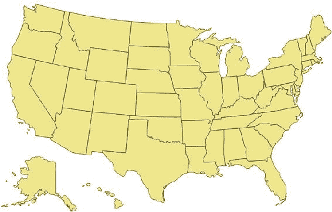
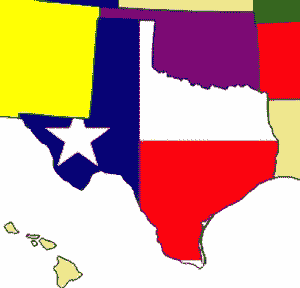
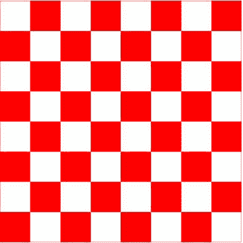
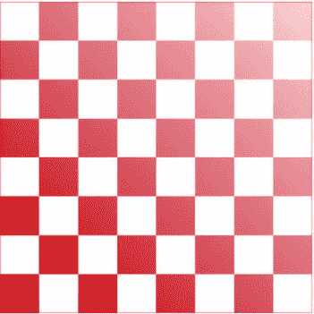
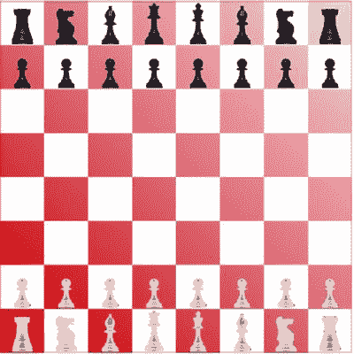

# 第 22 章 ■ 可缩放矢量图形  

70.941306,539.51713 L 69.648012,540.81041 L 68.516388,540.32543 L 68.193068,538.3855 L  
64.151535,538.54716 L 62.049939,539.67879 L 59.463361,539.35547 L 60.918305,537.90052 L  
61.403286,535.31394 L 60.756645,533.374 L 62.211599,532.40404 L 63.504883,532.24238 L  
62.858241,530.4641 L 62.858241,526.09925 L 61.888278,525.12928 L 61.079966,526.58423 L  
54.936843,526.58423 L 53.481892,525.29094 L 52.835247,521.41108 L 50.733651,517.85452 L  
50.733651,516.88456 L 52.835247,516.07625 L 52.996908,513.97465 L 54.128536,512.84303 L  
53.320231,512.35805 L 52.026941,512.84303 L 50.895313,510.09479 L 51.86528,505.08328 L  
56.391794,501.85007 L 58.978369,500.23345 L 60.918305,496.51525 L 63.666554,495.22195 L  
66.253132,496.35359 L 66.576453,498.77851 L 69.00137,498.45517 L 72.23459,496.03026 L  
73.851205,496.67691 L 74.821167,497.32355 L 76.437782,497.32355 L 78.701041,496.03026 L  
79.509354,491.6654 C 79.509354,491.6654 79.832675,488.75551 80.479317,488.27052 C  
81.125959,487.78554 81.44928,487.30056 81.44928,487.30056 L 80.317657,485.36062 L  
77.731077,486.16893 L 74.497847,486.97723 L 72.557911,486.49225 L 69.00137,484.71397 L  
63.989875,484.55231 L 60.433324,480.83411 L 60.918305,476.95424 L 61.564957,474.52932 L  
59.463361,472.75105 L 57.523423,469.03283 L 58.008406,468.22453 L 64.798177,467.73955 L  
66.899773,467.73955 L 67.869736,468.70951 L 68.516388,468.70951 L 68.354728,467.0929 L  
72.23459,446.44626 L 74.821167,466.76958 L 76.276122,467.90121 L 74.821167,470.00281 L  
74.336186,471.45775 L 77.084435,473.07437 L 82.095932,474.85264 L 83.874208,473.88268 L  
81.610951,469.51783 L 80.640977,466.2846 L 81.610951,465.47629 L 78.21606,463.53636 L  
77.731077,462.40472 L 78.21606,460.78812 L 77.407756,456.90825 L 74.497847,452.22007 L  
72.072929,448.01688 L 74.982838,446.07694 L 78.21606,446.07694 L 79.994336,446.72359 L  
84.197528,446.56193 L 87.915733,443.00539 L 89.047366,439.93382 L 92.765578,437.5089 L  
94.382182,438.47887 L 97.130421,437.83222 L 100.84863,435.73062 L 101.98027,435.56896 L  
```


```svg
<path d="M 102.95023,436.37728 L 107.47674,436.21561 L 110.22498,433.14405 L 111.35661,433.14405 L
114.91316,435.56896 L 116.85309,437.67056 L 116.36811,438.80219 L 117.01475,439.93382 L
118.63137,438.31721 L 122.51124,438.64053 L 122.83456,442.35873 L 124.7745,443.81369 L
131.88759,444.46033 L 138.19238,448.66352 L 139.64732,447.69356 L 144.82049,450.28014 L
146.92208,449.6335 L 148.86202,448.82518 L 153.71185,450.76512 L 158.07671,453.67502 z M
42.973913,482.61238 L 45.075509,487.9472 L 44.913847,488.91717 L 42.003945,488.59384 L
40.225672,484.55231 L 38.447399,483.09737 L 36.02248,483.09737 L 35.86082,480.51078 L
37.639093,478.08586 L 38.770722,480.51078 L 40.225672,481.96573 L 42.973913,482.61238 z M
40.387333,516.07625 L 44.105542,516.88456 L 47.823749,517.85452 L 48.632056,518.8245 L
47.015444,522.5427 L 43.94388,522.38104 L 40.548995,518.8245 L 40.387333,516.07625 z M
19.694697,502.01173 L 20.826327,504.5983 L 21.957955,506.21492 L 20.826327,507.02322 L
18.72473,503.95166 L 18.72473,502.01173 L 19.694697,502.01173 z M 5.9534943,575.0826 L
9.3483796,572.81934 L 12.743265,571.84937 L 15.329845,572.17269 L 15.814828,573.7893 L
17.754763,574.27429 L 19.694697,572.33436 L 19.371375,570.71775 L 22.119616,570.0711 L
25.029518,572.65768 L 23.897889,574.43595 L 19.533037,575.56758 L 16.784795,575.0826 L
13.066588,573.95097 L 8.7017347,575.40592 L 7.0851227,575.72924 L 5.9534943,575.0826 z M
54.936843,570.55609 L 56.553455,572.49602 L 58.655048,570.87941 L 57.2001,569.58611 L
54.936843,570.55609 z M 57.846745,573.62764 L 58.978369,571.36439 L 61.079966,571.68771 L
60.271663,573.62764 L 57.846745,573.62764 z M 81.44928,571.68771 L 82.904234,573.46598 L
83.874208,572.33436 L 83.065895,570.39442 L 81.44928,571.68771 z M 90.17899,559.2398 L
91.310623,565.0596 L 94.220522,565.86791 L 99.232017,562.958 L 103.59687,560.37142 L
101.98027,557.94651 L 102.46525,555.52159 L 100.36365,556.81488 L 97.453752,556.00657 L
99.070357,554.87495 L 101.01029,555.68325 L 104.89016,553.90497 L 105.37515,552.45003 L
102.95023,551.64172 L 103.75853,549.70178 L 101.01029,551.64172 L 96.322118,555.19827 L
91.472284,558.10817 L 90.17899,559.2398 z M 132.53423,539.35547 L 134.95915,537.90052 L
133.98918,536.12224 L 132.21091,537.09221 L 132.53423,539.35547 z" />
```

## 第 22 章：可缩放矢量图形

**提示** 本数据以及其他所有州的数据均下载自 [`en.wikipedia.org/wiki/File:Blank_US_Map.svg`](http://en.wikipedia.org/wiki/File:Blank_US_Map.svg)。你可以通过访问 [`commons.wikimedia.org/`](http://commons.wikimedia.org/) 并在搜索条件中输入 **svg 地图** 来找到大量类似素材。

#### 实现初始地图

首先，你将为地图应用基本样式来创建初始地图。路径定义在 `States.js` 文件中，该文件可从 [www.apress.com](http://www.apress.com/) 下载。你将创建一个新的 HTML 文档来显示地图，而实际的路径 DOM 元素将通过 JavaScript 创建。

### 练习 22-3：创建初始地图

1.  使用以下标记创建一个新的 HTML 文档。这与上一页类似；但请注意，高度和宽度不同，因为此地图具有不同的固有尺寸。

```html
<!DOCTYPE html>
<html lang="en">
<head>
  <meta charset="utf-8" />
  <title>第 22 章 - 美国地图</title>
  <link rel="stylesheet" href="Map.css" />
  <script src="States.js" defer></script>
  <script src="Map.js" defer></script>
</head>
<body>
  <svg version="1.1"
       width="959px" height="593px"
       id="map">
  </svg>
</body>
</html>
```

2.  从 [www.apress.com](http://www.apress.com/) 下载 `States.js` 文件。该文件定义了一个名为 `States` 的变量，它是一个对象数组。每个对象都具有 `StateCode`、`StateName` 和 `Path` 属性。



3.  创建一个 `Map.js` 文件，并使用以下代码进行实现。此代码将获取


`svg`元素并将`path`元素作为子元素添加。`StateCode`用于

`id`，`StateName`用于`class`属性。

```
var map = document.getElementById("map");

for (var i=0; i < States.length; i++) {
  var path = document.createElementNS("http://www.w3.org/2000/svg", "path");
  path.id = States[i].StateCode;
  path.setAttribute("class", States[i].StateName);
  path.setAttribute("d", States[i].Path);
  map.appendChild(path);
}
```

**注意**：因为`path`元素不是标准 HTML 命名空间的一部分，所以必须使用`createElementNS()`方法并指定 SVG 命名空间。

4. 创建`Map.css`文件并输入以下规则。这将改变填充颜色，以便州轮廓可见。

```
path {
  stroke: black;
  fill: khaki;
}
```

5. 保存更改并在浏览器中显示`Map.html`文件。地图应如图 22-4 所示。

**图 22-4. 初始地图**

# 可伸缩矢量图形（第 22 章）

## 样式化州元素

现在所有机械性工作已完成，你可以通过样式化`path`元素来获得一些乐趣。正如我之前用雪人图像演示的那样，每个元素都可以使用 CSS 进行样式化。您也可以使用 JavaScript 动态地对其进行样式化。我将向您展示如何使用纯色填充、渐变和背景图像来格式化每个元素。

#### 使用基本填充颜色

**注意**：在本章中，您将使用颜色来区分各州的样式。在本书的印刷版中，其中一些颜色在转换为灰度时可能显示不佳。您需要完成练习或下载项目才能看到应用样式的结果。

首先将添加一些简单的填充规则。使用简单的元素选择器，您已经将描边颜色设置为黑色，填充颜色设置为`khaki`。现在，为了增加多样性并演示如何使用属性选择器，您将根据州代码更改填充颜色。

**练习 22-4. 添加基本填充颜色**

`id`属性包含两个字母的州代码，`class`属性包含州名。

使用`id`属性的首字母，您将按如下方式设置填充颜色：

*   `A`：红色
*   `N`：黄色
*   `M`：绿色
*   `C`：蓝色
*   `O`：紫色
*   `I`：橙色

1. 将以下样式规则输入到`Map.css`文件中。

```
path[id^="A"] {
  fill: red;
}
path[id^="N"] {
  fill: yellow;
}
path[id^="M"] {
  fill: green;
}
path[id^="C"] {
  fill: blue;
}
path[id^="O"] {
  fill: purple;
}
path[id^="I"] {
  fill: orange;
}
```

2. 刷新浏览器，地图现在应如图 22-5 所示。

**图 22-5. 经过基本样式化的地图**

3. 当您在地图上移动鼠标时，突出显示鼠标当前指向的州会很好。将以下规则添加到`Map.css`文件中：

```
path:hover {
  opacity: .5;
}
```

#### 使用渐变填充

您可以对 SVG 元素使用渐变填充，但其实现方式与典型的 HTML 元素不同。您首先必须在 HTML 标记中定义渐变，然后使用 URL 引用它。

**练习 22-5. 添加渐变填充**

1. 将以下`defs`元素添加到 HTML 文档的`svg`元素内部：

```
<defs>
  <linearGradient id="blueGradient"
                  x1="0%" y1="0%"
                  x2="100%" y2="100%"
                  spreadMethod="pad">
    <stop offset="0%" stop-color="#ffffff" stop-opacity="1"/>
    <stop offset="50%" stop-color="#6699cc" stop-opacity="1"/>
    <stop offset="100%" stop-color="#4466aa" stop-opacity="1"/>
  </linearGradient>
</defs>
```

`defs`元素用于定义可以在文档后续部分引用的内容。它实际上在被引用之前不会执行任何操作。这里我们定义了一个`linearGradient`元素，并赋予其`id`为`blueGradient`。您将使用`id`属性引用它。

这些属性与您在第 12 章中使用的渐变不同，但实现的基本功能相同。


相同的事情。`x1`、`y1`、`x2`和`y2`属性定义了一个向量，用于指定渐变的方向。

在这种情况下，渐变将从左上角开始，到右下角结束。这里指定了三个颜色值，分别定义了渐变在起点、中点和终点的颜色。

2. 现在将以下规则添加到`Map.css`文件的末尾。这将为怀俄明州使用新的渐变。

```css
path[id="WY"] {
  fill: url(#blueGradient);
}
```

3. 刷新浏览器，你应该会看到怀俄明州使用了渐变填充，如图 22-6 所示。

**Figure 22-6.** 使用渐变填充



第 22 章 ■ 可缩放矢量图形

#### 使用背景图像

你也可以使用图像文件作为形状的背景。首先需要在`defs`元素中将其定义为一个图案，然后像使用渐变一样引用它。在本练习中，你将使用一张德克萨斯州州旗的图像，并将其作为该州的背景。

**练习 22-6. 使用背景图像**

1. 在第 22 章的源代码下载中有一个`TX_Flag.jpg`文件；请下载此文件。

2. 将以下代码添加到你之前创建的 HTML 文档的`defs`元素中。这将定义背景图像，并指定图案应使用`TX_Flag.jpg`图像文件，并将其拉伸为 377 x 226 像素。这将使其足够大以覆盖`path`元素，而无需重复。

```html
<pattern id="TXflag" patternUnits="objectBoundingBox" width="1"
height="1">
  <image xlink:href="TX_Flag.jpg" x="0" y="0"
    width="377" height="226" />
</pattern>
```

3. 将以下规则添加到`Map.css`文件中，该规则将为德克萨斯州使用新的图案。

```css
path[id="TX"] {
  fill: url(#TXflag);
}
```

4. 保存更改并刷新浏览器。你应该会看到背景图像，如图 22-7 所示。

**Figure 22-7.** 使用背景图像


第 22 章 ■ 可缩放矢量图形

由于这是一章关于 SVG 的内容，我觉得使用位图图像有点不妥。当图像被拉伸时，你可以看到图像质量下降。德克萨斯州的州旗是最容易用 SVG 绘制的图案之一，但我想演示的是位图图像也可以在 SVG 定义中使用。不过，为了记录，清单 22-2 展示了用 SVG 表示的旗帜（这是从我之前提到的同一个 Wikimedia Commons 网站下载的，并稍作重新格式化）。

**清单 22-2.** 用 SVG 表示的德克萨斯州州旗

```svg
<rect width="1080" height="720" fill="#fff"/>
<rect y="360" width="1080" height="360" fill="#bf0a30"/>
<rect width="360" height="720" fill="#002868"/>
<g transform="translate(180,360)" fill="#fff">
  <g id="c">
    <path id="t" d="M 0,-135 v 135 h 67.5"
      transform="rotate(18 0,-135)"/>
    <use xlink:href="#t" transform="scale(-1,1)"/>
  </g>
  <use xlink:href="#c" transform="rotate(72)"/>
  <use xlink:href="#c" transform="rotate(144)"/>
  <use xlink:href="#c" transform="rotate(216)"/>
  <use xlink:href="#c" transform="rotate(288)"/>
</g>
```

请注意，组元素`g`用于定义单个路径。该路径通过五个不同的角度进行旋转，从而形成一个五角星。

## 使用 JavaScript 更改样式

这类应用的主要用途之一是，根据某些外部数据动态地设置每个元素的样式。例如，你可能希望突出显示有销售网点的州。或者，你可能希望根据人口统计等某些数据类型来设置颜色。到目前为止，你只使用了静态样式，但你也可以使用 JavaScript 来轻松地设置样式。

在此示例中，你将首先使用 JavaScript 将所有`path`元素的`fill`属性设置为`khaki`（卡其色）。这将替换设置默认颜色的 CSS 属性。然后，这段代码将设置弗吉尼亚州`path`元素的填充颜色。在实际应用中，你通常会根据外部数据来定义样式。


# 本练习还将演示如何使用 JavaScript 响应`mouseover`和`mouseout`事件。

你将替换`path:hover`规则，并使用这些事件处理程序来实现此功能。

## 练习 22-7. 使用 JavaScript 调整样式

1. 在`Map.js`脚本中添加以下函数：

```javascript
function adjustStates() {
  var paths = document.getElementsByTagName("path");
  for (var i = 0; i < paths.length; i++) {
    paths[i].setAttribute("fill", "khaki");
  }
  var path = document.getElementById("VA");
  path.setAttribute("fill", "teal");
}
```

2. 在`Map.js`脚本中调用`adjustStates()`方法。

```javascript
adjustStates();
```

3. 在`Map.css`文件中，像这样移除默认的 khaki 填充色：

```css
path {
  stroke: black;
  /*fill: khaki; */
}
```

4. 刷新浏览器，弗吉尼亚州应不再使用默认颜色，如图 22-8 所示。

***图 22-8.** 使用 JavaScript 设置样式的弗吉尼亚州*

5. 现在你还将使用 JavaScript 来实现悬停样式。你可以使用`event.target`属性获取触发事件的`path`元素。然后，通过访问其`id`属性来确定州代码。在`Map.js`脚本中添加以下方法：

```javascript
function hoverState(e) {
  var event = e || window.event;
  var state = event.target.getAttribute("id");
  var path = document.getElementById(state);
  path.setAttribute("fill-opacity", "0.5");
}

function unhoverState(e) {
  var event = e || window.event;
  var state = event.target.getAttribute("id");
  var path = document.getElementById(state);
  path.setAttribute("fill-opacity", "1.0");
}
```

6. 然后，通过向`adjustStates()`函数添加以粗体显示的代码来绑定`mouseover`和`mouseout`事件处理程序。这将使用`addEventListener()`方法将`hoverState()`和`unhoverState()`事件处理程序绑定到每个`path`元素。

```javascript
function adjustStates() {
  var paths = document.getElementsByTagName("path");
  for (var i = 0; i < paths.length; i++) {
    paths[i].setAttributeNS(null, "fill", "khaki");
    paths[i].addEventListener("mouseover", hoverState, true);
    paths[i].addEventListener("mouseout", unhoverState, true);
  }
  var path = document.getElementById("VA");
  path.setAttributeNS(null, "fill", "teal");
}
```

> **注意：** 在 Internet Explorer 中，`event`对象不会传递给事件处理程序。相反，它通过全局`window.event`属性提供。事件处理程序的编码可以兼容两种模型，只需像这样设置`event`变量：`var event = e || window.event`。如果传递了对象，则使用该对象；如果未传递，则使用全局`window.event`对象。但要使此方法生效，你必须使用`addEventListener()`方法注册事件处理程序。不能简单地设置`mouseover`属性。

7. 像这样移除`path:hover`样式规则：

```css
/*path:hover {
  opacity: .5;
}*/
```

8. 保存更改并刷新浏览器。当您移动鼠标时，各州的区域应像使用`path:hover`样式时一样高亮显示。

---

### 添加动画

此类地图的典型应用是允许用户选择一个区域，并因此触发某些操作。页面将根据所选项目显示一些信息。为了演示这一点，你将在用户点击某个州时添加一些动画效果。

我在[第 15 章](http://dx.doi.org/10.1007/978-1-4842-2463-2_15)中介绍的 CSS 动画无法在 SVG 元素上生效。相反，你将使用 JavaScript 来实现动画效果。当选中一个州时，你首先会复制所选元素。然后，使用计时器逐渐改变其旋转角度。你需要进行复制，这样当图像旋转时，地图上不会留下一个空洞。此外，新元素将位于所有其他元素之上，因此你不必担心它被其他元素遮挡。

一旦元素副本完成动画，你将其从文档中移除。然后，你将显示一个警告框，其中包含所选路径的州代码和州名称。

## 练习 22-8. 添加动画

1. 由于这使用了 3D 变换，你需要在`path`元素上设置一些变换属性。将以下规则添加到`Map.css`文件中：

```css
path {
  transform-style: preserve-3d;
  perspective: 200px;
}
```

2. 然后，将清单 22-3 中显示的代码添加到`Map.js`脚本中。

***清单 22-3.** 添加支持动画的函数*

```javascript
// 设置一些全局变量
var timer;
var stateCode;
var stateName;
var animate;
var angle;

function selectState(e) {
  var event = e || window.event;
  // 获取州代码和州名称
  stateCode = event.target.getAttribute("id");
  stateName = event.target.getAttribute("class");
  // 获取选中的路径元素，然后复制它
  var path = document.getElementById(stateCode);
  animate = path.cloneNode(false);
  // 设置一些显示属性，并将副本添加到文档中
  animate.setAttribute("fill-opacity", "1.0");
  animate.setAttribute("stroke-width", "3");
  document.getElementById("map").appendChild(animate);
  angle = 0;
  // 设置一个每 10 毫秒运行一次的计时器
  timer = setInterval(function () { animateState(); }, 10);
}

function animateState() {
  angle += 1;
  // 如果旋转了 360 度，停止计时器，销毁元素副本
  // 并显示一个警告框
  if (angle > 360) {
    clearInterval(timer);
    animate.setAttribute("visibility", "hidden");
    var old = document.getElementById("map").removeChild(animate);
    alert(stateCode + " - " + stateName);
    return;
  }
  // 改变图像旋转
  animate.style.transform = "rotateY(" + Math.round(angle) + "deg)";
}
```

`selectState()`函数从选中的`path`元素中获取州代码和州名称。然后，它获取`path`元素，并使用其`cloneNode()`方法复制它。由于鼠标当前悬停在选中的路径上，其不透明度将被设置为 50%。因此，此代码将副本的不透明度改为 100%。它还设置了描边宽度，使该元素具有更宽的边框。然后将副本添加到文档中，并启动一个计时器来触发动画。

每 10 毫秒，`animateState()`函数被调用，它增加角度并重绘图像。如果旋转达到 360 度，此方法取消计时器并移除`path`元素的副本。同时，它会弹出一个警告框，显示州代码和州名称。

3. 通过向`adjustStates()`函数添加以粗体显示的代码来添加另一个事件处理程序。当用户点击一个`path`元素时，这将调用`selectState()`方法。

```javascript
function adjustStates() {
  var paths = document.getElementsByTagName("path");
  for (var i = 0; i < paths.length; i++) {
    paths[i].setAttribute("fill", "khaki");
    paths[i].addEventListener("mouseover", hoverState, true);
    paths[i].addEventListener("mouseout", unhoverState, true);
    paths[i].addEventListener("click", selectState, true);
  }
  var path = document.getElementById("VA");
  path.setAttribute("fill", "teal");
}
```

4. 刷新浏览器并点击一个州，您应该会看到它飞离页面，如图 22-9 所示。

5. 然后图像将飞回原位，并出现一个警告框，如图 22-10 所示。

***图 22-9.** 对选中的州进行动画处理*

***图 22-10.** 显示选中州名称的警告框*

---

#### 总结


好的，作为一名高级文档工程师和翻译员，我将严格遵循您提供的格式和注意事项，将给定的英文文本翻译成中文。


# 第 23 章：Canvas

在本章中，我将向你展示如何使用 HTML5 的 `canvas` 元素来创建一些有趣的图形。你会看到，它与你上一章探索的 SVG 截然不同。稍后我将更详细地讨论这些差异，但你会注意到的重点是，canvas 完全是通过 JavaScript 实现的。

标记中唯一的部分是一个简单的元素定义，如下所示：

```html
<canvas id="myCanvas" width="400" height="400">
Canvas is not supported on this browser
</canvas>
```

相反，你将通过调用 JavaScript 中的各种绘图方法来定义内容。就像 `audio` 和 `video` 元素一样，当浏览器不支持 canvas 时，会使用 `canvas` 元素内的标记。你可以利用这一点来提供适当的回退内容。

通过本章的练习，你将创建三个不同的 canvas 实现，它们将共同展示 canvas 的能力。你将创建以下内容：

-   一个带有移动棋子的棋盘
-   一个简单的太阳系模型
-   一个展示形状各种合成方式的页面

当然，你可以发挥想象力，将这些原理应用到任何有趣且引人入胜的图形应用中。

## 创建一个棋盘

在第一个应用中，你将绘制一个棋盘，它只是一系列颜色交替的方块。

我将向你展示如何使用渐变来使棋盘更有趣一些。你将使用图像文件在合适的方格中绘制棋子。最后，你将应用一点动画效果来在棋盘上移动棋子。这将让你在进入更高级的主题之前，很好地了解基本绘图技术是如何使用的。

`canvas` 元素的命名恰如其分，因为它提供了一个可供你绘制的区域。

当你创建一个 `canvas` 元素时，你使用 `height` 和 `width` 属性来定义其大小。你可以通过标记或 CSS 指定其他属性，如 `margin`、`padding` 和 `border`。这些属性会影响元素在页面中的位置。但是，你不能修改元素内的任何内容。`canvas` 元素本身只是定义了一个空白区域，你可以在上面创建你的杰作。

当你在 HTML 中创建一个 `canvas` 元素时，通常会分配一个 `id` 属性，以便你可以在 JavaScript 中使用 `getElementById()` 方法访问它。你不必这样做；你可以使用 `getElementsByTagName()` 方法访问它，或者使用我在 [第 18 章](http://dx.doi.org/10.1007/978-1-4842-2463-2_18) 中描述的新查询选择器。

© Mark J. Collins 2017  
M. J. Collins, *Pro HTML5 with CSS, JavaScript, and Multimedia*, DOI 10.1007/978-1-4842-2463-2_23

一旦你有了 `canvas` 元素，你将通过调用 `getContext()` 来获取其绘图上下文。你必须指定要使用哪个上下文。上下文指定了一组 API 函数和绘图能力。唯一普遍可用的是 `2d`，我们将在本章中专门使用它。

> **注意：** 另一个可能的上下文并非你期望的 `3d`；它是 `WebGL`，或者在某些浏览器中是 `experimental-webgl`。这还没有完全准备好用于主流环境，并且它与 `2d` 上下文截然不同。

#### 绘制矩形

与 SVG 不同，你可以直接绘制的唯一形状是矩形。你可以使用路径绘制更复杂的形状，我将在后面解释。有三个方法可用于绘制矩形。

-   `clearRect()`：清除指定的矩形区域。
-   `strokeRect()`：绘制指定矩形的边框，不填充。
-   `fillRect()`：绘制一个填充的矩形。

这些方法每个都需要四个参数。前两个定义了矩形左上角的 `x` 和 `y` 坐标。最后两个参数分别指定了宽度和高度。绘图上下文具有 `strokeStyle` 和 `fillStyle` 属性，用于控制边框或填充的绘制方式。你在绘制矩形之前设置这些属性。一旦设置，后续所有形状都会使用这些属性进行绘制，直到你更改它们。

> **提示：** 与 SVG 一样，在 canvas 中，canvas 元素的左上角坐标为 `x` 和 `y`，其值为 `0, 0`。

为了演示绘制矩形，你将首先绘制棋盘，它包含八行八列方块。

#### 练习 23-1：绘制一个简单的棋盘

1.  创建一个名为 `Chess.html` 的新网页，使用基本标记：

```html
<!DOCTYPE html>
<html lang="en">
<head>
    <meta charset="utf-8" />
    <title>Chapter 23 - Chess</title>
    <script src="Chess.js" defer></script>
</head>
<body>
</body>
</html>
```

2.  通过在 `body` 元素中插入以下标记来添加一个 `canvas` 元素：

```html
<canvas id="board" width="600" height="600">
    Not supported
</canvas>
```

3.  然后使用以下代码创建一个 `Chess.js` 脚本文件：

```javascript
"use strict";

// Get the canvas context
var chessCanvas = document.getElementById("board");
var chessContext = chessCanvas.getContext("2d");
```

4.  向 `Chess.js` 文件添加一个绘制棋盘的函数，然后使用以下代码调用此函数：

```javascript
// Draw the chess board
function drawBoard() {
    chessContext.clearRect(0, 0, 600, 600);
    chessContext.fillStyle = "red";
    chessContext.strokeStyle = "red";

    // Draw the alternating squares
    for (var x = 0; x < 8; x++) {
        for (var y = 0; y < 8; y++) {
            if ((x + y) % 2) {
                chessContext.fillRect(75 * x, 75 * y, 75, 75);
            }
        }
    }

    // Add a border around the entire board
    chessContext.strokeRect(0, 0, 600, 600);
}

drawBoard();
```

`drawBoard()` 函数首先清空它将要绘制的区域。然后它使用嵌套的 `for` 循环来绘制方块。`fillStyle` 和 `strokeStyle` 属性都被设置为红色；默认情况下它们都是黑色。注意，它只绘制了红色的方块。由于整个区域先前已被清空，任何没有绘制到的区域都将是白色。此代码使用嵌套的 `for` 循环来遍历八行八列。红色方块是行数与列数之和为奇数的那些方块。对于偶数行（0、2、4 和 6），奇数列（1、3、5 和 7）将为红色。对于奇数行，偶数列将为红色。为了修整边缘方块，在整个棋盘周围绘制了一个红色边框。



5.  保存你的更改，并在浏览器中显示 `Chess.html` 页面。该页面看起来应该类似于图 23-1。

***图 23-1.** 初始棋盘*

#### 使用渐变


你可以使用渐变而非纯色来填充形状。为此，你必须首先使用绘图上下文的`createLinearGradient()`方法创建一个渐变对象。该方法接受四个参数，分别是渐变起点和终点的 x 和 y 坐标。这让你能够指定渐变的方向：从上到下、从左到右，或是对角线方向。渐变是在整个画布上计算的。你无法为单个元素定义渐变。

接着，你必须定义颜色节点。每个颜色节点定义了渐变上的一个位置及其对应的颜色。

至少需要定义位置为 0 和 1 的颜色节点，它们分别指定渐变的起始颜色和结束颜色。如果你希望控制颜色过渡，还可以在它们之间添加颜色节点。例如，如果你想定义中点处的颜色，则使用 0.5。

最后，你将使用这个渐变来设置`fillStyle`属性。要尝试此功能，请添加以下粗体显示的代码：

```
function drawBoard() {

chessContext.clearRect(0, 0, 600, 600);

var gradient = chessContext.createLinearGradient(0, 600, 600, 0);

gradient.addColorStop(0.0, "#D50005");

gradient.addColorStop(0.5, "#E27883");

gradient.addColorStop(1.0, "#FFDDDD");

chessContext.fillStyle = gradient;

chessContext.strokeStyle = "red";
```



**第 23 章 ■ Canvas**

保存你的更改并刷新浏览器。页面现在应看起来像图 23-2。请注意，颜色过渡是跨越整个画布的，而非每个方格内部。

***图 23-2.** 使用渐变填充的棋盘*

#### 使用图像

现在你可以准备添加棋子了，棋子将使用图像文件绘制。向画布添加图像非常简单。你创建一个`Image`对象，将其`src`属性设置为图像文件的位置，然后像这样调用绘图上下文的`drawImage()`方法：

```
var myImage = new Image();

myImage.src = "images/sample.jpg";

context.drawImage(myImage, 0,0, 50, 100);
```

`drawImage()`方法的第一个参数指定要绘制的图像。它可以是我上面演示的`Image`对象。或者，你也可以指定页面上已有的`img`、`video`或`canvas`元素。接下来的两个参数指定图像左上角的 x 和 y 位置。

第四个和第五个参数是可选的，分别指定要将图像缩放到的宽度和高度。如果你不指定这些参数，图像将使用其原始尺寸绘制。

`drawImage()`方法还允许你提供额外的四个参数。这些参数用于指定应显示在画布上的图像部分。这些额外参数包括指定左上角的 x 坐标和 y 坐标，以及定义指定部分的宽度和高度。如果你只想绘制图像的一部分，请使用最后四个参数。如果省略它们，将显示整个图像。

在此应用中，你将使用 12 个不同的图像绘制 32 个棋子。此外，在本章后面，你将添加代码来移动棋子。为此，你将为应用添加一些结构。你将定义一个类，用于存储棋子属性，例如要使用的图像及其在棋盘上的位置。然后，你将实现一个通用的绘图函数，该函数使用这些属性中的详细信息。

**第 23 章 ■ Canvas**

**练习 23-2. 绘制棋子**

1. 在你的 web 应用中创建一个名为`Images`的新文件夹，用于存储图像文件。
2. 棋子的图像包含在源代码下载文件中。你可以在`Chapter23\Images`文件夹中找到它们。将全部 12 个文件拖到你的`Images`文件夹中。
3. 在`Chess.js`文件的开头添加以下变量声明（紧接在`chessCanvas`和`chessContext`变量之后）。这将定义一个变量来


`reference`一个`Image`对象对应 12 个图像文件中的每一个。它还会定义一个数组，用于存储 32 个国际象棋棋子。

```javascript
// Define the chess piece images
var imgPawn = new Image();
var imgRook = new Image();
var imgKnight = new Image();
var imgBishop = new Image();
var imgQueen = new Image();
var imgKing = new Image();
var imgPawnW = new Image();
var imgRookW = new Image();
var imgKnightW = new Image();
var imgBishopW = new Image();
var imgQueenW = new Image();
var imgKingW = new Image();

// Define an array to store 32 pieces
var pieces = new Array(32);
```

4. 将`loadImages()`函数添加到`Chess.js`文件中。

```javascript
function loadImages() {
  imgPawn.src = "Images/pawn.png";
  imgRook.src = "Images/rook.png";
  imgKnight.src = "Images/knight.png";
  imgBishop.src = "Images/bishop.png";
  imgQueen.src = "Images/queen.png";
  imgKing.src = "Images/king.png";
  imgPawnW.src = "Images/wpawn.png";
  imgRookW.src = "Images/wrook.png";
  imgKnightW.src = "Images/wknight.png";
  imgBishopW.src = "Images/wbishop.png";
  imgQueenW.src = "Images/wqueen.png";
  imgKingW.src = "Images/wking.png";
}
```

第 23 章 ■ Canvas

5. 现在可以定义棋子了。你将使用一个对象定义来存储绘制棋子所需的属性。`image`属性包含对相应`Image`对象的引用。`x`和`y`属性指定棋子所在的方格，取值范围为 0 到 7，从左到右、从上到下。`height`和`width`属性表示图像的大小，会根据棋子类型而变化。`killed`属性用于表示棋子是否已被捕获。被捕获的图像将不显示。将以下代码添加到`Chess.js`中：

```javascript
// Define a class to store the piece properties
function ChessPiece() {
  this.image = null;
  this.x = 0;
  this.y = 0;
  this.height = 0;
  this.width = 0;
  this.killed = false;
}
```

6. 将以下函数添加到`Chess.js`文件中。这实现了`drawPiece()`函数，该函数根据类属性绘制单个棋子。它还实现了`drawAllPieces()`函数，该函数将绘制`pieces`数组中定义的每一个棋子。

```javascript
// Draw a chess piece
function drawPiece(p) {
  if (!p.killed)
    chessContext.drawImage(p.image,
      (75 - p.width) / 2 + (75 * p.x),
      73 - p.height + (75 * p.y),
      p.width,
      p.height);
}

// Draw all of the chess pieces
function drawAllPieces() {
  for (var i = 0; i < 32; i++) {
    if (pieces[i] != null) {
      drawPiece(pieces[i]);
    }
  }
}
```

7. 现在你需要创建 32 个`ChessPiece`类的实例，并指定所有适当的属性。添加清单 23-1 中所示的`createPieces()`函数。该函数创建`ChessPiece`类的实例，将它们存储在`pieces`数组中，并设置每个实例的属性。

第 23 章 ■ Canvas

> **提示**：由于此过程相当冗长且乏味，我将此函数作为单独的文件提供在源代码下载中。如果你愿意，可以不用手动输入清单 23-1 中的函数，而是在`Chapter23`文件夹中找到`createPieces.js`文件，并将其拖拽到你的 Web 项目中。然后在`head`元素中添加此引用：
> `<script src="createpieces.js" defer></script>`

***清单 23-1.*** 实现`createPieces()`函数

```javascript
function createPieces() {
  var piece;

  // Black pawns
  for (var i = 0; i < 8; i++) {
    piece = new ChessPiece();
    piece.image = imgPawn,
    piece.x = i;
    piece.y = 1;
    piece.height = 50;
    piece.width = 28;
    pieces[i] = piece;
  }

  // Black rooks
  piece = new ChessPiece();
  piece.image = imgRook;
  piece.x = 0;
  piece.y = 0;
  piece.height = 60;
  piece.width = 36;
  pieces[8] = piece;

  piece = new ChessPiece();
  piece.image = imgRook;
  piece.x = 7;
  piece.y = 0;
  piece.height = 60;
  piece.width = 36;
  pieces[9] = piece;

  // Black knights
  piece = new ChessPiece();
  piece.image = imgKnight;
  piece.x = 1;
  piece.y = 0;
  piece.height = 60;
  piece.width = 36;
  pieces[10] = piece;

  Chapter 23 ■ Canvas

  piece = new ChessPiece();
  piece.image = imgKnight;
  piece.x = 6;
  piece.y = 0;
  piece.height = 60;
  piece.width = 36;
  pieces[11] = piece;

  // Black bishops
  piece = new ChessPiece();
```


```javascript  
piece.image = imgBishop;  
piece.x = 2;  
piece.y = 0;  
piece.height = 65;  
piece.width = 30;  
pieces[12] = piece;  

piece = new ChessPiece();  
piece.image = imgBishop;  
piece.x = 5;  
piece.y = 0;  
piece.height = 65;  
piece.width = 30;  
pieces[13] = piece;  

// 黑方象  
piece = new ChessPiece();  
piece.image = imgBishop;  
piece.x = 2;  
piece.y = 0;  
piece.height = 65;  
piece.width = 30;  
pieces[12] = piece;  

piece = new ChessPiece();  
piece.image = imgBishop;  
piece.x = 5;  
piece.y = 0;  
piece.height = 65;  
piece.width = 30;  
pieces[13] = piece;  

// 黑方后  
piece = new ChessPiece();  
piece.image = imgQueen;  
piece.x = 3;  
piece.y = 0;  
piece.height = 70;  
piece.width = 32;  
pieces[14] = piece;  

// 黑方王  
piece = new ChessPiece();  
piece.image = imgKing;  
piece.x = 4;  
piece.y = 0;  
piece.height = 70;  
piece.width = 28;  
pieces[15] = piece;  

// 白方兵  
for (var i = 0; i < 8; i++) {  
piece = new ChessPiece();  
piece.image = imgPawnW;  
piece.x = i;  
piece.y = 6;  
piece.height = 50;  
piece.width = 28;  
pieces[16 + i] = piece;  
}  

## 第 23 章 ■ Canvas

// 白方车  
piece = new ChessPiece();  
piece.image = imgRookW;  
piece.x = 0;  
piece.y = 7;  
piece.height = 60;  
piece.width = 36;  
pieces[24] = piece;  

piece = new ChessPiece();  
piece.image = imgRookW;  
piece.x = 7;  
piece.y = 7;  
piece.height = 60;  
piece.width = 36;  
pieces[25] = piece;  

// 白方马  
piece = new ChessPiece();  
piece.image = imgKnightW;  
piece.x = 1;  
piece.y = 7;  
piece.height = 60;  
piece.width = 36;  
pieces[26] = piece;  

piece = new ChessPiece();  
piece.image = imgKnightW;  
piece.x = 6;  
piece.y = 7;  
piece.height = 60;  
piece.width = 36;  
pieces[27] = piece;  

// 白方象  
piece = new ChessPiece();  
piece.image = imgBishopW;  
piece.x = 2;  
piece.y = 7;  
piece.height = 65;  
piece.width = 30;  
pieces[28] = piece;  

piece = new ChessPiece();  
piece.image = imgBishopW;  
piece.x = 5;  
piece.y = 7;  
piece.height = 65;  
piece.width = 30;  
pieces[29] = piece;  

## 第 23 章 ■ Canvas

// 白方后  
piece = new ChessPiece();  
piece.image = imgQueenW;  
piece.x = 3;  
piece.y = 7;  
piece.height = 70;  
piece.width = 32;  
pieces[30] = piece;  

// 白方王  
piece = new ChessPiece();  
piece.image = imgKingW;  
piece.x = 4;  
piece.y = 7;  
piece.height = 70;  
piece.width = 28;  
pieces[31] = piece;  
}  

8.  修改`drawBoard()`函数，使其在绘制棋盘后也调用`drawAllPieces()`。

```javascript  
// 为整个棋盘添加边框
chessContext.strokeRect(0, 0, 600, 600);  
drawAllPieces();  
}  
```  

9.  最后，将 Chess.js 文件中对`drawBoard()`函数的调用替换为以下代码。这将调用`loadImages()`和`createPieces()`函数，并在调用`drawBoard()`之前等待 1 秒钟。

```javascript  
loadImages();  
createPieces();  
setTimeout(drawBoard, 1000);  
```  

10. 保存更改并刷新浏览器。您现在应该能看到国际象棋棋子，如图 23-3 所示。

  

## 第 23 章 ■ Canvas  

**图 23-3.** 显示棋子的棋盘  

> **注** 当您创建一个`Image`对象并设置其`src`属性时，指定的图像文件会异步下载。有可能在调用`drawImage()`函数之前文件尚未加载完成。如果发生这种情况，图像将不会显示。1 秒的延迟是解决此问题的一个简单方法。您可以为每个`Image`对象实现`onload`事件处理程序，该处理程序在图像加载完成时被调用。但这会有些复杂，因为您需要等待所有 12 张图像加载完毕。  

## 添加简单动画  

为了演示如何使用 canvas 实现简单动画，您将让棋子移动。绘制每个棋子的函数会根据棋子所在格子计算其位置。要移动一个棋子，您只需更新其`x`或`y`属性，然后重新绘制它。  

当您在新位置重新绘制棋子时，它在旧位置仍然可见。此外，如果您将棋子移动到另一个棋子所在的格子中以吃掉对方，最终会导致两个棋子落在同一个格子上。您可以实现一些复杂的逻辑来清除该格子，并在移动棋子前重新绘制一个红色或白色的格子。然而，在本演示中，您将简单地清除整个画布并重新绘制棋盘以及所有棋子。


